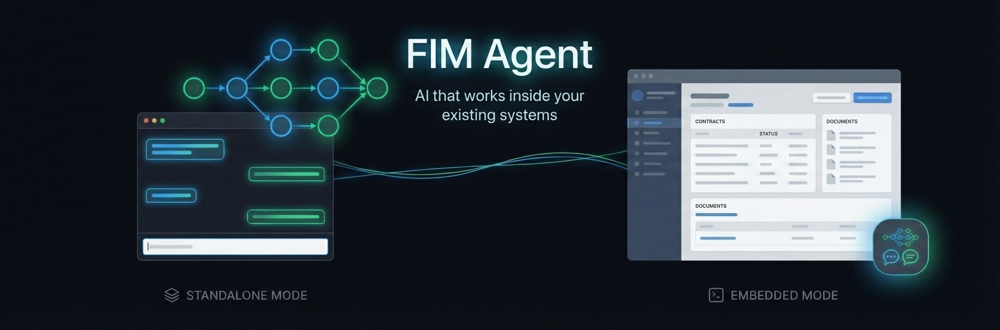
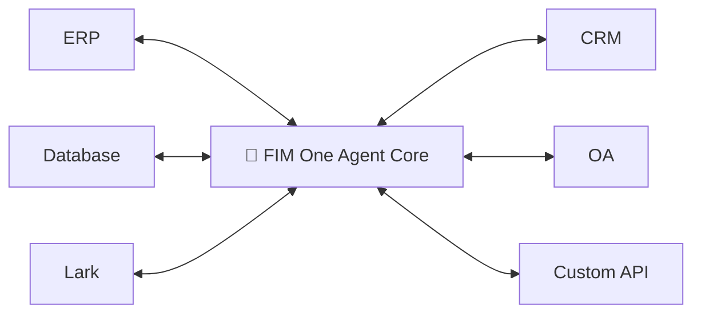
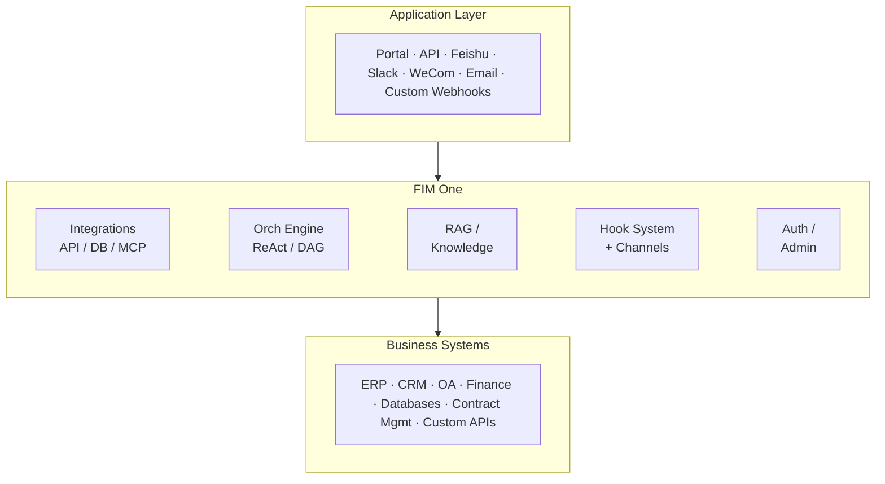

<div align="center">




[](https://github.com/fim-ai/fim-one/actions/workflows/test.yml)

[](https://discord.gg/z64czxdC7z)
[](https://x.com/FIM_One)

[🌐 English](README.md) | [🇨🇳 中文](README.zh.md) | [🇯🇵 日本語](README.ja.md) | [🇰🇷 한국어](README.ko.md) | [🇩🇪 Deutsch](README.de.md) | [🇫🇷 Français](README.fr.md)

**面向全球与中国企业的一体化智能体平台。**
*通过一个智能体核心，连接您现有的所有系统——从全球 SaaS 到中国技术栈。*

🌐 [网站](https://one.fim.ai/) · 📖 [文档](https://docs.fim.ai) · 📋 [变更日志](https://docs.fim.ai/changelog) · 🐛 [报告 Bug](https://github.com/fim-ai/fim-one/issues) · 💬 [Discord](https://discord.gg/z64czxdC7z) · 🐦 [Twitter](https://x.com/FIM_One) · 🏆 [Product Hunt](https://www.producthunt.com/products/fim-one)

</div>

> [!TIP]
> **☁️ 跳过设置——立即在云端试用 FIM One。**
> 托管版本已上线：[cloud.fim.ai](https://cloud.fim.ai/)——无需 Docker、无需 API 密钥、无需配置。登录后即可在几秒钟内开始连接您的系统。_抢先体验，欢迎反馈。_

https://github.com/user-attachments/assets/8a0e1136-ffbc-4950-86bd-b2f8884214af

---

## Overview

Global enterprises run a sprawl of systems that don't talk to each other — ERP, CRM, OA, HR, finance, databases, IM platforms across regions. FIM One is the **all-in-one agent platform** that wires every system you already run into one agent core — global SaaS on one side, the full China stack (Feishu, WeCom, DingTalk, DM, Kingbase, etc.) on the other. One brain. Every system. Global SaaS × China Stack.

| Mode           | What it is                                              | Access                  |
| -------------- | ------------------------------------------------------- | ----------------------- |
| **Standalone** | General-purpose AI assistant — search, code, KB         | Portal                  |
| **Copilot**    | AI embedded in a host system's UI                       | API (embed planned)     |
| **Hub**        | Central AI orchestration across all connected systems   | Portal / API            |



### 截图

**仪表板** — 统计数据、活动趋势、令牌使用情况以及对智能体和对话的快速访问。


**智能体聊天** — 针对连接的数据库进行 ReAct 推理和多步工具调用。


**DAG 规划器** — LLM 生成的执行计划，支持并行步骤和实时状态跟踪。


### 演示

**使用智能体**


**使用规划器模式**


## 快速开始

### Docker（推荐）

```bash
git clone https://github.com/fim-ai/fim-one.git
cd fim-one

cp example.env .env
# Edit .env: set LLM_API_KEY (and optionally LLM_BASE_URL, LLM_MODEL)

docker compose up --build -d
```

打开 http://localhost:3000 — 首次启动时，你需要创建一个管理员账户。就这么简单。

```bash
docker compose up -d          # start
docker compose down           # stop
docker compose logs -f        # view logs
```

### 本地开发

前置条件：Python 3.11+、[uv](https://docs.astral.sh/uv/)、Node.js 18+、pnpm。

```bash
git clone https://github.com/fim-ai/fim-one.git && cd fim-one

cp example.env .env           # Edit: set LLM_API_KEY

uv sync --all-extras
cd frontend && pnpm install && cd ..

./start.sh dev                # hot reload: Python --reload + Next.js HMR
```

| 命令          | 启动内容                       | URL                            |
| ---------------- | --------------------------------- | ------------------------------ |
| `./start.sh`         | Next.js + FastAPI                 | localhost:3000 (UI) + :8000    |
| `./start.sh dev`     | 相同，带热重载             | 相同                           |
| `./start.sh dev:api` | 仅 API，开发模式（热重载）   | localhost:8000                 |
| `./start.sh dev:ui`  | 仅前端，开发模式（HMR）    | localhost:3000                 |
| `./start.sh api`     | FastAPI 仅（无界面）           | localhost:8000/api             |

> 关于生产部署（Docker、反向代理、零停机更新），请参阅[部署指南](https://docs.fim.ai/quickstart#production-deployment)。

## 主要功能

#### 跨境连接
- **三种交付模式** —— 独立助手、嵌入式 Copilot 或中央 Hub；使用相同的智能体核心。
- **任意系统，一种模式** —— 连接 API、数据库和 MCP 服务器。操作会自动注册为智能体工具，并注入身份验证信息。渐进式披露元工具可将所有工具类型的 token 用量降低 80% 以上。
- **数据库连接器** —— PostgreSQL、MySQL，以及全球大多数平台无法连接的中国常见企业数据库（DM、KingbaseES、HighGo）。支持模式内省和 AI 驱动的注释。
- **三种构建方式** —— 导入 OpenAPI 规范、使用 AI 聊天构建器，或直接连接 MCP 服务器。

#### Planning & Execution
- **Dynamic DAG planning** — LLM decomposes goals into dependency graphs at runtime. No hard-coded workflows.
- **Concurrent execution** — Independent steps run in parallel via asyncio; auto re-plan up to 3 rounds in total (the first plan plus 2 re-plans).
- **ReAct agent** — Structured reasoning-and-acting loop with automatic error recovery.
- **Agent harness** — Production-grade execution environment: ContextGuard for 5-layer token-budget management, progressive-disclosure meta-tools to keep the tool surface tractable, and self-reflection loops to counter goal drift.
- **Hook System** — Deterministic enforcement that runs outside the LLM loop. First shipped: `ApprovalGateHook` gates sensitive tool calls behind a human approval card in the chat or in a Feishu group. Extensible to audit logging, read-only-mode guards, and rate limits (v0.9).
- **Content guardrails** — Three-layer safety: tool-permission hooks (actions), credential / SSRF / MCP-auth checks (protocols), and content guardrails (input/output text). Default jailbreak-phrase detector aborts the turn before the LLM is invoked, saving tokens and surfacing a clear blocked notice in chat. Output guardrails optional via `FIM_GUARDRAILS_OUTPUT`.
- **Auto-routing** — Auto mode classifies each query and routes it to ReAct or DAG. Selectable per agent and per message; the default is ReAct.
- **Extended thinking** — Chain-of-thought for OpenAI o-series, Gemini 2.5+, Claude.
- **Prompt-cache observability** — Anthropic prompt-cache `read/create` token counts captured per turn, surfaced in the chat `done` payload and logged so operators can verify cache hits and detect relay stations that don't honor the discount.

#### Workflow & Tools
- **Visual workflow editor** — 9 node types, drag-and-drop canvas (React Flow v12), import/export as JSON. Optional module, off by default; an admin enables it under Admin → Settings → Modules.
- **Smart file handling** — Uploaded files auto-inlined into context (small) or readable on-demand via `read_uploaded_file` tool. Intelligent document processing: PDFs, DOCX, and PPTX files get vision-aware processing with embedded image extraction when the model supports vision. Smart PDF mode extracts text from text-rich pages and renders scanned pages as images.
- **Universal document conversion** — Built-in `convert_to_markdown` tool turns PDF / Word / Excel / PowerPoint / HTML / images / audio / Outlook `.msg` / EPUB / YouTube transcripts into clean Markdown via Microsoft MarkItDown. Vision-capable LLMs OCR embedded images and scanned pages — works with Claude, Gemini, Bedrock, and any LiteLLM-supported provider, no per-provider adapter code.
- **Pluggable tools** — Python, Node.js, shell exec with optional Docker sandbox (`CODE_EXEC_BACKEND=docker`).
- **V4A patch editing** — Beyond `find_replace`, agents can apply line-hunk patches with fuzzy whitespace matching via `file_ops.apply_patch` — robust to multi-line edits where exact-substring match would be brittle.
- **Full RAG pipeline** — Jina embedding + LanceDB + hybrid retrieval + reranker + inline `[N]` citations. Vision-aware ingestion routes scanned PDFs and Office embedded images through the workspace's default vision LLM for OCR.
- **Tool artifacts** — Rich outputs (HTML previews, files) rendered in-chat.

#### Messaging Channels (v0.8)
- **Org-scoped IM bridge** — `BaseChannel` abstraction for outbound messaging across Slack, Microsoft Teams, Discord, Feishu (Lark), WeCom, and DingTalk. First shipping implementation is Feishu; Slack / Teams / WeCom / Email are planned.
- **Fernet-encrypted credentials** — App secrets and encrypt keys encrypted at rest; every inbound callback signature-verified.
- **Interactive approval cards** — Channel-native `GateHook` (Feishu today, Slack/Teams next) posts an Approve / Reject card to your group when a sensitive tool call fires; the tool blocks until a group member taps a verdict. Human-in-the-loop approval without a custom workflow engine.
- **Configurable approval routing per agent** — Three modes (Auto / Inline only / Channel only) with an approver-scope selector (initiator / agent owner / any org member). One audit path stamps `approver_user_id` and `decided_at` whether the verdict came from chat or from the channel. Auto mode falls back to inline if no channel is linked, so agents always get a real approval UX.
- **Task-completion notifications** — Long-running ReAct or DAG agents can push a summary card to the org's channel when work finishes. Configurable per-agent in Settings → Agent → Notifications.
- **Browse-and-pick UI** — No copying raw channel IDs from the vendor console; the portal calls the IM platform's API and shows a group picker.

#### Platform
- **Multi-tenant** — JWT auth, org isolation, admin panel with usage analytics and connector metrics. Multi-worker support via `WORKERS=N` with a Redis interrupt broker for cross-worker relay.
- **Marketplace** — Publish and subscribe to agents, API connectors and MCP servers, plus skills and workflows when those modules are enabled. Knowledge bases and database connectors stay private to their owner.
- **Global skills (SOPs)** — Reusable operating procedures loaded for every user; progressive mode cuts tokens ~80%. Optional module, off by default.
- **Stripe billing & per-user quotas** — Optional Pro-plan upgrade via Stripe Checkout + Customer Portal. Quota chain (per-user override → plan tier → system default) with `0` for unlimited. Admin feature flag gates the entire pipeline; private deployments without Stripe stay clean.
- **Evaluation Center** — Test-dataset management, parallel eval runs with LLM-graded judgments, per-case pass/fail/latency/token results viewer with auto-polling.
- **Conversation recovery** — Synthetic `tool_result` rows persist after interrupted turns; clients auto-reconnect dropped SSE streams via `/chat/resume` with exponential backoff and a "Reconnecting…" indicator.
- **6 languages** — EN, ZH, JA, KO, DE, FR. Translations are [fully automated](https://docs.fim.ai/contributing#i18n) — single glossary drives every LLM translation call (JSON, MDX, README), pre-commit hook refuses manual edits to generated locale files.
- **First-run setup wizard**, dark/light theme, command palette, streaming SSE, DAG visualization.

> Deep dive: [Architecture](https://docs.fim.ai/architecture/system-overview) · [Hook System](https://docs.fim.ai/architecture/hook-system) · [Channels](https://docs.fim.ai/configuration/channels/overview) · [Execution Modes](https://docs.fim.ai/concepts/execution-modes) · [Why FIM One](https://docs.fim.ai/why) · [Competitive Landscape](https://docs.fim.ai/strategy/competitive-landscape)

## Architecture



Each connector and channel is a standardized bridge — the agent doesn't know or care whether it's talking to SAP, a custom contract system, or a Feishu group. The Hook System runs platform code outside the LLM loop for approvals, audit, and rate limits; Channels carry outbound notifications and approval cards to external IM platforms. See [Connector Architecture](https://docs.fim.ai/architecture/connector-architecture), [Hook System](https://docs.fim.ai/architecture/hook-system), and [Channels](https://docs.fim.ai/configuration/channels/overview) for details.

## 配置

FIM One 支持**任何 OpenAI 兼容的提供商**：

| 提供商           | `LLM_API_KEY` | `LLM_BASE_URL`                 | `LLM_MODEL`         |
| ------------------ | ------------- | ------------------------------ | -------------------- |
| **OpenAI**         | `sk-...`      | *(默认)*                    | `gpt-4o`             |
| **DeepSeek**       | `sk-...`      | `https://api.deepseek.com/v1`  | `deepseek-chat`      |
| **Anthropic**      | `sk-ant-...`  | `https://api.anthropic.com/v1` | `claude-sonnet-4-6`  |
| **Ollama** (本地) | `ollama`      | `http://localhost:11434/v1`    | `qwen2.5:14b`        |

最小化 `.env`：

```bash
LLM_API_KEY=sk-your-key
# LLM_BASE_URL=https://api.openai.com/v1   # default
# LLM_MODEL=gpt-4o                         # default
JINA_API_KEY=jina_...                       # unlocks web tools + RAG
```

> 完整参考：[环境变量](https://docs.fim.ai/configuration/environment-variables)

## Tech Stack

| Layer       | Technology                                                          |
| ----------- | ------------------------------------------------------------------- |
| Backend     | Python 3.11+, FastAPI, SQLAlchemy, Alembic, asyncio                 |
| Frontend    | Next.js 15, React 18, Tailwind CSS, shadcn/ui, React Flow v12      |
| AI / RAG    | OpenAI-compatible LLMs, Jina AI (embed + search), LanceDB          |
| Database    | SQLite (dev) / PostgreSQL (prod)                                    |
| Messaging   | `BaseChannel` abstraction (Feishu/Lark shipped), Fernet-encrypted credentials, HMAC signature verification |
| Infra       | Docker, uv, pnpm, SSE streaming                                    |

## 开发

```bash
uv sync --all-extras          # install dependencies
pytest                         # run tests
pytest --cov=fim_one           # with coverage
ruff check src/ tests/         # lint
mypy src/                      # type check
bash scripts/setup-hooks.sh    # install git hooks (enables auto i18n)
```

## 路线图

查看完整的[路线图](https://docs.fim.ai/roadmap)了解版本历史和计划功能。

## 常见问题

关于部署、LLM 提供商、系统要求等常见问题 — 请查看 [常见问题](https://docs.fim.ai/faq)。

## Contributing

We welcome contributions of all kinds — code, docs, translations, bug reports, and ideas.

> **Pioneer Program**: The first 100 contributors who get a PR merged are recognized as **Founding Contributors** with permanent credits, a badge, and priority issue support. [Learn more &rarr;](CONTRIBUTING.md#-pioneer-program)

**Quick links:**

- [**Contributing Guide**](CONTRIBUTING.md) — setup, conventions, PR process
- [**Development Conventions**](https://docs.fim.ai/contributing) — type safety, testing, and code quality standards
- [**Good First Issues**](https://github.com/fim-ai/fim-one/labels/good%20first%20issue) — curated for newcomers
- [**Open Issues**](https://github.com/fim-ai/fim-one/issues) — bugs & feature requests

**Security:** Do not open a public issue for a sensitive vulnerability. Report it privately through [GitHub Security Advisories](https://github.com/fim-ai/fim-one/security/advisories/new) or email security@fim.ai. See [SECURITY.md](SECURITY.md).

## 活动


## Contributors

Thanks to these wonderful people ([emoji key](https://allcontributors.org/docs/en/emoji-key)):

<!-- ALL-CONTRIBUTORS-LIST:START - Do not remove or modify this section -->
<!-- prettier-ignore-start -->
<!-- markdownlint-disable -->
<table>
  <tbody>
    <tr>
      <td align="center" valign="top" width="12.5%"><a href="https://github.com/tao-hpu"><br /><sub><b>Tao An</b></sub></a><br /><a href="https://github.com/fim-ai/fim-one/commits?author=tao-hpu" title="Code">💻</a> <a href="#maintenance-tao-hpu" title="Maintenance">🚧</a> <a href="#design-tao-hpu" title="Design">🎨</a> <a href="https://github.com/fim-ai/fim-one/commits?author=tao-hpu" title="Documentation">📖</a> <a href="#projectManagement-tao-hpu" title="Project Management">📆</a> <a href="#ideas-tao-hpu" title="Ideas, Planning, & Feedback">🤔</a> <a href="#infra-tao-hpu" title="Infrastructure (Hosting, Build-Tools, etc)">🚇</a> <a href="https://github.com/fim-ai/fim-one/issues?q=author%3Atao-hpu" title="Bug reports">🐛</a> <a href="https://github.com/fim-ai/fim-one/commits?author=tao-hpu" title="Tests">⚠️</a></td>
      <td align="center" valign="top" width="12.5%"><a href="https://github.com/tgonzalezc5"><br /><sub><b>Teo Gonzalez Collazo</b></sub></a><br /><a href="https://github.com/fim-ai/fim-one/commits?author=tgonzalezc5" title="Code">💻</a> <a href="https://github.com/fim-ai/fim-one/commits?author=tgonzalezc5" title="Tests">⚠️</a></td>
      <td align="center" valign="top" width="12.5%"><a href="https://github.com/Houjiawei330"><br /><sub><b>Houx.</b></sub></a><br /><a href="https://github.com/fim-ai/fim-one/commits?author=Houjiawei330" title="Code">💻</a> <a href="https://github.com/fim-ai/fim-one/issues?q=author%3AHoujiawei330" title="Bug reports">🐛</a></td>
      <td align="center" valign="top" width="12.5%"><a href="https://github.com/wcboy"><br /><sub><b>Chenying Wang</b></sub></a><br /><a href="https://github.com/fim-ai/fim-one/commits?author=wcboy" title="Code">💻</a></td>
      <td align="center" valign="top" width="12.5%"><a href="https://github.com/Joshua-Medvinsky"><br /><sub><b>Joshua Medvinsky</b></sub></a><br /><a href="#security-Joshua-Medvinsky" title="Security">🛡️</a></td>
      <td align="center" valign="top" width="12.5%"><a href="https://github.com/Aryan-theccool"><br /><sub><b>Aryan singh Bhadoria</b></sub></a><br /><a href="https://github.com/fim-ai/fim-one/issues?q=author%3AAryan-theccool" title="Bug reports">🐛</a> <a href="https://github.com/fim-ai/fim-one/commits?author=Aryan-theccool" title="Documentation">📖</a> <a href="https://github.com/fim-ai/fim-one/commits?author=Aryan-theccool" title="Tests">⚠️</a> <a href="https://github.com/fim-ai/fim-one/commits?author=Aryan-theccool" title="Code">💻</a></td>
      <td align="center" valign="top" width="12.5%"><a href="https://portfolio-alexgonzalez33.vercel.app/"><br /><sub><b>alexcastgonz</b></sub></a><br /><a href="https://github.com/fim-ai/fim-one/issues?q=author%3Apcbeingused333" title="Bug reports">🐛</a> <a href="https://github.com/fim-ai/fim-one/commits?author=pcbeingused333" title="Documentation">📖</a> <a href="https://github.com/fim-ai/fim-one/commits?author=pcbeingused333" title="Tests">⚠️</a> <a href="https://github.com/fim-ai/fim-one/commits?author=pcbeingused333" title="Code">💻</a></td>
      <td align="center" valign="top" width="12.5%"><a href="https://github.com/ryangoho"><br /><sub><b>Ryan Goh</b></sub></a><br /><a href="https://github.com/fim-ai/fim-one/issues?q=author%3Aryangoho" title="Bug reports">🐛</a> <a href="https://github.com/fim-ai/fim-one/commits?author=ryangoho" title="Documentation">📖</a> <a href="https://github.com/fim-ai/fim-one/commits?author=ryangoho" title="Tests">⚠️</a> <a href="https://github.com/fim-ai/fim-one/commits?author=ryangoho" title="Code">💻</a></td>
    </tr>
  </tbody>
</table>

<!-- markdownlint-restore -->
<!-- prettier-ignore-end -->

<!-- ALL-CONTRIBUTORS-LIST:END -->

This project follows the [all-contributors](https://allcontributors.org/) specification. Contributions of any kind welcome!

## 关于 FIM

FIM One 由 [FIM](https://fim.ai) 开发。FIM 是两个独立公司共用的品牌：FIM Labs Pte. Ltd.（新加坡）和北京飞沐网络科技有限公司（北京，成立于 2013 年）。

## 许可证

FIM One 源代码可用许可证。这**不是** OSI 批准的开源许可证。

**允许**：内部使用、修改、保持许可证完整的分发、嵌入到非竞争应用中。

**限制**：多租户 SaaS、竞争性智能体平台、白标、移除品牌标识。

如有商业许可咨询，请在 [GitHub](https://github.com/fim-ai/fim-one) 上提交 issue。

完整条款见 [LICENSE](LICENSE)。

---

<div align="center">

🌐 [网站](https://one.fim.ai/) · 📖 [文档](https://docs.fim.ai) · 📋 [更新日志](https://docs.fim.ai/changelog) · 🐛 [报告问题](https://github.com/fim-ai/fim-one/issues) · 💬 [Discord](https://discord.gg/z64czxdC7z) · 🐦 [Twitter](https://x.com/FIM_One) · 🏆 [Product Hunt](https://www.producthunt.com/products/fim-one)

</div>
