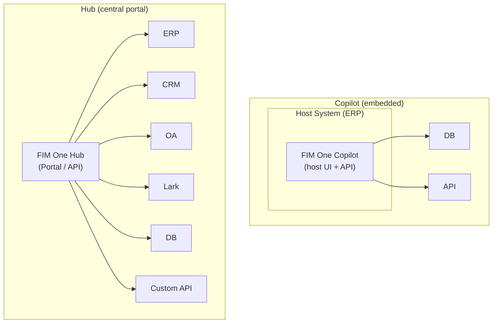
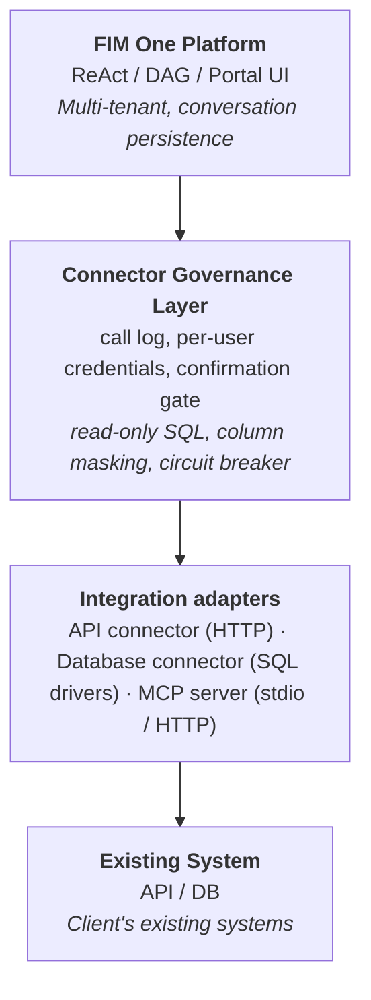
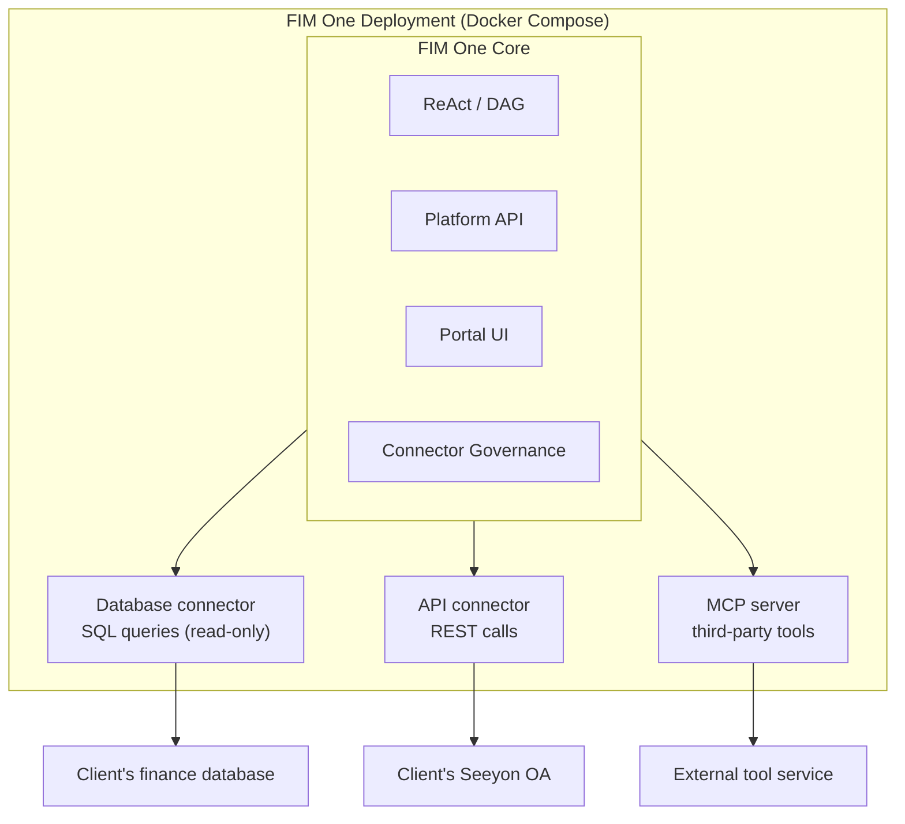
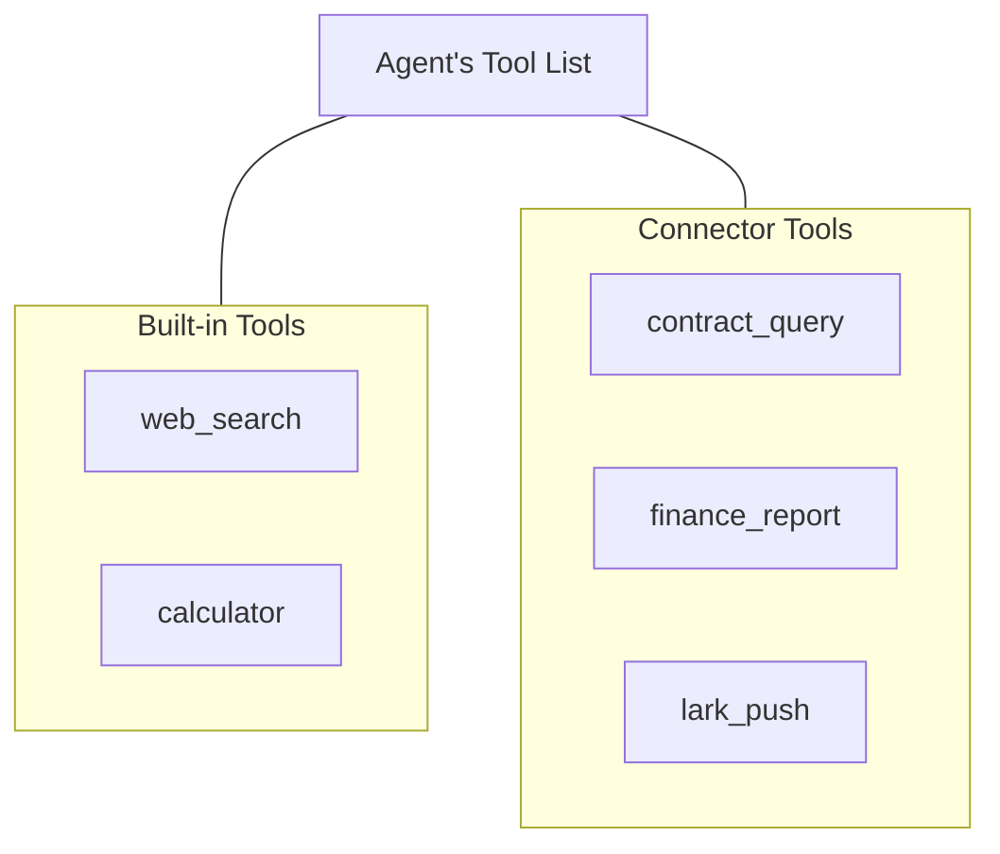
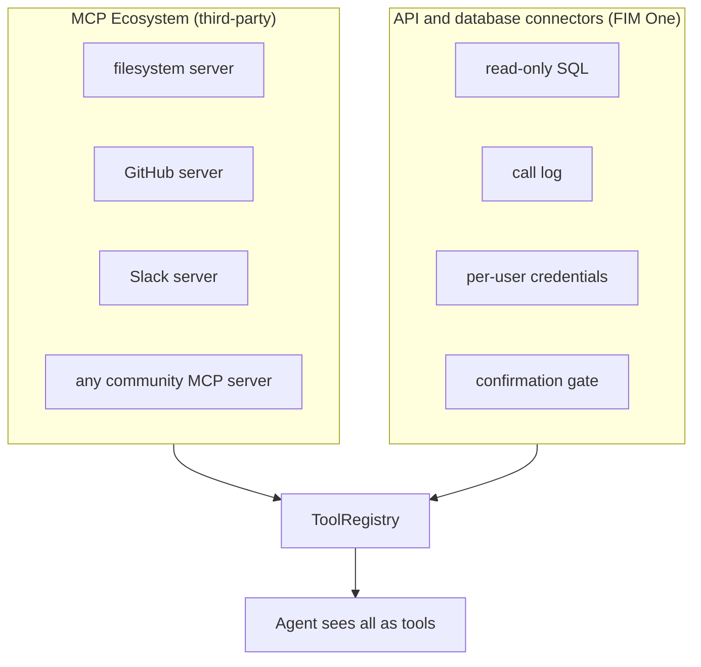

## Copilot vs Hub

The architecture supports two integration scales:



**Copilot** puts the agent inside a host system's UI, today by having the host page call the FIM One API (a drop-in iframe / widget embed is planned). Users interact with AI without leaving their familiar interface. It can use multiple connectors (host DB + notification service, etc.).

**Hub** is a standalone portal that connects all systems. It's not embedded in any single system -- it's the central intelligence layer where systems meet AI.

Same connector architecture, different delivery. A Copilot uses the same `ConnectorToolAdapter` as a Hub.

## Core Principle

**The client changes zero code.** FIM One bridges into their systems proactively -- reading their databases, calling their APIs, pushing to their message bus. The client provides only credentials and network access.

## Three-Layer Architecture



Each layer has a distinct responsibility:

| Layer | Owns | Changes when... |
|---|---|---|
| **Platform** | Orchestration, multi-tenant, UI | New platform features ship |
| **Connector Governance Layer** | Enterprise governance policies | Security/compliance requirements change |
| **Integration adapters** | Talking to one kind of system | A new protocol or database driver is added |
| **Existing System** | Business data and logic | Never (that's the whole point) |

## Three Integration Types

In the portal these live under **Integrations**, with one tab each:

| Type | What it is | Runs as |
|---|---|---|
| **API connector** | A base URL, an auth method (none, bearer, API key, basic) and a list of actions (method, path, parameter schema). Created by hand, by importing an OpenAPI spec, or with the AI builder | `ConnectorToolAdapter`, an in-process HTTP client that injects the caller's credential |
| **Database connector** | A connection to PostgreSQL, MySQL, DM, KingbaseES or HighGo, with an introspected and annotatable schema | `DatabaseToolAdapter` over the matching driver; SQL is validated and read-only by default |
| **MCP server** | Any server speaking the Model Context Protocol, over stdio or HTTP | A separate process (stdio) or remote endpoint, adapted into the same `Tool` protocol |

API and database connectors are records in the database. A connector that is created or edited in the portal is picked up by the next chat request; nothing is redeployed or restarted. MCP is the route for third-party tool servers and for adapters that need their own process.

### What the governance layer adds

| Concern | What FIM One does |
|---|---|
| Read-only SQL | Database connectors reject anything but `SELECT` unless the owner switches `read_only` off |
| Call log | Every connector, database and MCP call is recorded: time, user, where it came from (chat, a delegated agent, a workflow step), the connector or MCP server, the action or tool, status, duration, and whose credential it used |
| Per-user credentials | Each user stores their own credential; the owner's is used only when the owner allows fallback (see [Sharing and credentials](/architecture/sharing-and-credentials)) |
| Confirmation gate | Actions marked `requires_confirmation` (or every tool call, when the agent is set to confirm all) pause for human approval, in chat (`awaiting_confirmation` SSE event) or in a Feishu approval card |
| Circuit breaker | Repeated failures against a connector stop further calls for a cool-down period |
| Column-level masking | Database columns marked as personal data return a mask instead of their values |
| Sharing limits | API connectors and MCP servers can be published to an organization or the Market; database connectors cannot, and their SQL tool is offered only to the owner |

### Database column masking

A database connector is often configured with one privileged account, so
every caller reaches the same tables. Marking a column as **PII** in the
connector's schema manager narrows what the agent can see from it:

- the column stays listed in the schema, tagged, so the model knows it
  exists and does not invent a substitute for it;
- any value returned under that column name is replaced with `***` before
  the result reaches the model, including through `SELECT *`;
- the call log records which columns were masked, alongside whether the
  connector was in read-only mode.

Matching is by column name, which is the only identifier a result set
carries. Two limits follow, and both are deliberate: the database still
*uses* the column, so `WHERE salary > 5000` filters normally, and a query
that renames the column (`SELECT salary AS s`) returns unmasked values.
When the requirement is that the query account cannot read a column at
all, grant that in the database and point the connector at the restricted
account.

The owner's own query playground is not masked. Masking governs what
reaches an agent and the conversation transcript, not what the person who
configured the connection can inspect.

## Deployment Model

Everything runs in a single Docker Compose deployment. The client installs nothing.



<Note>
All provided by FIM One. Client provides only:
- Database credentials (read-only account recommended)
- API endpoints and keys (if available)
- Network whitelist access
</Note>

**Access hierarchy**: FIM One adapts to whatever access the client can provide:

| What client has | How FIM One connects |
|---|---|
| API with an OpenAPI spec | API connector, actions imported from the spec (best case) |
| API without documentation | API connector with actions defined by hand or with the AI builder |
| Database access only | Database connector (direct SQL, read-only by default) |

## Agent-Connector Decoupling

The agent sees connectors as ordinary tools. It does not know or care whether a tool is built-in, a third-party MCP Server, or a legacy system connector.



This means:

- **Adding** a new system = adding a connector config. Agent code does not change.
- **Removing** a connector = removing the config. No code changes.
- The same agent can use built-in tools and connectors in a single task.

## Adding a Connector

No code and no restart are involved. A connector is created in the portal in one of three ways:

| Way | What you provide | Who does it |
|---|---|---|
| **Import an OpenAPI spec** | A YAML / JSON spec or its URL; actions are generated from it | Implementation engineer |
| **AI builder** | A description of the API in natural language; the builder writes and tests the actions | Implementation engineer, with review |
| **Manual** | Base URL, auth method, and each action's method, path and parameters | Implementation engineer |

Database connectors take connection details instead and introspect the schema. Systems that need custom code are wrapped as an MCP server and added under the MCP tab.

## Data Flow Example

User: "Check all overdue contracts from the finance system and push a summary to Lark."

```
1. User sends message via Portal / API

2. FIM One (ReAct mode):
   Think: I need to query the finance DB for overdue contracts, then push to Lark.

3. Act: database("query", "finance_db", sql="SELECT ... FROM contracts WHERE status='overdue' AND ...")
   → Connector Governance: SQL validated as read-only, call logged
   → Database connector: runs the query on the client DB
   ← Returns 7 overdue contracts

4. Think: Found 7 overdue contracts. I'll summarize and push.

5. Act: lark_push(message="7 overdue contracts found: ...")
   → Connector Governance: call logged, action requires confirmation → confirmation gate
   → User approves via Portal
   → API connector: POST to Lark webhook
   ← Push successful

6. Answer: "Found 7 overdue contracts. Summary pushed to Lark group."
```

## Relationship to Existing MCP Ecosystem

FIM One's MCP client supports third-party MCP servers alongside its own API and database connectors. All three end up in the same `ToolRegistry`, so the agent treats them alike.



Connectors do not replace MCP. They cover the common cases (a REST API, a SQL database) with governance built in; MCP covers everything that ships as a tool server. MCP servers carry per-user credentials and the same fallback switch as connectors.
