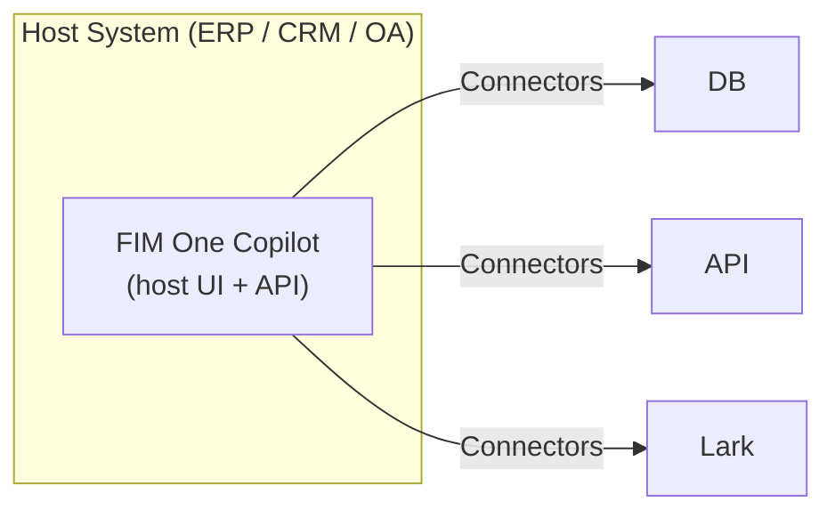
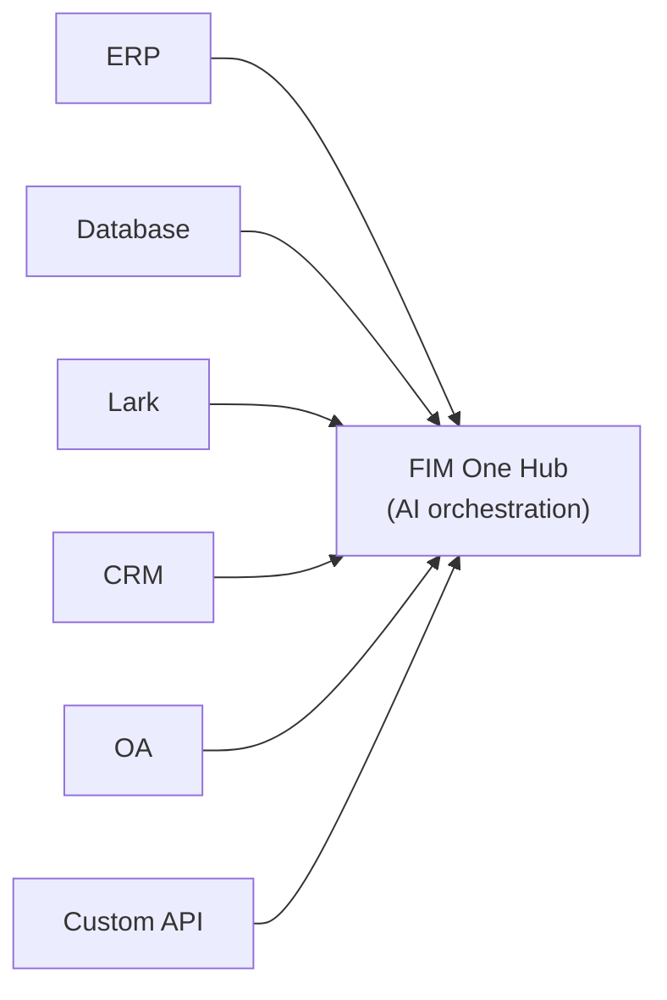
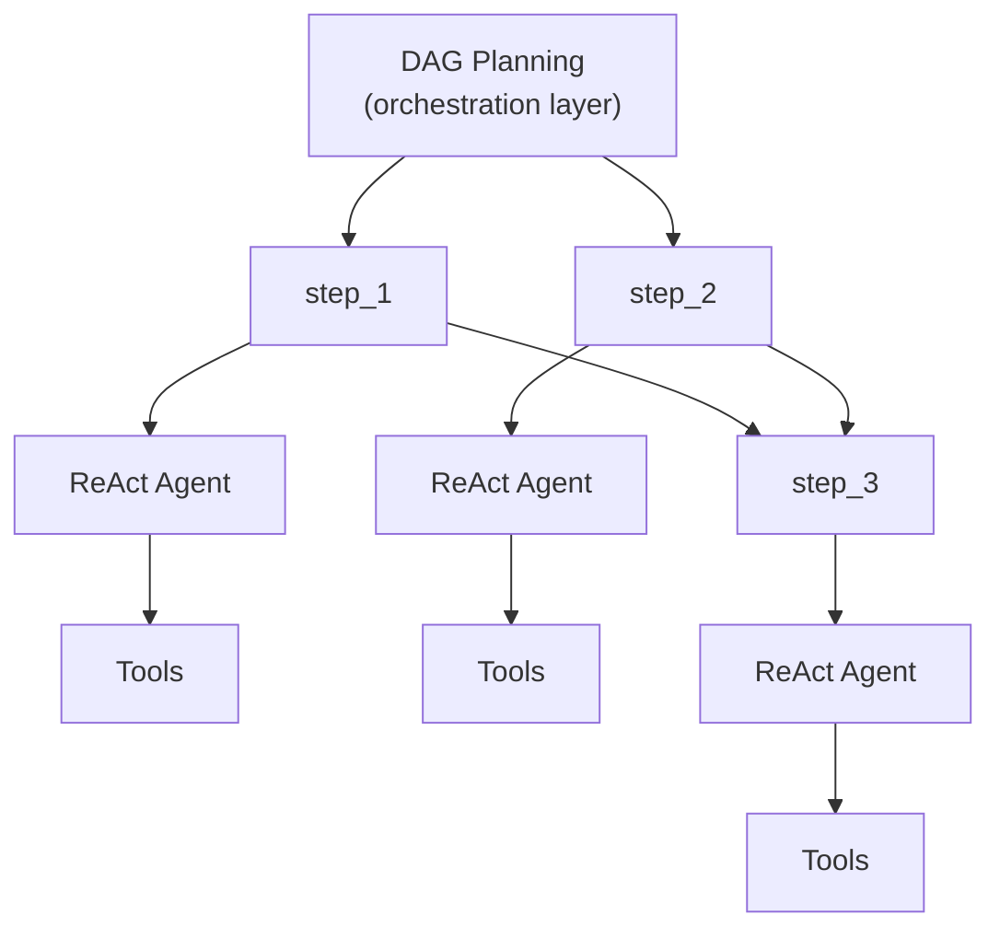

## Three modes

FIM One operates in three modes, determined by how the agent is deployed and used:

| Mode | What it is | Delivery | Example |
|------|-----------|----------|---------|
| **Standalone** | General-purpose AI assistant | Portal | Chat, search, code execution, knowledge base Q&A |
| **Copilot** | AI embedded in a host system | API today; iframe / widget embed is planned | "Finance Copilot" embedded in ERP web UI |
| **Hub** | Central cross-system orchestration | Portal / API | Agent queries ERP, checks OA approvals, notifies via Lark |

The progression is natural: start standalone, embed into a host system as a Copilot, then set up a Hub for cross-system orchestration. The Copilot keeps running embedded; the Hub adds a central orchestration layer.

<Note>
FIM One does not ship an embeddable iframe or widget yet. Today a Copilot is built by calling the API from the host system's own UI; the drop-in embed is planned.
</Note>

## Mode details

### Standalone (0 connectors)

The default mode. FIM One works as a full-featured AI assistant:

- Built-in tools: web search, Python execution, calculator, file operations, shell commands
- Knowledge base with RAG (PDF, DOCX, Markdown, HTML, CSV)
- Dynamic DAG planning for complex multi-step tasks
- Real-time streaming with DAG visualization

No external system access needed. Useful for general analysis, research, and code tasks.

### Copilot (embedded)

Put FIM One inside a host system's web UI, today by having the host page call the API. The agent works alongside users in their familiar interface — no context switching required. Copilot mode can use multiple connectors (e.g., the host system's DB + a notification service).

Examples:
- **Finance Copilot**: Connected to Kingdee (金蝶) via DB connector → query financial statements, generate analysis reports
- **Contract Copilot**: Connected to contract management system via API connector → search contracts, extract clauses, assess risk
- **HR Copilot**: Connected to HR system via API connector → query employee info, generate statistics

The agent uses the same ReAct/DAG engine as Standalone mode, but now has access to real business data through the connector.

### Hub (central orchestration)

The Hub is a standalone portal (or API) that serves as the central intelligence layer. It's not embedded in any single system — instead, it connects to all of them. Users access it through the Portal UI or API.

Examples:
- "Check overdue contracts in CRM, cross-reference with ERP payments, notify finance team on Lark"
- "When OA approval completes, update contract status in CRM and log to audit database"
- "Query sales data from Salesforce, generate forecast using business DB, email summary to management"

Each connector is an independent bridge. Adding or removing one doesn't affect the others.

## Delivery methods

| Delivery | Description | Typical mode |
|----------|-------------|-------------|
| **Portal (Web UI)** | Built-in Next.js interface | Standalone, Hub |
| **API (headless)** | HTTP/SSE endpoints (`POST /api/react`, `/api/dag`, `/api/auto`) | Hub (programmatic access), Copilot |
| **iframe / Embed** | Injected into host system pages (planned, not shipped) | Copilot |

Delivery and mode are related but not locked: you can access a Hub via API, or use a standalone agent through the Portal. But the typical pattern is Portal for Hub and the API for Copilot.

## Execution engines (internal implementation)

Under the hood, FIM One provides two execution engines:

| Engine | Best for | How it works |
|--------|----------|-------------|
| **ReAct** | Single complex queries | Reason → Act → Observe loop with tools |
| **DAG Planning** | Multi-step parallel tasks | LLM generates dependency graph, independent steps run concurrently |

ReAct is the atomic unit; DAG is the orchestration layer. Both engines work in all three modes (Standalone, Copilot, Hub). In Hub mode, a single DAG step might call connectors to different systems.

New agents and plain chat run on ReAct by default. DAG can be selected per agent or per message, and Auto lets a fast model pick between the two for each request.

## Two execution paradigms

FIM One provides two complementary paradigms for getting work done:

| Paradigm | Orchestration | Best for |
|----------|--------------|----------|
| **Agent (Chat)** | LLM decides next step dynamically (ReAct or DAG) | Exploratory tasks, conversations, flexible reasoning |
| **Workflow** | Fixed DAG defined at design time (visual editor, 9 node types) | Approval chains, scheduled runs, multi-step automations |

**Agents** excel when the task is open-ended — "analyze this quarter's data and recommend actions." The LLM plans and adapts on the fly.

**Workflows** excel when the process is known and repeatable — "every Monday, pull invoices from ERP, run compliance checks, route exceptions to a reviewer." The visual editor lets you wire nodes (Start, End, LLM, Condition Branch, Agent, Knowledge Retrieval, Connector, MCP, Human Intervention) into a fixed DAG.

Workflows are an optional module, off by default. An administrator turns it on under Admin → Settings → Modules; until then the Workflows page, its APIs and triggers are unavailable.

The two paradigms compose in both directions. A Workflow can invoke an Agent at any step that needs flexible reasoning within an otherwise fixed pipeline. An Agent can run a Workflow mid-conversation through the `run_workflow` tool, which is offered for active workflows without a Human Intervention step that the user owns or has subscribed to; the run uses the chatting user's credentials and token quota.

<Tip>
**When to choose which:** If you find yourself writing very specific, step-by-step instructions for an Agent, that process probably belongs in a Workflow. If the task requires judgment, exploration, or adapting to unexpected data, keep it as an Agent.
</Tip>
