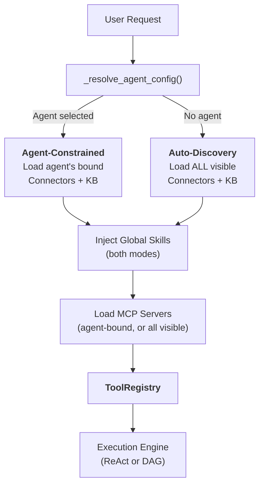
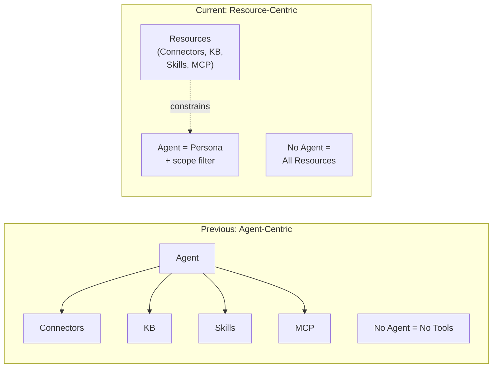
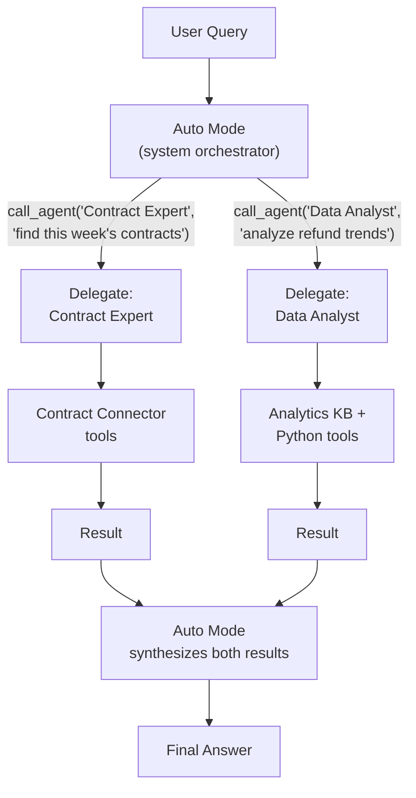
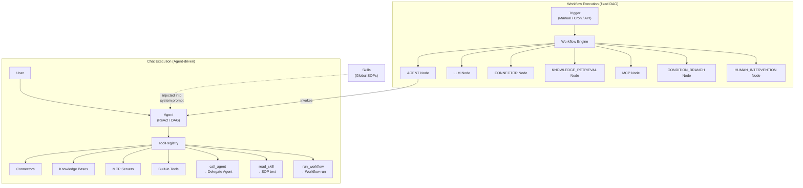

## The two modes

Every chat request in FIM One starts with a question: **is an Agent selected?** The answer determines how resources — Connectors, Knowledge Bases, Skills, and MCP servers — are discovered and assembled into the tool set the LLM can use.

**Agent-Constrained Mode** activates when the user picks a specific Agent. The system loads only the resources that Agent has been explicitly configured with:

- **Connectors**: only the Agent's bound `connector_ids` are loaded as tools.
- **Knowledge Bases**: only the Agent's bound `kb_ids` are injected as retrieval tools.
- **Skills**: globally available when the Skills module is enabled (it is off by default) — all active Skills visible to the user are injected, because Skills are organizational SOPs, not Agent-specific knowledge. (See [Skills as Global SOPs](#skills-as-global-sops) below.)
- **MCP Servers**: only the Agent's bound `mcp_server_ids` are loaded; an Agent with none bound gets no MCP tools.
- **Instructions**: the Agent's `instructions` field defines the persona and behavioral guidelines injected into the system prompt.

**Global Auto-Discovery Mode** activates when no Agent is selected (e.g., a new chat). The system auto-discovers everything accessible to the user:

- **Connectors**: all Connectors visible to the user (own + subscribed from an organization or the Market) are loaded.
- **Knowledge Bases**: the user's own KBs are available for retrieval via `kb_retrieve` (knowledge bases cannot be shared).
- **Skills**: all active Skills visible to the user are injected as SOP stubs.
- **MCP Servers**: all active servers visible to the user.
- **Instructions**: a generic assistant persona is used.

The branching happens inside `_resolve_tools()`, which is called on every chat request:



The practical effect: users can start chatting immediately without configuring an Agent. The system discovers available resources and exposes them as tools. Selecting an Agent narrows the scope — it does not unlock new capabilities, it focuses existing ones.

### What each mode discovers

The two modes differ in **scope**, not in kind. Both produce a `ToolRegistry` — they just fill it differently.

**Auto-Discovery Mode (no Agent selected):**

| Resource | Discovery | Tool Form |
|---|---|---|
| Connectors (API) | `resolve_visibility()` — all visible to user | `ConnectorMetaTool` (progressive) |
| Connectors (DB) | `resolve_visibility()` — all visible to user | `DatabaseMetaTool` (progressive) |
| Knowledge Bases | The user's own KBs | `kb_retrieve` |
| Skills | `resolve_visibility()` — all active | `read_skill` (progressive stubs) |
| MCP Servers | `resolve_visibility()` — all user-visible | `MCPServerMetaTool` (progressive) |
| Agents | `resolve_visibility()` — all active, non-builder | `call_agent` (delegation catalog) |
| Built-in Tools | `discover_builtin_tools()` — full set | No category filter applied |

**Agent-Constrained Mode (Agent selected):**

| Resource | Discovery | Tool Form |
|---|---|---|
| Connectors | Only `agent.connector_ids` | `ConnectorMetaTool` or legacy per-action |
| Knowledge Bases | Only `agent.kb_ids` | `GroundedRetrieveTool` / `KBRetrieveTool` |
| Skills | Global — **not constrained by Agent** | `read_skill` |
| MCP Servers | Only `agent.mcp_server_ids` | `MCPServerMetaTool` (progressive) |
| Agent Delegation | Not available — agents are specialized | _(disabled)_ |
| Built-in Tools | `agent.tool_categories` filter | Subset by category |

The key asymmetry: Connectors, Knowledge Bases and MCP Servers are scoped by the Agent, but Skills remain global in both modes. `CallAgentTool` (agent delegation) is only available in Auto-Discovery mode — it is **not** registered when a specific Agent is selected. This is a security measure: a marketplace agent could otherwise use `call_agent` to invoke other agents and access their private prompts. Skills are organizational rules (everyone follows the same SOPs), while Connectors and KBs are capability bindings (different agents connect to different systems).

## Alles ist ein Werkzeug

Auf der LLM-Ebene konvergieren alle Ressourcentypen in eine flache Liste aufrufbarer Werkzeuge. Das LLM hat kein strukturelles Bewusstsein dafür, ob es einen Connector, einen MCP-Server oder eine Knowledge Base aufruft. Es sieht eine `ToolRegistry` — eine Menge von Funktionen mit Namen, Beschreibungen und Parameterschemas.

| Ressourcentyp | Wird auf LLM-Ebene zu | Werkzeugnamen-Muster |
|---|---|---|
| Connector (progressiv) | Einzelnes Meta-Werkzeug | `connector` |
| Connector (Legacy) | N Werkzeuge pro Aktion | `{connector}__{action}` |
| Datenbank-Connector (progressiv) | Einzelnes Meta-Werkzeug | `database` |
| Datenbank-Connector (Legacy) | 3 Werkzeuge pro Datenbank | `{db}__list_tables`, `{db}__describe_table`, `{db}__query` |
| MCP-Server (progressiv) | Einzelnes Meta-Werkzeug | `mcp` |
| MCP-Server (Legacy) | N Werkzeuge pro Server | `{server}__{tool}` |
| Knowledge Base | Abruf-Werkzeug | `kb_retrieve` oder `grounded_retrieve` |
| Skill (progressiv) | Lese-Werkzeug + System-Prompt-Stubs | `read_skill` |
| Skill (Inline) | Nur System-Prompt-Text | _(kein Werkzeug)_ |
| Agent selbst | Nicht als Werkzeug sichtbar | _(Anweisungen + Werkzeug-Zusammenstellung)_ |

Die Schlüsselerkenntnis: **Ein Agent ist kein Werkzeug — er ist die Entität, die Werkzeuge nutzt.** Der Agent trägt seine Anweisungen zum System-Prompt bei und bestimmt, welche Werkzeuge verfügbar sind. Aber aus der Perspektive des LLM gibt es kein „Agent"-Konzept — nur einen System-Prompt und eine Menge aufrufbarer Funktionen.

Diese Einheitlichkeit ist das, was das System erweiterbar macht. Das Hinzufügen eines neuen Ressourcentyps bedeutet, das `Tool`-Protokoll (`name`, `description`, `parameters_schema`, `run()`) zu implementieren. Die Ausführungs-Engines, das Kontext-Management und die LLM-Interaktionsschicht bleiben unverändert.

## Fähigkeiten als globale SOPs

Fähigkeiten befinden sich auf einer Ebene über Agenten. Sie sind organisatorische Richtlinien und Verfahren, die jeder Agent befolgen muss, unabhängig davon, welcher Agent ausgewählt ist.

### Warum Fähigkeiten nicht an Agenten gebunden sind

Eine Fähigkeit wie „Customer Complaint Handling SOP" gilt für jeden Agenten, der mit Kunden interagiert. Das Binden von Fähigkeiten an Agenten erzeugt ein bidirektionales Eigentumsproblem: Wenn eine Fähigkeit Agenten orchestriert und Agenten Fähigkeiten besitzen, wer kontrolliert wen?

Fähigkeiten sind von Natur aus global — sie sind Unternehmensregeln, keine agentenspezifischen Kenntnisse. Die Funktion `_resolve_tools()` lädt alle aktiven Fähigkeiten, die für den Benutzer sichtbar sind, unabhängig von der Agentenwahl, wobei der gleiche `resolve_visibility()`-Filter verwendet wird, der auch für andere Ressourcen verwendet wird.

### Zwei Injektionsmodi

Fähigkeiten unterstützen zwei Injektionsmodi -- **progressiv** (Standard) und **inline** -- gesteuert durch `SKILL_TOOL_MODE` oder die `model_config_json.skill_tool_mode` des Agenten. Im progressiven Modus erscheinen nur kompakte Stubs in der Systemaufforderung; das LLM ruft `read_skill(name)` bei Bedarf auf, um den vollständigen Inhalt zu laden. Dies ist Teil von FIM One's umfassenderer [Progressive Disclosure](/architecture/progressive-disclosure) Architektur, die den Kontextverbrauch über alle Ressourcentypen hinweg minimiert.

## Agent as persona, not container

FIM One's architecture reflects a deliberate shift from an Agent-centric model to a Resource-centric model.

**Previous model:** the Agent was a container that gated access to all resources. No Agent selected meant no Connectors, no Skills, no specialized KB. The Agent was the mandatory entry point for any capability.

**Current model:** the Agent is a persona — a set of instructions and behavioral guidelines — combined with an optional resource constraint. Resources exist independently of Agents. Selecting an Agent narrows the scope; not selecting one opens it fully.



This means:

- **Users can start chatting immediately** without configuring an Agent.
- **The system auto-discovers available resources** and exposes them as tools.
- **Agents become lightweight personas** that can be created quickly — just write instructions and optionally bind specific Connectors and KBs.
- **Resource management is decoupled** from Agent management. Publishing a Connector to an organization makes it available to every member who subscribes to it — in auto-discovery mode, in Agent binding dropdowns, and in agent delegation resolution.

## Agent-Delegierung

FIM One unterstützt die Delegierung von Aufgaben an spezialisierte Agenten über `CallAgentTool` — aber nur im **Auto-Modus** (kein Agent ausgewählt). Wenn ein Benutzer einen bestimmten Agent auswählt, ist die Delegierung deaktiviert und der Agent konzentriert sich ausschließlich auf seine eigenen Tools.

### Two modes: Auto vs Agent-selected

| Aspect | Auto Mode (no agent selected) | Agent-Selected Mode |
|---|---|---|
| `call_agent` | Enabled — delegates to any visible agent | **Disabled** — not registered |
| Tool scope | All visible Connectors, KB, Skills, MCP | Only the Agent's bound resources + global Skills |
| Orchestration | System LLM dynamically picks the best agent per iteration | Agent uses its own tools directly |
| Use case | General queries, cross-domain tasks | Focused specialist tasks |

**Why delegation is disabled in Agent-selected mode:** Security. A marketplace agent could use `call_agent` to invoke other agents and read their private system prompts. By restricting delegation to Auto mode — where the system LLM (not any individual agent's prompt) controls the flow — private agent prompts are never exposed to untrusted agent configurations.

### Auto-Modus als Orchestrierungsebene

Der Auto-Modus ist ein erstklassiges Konzept in der Benutzeroberfläche. Die Agent-Auswahl zeigt "Auto" als Standardoption an. Wenn Auto aktiv ist, fungiert das System-LLM als Orchestrator: Es sieht den vollständigen Katalog aller sichtbaren Agenten und kann Aufgaben bei jeder Iteration an den am besten geeigneten Spezialisten delegieren. Dies ersetzt die Notwendigkeit eines dedizierten "übergeordneten Agenten" — das System selbst ist der Orchestrator.

### Agenten-Katalog

Zur Laufzeit werden alle aktiven, nicht-Builder-Agenten, die für den Benutzer sichtbar sind, in einem Katalog zusammengestellt. Der Name und die Beschreibung jedes Agenten sind im Parameterschema des `call_agent`-Tools aufgeführt, sodass das LLM den richtigen Spezialisten semantisch auswählen kann – ohne hartcodiertes Routing.

### Full tool inheritance

When a delegated agent is invoked via `call_agent(agent_id, task)`, it is assembled the way a chat with that agent is: a complete `ToolRegistry` built from its own configuration — its bound Connectors, Knowledge Bases and MCP servers (connected for the duration of the call) and its built-in tool categories — together with its own approval gate. Delegated agents are full execution units, not text-only advisors. An agent that has been switched off or is no longer visible to the user when it is called is reported as unavailable instead of being run.

### Delegation auf einer Ebene

Um unendliche Rekursion zu verhindern, erhalten delegierte Agenten das Tool `call_agent` nicht. Delegation erfolgt immer auf einer Ebene: Der Auto-Modus ruft einen Spezialisten auf, der Spezialist führt aus und gibt ein Ergebnis zurück. Das System synthetisiert Ergebnisse von mehreren delegierten Agenten.

### Parallele Ausführung

Im nativen Funktionsaufrufs-Modus kann das LLM mehrere `call_agent`-Aufrufe in einer einzelnen Runde aufrufen. Diese werden gleichzeitig über `asyncio.gather` ausgeführt, was Muster wie "drei Quellen gleichzeitig durchsuchen" ermöglicht.



## Visibility model

All resource discovery — in both modes — is governed by a unified visibility model with two tiers:

| Tier | Description | Example |
|---|---|---|
| **Own** | Created by the user. Always visible. | A Connector you built for your team's API |
| **Subscribed** | Resources published to one of the user's organizations or to the Market that the user has subscribed to. Visible while the resource is still shared and approved. Org membership alone grants nothing. | A company-wide ERP Connector published by IT, or a community-built Slack Connector you installed |

The `resolve_visibility()` function in `web/visibility.py` builds a SQL filter that covers both tiers in a single query:

```python
conditions = [
    model.user_id == user_id,                    # own resources
    and_(model.id.in_(subscribed_ids),           # subscribed, and still shared
         model.visibility == "org",
         or_(model.publish_status.is_(None),
             model.publish_status == "approved")),
]
```

This same filter is used everywhere:

- Auto-discovering Connectors in no-agent mode
- Building the Agent catalog for `CallAgentTool`
- Loading visible Skills for system prompt injection
- MCP server resolution
- Agent configuration lookup (ensuring a user can only select Agents visible to them)

The uniformity means that **a Connector published to an organization becomes available to its subscribers** in auto-discovery mode, in Agent binding dropdowns, and in agent delegation resolution — no special wiring required. The visibility model is the single source of truth for "what can this user access."

## Relationship map

FIM One has two parallel execution paradigms — **Chat (Agent-driven)** and **Workflow (DAG-driven)** — that share the same underlying resources but orchestrate them differently.



Key takeaways from the diagram:

- **Agent and Workflow are parallel paradigms.** Both can use Connectors, Knowledge Bases, and MCP Servers — but through different mechanisms. Agents use them as tools in a `ToolRegistry`; Workflows use them as typed DAG nodes.
- **Workflow can orchestrate Agents** via the `AGENT` node — a Workflow step can invoke a full Agent with its own ReAct/DAG loop. The reverse also works: an Agent can run a Workflow through the `run_workflow` tool when the Workflows module is enabled, except workflows that contain a Human Intervention step.
- **Skills are injected into Agents only.** Skills are system prompt text — they guide Agent behavior. Workflows don't consume Skills because Workflow nodes execute deterministic logic, not LLM-guided reasoning.
- **Shared resources, different access patterns.** A Connector can be called by an Agent (via `ConnectorToolAdapter`), by a Workflow (via `CONNECTOR` node), or by both in the same business process — e.g., a Workflow triggers an Agent that queries the same Connector the Workflow also uses in a later step.

## Workflow Engine — the other execution paradigm

While this document focuses on Agent-driven chat execution, FIM One includes a full **Workflow Engine** — a visual DAG editor with 9 node types for fixed-process automation. It is an optional module, off by default.

| Aspect | Agent (Chat) | Workflow |
|---|---|---|
| Orchestration | LLM decides next step dynamically | Fixed DAG defined at design time |
| Best for | Exploratory tasks, conversations, flexible reasoning | Approval chains, scheduled ETL, multi-step automations |
| Can call | Connectors, KB, MCP, Built-in Tools, Delegated Agents, Skills, Workflows (`run_workflow`) | Agents, Connectors, KB, MCP, LLM, Human approval |
| Trigger | User message in chat | Manual, cron schedule, or API/webhook |
| Nesting | One-level delegation (Auto mode → delegated Agent) | No sub-workflow nesting |

The two paradigms are complementary. Use Agents when the task is open-ended ("analyze this quarter's sales data and recommend actions"). Use Workflows when the process is known ("every Monday, pull new invoices from ERP, run compliance checks, and route exceptions to a human reviewer"). A Workflow can invoke an Agent for any step that needs flexible reasoning within an otherwise fixed pipeline.

For details on Agent execution modes and Workflow node types, see [Execution Modes](/concepts/execution-modes).
