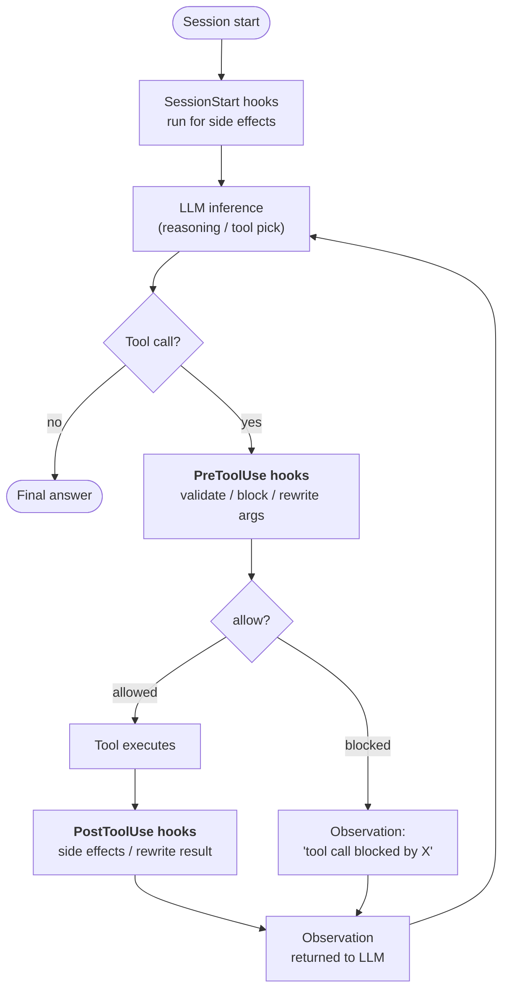
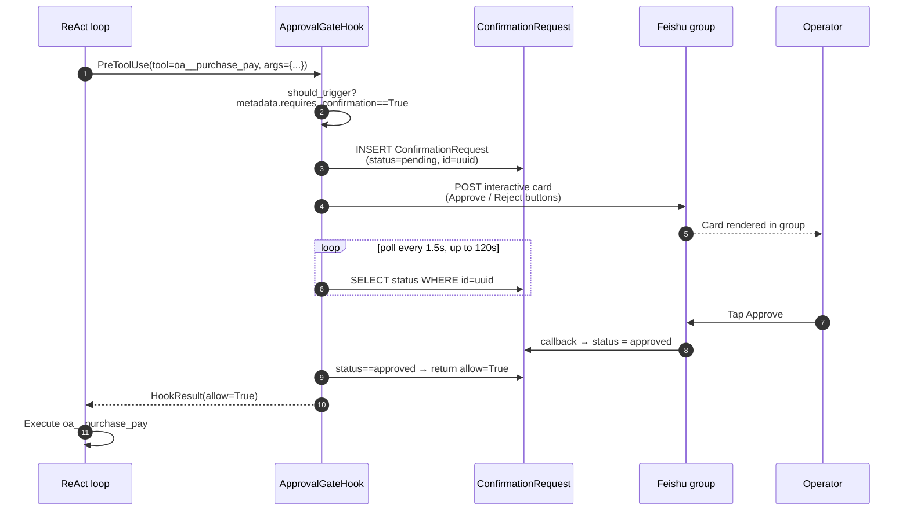

## Warum Hooks existieren

Anweisungen in einem System-Prompt sind **Vorschläge**. Ein ausreichend eigensinniges oder verwirrtes LLM kann sie ignorieren. Für die meisten Agent-Verhaltensweisen ist das genau das, was Sie möchten — Anweisungen geben dem Modell Raum zur Anpassung.

Aber einige Anforderungen sind keine Vorschläge. „Jeder sensible Tool-Aufruf muss protokolliert werden." „Schreibvorgänge sind blockiert, wenn die Organisation im Nur-Lese-Modus ist." „Zahlungen über ¥50k erfordern eine menschliche Bestätigung vor der Ausführung." Das sind **Invarianten** — Fakten über das System, die unabhängig davon gelten müssen, was das Modell in einem bestimmten Durchlauf entscheidet.

Ein Hook ist Code, der **außerhalb der LLM-Schleife** an einem klar definierten Punkt im Ausführungs-Lebenszyklus des Agenten läuft. Das LLM kann den Hook nicht sehen. Das LLM kann mit dem Hook nicht argumentieren. Das LLM kann den Hook nicht überreden, einen Schritt zu überspringen. Wenn ein `PreToolUse` Hook `allow=False` zurückgibt, findet der Tool-Aufruf nicht statt — egal wie hartnäckig die Reasoning-Spur war.

Das ist die kritische architektonische Unterscheidung:

| Mechanismus | Wo es läuft | Wer kontrolliert es | Garantie |
|---|---|---|---|
| **System-Prompt-Anweisung** | Innerhalb von LLM-Inferenz | Modell | „Folgt wahrscheinlich" |
| **Tool-Beschreibung / Schema** | Innerhalb von LLM-Inferenz | Modell | „Folgt wahrscheinlich" |
| **Hook** | Um LLM-Inferenz herum | Platform-Code | **Läuft immer** |

Hooks sind, wie FIM One „der Agent soll..." in „der Agent kann nicht umgehen..." umwandelt.

## Where hooks plug in

Three hook points are defined today. Each marks a boundary the agent crosses during one loop iteration:



| Hook point | Fires when | Can it block? | Can it mutate data? |
|---|---|---|---|
| `SessionStart` | Before the first LLM call of a session | No | No — runs for side effects only |
| `PreToolUse` | After the LLM picks a tool, before the tool runs | **Yes** (via `allow=False`) | Yes — can rewrite `tool_args` before execution |
| `PostToolUse` | After the tool returns, before the observation goes to the LLM | No | Yes — can rewrite the observation |

Multiple hooks at the same point run in priority order. An earlier `PreToolUse` hook's rewritten args are carried forward to later hooks, so middleware composes.

## Wann ein Hook vs. eine Anweisung

Die Entscheidung, ob eine Anforderung mit einer Prompt-Anweisung oder einem Hook gelöst werden soll, ist dieselbe Berechnung wie "Runtime-Assertion vs. Code-Kommentar":

| Symptom | Lösung |
|---|---|
| "Der Agent sollte X bevorzugen, wenn Y" | Anweisung — sanfte Anleitung, Modell hat Spielraum |
| "Der Agent muss jeden Aufruf an Connector Z protokollieren" | **PostToolUse Hook** — kann sich nicht auf das Modell verlassen, um sich zu erinnern |
| "Zahlungen über ¥50k benötigen menschliche Genehmigung" | **PreToolUse Hook** — kann sich nicht auf das Modell verlassen zu fragen |
| "Der Agent sollte sich auf Chinesisch vorstellen" | Anweisung — stilistisch, geringe Kosten bei Fehlschlag |
| "Der Agent kann nicht in die Produktionsdatenbank im Nur-Lese-Modus schreiben" | **PreToolUse Hook** — Sicherheitsinvariante, Null-Toleranz |
| "Der Agent sollte lange DB-Abfrageergebnisse zusammenfassen" | Könnte beides sein, aber ein Hook ist robuster — siehe PostToolUse truncate |

Faustregel: **Wenn das falsche Verhalten ein Incident ist, verwenden Sie einen Hook. Wenn das falsche Verhalten eine kleine Unannehmlichkeit ist, ist eine Anweisung ausreichend.**

## The hook contract

A hook is a subclass of `PreToolUseHook` or `PostToolUseHook` (a session-start hook is registered as a plain `Hook` object) with one required method:

```python
class ReadOnlyGuard(PreToolUseHook):
    name = "readonly_guard"
    priority = 5                          # lower runs earlier

    def should_trigger(self, ctx: HookContext) -> bool:
        return ctx.tool_name.startswith("sql_")

    async def execute(self, ctx: HookContext) -> HookResult:
        if org_is_readonly(ctx.metadata["org_id"]):
            return HookResult(
                allow=False,
                error="Org is in read-only mode — write blocked.",
                side_effects=["readonly_guard: blocked sql write"],
            )
        return HookResult()               # default: allow=True, no mutation
```

The `HookContext` passed in carries `tool_name`, `tool_args`, `agent_id`, `user_id`, and a flexible `metadata` dict the engine populates with per-request facts (org id, tool call id, the connector action's `requires_confirmation` flag).

The `HookResult` returned controls the outcome:

- `allow: bool = True` — whether the tool call proceeds (ignored for `PostToolUse` / `SessionStart`)
- `error: str | None` — human-readable reason, surfaced to the LLM as the observation when blocked
- `modified_args: dict | None` — if set, replaces the tool args before execution
- `modified_result: str | None` — if set (PostToolUse), replaces the observation before it returns to the LLM
- `side_effects: list[str]` — notes on what the hook did, collected by the registry (not surfaced in the agent's trace today)

## Case study: `ApprovalGateHook`

The first hook shipped on top of this system is `ApprovalGateHook` (`fim_one.core.assembly.confirmation`; registry key `approval_gate`, formerly `feishu_gate` / `FeishuGateHook`) — a `PreToolUse` hook that turns any tool call needing confirmation (the action's `requires_confirmation` flag, or the agent's confirm-all setting) into a human approval. The hook builds a `ConfirmationSpec` and hands it to `ConfirmationService`, which records the request, delivers it as a card in the portal chat or as a Feishu card in the approval channel bound to the agent, according to the agent's confirmation mode (Auto / Inline only / Channel only), and waits for the decision; Auto uses the in-portal card when no channel is bound. In a chat with no agent the tool's own flag alone decides, and the person chatting approves inline. Who may decide is written on the request when it is created and read back by the portal and the channel callback alike.

This hook exercises the full lifecycle:



What this design is buying:

- **The tool call is genuinely suspended.** The agent's SSE stream pauses between "I will call `oa__purchase_pay`" and the observation. The user sees the agent waiting, which matches what is happening under the hood.
- **Approval survives a process restart.** The pending row is in the database, not in memory. If the backend restarts while a card is outstanding, the next poll picks up where it left off.
- **The decision is audited.** `ConfirmationRequest` keeps `payload`, `responded_at`, `responded_by_open_id`, and the final status — an auditable record of who approved what and when.
- **No LLM in the decision loop.** The model produces the tool call. Humans produce the verdict. The hook is the deterministic bridge.

The channel path depends on a [Feishu Channel](/configuration/channels/feishu) bound as the agent's approval channel. The service asks only whether the channel implements `ApprovalCarrier` (`send_approval`, `parse_decision`, `approval_target`), never which platform it is; the Feishu channel is the first implementation. The separation is deliberate: the service owns the approval state machine, the channel owns the IM platform mechanics. A Slack or WeCom channel that implements the carrier protocol would carry approvals without a change to the gate. A callback can decide only requests its own channel delivered.

## Mögliche Hooks (nicht geplant)

Vier Hook-Muster passen in denselben Lebenszyklus. Keines davon steht auf der aktuellen Roadmap; sie bleiben zurückgestellt, bis ein Deployment eines davon benötigt:

| Hook | Zeitpunkt | Zweck |
|---|---|---|
| `AuditLogHook` | PostToolUse | `ConnectorCallLog` bei jedem Connector-Aufruf automatisch schreiben. Derzeit geschieht dies manuell; als Hook ist die Abdeckung sichergestellt. |
| `ReadOnlyGuard` | PreToolUse | Schreibvorgänge blockieren, wenn die Organisation im schreibgeschützten Modus ist. |
| `ResultTruncateHook` | PostToolUse | Übergroße Tool-Beobachtungen (>8k Zeichen) kürzen, bevor sie den LLM-Kontext erreichen. |
| `ConnectorRateLimitHook` | PreToolUse | Aufrufe pro Connector und Benutzer begrenzen, unabhängig von LLM-Ratenlimits. |

Eine benutzerdefinierte Hook-Ebene bleibt unter denselben Bedingungen zurückgestellt: eine YAML-Konfiguration pro Agent (`hooks: [...]`), in der Shell-Befehle oder Python-Aufrufobjekte festgelegt werden, die bei passenden Tool-Ereignissen ausgeführt werden. Dieser Ansatz folgt dem Muster, auf das sich moderne Agent-Frameworks (Claude Code, OpenDevin) verständigt haben — eine Durchsetzung per Hook hält die Logik für Dinge, die „immer geschehen müssen“, aus den Prompts heraus.

## Hooks vs. Channels

The two abstractions solve orthogonal problems:

| Concept | What it models | Lifetime | Example |
|---|---|---|---|
| **Hook** | A point in the agent's execution where platform code runs | Per tool call | `ApprovalGateHook`, `AuditLogHook` |
| **Channel** | A pluggable adapter to an external messaging platform | Long-lived per org | `FeishuChannel`, planned `SlackChannel` |

Hooks consume Channels — a hook that needs to talk to the outside world (send a card, post an alert, escalate to a group) calls into the org's Channel. A channel without any hook using it is still useful (e.g. agents can proactively send notifications via a tool), but the approval-gate pattern specifically requires both halves to be in place.

Put differently: **Channels are the "where do I talk to humans" plumbing, Hooks are the "when do I have to talk to humans" policy**. Production human-in-the-loop workflows need both.

## Current state (v0.9.4)

Snapshot of what shipped and what is still ahead:

- ✅ `HookRegistry`, `HookContext`, `HookResult` primitives wired into both ReAct and DAG
- ✅ `PreToolUseHook` / `PostToolUseHook` abstract bases
- ✅ `ApprovalGateHook` and `ConfirmationService` — complete, including the `ConfirmationRequest` table, polling loop, timeout/expire, and callback-driven state flips; workflow approval steps and confirmations of connector actions in a workflow use the same service, and instead of polling they suspend the run and are told of the decision through `ConfirmationService.on_decided`
- ✅ Feishu channel callback endpoint that decodes `card.action.trigger` and updates the pending row
- ✅ Agent-level hook declarations: `agent.model_config_json.hooks.class_hooks` resolves to an instantiated `HookRegistry` on every ReAct/DAG session
- ✅ **Hooks fire on every execution surface**: the main chat path (Portal, API, DAG), delegated sub-agents (`CallAgentTool`), and Workflow `AGENT` nodes. Eval Center runs intentionally **bypass** hooks (automated evaluation must not block on human approval).

  A delegated agent does not inherit its caller's registry — it builds **its own** from its own `model_config_json`. Because the confirmation gate is auto-attached to every agent, rebuilding is a superset of inheriting: the delegate gets the gate *plus* whatever it declares for itself, and the gate resolves the delegate's `require_confirmation_for_all` rather than its caller's. Both surfaces fail **closed**: an agent whose hooks cannot be built is not run.
- ❌ `AuditLogHook`, `ReadOnlyGuard`, `ResultTruncateHook`, `ConnectorRateLimitHook` (not planned)
- ❌ User-defined YAML hook declarations (not planned)

The Hook System is a **load-bearing foundation** for production hardening. Its first user (`ApprovalGateHook`) is also a production feature in its own right, which is why the skeleton shipped early for the 2026-04-24 roadshow rather than waiting for the full hook catalog.
