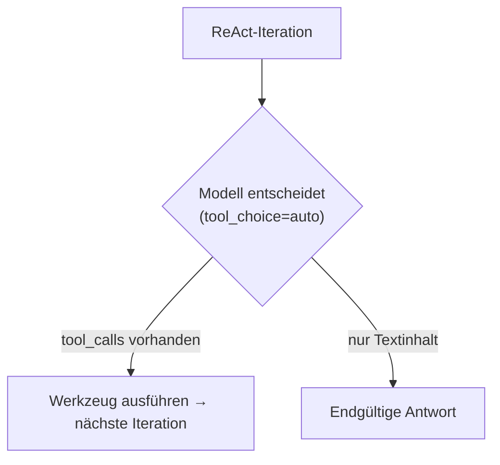
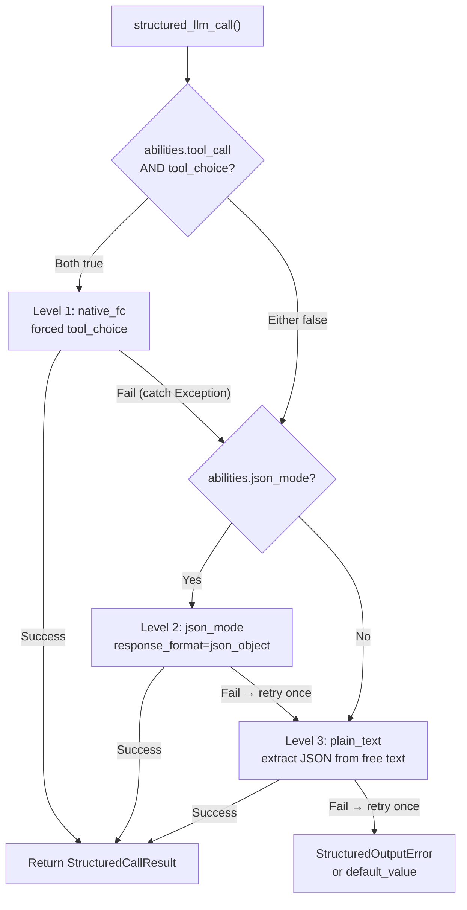

## Provider detection

FIM One uses LiteLLM as a universal adapter. The `_resolve_litellm_model()` function in `core/model/openai_compatible.py` maps the user's `LLM_BASE_URL` + `LLM_MODEL` to a LiteLLM model identifier with a provider prefix. The prefix determines how LiteLLM routes the request — native API protocol (Anthropic Messages API, Gemini, etc.) or generic OpenAI-compatible `/v1/chat/completions`.

Resolution order:

1. **Explicit provider** (from the `provider` field of a legacy `ModelConfig` row or an agent's inline model config; models added under Admin → Models have no provider field, so for them resolution starts at step 2) — highest priority. If the provider matches a known domain in the URL, no `api_base` is returned (LiteLLM routes natively). Otherwise, `api_base` is set to the relay URL.
2. **Domain match** against `KNOWN_DOMAINS` — official API endpoints are recognized by hostname.
3. **URL path hint** against `PATH_PROVIDER_HINTS` — common on relay platforms like UniAPI where `/claude` or `/anthropic` in the path indicates the upstream protocol.
4. **Fallback** — `openai/` prefix (generic OpenAI-compatible).

| Domain / Path | Provider prefix | Protocol |
|---|---|---|
| `api.openai.com` | `openai/` | OpenAI Chat Completions |
| `anthropic.com` | `anthropic/` | Anthropic Messages API |
| `generativelanguage.googleapis.com` | `gemini/` | Google Gemini |
| `api.deepseek.com` | `deepseek/` | DeepSeek (OpenAI-compatible) |
| `api.mistral.ai` | `mistral/` | Mistral |
| Path contains `/claude` or `/anthropic` | `anthropic/` | Anthropic Messages API (via relay) |
| Path contains `/gemini` | `gemini/` | Google Gemini (via relay) |
| Anything else | `openai/` | Generic OpenAI-compatible |

When the provider prefix is a native protocol (anthropic, gemini, etc.) and the URL is not the official endpoint, LiteLLM uses the native protocol but sends requests to the relay's `api_base`. This means provider-specific behaviors — including the Bedrock prefill issue described below — apply regardless of whether the request goes to the official API or through a relay.

<Warning>
If your relay URL contains `/claude` in the path, FIM One automatically routes via Anthropic's native protocol. This is usually correct (better streaming, thinking support), but means provider-specific behaviors apply — including the Bedrock prefill issue described below.
</Warning>

## tool_choice — die vier Modi

Der Parameter `tool_choice` ist über das OpenAI-Format standardisiert. LiteLLM übersetzt ihn vor dem Senden der Anfrage in das native Protokoll jedes Anbieters.

| Modus | Bedeutung | Anbieterunterstützung |
|---|---|---|
| `"auto"` | Modell entscheidet, ob ein Werkzeug aufgerufen oder mit Text geantwortet wird | Alle Anbieter |
| `"required"` | Muss ein Werkzeug aufrufen, aber Modell wählt welches | Die meisten Anbieter |
| `{"type":"function","function":{"name":"X"}}` | Muss Funktion X spezifisch aufrufen | Die meisten Anbieter — **nicht kompatibel mit Anthropic Thinking** |
| `"none"` | Kann keine Werkzeuge verwenden, nur Text | Alle Anbieter |

Die Unterscheidung zwischen `"auto"` und erzwungen (`{"type":"function",...}`) ist der Kern jedes Kompatibilitätsproblems in FIM One. Diese beiden Modi werden von völlig unterschiedlichen Subsystemen mit unterschiedlichen Anforderungen verwendet.

## Wo tool_choice verwendet wird

Zwei Subsysteme verwenden `tool_choice`, und sie verwenden es auf grundlegend unterschiedliche Weise.

### ReAct-Engine — tool_choice="auto"

Die ReAct-Schleife erfordert, dass das Modell in jeder Iteration entscheidet: ein Werkzeug aufrufen oder eine endgültige Antwort geben. Nur `"auto"` macht hier Sinn — das Modell wählt frei zwischen der Erzeugung von `tool_calls` oder Textinhalten. Dies ist mit allen Anbietern, allen Modellen und allen Modi kompatibel, einschließlich erweitertem Denken.



Die ReAct-Engine verwendet natives Function Calling (`_run_native`), wenn `abilities["tool_call"] = True`, und fällt andernfalls auf den JSON-im-Inhalt-Modus (`_run_json`) zurück. Beide Modi verwenden `"auto"` — der Unterschied besteht darin, ob Werkzeuge über den `tools`-Parameter übergeben oder in der Systemaufforderung beschrieben werden. Weitere Informationen finden Sie unter [ReAct-Engine — Dual-Mode-Ausführung](/architecture/react-engine#dual-mode-execution).

### structured_llm_call — tool_choice=forced

Einmalige strukturierte Extraktion (Schema-Annotation, DAG-Planung, Plananalyse). Erzwingt, dass das Modell eine bestimmte virtuelle Funktion aufruft, und garantiert dadurch eine strukturierte JSON-Ausgabe. Dies ist die Aufrufstelle, die anbieterspezifische Fehler auslöst.

`structured_llm_call` implementiert eine dreistufige Degradationskette. Die drei Stufen sind nach dem Code benannt, und ihre Nummerierung entspricht nicht den vier Garantieebenen, die im [folgenden Abschnitt](#structured-output-the-four-guarantee-tiers) beschrieben werden:



Der entscheidende Designunterschied: Der Fallback von `structured_llm_call` erfolgt **zur Laufzeit** — es wird dynamisch jede Stufe ausprobiert, und Ausnahmen werden abgefangen, um zur nächsten Stufe überzugehen. Die Modusauswahl der ReAct-Engine erfolgt **zur Build-Zeit** — sie prüft `_native_mode_active` einmal zu Beginn und legt sich für die gesamte Schleife auf einen Modus fest. Das bedeutet, dass `structured_llm_call` anbieterspezifische 400-Fehler transparent abfangen kann, während ReAct darauf angewiesen ist, dass der Modus von Anfang an korrekt ausgewählt wird.

## Strukturierte Ausgabe: die vier Garantieebenen

„Strukturierte Ausgabe“ ist ein Begriff für vier verschiedene Mechanismen. Sie alle erzeugen JSON, bieten aber nicht dieselbe Garantie. Der entscheidende Unterschied liegt darin, wo die Einschränkung greift: im Decoder, der kein Token ausgeben kann, das das Schema verbietet, oder im Prompt, der lediglich eine Aufforderung formulieren kann.

| Ebene | Was die Anfrage enthält | Wo die Nutzlast eintrifft | Was garantiert wird | Durchgesetzt von |
|---|---|---|---|---|
| **T1 — natives Function Calling, `strict: true`** | `tools=[…]` mit gesetztem `strict` in der Funktionsdefinition | Ein JSON-String in `tool_calls[0].function.arguments` | Auf Schemaebene: jedes erforderliche Feld ist vorhanden, keine nicht deklarierten Schlüssel, Typen und Enumerationen sind korrekt | Zustandsautomat des Decoders |
| **T2 — `response_format: {"type": "json_schema"}`** | Das Schema selbst innerhalb von `response_format`, mit `strict: true` | Ein JSON-String in `message.content` | Auf Schemaebene wie bei T1, jedoch in der eigenen Antwort des Assistenten statt in einem Tool-Aufruf | Zustandsautomat des Decoders |
| **T3 — `response_format: {"type": "json_object"}`** | Nur der Typ, kein Schema | Ein JSON-String in `message.content` | Nur syntaktisch: Der Text lässt sich als JSON parsen. Welche Schlüssel vorkommen, ist nicht eingeschränkt | Decoder (Syntax) |
| **T4 — Freitext plus Anweisungen** | Nichts. Das Schema wird im Prompt beschrieben | `message.content`, möglicherweise von Prosa oder Code-Fences umgeben | Nichts | Der Prompt |

Der Mechanismus hinter T1 und T2 ist Constrained Decoding. Der Anbieter kompiliert das Schema in eine Grammatik und maskiert bei jedem Decodierungsschritt jedes Token, das die Ausgabe gegenüber diesem Schema unparsebar machen würde. Ein erforderliches Feld kann nicht übersprungen werden, weil das Token zum Schließen des Objekts erst dann zur zulässigen Menge gehört, wenn dieses Feld ausgegeben wurde. Das ist eine andere Art von Aussage als „das Modell wurde freundlich gebeten und hat sich daran gehalten“ – und der Grund, warum T1/T2 bei Temperatur 1 und auch bei kleinen Modellen zuverlässig funktionieren, wo die Befolgung von Prompts dies nicht tut.

### T1 und T2 sind nicht austauschbar

Sie bieten über unterschiedliche Kanäle dieselbe Garantie, und der Kanal ist in drei Punkten entscheidend.

**Die Form des Turns unterscheidet sich.** T1 gibt einen Tool-Call-Turn zurück; das Modell hat entschieden zu *handeln*. T2 gibt eine gewöhnliche Assistant-Nachricht zurück; das Modell hat in einer bestimmten Form *geantwortet*. Wenn der Aufrufer eine einzelne Extraktion und keine Agentenschleife möchte, bringt T2 dies direkt zum Ausdruck, anstatt für das Modell eine virtuelle Funktion zu erfinden, die es „aufrufen“ soll.

**Das Erzwingen von T1 kollidiert mit Thinking.** Um aus T1 eine schema-gesteuerte Nutzlast zu erhalten, muss die Auswahl in der Regel erzwungen werden, entweder mit `required` oder mit einer benannten Funktion. Mehrere Provider lehnen eine erzwungene Tool-Auswahl ab, wenn Extended Thinking aktiv ist. Tabelle B weiter unten zeigt, welche das betrifft. Bei T2 gibt es keinen solchen Konflikt: T2 ist eine Antwortbeschränkung und keine Tool-Beschränkung. Daher ist T2 der einzige schema-gesteuerte Pfad, der auch bei aktiviertem Thinking funktioniert. Für eine Bereitstellung, die auf Reasoning-Modellen standardisiert ist, ist das ein praktisches und kein stilistisches Argument für T2.

**T1 verursacht einen zusätzlichen Durchlauf für die Schema-Anbindung, den T2 nicht benötigt.** Eine virtuelle Funktion benötigt einen Namen, eine Beschreibung und eine Entscheidung darüber, ob das Modell den Aufruf ablehnen darf.

### Was T2 kostet

Constrained Decoding ist nicht kostenlos, und das Schema, das bereits vorhanden ist, entspricht normalerweise nicht dem Schema, das akzeptiert wird.

- **Eine Teilmenge des Schemas.** Der Strict-Modus von OpenAI erfordert bei jedem Objekt `additionalProperties: false` und bei jeder Eigenschaft einen Eintrag in `required`; Optionalität wird durch eine Union mit `null` ausgedrückt und nicht durch das Weglassen aus `required`. Die Wurzel muss ein Objekt sein. Für die Gesamtzahl der Eigenschaften und die Verschachtelungstiefe gelten Obergrenzen. Die meisten von Hand geschriebenen Schemas müssen bearbeitet werden, bevor sie dafür geeignet sind.
- **Kompilierung der Grammatik.** Die erste Anfrage mit einem neuen Schema verursacht auf der Seite des Anbieters eine einmalige Kompilierungslatenz. Durch die Wiederverwendung eines stabilen Schemas lässt sich diese amortisieren; bei der Erzeugung eines neuen Schemas pro Anfrage ist das nicht der Fall.
- **Eine neue Fehlerquelle.** Ein Modell, das nicht antworten möchte, gibt statt eines schemaförmigen Objekts eine Ablehnung zurück. Daher benötigt der Aufrufer dafür einen eigenen Zweig.

### Was keine Stufe garantiert

Jede Stufe schränkt die Form ein. Keine schränkt die Wahrheit ein. Eine T2-Antwort kann vollständig schema-konform und dennoch sachlich falsch sein. Ein enum-beschränktes Feld gibt einen der zulässigen Werte zurück, selbst wenn keiner davon korrekt ist, denn die Aufgabe des Decoders besteht darin, die Ausgabe innerhalb der Grammatik zu halten, nicht darin, die Antwort zu kennen. Die Schema-Steuerung verhindert Parsing-Fehler und Fehler bei der Feldstruktur. Sie macht jedoch nicht überflüssig, zu prüfen, was der Wert aussagt.

<Warning>
**Zwei Nummerierungsschemata, die nicht übereinstimmen.** Diese Seite verwendet **T1–T4** für die oben genannten Garantie-Stufen. Für die drei Stufen der Degradationskette von `structured_llm_call` wird **Level 1/2/3** verwendet; sie sind nach dem Code benannt (`native_fc`, `json_mode`, `plain_text`). FIM Ones Level 2 ist `json_object`, also **T3**, nicht T2. Die Kette hat drei Stufen, weil sie T2 vollständig überspringt, nicht weil es nur drei Stufen gibt.
</Warning>

### Wo FIM One einzuordnen ist

| `structured_llm_call`-Ebene | Stufe | Was der Code tatsächlich tut |
|---|---|---|
| Ebene 1 — `native_fc` | **T1 ohne `strict`** | `_build_tool_def` gibt `name` / `description` / `parameters` und nichts anderes aus. Keine Aufrufstelle setzt `strict`, daher verwendet `convert_tools` in `responses_adapter.py` standardmäßig den Wert `False`. Das Schema erreicht das Modell als Beschreibung dessen, was es erzeugen soll, nicht als Einschränkung dessen, was es erzeugen kann |
| *(nicht vorhanden)* | **T2** | Nicht implementiert. `json_schema` taucht an keiner Stelle in der Codebasis auf, und `abilities` verfügt über kein Flag, mit dem sich die Unterstützung pro Modell ausdrücken ließe |
| Ebene 2 — `json_mode` | **T3** | `{"type": "json_object"}`, fest in `structured.py::_call_llm` und `react.py::_json_response_format` hinterlegt |
| Ebene 3 — `plain_text` | **T4** | `extract_json()` über frei formatierten Inhalt, mit einem optionalen Regex-Fallback pro Aufrufstelle |

Daraus ergeben sich fünf Konsequenzen – und das sind die ehrlichen Einschränkungen des aktuellen Designs.

1. **Die Kette verfügt über keine schema-gesteuerte Stufe, auf die sie zurückfallen kann.** Wenn Ebene 1 fehlschlägt, ist die nächste Stufe `json_object`, was lediglich garantiert, dass der Text geparst werden kann. Es gibt keinen Zwischenschritt, der weiterhin Felder erzwingt.
2. **Die Garantie von Ebene 1 ist schwächer, als der Name vermuten lässt.** Ohne `strict` entspricht native function calling der nicht-strikten Variante aus der Zeit vor 2024: Das Modell hält sich normalerweise an das Schema, wird aber nicht daran gehindert, ein erforderliches Feld auszulassen, einen eigenen Schlüssel zu erfinden oder eine Zeichenfolge zurückzugeben, obwohl eine Zahl deklariert wurde.
3. **Auf `anthropic/`-Routen ist Ebene 2 nicht wirklich T3.** Die Anthropic Messages API verfügt über kein `response_format`, daher emuliert LiteLLM den JSON-Modus durch das Einfügen eines Assistant-Prefills. Das ist ein Mechanismus auf Prompt-Ebene, wodurch die effektive Garantie zwischen T4 und T3 liegt und nicht bei T3. Die weiter unten dokumentierte Bedrock-Prefill-Falle besteht darin, dass diese Emulation deutlich fehlschlägt. Die weniger offensichtlichen Kosten bestehen darin, dass die Garantie nie derjenigen entsprach, die der Parametername nahelegt.
4. **Das Ergebnis wird anschließend nicht gegen das Schema validiert.** `jsonschema` ist keine Abhängigkeit. Jede Prüfung erfolgt innerhalb der optionalen `parse_fn` pro Aufrufstelle, und ihre Gründlichkeit variiert je nach Aufrufstelle.
5. **Fehler werden abgefangen, statt sichtbar gemacht zu werden.** Fast jeder Aufrufer übergibt `default_value`, sodass eine erschöpfte Kette ein plausibel aussehendes Objekt zurückgibt, anstatt einen Fehler auszulösen. `StructuredCallResult.level_used` erfasst, welche Stufe den Wert erzeugt hat, aber keine Aufrufstelle liest diesen Wert aus. Beim `default_value`-Pfad meldet es außerdem `plain_text` für eine Kette, die tatsächlich nichts erzeugt hat.

**So lässt sich feststellen, auf welcher Stufe man sich tatsächlich befindet.** `structured_llm_call` protokolliert bei `INFO` eine Zeile pro abgeschlossenem Aufruf. Sie wird erst ausgegeben, nachdem die Daten `parse_fn` erfolgreich durchlaufen haben, und nennt daher eine Stufe, die tatsächlich erfolgreich war:

```
structured_llm_call: fn=classify_mode level=native_fc attempt=first calls=1
structured_llm_call: fn=annotate_tables level=json_mode attempt=reformat_retry calls=3
```

Ein vollständiger Fehlschlag wird mit `WARNING` und `level=none outcome=default_value` protokolliert. Diese beiden Zeilen über einen Tag hinweg im Datenverkehr zu suchen, ist die einzige Möglichkeit festzustellen, ob das fehlende T2 in einer bestimmten Bereitstellung Auswirkungen hat, da das `default_value`-Design als Symptom eine mittelmäßige Antwort statt eines Fehlers erzeugt.

### Provider-Unterstützung für jede Stufe

<Note>
**Diese Tabelle dokumentiert Upstream-APIs, nicht die Codepfade von FIM One.** Jede andere Tabelle auf dieser Seite nennt die Funktion, die das Verhalten implementiert. Diese Tabelle kann das nicht, da FIM One keine T2-Funktion eines Providers verwendet und bei keinem von ihnen `strict` setzt. Sie ist hier enthalten, damit eine Entscheidung zur Implementierung von T2 auf dem tatsächlich Verfügbaren basiert. Die Fähigkeiten der Anbieter entwickeln sich schnell weiter, und Unterstützung wird häufig zuerst für einige Modelle einer Familie verfügbar, bevor andere folgen. Prüfen Sie daher die Dokumentation des jeweiligen Anbieters erneut, bevor Sie sich auf eine Tabellenzeile verlassen.
</Note>

| Provider | T1 `strict` | T2 `json_schema` | T3 `json_object` | Hinweise |
|---|---|---|---|---|
| **OpenAI** | ✅ | ✅ | ✅ | Die Referenzimplementierung beider Strict-Stufen. Strict Function Calling und `response_format: json_schema` verwenden dieselbe Grammar Engine und dieselbe Schema-Teilmenge. `json_object` ist der ältere JSON-Modus, der aus Kompatibilitätsgründen beibehalten wird |
| **Anthropic** | ⚠️ | ⚠️ | ❌ | Die Messages API bietet überhaupt kein `response_format`; `input_schema` von Tools wird validiert, aber nicht vom Decoder erzwungen. Strict Tool Use und ein schema-beschränktes Ausgabeformat sind bei aktuellen Claude-Modellen hinter einem Beta-Header verfügbar. FIM One greift über LiteLLM auf Anthropic zu. LiteLLM simuliert den JSON-Modus durch Prefill und verwendet die Beta-Funktion nicht, daher ist hier nichts davon aktiv |
| **Gemini** | ✅ | ✅ | ✅ | `responseSchema` (eine Teilmenge von OpenAPI 3.0) und das spätere `responseJsonSchema` werden vom Decoder erzwungen, und der OpenAI-kompatible Endpunkt akzeptiert `response_format: json_schema`. Erzwungenes Aufrufen verwendet `ANY` mit `allowed_function_names` |
| **xAI (Grok)** | ✅ | ✅ | ✅ | OpenAI-kompatible Oberfläche einschließlich Strict Structured Outputs |
| **Mistral** | ✅ | ✅ | ✅ | Benutzerdefinierte Structured Outputs akzeptieren ein vom Benutzer bereitgestelltes JSON Schema |
| **DeepSeek** | ❌ | ❌ | ✅ | Die JSON-Ausgabe ist ausschließlich `json_object`. Laut Dokumentation muss der Prompt das Wort „json“ enthalten und ein Beispiel zeigen. Das ist ein T4-Mechanismus, der an einen T3-Parameter angehängt ist. `deepseek-reasoner` lehnt außerdem eine erzwungene Tool-Auswahl ab, daher ist sein schema-gesteuerter Pfad an beiden Enden geschlossen |
| **Qwen** (DashScope) | ⚠️ | ⚠️ | ✅ | `json_object` ist auf dem Kompatibilitätsendpunkt verfügbar. Schema-beschränktes Decoding ist bei selbst gehostetem Qwen über den Serving-Stack zuverlässig, nicht jedoch unbedingt über die API; die Unterstützung von `json_schema` durch DashScope selbst variiert je nach Modellgeneration. Für jedes Modell einzeln prüfen |
| **GLM** (Zhipu / Z.AI) | ❌ | ⚠️ | ✅ | `json_object` ist auf dem OpenAI-kompatiblen Endpunkt verfügbar. Eine erzwungene Tool-Auswahl wird grundsätzlich nicht unterstützt. Deshalb wird in Tabelle B `tool_choice_enabled=false` als empfohlene Einstellung angegeben. Behandeln Sie `json_schema` als nicht verfügbar, sofern die Plattform es nicht für Ihr Modell dokumentiert |
| **Kimi** (Moonshot) | ⚠️ | ⚠️ | ✅ | `json_object` ist dokumentiert. Thinking-Varianten akzeptieren nur die Tool-Auswahl `auto`; bei diesen kann der T1-Pfad daher unabhängig von der Unterstützung von `strict` nicht erzwungen werden |
| **MiniMax** | ⚠️ | ⚠️ | ✅ | Function Calling funktioniert auch bei dauerhaft aktiviertem Thinking mit einer erzwungenen Auswahl. Damit ist dies unter den Modellen mit dauerhaftem Thinking der am besten nutzbare T1-Pfad. Eine Durchsetzung auf Schemaebene ist nicht dokumentiert; gehen Sie davon aus, dass T1 nicht Strict ist |
| **Doubao** (Volcengine Ark) | ⚠️ | ⚠️ | ✅ | Ark dokumentiert Structured Output für Teile der Doubao-Produktlinie. Die Abdeckung ist modellabhängig. Prüfen Sie daher, ob das Modell Ihres Kontos diese Funktion unterstützt |
| **Ollama / vLLM / llama.cpp** | ✅ | ✅ | ✅ | Die stärkste Unterstützung für die Stufen auf dieser Liste und zugleich die am wenigsten beworbene. Grammar-beschränktes Decoding (GBNF, XGrammar, Outlines) läuft lokal. Dadurch kann ein selbst gehostetes 14B-Modell eine Garantie erhalten, die mehrere der oben genannten gehosteten APIs nicht bieten können. Je nach Server wird dies als `format` von Ollama, als Parameter für Guided Decoding von vLLM oder als OpenAI-kompatibles `response_format` bereitgestellt |

Drei Muster sind eine eigene Erwähnung wert, weil sie die Struktur der Tabelle erklären, statt sie nur zu wiederholen.

**T3 ist universell, T2 nicht.** Jeder von FIM One unterstützte Provider bietet `json_object`, während ungefähr die Hälfte eine Schema-Stufe anbietet. Ein portabler Pfad für Structured Output muss daher auf T3 oder darunter aufbauen. Das erklärt, warum die Kette von FIM One so aussieht. T2 hinzuzufügen bedeutet, ein Flag für die Fähigkeiten jedes einzelnen Modells hinzuzufügen, keinen globalen Schalter.

**Dauerhaft aktiviertes Thinking schließt tendenziell die T1-Tür.** GLM, die Thinking-Modelle von Kimi und `deepseek-reasoner` schränken eine erzwungene Tool-Auswahl ein oder lehnen sie ab, und Anthropic lehnt sie ab, während Thinking aktiv ist. MiniMax ist das Gegenbeispiel. Wenn diese Tür geschlossen ist, bleibt T2 als einzige schema-gesteuerte Option. Deshalb ist die fehlende Stufe bei einem Deployment chinesischer Modelle von größerer Bedeutung als bei OpenAI.

**Selbsthosting kehrt die übliche Reihenfolge um.** Beschränktes Decoding ist eine Eigenschaft des Serving-Stacks. Daher steht es auf einem lokalen Checkpoint zur Verfügung, dessen Befolgung von Anweisungen deutlich schwächer ist als die eines Frontier-Modells. Die Modelle, die Schema-Gating am dringendsten benötigen, können es am ehesten erhalten.

## Die Bedrock-Prefill-Falle

Wenn `response_format={"type":"json_object"}` für ein Modell übergeben wird, das mit dem `anthropic/`-Präfix aufgelöst wird, injiziert LiteLLM intern eine Assistant-Prefill-Nachricht, um den JSON-Modus zu simulieren. Die Anthropic Messages API hat keinen nativen `response_format`-Parameter, daher approximiert LiteLLM dies, indem eine öffnende Klammer als Assistant-Inhalt vorangestellt wird:

```json
{"role": "assistant", "content": "{"}
```

Dies funktioniert auf Anthropics direkter API. Jedoch lehnen neuere AWS-Bedrock-Modellversionen jede Konversation ab, deren letzte Nachricht `role: "assistant"` hat — sie nennen dies „Assistant-Message-Prefill" und werfen:

```
ValidationException: This model does not support assistant message prefill.
The conversation must end with a user message.
```

Dieser Fehler tritt nur auf, wenn **alle drei Bedingungen** gleichzeitig erfüllt sind:

1. Das Modell wird mit dem `anthropic/`-Präfix aufgelöst (über Domain-Matching oder URL-Pfad-Hinweis).
2. `response_format={"type":"json_object"}` wird übergeben (der json_mode-Code-Pfad in `structured_llm_call`).
3. Das eigentliche Backend ist AWS Bedrock (das Prefill ablehnt).

<Tip>
**Bedrock über OpenAI-kompatiblen Endpoint?** Wenn Ihr Bedrock-Relay einen OpenAI-kompatiblen `/v1/chat/completions`-Endpoint bereitstellt (entweder AWS's eigenes OpenAI-kompatibles Gateway oder einen Drittanbieter-Proxy), und der URL-Pfad enthält **nicht** `/claude` oder `/anthropic`, löst FIM One es mit dem `openai/`-Präfix auf. LiteLLM behandelt das Backend dann als einen Standard-OpenAI-kompatiblen Server, übergibt `response_format` direkt ohne Prefill-Injektion, und der Server handhabt JSON-Constraining nativ. **Die Prefill-Falle gilt nicht** — Sie müssen `json_mode_enabled=false` nicht setzen.
</Tip>

<Warning>
Dies betrifft NICHT natives Tool-Calling (`tool_choice="auto"` mit `tools=`-Parameter). Die Prefill-Injektion erfolgt nur für `response_format`. Die ReAct-Agent-Ausführung ist völlig unbeeinträchtigt.
</Warning>

Wenn sowohl Level 1 (native_fc) als auch Level 2 (json_mode) auf Bedrock fehlschlagen, stellt sich das System auf Level 3 (plain_text) wieder her. Das unten beschriebene Flag `json_mode_enabled` eliminiert den verschwendeten Level-2-Aufruf.

### Die Lösung: json_mode_enabled

Ein modellbezogenes `json_mode_enabled`-Flag steuert, ob Level 2 (`json_mode`) überhaupt versucht wird:

- **Datenbankkonfigurierte Modelle**: In Admin → Modelle → Erweiterte Einstellungen umschalten. Das Flag wird in `ModelProviderModel.json_mode_enabled` gespeichert (Standardwert `TRUE`).
- **ENV-konfigurierte Modelle**: `LLM_JSON_MODE_ENABLED=false` in Ihrer Umgebung festlegen.
- **Auswirkung**: Wenn das Flag deaktiviert ist, gibt `abilities["json_mode"]` `False` zurück → `response_format` wird nie übergeben → kein Prefill → Bedrock funktioniert. Die Degradationskette wird zu `native_fc → plain_text` und überspringt den zum Scheitern verurteilten `json_mode`-Aufruf vollständig.
- **Kosten des Überspringens**: Das Modell gibt in der Praxis weiterhin gültiges JSON zurück, da der System-Prompt dies anfordert und `extract_json()` frei formatierten Inhalt bei modernen Modellen zuverlässig parst. Verloren geht nicht die Ausgabe, sondern die Garantie: Die Kette endet nun bei T4, wo ausschließlich der Prompt das Ergebnis einschränkt. Bei einer `anthropic/`-Route ist dieser Verlust weniger gravierend, als es zunächst scheint, da der emulierte JSON-Modus ohnehin keine Garantie auf Decoderebene bot.

## Thinking models + forced tool_choice

Mehrere Anbieter lehnen ein erzwungenes `tool_choice` ab, während Extended Thinking aktiv ist, mit der Begründung, dass das Festlegen eines bestimmten Funktionsaufrufs der Freiheit des Modells widerspricht, zunächst zu überlegen:

```
tool_choice 'specified' is incompatible with thinking enabled
```

**Dies ist eine anbieterspezifische Regel, keine allgemeingültige Regel für Thinking Models.** Anthropic erzwingt sie auf Protokollebene und Moonshot (Kimi) verhält sich genauso, aber MiniMax denkt bei jedem Aufruf und akzeptiert trotzdem ein erzwungenes Tool Choice. Tabelle B in der [Provider Capability Matrix](#provider-capability-matrix) dokumentiert das Ergebnis für jeden Anbieter; verallgemeinern Sie nicht von einer Zeile auf eine andere.

Für Anthropic-Modelle löst `structured_llm_call` den Konflikt automatisch, indem es auf der nativen-FC-Ebene `reasoning_effort=None` übergibt, was Thinking für diesen einen Aufruf ausschaltet (`structured.py::_call_llm`). Strukturierte Ausgabe benötigt **Schema-Konformität**, nicht tiefes Reasoning, daher ist das Ausschalten von Thinking dort sowohl korrekt als auch kostengünstiger.

Wenn Thinking nicht über die API ausgeschaltet werden kann, schlägt native_fc bei jedem strukturierten Aufruf mit einem 400-Fehler fehl und kostet etwa zehn Sekunden, bevor die Chain zu json_mode fällt. Kimi ist der häufige Fall: Mit aktiviertem Thinking wird nur `auto` unterstützt, und ein erzwungenes Tool Choice erfordert das Ausschalten von Thinking, das Moonshot nur über die Modell-ID verfügbar macht (`kimi-k2` hat es aus, `kimi-k2.5` und `kimi-k2-thinking` haben es an). FIM One hat keinen Parameter, der es umschaltet, daher ist das Mittel das `tool_choice_enabled`-Flag unten.

### Die Lösung: tool_choice_enabled

Ein Pro-Modell-Flag `tool_choice_enabled` steuert, ob Level 1 (native_fc) jemals versucht wird:

- **DB-konfigurierte Modelle**: Umschalter in Admin → Models → Advanced → "Native Function Calling". Das Flag wird auf `ModelProviderModel.tool_choice_enabled` gespeichert (Standard `TRUE`).
- **ENV-konfigurierte Modelle**: setzen Sie `LLM_TOOL_CHOICE_ENABLED=false` in Ihrer Umgebung.
- **Auswirkung**: wenn deaktiviert, gibt `abilities["tool_choice"]` `False` zurück → die Degradationskette beginnt bei Level 2 (json_mode) oder Level 3 (plain_text) und überspringt native_fc vollständig. Dies eliminiert die ~10s Strafe pro strukturiertem Aufruf für inkompatible Modelle.
- **ReAct-Agent nicht betroffen**: `tool_choice_enabled` steuert nur die erzwungene Werkzeugauswahl in `structured_llm_call`. Die ReAct-Engine verwendet `tool_choice="auto"` (Modell entscheidet frei), was mit allen Modellen unabhängig von dieser Einstellung funktioniert.

<Note>
`tool_choice_enabled` und `tool_call` sind separate Ability-Flags. `tool_call` (immer `True` für `OpenAICompatibleLLM`) steuert, ob Werkzeuge dem Modell überhaupt übergeben werden — das Deaktivieren würde den ReAct-Agent beschädigen. `tool_choice` steuert nur, ob **erzwungene** Werkzeugauswahl für die Strukturierte-Ausgabe-Extraktion versucht wird.
</Note>

`tool_choice="auto"` wird durch den Thinking-Modus nicht beeinflusst. Die ReAct-Engine verwendet ausschließlich `"auto"`, daher funktioniert die Agent-Ausführung mit aktiviertem Thinking.

<Warning>
Setzen Sie NICHT `abilities["tool_call"] = False`, um diese Einschränkung zu vermeiden. Das würde ReActs `_run_native`-Modus deaktivieren (der `tool_choice="auto"` verwendet und mit Thinking gut funktioniert) und würde es in den weniger zuverlässigen `_run_json`-Modus zwingen.
</Warning>

<Note>
**Hinweis zur Provider-Migration:** Einige Drittanbieter-Relays löschen stillschweigend nicht unterstützte Parameter wie `reasoning_effort` (`drop_params=True`), daher wird Thinking nie aktiviert, auch wenn es konfiguriert ist. Bei der Migration zu einem Provider, der Thinking ordnungsgemäß unterstützt (Bedrock, direkte Anthropic API), stellt `reasoning_effort=None` in native_fc konsistentes Verhalten sicher. Es ist keine Benutzeraktion erforderlich — strukturierte Ausgabe funktioniert identisch über alle Provider hinweg.
</Note>

## Provider Capability Matrix

This section is the authoritative record of what each provider supports and what FIM One does about it. Every row names the function that implements the behaviour, so any claim here can be checked against the code. Other pages link here instead of repeating the data; when the code changes, this section changes with it.

A row describes a provider's protocol, not a single model. Where models inside one family differ (DeepSeek chat against reasoner, Kimi with thinking on against off), the cell says so.

### Table A: Protocol routing

How a configured `base_url` plus `model` becomes a LiteLLM call, and what happens when the first choice of interface is unavailable.

| Provider | Detected by | LiteLLM prefix | Interface surface | Downgrade chain | Code anchor |
|---|---|---|---|---|---|
| **OpenAI** | Domain `api.openai.com`, or an explicit `provider` of `openai` on the model config | `openai/` | `completions`. GPT-5.x uses `responses-native` (`litellm.aresponses`), with `responses-bridge` (`openai/responses/<model>`) retained as a rollback | GPT-5.x talks Responses natively, falls back to `completions` on a 404 (cached per endpoint and model in `_RESPONSES_NATIVE_SUPPORT`) or on a 400 (not cached). `gpt-6.1-*` and `gpt-6-astra` keep a 400 on a request with tools instead of falling back, since their `completions` rejects tools. Every other model goes straight to `completions` | `_resolve_litellm_model`, `_should_use_native_responses`, `_dispatch_acompletion` |
| **Anthropic** (Bedrock note below) | Domain `anthropic.com`, path segment `/claude` or `/anthropic`, or an explicit `provider` of `anthropic` | `anthropic/` | `anthropic messages` | None. Native routes never enter the Responses bridge; their protocol is built in `_build_request_kwargs` | `_resolve_litellm_model`, `_dispatch_acompletion` |
| **Gemini** | Domain `generativelanguage.googleapis.com`, path segment `/gemini`, or an explicit `provider` of `gemini` | `gemini/` | `gemini` | None. A domain match also drops `api_base`, so an OpenAI-compat suffix such as `/v1beta/openai/` is ignored and the call goes to the native Gemini API | `_resolve_litellm_model` |
| **xAI (Grok)** | No domain or path entry. Resolves as generic OpenAI-compatible unless `provider` is set explicitly on the model config | `openai/` with `api_base`, or the explicit provider prefix | `completions` | None | `_resolve_litellm_model` |
| **DeepSeek** | Domain `api.deepseek.com` | `deepseek/` | `completions` | None | `_resolve_litellm_model` |
| **Qwen** (DashScope) | Generic fallback | `openai/` with `api_base` | `completions` | None | `_resolve_litellm_model` |
| **GLM** (Zhipu, Z.AI) | Generic fallback | `openai/` with `api_base` | `completions` | None | `_resolve_litellm_model` |
| **MiniMax** | Generic fallback | `openai/` with `api_base` | `completions` | None | `_resolve_litellm_model` |
| **Kimi** (Moonshot) | Generic fallback | `openai/` with `api_base` | `completions` | None | `_resolve_litellm_model` |
| **Doubao** (Volcengine) | Generic fallback | `openai/` with `api_base` | `completions` | None | `_resolve_litellm_model` |
| **Mistral** | Domain `api.mistral.ai` | `mistral/` | `completions` | None | `_resolve_litellm_model` |
| **Ollama / local** | Generic fallback, typically `http://localhost:11434/v1` | `openai/` with `api_base` | `completions` | None | `_resolve_litellm_model` |
| **Relay / proxy** | Path hint first, then the generic fallback. An explicit `provider` on the model config outranks both | The hinted provider prefix, else `openai/`, always with `api_base` pointing at the relay | Whatever the resolved prefix implies | None beyond the resolved prefix. See the relay gotchas below | `_resolve_litellm_model` |

**How GPT-5.x picks a protocol.** `FIM_GPT5_RESPONSES_MODE` selects it: `native` (the default) talks `/v1/responses` directly through `litellm.aresponses`, `bridge` uses LiteLLM's chat-completions translation, and `off` forces plain chat completions. The native path exists because the bridge is lossy in the one place that matters: it discards the reasoning items, so a GPT-5.x agent re-derives its chain of thought on every tool round. Talking the protocol directly lets those items be replayed. A call that explicitly passes `reasoning_effort=None`, which is what `structured_llm_call` and the finish-signal probes do, stays on chat completions, because a call that wants no thinking has no reasoning state to preserve. The exception is models that cannot switch reasoning off (`gpt-6.1-*`, `gpt-6-astra`): their chat completions reject function tools at any `reasoning_effort`, so those calls stay on `/v1/responses` and run at the lowest effort, `low`. For the same reason `off`, or an endpoint without `/v1/responses`, leaves these models without tool calls.

Two properties of that native request are load-bearing and easy to get wrong:

- `store=false` keeps the conversation stateless upstream, and `include=["reasoning.encrypted_content"]` asks for the encrypted payload to be returned. Without the include, the reasoning items arrive empty and replay silently becomes a no-op.
- A replayed reasoning item must have its server-side `id` stripped. With `store=false` nothing is persisted upstream, so echoing the id back earns `Item with id 'rs_...' not found. Items are not persisted when 'store' is set to false`. The `encrypted_content` blob carries the state on its own, so dropping the id costs nothing (`sanitize_reasoning_item`).

**User-supplied endpoints.** The table describes endpoints an operator configured (environment variables, Admin → Models). An endpoint that comes from a user, i.e. `base_url` in an agent's inline model settings, does not go through LiteLLM at all (`OpenAICompatibleLLM(untrusted_endpoint=True)`, `_call_pinned`). It must come with its own `api_key`: the platform's keys are never used for it, and an empty key is refused. It is called as OpenAI-compatible chat completions at the URL as typed, by the OpenAI SDK on a dedicated HTTP client that refuses private, loopback, link-local and metadata addresses when it connects and does not follow redirects. The model name is sent as a field of the request and selects no route, provider or protocol; there is no path hint, no `provider`, no Responses route. When such an endpoint fails, the error names the kind of failure and the HTTP status, not the response body. Models on internal networks, or that need a provider's native protocol, are added by an administrator under Admin → Models and selected by the agent.

**Bedrock.** Bedrock-hosted Claude follows the row it resolves to, not the fact that Bedrock is hosting it. Reached through an `anthropic/`-routed relay it inherits Anthropic protocol behaviour, including LiteLLM's json-mode assistant prefill, which newer Bedrock versions reject. Reached through an OpenAI-compatible gateway it resolves as `openai/`, no prefill is injected, and `json_mode_enabled` can stay on.

### Tabelle B: Konflikte und Workarounds

FIM One gibt drei der vier `tool_choice`-Zustände aus: `auto` aus der ReAct-Schleife (`react.py::_run_native`), eine benannte Funktion aus strukturierter Ausgabe (`structured.py::_call_llm`) und `none`, wenn die Finish-Signal-Antwort die Tools-Payload wiedergeben. Keine Aufrufstelle gibt `required` aus; diese Spalte dokumentiert die Einschränkung des Anbieters bei nicht-`auto`-Tool-Auswahl, die sowohl auf `required` als auch auf eine benannte Funktion zutrifft.

| Anbieter | `auto` | `required` | Benannte Funktion | `none` | Mit Thinking an | FIM One's Workaround | Code-Anker |
|---|---|---|---|---|---|---|---|
| **OpenAI** | ✅ | ✅ | ✅ | ✅ | GPT-5.x bei Chat Completions lehnt Tools kombiniert mit Reasoning ab | Führt GPT-5.x auf Responses aus, wo beide erlaubt sind. Beim Chat-Completions-Fallback sendet es explizit `reasoning_effort` von `none`, wenn Tools vorhanden sind | `_should_use_native_responses`, `_build_request_kwargs` |
| **Anthropic** | ✅ | ⚠️ | ⚠️ | ✅ | Akzeptiert mit Thinking aus, lehnt mit 400 ab, wenn es an ist. `auto` ist in beiden Fällen unbeeinträchtigt | `structured_llm_call` übergibt `reasoning_effort=None` auf der nativen-FC-Ebene, sodass Thinking für diesen einen Aufruf aus ist. ReAct behält `auto` und behält Thinking | `structured.py::_call_llm` |
| **Gemini** | ✅ | ✅ | ✅ | ✅ | Kein Konflikt | Standardwerte: `tool_choice_enabled` und `json_mode_enabled` beide an | `OpenAICompatibleLLM.abilities` |
| **xAI (Grok)** | ✅ | ✅ | ✅ | ✅ | Reasoning-Varianten akzeptieren Tools | Standardwerte, beide an | `OpenAICompatibleLLM.abilities` |
| **DeepSeek** | ✅ | ⚠️ | ⚠️ | ✅ | `deepseek-chat` (V3.2, nicht-Thinking) akzeptiert erzwungene Tool-Auswahl. `deepseek-reasoner` (V3.2 Thinking-Modus) lehnt sie ab | Setze `tool_choice_enabled=false` nur auf `deepseek-reasoner`; lasse es für `deepseek-chat` an | `OpenAICompatibleLLM.abilities` |
| **Qwen** | ✅ | ✅ | ✅ | ✅ | `enable_thinking` ist ein anbieterseitiger Schalter, den FIM One nie sendet, daher folgt Thinking dem Modell-Standard | Standardwerte, beide an | `_build_request_kwargs` |
| **GLM** | ✅ | ❌ | ❌ | ✅ | Erzwungene Tool-Auswahl wird nicht unterstützt, unabhängig davon, ob das Modell denkt | Setze `tool_choice_enabled=false` | `OpenAICompatibleLLM.abilities` |
| **MiniMax** | ✅ | ✅ | ✅ | ✅ | Thinking ist immer an und eine erzwungene Tool-Auswahl funktioniert trotzdem. Dies ist die Gegenbeispiel zur Regel „immer-an Thinking lehnt erzwungene Tools ab" | Standardwerte, beide an. Thinking kommt als `<think>`-Tags an und wird zum Reasoning-Stream umgeleitet | `_ThinkTagStreamParser` |
| **Kimi** (Moonshot) | ✅ | ⚠️ | ⚠️ | ✅ | Mit Thinking an wird nur `auto` unterstützt; eine erzwungene Tool-Auswahl erfordert das Ausschalten von Thinking. `kimi-k2` hat es aus, `kimi-k2.5` und `kimi-k2-thinking` haben es an | Kein API-Parameter schaltet Moonshot Thinking um, daher setze `tool_choice_enabled=false` auf den Thinking-Modellen | `OpenAICompatibleLLM.abilities` |
| **Doubao** | ✅ | ✅ | ✅ | ✅ | Akzeptiert `reasoning_effort` neben Tools | Standardwerte, beide an | `_build_request_kwargs` |
| **Mistral** | ✅ | ✅ | ✅ | ✅ | Kein Thinking-Modus | Standardwerte, beide an | `OpenAICompatibleLLM.abilities` |
| **Ollama / lokal** | ⚠️ variiert | ⚠️ variiert | ⚠️ variiert | ⚠️ variiert | Hängt vollständig vom Checkpoint ab | 14B Parameter ist die Untergrenze für brauchbare Tool-Aufrufe und 32B ist das praktische Ziel. Schalte beide Flags für kleinere Modelle aus, damit strukturierte Ausgabe direkt zu Klartext geht | `OpenAICompatibleLLM.abilities` |
| **Relay / Proxy** | Erbt vom Upstream | Erbt vom Upstream | Erbt vom Upstream | Erbt vom Upstream | Erbt vom Upstream, und ein nicht unterstützter Parameter wird gelöscht statt abgelehnt (`litellm.drop_params=True`) | Pro-Modell-Flags, plus die Relay-Fallstricke unten | `_build_request_kwargs` |

### Tabelle C: Thinking-Protokoll

`LLM_REASONING_EFFORT` akzeptiert `low`, `medium` und `high`; jeder andere Wert wird als nicht gesetzt gelesen (`deps.py::_reasoning_effort`). Was FIM One dann auf die Leitung bringt, ist anbieterabhängig, und das ist das, was diese Tabelle dokumentiert. Die Spalte „Replay" ist der Rückgabewert von `reasoning_replay_policy`, eine kleine geschlossene Menge von vier Zuständen statt einer anbieterspezifischen Liste.

| Anbieter | Thinking aktiviert durch | Akzeptierte `effort`-Werte | Replay-Richtlinie | Wo die Ausgabe landet | Code-Anker |
|---|---|---|---|---|---|
| **OpenAI GPT-5.x** | `reasoning` von `{effort, summary: "auto"}` auf Responses; `reasoning_effort` auf Chat-Completions | `low`, `medium`, `high` aus der Konfiguration, plus ein erzwungenes `none`, wenn Tools auf Chat-Completions vorhanden sind | `openai_responses`: die undurchsichtigen Reasoning-Elemente werden auf Responses wörtlich wiedergegeben, und der lesbare Text wird auf Chat-Completions genau wie `informational_only` verworfen | Verschlüsselte Elemente plus eine lesbare Zusammenfassung, im Reasoning-Panel gerendert. Chat-Completions gibt keinen Reasoning-Text zurück | `_build_responses_kwargs`, `reasoning_replay_policy` |
| **OpenAI o-Serie** | Immer aktiviert | `reasoning_effort` unverändert weitergeleitet | `informational_only`, abgeglichen auf den Fragmenten `o1`, `o3` und `o4` | Intern; die Token werden abgerechnet, aber nicht zurückgegeben | `reasoning_replay_policy` |
| **Anthropic, adaptiv** (Opus 4.6 / 4.7 / 4.8, Sonnet 4.6, Fable 5, Mythos 5) | `thinking` vom Typ `adaptive` plus `output_config.effort` | `low`, `medium`, `high` | `anthropic_thinking`: der Block und seine `signature` werden wörtlich wiedergegeben, oder die API lehnt den Turn ab | `reasoning_content` plus `signature`, im Reasoning-Panel gerendert | `_uses_adaptive_thinking`, `_extract_thinking_signature` |
| **Anthropic, Legacy** (4.5 und älter) | `thinking` vom Typ `enabled` mit `budget_tokens`, wenn `LLM_REASONING_BUDGET_TOKENS` gesetzt ist, andernfalls `reasoning_effort` an LiteLLM übergeben | `low`, `medium`, `high` oder ein explizites Token-Budget mit einem Minimum von 1024 | `anthropic_thinking` | Wie adaptiv | `_build_request_kwargs` |
| **Gemini** | `reasoning_effort` auf dem Kompatibilitäts-Endpunkt | `low`, `medium`, `high` | `informational_only` für IDs mit einem `flash-thinking`-Fragment. Andere Gemini-IDs werden zu `unsupported` aufgelöst, was das Feld genauso entfernt | Intern | `reasoning_replay_policy` |
| **xAI (Grok)** | `reasoning_effort` über LiteLLM | Anbieterdefiniert | `informational_only`, da das generische `reasoning`-Fragment jede ID mit dem Wort passt | Intern | `reasoning_replay_policy` |
| **DeepSeek** | Modell-ID: `deepseek-reasoner` für V3.2-Thinking-Modus, `deepseek-chat` für Non-Thinking | Keine. Es gibt keinen Effort-Parameter | `informational_only` | `reasoning_content`-Feld, im Reasoning-Panel gerendert | `_parse_choice_message` |
| **Qwen** | `enable_thinking`, anbieterseitig. FIM One sendet es nicht | Nicht zutreffend | `informational_only` für `qwq`-IDs, `unsupported` andernfalls | `<think>`-Tags im Inhalt, zum Reasoning-Stream umgeleitet | `_ThinkTagStreamParser` |
| **GLM** | In `glm-5` integriert; kein API-Schalter | Nicht zutreffend | `unsupported` | Nicht externalisiert | `reasoning_replay_policy` |
| **MiniMax** | Immer aktiviert; kein Schalter | Nicht zutreffend | `unsupported` | `<think>`-Tags im Inhalt, umgeleitet | `_ThinkTagStreamParser`, `_THINK_RE` |
| **Kimi** (Moonshot) | Modell-ID: `kimi-k2-thinking` und `kimi-k2.5` denkt standardmäßig | Nicht zutreffend | `unsupported` | Ein API-Reasoning-Feld, gelesen als `reasoning_content` oder `reasoning` | `_parse_choice_message` |
| **Doubao** | `reasoning_effort` | Der Anbieter dokumentiert `minimal`, `low`, `medium` und `high`; FIM One gibt nur die mittleren drei aus | `unsupported` | Intern | `_build_request_kwargs` |
| **Mistral** | Kein Thinking-Modus | Nicht zutreffend | `unsupported` | Nicht zutreffend | `reasoning_replay_policy` |
| **Ollama / lokal** | Modellabhängig | Nicht zutreffend | `informational_only` für `deepseek-r1`-Destillate und `qwq`-Builds, `unsupported` andernfalls | `<think>`-Tags, wo der Checkpoint sie ausgibt | `_ThinkTagStreamParser` |
| **Relay / Proxy** | Was der Upstream akzeptiert | Was der Upstream akzeptiert | Aus der Modell-ID genau wie auf einer direkten Route aufgelöst | Abhängig vom Upstream. Ein Claude-Adaptive-Thinking-Modell hinter einem generischen `openai/`-Relay erhält niemals Thinking, und der Konstruktor protokolliert eine Warnung | `OpenAICompatibleLLM.__init__` |

`unsupported` und `informational_only` erzeugen die gleichen Bytes auf der Leitung: beide entfernen `reasoning_content` und `signature` aus der ausgehenden Historie. Sie unterscheiden sich in der Absicht, daher ist ein Modell, das eindeutig denkt, aber in `unsupported` landet, eine Lücke in der Fragment-Tabelle statt eines Live-Bugs.

### Relay/proxy gotchas

Third-party gateways fail in ways a direct provider does not, and most of those failures are silent. Each row below pairs the symptom with its mechanism and with what FIM One already does about it.

<Note>
**Support boundary.** FIM One guarantees the behaviour documented on this page for first-party endpoints: OpenAI's own API, Anthropic, Google, and any vendor serving its own models directly. Third-party relays are supported on a best-effort basis and are not covered by that guarantee, because what a relay does to a request is outside our control and frequently outside its own documentation. A relay can drop a parameter, rewrite history, strip a cache breakpoint, or answer a protocol it only partially implements, and in most of those cases it returns a `200` rather than an error.

This is a statement about what we promise, not a restriction on what runs. FIM One does not maintain an allowlist of approved hosts, and nothing here is gated on a domain. Capability is decided by what an endpoint actually does: a missing route answers `404` and is remembered, an ignored `include` yields empty reasoning items and the replay becomes a no-op, and a rejected request falls back for that call. Probing the endpoint is more accurate than inferring its capabilities from its hostname, and it is the only approach that keeps working for Azure OpenAI, enterprise gateways, and self-hosted proxies that implement the protocol correctly.

If a relay misbehaves in a way the fallbacks do not catch, pin the protocol yourself with `FIM_GPT5_RESPONSES_MODE` (`bridge` or `off`) or the per-model `tool_choice_enabled` and `json_mode_enabled` toggles, and reproduce against the first-party endpoint before filing it as a FIM One bug.
</Note>

| Symptom | Mechanism | What FIM One does |
|---|---|---|
| Thinking is configured but never appears | The relay path has no `/claude` hint, so the model resolves as `openai/`. The Chat Completions schema has no thinking concept, so the parameter is dropped before the request leaves the process | Logs a warning at construction naming the model and the resolved prefix, and telling you to use an Anthropic base URL (a `/claude` or `/anthropic` path) (`OpenAICompatibleLLM.__init__`) |
| A parameter appears to be accepted and has no effect | `litellm.drop_params=True` removes anything the resolved provider does not declare, silently and per-parameter | Deliberate. It keeps one request builder working across every provider. The cost is that "no error" is not evidence the parameter arrived |
| First token takes minutes on a non-OpenAI model, or the agent returns text and makes no tool calls | The relay advertises `/v1/responses` for a model that is not OpenAI's, accepts the request, then buffers the whole answer before replaying it. Observed on Uniapi with Claude at roughly four minutes to first token, and in a second reproduction the call returned normally but the agent then made zero tool calls. Nothing errors, so an error-triggered fallback never fires | The bridge is benefit-gated to GPT-5.x, the one family that gains capability from Responses. Everything else goes straight to chat completions and never probes (`_dispatch_acompletion`, commit `137ede4c`) |
| `ValidationException: This model does not support assistant message prefill` | json_mode on an `anthropic/`-routed Bedrock relay. LiteLLM simulates `response_format` by prefilling an opening brace as an assistant message, and newer Bedrock versions reject a conversation ending in an assistant turn | Set `json_mode_enabled=false` for that model, or route through an OpenAI-compatible gateway where no prefill is injected |
| `404` on every call to a Zhipu endpoint | The client appends an OpenAI-style `/v1` to a base URL that already ends in `/v4` | Configure the base URL exactly as the provider documents it. FIM One passes `api_base` through unchanged |
| `APIConnectionError: Connection error` after a quiet period | An intermediary reaped an idle pooled connection without sending FIN or RST, and httpx handed back the half-dead socket on the next write | Keep-alive expiry defaults to 5 seconds so cross-turn idle connections are discarded rather than reused. Set `LLM_HTTP_MAX_KEEPALIVE=0` to disable reuse entirely (`_get_shared_http_client`) |
| `Cannot send a request, as the client has been closed` | LiteLLM evicted a cached SDK client on its idle TTL, and the OpenAI SDK closed the shared httpx session that client was holding | The pool is re-validated before every attempt and rebuilt when closed, and LiteLLM's stale client cache is flushed alongside it (`_get_shared_http_client`, `_flush_litellm_client_cache`) |
| Billed input tokens do not match the reported cache reads | The relay strips `cache_control` before forwarding, so you pay full price while the response still reports cache counters | `TurnProfiler` logs `read_tokens` and `create_tokens` per turn, which doubles as a relay honesty probe. Compare it against the invoice |
| `Function tools with reasoning_effort are not supported ... Please use /v1/responses instead` | The relay guards chat completions on the presence of the `reasoning_effort` field, not on its value, so the explicit `none` FIM One sends to disable reasoning trips the guard too. Observed on Uniapi with `gpt-5.6-luna` | Nothing, and nothing is needed while the Responses path is working: that model only reaches chat completions after a Responses request has already failed. Read it as a sign the relay wants Responses, not as a reason to set `FIM_GPT5_RESPONSES_MODE=off` |
| GPT-5.x stays on chat completions on an endpoint that does support Responses | A `404` was cached as a negative verdict for that endpoint and model | Only a `404` is cached, because a missing route is structural. A `400` falls back for that one call and is deliberately not cached, so a single stale reasoning item cannot blacklist the endpoint permanently (`_remember_native_failure`). The cache is per process, so a restart re-probes either way |
| Thinking blocks are rejected or the prefix cache never hits | The relay rewrites or reorders history, so the replayed `signature` no longer matches | Replay is decided centrally by `reasoning_replay_policy`, and only Anthropic-family ids replay at all. If a Claude model behind a relay carries an unrecognisable id, add its fragment to the policy table |

## Empfohlene Pro-Modell-Konfiguration

Sowohl `tool_choice_enabled` als auch `json_mode_enabled` können pro Modell in Admin → Models → Advanced settings umgeschaltet werden. Die Standardwerte, beide `TRUE`, sind für die meisten Anbieter korrekt; passen Sie diese nur an, wenn Sie Fehler oder verschwendete Latenz sehen. Welche Anbieter eine Anpassung benötigen, ist in Tabelle B oben aufgezeichnet, und die Pro-Modell-Ansicht, die ein Operator ausfüllt, befindet sich in [Model Management](/configuration/model-management#per-provider-configuration-matrix).

<Tip>
**Wann ändern:** Wenn Sie `structured_llm_call: native_fc call raised` Warnungen in Ihren Logs gefolgt von erfolgreicher json_mode Extraktion sehen, profitiert das Modell nicht von native_fc. Deaktivieren Sie "Native Function Calling" für dieses Modell, um den verschwendeten API-Aufruf zu eliminieren (~10s pro strukturierter Ausgabeanfrage).
</Tip>

**ENV-level Overrides** gelten für alle Modelle, die über Umgebungsvariablen konfiguriert sind (nicht Admin UI):

```bash
# Disable native_fc globally (for thinking-model-only deployments)
LLM_TOOL_CHOICE_ENABLED=false

# Disable json_mode globally (for Bedrock relay deployments)
LLM_JSON_MODE_ENABLED=false
```

## Reasoning effort and thinking configuration

FIM One exposes two env vars for controlling extended thinking / reasoning (the reasoning tier has its own pair, `REASONING_LLM_EFFORT` and `REASONING_LLM_BUDGET`, falling back to these). They apply to the ENV-configured General model and to the Reasoning slot; the Fast model never gets reasoning, and General and Fast models from an active Model Group run without it:

| Variable | Values | Effect |
|---|---|---|
| `LLM_REASONING_EFFORT` | `low`, `medium`, `high` | Turns thinking on. Anything outside this set is read as unset (`deps.py::_reasoning_effort`). How the level is translated, and which values the provider itself accepts, is per-provider: see Table C in the [Provider Capability Matrix](#provider-capability-matrix). |
| `LLM_REASONING_BUDGET_TOKENS` | integer (e.g. `10000`) | Anthropic legacy path only: sets an explicit `thinking.budget_tokens` cap on models that still take the `enabled` form, bypassing LiteLLM's auto-mapping. Adaptive-thinking models ignore it in favour of `output_config.effort`. |

Two behaviours follow automatically once thinking is on, and neither needs user configuration:

1. **Temperature is handled for you.** On an `anthropic/` route with thinking active, `_build_request_kwargs` sends `temperature` 1.0 for Claude 4.5 and older, which is what Bedrock demands, and removes `temperature` for adaptive-thinking models (4.6 and newer). Models that reject sampling parameters outright (Opus 4.7 and 4.8, Fable 5, Mythos 5) have `temperature` removed from the request entirely, thinking or not. Do not set `LLM_TEMPERATURE=1` by hand for this.
2. **GPT-5.x keeps tools and reasoning together where it can.** FIM One talks `/v1/responses` directly for GPT-5.x, because that is the only surface where the two combine. An endpoint with no `/v1/responses` route (404) falls back to chat completions and the verdict is cached per endpoint and model; a 400 falls back for that call only. On that path a request carrying `tools` sends an explicit `reasoning_effort` of `none`. Omitting the field is not equivalent, since the server default is not `none`.

## Defensive Parsing für strukturierte Ausgabe

Auch wenn native_fc korrekt funktioniert, enthält die Pipeline für strukturierte Ausgabe eine defensive Parsing-Schicht, um Grenzfälle von beliebigen Anbietern oder Kompatibilitätsschichten zu behandeln.

Der `_dict_to_steps`-Parser des DAG-Planers behandelt drei häufige Grenzfälle:

1. **Einzelnes Objekt statt Array.** Einige Modelle geben `{"steps": {"id": "1", "task": "..."}}` (ein einzelnes Step-Objekt) statt `{"steps": [{"id": "1", "task": "..."}]}` (ein Array) zurück. Der Parser erkennt dies, indem er auf `id`- oder `task`-Schlüssel prüft und das Objekt in eine Liste einbindet.

2. **Doppelt kodierter JSON-String.** Wenn strukturierte Ausgabe auf json_mode zurückfällt (das keine Schema-Erzwingung hat), geben einige Anbieter den `steps`-Wert als JSON-String statt als natives Array zurück – z. B. `{"steps": "[{\"id\": \"1\", ...}]"}`. Dieser String kann auch Zeilenumbrüche enthalten (aus der Formatierung des Modells), die Standard-`json.loads` unterbrechen. Der Parser verwendet `extract_json_value()` (das `_repair_json_strings` enthält), um folgende Fälle zu behandeln:
   - Literale Zeilenumbrüche innerhalb von JSON-Stringwerten
   - Ungültige Escape-Sequenzen (häufig bei LaTeX- oder Code-Inhalten)
   - Andere Serialisierungsbesonderheiten von Kompatibilitätsschichten

3. **Fehlender `steps`-Wrapper.** Das Modell kann einen einzelnen Step als Top-Level-Objekt ohne den `steps`-Wrapper-Schlüssel zurückgeben. Der Parser erkennt `id` und `task` auf der Root-Ebene und bindet sie entsprechend ein.

<Note>
Unter normalen Bedingungen gibt native_fc korrekt strukturierte Tool-Call-Argumente zurück und diese Grenzfälle treten nicht auf. Die defensiven Parser existieren als Sicherheitsnetz für benutzerdefinierte `BaseLLM`-Unterklassen, ungewöhnliche Anbieterverhalten oder Fallback-Szenarien, in denen strukturierte Ausgabe zu json_mode oder plain_text degradiert.
</Note>

## Prompt-Caching (anbieterübergreifend)

FIM One implementiert Anthropics explizites Prompt-Caching über `cache_control`-Breakpoints und profitiert gleichzeitig vom automatischen Prefix-Caching aller anderen Anbieter durch die **Prompt Section Registry**. Das Ziel ist ein einziger Prompt-Assembly-Pfad, der über alle Anbieter hinweg funktioniert, ohne dass sich die Prompt-Form bei jedem Aufruf unterscheidet.

### Architektur

Das Modul `fim_one.core.prompt` stellt drei Primitive bereit:

- **`PromptSection`** — ein benanntes Fragment mit entweder statischem `content: str` oder dynamischem `content: Callable`
- **`PromptRegistry`** — ein memoized Store (statische Abschnitte werden einmal gerendert, dynamische Abschnitte werden pro Aufruf neu gerendert)
- **`DYNAMIC_BOUNDARY`** — ein Sentinel-Marker, den die Registry zwischen dem letzten statischen Abschnitt und dem ersten dynamischen einfügt, damit Aufrufer den gerenderten Prompt am Cache-Breakpoint aufteilen können

System-Prompts für ReAct (JSON-Modus, nativer Function-Calling-Modus, Synthese) werden aufgeteilt in:

- **Statisches Präfix** (~95% des Prompts) — Identität, Kernrichtlinien, Tool-Beschreibungen
- **Dynamisches Suffix** — aktuelles Datum/Uhrzeit, sprachspezifische Direktive pro Anfrage, Handoff-Kontext

### Funktionserkennung

`fim_one.core.prompt.caching.is_cache_capable(model_id)` gibt `True` zurück, wenn die Modell-ID eines der folgenden Elemente enthält: `claude`, `anthropic`, `bedrock/anthropic`, `vertex_ai/claude`. Diese Provider erhalten **zwei** `role="system"`-Nachrichten mit `cache_control: {"type": "ephemeral"}` in der ersten (statischen) Nachricht.

Alle anderen Provider erhalten eine **einzelne** verkettete Systemnachricht ohne `cache_control`-Feld — notwendig, da Nicht-Anthropic-Endpunkte das Feld entweder ablehnen oder stillschweigend ignorieren, und das Senden über einige Relays führt zu `400 unknown parameter`-Fehlern.

### Anbieterübergreifende Abdeckung

| Anbieter | Mechanismus | Leserabatt | Unsere Handhabung |
|---|---|---|---|
| **Anthropic Claude** (3, 3.5, 4) | Explizites `cache_control` | 0.10× | Zwei Systemnachrichten mit ephemerem Breakpoint |
| **AWS Bedrock Anthropic** | Übernimmt den Anthropic-Cache | 0.10× | Wie bei Anthropic |
| **GCP Vertex AI Claude** | Übernimmt den Anthropic-Cache | 0.10× | Wie bei Anthropic |
| **OpenAI GPT / o-series** | Automatischer Präfix-Hash (≥1024 Tokens) | 0.50× | Byte-stabiler Präfix über Section Registry → automatischer Treffer |
| **DeepSeek (v3 / R1)** | Automatischer, festplattenbasierter Präfix-Cache | 0.10× | Wie bei OpenAI |
| **Moonshot Kimi (K1/K2)** | Automatischer Präfix-Cache | 0.10×/0.50× | Gleich |
| **ZhipuAI GLM-4.5+** | Automatischer Cache für lange Kontexte | 0.20× | Gleich |
| **Grok (xAI)** | Automatischer Präfix-Cache | 0.25× | Gleich |
| **Google Gemini** | Separate `createCachedContent`-API | 0.25× | **Nicht implementiert** — ein `GeminiCacheAdapter` ist zurückgestellt und nicht geplant |
| **Mistral / Cohere** | Kein nativer Cache | N/A | N/A |

Die `PromptRegistry` kommt jedem Anbieter mit automatischem Präfix-Caching „kostenlos“ zugute: Da der statische Teil über Aufrufe hinweg byte-identisch bleibt (das aktuelle Datum und die aktuelle Uhrzeit stehen im dynamischen Suffix und nicht im Präfix), stimmt der Hash bei jedem Anbieter mit automatischem Caching überein und erzielt einen Cache-Treffer. Deshalb ist die Registry ein grundlegender modellunabhängiger Vorteil, noch bevor man das speziell für Anthropic vorgesehene `cache_control` berücksichtigt.

### Observability

Every `chat/*` response's `done_payload` now includes:

```json
"cache": {
  "read_tokens": 1067,
  "creation_tokens": 0
}
```

`TurnProfiler` emits a structured log line per turn: `turn_cache conv=<id> turn=<n> model=claude-sonnet-4-6 read_tokens=1067 create_tokens=0 saved_input_tokens=961 (~90%)`. This also functions as a **relay honesty probe** — if you route through an API relay, compare actual billed input vs `read_tokens` to detect whether the relay strips `cache_control` or keeps the 0.10× discount.

No dollar estimate is returned at the LLM layer — pricing and relay markup are applied above, so the LLM layer only returns objective token counts.

### Multi-turn Cache ROI

Gemessen auf Claude 4 ReAct Turns mit dem Standard-Agent-Prompt:

| Mode | Static prefix tokens | Dynamic suffix tokens | Cache ratio |
|---|---|---|---|
| JSON mode, no tools | ~753 | ~46 | 94.2% |
| JSON mode with ~10 tools | ~1067 | ~46 | 95.9% |
| Native function-calling | ~523 | ~46 | 91.9% |

Ein 10-Iterations-ReAct-Lauf mit 10 Tools spart ~8.640 Input-Tokens pro Turn nach dem ersten (9 Cache-Treffer × 1067 Tokens × 90%). Anthropic berechnet 1,25× für Cache-Schreibvorgänge beim ersten Aufruf, daher ist die Gewinnschwelle beim **zweiten** Aufruf — Single-Shot-Abfragen profitieren nicht davon.

## Reasoning Replay Policy (modelloses Reasoning)

Extended Thinking / Reasoning Blocks verhalten sich bei verschiedenen Anbietern unterschiedlich. Eine einheitliche Serialisierungsrichtlinie verstößt gegen Protokollverträge und automatische Prefix-Caches. `fim_one.core.prompt.reasoning.reasoning_replay_policy(model_id)` gibt einen von vier Werten zurück und steuert `ChatMessage.to_openai_dict(replay_policy=...)` in `OpenAICompatibleLLM._build_request_kwargs()`.

### Four policies

- **`anthropic_thinking`** — Claude family (including `anthropic/`, `bedrock/anthropic`, `vertex_ai/claude`). Thinking blocks MUST be replayed with `signature` attached; Anthropic rejects subsequent turns if the signature is missing or altered.
- **`informational_only`** — models that emit CoT but do NOT expect replay: DeepSeek reasoning mode (`deepseek-reasoner` on V3.2, and the older `deepseek-r1` and R1-Distill ids the fragment table still matches), Qwen QwQ, Gemini flash-thinking, OpenAI o1 / o3 / o4. Their documentation explicitly says "do not send `reasoning_content` back in message history". Sending it anyway:
  - Violates the provider contract (may start rejecting in future versions)
  - **Silently invalidates their automatic prefix cache** — message bytes mutate on every turn, breaking the hash
- **`openai_responses`** — GPT-5.x and later, matched on the `gpt-5` and `gpt-6` fragments. Its reasoning state is not text but a sequence of opaque items carrying encrypted payloads, and only `/v1/responses` has a slot for them. On that protocol the items are replayed verbatim, which is what keeps the model's chain of thought alive across tool rounds. The readable summary is still dropped from outgoing requests, so on the chat-completions fallback this behaves exactly like `informational_only`. Checked before the informational fragments, whose generic `reasoning` entry would otherwise swallow proxy-tagged GPT-5 ids.
- **`unsupported`** — the catch-all: models with no reasoning capability (GPT-4o, Gemini 1.5, Mistral, Llama), and reasoning models whose id matches no fragment (GLM, MiniMax, Kimi, Doubao). No field should be replayed either way, so this policy puts the same bytes on the wire as `informational_only`. It is also the safe default for unknown model ids.

The readable `reasoning_content` and the opaque `reasoning_items` are independent fields on `ChatMessage`. `to_openai_dict()` never serialises the items at all, so they are structurally incapable of leaking onto a chat-completions request, whatever the policy says.

### Durchsetzung

Die gesamte Richtlinienbewertung erfolgt an einer Stelle (`_build_request_kwargs`). `ChatMessage.to_openai_dict(replay_policy=None)` behält die A3-permissive Standardeinstellung bei, damit unkoordinierte Aufrufer nicht zurückgehen. Die Cross-Provider-Testmatrix befindet sich in `tests/test_reasoning_replay_policy.py` mit **umgekehrten Assertions**, die beweisen, dass Nicht-Anthropic-Anfragen `reasoning_content` NICHT durchsickern lassen.

### Für Benutzer

Sowohl Feature- als auch Bug-Verhalten ist automatisch — Sie müssen nichts konfigurieren. Workflow-Implikationen:

- **Wenn Sie Agenten zwischen Claude und DeepSeek in derselben Konversation wechseln**, wird der Verlauf mit Thinking Blocks intakt gespeichert; beim nächsten Turn passt sich die ausgehende Nachrichtenform an das aktuelle Modell an.
- **Wenn Sie einen Proxy / eine benutzerdefinierte `BaseLLM`-Unterklasse verwenden**, stellen Sie sicher, dass seine Modell-ID erkennbar ist (enthält eines der Fragmente) oder die Standard-`unsupported`-Richtlinie wird angewendet — was sicher ist, aber bedeutet, dass Claude hinter einem ungewöhnlichen Proxy möglicherweise die Thinking-Wiedergabe verliert. Fügen Sie das Modell-ID-Fragment zu `_CACHE_CAPABLE_MODEL_FRAGMENTS` (in `core/prompt/caching.py`) und/oder zur Reasoning-Richtlinien-Suche hinzu.

## Troubleshooting

**"This model does not support assistant message prefill"**
Bedrock + json_mode. Two fixes: (1) set `LLM_JSON_MODE_ENABLED=false` or disable JSON Mode in the admin model settings; or (2) if your Bedrock provider offers an OpenAI-compatible `/v1/chat/completions` endpoint, switch to that — FIM One resolves it as `openai/` and the prefill injection never occurs.

**"Thinking may not be enabled when tool_choice forces tool use"** / **"tool_choice 'specified' is incompatible with thinking enabled"**
For Anthropic models, `structured_llm_call` disables thinking for native_fc calls automatically. Where thinking cannot be turned off through the API, such as `kimi-k2.5` and `kimi-k2-thinking` or `deepseek-reasoner`, disable "Native Function Calling" in the model's Advanced settings, or set `LLM_TOOL_CHOICE_ENABLED=false` globally. The degradation chain will skip native_fc and extract structured output via json_mode or plain_text instead. Check Table B of the [Provider Capability Matrix](#provider-capability-matrix) before assuming a thinking model has this problem; MiniMax does not.

**"DAG pipeline failed: LLM 'steps' is not an array"**
The LLM returned the `steps` field as a string or single object instead of an array. This typically means structured output fell through to json_mode (which lacks schema enforcement). Check the log for `structured_llm_call: level=xxx` — if it shows `json_mode` instead of `native_fc`, native_fc is failing silently. If using a custom `BaseLLM` subclass, verify it accepts the `reasoning_effort` kwarg.

**ReAct falls back to JSON mode unexpectedly**
Check that the model's `abilities["tool_call"]` is `True`. This is always `True` for `OpenAICompatibleLLM`, but a custom `BaseLLM` subclass might override it.

**structured_llm_call exhausts all levels and raises StructuredOutputError**
The model failed to produce parseable JSON at any level. This is rare with modern models. Check: (1) the schema is valid JSON Schema, (2) the model has enough `max_tokens` to produce the full response, (3) the system prompt is not contradicting the schema instructions. The DAG planner and analyzer both provide `default_value` fallbacks, so this error only propagates from call sites that explicitly omit defaults.
