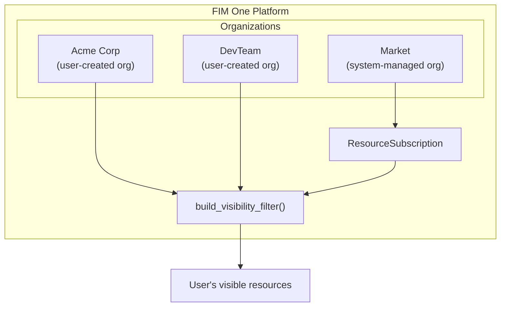
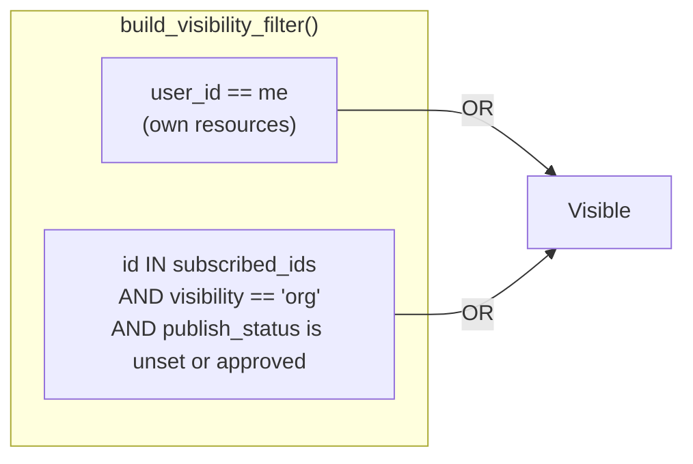
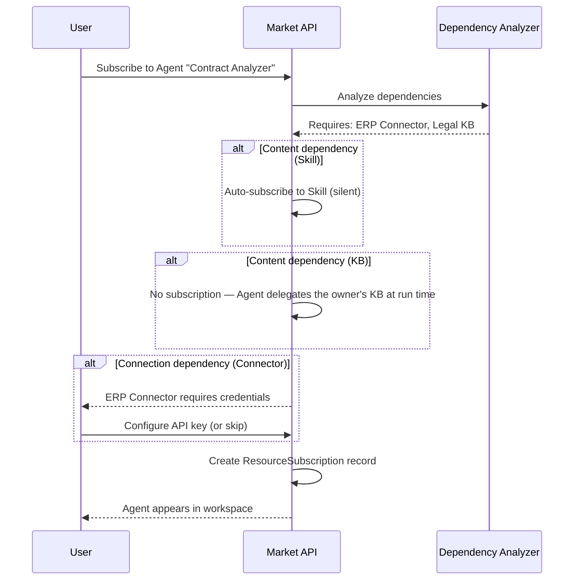
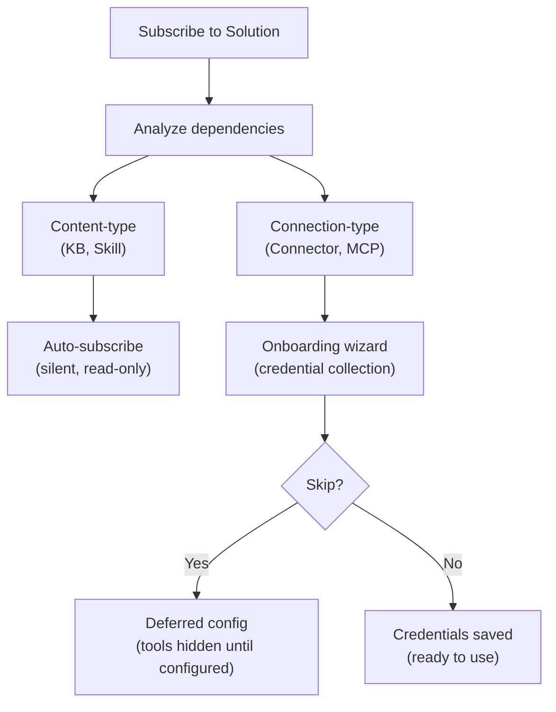

## Übersicht

Der Market ist FIM Ones Ressourcen-Marktplatz. Benutzer veröffentlichen Ressourcen, die sie erstellt haben, andere entdecken und abonnieren diese, und abonnierte Ressourcen erscheinen im Arbeitsbereich des Abonnenten, als wären sie ihre eigenen. Das gesamte System basiert auf einer einzigen architektonischen Erkenntnis: **Der Market ist eine Organisation** — eine vom System verwaltete Shadow-Org mit speziellen Vertrauensregeln.

Diese Seite erläutert die interne Architektur des Market. Eine benutzerorientierte Übersicht über Veröffentlichung und Abonnement finden Sie unter [Market (Features)](/concepts/market). Informationen darüber, wie abonnierte Ressourcen in Tool-Sets geladen werden, finden Sie unter [Agent & Resource Discovery](/architecture/agent-discovery).

## Zwei-Ebenen-Klassifizierung

Der Marketplace organisiert Ressourcen in zwei Kategorien basierend auf dem, was die Ressource tut, nicht auf ihrer Implementierung.

### Solutions

Solutions are things that **do work for you**. A user subscribes to a Solution and gets a ready-to-use capability.

| Resource Type | What It Does |
|---|---|
| **Agent** | A conversational AI assistant with bound tools, knowledge, and instructions |
| **Skill** | A global SOP (Standard Operating Procedure) that can orchestrate multiple agents via `call_agent` |
| **Workflow** | A DAG-based automation flow with visual editing and deterministic execution |

Skills and Workflows are optional modules, off by default. While a module is off its resources are absent from the Market and cannot be subscribed to.

Solutions may depend on other resources. An Agent might require a specific Connector for its API calls and a Knowledge Base for its retrieval pipeline. The Market handles these dependencies automatically during subscription (see [Dependency resolution](#dependency-resolution) below).

### Components

Components are **reusable building blocks** for developers. They provide capabilities that Solutions consume.

| Resource Type | What It Does |
|---|---|
| **Connector** | An API integration adapter definition (database connectors cannot be published) |
| **MCP Server** | A tool service configuration using the Model Context Protocol |

Components are simpler to subscribe to — they have no internal dependencies, only credential requirements.

### Warum Knowledge Bases nicht unabhängig aufgelistet werden

Knowledge Bases sind überhaupt nicht teilbar — weder im Market noch für eine Organisation. Eine KB erreicht andere Benutzer nur als interne Abhängigkeit eines gemeinsam genutzten Agent: Zur Laufzeit delegiert der Agent die Inhalte des Eigentümers, sodass der Abonnent niemals ein KB-Abonnement hält und KBs nie separat suchen, bewerten oder verwalten muss.

<Info>
Die zweigeteilte Klassifizierung (Solutions vs. Components) ist ein **Anzeigeschicht-Konzept**. Sie wird zur Abfragezeit aus `resource_type` abgeleitet, nicht als separates Feld gespeichert. Der zugrunde liegende Abonnementmechanismus, der Sichtbarkeitsfilter und der Überprüfungsprozess sind für alle Ressourcentypen identisch.
</Info>

## Einheitliche Architektur

### Markt als Schattenorganisation

Die wichtigste architektonische Entscheidung des Markts ist, dass er kein separates Subsystem ist. Er ist eine **Organisation** — eine vom System verwaltete Org mit einer festen ID (`MARKET_ORG_ID`), die automatisch während der Plattforminitialisierung erstellt wird.

Das bedeutet:

- **Der gleiche Sichtbarkeitsfilter** (`build_visibility_filter()`) verarbeitet persönliche, Organisations- und Marktressourcen in einer einzigen Abfrage. Kein spezieller Code für Markt-Lookups.
- **Der gleiche Abonnementmechanismus** (`ResourceSubscription`) gilt für Organisations- und Marktressourcen. Das Abonnieren einer Organisationsressource und das Abonnieren einer Marktressource erstellen denselben Datensatz.
- **Die gleiche Anmeldedatenverwaltung** (Fallback, Außerkraftsetzung pro Benutzer) funktioniert in beiden Kontexten. Das Flag `allow_fallback` auf Konnektoren und MCP-Servern verhält sich identisch, unabhängig von der Quelle.
- **Der gleiche Überprüfungsprozess** (`apply_publish_status()`) verarbeitet sowohl Organisations- als auch Marktebenen-Überprüfung. Der einzige Unterschied besteht darin, dass die Marktorganisation alle Überprüfungsflags auf `true` gesperrt hat.

Die Schlüsseldifferenzierung zwischen einer regulären Organisation und der Marktorganisation:

| Aspekt | Organisation | Markt |
|---|---|---|
| **Vertrauensmodell** | Hohes Vertrauen (Teammitgliedschaft) | Kein Vertrauen angenommen (globale Gemeinschaft) |
| **Überprüfung** | Optional pro Ressourcentyp | Immer obligatorisch für alle Typen |
| **Zugriff** | Automatisch für alle Mitglieder | Erfordert explizites Abonnement |
| **Umfang** | Team oder Unternehmen | Global |

<Tip>
Da der Markt nur eine Organisation mit speziellen Regeln ist, funktioniert jede für Organisationen entwickelte Funktion — Überprüfungs-Workflows, Anmeldedatenverwaltung, Ressourcen-Lebenszyklus — automatisch für den Markt ohne zusätzliche Implementierung.
</Tip>

### How the visibility filter handles it

Nobody holds membership in the Market org. Users do not "join" the Market — they subscribe to individual resources. This means `MARKET_ORG_ID` is never present in a user's `user_org_ids` list, and the org-membership visibility condition is naturally skipped for Market resources.

Instead, subscribed Market resources flow through the `subscribed_ids` path in `build_visibility_filter()`, the same path org-shared resources take:

This two-condition OR clause is the entire visibility model. Org membership alone grants nothing: org-shared and Market resources both reach a user through a subscription, and the share state is re-read on every query, so a subscription stops working as soon as the owner unpublishes the resource or it is awaiting or refused by review.

### Bereichsbasiertes Durchsuchen

Die Market-Seite bietet einen **Bereichswähler**, der zwischen zwei Browsing-Kontexten wechselt:

| Bereich | Was wird angezeigt | Wer überprüft |
|---|---|---|
| **Global Market** | Ressourcen, die von jedem in der Market-Organisation veröffentlicht werden | Plattformadministratoren |
| **Organization: [name]** | Ressourcen, die von Mitgliedern einer bestimmten Organisation veröffentlicht werden | Organisationsadministratoren |

Die gleiche Benutzeroberfläche, die gleichen Registerkarten (Solutions / Components) und der gleiche Abonnementfluss gelten in beiden Bereichen. Ein Bereichswechsel ändert nur den `org_id`-Filter in der Browse-Abfrage. Aus Benutzersicht ist die Erfahrung identisch – sie durchsuchen einen Katalog und wählen aus, was installiert werden soll.

## Abonnement-Ablauf

### Durchsuchen und Entdeckung

Benutzer durchsuchen den Marktplatz über einen paginierten Katalog. Jede Ressource zeigt ihren Namen, eine Beschreibung, ein Symbol, den Benutzernamen des Herausgebers und eine Abonnieren-Schaltfläche an. Ressourcen, die der Benutzer bereits abonniert hat, werden entsprechend gekennzeichnet. Die Browse-API (`GET /api/market`) schließt die eigenen Ressourcen des Benutzers aus — Sie können sich nicht für etwas anmelden, das Sie veröffentlicht haben.

### Abonnieren einer Lösung

Das Abonnieren einer Lösung (Agent, Skill oder Workflow) umfasst eine Abhängigkeitsanalyse:

1. Das System analysiert die Abhängigkeiten der Lösung — welche Connectors, Knowledge Bases, MCP Servers und Skills erforderlich sind.
2. **Content-type-Abhängigkeiten** werden ohne Benutzerabfrage behandelt. Ein Skill wird automatisch stillschweigend abonniert. Eine Knowledge Base wird nie abonniert — der Agent delegiert die KB des Eigentümers zur Laufzeit, sodass der Abonnent nichts bereitstellen muss.
3. **Connection-type-Abhängigkeiten** (Connector, MCP Server) werden als Anforderungen aufgelistet. Ein Onboarding-Assistent erfasst Anmeldedaten.
4. Der `ResourceSubscription`-Datensatz wird erstellt, und die Ressource wird im Sichtbarkeitsfilter des Benutzers angezeigt.

### Abonnement für eine Komponente

Komponenten (Konnektoren und MCP-Server) haben einen einfacheren Ablauf — keine Abhängigkeitsanalyse ist erforderlich. Der Benutzer abonniert, konfiguriert optional Anmeldedaten, und die Komponente ist einsatzbereit.

### Credential configuration

Credentials follow a **hybrid model** that balances convenience with flexibility:

- **Offered during subscription.** When a connection-type dependency requires credentials, the onboarding wizard presents the credential form immediately.
- **Skippable.** The user can choose "Skip, configure later." The resource is subscribed, but the tools that need those credentials stay out of the agent's toolset until the user configures them (or the publisher allows fallback).
- **Deferred configuration.** Users can configure or update credentials at any time from their settings page.

This is the same `allow_fallback` mechanism used in organizations. If the publisher has enabled fallback and set a default credential, subscribers can use the resource immediately without providing their own key. If fallback is disabled, each subscriber must bring their own.

<Warning>
When using a Market resource with credential fallback enabled, your API requests flow through the publisher's credentials. For sensitive operations, consider providing your own credentials or verifying the publisher's trustworthiness.
</Warning>

### Unsubscribing

Unsubscribing removes the `ResourceSubscription` record. The resource disappears from the user's visibility filter and is no longer loaded into tool sets. For Solutions, dependencies that were subscribed automatically (Skills, Connectors, MCP Servers) are removed as well when no other subscribed Solution needs them, along with the credentials saved for those Connectors and MCP Servers. Unsubscribing from a Connector or MCP Server directly removes the user's credential for it.

## Abhängigkeitsauflösung

Wenn eine Lösung veröffentlicht oder abonniert wird, analysiert das System ihren Abhängigkeitsbaum. Abhängigkeiten fallen in zwei Kategorien mit unterschiedlichen Behandlungsstrategien.

### Content-Type-Abhängigkeiten

**Knowledge Bases** und **Skills**, auf die eine Solution verweist, sind Content-Type-Abhängigkeiten. Sie stellen schreibgeschützte Daten bereit — Abrufdokumente, SOP-Verfahren — die die Solution nutzt.

- **Skills — im Abonnement:** automatisch stillschweigend abonniert. Der Benutzer sieht keinen separaten Abonnementschritt.
- **Knowledge Bases:** nie abonniert. Eine gebundene KB wird zur Laufzeit vom besitzenden Agent delegiert (Owner-Delegation), daher gibt es auf der Seite des Abonnenten nichts bereitzustellen oder zu bereinigen.
- **Zugriffsmodell:** schreibgeschützter Verweis auf die Ressource des ursprünglichen Autors. Der Abonnent kann den Inhalt nicht ändern.
- **Bei Abmeldung:** automatisch abonnierte Abhängigkeiten werden automatisch bereinigt, wenn die übergeordnete Solution abgemeldet wird.

### Connection-type dependencies

**Connectors** and **MCP Servers** referenced by a Solution are connection-type dependencies. They require credentials to function.

- **On subscription:** subscribed together with the Solution and listed as requirements in the onboarding wizard. The user is prompted to configure credentials (or skip).
- **On unsubscription:** a Connector or MCP Server that was subscribed automatically with the Solution is removed with it, credentials included, unless another subscribed Solution still needs it. One the user subscribed to on their own is left in place with its credentials.

## Veröffentlichung

### Eine Lösung veröffentlichen

Wenn ein Autor einen Agenten, eine Fähigkeit oder einen Workflow auf dem Marktplatz veröffentlicht:

1. Das System setzt `visibility: "org"` und `org_id: MARKET_ORG_ID` auf die Ressource.
2. Das System analysiert die Abhängigkeiten der Lösung und erstellt ein Manifest — das erforderliche Konnektoren, Wissensdatenbanken und MCP-Server auflistet.
3. Das Manifest wird dem Autor zur Bestätigung angezeigt.
4. `apply_publish_status()` setzt die Ressource auf `pending_review` (die Marktplatz-Organisation hat alle Review-Flags auf `true` gesperrt).
5. Ein Systemadministrator überprüft und genehmigt oder lehnt die Ressource ab.

### Veröffentlichung einer Komponente

Die Veröffentlichung eines Konnektors oder MCP-Servers ist einfacher:

1. Das System legt Sichtbarkeit und org_id wie oben fest.
2. Das Credential-Schema wird extrahiert (welche Felder Abonnenten ausfüllen müssen).
3. Die Ressource wechselt in den Status `pending_review` und wartet auf die Genehmigung durch einen Administrator.

### Überprüfungsprozess

Der Überprüfungsprozess ist derselbe Mechanismus, der von Organisationen verwendet wird, mit einem kritischen Unterschied:

| Kontext | Überprüfung erforderlich? | Wer überprüft |
|---|---|---|
| **Organisation** | Konfigurierbar pro Ressourcentyp (`review_agents`, `review_connectors`, usw.) | Org-Administratoren |
| **Marktplatz** | Immer erforderlich für alle Ressourcentypen | Plattform-Administratoren (Marktplatz-Org-Eigentümer) |

Die Marktplatz-Org wird mit allen sechs Überprüfungs-Flags auf `true` initialisiert, und diese Konfiguration kann nicht geändert werden. Jede Ressource, die auf dem Marktplatz veröffentlicht wird, muss die Admin-Überprüfung bestehen, bevor sie im Browse-Katalog sichtbar wird.

<Note>
Org-Eigentümer umgehen die Überprüfung automatisch — ihre veröffentlichten Ressourcen sind sofort verfügbar. Für den Marktplatz hat nur der Marktplatz-Org-Eigentümer (der Systemadministrator) dieses Bypass-Privileg.
</Note>

Wenn eine genehmigte Ressource von ihrem Autor bearbeitet wird, setzt `check_edit_revert()` automatisch den `publish_status` auf `pending_review` zurück. Dies stellt sicher, dass Änderungen an Live-Marktplatz-Ressourcen erneut überprüft werden, bevor sie für Abonnenten sichtbar werden.

## Implementierungshinweise

### The shadow org

The Market organization has a well-known fixed ID (`00000000-0000-0000-0000-000000000001`) and slug (`market`). It is created by `ensure_market_org()` during platform initialization, when the first user (the administrator) registers. The function is idempotent; calling it multiple times is safe.

### ResourceSubscription

Die `ResourceSubscription`-Tabelle ist die zentrale Datenstruktur für den Marketplace-Zugriff:

| Column | Purpose |
|---|---|
| `user_id` | Der Abonnent |
| `resource_type` | `agent`, `connector`, `mcp_server`, `skill` oder `workflow` (Wissensdatenbanken werden nie abonniert — sie basieren auf Agent-Eigentümer-Delegation) |
| `resource_id` | Die ID der abonnierten Ressource |
| `org_id` | Die Quellorganisation (Marketplace-Organisations-ID oder eine reguläre Organisations-ID) |

Eine eindeutige Einschränkung auf `(user_id, resource_type, resource_id)` verhindert doppelte Abonnements. Die `org_id`-Spalte verfolgt, woher das Abonnement stammt, und ermöglicht eine bereichsabhängige Abmeldung.

### Visibility filter integration

The `resolve_visibility()` function performs two lookups in a single call:

1. Fetches the user's org memberships (`user_org_ids`)
2. Fetches the user's subscriptions (`subscribed_ids`)

These are passed to `build_visibility_filter()`, which produces a single SQL WHERE clause combining the two visibility conditions (own, or subscribed and still shared). This function is used everywhere resources are queried — agent lists, connector dropdowns, skill injection, auto-discovery mode — ensuring consistent visibility across the entire platform.

### Anmeldedaten-Verschlüsselung

Anmeldedaten, die während des Abonnements (oder später in den Einstellungen) konfiguriert werden, werden im Ruhezustand mit dem Verschlüsselungsschlüssel der Plattform verschlüsselt. Die Market API gibt niemals Anmeldedatenwerte in Browse-Antworten preis — nur Metadaten (Name, Beschreibung, Symbol, Typ) werden in den `_*_market_info()`-Hilfsfunktionen zurückgegeben.

## Siehe auch

- [Organization & Market](/architecture/organization) -- Freigabe- und Vertrauensmodell auf Organisationsebene
- [Agent & Resource Discovery](/architecture/agent-discovery) -- wie abonnierte Ressourcen in Tool-Sets geladen werden
- [Connector Architecture](/architecture/connector-architecture) -- Connector-Design, Auth-Injection und Audit
- [System Overview](/architecture/system-overview) -- die einheitliche Tool-Abstraktion, auf die alle Ressourcen konvergieren
