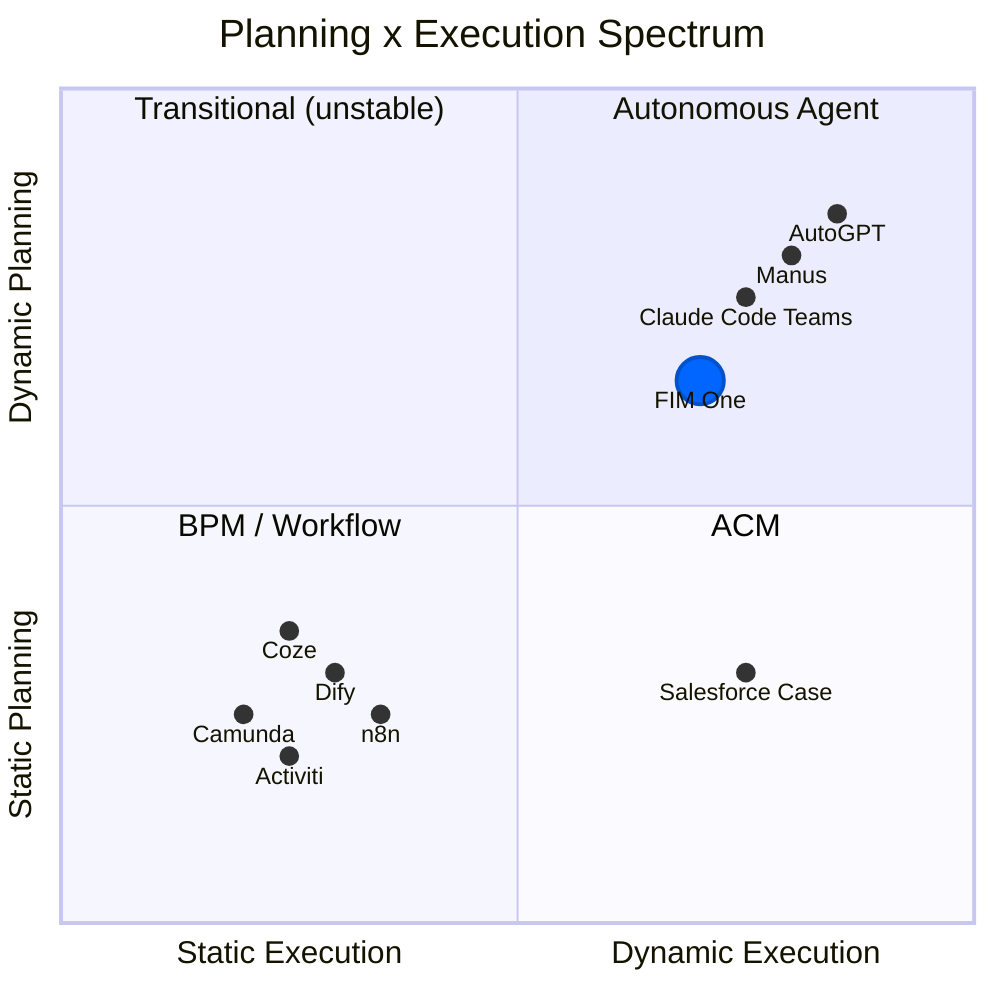
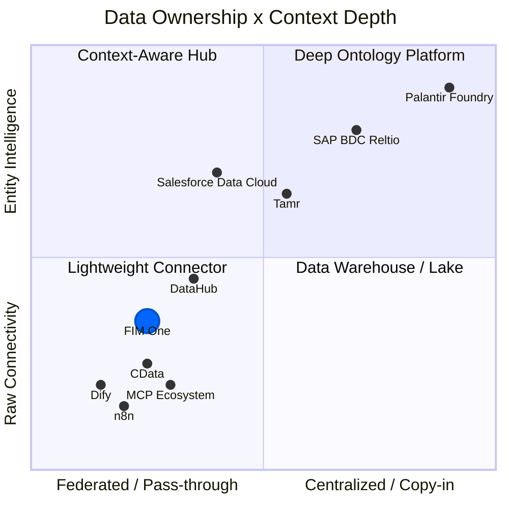

## Warum dynamische Planung der schwierige Mittelweg ist

Die Landschaft der KI-Agenten spaltete sich in zwei Lager auf, und beide wählten den einfachen Weg. Traditionelle Workflow-Engines -- Dify, n8n, Coze -- entschieden sich für statische Orchestrierung: visuelle Drag-and-Drop-Flussdiagramme mit festen Ausführungspfaden. Dies war keine Unwissenheit; Unternehmenskunden fordern Determinismus (gleiche Eingabe, stabile Ausgabe), und statische Graphen liefern das. Am anderen Extrem versprachen vollständig autonome Agenten (AutoGPT und seine Nachfolger) End-to-End-Autonomie, erwiesen sich aber als unpraktisch: unzuverlässige Aufgabenzerlegung, unkontrollierte Token-Kosten und Verhalten, das niemand vorhersagen oder debuggen konnte.

Der Sweet Spot ist eng, aber real. Einfache Aufgaben benötigen keinen Planer. Aufgaben, die komplex genug sind, um Dutzende voneinander abhängiger Schritte zu erfordern, überfordern aktuelle LLMs. Aber dazwischen liegt eine reichhaltige Klasse von Problemen -- Aufgaben mit klaren parallelen Teilaufgaben, die mühsam zu programmieren sind, aber für ein LLM praktikabel zu zerlegen. Dynamische DAG-Planung zielt genau auf diese Zone ab: Das Modell schlägt den Ausführungsgraphen zur Laufzeit vor, das Framework validiert die Struktur und führt sie mit maximaler Parallelität aus. Kein Drag-and-Drop, keine YOLO-Autonomie.

## Die Wette auf verbesserte Modelle

Alle paar Monate verschiebt sich die Grundlage -- GPT-4, Function Calling, Claude 3, das MCP-Protokoll. Eine starre Abstraktion auf wechselndem Untergrund zu bauen ist riskant; LangChains Über-Abstraktion ist die Vorsichtsgeschichte, die jeder in diesem Bereich verinnerlicht hat. FIM One verfolgt den gegenteiligen Ansatz: **minimale Abstraktion, maximale Erweiterbarkeit**. Das Framework übernimmt Orchestrierung, Parallelität und Observability. Die Intelligenz kommt vom Modell, und das Modell wird immer besser.

Heute liegt die Genauigkeit der LLM-Aufgabenzerlegung bei etwa 70-80% für nicht-triviale Ziele. Wenn das 90%+ erreicht, expandiert die „Sweet Spot" für dynamische Planung dramatisch -- Probleme, die gestern zu komplex waren, werden morgen lösbar. FIM Ones DAG-Framework ist so konzipiert, dass es diesen wachsenden Wert erfasst, ohne die Infrastruktur umzuschreiben.

## Will ReAct and DAG planning become obsolete?

ReAct will not disappear -- it will sink into the model. Consider the analogy: you do not hand-write TCP handshakes, but TCP did not go away; it got absorbed into the operating system. When models are strong enough, the think-act-observe loop becomes implicit behavior inside the model, not explicit framework code. This is already happening: Claude Code is essentially a ReAct agent where the loop is driven by the model itself, not by an external harness.

DAG planning's lasting value is not "helping dumb models decompose tasks" -- it is **concurrent scheduling**. Even with infinitely capable models, physics imposes latency: a serial chain of 10 LLM calls takes 10x longer than 3 parallel waves. DAG is an engineering problem (how to run things fast and reliably), not an intelligence problem (how to decide what to run). Retry logic, cost control, timeout management, observability -- these do not go away when models get smarter.

The endgame: **models own the "what" (planning intelligence internalizes into the model), frameworks own the "how" (concurrency, retry, monitoring, cost governance)**. A framework's lasting value is not intelligence -- it is governance.

This is the sentence the rest of FIM One is downstream of. Once the model owns the "what," durable value moves to governing the "how" -- and the highest-value "how" in any enterprise is *reach* into the systems that refuse to talk to each other. The integration layer is one inferential step from here, and the history shows it: the project began as a DAG orchestration framework (`fim-agent`) and became a connector platform within a single week -- not through a rewrite, but because this bet already required it.

## Why not mirror Dify's workflow editor

A natural question: if DAG covers the flexible case, shouldn't we also build a static workflow editor for the deterministic case?

Not as the core. FIM One does ship a visual Workflow editor (9 node types, cron and API triggers), but as an optional module that is off by default. The reasoning for keeping it secondary:

1. **The workflows already exist elsewhere.** Government and enterprise clients' fixed processes live in their OA, ERP, and legacy systems. They don't want to rebuild those flows in yet another platform -- they want AI that can connect to the systems where those flows already run. The Connector Platform (v0.6) solves this directly.

2. **Existing capabilities compose into fixed pipelines.** Scheduled Jobs (v1.0) trigger a DAG agent with a fixed prompt; the DAG dynamically plans the steps; Connectors (v0.6) connect to the target systems. The combination is equivalent to a static pipeline -- but more flexible, because the LLM can adjust its plan based on the data it encounters. No separate pipeline DSL needed.

3. **Investment mismatch.** A production-quality visual workflow editor (canvas, node types, variable passing, debug/replay) is months of dedicated effort. The result would be a low-fidelity copy of what Dify's 120K-star community already maintains. That effort is better spent on the Connector architecture -- a capability no competitor offers.

The strategic bet: **don't compete on workflow visualization; compete on being the agent platform where systems meet AI**. Let Dify own "build AI workflows visually." FIM One owns "the all-in-one agent platform for Global × China enterprises."

## Where FIM One stands

FIM One is not an "AGI task scheduler" and not primarily a static workflow engine. It occupies the middle ground: planning capability with constraints, concurrency with observability.

- Compared to **Dify**: more flexible -- runtime DAG generation vs. design-time flowcharts. You do not need to anticipate every execution path in advance. Does not compete on visual workflow editing; competes on legacy system integration.
- Compared to **AutoGPT**: more controlled -- bounded iterations, re-planning limits, with human confirmation gates. Autonomy within guardrails.

The strategy is straightforward: build the orchestration framework now, and let improving models fill it with capability over time.

## Where FIM One Sits: Planning x Execution Spectrum

The AI execution landscape can be mapped on two axes -- how plans are created (static vs dynamic) and how they are executed (rigid vs adaptive):

**Why Dify/n8n are Static Planning + Static Execution**: The DAG is drawn by a human on a visual canvas at design time. Each node executes a fixed operation (an LLM call with a fixed prompt, an HTTP request, a code block). There is no runtime replanning -- if a step fails, the workflow fails or follows a pre-wired error branch. This is structurally the same as BPM, just with AI nodes in the graph.

**FIM One's position: Dynamic Planning + Dynamic Execution**

- **DAG topology is generated by LLM at runtime** (dynamic planning) -- no human designs the graph
- **Each DAG node runs a full ReAct loop** (dynamic execution) -- nodes reason, use tools, and adapt
- **Re-planning mechanism** (execute → analyze → re-plan if unsatisfied)
- But bounded: max 3 rounds in total (the first plan plus 2 re-plans), token budgets, human confirmation gates

This places FIM One in the same quadrant as AutoGPT, but with engineering constraints that prevent runaway behavior. More flexible than BPM/Dify, more controlled than AutoGPT.

## Concept Glossary

For readers unfamiliar with the terminology used in this document:

| Term | One-line explanation | Relation to FIM One |
|------|---------------------|----------------------|
| **BPM** (Business Process Management) | Processes fully fixed at design time, executed rigidly. Camunda, Activiti. | FIM One is **not** BPM. Fixed processes are covered by the optional Workflow module, not the core. |
| **FSM** (Finite State Machine) | System is in exactly one state at any time; events trigger transitions. Supports loops (reject → resubmit). | Target systems (ERP, contract systems) use FSM internally. FIM One **doesn't need** its own FSM -- it calls the target system's API. |
| **ACM** (Adaptive Case Management) | Skeleton static, branches dynamic. Main flow pre-defined, each node adapts at runtime. | FIM One's DAG + ReAct naturally falls in this quadrant. |
| **HTN** (Hierarchical Task Network) | Recursive task decomposition: high-level → subtasks → atomic operations. | DAG re-planning covers most scenarios; full HTN not needed yet. |
| **iPaaS** (Integration Platform as a Service) | Cloud integration platform connecting multiple SaaS/on-prem systems. MuleSoft, Zapier. | FIM One's integration layer is like **AI-native iPaaS** -- natural language drives cross-system integration. |
| **MDM** (Master Data Management) | Deduplicates and unifies entity records across systems into a "golden record." Reltio, Informatica, Tamr. | FIM One **connects to** MDM systems; it does not replicate entity resolution. |
| **Context Layer / System of Context** | Unified entity + relationship graph that gives AI agents trusted business context. Term popularized by Reltio (2026). | FIM One delegates this to upstream MDM/data platforms. Skills provide lightweight aggregation for common cases. |

## Architektur-Grenze: FIM One repliziert keine Workflow-Logik

Komplexe Geschäftsprozesse (Genehmigungsketten, Transfers, Ablehnungen, Eskalationen, Mitzeichnung, Gegenzeichnung) sind die **Verantwortung des Zielsystems**. Diese Systeme haben Jahre damit verbracht, diese Logik zu entwickeln -- ERP-, OA- und Vertragsmanagementsysteme verfügen alle über ausgefeilte State Machines.

Aus der Perspektive des Konnektors:

| Operation | Was der Konnektor macht |
|-----------|------------------------|
| Transfer | Eine API aufrufen, Zielperson übergeben |
| Ablehnung | Eine API aufrufen, Ablehnungsgrund übergeben |
| Eskalation | Eine API aufrufen, Eskalationspersonenliste übergeben |
| Mitzeichnung | Eine API aufrufen, Mitzeichnerliste übergeben |

Jede komplexe Workflow-Operation wird zu einer HTTP-Anfrage mit Parametern. FIM One ruft die API auf; das Zielsystem verwaltet die State Machine.

Dies ist eine **bewusste architektonische Grenze**, keine Funktionslücke. Die Duplizierung von Workflow-Logik, die bereits in Zielsystemen vorhanden ist, würde:
1. Wartungsaufwand verursachen (zwei State Machines, die synchron gehalten werden müssen)
2. Fehlermöglichkeiten hinzufügen (was ist, wenn sie sich widersprechen?)
3. Keinen zusätzlichen Wert bieten (das Zielsystem macht dies bereits korrekt)

Das Konnektor-Muster ist absichtlich einfach gestaltet: **eine Operation = ein API-Aufruf**.

## Architecture Boundary: Connector Layer, Not Context Layer

Enterprise AI konvergiert auf eine geschichtete Architektur für Agenten-Kontext:

| Layer | Was es tut | Representative players |
|-------|-------------|----------------------|
| **Decision Traces** | Zeichnet auf, *warum* etwas passiert ist -- Audit Trails, Lineage | Palantir Decision Lineage, Arize |
| **Entity Context** | Einheitliche Golden Records + Beziehungsgraphen -- das "System of Context" | Reltio/SAP, Informatica/Salesforce, Tamr |
| **Data Connectivity** | Verbindet Agenten mit Quellsystemen über APIs und Protokolle | **FIM One**, CData, MCP ecosystem |
| **Source Systems** | CRM, ERP, Vertragsverwaltung, Datenbanken, SaaS-Apps | SAP, Salesforce, benutzerdefinierte Systeme |

FIM One operiert auf der **Datenkonnektivitätsschicht**. Es versucht nicht, die darüber liegende Entity-Context-Schicht zu erstellen. Dies ist eine bewusste Entscheidung, keine Lücke.

### Branchenkontext: Die Konsolidierung 2025-2026

Zwei wegweisende Akquisitionen haben die Enterprise-AI-Datenlösung neu gestaltet und die Kontextschicht zu einem strategischen Schlachtfeld gemacht:

- **Salesforce erwarb Informatica** (November 2025) -- fügte Enterprise MDM und Daten-Governance zu seinem Data Cloud + Agentforce Stack hinzu. Das Ziel: Agentforce-Agenten vertrauenswürdig machen, indem sie in Informaticas Golden Records verankert werden.
- **SAP kündigte die Übernahme von Reltio an** (März 2026) -- fügte AI-native Entity Resolution und Relationship Graphs zu seiner Business Data Cloud (BDC) hinzu. Das Ziel: ein „System of Context" schaffen, das sich über SAP- und Nicht-SAP-Umgebungen erstreckt und als vertrauenswürdige Grundlage für Joule-Agenten dient.

Diese Schritte signalisieren, dass die weltweit größten Enterprise-Plattformen einheitlichen Entity-Kontext nun als Voraussetzung für zuverlässige AI-Agenten betrachten -- nicht als Nice-to-have.

### Spektrum von Datenhoheit × Kontexttiefe

**Lesehilfe zum Diagramm:**

- **Unten links (Lightweight Connector)**: minimale Datenhoheit, direkte API-Anbindung. Dify, n8n und einfache MCP-Server befinden sich hier – sie verbinden sich mit Systemen, verstehen aber keine Entitäten. FIM One liegt in diesem Quadranten, jedoch aufgrund von Meta-Tools mit progressiver Offenlegung, Skill-basierter Kontextaggregation und domänenbewusster Eskalation weiter oben auf der y-Achse.
- **Oben links (Context-Aware Hub)**: föderierter Zugriff mit Verständnis auf Entitätsebene. Salesforce Data Cloud ist ein Beispiel dafür – föderierter Zero-Copy-Zugriff mit bedarfsgesteuerter Entitätsauflösung. DataHub stellt Kontext auf Metadatenebene bereit (Schema, Herkunft, Eigentümerschaft), ohne Geschäftsdaten zu besitzen.
- **Oben rechts (Deep Ontology Platform)**: vollständige Datenaufnahme mit umfassender Entitätenintelligenz. SAP BDC + Reltio erstellt persistente Golden Records über mehrere Domänen hinweg, einschließlich Beziehungsgraphen. Palantir geht am weitesten – mit einer dreischichtigen Ontologie und Entscheidungslinien.
- **Unten rechts (Data Warehouse / Lake)**: zentralisierte Datenspeicherung ohne Entitätssemantik. Traditionelle Datenplattformen, die alles aufnehmen, aber keine Entitätsauflösung oder Beziehungsmodellierung bieten.

Die Position von FIM One spiegelt eine bewusste Entscheidung wider: föderiert und schlank zu bleiben, zugleich aber in die einfache Zugänglichkeit des vorgelagerten Entitätskontexts (aus beliebigen MDM-Systemen) für Agents zu investieren.

### Drei Modelle für Entity-Kontext

**SAP: Multi-Domain Golden Record (Copy-in + Govern)**

SAP baut eine dreischichtige Enterprise-Architektur auf:

| Layer | System | Rolle |
|-------|--------|------|
| **Transaction** | S/4HANA | Geschäftsausführung -- Bestellungen, Rechnungen, Lieferungen |
| **Intelligence** | Business Data Cloud (BDC) + Reltio | Semantische Integration, Entity Resolution, Beziehungsgraphen |
| **Agent** | Joule + Joule Agents | Intent-Verständnis, Tool-Orchestrierung, autonome Ausführung |

Reltio sitzt im Zentrum der Intelligence-Schicht. Seine Aufgabe: Entity-Daten aus SAP- und Nicht-SAP-Systemen aufnehmen, Duplikate durch KI-basiertes Matching auflösen und **Multi-Domain Golden Records** (Kunde, Lieferant, Produkt, Patient, Asset) mit Beziehungsgraphen erzeugen. Reltios frühe Adoption des **MCP-Protokolls** ist strategisch bedeutsam -- es positioniert Golden Records als direkt aufrufbar durch jeden MCP-kompatiblen Agenten, nicht nur durch SAPs eigene Joule.

SAPs Wette: Agenten benötigen einen persistenten, gesteuerten, domänenübergreifenden "Single Source of Truth", um zuverlässig in hochriskanten Enterprise-Prozessen zu arbeiten.

**Salesforce: Zero-Copy-Föderierung (Federate + On-Demand-Auflösung)**

Salesforce verfolgt einen leichteren Ansatz. Data Cloud erfordert keine physische Datenbewegung; stattdessen nutzt es **Zero-Copy-Partnerschaften** (Databricks, Snowflake, BigQuery), um Daten an Ort und Stelle zu föderieren. Entity Resolution findet on-demand innerhalb von Data Cloud statt und erstellt einheitliche Kundenprofile ohne einen persistenten Golden-Record-Store.

Wichtige Zahlen (Q3 FY2026): Data Cloud nahm 32 Billionen Datensätze auf, davon 15 Billionen über Zero-Copy (341% YoY-Wachstum). Diese Skalierung validiert das Föderierungsmodell für CRM-zentrische Anwendungsfälle.

Agentforce-Agenten sind in diesem föderiertem Kontext verankert: Sie argumentieren über die verteilte Datenbasis, ohne dass alle Daten in einem System landen müssen. Für Front-Office-Szenarien (Vertrieb, Service, Marketing) ist dies flexibel und schnell bereitzustellen.

Salesforces Wette: Agenten benötigen keinen schwerfälligen Golden-Record-Store -- sie benötigen Echtzeitzugriff auf föderiertem, aufgelöstem Kontext dort, wo er bereits vorhanden ist.

**Palantir: Tiefe Ontologie (die gewichtige Referenz)**

Am extremen Ende nimmt Palantir Foundry alle Daten auf und baut eine dreischichtige Ontologie (semantische Objekte + kinetische Aktionen + dynamische Regeln) mit vollständiger Entscheidungslinienführung. Dies ist das vollständigste Kontextsystem in der Produktion, aber zu Verträgen von $10M+ und Bereitstellungen von 6-18 Monaten. Es dient als Referenzarchitektur, nicht als realistisches Modell für die meisten Organisationen.

### Wo FIM One passt

| Dimension | SAP + Reltio | Salesforce + Informatica | FIM One |
|-----------|-------------|-------------------------|---------|
| **Datenphilosophie** | Copy-in: in BDC aufnehmen, goldene Datensätze erstellen | Federate: Zero-Copy-Zugriff, On-Demand-Auflösung | Pass-through: mit Quelle verbinden, nicht speichern |
| **Entity Resolution** | Tiefgreifend -- AI-natives MDM mit Beziehungsgraphen | Mittel -- Data Cloud Entity Resolution | Keine -- delegiert an vorgelagertes MDM |
| **Agent-Integration** | Joule Agents + MCP | Agentforce + Data Cloud Grounding | Beliebiger Agent + beliebiger Connector |
| **Bereitstellungskosten** | Enterprise-Plattformpreisgestaltung | Enterprise-SaaS-Preisgestaltung | Leichtgewichtig, Stunden bis Tage |
| **Lock-in** | Hoch (BDC + S/4HANA-Ökosystem) | Mittel (Salesforce-Ökosystem) | Niedrig -- Connectoren sind austauschbar |
| **Beste Eignung** | Fertigung, Lieferkette, Life Sciences (komplexe Multi-Domain) | CRM-gesteuerte Unternehmen (Front-Office-Fokus) | Mittelmarkt, Multi-System, Provider-agnostisch |

FIM One entspricht am ehesten der **Salesforce-Philosophie** (Daten nicht besitzen, sondern sich damit verbinden), jedoch ohne die Abhängigkeit vom Salesforce-Ökosystem. Die strategische Position: Provider-agnostisch auf der Konnektivitätsebene sein und jedes MDM -- ob SAP/Reltio, Salesforce/Informatica, Tamr oder eine benutzerdefinierte Lösung -- als Entity-Context-Quelle dienen lassen.

### Warum FIM One auf der Connector-Ebene bleibt

Der Aufbau einer Entity-Context-Schicht erfordert persistente Datenspeicherung, ML-basierte Entity-Auflösung, Survivorship-Regeln, Relationship-Graph-Engines und Governance-Frameworks. Dies ist eine eigenständige Produktkategorie (MDM) mit jahrzehntelanger Konkurrenz (Reltio, Informatica, Tamr). Ein Versuch würde:

1. **FIM One von einem Connector zu einer Datenplattform transformieren** -- grundlegend anderes Produkt, Team und Go-to-Market
2. **Funktionen duplizieren, die vorgelagerte Systeme bereits bereitstellen** -- das gleiche Anti-Pattern, das wir bei Workflow-Logik vermeiden
3. **Lock-in erhöhen** -- sobald Benutzer Golden Records in FIM One speichern, steigen die Wechselkosten dramatisch

Die richtige Strategie: **der beste Eingangspunkt für jedes MDM-System sein**, nicht ein Ersatz dafür. FIM One sollte es trivial machen, dass Reltio, Informatica, Tamr oder ein benutzerdefiniertes MDM Entity-Context für Agenten bereitstellen -- über MCP Resources, Connector-APIs oder Knowledge-Base-Injection.

### Aktueller Ansatz: Fähigkeiten als leichte Kontextaggregation

Für Szenarien, die kontextübergreifende Konnektoren benötigen (z. B. Vertragsüberprüfung mit Lieferantendaten + Zahlungsverlauf + Risikoflaggen), bieten **Fähigkeiten** bereits eine pragmatische Lösung. Das SOP einer Fähigkeit kann mehrere Konnektoraktionen nacheinander orchestrieren, Ergebnisse aggregieren und strukturierten Kontext dem Agenten präsentieren -- ohne eine persistente Entity-Schicht zu erstellen.

Dies deckt den 80%-Fall ab. Sollte Nachfrage nach Echtzeit-Entity-Auflösung auf Konnektorebene entstehen, lässt die Architektur Raum für einen zukünftigen `ContextSource`-Konnektortyp, der sich mit externen MDM-Systemen integriert -- aber das ist eine zukünftige Überlegung, keine aktuelle Verpflichtung.

### Die Analogie

FIM One's Beziehung zur Kontextschicht ist wie SQLAlchemy's Beziehung zur Datenbank: Sie speichert oder verwaltet keine Daten, sondern macht jede Datenquelle für die Anwendungsschicht zugänglich. Lassen Sie MDM-Plattformen die Entitätsauflösung besitzen; lassen Sie FIM One die Verbindung besitzen.

## Wo FIM One im KI-Stack sitzt

### The Layered Model

A useful mental model (credit [Phil Schmid](https://www.philschmid.de/)) maps AI systems to a four-layer stack analogous to computing hardware:

| Layer | Analogy | FIM One Component |
|-------|---------|-------------------|
| **Model** | CPU | ModelRegistry -- any OpenAI-compatible LLM |
| **Context** | RAM | ContextGuard + Memory (Window / Summary / DB) |
| **Harness** | Operating System | ReAct Agent + DAG Planner + Hooks + ToolRegistry |
| **Application** | App | Portal, API |

FIM One operates at the **harness layer** -- it does not compete with models; it makes them productive by providing the right tools, constraints, and feedback loops. The model supplies intelligence; the harness supplies governance, concurrency, and reliability.

### Three Eras of AI Engineering

The discipline has evolved through distinct phases: **Prompt Engineering** focused on crafting better instructions to elicit correct behavior from a fixed model. **Context Engineering** shifted attention to assembling the right information -- retrieving documents, injecting tool results, managing memory -- so the model has what it needs to reason well. **Harness Engineering** goes further: designing the full execution environment around the model, including deterministic guardrails, tool orchestration, feedback loops, and cost controls.

FIM One's architecture embodies harness engineering principles. The [Hook System](/architecture/hook-system) runs platform code outside the LLM loop at well-defined lifecycle points — today `ApprovalGateHook` intercepts sensitive tool calls and routes approval to an in-portal card or an IM channel, and the same abstraction can carry audit logging, read-only-mode enforcement, rate limits, and result truncation if those are ever needed. ContextGuard manages what enters the context window and when. Dynamic tool selection (progressive-disclosure meta-tools) keeps the tool surface tractable as connector count grows. The ReAct loop's self-reflection mechanism and the DAG planner's re-plan cycle provide structured feedback that improves execution quality without requiring a more capable model.
