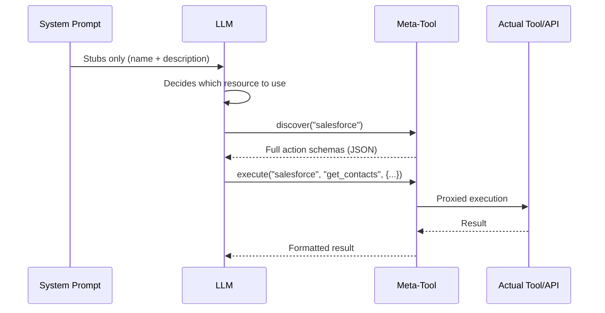
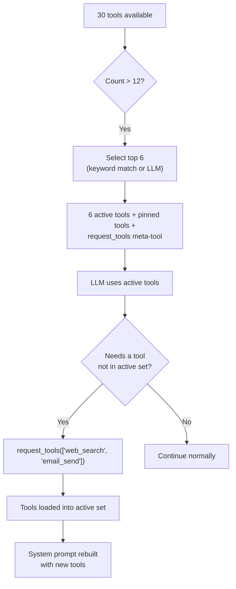

## Das Problem

LLMs zahlen für Kontext in zwei Währungen: Token und Aufmerksamkeit. Jede Werkzeugdefinition, die in den System-Prompt injiziert wird, kostet beides. Ein einzelner MCP-Server kann über 90 Werkzeuge bereitstellen. Fünf API-Konnektoren mit je 20 Aktionen erzeugen 100 Werkzeugdefinitionen. Drei Datenbank-Konnektoren mit je 30 Tabellen generieren weitere 90 Schemabeschreibungen. Bevor der Benutzer auch nur ein Wort tippt, kann der System-Prompt bereits 50–100 KB Kontext verbrauchen – die Hälfte des Budgets eines 128K-Modells.

Die Kosten sind nicht nur Token. Forschung und Praxis zeigen konsistent, dass **die Genauigkeit von LLMs mit wachsendem irrelevantem Kontext abnimmt.** Ein Agent mit 80 Werkzeugdefinitionen in seinem System-Prompt schneidet bei der Werkzeugauswahl messbar schlechter ab als einer mit 6. Das Modell verschwendet Aufmerksamkeit auf Werkzeugschemas, die es nie verwenden wird, und schwächt damit seinen Fokus auf die Werkzeuge und Anweisungen, die wichtig sind.

Die naive Lösung – alles injizieren und das Modell sortieren lassen – skaliert nicht. FIM One verfolgt den gegenteiligen Ansatz: **Zeige dem LLM das Minimum, das es für eine Entscheidung braucht, und lass es mehr anfordern, wenn es mehr braucht.**

## Das Muster

Progressive Offenlegung folgt einer zweistufigen Architektur über alle Ressourcentypen hinweg:

1. **Stufe 1 -- Stubs im System-Prompt.** Leichte Zusammenfassungen: ein Name, eine kurze Beschreibung und genug Metadaten (Aktionsanzahl, Tabellenanzahl, Werkzeuganzahl), damit das LLM entscheiden kann, ob es mehr braucht.

2. **Stufe 2 -- Vollständige Details auf Anfrage.** Das LLM ruft ein Meta-Werkzeug auf, um vollständige Schemas, Parameter und Ausführungsfähigkeiten abzurufen. Die vollständigen Details werden als Werkzeug-Ergebnis-Nachricht in das Gespräch eingegeben -- begrenzt auf diese Runde, nicht dauerhaft im System-Prompt.



Die Schlüsseleinsicht: **Vollständige Werkzeug-Schemas sind gesprächsbezogen, nicht prompt-bezogen.** Sie erscheinen als Werkzeug-Ergebnis-Nachrichten, die das Kontextverwaltungssystem in späteren Runden zusammenfassen oder kürzen kann. Im Gegensatz dazu bleibt der Inhalt des System-Prompts über das gesamte Gespräch hinweg in voller Größe erhalten.

## Five disclosure mechanisms

FIM One applies progressive disclosure uniformly across five resource types. Each uses the same two-tier pattern but with a meta-tool tailored to its semantics.

| Resource | Meta-Tool | Stubs Show | On-Demand Returns | Config Var | Default |
|---|---|---|---|---|---|
| Skills (when the module is enabled; off by default) | `read_skill` | Name + description (120 chars) | Full SOP content + embedded script | `SKILL_TOOL_MODE` | `progressive` |
| API Connectors | `connector` | Connector name + action list | Full action schemas with parameters | `CONNECTOR_TOOL_MODE` | `progressive` |
| Database Connectors | `database` | DB name + table names + counts | Column schemas, SQL query execution | `DATABASE_TOOL_MODE` | `progressive` |
| MCP Servers | `mcp` | Server name + tool list | Full tool schemas + invocation | `MCP_TOOL_MODE` | `progressive` |
| Built-in Tools | `request_tools` | Compact catalog (name + 80-char desc) | Full tool schema injected into session | _(auto)_ | Auto when >12 tools |

### Skills -- `read_skill`

**What the LLM sees initially:**

```
## Available Skills
Call read_skill(name) to load full content before executing any of these:
- Customer Complaint SOP: Handle escalations per company policy...
- Refund Processing: Step-by-step refund workflow with approval gates...
```

Each stub is roughly 30 tokens -- a name plus the Skill's description, truncated to 120 characters (`SKILL_STUB_DESC_LENGTH`).

**What happens on demand:** The LLM calls `read_skill("Customer Complaint SOP")` and receives the complete SOP text -- potentially thousands of tokens of step-by-step instructions, decision trees, and embedded scripts. This content enters as a tool result, not as system prompt text, so it is subject to normal context management (summarization, truncation) in later turns.

**Legacy mode:** `SKILL_TOOL_MODE=inline` embeds the full Skill content directly in the system prompt. Suitable when you have few, small Skills -- but scales poorly.

**Context savings:** A deployment with 10 Skills averaging 2,000 tokens each consumes ~300 tokens in progressive mode (stubs only) vs. ~20,000 tokens in inline mode. That is a 98% reduction in persistent context cost.

### API-Konnektoren -- `connector`

**Was der LLM zunächst sieht:**

```
Interact with external services. Available connectors:
  - salesforce: CRM system -- actions: get_contacts, create_lead, update_opportunity
  - jira: Project management -- actions: create_issue, get_issue, search_issues

Subcommands:
  discover <name> -- list actions with full parameter schemas
  execute <name> <action> {"param": "value"} -- run an action
```

Jeder Konnektoren-Stub listet Aktionsnamen auf, aber nicht die Parameterschemas. Der LLM weiß, *welche* Aktionen existieren, aber nicht, *wie* man sie aufruft – genau die richtige Detailebene, um zu entscheiden, ob ein Konnektor verwendet werden soll.

**Was bei Bedarf passiert:** `connector("discover", "salesforce")` gibt die vollständigen Aktionsschemas zurück, einschließlich HTTP-Methoden, URL-Pfade, Parameter-JSON-Schemas und Request-Body-Vorlagen. `connector("execute", "salesforce", "get_contacts", {"limit": 10})` leitet die Ausführung durch `ConnectorToolAdapter` mit vollständiger Auth-Injektion und Audit-Logging weiter.

**Legacy-Modus:** `CONNECTOR_TOOL_MODE=legacy` registriert jede Aktion als separates Tool (`salesforce__get_contacts`, `salesforce__create_lead`, usw.). Ein Konnektor mit 20 Aktionen wird zu 20 Tool-Definitionen im System-Prompt.

**Kontexteinsparungen:** Ein Konnektor mit 15 Aktionen generiert ~50 Token Stub gegenüber ~3.000 Token vollständiger Schemas. Fünf Konnektoren: ~250 Token progressiv gegenüber ~15.000 Token Legacy.

### Datenbank-Konnektoren -- `database`

**Was das LLM anfangs sieht:**

```
Query connected databases. Available databases:
  - hr_postgres: HR system (12 tables: employees, departments, salaries ...)
  - analytics_db: Analytics warehouse (45 tables: events, sessions, users ...)

Subcommands:
  list_tables <database> -- table names, descriptions, column counts
  discover <database> [table] -- full column schemas for one or all tables
  query <database> <sql> -- execute a SQL query
```

Datenbank-Stubs enthalten Tabellennamen (bis zu 10) und Zählungen, was dem LLM genug Informationen gibt, um zu entscheiden, welche Datenbank abgefragt werden soll, ohne Spaltenschemas zu laden.

**Was bei Bedarf geschieht:** Drei Unterbefehle bilden einen natürlichen Erkennungsfluss:

1. `database("list_tables", "hr_postgres")` -- gibt alle Tabellennamen mit Beschreibungen und Spaltenzählungen zurück.
2. `database("discover", "hr_postgres", table="employees")` -- gibt vollständige Spaltenschemas zurück (Name, Typ, nullable, Primärschlüssel, Beschreibungen).
3. `database("query", "hr_postgres", sql="SELECT ...")` -- führt eine validierte SQL-Abfrage mit Sicherheitsprüfungen und Zeilenlimits aus.

Der dreistufige Fluss spiegelt wider, wie ein Entwickler eine neue Datenbank erkundet: Tabellen durchsuchen, Schema inspizieren, dann abfragen. Das LLM folgt dem gleichen Muster natürlicherweise.

**Legacy-Modus:** `DATABASE_TOOL_MODE=legacy` registriert drei Tools pro Datenbank (`{db}__list_tables`, `{db}__describe_table`, `{db}__query`). Mit 5 Datenbank-Konnektoren sind das 15 Tool-Definitionen statt 1.

**Kontexteinsparungen:** Eine Datenbank mit 30 Tabellen und 200 Spalten erzeugt ~80 Token Stub gegenüber ~5.000 Token vollständigem Schema. Die Einsparungen verstärken sich mit mehreren Datenbanken.

### MCP-Server -- `mcp`

**Was der LLM anfangs sieht:**

```
Interact with MCP servers. Available servers:
  - github: GitHub (35 tools: create_issue, list_repos, get_pull_request ...)
  - slack: Slack (12 tools: send_message, list_channels, upload_file ...)

Subcommands:
  discover <server> -- list tools with full parameter schemas
  call <server> <tool> {"param": "value"} -- invoke an MCP tool
```

MCP-Server sind der extremste Fall für progressive Offenlegung. Ein GitHub-MCP-Server stellt 35+ Tools zur Verfügung. Ein Dateisystem-Server stellt 20+ zur Verfügung. Ohne progressive Offenlegung könnten 3 verbundene MCP-Server 70+ Tool-Definitionen in den System-Prompt injizieren -- jede mit vollständigen JSON-Schema-Parametern.

**Was bei Bedarf geschieht:** `mcp("discover", "github")` gibt den vollständigen Tool-Katalog mit Parameter-Schemas zurück. `mcp("call", "github", "create_issue", {"title": "Bug report", "body": "..."})` delegiert an den gespeicherten `MCPToolAdapter`, der mit dem MCP-Server-Prozess kommuniziert.

**Legacy-Modus:** `MCP_TOOL_MODE=legacy` registriert jedes MCP-Tool als separates Tool (`github__create_issue`, `github__list_repos`, usw.). Dies kann leicht die Tool-Auswahlschwelle überschreiten und unnötige Auswahlphasen auslösen.

**Kontexteinsparungen:** Die Einsparungen hier sind extrem. Die 35 Tools eines GitHub-MCP-Servers könnten 10.000+ Token des Schemas verbrauchen. Im Progressive-Modus kostet der Stub ~100 Token. Wenn der Benutzer GitHub in diesem Gespräch nie benötigt, werden diese 10.000 Token nie ausgegeben.

### Built-in Tools -- `request_tools`

The fifth mechanism is architecturally different from the other four. It does not consolidate a resource type behind a meta-tool. Instead, it addresses the **tool selection bottleneck** -- what happens when the agent has more than 12 tools available.

**How it works:** When the total tool count exceeds `REACT_TOOL_SELECTION_THRESHOLD` (default: 12), the ReAct engine selects up to 6 relevant tools for the current query (a keyword match first, a lightweight fast-LLM call otherwise) and adds pinned tools such as `read_skill` and `update_plan` on top. The remaining tools are stored in a full registry. A `request_tools` meta-tool is automatically registered, listing all unloaded tools as a compact catalog (name + 80-character description).



**What the LLM sees initially:**

```
Load additional tools into the current session.
Available tools not yet loaded:
- web_search: Search the web for current information and return relevant results...
- email_send: Send an email to one or more recipients with subject, body, and opt...
- python_exec: Execute Python code in a sandboxed environment and return the output...
```

**What happens on demand:** `request_tools(tool_names=["web_search", "email_send"])` copies those tools from the full registry into the active registry. The system prompt is rebuilt on the next iteration so the LLM sees the full schemas. This is a side-effect -- the tool mutates the active tool set mid-conversation.

**No env var:** This mechanism activates automatically when tool selection filters the set. There is no `REQUEST_TOOLS_MODE` environment variable. If you want to disable tool selection entirely, set `REACT_TOOL_SELECTION_THRESHOLD` to a very high number.

**Context savings:** The savings depend on how many tools are available and how many the selection picks. An agent with 30 tools seeing only 6 active schemas + the `request_tools` catalog saves roughly 60--70% of the tool schema context.

## How it fits into the tool assembly pipeline

The [System Overview](/architecture/system-overview) describes an 8-step per-request tool assembly pipeline. Progressive disclosure acts at multiple points:

| Pipeline Step | Progressive Disclosure Role |
|---|---|
| **1. Base discovery** | No effect -- built-in tools are loaded normally |
| **2. Agent category filter** | No effect -- category filtering applies regardless of mode |
| **3. KB injection** | No effect -- KB tools are naturally lightweight (1--2 tools) |
| **4. Connector loading** | `ConnectorMetaTool` consolidates all API connectors; `DatabaseMetaTool` consolidates all DB connectors |
| **5. MCP loading** | `MCPServerMetaTool` consolidates all MCP servers into one tool |
| **6. Skills injection** | `ReadSkillTool` replaces full content with compact stubs in system prompt |
| **7. CallAgent registration** | No effect -- `call_agent` is already a single tool with a catalog |
| **8. Runtime selection** | `request_tools` meta-tool registered when selection filters the set |

The net effect: steps 4--6 each reduce their tool count to 1 (or a small constant), and step 8 adds a safety net for dynamically loading anything the selection phase missed. An agent that would have 50+ tools in legacy mode might present 8--10 in progressive mode -- well below the selection threshold.

## Konfiguration

Vier Umgebungsvariablen steuern die progressive Offenlegung, eine pro Ressourcentyp:

| Variable | Werte | Standard | Effekt |
|---|---|---|---|
| `SKILL_TOOL_MODE` | `progressive` / `inline` | `progressive` | Skills: Stubs + `read_skill` vs. vollständiger Inhalt im System-Prompt |
| `CONNECTOR_TOOL_MODE` | `progressive` / `legacy` | `progressive` | API-Konnektoren: einzelnes `connector` Meta-Tool vs. einzelne Action-Tools |
| `DATABASE_TOOL_MODE` | `progressive` / `legacy` | `progressive` | DB-Konnektoren: einzelnes `database` Meta-Tool vs. 3 Tools pro Datenbank |
| `MCP_TOOL_MODE` | `progressive` / `legacy` | `progressive` | MCP-Server: einzelnes `mcp` Meta-Tool vs. einzelne Server-Tools |

**Außerkraftsetzung auf Agent-Ebene.** Jede Umgebungsvariable kann pro Agent über das Feld `model_config_json` außer Kraft gesetzt werden:

```json
{
  "model_config_json": {
    "skill_tool_mode": "inline",
    "connector_tool_mode": "legacy",
    "database_tool_mode": "progressive",
    "mcp_tool_mode": "progressive"
  }
}
```

**Prioritätsreihenfolge:** Agent-Konfiguration > Umgebungsvariable > Standard.

Das bedeutet, dass Sie global `progressive` ausführen können (Standard) und selektiv für bestimmte Agenten außer Kraft setzen. Ein Agent mit einer einzelnen kleinen Skill könnte den `inline`-Modus verwenden. Ein Agent, der das LLM alle Konnektoren-Aktionen von vornherein sehen lassen muss (z. B. für feinabgestimmte Modelle, die Meta-Tools nicht zuverlässig aufrufen), könnte den `legacy`-Modus verwenden.

**`request_tools` hat keine Konfiguration.** Es wird automatisch aktiviert, wenn die Tool-Auswahl eine gefilterte Teilmenge erzeugt. Der Schwellenwert wird durch `REACT_TOOL_SELECTION_THRESHOLD` (Standard: 12) und die maximale Auswahlanzahl durch `REACT_TOOL_SELECTION_MAX` (Standard: 6) gesteuert.

## Designentscheidungen

### Warum explizit (LLM-gesteuert) statt implizit (Framework-gesteuert)?

Ein alternatives Design würde das Framework automatisch Tool-Schemas basierend auf Heuristiken erweitern -- z. B. durch Erkennung, welcher Connector die Abfrage des Benutzers betrifft, und Einspeisung seiner Schemas, bevor das LLM den Prompt sieht. FIM One hat sich bewusst für den LLM-gesteuerten Ansatz aus drei Gründen entschieden:

1. **Das LLM ist besser bei der Intentionserkennung als Heuristiken.** Eine Abfrage wie "überprüfe, ob der Kunde ein offenes Ticket hat und aktualisiere sein Profil" betrifft zwei Connectors. Heuristische Schlüsselwortabstimmung ist fehleranfällig; das LLM identifiziert natürlicherweise beide.

2. **Transparenz.** Wenn das LLM `connector("discover", "jira")` aufruft, erscheint die Aktion in der Tool-Trace. Der Benutzer (und der Entwickler beim Debugging) kann genau sehen, welche Schemas geladen wurden und wann. Implizite Erweiterung ist unsichtbar.

3. **Kontexteffizienz.** Das Framework kann nicht wissen, welche Aktionen innerhalb eines Connectors das LLM benötigt. Das Erweitern aller Aktionen eines Connectors verschwendet Token für irrelevante. Das LLM sieht zunächst die Aktionsnamen (über den Stub), fordert dann nur das Schema der spezifischen Aktion an -- zweistufige Offenlegung in ihrer reinsten Form.

### Why per-resource meta-tools rather than one universal tool?

A single `discover_resource(type, name)` tool would be simpler to implement but worse for the LLM. Per-resource meta-tools provide:

- **Typed parameters.** `connector` has `subcommand`, `connector`, `action`, `parameters`. `database` has `subcommand`, `database`, `table`, `sql`. The parameter schemas tell the LLM exactly what is expected.
- **Enum constraints.** Each meta-tool lists its valid names (connector names, database names, server names) as enum values in the schema. The LLM cannot hallucinate a connector name.
- **Category semantics.** The `connector` tool has category `connector`, `database` has category `database`, `mcp` has category `mcp`. An agent's `tool_categories` filter applies to built-in tools only; which meta-tools appear is decided by the agent's bound connectors and MCP servers.

### Warum sowohl Progressive als auch Legacy-Modi?

Nicht alle LLMs handhaben Meta-Tools gleich gut. Kleinere oder fein abgestimmte Modelle können mit dem zweistufigen Discover-then-Execute-Muster kämpfen. Der Legacy-Modus bietet einen direkten Fallback, bei dem jede Aktion ein eigenständiges Tool mit seinem vollständigen Schema ist -- keine Meta-Tool-Umleitung erforderlich.

Das Dual-Mode-Design unterstützt auch die Migration. Bestehende Bereitstellungen können schrittweise in den Progressive-Modus wechseln und einen Ressourcentyp nach dem anderen testen, indem sie eine einzelne Umgebungsvariable ändern. Jede Umgebungsvariable fungiert als Feature-Flag -- der Auswirkungsbereich ist auf einen einzelnen Ressourcentyp begrenzt, und ein Rollback ist eine einzeilige Konfigurationsänderung.

Ein dritter, praktischerer Grund: **Debugging.** Im Legacy-Modus ist jeder Tool-Aufruf explizit und in sich geschlossen -- `salesforce__get_contacts(limit=10)` ist sofort in Logs und Traces lesbar. Im Progressive-Modus ist derselbe Aufruf `connector("execute", "salesforce", "get_contacts", {"limit": 10})` -- eine zusätzliche Indirektionsebene, die das Parsen der Meta-Tool-Argumente erfordert, um zu verstehen, was tatsächlich passiert ist. Während der Entwicklung und Fehlerbehebung kann das Umschalten eines einzelnen Ressourcentyps zurück in den Legacy-Modus die Diagnose erheblich beschleunigen, ohne andere Ressourcentypen zu beeinflussen.
