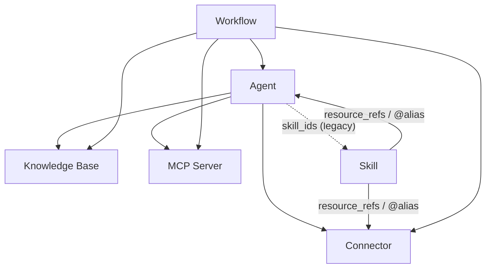

This page is the single reference for **sharing permissions** and **credential
flow**. The shareable resource types are **Agents, Connectors, and MCP
servers** (plus **Skills** and **Workflows** when those optional modules are
enabled). Use it to reason about what happens when you share a resource that is
itself built on top of other resources.

<Note>
**Knowledge bases are not shareable.** A KB reaches other people only by being
bound to a shared Agent, which delegates the owner's content at run time (see
"How access flows through bound resources"). There is no publish-KB action.
**Database connectors are not shareable either:** publishing one is refused,
and its SQL tool is offered only to the connector's owner.
</Note>

## Die zwei Fragen

Jede Freigabeentscheidung beantwortet zwei unabhängige Fragen:

1. **Sichtbarkeit** — *kann die andere Person diese Ressource überhaupt sehen/nutzen?*
2. **Anmeldedaten** — *mit wessen Geheimnis (API-Schlüssel, Datenbankpasswort, Server-Umgebung) wird es ausgeführt?*

Sichtbarkeit betrifft die Ressource; Anmeldedaten sind eine separate, benutzerspezifische Angelegenheit, die nur Connectors und MCP-Server betrifft. Halten Sie diese auseinander — die meiste Verwirrung entsteht durch die Vermischung von „Ich kann es sehen" mit „Ich kann den Schlüssel des Eigentümers nutzen".

## Visibility: own + subscribed

A resource is visible to you only if **you own it** or **you have an explicit
subscription** to it. There is no implicit "everyone in my org can see it"
anymore — org sharing is delivered through subscriptions.

| Share scope | What it means | How others gain access |
| --- | --- | --- |
| **Personal** (default) | Only the owner can see it. | — |
| **Organization** | Published to an org. | Org members **subscribe** from the Market. |
| **Global / Market** | Published to the public Market. | Anyone **subscribes** from the Market. |

The same rule governs everywhere a resource is used — chat tool assembly, binding
to an agent, and a workflow step all resolve **own + subscribed**. So a connector
you subscribed to can be bound to an agent and called from a workflow; one you
can neither see nor subscribe to is refused in all three places. *Whose* access
is checked depends on how the resource is reached: used directly (a chat with no
agent), it is yours; reached through an agent or a workflow, it is the access of
that agent's owner or that workflow's author (see
[How access flows through bound resources](#how-access-flows-through-bound-resources)).

<Note>
Subscriptions are scoped: leaving (or being removed from) an organization
revokes the subscriptions you only had through it, and deletes the per-user
credentials you saved for those resources.
</Note>

## Credentials & "Allow fallback"

Only **Connectors** and **MCP servers** hold credentials. Each one has an
**Allow fallback** switch that decides whether subscribers may borrow the
owner's credential:

| State | A subscriber **with** their own credential | A subscriber **without** their own credential | The owner |
| --- | --- | --- | --- |
| **Allow fallback OFF** *(default)* | Uses their own credential. | **No access** — the tool is hidden and the UI prompts them to configure their own credential. | Always uses their own. |
| **Allow fallback ON** | Uses their own credential. | Falls back to the **owner's** credential (and any usage/billing lands on the owner). | Always uses their own. |

Key rules:

- **Off is the default.** Sharing your token is opt-in. A newly created connector
  or MCP server does not share the owner's credential, and existing ones were
  migrated to off.
- **The owner is always exempt.** "Allow fallback" only governs *other* users;
  you can always use your own connector with your own credential.
- **No silent failure.** When fallback is off and a user has no credential, the
  tool is **removed from the toolset** rather than offered and then failing at
  call time. Every surface (chat, the **Playground**, workflow steps) must show a
  "configure your own credentials" prompt instead of a broken tool.
- **One rule on every path.** Chat with an agent, chat without one, an agent
  delegated to with `call_agent`, and workflow connector and MCP steps all
  resolve the credential the same way. A workflow step has no toolset to drop
  a tool from, so it fails with a message asking the person running it to save
  their own credential.
- **Your own credential is used alone.** It replaces what the owner stored; the
  two are never combined. For an MCP server it counts only when it supplies
  what the server's transport reads: environment variables for stdio, request
  headers for SSE and HTTP.
- **Nothing to borrow, nothing to gate, for connectors.** A connector whose
  authentication is "None" is offered to everyone who can use it, whatever
  the switch says. An MCP server has no such declaration: with fallback off,
  anyone but the owner needs a credential of their own, also for a server
  that stores no environment variables and no headers, because its URL and
  command arguments are the owner's as well.
- **A failed lookup refuses.** If a user's saved credential cannot be read, the
  call is refused rather than sent with the owner's.

## How access flows through bound resources

Resources compose. Sharing one resource implicitly exposes the resources bound
underneath it — but **credentials do not automatically flow with them**.

| Container | Can reference | How |
| --- | --- | --- |
| **Agent** | Knowledge Bases, Connectors, MCP servers | `kb_ids` / `connector_ids` / `mcp_server_ids` |
| **Agent** | Skills | `skill_ids` *(legacy — prefer Skill→Agent)* |
| **Skill** | Connectors, Agents, … | `resource_refs` (the `@alias` mechanism) |
| **Workflow** | Agents, Knowledge Bases, Connectors, MCP servers | per-node `agent_id` / `kb_ids` / `connector_id` / `mcp_server_id` |

When you share the container, the references travel with it as a **graph of ids**
— a shared workflow or agent carries no embedded secrets. A workflow's
environment variables stay with its author: when someone else runs a shared
workflow, `{{env.*}}` references resolve to empty values. At run time, each
referenced resource is re-checked, in two parts:

- **May it be used at all?** That is the access of the container's owner, not of
  whoever runs it. Binding a resource to an agent, or naming it in a workflow
  step, is a delegation: the resource stays usable through the container while
  the agent's owner (or the workflow's author) can still use it and it is
  switched on. The person running a shared agent or workflow does not need a
  subscription of their own to each resource inside it. When the owner loses
  access (for example after leaving the organization the resource was shared
  through), an agent drops the resource from its tools, and a workflow step
  that names it fails, for everyone.
- **With whose credential?** Always decided for the person running it:
  - **Knowledge Bases** have no per-user credential, so a KB bound to a shared
    agent, or named in a workflow's Knowledge Retrieval step, **delegates its
    content**: whoever runs it reads the KB owner's data. A knowledge base
    cannot be shared on its own, so the agent's owner or the workflow's author
    must own it. Ad-hoc KB search in a chat with no agent reads only the
    caller's own knowledge bases.
  - **Connectors / MCP servers** carry credentials, so the owner's credential
    is used **only when Allow fallback is on** (see below); otherwise the
    runner needs their own.
- **Agents** named in a workflow's Agent step follow the same rule: the step
  runs while the workflow's author can use the agent and it is switched on, and
  fails otherwise. The agent's own bound resources are then checked against the
  agent's owner, as in chat.

## Bearbeitete Szenarien

Sie besitzen einen Agent, der einen **persönlichen** Connector bindet (Sie haben den Connector selbst nicht freigegeben). Sie teilen den **Agent** mit Ihrer Organisation oder global. Jemand anderes führt ihn aus:

| Szenario | "Allow fallback" des Connectors | Was der andere Benutzer erhält |
| --- | --- | --- |
| **3a** | **ON** | Das Connector-Tool ist verfügbar und wird mit **Ihren** Anmeldedaten ausgeführt — der andere Benutzer kann es verwenden. Die Nutzung wird Ihnen in Rechnung gestellt. |
| **3b** | **OFF** *(Standard)* | Das Connector-Tool ist für diesen Benutzer **verborgen**. Der Rest des Agents funktioniert weiterhin; die Benutzeroberfläche fordert ihn auf, **seine eigenen** Anmeldedaten für diesen Connector hinzuzufügen. Danach wird das Tool wieder angezeigt und wird mit seinem Schlüssel ausgeführt. |

Mit anderen Worten: **Das Freigeben des Agents gibt nicht das Geheimnis des Connectors frei.** Die Einstellung "Allow fallback" des Connectors selbst ist der einzige Schalter, der entscheidet, ob die Anmeldedaten durch die Bindung eindringen. Dasselbe gilt für einen Connector oder MCP-Server, auf den von einem Skill oder einem Workflow-Schritt aus verwiesen wird.

<Note>
Deshalb ist das empfohlene Muster für einen Connector, den Sie freigeben möchten: Lassen Sie **Allow fallback aus**, und lassen Sie jeden Benutzer seine eigenen Anmeldedaten binden. Schalten Sie es nur ein, wenn Sie absichtlich Ihren Schlüssel verleihen möchten (und die Nutzung übernehmen) — zum Beispiel eine gemessene API, für die Sie bereit sind, die Kosten für andere zu übernehmen.
</Note>
