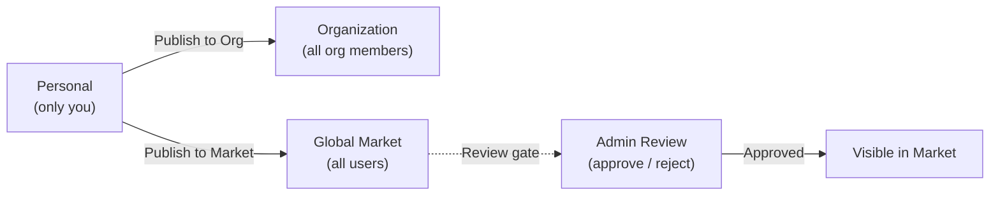

The Market is FIM One's built-in resource marketplace. It organizes shared resources into two tiers:

- **Solutions** -- high-level resources that deliver end-to-end capabilities: Agents, Skills, and Workflows.
- **Components** -- building blocks that Solutions depend on: Connectors and MCP Servers.

Skills and Workflows are optional modules, off by default. They appear in the Market only after an administrator enables them under Admin → Settings → Modules.

You browse by scope (your Organization or the Global Market), find what you need, subscribe, and start using it -- all without leaving FIM One.

<Info>
The Market uses a **pull model**: resources are discovered by browsing and explicitly subscribed to. There is no auto-join or push mechanism -- you choose what to install, and you can filter by scope at any time.
</Info>

## Was kann ich hier finden?

### Lösungen

Lösungen sind vollständige, einsatzbereite Funktionen, die Sie abonnieren und sofort nutzen können.

| Ressource | Kategorie | Was Sie erhalten |
|---|---|---|
| **Agent** | Lösung | Ein spezialisierter KI-Assistent mit gebundenen Tools und Wissen |
| **Skill** | Lösung | Ein globales SOP, das in System-Prompts eingefügt wird und Agenten orchestrieren kann |
| **Workflow** | Lösung | Ein DAG-Automatisierungsfluss für geplante oder ausgelöste Ausführung |

### Components

Components are the integrations and tool services that Solutions are built from.

| Resource | Category | What you get |
|---|---|---|
| **Connector** | Component | API integration available as agent tools (database connectors cannot be published) |
| **MCP Server** | Component | Third-party tool service loaded into sessions |

<Tip>
Knowledge Bases never appear in the Market and are never subscribed. An Agent that uses a KB delegates its owner's content at run time, so subscribing to the Agent is all you need.
</Tip>

## Scope

The Market has a scope selector at the top of the page. The UI and subscription flow are identical in both scopes -- only the visibility of resources changes.

- **Organization** -- resources shared within your team or company. Publishing here does not require review unless the organization has turned review on for that resource type.
- **Global Market** -- resources from the entire FIM One community. Publishing here requires admin approval.

Switch between scopes at any time to explore what is available.

## Wie abonniere ich?

Wenn Sie eine Ressource gefunden haben, die Sie möchten, klicken Sie auf **Abonnieren**. Ein Onboarding-Assistent führt Sie durch alle erforderlichen Einrichtungsschritte – zum Beispiel das Eingeben von API-Anmeldedaten für einen Connector. Sie können den Assistenten überspringen und Anmeldedaten später konfigurieren, wenn Sie dies bevorzugen.

Nach dem Abonnieren:

- **Agenten** erscheinen in Ihrer Agentenauswahl und im `call_agent`-Katalog.
- **Skills** werden automatisch in Ihre Systemaufforderungen eingefügt.
- **Workflows** erscheinen in Ihrer Workflow-Liste und sind bereit zur Ausführung.
- **Connectors** erscheinen in Ihrem Toolset und in den Dropdown-Menüs zur Agentenbindung.
- **MCP Server** laden ihre Tools in Ihre Sitzungen.

Wenn eine Lösung von Komponenten abhängt (z. B. ein Agent, der bestimmte Connectors verwendet), werden diese Abhängigkeiten während des Abonnements automatisch aufgelöst. Sie werden aufgefordert, alle erforderlichen Anmeldedaten bereitzustellen.

Abonnements sind sofort wirksam – keine Genehmigung des Herausgebers erforderlich. Sie können das Abonnement jederzeit kündigen, um die Ressource aus Ihrem Arbeitsbereich zu entfernen.

## How Do I Publish?

Any resource owner can publish to make their resource discoverable. Publishing can target either your Organization or the Global Market.

| Target | Who can see it | Review required? |
|---|---|---|
| **Organization** | All members of your org | No by default; an org can require review per resource type |
| **Global Market** | All authenticated users | Yes -- admin approval required |

Publishing to the Global Market always goes through a review gate. Admins can approve, reject (with a note), or leave the resource pending. Rejected resources can be revised and resubmitted.

## What About Credentials?

When you subscribe to a resource that requires credentials (API keys, OAuth tokens), the onboarding wizard collects them during subscription. Credentials are stored securely and scoped to your account -- no one else can see them.

You can update or rotate credentials at any time from the resource's settings page.

## How It Integrates

Under the hood, the Market is implemented as a **shadow organization** -- an invisible system org that holds no members. Resources published to the Global Market are set to `visibility: "org"` within this shadow org, which allows the existing visibility system to include them naturally.

This means the Market requires **zero special-case code** in the tool assembly pipeline. The same visibility filter (own, or subscribed and still shared) that loads personal and org resources also loads Market resources. When you subscribe, a subscription record is created, and the resource appears in your visibility filter automatically.

For Solutions that bundle dependencies (e.g., an Agent with bound Connectors and Knowledge Bases), the subscription process resolves and provisions those dependencies so everything works out of the box.

For technical details on how the visibility filter works across all resource types, see [Agent & Resource Discovery -- Visibility Model](/architecture/agent-discovery#visibility-model).
