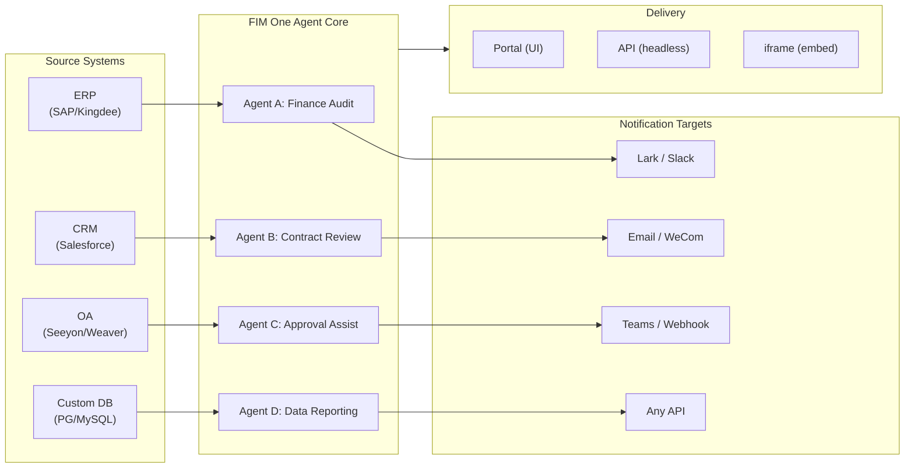

> Ziel: Eine **All-in-One-Agent-Plattform für Global × China-Unternehmen** aufzubauen — bereitgestellt in drei progressiven Modi: Standalone (Portal-Assistent), Copilot (eingebettet in das Host-System), Hub (zentrale systemübergreifende Orchestrierung).
>
> Prinzipien: **Provider-agnostisch** (kein Vendor-Lock-in), **minimale Abstraktion**, **Protocol-first**, **Connector-first** (Integration ist der Kernwert).

## Produktvision

FIM One ist eine **All-in-One-Agent-Plattform**, die drei progressive Bereitstellungsmodi unterstützt:

```
Standalone   → Your own AI assistant (Portal)
Copilot      → AI embedded in a host system (iframe / widget / embed)
Hub          → Central cross-system orchestration (Portal / API)
```

**Systemübergreifende Orchestrierung ist das zentrale Differenzierungsmerkmal.** Enterprise-Kunden verfügen über Legacy-Systeme — ERP, CRM, OA, Finanzen, HR — die über AI miteinander kommunizieren müssen:



**GTM-Strategie: Land and Expand**

| Schritt | Modus | Was passiert |
|------|------|-------------|
| Land | Copilot | In ein System einbetten, Mehrwert innerhalb der eigenen UI nachweisen |
| Expand | Copilot → Hub | Auf weitere Systeme ausrollen; Hub-Modus bündelt diese |

## Bekannte Probleme

Nachverfolgte Fehler, die in der Produktionsumgebung reproduzierbar, aber noch nicht behoben sind. Jeder Eintrag benennt das Symptom, den vermuteten Bereich und ggf. einen Workaround. Einträge werden in einen Versionsabschnitt verschoben, sobald eine Behebung geplant und terminiert ist.

- **Das Stoppen und Wiederholen im Playground zeigt vorübergehende visuelle Artefakte, die sich durch ein Neuladen der Seite stets beheben lassen.** Drei gleichzeitige Render-Quellen — `activeConversation.messages` (DB-Snapshot), der SSE-`messages`-Stream und der optimistische `pendingQuery`-Platzhalter — werden nicht zu einem einzigen abgeleiteten Zustand zusammengeführt. Dadurch kann es zwischen dem Klick auf „Wiederholen" und dem Eintreffen der zugehörigen Assistenten-Antwort zu folgenden Problemen kommen: (a) Die gleiche Anfrage wird kurzzeitig zweimal im Vor-Stream-Fenster gerendert, (b) frühere verwaiste Nutzer-Bubbles aus dem Wiederholungsverlauf werden ausgeblendet, solange `hasLiveMessages` den Wert `true` hat und bevor der Snapshot neu geladen wird, und (c) es kommt zu einem Flackern im kurzen Zeitfenster zwischen dem SSE-„done"-Ereignis und dem nächsten `selectConversation`-Refresh. **Daten gehen dabei nie verloren** — jede Nutzernachricht (einschließlich abgebrochener Wiederholungen) wird in `conversation.messages` gespeichert, beim nächsten LLM-Aufruf über `normalize_alternating_messages` einbezogen und nach einem Neuladen über `HistoryTurn.orphanUserContents` korrekt dargestellt, das im Render-Fix `48ba08c6` eingeführt wurde. Zum Kontext: Claudes eigene Web-Oberfläche weist eine vergleichbare Fehlerklasse auf — wird eine Antwort mittendrin gestoppt und sofort eine Folgeanfrage gesendet, wird diese manchmal als Geschwister-Bearbeitungszweig der ersten Anfrage verzweigt, anstatt als neuer Turn angehängt zu werden. Es handelt sich also um ein bekanntes, schwieriges Problem bei Designs mit optimistischer UI + SSE + persistiertem Verlauf und nicht um einen FIM-One-spezifischen Fehler. Eine ordentliche Behebung erfordert die Zusammenführung der drei Render-Quellen zu einem einzigen abgeleiteten Zustand; dies wird bis zu einem umfassenderen Refactoring der Playground-Zustandsmaschine zurückgestellt.

## Ausgelieferte Versionen

### v0.1 (2026-02-22) — MVP: ReAct + DAG Planner
- ReActAgent mit Tools (calculator, python_exec, web_search)
- DAG Planner (LLM generiert Abhängigkeitsgraphen)
- Portal UI mit Streaming + KaTeX

### v0.2 (2026-02-24) — Multi-Model + Memory
- Retry / Rate-Limiting / Nutzungsverfolgung
- Native Function Calling (kein reines JSON-Parsing)
- Multi-Model-Unterstützung (schnelles + Haupt-LLM)
- Memory: WindowMemory, SummaryMemory
- FastAPI-Backend mit SSE-Streaming

### v0.3 (2026-02-25) — Web Tools + MCP
- Web-Tools (web_search, web_fetch) via Jina/Tavily/Brave
- Dateioperationen-Tool
- MCP-Client (Standard-Tool-Integration)
- Automatische Tool-Erkennung + Kategorien
- DAG-Visualisierung mit Klick-zum-Scrollen
- Code-Ausführung in Docker (`--network=none`)

### v0.4 (2026-02-25) — Multi-Turn + Agents
- Multi-Turn-Konversationen (DbMemory)
- Tool-Schritt-Faltung UI
- HTTP-Anfrage + Shell-Ausführungs-Tools
- Agent-Verwaltung (erstellen, konfigurieren, veröffentlichen)
- JWT-Authentifizierung
- Agenten-spezifischer Ausführungsmodus + Temperatursteuerung

### v0.5 (2026-02-28) — Full RAG + Grounded Gen
- Vollständige RAG-Pipeline (Einbettung + Vektorspeicher + FTS + RRF + Reranker)
- Grounded Generation (Zitate, Konfidenzwerte)
- Wissensdatenbank-Dokumentenverwaltung (CRUD, Suche, Wiederholung, Schema-Migration)
- ContextGuard + angeheftete Nachrichten (Token-Budget-Manager)
- DbMemory-Persistenz + LLM Compact
- DAG Re-Planning (bis zu 3 Runden)

### v0.6 (2026-03-01) — Connector Platform
- **Connector CRUD**: Erstellen, Lesen, Aktualisieren, Löschen
- **ConnectorToolAdapter**: konvertiert Connector → BaseTool
- **Benutzerspezifische Anmeldedaten**: AES-GCM-Verschlüsselung
- **Confirmation gate**: Genehmigung von Schreiboperationen
- **Audit-Protokollierung**: alle Tool-Aufrufe werden aufgezeichnet
- **Circuit Breaker**: graceful Degradation bei Fehlern
- **Hilfswerkzeuge**: email_send, json_transform, template_render, text_utils
- **Einbettungsoptionen**: Jina, OpenAI, benutzerdefinierte Anbieter

### v0.7 (2026-03-06) — Admin-Plattform + Multi-Tenant
- **Admin-Plattform**: Benutzerverwaltung, Rollen-Umschalter, Passwort-Reset, Konto aktivieren/deaktivieren
- **Nur-Einladungs-Registrierung**: drei Modi (offen/Einladung/deaktiviert) + Einladungscode-CRUD
- **Speicherverwaltung**: benutzerspezifische Festplattennutzung, Löschen, Bereinigung verwaister Dateien
- **Gesprächsmoderation**: Admin-Liste/alle löschen
- **Benutzerweises Erzwingen des Abmeldens**: alle Tokens widerrufen
- **API-Health-Dashboard**: Systemstatistiken, Connector-Metriken
- **Ersteinrichtungs-Assistent**: geführte Admin-Kontoerstellung
- **Persönliches Center**: benutzerspezifische globale Anweisungen, Sprachpräferenz
- **JWT-Authentifizierung**: Token-basierte SSE-Authentifizierung, Gesprächseigentümerschaft
- **Globale MCP-Server**: vom Admin bereitgestellt, in allen Sitzungen geladen
- **Abwärtskompatibilität**: `registration_enabled` → `registration_mode` automatische Migration

### v0.7.x (2026-03-07 bis 2026-03-12) — Stabilität + Verfeinerungen
- Verwaltung von Einladungscodes
- Kontingente pro Benutzer (429-Durchsetzung)
- Strukturierte Audit-Protokollierung
- Filterung sensibler Wörter
- Anmeldeverlauf der Administration
- Dateibrowser der Administration
- Erweiterte Administrationsansichten (Felder `model_name`, `tools`, `kb_ids`)
- Docker-Compose-Bereitstellung (einzelnes Image, benannte Volumes)
- Automatische OAuth-Erkennung aus `window.location`
- Unterstützung für erweitertes Denken / Reasoning (`LLM_REASONING_EFFORT`, `LLM_REASONING_BUDGET_TOKENS`) für OpenAI o-series, Gemini 2.5+ und Claude
- Aktivieren/Deaktivieren einzelner Tools durch die Administration (deaktivierte Tools werden zur Laufzeit aus dem Chat ausgeschlossen)
- Verwaltung von MCP-Servern auf die Connectors-Seite verschoben
- Unterstützung für zwei Datenbanken: SQLite (standardmäßig ohne Konfiguration) + PostgreSQL (Produktion); Docker Compose stellt PostgreSQL automatisch bereit
- Dokumentationsseite zur Modellkonfiguration mit Einrichtung des erweiterten Denkens pro Anbieter
- SSE Protocol v2: Echtzeit-Streaming von Antworten mit den Feldern `delta_reasoning` und `usage` sowie getrennten `done`-/`suggestions`-/`title`-/`end`-Events; SQLite-Poolgröße 5 -> 20
- Erweiterung von AI Builder: 7 neue Builder-Tools (GetSettings, TestConnection, ImportOpenAPI für Connectors; ListConnectors, AddConnector, RemoveConnector, SetModel für Agents), `is_builder`-Flag für Agents, automatische Aktualisierung des Builder-Prompts, SSRF-Schutz
- SSE v2-Frontend: Cursor mit pulsierenden Streaming-Punkten, zusammenklappbare Karten für Snapshots der DAG-Neuplanung pro Durchlauf, Entkopplung des DAG-Layouts von den Schrittstatus
- Dokumentationsseite zum Konzept von AI Builder mit Anleitungen für Connector- und Agent-Builder
- Organisationssystem: vollständiges CRUD mit rollenbasierter Mitgliedschaft (Owner/Admin/Member), Benutzeroberfläche zur Administrationsverwaltung
- Dreistufige Sichtbarkeit von Ressourcen (persönlich/Organisation/global) für Agents, Connectors, Wissensdatenbanken und MCP-Server
- API zum Veröffentlichen/Aufheben der Veröffentlichung für alle Ressourcentypen; Delegierung des Owners für veröffentlichte Agents
- Endpunkt zum Festlegen der Sichtbarkeit durch die Administration (ersetzt das Klonen in den globalen Bereich); einheitlicher Abfragehelfer `build_visibility_filter()`
- Datenbank-Connectors (Phase 1–3): direkter SQL-Zugriff auf PG/MySQL + chinesische Legacy-Datenbanken; Schema-Inspektion, AI-Annotation, schreibgeschützte Abfrageausführung, verschlüsselte Zugangsdaten, 3 Tools pro Connector (`list_tables`, `describe_table`, `query`)
- **Evaluierungszentrum**: quantitative Bewertung der Agent-Qualität — CRUD für Testdatensätze (Prompt + erwartetes Verhalten + Assertions), Evaluierungsläufe (parallele Ausführung + LLM-Bewerter + Ergebnisse pro Fall für Bestehen/Nichtbestehen, Latenz und Tokens), Ergebnisanzeige mit automatischer Abfrage; Migration `r8t0v2x4z567`
- Drei Modellrollen (General/Fast/Reasoning) mit isolierter Umgebungsvariablenkonfiguration pro Stufe; das schnelle Modell übernimmt nicht länger die Einstellungen des Hauptmodells
- `StepOutput`-Dataclass als Ersatz für einfache String-Schrittergebnisse zur strukturierten Daten- und Artefaktübergabe
- Tool-Cache für die DAG-Ausführung — identische Tool-Aufrufe werden pro Lauf zwischengespeichert, mit Verhinderung von Anforderungswellen durch asynchrone Sperren (`DAG_TOOL_CACHE`)
- LLM-Verifizierung pro Schritt mit einem erneuten Versuch bei Fehlern (`DAG_STEP_VERIFICATION`)
- Automatisches Routing: Schnelles LLM klassifiziert Abfragen als ReAct oder DAG; Endpunkt `/api/auto`; dreistufiger Modus-Umschalter im Frontend (`AUTO_ROUTING`)
- [x] ~~**Shadow-Market-Organisation + Ressourcenabonnements**~~: Integrierte Market-Organisation (Shadow, kein automatischer Beitritt) ersetzt die Platform-Organisation; Ressourcen werden durch das Durchsuchen des Marktplatzes entdeckt und ausdrücklich abonniert (Pull-Modell); Market API zum Abonnieren gemeinsam genutzter Ressourcen; Veröffentlichung auf Market erfordert immer eine Überprüfung; Tabelle für Ressourcenabonnements; organisationsbasierte gemeinsame Ressourcennutzung ersetzt die globale Sichtbarkeit
- [x] ~~**Automatische Agent-Erkennung und Sub-Agent-Bindung**~~: `discoverable`-Flag für Agents; Whitelist `sub_agent_ids`; CallAgentTool zur Delegierung von Aufgaben an spezialisierte Agents
- [x] ~~**MCP-Server-Zugangsdaten + benutzerdefinierte Überschreibung**~~: Tabelle `mcp_server_credentials`; Endpunkt `PUT /api/mcp-servers/{id}/my-credentials`; Flag `allow_fallback` für das Fallback-Verhalten von Zugangsdaten
- [x] ~~**Connector-/KB-Umschaltung**~~: `POST /api/connectors/{id}/toggle` und `POST /api/knowledge-bases/{id}/toggle` zum Anhalten/Fortsetzen von Ressourcen
- [x] ~~**Eigenständige KB-Konversationen**~~: Feld `kb_ids` in Konversationen für direkten KB-Chat ohne Agent-Bindung

### v0.8 (2026-03-20) — Deklarative Connector-Konfiguration + progressive Offenlegung
- [x] **Datenbank-Connectoren**: direkter SQL-Zugriff (PostgreSQL, MySQL) *(in v0.7.x ausgeliefert — Phase 1–3)*
- [x] **RBAC**: Connector-Zugriffskontrolle pro Benutzer/Rolle *(in v0.7.x ausgeliefert — Organisationssystem + dreistufige Sichtbarkeit)*
- [x] **Verschlüsselung von Connector-Anmeldedaten + benutzerspezifische Überschreibung**: Tabelle `connector_credentials`, Fernet-Verschlüsselung über `CREDENTIAL_ENCRYPTION_KEY`, Flag `allow_fallback`, Endpunkte `GET/PUT/DELETE /my-credentials`, benutzerspezifische Auflösung von Anmeldedaten beim Laden von Chat-Tools
- [x] **UI für Veröffentlichungsprüfungen**: Organisationsweites System für Veröffentlichungsprüfungen — Prüfoption pro Organisation, ReviewsSheet mit Genehmigungs-/Ablehnungs-Workflow, Status-Badges auf Ressourcenkarten, Hinweis zur Prüfung im Veröffentlichungsdialog, erneutes Einreichen abgelehnter Ressourcen
- [x] **Progressive Offenlegung für Connectoren (Phase 1–2)**: Ein einzelnes `ConnectorMetaTool` ersetzt Tools pro Aktion; der System-Prompt erhält nur leichtgewichtige **Stubs** (Name + einzeilige Beschreibung, ~30 Token/Connector gegenüber ~250 Token/Aktion); der Agent ruft `discover(connector)` auf, um das vollständige Aktionsschema bei Bedarf zu laden — das Schema wird erst geladen, wenn das Modell einen Connector auswählt, wodurch das Prompt-Präfix für das Caching stabil bleibt. Folgt dem Muster des verzögerten Tool-Ladens, das in modernen Agent-Frameworks üblich ist. Unterbefehl `execute`; Feature-Flag für Abwärtskompatibilität.
- [x] **Agent-Skill-System + kompakte Anweisungen**: Bedarfsabhängiges Laden von Skills für Agent-Anweisungen — das Modell `Skill` (Name, Inhalt/SOP, optionale Skripte) wird an Agents angehängt; im System-Prompt wird nur auf den Namen verwiesen (~10 Token/Skill); der Agent ruft `read_skill(name)` auf, um den vollständigen Inhalt bei Bedarf zu laden. Reduziert die Token-Kosten für Anweisungen pro Konversation um ~80 % und ermöglicht zugleich umfangreichere SOP-Bibliotheken. Gegenstück zur progressiven Offenlegung von `ConnectorMetaTool`, angewendet auf der Anweisungsebene. Ermöglicht die Differenzierungsgeschichte „Anweisung + Tool + Skill“. Fügt dem Agent-Modell außerdem das Feld `compact_instructions` hinzu — eine Komprimierungsprioritätenliste pro Agent, die beim Komprimieren in `ContextGuard` injiziert wird (z. B. „Auftrags-IDs und Beträge beibehalten, unverarbeitete API-Antworten entfernen“), und ersetzt den aktuellen statischen generischen Prompt. Folgt der Konvention für kompakte Anweisungen, die in modernen Agent-Frameworks weit verbreitet ist.
- [x] **Connector-Import/-Export**: Connector-Vorlagen teilen
- [x] **Connector-Fork**: Vorhandene Connectoren klonen und anpassen
- [x] **Workflow-Phase-2-Knoten**: Iterator, Loop, VariableAggregator, ParameterExtractor, ListOperation, Transform, DocumentExtractor, QuestionUnderstanding, HumanIntervention — 9 erweiterte Knotentypen mit vollständigem Frontend + Backend und 150 neuen Tests (275 insgesamt). Knoten-Wiederholungsversuche mit exponentiellem Backoff, sichere Auswertung von Ausdrücken. Statistikbereich mit Erfolgsratenbalken. 12 integrierte Vorlagen. Kontextmenü im Bereich (Einfügen, Alles auswählen, Ansicht einpassen, Automatisches Layout).
- [x] **Workflow-Phase-3-Knoten: SubWorkflow + ENV** — 2 neue Knotentypen (25 Knoten insgesamt), 14 neue Tests (306 insgesamt), 14 integrierte Vorlagen. SubWorkflow: vollständig datenbankgestützter verschachtelter Workflow-Executor mit Auswahl des Ziel-Workflows, Variablenzuordnung und konfigurierbarer Tiefenbegrenzung zur Vermeidung unendlicher Rekursion. ENV: liest verschlüsselte Umgebungsvariablen mit Schlüsselauswahl und Fallback-Standardwerten. Vollständiges Frontend (Knotenkomponenten, Konfigurationsbereiche, Paletteneinträge, Minimap-Farben). Statistikbereich für die Ausführung pro Knoten (Erfolgsraten, Dauer, Fehleranzahl, absteigend nach Fehlerhäufigkeit sortiert). `getNodeStats`-API-Client + Typ `NodeStatEntry`. Dialog für Tastenkürzel (Taste `?`).
- [x] **Geplante Workflow-Trigger**: Cron-Konfiguration pro Workflow mit Zeitzone, Standardeingaben und Berechnung des nächsten Ausführungszeitpunkts. Voreingestellte Cron-Schaltflächen, 30 Trigger-Tests.
- [x] **Workflow-API-Trigger**: Öffentliche API-Schlüssel pro Workflow (Präfix `wf_`) für externe Ausführung ohne Benutzerauthentifizierung, mit Ratenbegrenzung. Dialog zur API-Schlüsselverwaltung mit Erzeugen/Neuerzeugen/Widerrufen, Trigger-URL sowie cURL-/JS-Beispielen.
- [x] **Workflow-Stapelausführung**: `POST /batch-run` mit bis zu 100 Eingabemengen, konfigurierbarer Parallelität (1–10), ausklappbaren Ergebnissen pro Element und JSON-Export. 14 Tests für die Stapelausführung.
- [x] **Viewer für Workflow-Ausführungsprotokolle**: Echtzeit-SSE-Ereignisstrom in chronologischer Reihenfolge im Ausführungsbereich mit Zeitstempeln, farbcodierten Badges und Umschaltern für Ereignistypfilter.
- [x] **Workflow-Ausführungsstatistiken**: Das Backend ruft Ausführungsanzahlen und Erfolgsraten per GROUP-BY-Unterabfrage stapelweise ab; das Frontend zeigt Statistiken auf Workflow-Karten mit farbcodierten Indikatoren für die Erfolgsrate an.
- [x] **Workflow-Scheduler-Daemon**: Hintergrunddienst auf Async-Basis, der alle 60 Sekunden nach fälligen Cron-basierten Workflows sucht. Croniter-Unterstützung für Zeitzonen, Semaphore-Konkurrenzsteuerung, Verfolgung von `last_scheduled_at`, Webhook-Zustellung. 14 Tests.
- [x] **Workflow-Importkonfliktauflösung**: Erkennt ungelöste Agent-/Connector-/KB-/MCP-Referenzen während des Imports. Stapelabfragen an die Datenbank mit Sichtbarkeitsfilterung, Toast-Warnungen im Frontend. 17 Tests.
- [x] **Testknotenausführung für Workflows**: Isolierte Tests einzelner Knoten mit Mock-Variablen, in den Editor integriert (Testschaltfläche im Konfigurationsbereich + Kontextmenü). 23 Tests.
- [x] **Workflow-Versionsvergleich**: Vergleich von Blueprints nebeneinander mit Erkennung von Änderungen an Knoten/Kanten und farbcodierten Indikatoren (hinzugefügt/entfernt/geändert).
- [x] **Workflow-Ausführungsverwaltung**: Einzelne Ausführungen löschen (`DELETE /runs/{run_id}`) und alle abgeschlossenen Ausführungen löschen (`DELETE /runs`) mit Bestätigungsdialogen im Frontend.
- [x] **Overlay zur Wiederholung von Workflow-Ausführungen**: Schaltfläche „Auf Canvas anzeigen“ im Ausführungsverlauf, um vergangene Ausführungsergebnisse auf dem Canvas einzublenden und den Status sowie die Ausgabe pro Knoten anzuzeigen, ohne die Ausführung erneut zu starten.
- [x] **Workflow-Favoriten/Anheften**: Workflows mit Stern markieren bzw. oben in der Liste anheften, mit Speicherung über localStorage.
- [x] **Export des Workflow-Ausführungsverlaufs**: Ausführungsverlauf als JSON-Dateidownload mit vollständigen Metadaten zur Ausführung und Ergebnissen pro Knoten exportieren.
- [x] **Workflow-Verwaltung für Admins**: Registerkarte im Admin-Bereich zur Verwaltung aller Workflows über Benutzer hinweg — auflisten, aktiv/inaktiv umschalten, mit Bestätigung löschen. Stapel-Endpunkte zum Löschen, Umschalten und Veröffentlichen mit Audit-Protokollierung.
- [x] **Workflow-Vorlagensystem**: ORM-Modell `WorkflowTemplate` mit CRUD für Admins, öffentlicher API zum Auflisten/Klonen und 5 Seed-Vorlagen, die beim ersten Start automatisch eingefügt werden.
- [x] **Inline-Validierungs-Badges für Workflows**: Echtzeit-`ValidationBadge` pro Knoten auf dem Canvas mit Tooltips für Fehler/Warnungen zur unmittelbaren visuellen Rückmeldung während der Bearbeitung.
- [x] **Viewer für Workflow-Ausführungs-Traces**: Zeitachsenbasierter Trace-Viewer als Sheet mit dem `trace_level`-Parameter der Engine und Variablen-Snapshots pro Knoten für schrittweises Debugging.
- [x] **Ratenbegrenzung und Timeout für Workflows**: `WorkflowRateLimiter` pro Benutzer (gleitendes Fenster mit 10 Ausführungen/Minute, 3 gleichzeitig) und globales Standard-Timeout von 10 Minuten pro Ausführung.
- [x] **Workflow-Blueprint-System**: Visueller Workflow-Editor zum Entwerfen und Ausführen mehrstufiger Automatisierungs-Blueprints — ORM-Modelle `Workflow` / `WorkflowRun`, vollständige CRUD- + SSE-Ausführungs-API, Import/Export, Duplizieren, Endpunkt zur Blueprint-Validierung, `WorkflowEngine` mit topologischer Sortierung + Semaphore-basierter Parallelität + bedingter Verzweigung und 12 Knotentypen (Start, End, LLM, ConditionBranch, QuestionClassifier, Agent, KnowledgeRetrieval, Connector, HTTPRequest, VariableAssign, TemplateTransform, CodeExecution), `VariableStore` mit `{{node_id.output}}`-Interpolation und `env.*`-Namespace, Fehlerstrategien pro Knoten (STOP_WORKFLOW / CONTINUE / FAIL_BRANCH) mit Timeout pro Knoten und erweiterter Konfigurationsoberfläche, visueller Editor auf Basis von React Flow v12 mit Drag-and-drop-Palette + Knotenkonfigurationsbereich + Combobox zur Variablenauswahl + Knoten-am-Kantenende-hinzufügen + automatischem Layout (ELK.js) + Sheet für den Ausführungsverlauf, kompaktes Knotendesign im Dify-Stil mit ringbasierter Darstellung des Ausführungsstatus und animierten Kantenübergängen, 4 integrierte Startvorlagen (Simple LLM Chain, Conditional Router, Knowledge-Augmented QA, HTTP API Pipeline) mit Dialog zur Vorlagenauswahl und den APIs `GET /templates` + `POST /from-template`, Statistik-Endpunkt, URL-Parameter `?run=true` zum automatischen Öffnen, sicherheitsorientierte Codeausführung auf Subprozess-Basis, Testsuite mit 105 Tests (Vorlagen, Abflachung des Eval-Namespaces, Warnungen bei der Blueprint-Validierung, Löschen von Knoten/Kanten, Import/Export/Duplizieren, Deadlock-Erkennung, Verzweigung nach mehreren Bedingungen)
- [x] **Operations-Audit**: detaillierte Protokollierung, wer was getan hat — Registerkarte für Audit-Protokolle der Admin-Prüfungen hinzugefügt (Veröffentlichungsprüfungsverlauf pro Organisation/Ressource)
- [x] **Semantische Schema-Annotationen**: Erweiterung von Connector-Schemafeldern um die Flags `semantic_tag`, `description` und `pii`; Annotationen werden in den LLM-Toolbeschreibungen angezeigt, damit der Agent die Bedeutung der Felder versteht, ohne sie anhand von Spaltennamen erraten zu müssen

### v0.8.1 (2026-03-29) — Progressive Disclosure Maturity + ReAct Hardening
- Progressive Disclosure für DB-Konnektoren (`DatabaseMetaTool`), MCP-Server (`MCPServerMetaTool`) und bedarfsgesteuertes Tool-Laden (`request_tools` Meta-Tool)
- DAG-Qualitätsverbesserung (5 Verbesserungen: Modell-Upgrade, automatische Skill-Erkennung, Zitierprüfer, strukturierte Inhaltsbewahrung, domänenbasiertes Routing)
- Domänenmodell-Eskalation in ReAct (Spezialdomänen eskalieren automatisch zum Reasoning-Modell)
- Pro-Modell-Umschalter für natives Function Calling (`tool_choice_enabled`)
- ReAct-Zykluserkennung (deterministische Verhinderung doppelter Tool-Aufrufe)
- ReAct-Abschluss-Checkliste (Vorprüfung vor der Antwort, wenn Tools verwendet wurden)
- Resource Fork Phase 1 (MCP-Server + Skill-Fork-Endpunkte mit Herkunftsverfolgung)
- Workflow-Verbindungsabhängigkeit Auto-Subscribe (rekursive Abhängigkeitsauflösung für Sub-Workflows)
- Vorgefertigte Solution-Templates (8 vertikale Lösungen beim ersten Registrierungsvorgang in den Market eingespeist)
- Verbesserungen bei Admin-Benachrichtigungen (zeitzonenbewusst, Master-Schalter, SMTP Reply-To)
- Token-Budget-Schutzschalter pro Gesprächsrunde (`REACT_MAX_TURN_TOKENS`)
- Zentralisierte Tool-Kürzung, dynamisches System-Prompt-Budgeting
- Dateianhang-Download, Behebung doppelter Nachrichtenübermittlung

### v0.8.2 (2026-04-10) — Agent Core Hardening + Vision Documents
- **Agent Core Phase 0** — Compact-Prompt auf 9-Abschnitte strukturiertes Format aufgewertet; Schutz vor leeren Tool-Ergebnissen (beschreibende Meldung statt `(no output)`); Anti-Loop-Prompt + Zyklus-Erkennungsschwelle auf 2 gesenkt; Domain-Klassifikator + Pre-Flight-DB-Konfigurationsauflösung parallelisiert (400–1100 ms pro Anfrage eingespart); SSE-`end`-Event wird unmittelbar nach der Antwort gesendet, Titel/Vorschläge in Hintergrundaufgaben verschoben
- **Agent Core Phase 1 (Context Anti-Bloat)** — `MicroCompact` regelbasierte Bereinigung alter Tool-Ergebnisse (letzte 6 behalten); `REACT_TOOL_RESULT_BUDGET=40000` aggregiertes Limit; reaktives Compact bei Context-Überlauf (automatisches Compact auf 50 % Budget und Wiederholung statt Absturz)
- **Agent Core Phase 2 (Geschwindigkeit)** — Schlüsselwortbasierte Tool-Vorauswahl (überspringt LLM-Aufruf bei eindeutigen Treffern, 200–500 ms eingespart); `SharedHttpClient` LLM-Verbindungs-Pooling; Abschluss-Check bei Antworten >200 Tokens übersprungen; `FallbackLLM` kapselt Primary+Fast mit automatischem Failover bei 429/503/529/Verbindungsfehlern
- **Intelligente Dokumentenverarbeitung (Vision-fähig)** — Adaptives Dokumenten-Handling: PDF-Seiten werden via PyMuPDF als Bilder für Vision-fähige Modelle gerendert (GPT-4o, Claude 3/4, Gemini), Text-only-Fallback via pdfplumber. Pro-Modell-Flag `supports_vision`. Modi über `DOCUMENT_PROCESSING_MODE`, `DOCUMENT_VISION_DPI`, `DOCUMENT_VISION_MAX_PAGES`. DOCX/PPTX eingebettete Bildextraktion. Multi-Turn-Vision-Persistenz über Gesprächsrunden hinweg. Intelligente PDF-Verarbeitung (textreiche Seiten extrahieren Text + Bilder; gescannte Seiten werden als ganzseitiges PNG gerendert). Vorgefertigtes Sandbox-Image (`Dockerfile.sandbox`) mit gängigen Data-Science-Paketen für `--network=none`-Codeausführung
- **Resource Fork Vervollständigung** — Agent-/Connector-/Workflow-Fork-Endpunkte hinzugefügt, womit das fünfteilige Abstammungs-Tracking abgeschlossen ist (KB-Fork entfernt — inhärent benutzerspezifisch)
- **Dateiintegritäts-Schutzregel** — Systemprompt-Regel verhindert, dass der Agent bei unlesbaren Zieldateien unzusammenhängende Dateiinhalte einsetzt; hochgeladene Dateien enthalten nun `file_id` im Nachrichtenkontext für direkten `read_uploaded_file`-Zugriff

### v0.8.3 (2026-04-16) — Universelle Dokumentenkonvertierung + Agent Core Phase 3
- **Universelle Dokumentenkonvertierung (`convert_to_markdown` + OCR)** — Integriertes Agent-Tool, das Microsoft MarkItDown kapselt; konvertiert PDF, Word, Excel, PowerPoint, HTML, JSON, CSV, XML, ZIP, EPUB, Outlook .msg, Bilder, Audio und YouTube-URLs nach Markdown. `LiteLLMOpenAIShim` ermöglicht OCR über jeden visionsfähigen LLM (Claude, Gemini, Bedrock, Azure). Visionsbewusste RAG-Ingestion mit regressionssicherem Nur-Text-Fallback. `LLM_SUPPORTS_VISION`-Umgebungsvariable zum Deaktivieren
- **Agent Core Phase 3 (Laufzeit-Invarianten-Härtung)** — Konversationswiederherstellung (automatische Reparatur hängender `tool_use`-Einträge); strukturierte kompakte Arbeitskarte (`WorkCard` typisiertes Zusammenführen über Kompaktierungsrunden); Turn-Level-Profiler (`REACT_TURN_PROFILE_ENABLED`); benutzerspezifische Ratenbegrenzung (`LLM_RATE_LIMIT_PER_USER`); leere Assistant-Nachrichten mit `tool_calls` werden nicht mehr verworfen

### v0.8.4 (2026-04-17) — Prompt-Cache + Reasoning-Korrektheit
- **System-Prompt-Abschnittsregistry mit Cache-Breakpoints** — Memoized `PromptRegistry` teilt System-Prompts in stabiles Präfix + dynamisches Suffix auf; Cache-fähige Provider (Claude, Bedrock Anthropic, Vertex Claude) erhalten `cache_control: {"type": "ephemeral"}` auf dem Präfix für ~60–80 % Einsparung bei Input-Tokens pro Turn. Nicht-Cache-Provider erhalten eine einzelne zusammengefügte Nachricht (kein Verhaltensunterschied)
- **Prompt-Cache-Observability** — `cache_read_input_tokens` und `cache_creation_input_tokens` werden über `UsageSummary` → `TurnProfiler` → `done_payload.cache`-Feld nachverfolgt. Strukturierte `turn_cache`-Logzeile pro Turn. Dient gleichzeitig als Relay-Cache-Ehrlichkeitsprüfung
- **Conversation-Recovery-MVP** — Synthetische `tool_result`-Zeilen bleiben nach unterbrochenen Turns erhalten; `POST /chat/resume` spielt gecachte SSE-Events ab einem monotonen Cursor ab; Frontend-Hook `useSseResume` stellt die Verbindung automatisch mit exponentiellem Backoff wieder her (300 ms → 1 s → 3 s, max. 3 Versuche) und zeigt einen „Reconnecting…"-Indikator
- **Thinking-Block-Persistenz mit Signatur** — `reasoning_content` + Anthropic-`signature` werden in `metadata_["thinking"]` gespeichert und bei nachfolgenden Turns wiedergegeben; behebt HTTP-400-Signatur-Mismatch bei Claude-4-Multi-Turn-Gesprächen
- **Provider-bewusste Reasoning-Replay-Policy** — Zentralisierte `reasoning_replay_policy()` in `core/prompt/reasoning.py` steuert die Serialisierung pro Provider-Familie: Claude spielt Thinking-Blocks mit Signatur ab; DeepSeek-R1/Qwen-QwQ/Gemini-thinking/o-series verwerfen `reasoning_content` beim Senden (zuvor durchgesickert, was Provider-KV-Caches beschädigte und gegen die API-Dokumentation verstieß)

### v0.8.5 (2026-04-23) — Channel-Integration + Hook-System + Contributor-i18n
- **Feishu-Kanal (Phase-1-Teilmenge)** — Org-bezogene `Channel`-Ressource mit Fernet-verschlüsselten Zugangsdaten; `FeishuChannel` unterstützt interaktives Karten-Senden + Callback (Signaturprüfung + URL-Challenge); Einstellungen → Kanalverwaltungs-UI (Liste, Erstellen/Bearbeiten mit Dirty-State-Schutz, Details mit kopierbarer Callback-URL, Test-Senden); CRUD-API (`/api/channels`) und Event-Callback-Endpunkt (`/api/channels/{id}/callback`). Frühzeitig für den Roadshow am 2026-04-24 ausgeliefert
- **Agent-Hook-System (live in ReAct + DAG-Runtime)** — `PreToolUseHook` / `PostToolUseHook`-Abstraktion in `src/fim_one/core/hooks/`; Agents, die `hooks.class_hooks` in `model_config_json` deklarieren, erhalten Hooks, die pro Chat-Session instanziiert und registriert werden. Erster Verbraucher `FeishuGateHook` sendet eine Genehmigen/Ablehnen-Karte an die verknüpfte Feishu-Gruppe, wenn ein Agent ein `requires_confirmation=True`-Tool aufruft, blockiert die Ausführung und setzt sie basierend auf dem Ergebnis fort oder bricht ab
- **Konfigurierbare Bestätigungsschranke (inline ODER Kanal)** — Jeder Agent erhält einen Genehmigungsbereich mit drei Routing-Modi (Automatisch / Nur inline / Nur Kanal), einer Auswahl des Genehmiger-Umfangs (Initiator / Eigentümer / Beliebige Person in der Org), einer Tool-spezifischen Überschreibung und einer expliziten Genehmigungskanal-Auswahl. Der automatische Modus fällt auf eine inline-Genehmigungskarte zurück, wenn kein Kanal verknüpft ist. `POST /api/confirmations/{id}/respond` teilt einen einzigen Entscheidungserfassungspfad mit dem Feishu-Webhook
- **Agentenbezogene Aufgabenabschluss-Benachrichtigungen** — Lang laufende ReAct- oder DAG-Agents können eine Zusammenfassungskarte an den Kanal der Org senden, wenn eine Aufgabe abgeschlossen ist. Erster Verbraucher des generischen ausgehenden Benachrichtigungsmusters
- **Hook-Approval-Playground** — Das Kanaldetail-Sheet verfügt über eine „Genehmigungsablauf testen"-Aktion, die den vollständigen Produktionspfad durchläuft (echter `ConfirmationRequest`-Eintrag, echter Feishu-Callback, Statusübergänge) — derselbe Codepfad, den ein Produktions-Hook verwendet
- **Contributor-freundlicher i18n-CI-Fallback** — `.github/workflows/i18n-sync.yml` übersetzt EN → ZH/JA/KO/DE/FR auf dem Master nach dem PR-Merge und committet automatisch mit `[skip ci]`; Contributors benötigen `LLM_API_KEY` nicht mehr lokal. Der Pre-Commit-Locale-Bearbeitungsschutz verweigert manuelle Änderungen an generierten Locale-Dateien (`ALLOW_LOCALE_EDIT=1`-Override für legitime Übersetzungskorrekturen). End-to-End über einen Smoke-Test-Push verifiziert
- **Exa-Integrationsdokumentation** — Dedizierter Integrationsbereich mit einer erstklassigen Exa-Seite, die die gesamte Exa-Suchoberfläche abdeckt (neural / fast / deep-reasoning / instant), Filterung, Inhaltsabruf und drei abgestimmte Voreinstellungen
- **Xinchuang (信创) Datenbankunterstützung** — Der Datenbank-Connector listet nun KingbaseES (人大金仓), HighGo (瀚高) und DM8 (达梦) neben PostgreSQL/MySQL auf. PG-kompatible Treiber verwenden `asyncpg` wieder; DM8 verwendet `dmPython`. `scripts/test_xinchuang_dbs.py` überprüft die Live-Konnektivität über die CLI
- **Channels + Hook-System-Architekturdokumentation** — `docs/architecture/hook-system.mdx` erläutert die drei Hook-Punkte und führt durch FeishuGateHook von Anfang bis Ende; bestehende Architekturseiten verlinken sich gegenseitig; README listet Messaging-Kanäle als erstklassige Funktion auf
- **Härtung** — Doppelte Feishu-Callback-Klicks erzeugen eine Ersatzkarte anstatt doppelt zu entscheiden; gleichzeitige Callback-Klicks werden über eine bedingte `UPDATE ... WHERE status='pending'`-Zeilenanzahlprüfung aufgelöst; ausstehende Genehmigungen laufen nach `CHANNEL_CONFIRMATION_TTL_MINUTES` (Standard 24h) über einen Hintergrund-Sweeper automatisch ab; Einstellungen → Kanäle respektiert die Org-Rolle (Mitglieder sehen eine schreibgeschützte UI); der parallele Tool-Call-Aggregator verarbeitet Anbieter, die `index=0` für jedes Delta wiederverwenden; die Sitzungsablauf-Weiterleitung bewahrt den Query-String

### v0.8.6 (2026-05-08) — Stripe Billing + Verbesserungen
- [x] Stripe Billing MVP — Free- und Pro-Tarife; Checkout, Kundenportal, Webhook-Lifecycle; `/settings?tab=billing`; Admin-Plan/Abonnement-CRUD; Kontingentdurchsetzung berücksichtigt den Plan jedes Nutzers
- [x] Admin-gesteuertes Billing-Feature-Flag — `system_settings.billing_enabled` steuert die gesamte Stripe-Pipeline, sodass private Deployments ohne Stripe-Zugangsdaten niemals eine nicht funktionsfähige Zahlungs-UX anzeigen
- [x] Unbegrenztes Kontingent pro Nutzer — leer erbt den globalen Standard, `0` gewährt unbegrenzt; zuvor wurden beide in denselben Zustand zusammengeführt
- [x] Übersetzungs-Glossar als Single Source of Truth — `scripts/translation-glossary.md` konsolidiert sprachspezifische Regeln; Pre-Commit verweigert bedingungslos manuelle Änderungen an generierten Locale-Dateien
- [x] Lizenz und anwendbares Recht auf FIM Labs Pte. Ltd. (Singapur) migriert; SIAC-Schiedsverfahren auf Englisch; neue `NOTICE`-Datei auf oberster Ebene
- [x] Playground-Folgevorschläge wiederhergestellt, opt-in pro Agent
- [x] Stabilitätskorrekturen — strikte Abwechslung im Provider-Verlauf, Erkennung paralleler Tool-Call-Grenzen, Bestätigungsablauf für ungebundene Agents, Kanal-Rollen-Gating, Unterdrückung von Wiederholungs-Duplikaten, keine Umformulierung nach Ablehnung

### v0.8.7 (2026-06-10) — Sicherheitshärtung + Guardrails v0 + Abrechnungskorrektheit
- [x] JWT-Token-Typ-Einschränkung — schließt eine 2FA-Umgehung, bei der jedes gleichartig signierte Token (temp/refresh/ticket) API- und SSE-Endpunkte authentifizieren konnte
- [x] OAuth-Härtung — automatische E-Mail-Verknüpfung erfordert eine vom Anbieter verifizierte E-Mail (Behebung von Account-Übernahmen); OAuth-Refresh-Tokens werden gehasht gespeichert, damit die Sitzungsrotation funktioniert
- [x] Content-Guardrails v0 — Eingabe-/Ausgabe-Tripwire-Schicht (`core/agent/guardrail`); enthält Jailbreak-Detektor + maximale Ausgabelängen-Guardrail, per Umgebungsvariable konfigurierbar
- [x] `file_ops.apply_patch` — V4A-Diff-Patches mit unscharfem Whitespace-Abgleich, ergänzt `find_replace`
- [x] Abrechnungszykluskorrektur — Kontingent wird am Jahrestag des Abonnements zurückgesetzt (nicht zum Kalendermonat); Verlängerungen rücken den Zeitraum per autoritativer Stripe-Abfrage vor; Nutzungsanzeige am Durchsetzungsfenster ausgerichtet
- [x] Zuverlässigkeitskorrekturen — Pseudo-Protokoll-Tool-Call-Leck aus Antworten entfernt; einstellbares HTTP-Keep-Alive beendet `APIConnectionError`-Häufungen; API-Key-Nutzungsstatistiken werden auch bei Nur-Lese-Anfragen gespeichert
- [x] Visuelles Überarbeitung des Abrechnungs-Tabs — volle Breite, konsistent mit anderen Einstellungs-Tabs

### v0.8.8 (2026-06-22) — SSRF-Härtung + Zuverlässigkeits- & Reasoning-Fixes
- [x] SSRF-Härtung — Blocklist entpackt IPv4-mapped IPv6 (`::ffff:` Instance-Metadata-Bypass); MCP SSE/Streamable-HTTP-Server-URLs werden bei Erstellung und Verbindung auf SSRF geprüft
- [x] LLM-Zuverlässigkeit — gemeinsamer HTTP-Pool heilt sich selbst nach einer LiteLLM-Client-Cache-Eviction, die ihn schließt; Chat sendet Stream sofort (Verlauf wird im Hintergrund zusammengeführt, kein vollständiges Neuladen)
- [x] Anthropic Adaptive-Thinking-Protokoll für Opus 4.6+/Sonnet 4.6/Fable 5 — Extended Thinking funktioniert dort, wo der alte Fixed-Budget-Parameter bei 4.7/4.8 einen 400-Fehler liefert; warnt bei OpenAI-Proxy-Fehlweiterleitung
- [x] Reasoning-Details werden Ende-zu-Ende bewahrt — echte finale Antwort wird wortgetreu gestreamt; übersteht Komprimierung, Kontext-Rebuilds und Sub-Agent-Schritte (kein verlustbehaftetes Re-Synthesizing)
- [x] `PreToolUse`-Enforcement-Hooks schlagen bei Fehler geschlossen fehl — ein abstürzender Approval-Gate erlaubt den Aufruf nicht mehr stillschweigend; Nicht-Enforcement-Hooks behalten Fail-Open über `fail_open`
- [x] Force-Logout-Zeitstempelvergleich auf UTC normalisiert durch Konvertierung + Docker Compose `POSTGRES_*`-Credential-Override (kein ausgelieferter `fim:fim`-Standard)

### v0.8.9 (2026-07-08) — Modul-Verschlankung + Sharing-Konsolidierung + Approval-Härtung
- [x] Skills & Workflows hinter Admin-Modul-Flags weich ausgeblendet (standardmäßig deaktiviert) — nur Core-Boot; nichts gelöscht, über Admin → Einstellungen → Module reversibel
- [x] Sharing konsolidiert — KB-Sharing entfernt (KBs erreichen andere nur über geteilte Agents), DB-Connectors nicht teilbar + rohes SQL nur für Eigentümer, Workflow-Builder auf 9 reine Referenz-Nodes reduziert
- [x] Feishu Approval-Härtung — Kartenklicks erzwingen Genehmiger-Identität, Callback-Signaturen schlagen geschlossen fehl + verschlüsselte Envelopes werden entschlüsselt, Approvals werden nie an einen unbeabsichtigten Chat weitergeleitet
- [x] Zugriffsprüfung zur Nutzungszeit — geteilte MCP-Server und gebundene KBs werden pro Ausführung neu verifiziert; das Verlassen einer Organisation widerruft Abonnements und gespeicherte Anmeldedaten sofort
- [x] Agent-Loop-Härtung — Plan-Board, Hintergrundwerkzeuge, inkrementelles DAG-Replan + Checkpoint-Wiederaufnahme, Komprimierung behält Tool-Paarung, Kürzungsfortsetzung, 529/504-Wiederholung
- [x] `run_workflow` Agent-Tool + Workflow-Korrektheit — Agent-Node führt den vollständigen Agent aus, Bestätigungsgates schlagen geschlossen fehl, Connector-Aufrufe werden zugriffsgeprüft und auditprotokolliert
- [x] Kontolöschung vereinheitlicht — Admin- und Self-Service-Pfad laufen durch eine einzige Bereinigungsroutine, die jeden Datensatz und jede Datei auf dem Datenträger abdeckt; Org-Eigentümer müssen zuerst die Eigentümerschaft übertragen
- [x] Eigentümer-Credential-Fallback jetzt opt-in (Breaking Change) — Connectors/MCP-Server haben `allow_fallback` standardmäßig deaktiviert, bestehende Zeilen wurden umgestellt; Ressourcen ohne Fallback, für die keine Anmeldedaten vorliegen, werden aus dem Toolset ausgeblendet
- [x] Webhook/Cron-Workflow-Ausführungen werden gegen das Token-Kontingent des Eigentümers verrechnet — der nicht verrechnete Free-LLM-Trigger-Pfad ist geschlossen
- [x] Ressourcenbindung auf Sichtbarkeit vereinheitlicht — abonnierte Connectors/KBs/MCP-Server können an Agents gebunden werden; Workflow-Connector-Schritte erzwingen den Zugriff des Ausführenden
- [x] Konversations-Workspace in den Chat integriert — `workspace://`-Auslagerung überdimensionierter Tool-Ergebnisse, Budget-Kürzungsrettung, Pre-Compaction-Transkript-Snapshots

### v0.8.10 (2026-08-28) — Gestreamte Antworten + Rich Rendering + GPT-5 Responses + Zugriffsmodell
- [x] Endantworten werden nativ über einen `finish`-Handoff gestreamt; gestreamtes Markdown wird blockweise gerendert, stabil und ohne Flackern
- [x] Antworten rendern Mermaid-Diagramme, SVG-Grafiken und kartenförmige Vergleichstabellen, mit Kopier-/Exportfunktion und Dateidownloads für Antworten, Code-Blöcke und Tabellen
- [x] Gerendertes Markdown wird bereinigt (Raw-HTML-Injection geschlossen); Konversationsexporte werden für CJK gesetzt (PDF bettet eine echte Schriftart ein, DOCX deklariert eine ostasiatische Schriftart)
- [x] Reasoning wird auf einzeilige Vorschauen eingeklappt; laufende Agent-Schritte zeigen generierte einzeilige Titel, die im Konversationsverlauf gespeichert bleiben
- [x] Seitenleiste neu um den Chat-Cluster organisiert; `/clear`-Befehl; Admin-Modelllisten erhalten Checkbox-Mehrfachauswahl mit Shift-Klick-Bereichen und Massenl­öschung
- [x] Eine neu gesendete Nachricht steigt an die Spitze des Transkripts; Listenseiten blenden Karten gestaffelt ein; alle Animationen berücksichtigen Reduce-Motion
- [x] Agents stellen während des Laufs klärende Multiple-Choice-Fragen (ask_user_question) — der Durchlauf pausiert auf einer In-Chat-Karte und wird mit den Antworten fortgesetzt
- [x] Der Composer behält ungesendete Entwürfe pro Konversation, warnt wenn ein Bild ein nur-Text-Modell erreichen würde, und wartet bei Senden auf laufende Uploads
- [x] GPT-5.x verwendet Responses-API-first mit verschlüsseltem Reasoning-Replay über Tool-Runden hinweg (`FIM_GPT5_RESPONSES_MODE` zum Zurückrollen)
- [x] Ein Output-Limit-Schnitt verwirft den gesamten Tool-Call-Batch und fordert einen kleineren Wiederholungsversuch an
- [x] Typisierte DAG-Schritte — reine Transform-/Synthese-Schritte laufen als ein direkter LLM-Aufruf; Ask-First-Ziele werden in einer Runde abgeschlossen
- [x] Kontext-Budgets liegen 8 % unterhalb des harten Modell-Limits; Plan-Board-Disziplin (Wiederholungs-/Kein-Plan-Erinnerungen, Verifikation vor Abschluss)
- [x] Approval-Gates bleiben über Delegation hinweg aktiv — `call_agent` und Workflow-AGENT-Knoten führen die eigenen Hooks des Agents aus, anstatt keine
- [x] OAuth-Auto-Verknüpfung erfordert eine verifizierte Adresse auf beiden Seiten; Refresh-Token-Rotation trägt eine eindeutige `jti`, sodass das alte Token sofort ungültig wird
- [x] Feishu-Callback-URL besteht die Verifizierung — unsignierte Pushes authentifizieren sich über Encrypt-Key-Envelope + Verification-Token
- [x] Instanz-Zugriffsmodell für Abrechnung — Keine-Abonnements / Inklusive+Bezahlt / Nur-Bezahlt-Positionen, inklusiver Standardplan nicht löschbar

### v0.8.11 (2026-09-03) — Floating Composer
- [x] Der Chat-Composer ist eine schwebende Pille über dem Nachrichtenstrom — Anhänge, Modus-/Agent-Auswahl und Senden in einer Eingabe; Nachrichten scrollen darunter

### v0.8.12 (2026-09-04) — Gemeinsamer Composer + ENV-Synchronisierung
- [x] KI-Assistenten für KB / Agenten / Connectors verwenden denselben schwebenden Composer wie der Chat; Enter während der IME-Komposition sendet nicht mehr
- [x] `scripts/env_from_active_group.py` hält den `.env`-Modell-Fallback mit der aktiven Gruppe im Admin-Panel synchron
- [x] Bildgenerierung funktioniert mit OpenAI-`gpt-image-*`-Modellen

### v0.9.0 (2026-10-01) — Sicher teilbar {/* dev: dev/connector-rbac/00-overview.md */}
- [x] PII-Spaltenmarkierung — markierte Spalten bleiben im Schema, Werte werden in jedem Abfrageergebnis maskiert zurückgegeben
- [x] Schemasichtbarkeit — Zulassen und Sperren von Tabellen und Spalten sowie Sperren von Verben (Durchsetzung des Nur-Lese-Zugriffs)
- [x] Nachvollziehbarkeit der Schutzregeln — `scope_rules_applied` in `ConnectorCallLog` protokolliert die Schutzregeln, unter denen jeder Aufruf ausgeführt wurde
- [x] Aufheben der Veröffentlichung funktioniert — ein Abonnement gewährt nur Zugriff, solange die Ressource weiterhin geteilt wird; dies wird zum Nutzungszeitpunkt erneut geprüft
- [x] Das Entfernen einer Ressource aus dem Admin Market macht sie wieder privat, statt sie nur aus der Auflistung auszublenden
- [x] Beim Abmelden von einer Lösung werden keine Connectoren oder Zugangsdaten mehr entfernt, die der Benutzer selbst eingerichtet hat
- [x] Beim Löschen einer Organisation werden ihre veröffentlichten Ressourcen an ihre Eigentümer zurückgegeben und organisationsbezogene Abonnements widerrufen
- [x] GPT-6-Modelle (6-luna, 6-sol, 6.1-sol, 6-astra) funktionieren mit Tools und strukturierter Ausgabe über den GPT-5.x-Anforderungspfad

### v0.9.1 (2026-10-07) — Patch zur Anmeldeinformationsbindung
- [x] Ein gespeichertes Datenbankpasswort wird nur vom Besitzer des Connectors und nur für das Ziel verwendet, für das es gespeichert wurde

### v0.9.2 (2026-10-09) — Patch für ausgehende Anfragen
- [x] Webhooks und Weiterleitungen werden zum Zeitpunkt des Sendens auf private Adressen geprüft; der Metadatenbereich von Alibaba Cloud wird blockiert

### v0.9.3 (2026-11-04) — Auth Hardening Patch
- [x] Linking a sign-in provider requires a full sign-in ([GHSA-x8r3-xjc7-ph3c](https://github.com/fim-ai/fim-one/security/advisories/GHSA-x8r3-xjc7-ph3c))
- [x] API key scopes enforced on every route, default deny ([GHSA-j575-3grh-pvcw](https://github.com/fim-ai/fim-one/security/advisories/GHSA-j575-3grh-pvcw))

### v0.9.4 (2026-11-09) — Patch für Tool- und Genehmigungs-Gating
- [x] Agent-Tools, die in instanzweiten Kanälen posten (Benachrichtigungen, E-Mail), bleiben deaktiviert, bis der Operator sie aktiviert
- [x] Nicht zugewiesene Workflow-Genehmigungen sind auf den Benutzer des Laufs beschränkt; der Abgleich von Feishu-E-Mail-Adressen erfolgt nur für vertrauenswürdige Tenants
- [x] Ein Lauf, der aufgrund wiederholter abgelehnter Aufrufe feststeckt, wird beendet und fragt, wie fortgefahren werden soll; optionales Zeitlimit pro Lauf

## Geplante Versionen

Neu geplant am 2026-09-06. Der Kern ist fertiggestellt: ReAct-Engine, Konnektoren,
Zugangsdaten, Freigabegate, Audit und mandantenfähige Organisationen. Von hier an geht es
darum, das, was bereits in der Codebasis vorhanden ist, fertigzustellen und korrekt zu halten,
nicht darum, neue Funktionsbereiche zu eröffnen. Alles, was unten nicht aufgeführt ist, ist nicht
geplant; siehe den abschließenden Hinweis.

### v0.9.5 — Die letzten offenen Punkte abschließen

**Ziel**: Die bereits im Code vorhandenen, halb fertigen Pfade abschließen.

- [ ] Chunk-basierte Komprimierung der Eingaben und modellabhängige Budgets im Haupt-Chat-Pfad, damit jede Modellkombination innerhalb des Kontextfensters bleibt
- [ ] Beim nächsten LiteLLM-Upgrade die Streaming-Nutzungszahlen der Responses-Bridge überprüfen (eine fehlerhafte Zuordnung im Upstream wird vermutet)
- [ ] Die LiteLLM-Bridge von Chat zu Responses außer Betrieb nehmen, sobald der native GPT-5.x-Pfad einen vollständigen Release-Zyklus durchlaufen hat
- [ ] Stripe-Abrechnung live schalten — nächtlicher Abgleich mit Stripe auf verpasste Webhooks, vollständige Regressionstests über den gesamten Stack und Live-Preis-ID

### Aus dem Pre-Replan-Plan v0.9 ausgeliefert

- [x] ~~Auth & Sicherheit: JWT Token-Typ-Einschränkung + OAuth-Fixes (v0.8.7); PG zeitzonenbewusste Zeitstempel (v0.8.6); Force-Logout UTC + `POSTGRES_*`-Override + SSRF IPv6-Mapped-Fix (v0.8.8); Owner-Fallback Opt-in + vereinheitlichte Sichtbarkeits-Bindung + Webhook/Cron-Messung (v0.8.9)~~
- [x] ~~Provider-Kompatibilität: Anthropic Adaptive Thinking + gemeinsamer LLM-Pool Self-Heal (v0.8.8)~~
- [x] ~~Content-Guardrails v0: Tripwire-Schicht + Jailbreak-Detektor (v0.8.7)~~ {/* dev: dev/archive/openai-agents-insights.md */}
- [x] ~~Hook-System: Grundgerüst + FeishuGateHook + Approval Playground + ReAct/DAG-Laufzeit (v0.8.5); PreToolUse-Durchsetzung Fail-Closed (v0.8.8)~~
- [x] ~~Feishu-Kanal Phase 1 + Aufgabenabschluss-Benachrichtigung (v0.8.5)~~
- [x] ~~`run_workflow` Agent-Tool (v0.8.9); Reasoning-Details Ende-zu-Ende erhalten (v0.8.8); Workspace Tool-Output-Offloading in Chat integriert (v0.8.9)~~
- [x] ~~Agent-Loop-Härtung: Plan-Board, LLM-Aufruf-Resilienz, Hintergrund-Tools, inkrementelles DAG-Replan + Checkpoint-Wiederaufnahme, Kompaktierungs-Tool-Paarung (v0.8.9)~~ {/* dev: dev/archive/incremental-dag.md */}

- [x] ~~Circuit Breaker, Workflow-Ausführungs-Aufbewahrungsbereinigung, Workflow-Versions-Diff-Zusammenfassungen~~ *(v0.8 / v0.8.1)*
- [x] ~~DAG-Qualitätsüberarbeitung, Domain-Modell-Eskalation, Pro-Modell-NFC-Umschalter~~ *(v0.8.1)*
- [x] ~~DatabaseMetaTool, MCPServerMetaTool, On-Demand `request_tools`~~ *(v0.8.1)*
- [x] ~~Workflow-Verbindungs-Dep-Auto-Abonnement, Workflow-echte Ausführer~~ *(v0.8.1)*
- [x] ~~ReAct-Zykluserkennung, Abschluss-Checkliste~~ *(v0.8.1)*
- [x] ~~Vorgefertigte Lösungsvorlagen (8 vertikale Bundles), Ressourcen-Fork (MCP/Skill/Agent/Connector/Workflow)~~ *(v0.8.1)*
- [x] ~~Vision-Dokumentenverarbeitung (PDF / DOCX / PPTX), MarkItDown OCR~~ *(v0.8.2 / v0.8.3)*
- [x] ~~Intelligente Dateiinhalt-Einbettung + `read_uploaded_file`~~ *(v0.8)*
- [x] ~~Agent Core Phase 3: Konversations-Wiederherstellungs-MVP, Kompaktes Work-Card, Turn-Profiler, Benutzerbasiertes Rate-Limiting~~ *(v0.8.3)*
- [x] ~~Konversations-Wiederaufnahme-MVP, System-Prompt-Registry + Cache, Thinking-Block-Persistenz, Reasoning-Replay-Richtlinie, Cache-Observierbarkeit~~ *(v0.8.4)*

## Eingefrorene Funktionen (Ausgeliefert, nur Wartung)

Gemäß der [Orthogonalitätsstrategie](/strategy/orthogonality-strategy) sind diese Funktionen ausgeliefert und funktionsfähig, erhalten jedoch keine neuen Funktionen mehr (nur noch Fehlerbehebungen):

| Funktion | Version | Grund für Einfrierung |
|---------|---------|-----------|
| ReAct Agent | v0.1, v0.9 | Modelle verfügen jetzt über natives Tool-Calling. Mid-Loop-Selbstreflexion (v0.9) verhindert Zieldrift in langen Ketten. Qualität der Tool-Beobachtungssynthese verbessert (8K Zeichen, konfigurierbar über `REACT_TOOL_OBS_TRUNCATION`) |
| DAG-Planung / Neuplanung | v0.1, v0.5, v0.7.5 | Reasoning-Fähigkeiten der Modelle verbessern sich; Dekomposition wird zum Single-Shot-Verfahren. Schrittweise Verifikation in v0.7.5 ausgeliefert (`DAG_STEP_VERIFICATION`). Gehärtet: Kaskadenfehler-Propagation, Verifier-Status-Fix, Planer-Tool-Beschreibungen, vollständige Neuplanungshistorie, Whitelist-basierter Tool-Cache. 14 Engine-Konstanten als ENV-Variablen exponiert — keine weiteren Planungsprimitive geplant |
| Memory (Window, Summary, Compact) | v0.2, v0.5 | Kontextfenster wachsen (200K+); geringerer Bedarf an externem Speichermanagement |
| RAG-Pipeline | v0.5 | Anbieter bauen Retrieval nativ ein (OpenAI file_search, Gemini Search Grounding) |
| Grounded Generation | v0.5 | Modelle verbessern sich bei Zitierungen; 5-stufige Pipeline bringt abnehmenden Mehrwert |
| ContextGuard / Pinned Messages | v0.5 | Wird so ausgeliefert; keine neuen Funktionen |

## Nicht auf dieser Roadmap

Wenn eine Funktionalität oben nicht aufgeführt ist, ist sie nicht geplant. Das ist eine bewusste Entscheidung und kein Versehen: Das Projekt befindet sich im Wartungsmodus, und die Arbeit wird danach priorisiert, was tatsächlich benötigt wird, statt danach, was die Funktionsmatrix abrunden würde.

Wenn dir etwas fehlt, eröffne ein Issue und beschreibe das Problem, an dem du festhängst. Ein konkreter blockierter Anwendungsfall ist der Grund, aus dem ein Punkt auf diese Seite gelangt.
