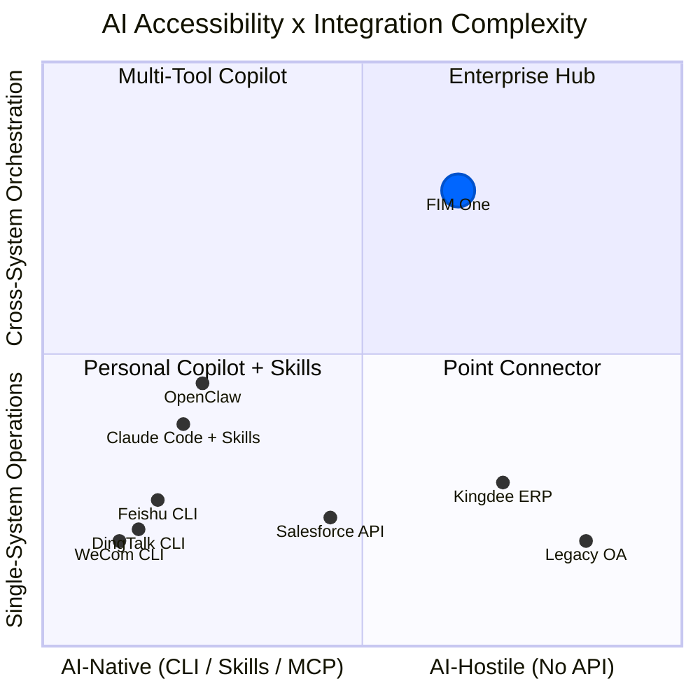

## Das Signal vom März 2026

Im März 2026 öffneten drei große chinesische Workplace-Plattformen innerhalb derselben Woche CLI-Tools:

- **DingTalk** veröffentlichte `dws` — 104 Tools über 12 Geschäftsbereiche
- **Feishu/Lark** veröffentlichte `lark-cli` — 200+ Befehle über 11 Bereiche
- **WeCom** veröffentlichte `wecom-cli` — abdeckend 7 Geschäftsbereiche

Keine von ihnen wählte MCP. Alle drei lieferten reine CLI-Tools mit vorkonfigurierten AI Skills aus, die über `npx skills add` verteilt werden. Dies ist das erste Mal, dass die Branche kollektiv ihre Position zu Frage zeigte, wie AI-Agenten mit Unternehmenssystemen kommunizieren sollten — und die Antwort war nicht ein Protokoll, sondern ein Verpackungsformat.

Dieses Dokument analysiert, was dies für die AI-System-Integration im Allgemeinen bedeutet und für die Strategie von FIM One im Besonderen.

## Drei Paradigmen für die Integration von KI-Systemen

### 1. REST API (Traditionell)

Die Grundlage. Jede SaaS-Plattform stellt HTTP-Endpunkte bereit, die mit OpenAPI-Spezifikationen dokumentiert sind. Die KI-Integration erfordert eine Adapter-Schicht — etwas, das zwischen „diesen API-Endpunkt mit diesen Headern und diesem JSON-Body aufrufen" und „hier ist ein Tool, das der Agent aufrufen kann" übersetzt.

Das ist das, was FIM One's ConnectorToolAdapter heute macht. Es funktioniert, aber jede Integration erfordert benutzerdefinierte Arbeit: API-Dokumentation lesen, Authentifizierung handhaben, Antwortformate zuordnen, mit Paginierung umgehen.

- **Wer nutzt es**: Jede SaaS-Plattform, Legacy-Integrationen
- **KI-Integration**: Erfordert Adapter-Schicht (ConnectorToolAdapter, benutzerdefinierter Code)
- **Stärke**: Universell, gut verstanden, strukturierte JSON-Ein-/Ausgabe
- **Schwäche**: Jede Integration erfordert benutzerdefinierte Entwicklungsarbeit

### 2. CLI + Skills (Emerging)

Die Plattform bietet eine kompilierte CLI-Binärdatei. Die KI-Integration erfolgt über vorgefertigte Skill-Dateien – Markdown-Dokumente, die KI-IDEs lehren, wie sie CLI-Befehle über Subprozesse aufrufen. Die Verteilung erfolgt über npm: `npx skills add dingtalk/dws`.

Die KI liest die Skill-Datei, versteht, welche Befehle verfügbar sind und welche Argumente sie benötigen, und ruft dann die CLI als Subprozess auf. Die Ausgabe ist typischerweise freier Text (Tabellen, formatierte Strings), den die KI analysieren muss.

- **Wer nutzt es**: DingTalk, Feishu, WeCom (alle haben sich im März 2026 dafür entschieden)
- **KI-Integration**: `npx skills add platform/cli` — KI-IDE liest Skill-Markdown, ruft CLI-Befehle auf
- **Stärke**: Schnell zu implementieren, funktioniert mit jeder KI-IDE, die das Skills-Format unterstützt
- **Schwäche**: Unstrukturierte Textausgabe (KI muss analysieren), kein standardisiertes Discovery-Protokoll, Umfang auf eine einzelne Plattform beschränkt

### 3. MCP (Model Context Protocol)

JSON-RPC über stdio oder SSE. Strukturierte Tool-Erkennung (`tools/list`) und Aufrufe (`tools/call`). Der AI-Client verhandelt Fähigkeiten mit dem Server, erhält ein typisiertes Schema für jedes Tool und empfängt strukturierte `CallToolResult`-Antworten.

- **Wer nutzt es**: Anthropic-Ökosystem, wachsende Anzahl von Entwicklertools
- **AI-Integration**: Natives Protokoll — strukturierte Ein-/Ausgabe, schemabasierte Erkennung
- **Stärke**: Standardisiert, strukturiert, zusammensetzbar, für Multi-Tool-Orchestrierung konzipiert
- **Schwäche**: Höhere Implementierungskosten, noch nicht von großen Workplace-Plattformen übernommen

### Vergleich

| Dimension | REST API | CLI + Skills | MCP |
|-----------|----------|-------------|-----|
| Standardisierung | Mittel (OpenAPI) | Niedrig (herstellerspezifische Skills) | Hoch (JSON-RPC-Protokoll) |
| KI-Freundlichkeit | Niedrig (benötigt Adapter) | Mittel (Text-E/A, von KI geparst) | Hoch (strukturierte JSON-E/A) |
| Erkennungsmechanismus | OpenAPI-Spezifikation / Dokumentation | `--help` + Skill-Markdown | `tools/list` Protokoll-Endpunkt |
| Ausgabeformat | Strukturiertes JSON | Freitext (benötigt KI-Parsing) | Strukturiertes `CallToolResult` |
| Zeit bis zur Bereitstellung | Wochen (pro Integration) | Tage (vorhandene API umhüllen) | Wochen (Protokoll implementieren) |
| Plattformübergreifende Orchestrierung | Erfordert Hub | Nicht integriert | Nicht integriert |
| Enterprise-Governance | Erfordert Hub | Nicht integriert | Nicht integriert |

## Was die großen Plattformen tatsächlich gewählt haben

| | DingTalk `dws` | Feishu `lark-cli` | WeCom `wecom-cli` |
|---|---|---|---|
| Sprache | Go | Go + Python | Rust + TS |
| Tools | 104 / 12 Domänen | 200+ / 11 Domänen | 7 Domänen |
| MCP-Unterstützung | Nein | Nein | Nein |
| KI-Integration | Markdown Skills + Schema-Introspection | 19 npm Skills (`npx skills add`) | 12 npm Skills (`npx skills add`) |
| Ausgabeformate | JSON / Tabelle / Raw + `--jq` | JSON / Tabelle / csv / ndjson | JSON |
| Agent-freundliche Flags | `--yes`, `--dry-run`, intelligente Eingabekorrektur | `--no-wait`, `--as user/bot`, `--dry-run` | Direkte JSON-Parameter |
| Erkennung | `dws schema` (Selbst-Introspection) | `lark-cli schema` (Selbst-Introspection) | Nur über Skill-Dateien |

Wichtige Beobachtung: `npx skills add` wird zu einem De-facto-Verteilungskanal für KI-Tool-Integrationen und umgeht MCP vollständig. Diese Plattformen wählten Geschwindigkeit beim Versand über Protokollstandardisierung. Das KI-IDE-Ökosystem (Cursor, Claude Code, Windsurf) versteht bereits Skills-Dateien, sodass die Plattformen sofortige KI-Integration erhalten, ohne einen Protokoll-Server implementieren zu müssen.

## Das Spektrum der KI-Zugänglichkeit

Nicht alle Systeme sind für KI gleichermaßen leicht erreichbar, und nicht alle Aufgaben sind gleich einfach. Diese beiden Dimensionen bestimmen, bei welchen Integrationsansätzen ein Mehrwert entsteht.

**Diagramm lesen:**

- **Unten links (Personal Copilot + Skills)**: KI-native Plattformen mit einfachen Abläufen. DingTalk, Feishu und WeCom befinden sich in diesem Bereich — sie liefern ihre eigene CLI + Skills und machen die KI-Integration für eine einzelne Plattform im Self-Service möglich. Persönliche Copiloten wie OpenClaw und Claude Code mit Skills gehören ebenfalls in diese Zone. FIM One bietet hier nur wenig zusätzlichen Nutzen — die Plattform hat diese Arbeit bereits erledigt.
- **Oben links (Multi-Tool Copilot)**: KI-native Plattformen mit Anforderungen, die mehrere Systeme umfassen. Ein Benutzer, der mehrere Skills (`dingtalk` + `feishu` + `wechat`) in Claude Code installiert, kann versuchen, mehrere Plattformen zu koordinieren, verfügt jedoch nicht über Governance, Orchestrierungsplanung oder eine einheitliche Verwaltung von Zugangsdaten.
- **Unten rechts (Point Connector)**: Altsysteme, die eine einfache Brücke benötigen. Ein einzelner Connector zu einem Kingdee-ERP-System oder einem älteren OA-System — FIM One ist hier als Adapter nützlich, selbst bei Abläufen mit nur einem System, da diese Systeme keine CLI und nur eingeschränkte oder gar keine API-Unterstützung bieten.
- **Oben rechts (Enterprise Hub)**: Alte oder API-beschränkte Systeme mit Anforderungen an eine systemübergreifende Orchestrierung. Dies ist der ideale Einsatzbereich von FIM One. Das Abfragen von Verträgen in einem älteren Managementsystem, die Verknüpfung mit offenen ERP-Forderungen und das Versenden von Zahlungserinnerungen über DingTalk — dies erfordert DAG-Planung, die Koordination mehrerer Connectoren, die sichere Verwaltung von Zugangsdaten, Audit-Trails und Bestätigungs-Gates durch Menschen. Kein persönlicher Copilot, keine CLI und keine Skills-Datei wird diesen Bereich jemals erreichen.

Der Nutzen von FIM One nimmt zu, je weiter man sich nach oben rechts bewegt: schwerer erreichbare Systeme in Kombination mit komplexeren Anforderungen an die Orchestrierung. Die Plattformen, die ihre eigene CLI + Skills bereitstellen, befinden sich in der gegenüberliegenden Ecke — leicht erreichbar, einfache Abläufe — und stellen einen Markt dar, den FIM One nicht verfolgen sollte.

## Persönlicher Copilot vs. Enterprise Hub

Die Verbreitung persönlicher KI-Copilots (OpenClaw, Claude Code, Cursor, Windsurf) wirft eine Positionierungsfrage auf. Es gibt zwei grundlegend unterschiedliche Modelle:

### Persönlicher Copilot

- **Benutzer**: Einzelner Entwickler oder Wissensarbeiter
- **Datenschutzbereich**: Mein Kalender, meine E-Mails, meine Dokumente
- **Authentifizierung**: Mein persönliches Token, meine OAuth-Sitzung
- **Integrationsspektrum**: Einzelperson, wenige Plattformen, persönliche Produktivität
- **Governance**: Nicht erforderlich — es sind meine Daten, meine Aktionen

### Plattform für Unternehmensintegrationen

- **Nutzer**: Organisationen (Teams, Abteilungen, abteilungsübergreifende Workflows)
- **Datenumfang**: Abteilungs- und systemübergreifend, einschließlich sensibler und regulierter Daten
- **Authentifizierung**: Von Administratoren zugewiesene Berechtigungen, Prinzip der geringsten Privilegien, sichere Aufbewahrung von Zugangsdaten
- **Integrationsumfang**: Orchestrierung mehrerer Systeme, Automatisierung von Geschäftsprozessen
- **Governance**: Audit-Protokolle, RBAC, Bestätigungs-Gates, Compliance-Anforderungen

Diese Ansätze ergänzen sich und stehen nicht im Wettbewerb. Mit der zunehmenden Verbreitung persönlicher Copiloten benötigen Unternehmen eine zentrale Drehscheibe, um zu steuern, worauf diese Copiloten zugreifen können. Eine Einzelperson, die Claude Code mit `npx skills add dingtalk/dws` verwendet, kann ihre eigenen DingTalk-Nachrichten lesen. Wenn ein KI-Agent jedoch DingTalk, das ERP-System des Unternehmens und das Finanzsystem orchestrieren muss – mit Audit-Trails, Berechtigungskontrollen und menschlicher Bestätigung für Schreibvorgänge –, handelt es sich um ein vollständig anderes Problem.

Persönliche Copiloten machen einfache Vorgänge auf einer einzelnen Plattform zur Massenware. Das ist nicht der Markt von FIM One. Der Markt von FIM One ist die systemübergreifende, Governance-erfordernde Unternehmensintegration einschließlich Altsystemen, die kein persönlicher Copilot bewältigen kann.

## Strategische Auswirkungen für FIM One

| Priorität | Maßnahme | Begründung |
|----------|-----------|------------|
| Kurs beibehalten | Weiter in die Governance-Schicht (Zugangsdaten, Bestätigungs-Gates, Audit) rund um den Zugriff auf API, Datenbanken und MCP investieren | CLI + Skills werden Altsysteme niemals erreichen, und systemübergreifender Zugriff benötigt Governance |
| MCP annehmen | Die Unterstützung für MCP Server ist bereits implementiert (MCPServerMetaTool) — weiter ausbauen und ausreifen lassen | MCP ist die strategische Entscheidung für ein strukturiertes Protokoll; einige Plattformen werden es letztlich übernehmen |
| Skills beobachten | Das Ökosystem rund um `npx skills add` verfolgen, aber nicht hinterherlaufen | Skills lösen ein Distributionsproblem, das FIM One nicht hat |
| Durch Governance differenzieren | Audit, RBAC, Bestätigungs-Gates, Verwaltung von Zugangsdaten | Persönliche Copiloten werden niemals Governance auf Unternehmensebene bieten |
| Klar positionieren | „All-in-one-Agent-Plattform für Global × China-Unternehmen“ — nicht „eine weitere Möglichkeit, DingTalk aufzurufen“ | Vermeiden, bei einfachen Integrationen zu konkurrieren, die Plattformen kostenlos anbieten |

Der schlechteste strategische Schritt wäre, auf die CLI- und Skills-Welle zu reagieren, indem Skills-Adapter für Plattformen entwickelt werden, die bereits eigene anbieten. Das wäre ein Wettlauf nach unten gegen die Plattformanbieter selbst. Die richtige Reaktion besteht darin, sich weiterhin auf die Systeme zu konzentrieren, die diese Anbieter niemals erreichen werden.

## Das Verhältnis zwischen CLI, Skills und MCP

Diese drei Konzepte operieren auf unterschiedlichen Ebenen und werden in Diskussionen häufig miteinander verwechselt. Eine präzise Unterscheidung:

- **CLI** ist eine Benutzeroberfläche — Shell-Befehle, Text-I/O und ein Formfaktor für die Interaktion mit einem System
- **Skills** sind ein Verteilungsmechanismus — Markdown-Dateien, die einer KI beibringen, wie sie CLI-Befehle aufruft, sowie ein Paketierungsformat für KI-Tool-Integrationen
- **MCP** ist ein Protokoll — JSON-RPC, strukturierte Erkennung und Aufruf sowie ein Interoperabilitätsstandard für die Kommunikation zwischen KI und Tools

Langfristig sind sie keine gegenseitigen Alternativen. Eine CLI ist die Schnittstelle, über die ein Mensch (oder ein KI-Subprozess) mit einem Tool interagiert. Eine Skill-Datei ist die Schnittstelle, über die diese CLI in KI-IDEs verteilt wird. MCP ermöglicht eine strukturierte, schema-typisierte und komponierbare Integration auf Protokollebene.

Kurzfristig (2026) setzt sich CLI + Skills bei der Verbreitungsgeschwindigkeit jedoch durch, weil die Implementierung günstiger ist als bei MCP. Eine Plattform mit einer bestehenden CLI kann innerhalb eines Tages eine Skills-Datei bereitstellen. Die Implementierung eines MCP-Servers dauert Wochen und erfordert ein Verständnis der Protokollspezifikation, der Transportschichten und der Aushandlung von Fähigkeiten.

Die wahrscheinliche Annäherung: Plattformen, die heute CLIs bereitstellen, könnten sie morgen als MCP-Server kapseln. Der stdio-Transport von MCP startet bereits CLI-Prozesse — die Lücke zwischen „CLI, die über Skills aufgerufen wird“ und „CLI, die als MCP-Server gekapselt ist“ ist klein. Diese Annäherung ist jedoch nicht garantiert. Wenn das Skills-Ökosystem schnell genug wächst und sich KI-IDEs auf einen gemeinsamen Standard einigen, bleibt MCP möglicherweise ein Protokoll für Entwickler-Tools statt eines Standards für Enterprise-Tools.

Für FIM One ist die Schlussfolgerung klar: Investiert werden sollte in die Protokollebene (MCP) und die Governance-Ebene (Zugangsdaten, Bestätigungs-Gates, Audit), nicht in die Verteilungsebene (Skills). Die Verteilung ist für Plattformanbieter ein gelöstes Problem. Protokoll und Governance sind die Bereiche, in denen ein Hub dauerhaft Wert schafft.
