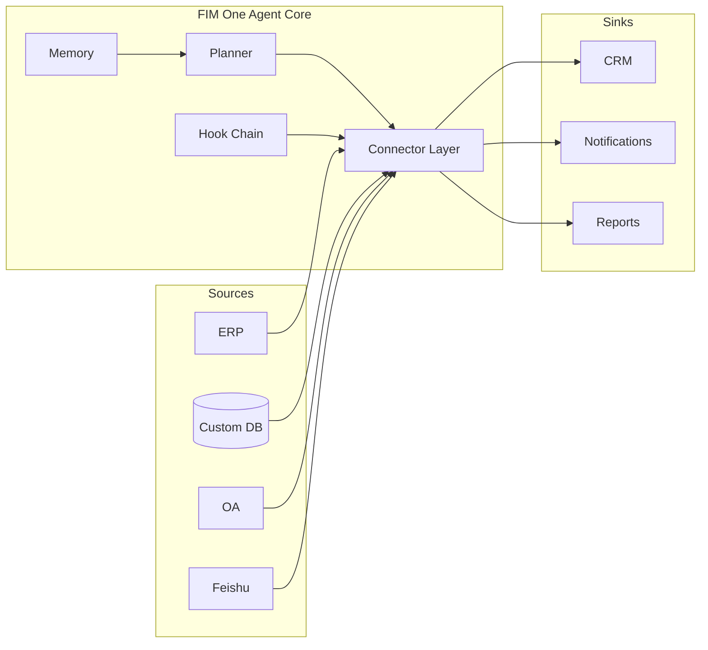

<Info>
  **Version 1.1 · April 2026.** Dieses Whitepaper dokumentiert die architektonische These, die Positionierung in der Kategorie und das Bereitstellungsmodell von FIM One.
  Es richtet sich an CTOs, Enterprise-Architekt:innen, Verantwortliche für KI-Plattformen und technische Investoren, die bewerten, wie sich KI in die Systeme integrieren lässt, die sie bereits betreiben.
</Info>

## Zusammenfassung

**Daten verlassen niemals Ihre Grenze.** Dieser eine Satz ist die grundlegende Designvorgabe hinter jeder Entscheidung in FIM One und der Grund, warum eine neue Infrastrukturschicht erforderlich ist — nicht eine weitere iPaaS und nicht ein weiterer universeller Agent.

Die meisten Unternehmen verfügen bereits über die Systeme, die sie benötigen — ERP, CRM, OA, benutzerdefinierte Datenbanken, interne APIs, branchenspezifische SaaS. Was ihnen fehlt, ist eine Möglichkeit für KI, diese Systeme zu **erreichen**, ohne Daten in eine Vendor-Cloud zu migrieren und ohne ein sechsmonatiges Integrationsprojekt für jeden Use Case. Der Markt ist groß, bewegt sich schnell und positioniert sich bereits neu: Die globalen Ausgaben für GenAI-Infrastruktur in Unternehmen werden 2025 auf **18 Mrd. USD geschätzt und wachsen um das 3,2-fache YoY** (Menlo Ventures 2025). China bewegt sich noch schneller — die Ausgaben für Enterprise-AI-Agenten liegen bei **120% CAGR (2023–2027) und erreichen bis 2027 ¥65,5 Mrd.** (iResearch · CAICT 2025). Zentral- und staatseigene Unternehmen machen **60%+ der Beschaffung großer Modelle** aus, und Xinchuang (信创) Private-Deployment ist eine zwingende Anforderung.

Gartner hat diese Kategorie offiziell in „AI Agent Platform" umbenannt (Dokument 6300015, 2025); CAICTs 2025 Agentic AI Technology Report nennt es „智能体平台"; MuleSoft, der historische iPaaS-Marktführer, wurde **vom Leader zum Challenger** im 2025 iPaaS Magic Quadrant herabgestuft. Die Kategorie, die die Unternehmensintegration ein Jahrzehnt lang dominierte, wird in Echtzeit ersetzt.

FIM One ist für die neue Kategorie konzipiert. Es ist eine **All-in-One-Agent-Plattform** für Global × China Unternehmen — ein Provider-agnostisches Python-Framework, bei dem KI-Agenten dynamisch Aufgaben über Ihre bestehenden Systeme planen und ausführen, globale SaaS und den China Stack über einen Agent Core verbinden, in Ihrer eigenen Umgebung bereitgestellt, vollständig nachverfolgbar. Ein Agent Core, drei Bereitstellungsmodi:

| Modus | Wo es sich befindet | Typische Bereitstellung |
|---|---|---|
| **Standalone** | Ein eigenes Portal | Knowledge Q&A, interner Chat, Code-Sandbox |
| **Copilot** | Eingebettet in ein Host-System | „Finance Copilot" in einer ERP-Web-UI |
| **Hub** | Zentraler systemübergreifender Orchestrator | Agent fragt ERP ab, prüft OA, benachrichtigt über Feishu |

Dieses Dokument erklärt, warum sich die Kategorie bewegt, warum iPaaS die neue Workload nicht aufnehmen kann, wie FIM One unter der Haube aussieht und wie Sie es in die Produktion bringen.

## 1. Das Problem: Enterprise-KI ist ein Alignment-Problem

Die öffentliche KI-Diskussion in 2025–2026 wurde von Modellkapazität dominiert — längere Kontexte, besseres Reasoning, günstigere Token. In Unternehmen ist Kapazität selten der Engpass. Der Engpass ist, dass **die KI keine Hände in Ihren Systemen hat**.

Ein Frontier-LLM, das eine zehntausendzeilige Codebasis lesen und einen korrekten Fix vorschlagen kann, kann von selbst nicht:

- Gestrige Bestandszahlen aus einer lokalen SAP-Instanz abrufen.
- Eine Urlaubsanfrage in einem SaaS-HR-Tool genehmigen, dessen einzige Integrationsoberfläche eine Legacy-SOAP-API ist.
- Eine Zeile in ein Xinchuang-konformes ERP schreiben, dessen Authentifizierung ein Login-Ticket-Service statt OAuth2 ist.
- Eine Benachrichtigung in eine Feishu-Gruppe senden und dabei die eigenen Genehmigungsregeln der Gruppe respektieren.

Jedes dieser Probleme ist einmal gelöst — eine gelöste Integrationsfrage. Die Schwierigkeit besteht darin, dass jedes Unternehmen Dutzende solcher Systeme hat, jedes mit seinem eigenen Authentifizierungsmodell, seiner eigenen Datenform und seinen eigenen Fehlermodi. Sie hardcodieren zu lassen, ergibt einen spröden Monolithen. Das LLM zur Laufzeit dazu zu bringen, sie zu entdecken, ergibt halluzinierte API-Aufrufe.

**Die fehlende Primitive ist eine ausgerichtete Oberfläche.** Eine typisierte, authentifizierte, auffindbare Schnittstelle zwischen dem Modell und dem System — eine, die dem Modell genau sagt, was es tun kann, was jede Aktion kostet, wer sie genehmigen muss und wie das Ergebnis aussieht. Diese Primitive ist das, was FIM One einen **Connector** nennt.

## 2. Warum bestehende Ansätze nicht ausreichen

### 2.1 iPaaS und Workflow Builder — eine Kategorie im Niedergang

iPaaS (MuleSoft, Boomi, Workato) und die leichtere Workflow-Familie (n8n, Zapier, Dify, Coze) behandeln Integration als ein **Design-Zeit**-Problem: Ein Mensch zeichnet einen Graphen von Knoten und verbindet sie auf Feldebene, der Graph läuft zur Laufzeit deterministisch ab. Das Modell funktionierte, als Integrationen wenige und stabil waren.

Es funktioniert nicht für KI-gesteuerte Enterprise-Automatisierung, aus drei sich verstärkenden Gründen:

1. **Die Logik existiert bereits im Zielsystem.** Jeder Knoten ist ein dünner Wrapper um einen API-Aufruf, den Sie jetzt an zwei Stellen pflegen.
2. **Der Mensch muss den Plan im Voraus kennen.** Enterprise-Fragen wie „Q1 für alle APAC-Entitäten abschließen" sind offen — der Plan muss zur Laufzeit generiert werden, nicht von einem Designer gezeichnet.
3. **Feldebenen-Mapping kollabiert bei Skalierung.** Ein Graph mit tausend Knoten über ein Dutzend Systeme ist nicht wartbar; KI-lesbare Action-Oberflächen ersetzen ihn vollständig.

Die Kategorie bewegt sich sichtbar. Gartner klassifizierte den Bereich 2025 als „AI Agent Platform" um (Dokument 6300015). CAICT übernahm denselben Rahmen in seinem 2025 Agentic AI Technology Report. Am aussagekräftigsten: **MuleSoft — der Referenz-iPaaS-Anbieter für ein Jahrzehnt — wurde im Gartner 2025 iPaaS Magic Quadrant von Leader auf Challenger herabgestuft**. Gleichzeitig wuchs das MCP-Protokoll von Anthropic, das im November 2024 veröffentlicht wurde, auf **über 10.000 Server und 97 Millionen monatliche SDK-Downloads in 15 Monaten**. Das Signal ist unmissverständlich: die Integrations-Schicht der Enterprise-Automatisierung wird neu aufgebaut.

### 2.2 Allzweck-Agenten (Manus, AutoGPT, OpenAI Assistants)

Allzweck-Agenten sind für Consumer- und Knowledge-Work-Aufgaben konzipiert — Web-Browsing, Dokumentenerstellung, Tabellenkalkulationen. Sie können nicht in Ihr VPN eindringen, sich bei Ihrem ERP authentifizieren oder Ihre Sicherheitsprüfung bestehen. Wenn sie um Unternehmensysteme herum eingesetzt werden, werden sie zu Demos, die in der Pilotphase scheitern.

### 2.3 Vendor-Embedded AI (Feishu AI, SAP Joule, Salesforce Einstein)

Vendors haben ihre eigene KI in ihre eigenen Produkte integriert. Das Problem ist strukturell: **Kein vorgelagerter Anbieter hat einen Anreiz, seine eigene Datensilo zu durchbrechen.** Feishu AI kennt Ihre ERP-Daten nicht; DingTalk AI kennt Ihren Vertragsstatus nicht. Die KI jedes Anbieters sieht nur das, was dieser Anbieter Ihnen verkauft hat. Für systemübergreifende Arbeiten sind sie keine Option.

### 2.4 Build-Your-Own und RPA

Eigenentwicklungen haben lange Entwicklungszyklen und konstante Anpassungskosten. RPA steuert die Benutzeroberfläche wie ein Mensch — der allgemeinste Ansatz und der zerbrechlichste: Jede UI-Änderung bricht ihn, jede Authentifizierungsaufforderung stoppt ihn. Es ist ein Pflaster über fehlenden APIs, keine Grundlage zum Aufbau von KI.

FIM One besetzt die Lücke, die all diese hinterlassen: typisierte APIs über echte Systeme, vom Modell geplant, vom Unternehmen gesteuert, innerhalb der Unternehmensgrenze bereitgestellt.

## 3. Die FIM One These

Drei Überzeugungen prägen jede Designentscheidung.

**Überzeugung 1 — Die Systeme existieren bereits.** Fordern Sie das Unternehmen nicht auf, alles neu aufzubauen; treffen Sie es dort, wo es ist. Jeder Connector ist eine Brücke, keine Ersetzung. Daten verlassen niemals die Quelle der Wahrheit und niemals die Unternehmensgrenze.

**Überzeugung 2 — Ausrichtung schlägt Leistung.** Ein schwächeres Modell mit einem ausgerichteten Toolset übertrifft ein stärkeres Modell, das an rohen APIs herumfummelt. Der Burggraben ist die Connector-Bibliothek, sein Authentifizierungsmodell und die Governance-Schicht — nicht das reine Reasoning des Agenten.

**Überzeugung 3 — Dynamische Planung ist der richtige Mittelweg.** Starre Workflows (iPaaS, BPM) sind zu spröde für echte Unternehmensaufgaben; vollständig autonome Agenten (AutoGPT, Manus) sind zu unvorhersehbar für die Produktion. FIM One plant zur Laufzeit, aber innerhalb eines typisierten Action Space — jeder Schritt ist ein Connector-Aufruf, kein offenes LLM-Monolog. Begrenzte Autonomie: `re-plan ≤ 3 | token budget | confirmation gate`.

### Beyond iPaaS

FIM One ist bewusst keine iPaaS, und dieser Unterschied ist nicht kosmetisch. iPaaS ist feldebenenbasiert, designzeitlich, von Menschen modelliert und in der Vendor-Cloud gehostet. FIM One ist aktionsebenenbasiert, laufzeitlich, modellgeplant und unternehmensgehostet.

| Axis | iPaaS | FIM One |
|---|---|---|
| Granularity | Field mapping | Typed action |
| Planning time | Design time | Run time |
| Who models it | Human designer | The model |
| Data location | Vendor cloud | Your servers |
| Governance | External add-on | Built-in hooks |
| Category (Gartner 2025) | iPaaS MQ (declining) | AI Agent Platform |

## 4. Architecture Principles

<CardGroup cols={2}>
  <Card title="Provider-Agnostic" icon="shuffle">
    Any OpenAI-compatible LLM — OpenAI, Anthropic, DeepSeek, Qwen, local Ollama, Xinchuang-certified models. Model choice is a deployment variable, not an architectural commitment.
  </Card>
  <Card title="Protocol-First" icon="network-wired">
    Every connector publishes a typed schema. The agent sees actions, parameters, and return types — never raw HTTP. OpenAPI, MCP, and direct database connections are first-class.
  </Card>
  <Card title="Three Execution Engines" icon="sitemap">
    **ReAct** for exploratory tasks, **DAG** for structured pipelines, **Workflow** (visual editor, 9 node types, an optional module) for deterministic human-designed pipelines. One agent core picks the engine per task.
  </Card>
  <Card title="Schema-First Tool Loading" icon="bolt">
    Tool schemas are pre-seeded at ~30 tokens each; the agent expands on demand. Per-session prompt overhead drops ~80%, and the platform scales to **10,000+ APIs** without blowing the context window.
  </Card>
  <Card title="Hook-Governed" icon="shield-halved">
    Every tool call passes through a configurable hook chain: audit, policy, human-in-the-loop approval. Hooks run outside the LLM loop — deterministic and auditable.
  </Card>
  <Card title="Memory-Aware" icon="brain">
    Short-term conversation, long-term knowledge base, and cross-session memory are first-class primitives, not bolt-ons.
  </Card>
</CardGroup>

## 5. Three Delivery Modes — One Agent Core

The same planner, memory, and connector library power three distinct product shapes. The choice is a deployment decision, not a code fork.

**Standalone** — a self-contained portal. The buyer wants a chat interface over a curated knowledge base, or a code sandbox, or a general assistant. No host system involved. Fits internal IT help desks, engineering productivity, customer-support KBs.

**Copilot** — the agent embedded inside an existing host system. Today the host UI calls the FIM One API; a drop-in iframe / widget embed, with the user's identity passed from the host, is planned. Fits Finance Copilot inside SAP Fiori, Sales Copilot inside Salesforce, DevOps Copilot inside an internal developer portal.

**Hub** — the central orchestration surface. Every connected system terminates here. Users ask cross-system questions; the agent plans and executes across systems. Fits "close out Q1 for all APAC entities", "find every customer who missed a renewal and draft outreach", "reconcile yesterday's payments between gateway and ledger".

## 6. Connector Alignment Model

A connector is a typed action surface backed by an auth strategy. FIM One defines three auth tiers that cover the vast majority of enterprise systems.

<AccordionGroup>
  <Accordion title="Tier 1 — Database Connectors">
    Direct connection to a relational database. The agent writes SQL against the introspected schema; a connector is read-only by default, stays private to its owner, and columns marked as personal data come back masked. Native support for **Xinchuang-compliant databases — Dameng (DM8), KingbaseES, HighGo** — alongside PostgreSQL and MySQL. Central/state-owned and regulated customers pass compliance procurement day-one.
  </Accordion>
  <Accordion title="Tier 2 — OpenAPI Connectors (User-Key)">
    Any REST API with an OpenAPI specification. The agent reads the spec, selects the endpoint, and calls it with the logged-in user's key. Covers modern SaaS (Slack, Linear, GitHub) and well-documented internal APIs.
  </Accordion>
  <Accordion title="Tier 3 — Login-Ticket / Legacy Connectors (planned)">
    For systems — particularly common in the Chinese market — that authenticate via a login-ticket service rather than OAuth2. The connector will manage the ticket lifecycle (acquire, refresh, invalidate) and present a normal typed surface upward. Not shipped yet: today API connectors authenticate with a bearer token, an API key, or basic auth.
  </Accordion>
</AccordionGroup>

Each connector also declares a **Channel/Integration duality**: the same underlying system can appear both as a *channel* (notification sink, approval surface) and as an *integration* (data source, action target). Feishu is both a notification channel and a group-chat data source; DingTalk and WeCom follow the same pattern.

## 7. Trustworthy Enterprise AI — Three Pillars

Enterprise AI fails in production not because the model is wrong but because the organization cannot prove it is right. FIM One treats trust as architecture, expressed in three pillars.

<CardGroup cols={3}>
  <Card title="Every Conclusion Is Cited" icon="paperclip">
    RAG retrieval + citation chain lets the agent reference a specific paragraph in a specific document for every claim. Conclusions are traceable and auditable. No black-box output.
  </Card>
  <Card title="Sensitive Actions Are Confirmed" icon="hand">
    Actions marked as requiring confirmation (or every tool call, when an agent is set to confirm all) pause before execution, waiting for a human approval — inline in the portal or out-of-band via a Feishu approval group. The hook chain is an architectural constraint, not a policy suggestion. It cannot be bypassed.
  </Card>
  <Card title="Every Release Is Measured" icon="chart-bar">
    Dataset-driven evaluation quantifies quality before each release. Every iteration is measurable; enterprise procurement gets evidence, not promises.
  </Card>
</CardGroup>

Supporting this, every agent run emits a structured trace: plan, tool calls, arguments, observations, approvals, final answer. Traces are the unit of audit. Credentials use Fernet encryption (AES-128-CBC + HMAC-SHA256). Full audit logs are stored and exportable.

When an operator rejects a tool call, the agent stops — it does not paraphrase and retry. Rejection is a policy decision, not an error to recover from.

## 8. Deployment and Business Model

FIM One ships with public source under the FIM One Source Available License (FIM-SAL) — source-available, not OSI-approved open source — with three deployment shapes and three edition tiers.

<CardGroup cols={3}>
  <Card title="Community" icon="code">
    Free forever. Self-hosted. For developers and evaluation teams.
  </Card>
  <Card title="Cloud" icon="cloud">
    FIM.AI-hosted on cloud.fim.ai. Per-user + per-connector subscription. Singapore entity handles overseas contracts.
  </Card>
  <Card title="Enterprise" icon="briefcase">
    Private deployment, custom pricing, compliance tooling, dedicated technical support. For large enterprises and government/state-owned customers.
  </Card>
</CardGroup>

The backend is ~106,000 lines of Python across 440+ modules, with 230+ test files and built-in support for 6 UI languages. Source is publicly available under FIM-SAL — enterprises can audit security themselves. The dominant runtime cost is LLM tokens, not infrastructure; provider-agnosticism means you benefit as the frontier pushes prices down, without migration.

## 9. Delivery Path

Production deployment follows a three-step path that keeps risk bounded and time-to-value short.

| Step | Timeline | What happens |
|---|---|---|
| **1. PoC** | 2 weeks | 1–2 representative scenarios (finance audit, contract review, data reporting), end-to-end on real data. First version in 7 days, validation report in 14. |
| **2. Pilot** | 1–2 months | Private deployment to your servers. First 3–5 connectors (ERP / OA / Feishu / DingTalk / database). One business line covered. Audit and approval baselines established. |
| **3. Scale** | 3–6 months | Expansion to more business lines and connectors. Industry Skill packs accumulated. Internal administrators trained. Operations runbook and SLA delivered. |

Eight pre-built Solution templates cover common scenarios: financial audit, contract review, data reporting, IT operations, HR onboarding, sales proposals, content creation, and meeting summaries.

## 10. Where This Goes

**Near-term — connector depth.** Tier-3 legacy connectors for the Chinese market, deeper Xinchuang certification, and an AI Builder that turns an OpenAPI spec or a database schema screenshot into a working connector in minutes.

**Near-term — governance depth.** Richer RBAC, four-tier connector permissions, independent IdP, SSO by default, SOC 2 and ISO 27001 posture.

**Mid-term — ecosystem.** Cloud SaaS, a Connector Marketplace, and industry Solution packs — the infrastructure layer that third parties build on top of.

The longer-term bet is that the shape of enterprise AI will look far more like a cross-system agent platform than a CLI. Knowledge workers will not install ten AI assistants; they will ask their company's agent platform, and the platform will know how to reach whatever system holds the answer — global SaaS, the China enterprise stack, or anything in between. FIM One is building that platform.

## 11. Appendix — Going Deeper

- **[System Overview](/architecture/system-overview)** — component-level architecture.
- **[Connector Architecture](/architecture/connector-architecture)** — the connector contract, lifecycle, and extension model.
- **[Design Philosophy](/architecture/design-philosophy)** — why we made each core tradeoff.
- **[Hook System](/architecture/hook-system)** — policy, approval, and audit in depth.
- **[Competitive Landscape](/strategy/competitive-landscape)** — category positioning and head-to-head comparison.
- **[Quickstart](/quickstart)** — run FIM One on your laptop in under ten minutes.

<Tip>
  Questions, corrections, or commercial inquiries: hi@fim.ai · [Discord](https://discord.gg/z64czxdC7z) · [GitHub](https://github.com/fim-ai/fim-one)
</Tip>
