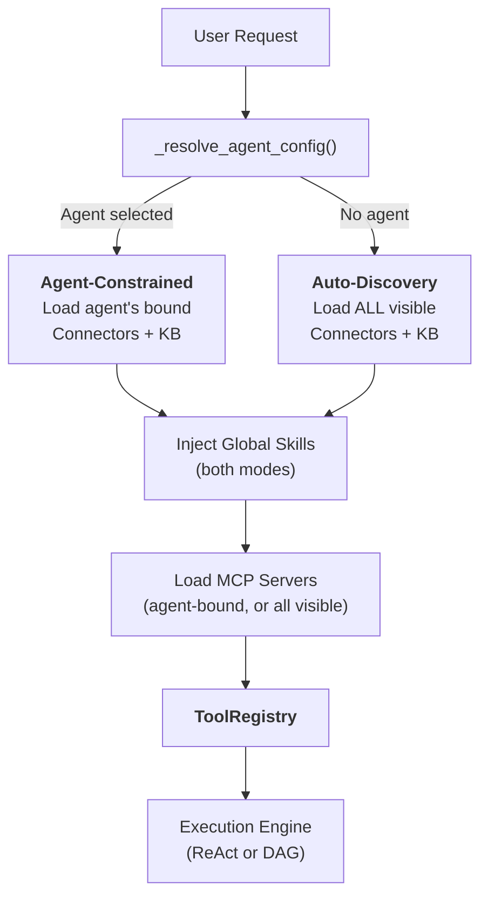
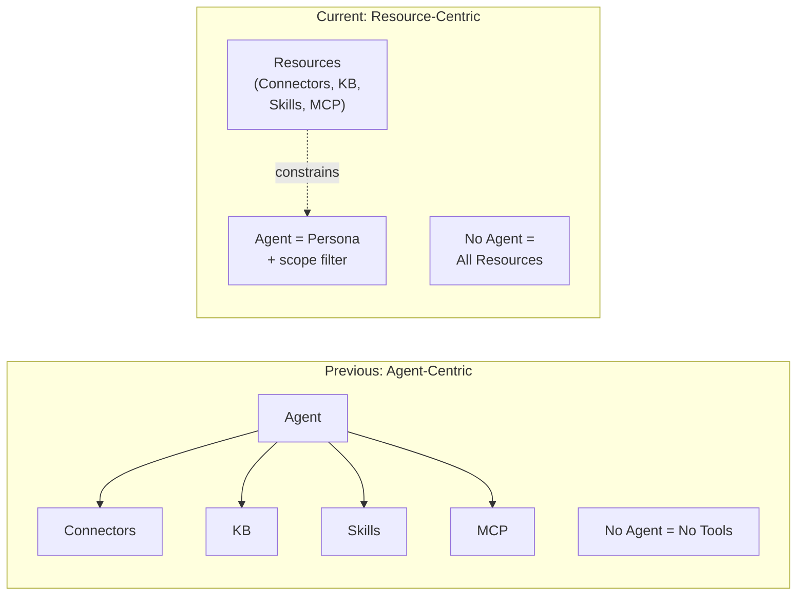
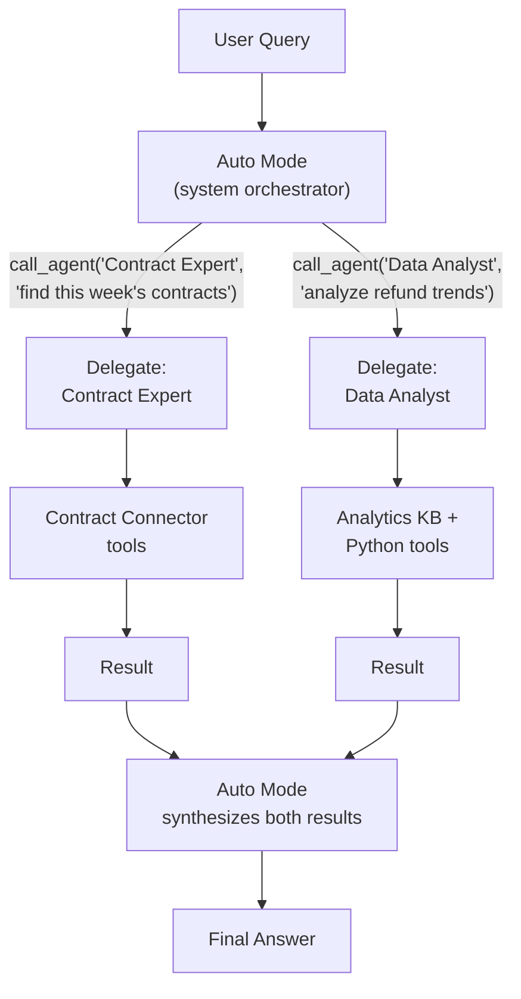
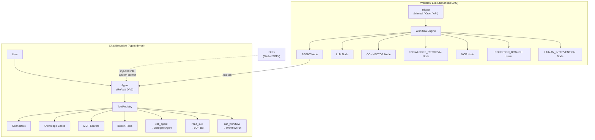

## The two modes

Every chat request in FIM One starts with a question: **is an Agent selected?** The answer determines how resources — Connectors, Knowledge Bases, Skills, and MCP servers — are discovered and assembled into the tool set the LLM can use.

**Agent-Constrained Mode** activates when the user picks a specific Agent. The system loads only the resources that Agent has been explicitly configured with:

- **Connectors**: only the Agent's bound `connector_ids` are loaded as tools.
- **Knowledge Bases**: only the Agent's bound `kb_ids` are injected as retrieval tools.
- **Skills**: globally available when the Skills module is enabled (it is off by default) — all active Skills visible to the user are injected, because Skills are organizational SOPs, not Agent-specific knowledge. (See [Skills as Global SOPs](#skills-as-global-sops) below.)
- **MCP Servers**: only the Agent's bound `mcp_server_ids` are loaded; an Agent with none bound gets no MCP tools.
- **Instructions**: the Agent's `instructions` field defines the persona and behavioral guidelines injected into the system prompt.

**Global Auto-Discovery Mode** activates when no Agent is selected (e.g., a new chat). The system auto-discovers everything accessible to the user:

- **Connectors**: all Connectors visible to the user (own + subscribed from an organization or the Market) are loaded.
- **Knowledge Bases**: the user's own KBs are available for retrieval via `kb_retrieve` (knowledge bases cannot be shared).
- **Skills**: all active Skills visible to the user are injected as SOP stubs.
- **MCP Servers**: all active servers visible to the user.
- **Instructions**: a generic assistant persona is used.

The branching happens inside `_resolve_tools()`, which is called on every chat request:



The practical effect: users can start chatting immediately without configuring an Agent. The system discovers available resources and exposes them as tools. Selecting an Agent narrows the scope — it does not unlock new capabilities, it focuses existing ones.

### What each mode discovers

The two modes differ in **scope**, not in kind. Both produce a `ToolRegistry` — they just fill it differently.

**Auto-Discovery Mode (no Agent selected):**

| Resource | Discovery | Tool Form |
|---|---|---|
| Connectors (API) | `resolve_visibility()` — all visible to user | `ConnectorMetaTool` (progressive) |
| Connectors (DB) | `resolve_visibility()` — all visible to user | `DatabaseMetaTool` (progressive) |
| Knowledge Bases | The user's own KBs | `kb_retrieve` |
| Skills | `resolve_visibility()` — all active | `read_skill` (progressive stubs) |
| MCP Servers | `resolve_visibility()` — all user-visible | `MCPServerMetaTool` (progressive) |
| Agents | `resolve_visibility()` — all active, non-builder | `call_agent` (delegation catalog) |
| Built-in Tools | `discover_builtin_tools()` — full set | No category filter applied |

**Agent-Constrained Mode (Agent selected):**

| Resource | Discovery | Tool Form |
|---|---|---|
| Connectors | Only `agent.connector_ids` | `ConnectorMetaTool` or legacy per-action |
| Knowledge Bases | Only `agent.kb_ids` | `GroundedRetrieveTool` / `KBRetrieveTool` |
| Skills | Global — **not constrained by Agent** | `read_skill` |
| MCP Servers | Only `agent.mcp_server_ids` | `MCPServerMetaTool` (progressive) |
| Agent Delegation | Not available — agents are specialized | _(disabled)_ |
| Built-in Tools | `agent.tool_categories` filter | Subset by category |

The key asymmetry: Connectors, Knowledge Bases and MCP Servers are scoped by the Agent, but Skills remain global in both modes. `CallAgentTool` (agent delegation) is only available in Auto-Discovery mode — it is **not** registered when a specific Agent is selected. This is a security measure: a marketplace agent could otherwise use `call_agent` to invoke other agents and access their private prompts. Skills are organizational rules (everyone follows the same SOPs), while Connectors and KBs are capability bindings (different agents connect to different systems).

## Tout est un outil

Au niveau du LLM, tous les types de ressources convergent en une liste plate d'outils appelables. Le LLM n'a aucune conscience structurelle de s'il appelle un Connecteur, un serveur MCP, ou une Base de Connaissances. Il voit un `ToolRegistry` — un ensemble de fonctions avec des noms, des descriptions et des schémas de paramètres.

| Type de Ressource | Devient au Niveau du LLM | Motif du Nom de l'Outil |
|---|---|---|
| Connecteur (progressif) | Outil méta unique | `connector` |
| Connecteur (hérité) | N outils par action | `{connector}__{action}` |
| Connecteur de Base de Données (progressif) | Outil méta unique | `database` |
| Connecteur de Base de Données (hérité) | 3 outils par base de données | `{db}__list_tables`, `{db}__describe_table`, `{db}__query` |
| Serveur MCP (progressif) | Outil méta unique | `mcp` |
| Serveur MCP (hérité) | N outils par serveur | `{server}__{tool}` |
| Base de Connaissances | Outil de récupération | `kb_retrieve` ou `grounded_retrieve` |
| Compétence (progressive) | Outil de lecture + stubs de prompt système | `read_skill` |
| Compétence (inline) | Texte de prompt système uniquement | _(pas d'outil)_ |
| Agent lui-même | Non visible comme un outil | _(instructions + assemblage d'outils)_ |

L'insight clé : **un Agent n'est pas un outil — c'est l'entité qui utilise les outils.** L'Agent contribue ses instructions au prompt système et détermine quels outils sont disponibles. Mais du point de vue du LLM, il n'y a aucun concept « d'agent » — seulement un prompt système et un ensemble de fonctions appelables.

Cette uniformité est ce qui rend le système extensible. Ajouter un nouveau type de ressource signifie implémenter le protocole `Tool` (`name`, `description`, `parameters_schema`, `run()`). Les moteurs d'exécution, la gestion du contexte et la couche d'interaction avec le LLM restent inchangés.

## Compétences en tant que procédures opérationnelles standard mondiales

Les compétences occupent une couche au-dessus des agents. Ce sont des politiques et des procédures organisationnelles que chaque agent doit suivre, quel que soit l'agent sélectionné.

### Pourquoi les compétences ne sont pas liées aux agents

Une compétence comme « Customer Complaint Handling SOP » s'applique à chaque agent qui interagit avec les clients. Lier les compétences aux agents crée un problème de propriété bidirectionnelle : si une compétence orchestre les agents, et les agents possèdent les compétences, qui contrôle qui ?

Les compétences sont globales par conception — ce sont des règles d'entreprise, pas des connaissances spécifiques aux agents. La fonction `_resolve_tools()` charge toutes les compétences actives visibles pour l'utilisateur indépendamment de la sélection d'agent, en utilisant le même filtre `resolve_visibility()` utilisé pour les autres ressources.

### Deux modes d'injection

Les compétences supportent deux modes d'injection -- **progressif** (par défaut) et **inline** -- contrôlés par `SKILL_TOOL_MODE` ou la `model_config_json.skill_tool_mode` de l'agent. En mode progressif, seuls des stubs compacts apparaissent dans le prompt système ; le LLM appelle `read_skill(name)` à la demande pour charger le contenu complet. Cela fait partie de l'architecture [Progressive Disclosure](/architecture/progressive-disclosure) plus large de FIM One qui minimise la consommation de contexte sur tous les types de ressources.

## Agent as persona, not container

FIM One's architecture reflects a deliberate shift from an Agent-centric model to a Resource-centric model.

**Previous model:** the Agent was a container that gated access to all resources. No Agent selected meant no Connectors, no Skills, no specialized KB. The Agent was the mandatory entry point for any capability.

**Current model:** the Agent is a persona — a set of instructions and behavioral guidelines — combined with an optional resource constraint. Resources exist independently of Agents. Selecting an Agent narrows the scope; not selecting one opens it fully.



This means:

- **Users can start chatting immediately** without configuring an Agent.
- **The system auto-discovers available resources** and exposes them as tools.
- **Agents become lightweight personas** that can be created quickly — just write instructions and optionally bind specific Connectors and KBs.
- **Resource management is decoupled** from Agent management. Publishing a Connector to an organization makes it available to every member who subscribes to it — in auto-discovery mode, in Agent binding dropdowns, and in agent delegation resolution.

## Délégation d'agent

FIM One prend en charge la délégation de tâches à des agents spécialisés via `CallAgentTool` — mais uniquement en mode **Auto** (aucun agent sélectionné). Lorsqu'un utilisateur sélectionne un agent spécifique, la délégation est désactivée et l'agent se concentre exclusivement sur ses propres outils.

### Two modes: Auto vs Agent-selected

| Aspect | Auto Mode (no agent selected) | Agent-Selected Mode |
|---|---|---|
| `call_agent` | Enabled — delegates to any visible agent | **Disabled** — not registered |
| Tool scope | All visible Connectors, KB, Skills, MCP | Only the Agent's bound resources + global Skills |
| Orchestration | System LLM dynamically picks the best agent per iteration | Agent uses its own tools directly |
| Use case | General queries, cross-domain tasks | Focused specialist tasks |

**Why delegation is disabled in Agent-selected mode:** Security. A marketplace agent could use `call_agent` to invoke other agents and read their private system prompts. By restricting delegation to Auto mode — where the system LLM (not any individual agent's prompt) controls the flow — private agent prompts are never exposed to untrusted agent configurations.

### Mode Auto comme couche d'orchestration

Le mode Auto est un concept de première classe dans l'interface utilisateur. Le sélecteur d'agent affiche « Auto » comme option par défaut. Lorsque le mode Auto est actif, le LLM système agit comme un orchestrateur : il voit le catalogue complet des agents visibles et peut déléguer les tâches au spécialiste le mieux adapté à chaque itération. Cela élimine le besoin d'un « agent parent » dédié — le système lui-même est l'orchestrateur.

### Catalogue d'agents

À l'exécution, tous les agents actifs et non-builder visibles par l'utilisateur sont assemblés dans un catalogue. Le nom et la description de chaque agent sont listés dans le schéma de paramètres de l'outil `call_agent`, permettant au LLM de choisir le bon spécialiste sémantiquement — sans routage codé en dur.

### Full tool inheritance

When a delegated agent is invoked via `call_agent(agent_id, task)`, it is assembled the way a chat with that agent is: a complete `ToolRegistry` built from its own configuration — its bound Connectors, Knowledge Bases and MCP servers (connected for the duration of the call) and its built-in tool categories — together with its own approval gate. Delegated agents are full execution units, not text-only advisors. An agent that has been switched off or is no longer visible to the user when it is called is reported as unavailable instead of being run.

### Délégation à un seul niveau

Pour éviter la récursion infinie, les agents délégués ne reçoivent pas l'outil `call_agent`. La délégation est toujours à un seul niveau : le mode Auto appelle un spécialiste, le spécialiste exécute et retourne un résultat. Le système synthétise les résultats de plusieurs agents délégués.

### Exécution parallèle

En mode d'appel de fonction natif, le LLM peut invoquer plusieurs appels `call_agent` en un seul tour. Ceux-ci s'exécutent simultanément via `asyncio.gather`, permettant des modèles comme « rechercher trois sources simultanément ».



## Visibility model

All resource discovery — in both modes — is governed by a unified visibility model with two tiers:

| Tier | Description | Example |
|---|---|---|
| **Own** | Created by the user. Always visible. | A Connector you built for your team's API |
| **Subscribed** | Resources published to one of the user's organizations or to the Market that the user has subscribed to. Visible while the resource is still shared and approved. Org membership alone grants nothing. | A company-wide ERP Connector published by IT, or a community-built Slack Connector you installed |

The `resolve_visibility()` function in `web/visibility.py` builds a SQL filter that covers both tiers in a single query:

```python
conditions = [
    model.user_id == user_id,                    # own resources
    and_(model.id.in_(subscribed_ids),           # subscribed, and still shared
         model.visibility == "org",
         or_(model.publish_status.is_(None),
             model.publish_status == "approved")),
]
```

This same filter is used everywhere:

- Auto-discovering Connectors in no-agent mode
- Building the Agent catalog for `CallAgentTool`
- Loading visible Skills for system prompt injection
- MCP server resolution
- Agent configuration lookup (ensuring a user can only select Agents visible to them)

The uniformity means that **a Connector published to an organization becomes available to its subscribers** in auto-discovery mode, in Agent binding dropdowns, and in agent delegation resolution — no special wiring required. The visibility model is the single source of truth for "what can this user access."

## Relationship map

FIM One has two parallel execution paradigms — **Chat (Agent-driven)** and **Workflow (DAG-driven)** — that share the same underlying resources but orchestrate them differently.



Key takeaways from the diagram:

- **Agent and Workflow are parallel paradigms.** Both can use Connectors, Knowledge Bases, and MCP Servers — but through different mechanisms. Agents use them as tools in a `ToolRegistry`; Workflows use them as typed DAG nodes.
- **Workflow can orchestrate Agents** via the `AGENT` node — a Workflow step can invoke a full Agent with its own ReAct/DAG loop. The reverse also works: an Agent can run a Workflow through the `run_workflow` tool when the Workflows module is enabled, except workflows that contain a Human Intervention step.
- **Skills are injected into Agents only.** Skills are system prompt text — they guide Agent behavior. Workflows don't consume Skills because Workflow nodes execute deterministic logic, not LLM-guided reasoning.
- **Shared resources, different access patterns.** A Connector can be called by an Agent (via `ConnectorToolAdapter`), by a Workflow (via `CONNECTOR` node), or by both in the same business process — e.g., a Workflow triggers an Agent that queries the same Connector the Workflow also uses in a later step.

## Workflow Engine — the other execution paradigm

While this document focuses on Agent-driven chat execution, FIM One includes a full **Workflow Engine** — a visual DAG editor with 9 node types for fixed-process automation. It is an optional module, off by default.

| Aspect | Agent (Chat) | Workflow |
|---|---|---|
| Orchestration | LLM decides next step dynamically | Fixed DAG defined at design time |
| Best for | Exploratory tasks, conversations, flexible reasoning | Approval chains, scheduled ETL, multi-step automations |
| Can call | Connectors, KB, MCP, Built-in Tools, Delegated Agents, Skills, Workflows (`run_workflow`) | Agents, Connectors, KB, MCP, LLM, Human approval |
| Trigger | User message in chat | Manual, cron schedule, or API/webhook |
| Nesting | One-level delegation (Auto mode → delegated Agent) | No sub-workflow nesting |

The two paradigms are complementary. Use Agents when the task is open-ended ("analyze this quarter's sales data and recommend actions"). Use Workflows when the process is known ("every Monday, pull new invoices from ERP, run compliance checks, and route exceptions to a human reviewer"). A Workflow can invoke an Agent for any step that needs flexible reasoning within an otherwise fixed pipeline.

For details on Agent execution modes and Workflow node types, see [Execution Modes](/concepts/execution-modes).
