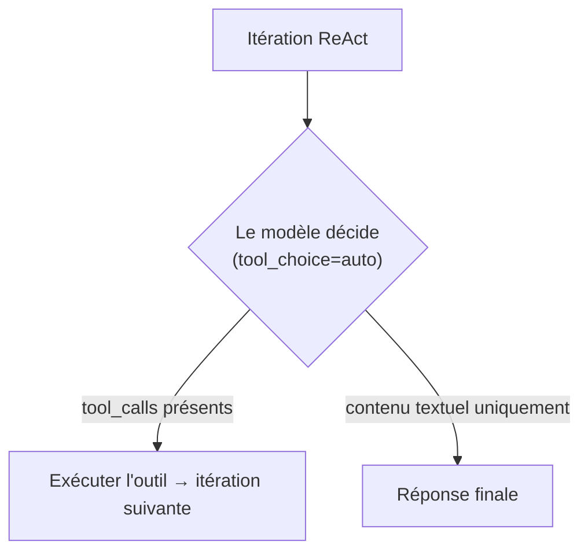
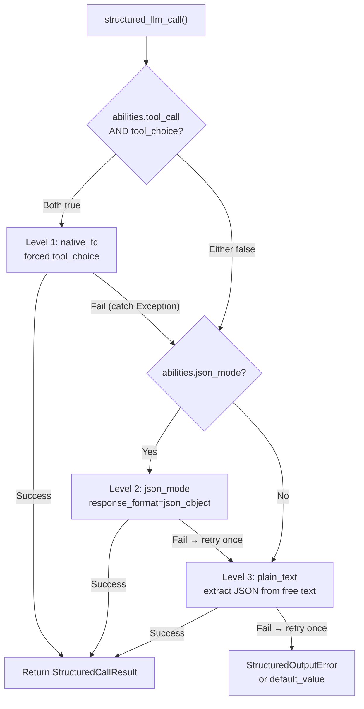

## Provider detection

FIM One uses LiteLLM as a universal adapter. The `_resolve_litellm_model()` function in `core/model/openai_compatible.py` maps the user's `LLM_BASE_URL` + `LLM_MODEL` to a LiteLLM model identifier with a provider prefix. The prefix determines how LiteLLM routes the request — native API protocol (Anthropic Messages API, Gemini, etc.) or generic OpenAI-compatible `/v1/chat/completions`.

Resolution order:

1. **Explicit provider** (from the `provider` field of a legacy `ModelConfig` row or an agent's inline model config; models added under Admin → Models have no provider field, so for them resolution starts at step 2) — highest priority. If the provider matches a known domain in the URL, no `api_base` is returned (LiteLLM routes natively). Otherwise, `api_base` is set to the relay URL.
2. **Domain match** against `KNOWN_DOMAINS` — official API endpoints are recognized by hostname.
3. **URL path hint** against `PATH_PROVIDER_HINTS` — common on relay platforms like UniAPI where `/claude` or `/anthropic` in the path indicates the upstream protocol.
4. **Fallback** — `openai/` prefix (generic OpenAI-compatible).

| Domain / Path | Provider prefix | Protocol |
|---|---|---|
| `api.openai.com` | `openai/` | OpenAI Chat Completions |
| `anthropic.com` | `anthropic/` | Anthropic Messages API |
| `generativelanguage.googleapis.com` | `gemini/` | Google Gemini |
| `api.deepseek.com` | `deepseek/` | DeepSeek (OpenAI-compatible) |
| `api.mistral.ai` | `mistral/` | Mistral |
| Path contains `/claude` or `/anthropic` | `anthropic/` | Anthropic Messages API (via relay) |
| Path contains `/gemini` | `gemini/` | Google Gemini (via relay) |
| Anything else | `openai/` | Generic OpenAI-compatible |

When the provider prefix is a native protocol (anthropic, gemini, etc.) and the URL is not the official endpoint, LiteLLM uses the native protocol but sends requests to the relay's `api_base`. This means provider-specific behaviors — including the Bedrock prefill issue described below — apply regardless of whether the request goes to the official API or through a relay.

<Warning>
If your relay URL contains `/claude` in the path, FIM One automatically routes via Anthropic's native protocol. This is usually correct (better streaming, thinking support), but means provider-specific behaviors apply — including the Bedrock prefill issue described below.
</Warning>

## tool_choice — les quatre modes

Le paramètre `tool_choice` est standardisé via le format OpenAI. LiteLLM le traduit vers le protocole natif de chaque fournisseur avant d'envoyer la requête.

| Mode | Signification | Support des fournisseurs |
|---|---|---|
| `"auto"` | Le modèle décide s'il faut appeler un outil ou répondre avec du texte | Tous les fournisseurs |
| `"required"` | Doit appeler un outil, mais le modèle choisit lequel | La plupart des fournisseurs |
| `{"type":"function","function":{"name":"X"}}` | Doit appeler la fonction X spécifiquement | La plupart des fournisseurs — **incompatible avec la réflexion Anthropic** |
| `"none"` | Impossible d'utiliser les outils, texte uniquement | Tous les fournisseurs |

La distinction entre `"auto"` et forcé (`{"type":"function",...}`) est au cœur de chaque problème de compatibilité dans FIM One. Ces deux modes sont utilisés par des sous-systèmes complètement différents avec des exigences différentes.

## Où tool_choice est utilisé

Deux sous-systèmes utilisent `tool_choice`, et ils l'utilisent de manières fondamentalement différentes.

### Moteur ReAct — tool_choice="auto"

La boucle ReAct nécessite que le modèle décide à chaque itération : appeler un outil ou donner une réponse finale. Seul `"auto"` a du sens ici — le modèle choisit librement entre produire des `tool_calls` ou du contenu textuel. Ceci est compatible avec tous les fournisseurs, tous les modèles et tous les modes, y compris la réflexion étendue.



Le moteur ReAct utilise l'appel de fonction natif (`_run_native`) quand `abilities["tool_call"] = True`, en se repliant sur le mode JSON-dans-le-contenu (`_run_json`) sinon. Les deux modes utilisent `"auto"` — la différence est que les outils sont passés via le paramètre `tools` ou décrits dans l'invite système. Voir [Moteur ReAct — Exécution en mode dual](/architecture/react-engine#dual-mode-execution) pour plus de détails.

### structured_llm_call — tool_choice=forced

Extraction structurée en une seule étape (annotation de schéma, planification de DAG, analyse de plan). Force le modèle à appeler une fonction virtuelle spécifique, ce qui garantit une sortie JSON structurée. C’est le point d’appel qui déclenche les erreurs spécifiques aux fournisseurs.

`structured_llm_call` implémente une chaîne de dégradation à 3 niveaux. Les trois paliers sont nommés d’après le code, et leur numérotation ne correspond pas à celle des quatre niveaux de garantie décrits dans [la section ci-dessous](#structured-output-the-four-guarantee-tiers) :



La différence de conception essentielle est la suivante : le fallback de `structured_llm_call` s’effectue **à l’exécution** — il essaie dynamiquement chaque niveau et intercepte les exceptions pour passer au suivant. La sélection du mode par le moteur ReAct s’effectue **au moment de la construction** — il vérifie `_native_mode_active` une fois au début et s’engage dans un mode unique pour toute la boucle. Ainsi, `structured_llm_call` peut récupérer de manière transparente les erreurs 400 spécifiques aux fournisseurs, tandis que ReAct dépend d’une sélection correcte du mode dès le départ.

## Sortie structurée : les quatre niveaux de garantie

« Sortie structurée » est une expression qui recouvre quatre mécanismes différents. Tous produisent du JSON, mais ils n’offrent pas le même niveau de garantie. Ce qui les distingue, c’est l’emplacement de la contrainte : dans le décodeur, qui ne peut pas émettre un token interdit par le schéma, ou dans le prompt, qui peut seulement formuler une demande.

| Niveau | Contenu de la requête | Emplacement de la charge utile | Garantie | Appliquée par |
|---|---|---|---|---|
| **T1 — appel de fonction natif, `strict: true`** | `tools=[…]` avec `strict` défini dans la définition de la fonction | Une chaîne JSON dans `tool_calls[0].function.arguments` | Au niveau du schéma : tous les champs requis sont présents, aucune clé non déclarée, types et énumérations corrects | Machine à états du décodeur |
| **T2 — `response_format: {"type": "json_schema"}`** | Le schéma lui-même, dans `response_format`, avec `strict: true` | Une chaîne JSON dans `message.content` | Au niveau du schéma, comme pour T1, mais dans la propre réponse de l’assistant plutôt que dans un appel d’outil | Machine à états du décodeur |
| **T3 — `response_format: {"type": "json_object"}`** | Le type uniquement, sans schéma | Une chaîne JSON dans `message.content` | Syntaxique uniquement : le texte est analysable comme du JSON. Les clés présentes ne sont soumises à aucune contrainte | Décodeur (syntaxe) |
| **T4 — texte libre accompagné d’instructions** | Rien. Le schéma est décrit dans le prompt | `message.content`, éventuellement entouré de texte ou de blocs de code | Aucune | Le prompt |

Le mécanisme qui sous-tend T1 et T2 est le décodage contraint. Le fournisseur compile le schéma en une grammaire et, à chaque étape du décodage, masque tous les tokens qui rendraient la sortie impossible à analyser conformément à ce schéma. Un champ requis ne peut pas être ignoré, car le token qui fermerait l’objet ne fait pas partie de l’ensemble autorisé tant que ce champ n’a pas été émis. Il s’agit d’un type d’affirmation différent de « le modèle a reçu une demande formulée poliment et s’y est conformé », et c’est pourquoi T1/T2 restent fiables avec une température de 1 et sur de petits modèles, là où l’obéissance aux instructions du prompt ne suffit pas.

### T1 et T2 ne sont pas interchangeables

Ils offrent la même garantie par des canaux différents, et le canal compte à trois égards.

**La structure du tour diffère.** T1 renvoie un tour d’appel d’outil ; le modèle a décidé d’*agir*. T2 renvoie un message d’assistant ordinaire ; le modèle a *répondu* dans un format donné. Lorsque l’appelant veut une seule extraction et non une boucle d’agent, T2 l’exprime directement au lieu d’inventer une fonction virtuelle que le modèle devrait « appeler ».

**Forcer T1 entre en conflit avec la réflexion.** Obtenir de T1 une charge utile contrainte par un schéma implique généralement de forcer le choix, soit avec `required`, soit avec une fonction nommée. Plusieurs fournisseurs refusent un choix d’outil forcé lorsque la réflexion étendue est active. Le tableau B ci-dessous indique lesquels. T2 ne présente pas ce conflit : il s’agit d’une contrainte de réponse, et non d’une contrainte d’outil ; c’est donc le seul chemin contraint par un schéma qui reste compatible avec la réflexion activée. Pour un déploiement standardisé sur des modèles de raisonnement, c’est l’argument pratique en faveur de T2, plutôt qu’une préférence stylistique.

**T1 entraîne une étape de configuration du schéma que T2 évite.** Une fonction virtuelle nécessite un nom, une description et une décision quant à la possibilité pour le modèle de refuser de l’appeler.

### Ce que coûte T2

Le décodage contraint n’est pas gratuit, et le schéma dont vous disposez déjà n’est généralement pas celui qu’il accepte.

- **Un sous-ensemble de schémas.** Le mode strict d’OpenAI exige `additionalProperties: false` pour chaque objet, ainsi que la présence de chaque propriété dans `required` ; l’optionalité s’exprime par une union avec `null` plutôt que par l’omission de `required`. La racine doit être un objet. Des limites s’appliquent au nombre total de propriétés et à la profondeur d’imbrication. La plupart des schémas écrits manuellement doivent être modifiés avant de pouvoir être utilisés.
- **La compilation de la grammaire.** La première requête utilisant un nouveau schéma entraîne une latence de compilation ponctuelle côté fournisseur. La réutilisation d’un schéma stable permet d’amortir ce coût ; générer un nouveau schéma pour chaque requête ne le permet pas.
- **Une nouvelle source d’échec.** Lorsqu’un modèle refuse de répondre, il renvoie un refus plutôt qu’un objet conforme au schéma ; l’appelant doit donc prévoir une branche pour ce cas.

### Ce qu’aucun niveau ne garantit

Chaque niveau contraint la forme. Aucun ne garantit la véracité. Une réponse T2 peut être parfaitement valide selon le schéma tout en étant factuellement incorrecte, et un champ contraint par une énumération renverra l’une des valeurs autorisées même si aucune n’est correcte, car le rôle du décodeur est de maintenir la sortie dans la grammaire plutôt que de connaître la réponse. Le contrôle par schéma élimine les échecs d’analyse et les erreurs de structure des champs. Il ne dispense pas de vérifier ce que la valeur signifie.

<Warning>
**Deux systèmes de numérotation, qui ne correspondent pas.** Cette page utilise **T1–T4** pour les niveaux de garantie ci-dessus. Elle utilise **Niveau 1/2/3** pour les trois paliers de la chaîne de dégradation de `structured_llm_call`, nommés d’après le code (`native_fc`, `json_mode`, `plain_text`). Le Niveau 2 de FIM One est `json_object`, qui correspond à **T3**, et non à T2. La chaîne comporte trois paliers parce qu’elle omet entièrement T2, et non parce qu’il n’existe que trois niveaux.
</Warning>

### Où se situe FIM One

| Niveau de `structured_llm_call` | Niveau | Ce que fait réellement le code |
|---|---|---|
| Niveau 1 — `native_fc` | **T1 sans `strict`** | `_build_tool_def` émet `name` / `description` / `parameters`, et rien d’autre. Aucun site d’appel ne définit `strict`, donc `convert_tools` dans `responses_adapter.py` lui attribue par défaut la valeur `False`. Le schéma parvient au modèle comme une description de ce qu’il doit produire, et non comme une contrainte sur ce qu’il peut produire |
| *(absent)* | **T2** | Non implémenté. `json_schema` n’apparaît nulle part dans la base de code, et `abilities` ne possède aucun indicateur permettant d’exprimer la prise en charge de cette fonctionnalité modèle par modèle |
| Niveau 2 — `json_mode` | **T3** | `{"type": "json_object"}`, défini en dur dans `structured.py::_call_llm` et `react.py::_json_response_format` |
| Niveau 3 — `plain_text` | **T4** | `extract_json()` appliqué à un contenu libre, avec un remplacement facultatif par expression régulière propre à chaque site d’appel |

Cinq conséquences en découlent, et ce sont les limites réelles de la conception actuelle.

1. **La chaîne ne dispose d’aucun niveau avec validation du schéma vers lequel se replier.** Lorsque le niveau 1 échoue, le niveau inférieur suivant est `json_object`, qui garantit uniquement que le texte peut être analysé. Il n’existe aucune étape intermédiaire qui continue d’imposer les champs.
2. **La garantie du niveau 1 est plus faible que son nom ne le laisse penser.** Sans `strict`, l’appel de fonction natif repose sur la variante non stricte antérieure à 2024 : le modèle respecte généralement le schéma, mais rien ne l’empêche d’omettre un champ obligatoire, d’inventer une clé ou de renvoyer une chaîne là où un nombre a été déclaré.
3. **Sur les routes `anthropic/`, le niveau 2 n’est pas réellement T3.** L’Anthropic Messages API ne possède pas de `response_format`, si bien que LiteLLM émule le mode JSON en injectant un préremplissage assistant. Il s’agit d’un mécanisme au niveau du prompt, ce qui place la garantie effective entre T4 et T3, plutôt qu’au niveau T3. Le piège du préremplissage Bedrock décrit ci-dessous correspond à l’échec manifeste de cette émulation ; le coût plus discret est que la garantie n’a jamais été celle que le nom du paramètre laissait entendre.
4. **Le résultat n’est jamais validé ensuite par rapport au schéma.** `jsonschema` n’est pas une dépendance. Les vérifications éventuelles sont effectuées par site d’appel, dans la fonction facultative `parse_fn`, et leur rigueur varie selon le site d’appel.
5. **L’échec est absorbé au lieu d’être signalé.** Presque tous les appelants transmettent `default_value`, si bien qu’une chaîne épuisée renvoie un objet d’apparence plausible au lieu de lever une exception. `StructuredCallResult.level_used` enregistre le niveau qui a produit la valeur, mais aucun site d’appel ne le lit ; de plus, sur le chemin `default_value`, il indique `plain_text` pour une chaîne qui, en réalité, n’a rien produit.

**Comment savoir sur quel niveau vous vous trouvez réellement.** `structured_llm_call` consigne une ligne par appel terminé au niveau `INFO`, émise uniquement après que les données ont été acceptées par `parse_fn` ; elle indique donc un niveau qui a véritablement réussi :

```
structured_llm_call: fn=classify_mode level=native_fc attempt=first calls=1
structured_llm_call: fn=annotate_tables level=json_mode attempt=reformat_retry calls=3
```

Un échec total est consigné au niveau `WARNING` avec `level=none outcome=default_value`. Rechercher ces deux lignes dans les logs d’une journée de trafic est le seul moyen de déterminer si l’absence du niveau T2 a un coût dans un déploiement donné, car la conception avec `default_value` se manifeste par une réponse médiocre plutôt que par une erreur.

### Prise en charge des fournisseurs pour chaque niveau

<Note>
**Ce tableau documente les API upstream, et non les chemins de code de FIM One.** Tous les autres tableaux de cette page indiquent la fonction qui implémente le comportement. Celui-ci ne le peut pas, car FIM One n'utilise aucune fonctionnalité T2 d'un fournisseur et ne définit `strict` sur aucun d'entre eux. Il est présent afin qu'une décision d'implémenter T2 parte de ce qui est réellement disponible. Les capacités des fournisseurs évoluent rapidement, et la prise en charge arrive souvent sur certains modèles d'une famille avant les autres ; consultez à nouveau la documentation du fournisseur avant de vous fier à une ligne.
</Note>

| Fournisseur | T1 `strict` | T2 `json_schema` | T3 `json_object` | Notes |
|---|---|---|---|---|
| **OpenAI** | ✅ | ✅ | ✅ | L'implémentation de référence des deux niveaux stricts. L'appel de fonctions strict et `response_format: json_schema` partagent un même moteur de grammaire et un même sous-ensemble de schémas. `json_object` est l'ancien mode JSON, conservé pour la compatibilité |
| **Anthropic** | ⚠️ | ⚠️ | ❌ | L'API Messages ne propose aucun `response_format` ; le `input_schema` des outils est validé plutôt qu'imposé par le décodeur. L'utilisation stricte des outils et un format de sortie contraint par schéma existent derrière un en-tête bêta sur les modèles Claude récents. FIM One accède à Anthropic via LiteLLM, qui émule le mode JSON par préremplissage et n'utilise pas la version bêta ; rien de tout cela n'est donc actif ici |
| **Gemini** | ✅ | ✅ | ✅ | `responseSchema` (un sous-ensemble d'OpenAPI 3.0) et le plus récent `responseJsonSchema` sont imposés par le décodeur, et le point de terminaison compatible OpenAI accepte `response_format: json_schema`. L'appel forcé utilise `ANY` avec `allowed_function_names` |
| **xAI (Grok)** | ✅ | ✅ | ✅ | Surface compatible OpenAI, y compris les sorties structurées strictes |
| **Mistral** | ✅ | ✅ | ✅ | Les sorties structurées personnalisées acceptent un JSON Schema fourni par l'utilisateur |
| **DeepSeek** | ❌ | ❌ | ✅ | La sortie JSON est limitée à `json_object`. La condition documentée est que le prompt contienne le mot « json » et présente un exemple, ce qui constitue un dispositif T4 associé à un paramètre T3. `deepseek-reasoner` refuse en outre un choix d'outil forcé ; son chemin contrôlé par schéma est donc fermé aux deux extrémités |
| **Qwen** (DashScope) | ⚠️ | ⚠️ | ✅ | `json_object` est disponible sur le point de terminaison de compatibilité. Le décodage contraint par schéma est fiable avec Qwen auto-hébergé via la pile de service plutôt que via l'API ; la prise en charge de `json_schema` par DashScope varie selon la génération du modèle. Vérifiez pour chaque modèle |
| **GLM** (Zhipu / Z.AI) | ❌ | ⚠️ | ✅ | `json_object` est disponible sur le point de terminaison compatible OpenAI. Le choix d'outil forcé n'est pas pris en charge, ce qui explique pourquoi `tool_choice_enabled=false` est le paramètre recommandé dans le tableau B. Considérez `json_schema` comme indisponible, sauf si la plateforme le documente pour votre modèle |
| **Kimi** (Moonshot) | ⚠️ | ⚠️ | ✅ | `json_object` est documenté. Les variantes de raisonnement n'acceptent que le choix d'outil `auto` ; pour celles-ci, le chemin T1 ne peut donc pas être forcé, quelle que soit la prise en charge de `strict` |
| **MiniMax** | ⚠️ | ⚠️ | ✅ | L'appel de fonctions fonctionne avec un choix forcé, même lorsque le raisonnement est toujours activé, ce qui en fait le chemin T1 le plus exploitable parmi les modèles à raisonnement permanent. L'imposition au niveau du schéma n'est pas documentée ; partez du principe que T1 n'est pas strict |
| **Doubao** (Volcengine Ark) | ⚠️ | ⚠️ | ✅ | Ark documente les sorties structurées pour certaines parties de la gamme Doubao. La couverture dépend du modèle ; vérifiez donc avant de supposer que le modèle de votre compte en dispose |
| **Ollama / vLLM / llama.cpp** | ✅ | ✅ | ✅ | La prise en charge des niveaux la plus complète de cette liste, et la moins mise en avant. Le décodage contraint par grammaire (GBNF, XGrammar, Outlines) s'exécute localement ; un modèle auto-hébergé de 14B peut donc recevoir une garantie que plusieurs API hébergées ci-dessus ne peuvent pas fournir. La fonctionnalité est exposée via le `format` d'Ollama, les paramètres de décodage guidé de vLLM ou un `response_format` compatible OpenAI, selon le serveur |

Trois tendances méritent d'être nommées, car elles expliquent la forme du tableau plutôt que de se contenter de le répéter.

**T3 est universel, T2 ne l'est pas.** Tous les fournisseurs pris en charge par FIM One proposent `json_object`, et environ la moitié proposent un niveau avec schéma. Un chemin de sortie structurée portable doit donc reposer sur T3 ou un niveau inférieur, ce qui explique la forme de la chaîne de FIM One. Ajouter T2 signifie ajouter un indicateur de capacité par modèle, et non un commutateur global.

**Le raisonnement toujours activé tend à fermer la porte de T1.** GLM, les modèles de raisonnement de Kimi et `deepseek-reasoner` limitent ou refusent tous un choix d'outil forcé, et Anthropic le refuse lorsque le raisonnement est actif. MiniMax est l'exception. Lorsque la porte est fermée, T2 est la seule option restante contrôlée par schéma, ce qui explique pourquoi le niveau manquant est plus important sur un déploiement de modèles chinois que sur un déploiement OpenAI.

**L'auto-hébergement inverse l'ordre habituel.** Le décodage contraint est une propriété de la pile de service ; il est donc disponible sur un checkpoint local dont le respect des instructions est bien plus faible que celui d'un modèle de pointe. Les modèles qui ont le plus besoin d'un contrôle par schéma sont ceux qui sont le plus susceptibles de l'obtenir.

## Le piège du prefill Bedrock

Lorsque `response_format={"type":"json_object"}` est transmis pour un modèle résolu avec le préfixe `anthropic/`, LiteLLM injecte en interne un message d'assistant prefill pour simuler le mode JSON. L'API Messages d'Anthropic n'a pas de paramètre `response_format` natif, donc LiteLLM l'approxime en ajoutant une accolade ouvrante comme contenu d'assistant :

```json
{"role": "assistant", "content": "{"}
```

Cela fonctionne sur l'API directe d'Anthropic. Cependant, les versions plus récentes des modèles AWS Bedrock rejettent toute conversation dont le dernier message a `role: "assistant"` — ils appellent cela « assistant message prefill » et lèvent :

```
ValidationException: This model does not support assistant message prefill.
The conversation must end with a user message.
```

Cette erreur se produit uniquement lorsque **les trois conditions** sont remplies simultanément :

1. Le modèle est résolu avec le préfixe `anthropic/` (via correspondance de domaine ou indice de chemin URL).
2. `response_format={"type":"json_object"}` est transmis (le chemin de code json_mode dans `structured_llm_call`).
3. Le backend réel est AWS Bedrock (qui rejette le prefill).

<Tip>
**Bedrock via endpoint compatible OpenAI ?** Si votre relais Bedrock expose un endpoint `/v1/chat/completions` compatible OpenAI (soit la passerelle compatible OpenAI d'AWS elle-même, soit un proxy tiers), et que le chemin URL ne contient **pas** `/claude` ou `/anthropic`, FIM One le résout avec le préfixe `openai/`. LiteLLM traite alors le backend comme un serveur standard compatible OpenAI, transmet `response_format` directement sans injecter de prefill, et le serveur gère la contrainte JSON nativement. **Le piège du prefill ne s'applique pas** — vous n'avez pas besoin de définir `json_mode_enabled=false`.
</Tip>

<Warning>
Cela n'affecte **pas** l'appel d'outil natif (`tool_choice="auto"` avec le paramètre `tools=`). L'injection de prefill se produit uniquement pour `response_format`. L'exécution de l'agent ReAct n'est complètement pas affectée.
</Warning>

Si le Niveau 1 (native_fc) et le Niveau 2 (json_mode) échouent tous deux sur Bedrock, le système se rétablit au Niveau 3 (plain_text). Le drapeau `json_mode_enabled` décrit ci-dessous élimine l'appel gaspillé du Niveau 2.

### Le correctif : json_mode_enabled

Un indicateur `json_mode_enabled` par modèle contrôle si le niveau 2 (`json_mode`) est susceptible d’être tenté :

- **Modèles configurés dans la DB** : activez ou désactivez l’option dans Admin → Modèles → Paramètres avancés. L’indicateur est stocké dans `ModelProviderModel.json_mode_enabled` (`TRUE` par défaut).
- **Modèles configurés via ENV** : définissez `LLM_JSON_MODE_ENABLED=false` dans votre environnement.
- **Effet** : lorsqu’il est désactivé, `abilities["json_mode"]` renvoie `False` → `response_format` n’est jamais transmis → aucun préremplissage → Bedrock fonctionne. La chaîne de dégradation devient `native_fc → plain_text`, en ignorant entièrement l’appel `json_mode` voué à l’échec.
- **Coût de cette désactivation** : en pratique, le modèle renvoie toujours un JSON valide, car l’invite système le lui demande et `extract_json()` analyse de manière fiable le contenu libre des modèles modernes. Ce qui est perdu, ce n’est pas le résultat, mais la garantie : la chaîne s’arrête désormais à T4, où seul le prompt contraint le résultat. Sur une route `anthropic/`, cette perte est moins importante qu’il n’y paraît, puisque le mode JSON émulé n’offrait déjà pas de garantie au niveau du décodeur.

## Modèles de raisonnement + tool_choice forcé

Plusieurs fournisseurs rejettent un `tool_choice` forcé lorsque le raisonnement étendu est actif, au motif que fixer un appel de fonction spécifique contredit la liberté du modèle de raisonner d'abord :

```
tool_choice 'specified' is incompatible with thinking enabled
```

**Il s'agit d'une règle par fournisseur, pas d'une loi des modèles de raisonnement.** Anthropic l'applique au niveau du protocole et Moonshot (Kimi) se comporte de la même manière, mais MiniMax raisonne à chaque appel et accepte toujours un tool choice forcé. Le tableau B dans la [Matrice de capacités des fournisseurs](#provider-capability-matrix) enregistre le verdict fournisseur par fournisseur ; ne généralise pas à partir d'une ligne à l'autre.

Pour les modèles Anthropic, `structured_llm_call` résout le conflit de lui-même en passant `reasoning_effort=None` au niveau du FC natif, ce qui désactive le raisonnement pour cet appel uniquement (`structured.py::_call_llm`). La sortie structurée nécessite une **conformité au schéma**, pas un raisonnement profond, donc désactiver le raisonnement là est à la fois correct et moins coûteux.

Lorsque le raisonnement ne peut pas être désactivé via l'API, native_fc échoue avec un 400 à chaque appel structuré et coûte environ dix secondes avant que la chaîne ne bascule vers json_mode. Kimi est le cas courant : avec le raisonnement activé, seul `auto` est supporté, et un tool choice forcé nécessite de désactiver le raisonnement, que Moonshot expose uniquement via l'ID du modèle (`kimi-k2` l'a désactivé, `kimi-k2.5` et `kimi-k2-thinking` l'ont activé). FIM One n'a aucun paramètre qui le bascule, donc le remède est le drapeau `tool_choice_enabled` ci-dessous.

### Le correctif : tool_choice_enabled

Un drapeau `tool_choice_enabled` par modèle contrôle si le Niveau 1 (native_fc) est jamais tenté :

- **Modèles configurés en BD** : basculer dans Admin → Models → Advanced → "Native Function Calling". Le drapeau est stocké sur `ModelProviderModel.tool_choice_enabled` (par défaut `TRUE`).
- **Modèles configurés par ENV** : définissez `LLM_TOOL_CHOICE_ENABLED=false` dans votre environnement.
- **Effet** : lorsque désactivé, `abilities["tool_choice"]` retourne `False` → la chaîne de dégradation commence au Niveau 2 (json_mode) ou Niveau 3 (plain_text), en ignorant complètement native_fc. Cela élimine la pénalité d'~10s par appel structuré pour les modèles incompatibles.
- **Agent ReAct non affecté** : `tool_choice_enabled` contrôle uniquement la sélection d'outil forcée dans `structured_llm_call`. Le moteur ReAct utilise `tool_choice="auto"` (le modèle décide librement), qui fonctionne avec tous les modèles indépendamment de ce paramètre.

<Note>
`tool_choice_enabled` et `tool_call` sont des drapeaux de capacité distincts. `tool_call` (toujours `True` pour `OpenAICompatibleLLM`) contrôle si les outils sont transmis au modèle du tout — le désactiver casserait l'agent ReAct. `tool_choice` contrôle uniquement si la sélection d'outil **forcée** est tentée pour l'extraction de sortie structurée.
</Note>

`tool_choice="auto"` n'est pas affecté par le mode de réflexion. Le moteur ReAct utilise `"auto"` exclusivement, donc l'exécution de l'agent fonctionne avec la réflexion activée.

<Warning>
Ne définissez PAS `abilities["tool_call"] = False` pour éviter cette contrainte. Cela désactiverait le mode `_run_native` de ReAct (qui utilise `tool_choice="auto"` et fonctionne bien avec la réflexion), le forçant dans le mode `_run_json` moins fiable.
</Warning>

<Note>
**Note de migration de fournisseur :** Certains relais tiers suppriment silencieusement les paramètres non supportés comme `reasoning_effort` (`drop_params=True`), donc la réflexion n'est jamais activée même si configurée. Lors de la migration vers un fournisseur qui supporte correctement la réflexion (Bedrock, API Anthropic directe), le `reasoning_effort=None` dans native_fc assure un comportement cohérent. Aucune action utilisateur n'est nécessaire — la sortie structurée fonctionne de manière identique sur tous les fournisseurs.
</Note>

## Matrice des capacités des fournisseurs

Cette section est le registre faisant autorité de ce que chaque fournisseur supporte et ce que FIM One fait à ce sujet. Chaque ligne nomme la fonction qui implémente le comportement, de sorte que toute affirmation ici peut être vérifiée par rapport au code. D'autres pages renvoient à cette section au lieu de répéter les données ; quand le code change, cette section change avec lui.

Une ligne décrit le protocole d'un fournisseur, pas un seul modèle. Lorsque les modèles au sein d'une même famille diffèrent (DeepSeek chat par rapport à reasoner, Kimi avec thinking activé par rapport à désactivé), la cellule l'indique.

### Table A: Protocol routing

How a configured `base_url` plus `model` becomes a LiteLLM call, and what happens when the first choice of interface is unavailable.

| Provider | Detected by | LiteLLM prefix | Interface surface | Downgrade chain | Code anchor |
|---|---|---|---|---|---|
| **OpenAI** | Domain `api.openai.com`, or an explicit `provider` of `openai` on the model config | `openai/` | `completions`. GPT-5.x uses `responses-native` (`litellm.aresponses`), with `responses-bridge` (`openai/responses/<model>`) retained as a rollback | GPT-5.x talks Responses natively, falls back to `completions` on a 404 (cached per endpoint and model in `_RESPONSES_NATIVE_SUPPORT`) or on a 400 (not cached). `gpt-6.1-*` and `gpt-6-astra` keep a 400 on a request with tools instead of falling back, since their `completions` rejects tools. Every other model goes straight to `completions` | `_resolve_litellm_model`, `_should_use_native_responses`, `_dispatch_acompletion` |
| **Anthropic** (Bedrock note below) | Domain `anthropic.com`, path segment `/claude` or `/anthropic`, or an explicit `provider` of `anthropic` | `anthropic/` | `anthropic messages` | None. Native routes never enter the Responses bridge; their protocol is built in `_build_request_kwargs` | `_resolve_litellm_model`, `_dispatch_acompletion` |
| **Gemini** | Domain `generativelanguage.googleapis.com`, path segment `/gemini`, or an explicit `provider` of `gemini` | `gemini/` | `gemini` | None. A domain match also drops `api_base`, so an OpenAI-compat suffix such as `/v1beta/openai/` is ignored and the call goes to the native Gemini API | `_resolve_litellm_model` |
| **xAI (Grok)** | No domain or path entry. Resolves as generic OpenAI-compatible unless `provider` is set explicitly on the model config | `openai/` with `api_base`, or the explicit provider prefix | `completions` | None | `_resolve_litellm_model` |
| **DeepSeek** | Domain `api.deepseek.com` | `deepseek/` | `completions` | None | `_resolve_litellm_model` |
| **Qwen** (DashScope) | Generic fallback | `openai/` with `api_base` | `completions` | None | `_resolve_litellm_model` |
| **GLM** (Zhipu, Z.AI) | Generic fallback | `openai/` with `api_base` | `completions` | None | `_resolve_litellm_model` |
| **MiniMax** | Generic fallback | `openai/` with `api_base` | `completions` | None | `_resolve_litellm_model` |
| **Kimi** (Moonshot) | Generic fallback | `openai/` with `api_base` | `completions` | None | `_resolve_litellm_model` |
| **Doubao** (Volcengine) | Generic fallback | `openai/` with `api_base` | `completions` | None | `_resolve_litellm_model` |
| **Mistral** | Domain `api.mistral.ai` | `mistral/` | `completions` | None | `_resolve_litellm_model` |
| **Ollama / local** | Generic fallback, typically `http://localhost:11434/v1` | `openai/` with `api_base` | `completions` | None | `_resolve_litellm_model` |
| **Relay / proxy** | Path hint first, then the generic fallback. An explicit `provider` on the model config outranks both | The hinted provider prefix, else `openai/`, always with `api_base` pointing at the relay | Whatever the resolved prefix implies | None beyond the resolved prefix. See the relay gotchas below | `_resolve_litellm_model` |

**How GPT-5.x picks a protocol.** `FIM_GPT5_RESPONSES_MODE` selects it: `native` (the default) talks `/v1/responses` directly through `litellm.aresponses`, `bridge` uses LiteLLM's chat-completions translation, and `off` forces plain chat completions. The native path exists because the bridge is lossy in the one place that matters: it discards the reasoning items, so a GPT-5.x agent re-derives its chain of thought on every tool round. Talking the protocol directly lets those items be replayed. A call that explicitly passes `reasoning_effort=None`, which is what `structured_llm_call` and the finish-signal probes do, stays on chat completions, because a call that wants no thinking has no reasoning state to preserve. The exception is models that cannot switch reasoning off (`gpt-6.1-*`, `gpt-6-astra`): their chat completions reject function tools at any `reasoning_effort`, so those calls stay on `/v1/responses` and run at the lowest effort, `low`. For the same reason `off`, or an endpoint without `/v1/responses`, leaves these models without tool calls.

Two properties of that native request are load-bearing and easy to get wrong:

- `store=false` keeps the conversation stateless upstream, and `include=["reasoning.encrypted_content"]` asks for the encrypted payload to be returned. Without the include, the reasoning items arrive empty and replay silently becomes a no-op.
- A replayed reasoning item must have its server-side `id` stripped. With `store=false` nothing is persisted upstream, so echoing the id back earns `Item with id 'rs_...' not found. Items are not persisted when 'store' is set to false`. The `encrypted_content` blob carries the state on its own, so dropping the id costs nothing (`sanitize_reasoning_item`).

**User-supplied endpoints.** The table describes endpoints an operator configured (environment variables, Admin → Models). An endpoint that comes from a user, i.e. `base_url` in an agent's inline model settings, does not go through LiteLLM at all (`OpenAICompatibleLLM(untrusted_endpoint=True)`, `_call_pinned`). It must come with its own `api_key`: the platform's keys are never used for it, and an empty key is refused. It is called as OpenAI-compatible chat completions at the URL as typed, by the OpenAI SDK on a dedicated HTTP client that refuses private, loopback, link-local and metadata addresses when it connects and does not follow redirects. The model name is sent as a field of the request and selects no route, provider or protocol; there is no path hint, no `provider`, no Responses route. When such an endpoint fails, the error names the kind of failure and the HTTP status, not the response body. Models on internal networks, or that need a provider's native protocol, are added by an administrator under Admin → Models and selected by the agent.

**Bedrock.** Bedrock-hosted Claude follows the row it resolves to, not the fact that Bedrock is hosting it. Reached through an `anthropic/`-routed relay it inherits Anthropic protocol behaviour, including LiteLLM's json-mode assistant prefill, which newer Bedrock versions reject. Reached through an OpenAI-compatible gateway it resolves as `openai/`, no prefill is injected, and `json_mode_enabled` can stay on.

### Table B: Conflits et solutions de contournement

FIM One émet trois des quatre états `tool_choice` : `auto` à partir de la boucle ReAct (`react.py::_run_native`), une fonction nommée à partir de la sortie structurée (`structured.py::_call_llm`), et `none` quand la réponse du signal de fin rejoue la charge utile des outils. Aucun site d'appel n'émet `required` ; cette colonne enregistre la contrainte du fournisseur sur le choix d'outil non-`auto`, qui s'applique à `required` et à une fonction nommée de la même manière.

| Fournisseur | `auto` | `required` | Fonction nommée | `none` | Avec réflexion activée | Solution de contournement de FIM One | Ancre de code |
|---|---|---|---|---|---|---|---|
| **OpenAI** | ✅ | ✅ | ✅ | ✅ | GPT-5.x sur les complétions de chat rejette les outils combinés avec le raisonnement | Exécute GPT-5.x sur Responses, où les deux sont autorisés. Sur le repli des complétions de chat, il envoie un `reasoning_effort` explicite de `none` chaque fois que des outils sont présents | `_should_use_native_responses`, `_build_request_kwargs` |
| **Anthropic** | ✅ | ⚠️ | ⚠️ | ✅ | Accepté quand la réflexion est désactivée, rejeté avec une erreur 400 quand elle est activée. `auto` n'est affecté d'aucune façon | `structured_llm_call` passe `reasoning_effort=None` au niveau natif-FC, donc la réflexion est désactivée pour cet appel unique. ReAct conserve `auto` et conserve la réflexion | `structured.py::_call_llm` |
| **Gemini** | ✅ | ✅ | ✅ | ✅ | Aucun conflit | Valeurs par défaut : `tool_choice_enabled` et `json_mode_enabled` tous deux activés | `OpenAICompatibleLLM.abilities` |
| **xAI (Grok)** | ✅ | ✅ | ✅ | ✅ | Les variantes de raisonnement acceptent les outils | Valeurs par défaut, tous deux activés | `OpenAICompatibleLLM.abilities` |
| **DeepSeek** | ✅ | ⚠️ | ⚠️ | ✅ | `deepseek-chat` (V3.2, sans réflexion) accepte un choix d'outil forcé. `deepseek-reasoner` (mode réflexion V3.2) le rejette | Définir `tool_choice_enabled=false` sur `deepseek-reasoner` uniquement ; le laisser activé pour `deepseek-chat` | `OpenAICompatibleLLM.abilities` |
| **Qwen** | ✅ | ✅ | ✅ | ✅ | `enable_thinking` est un commutateur côté fournisseur que FIM One n'envoie jamais, donc la réflexion suit la valeur par défaut du modèle | Valeurs par défaut, tous deux activés | `_build_request_kwargs` |
| **GLM** | ✅ | ❌ | ❌ | ✅ | Le choix d'outil forcé n'est pas pris en charge, que le modèle réfléchisse ou non | Définir `tool_choice_enabled=false` | `OpenAICompatibleLLM.abilities` |
| **MiniMax** | ✅ | ✅ | ✅ | ✅ | La réflexion est toujours activée et un choix d'outil forcé fonctionne toujours. C'est le contre-exemple à la règle « la réflexion toujours activée rejette les outils forcés » | Valeurs par défaut, tous deux activés. La réflexion arrive sous forme de balises `<think>` et est redirigée vers le flux de raisonnement | `_ThinkTagStreamParser` |
| **Kimi** (Moonshot) | ✅ | ⚠️ | ⚠️ | ✅ | Avec la réflexion activée, seul `auto` est pris en charge ; un choix d'outil forcé nécessite de désactiver la réflexion. `kimi-k2` l'a désactivée, `kimi-k2.5` et `kimi-k2-thinking` l'ont activée | Aucun paramètre API ne bascule la réflexion Moonshot, donc définir `tool_choice_enabled=false` sur les modèles de réflexion | `OpenAICompatibleLLM.abilities` |
| **Doubao** | ✅ | ✅ | ✅ | ✅ | Accepte `reasoning_effort` aux côtés des outils | Valeurs par défaut, tous deux activés | `_build_request_kwargs` |
| **Mistral** | ✅ | ✅ | ✅ | ✅ | Aucun mode de réflexion | Valeurs par défaut, tous deux activés | `OpenAICompatibleLLM.abilities` |
| **Ollama / local** | ⚠️ varie | ⚠️ varie | ⚠️ varie | ⚠️ varie | Dépend entièrement du point de contrôle | 14B paramètres est le minimum pour les appels d'outils utilisables et 32B est la cible pratique. Désactiver les deux indicateurs pour les modèles plus petits afin que la sortie structurée aille directement au texte brut | `OpenAICompatibleLLM.abilities` |
| **Relay / proxy** | Hérite en amont | Hérite en amont | Hérite en amont | Hérite en amont | Hérite en amont, et un paramètre non pris en charge est supprimé plutôt que rejeté (`litellm.drop_params=True`) | Indicateurs par modèle, plus les pièges du relais ci-dessous | `_build_request_kwargs` |

### Table C: Protocole de réflexion

`LLM_REASONING_EFFORT` accepte `low`, `medium` et `high` ; toute autre valeur est lue comme non définie (`deps.py::_reasoning_effort`). Ce que FIM One place ensuite sur le fil est spécifique au fournisseur, et c'est ce que ce tableau enregistre. La colonne Replay est la valeur de retour de `reasoning_replay_policy`, qui est un petit ensemble fermé de quatre états plutôt qu'une liste par fournisseur.

| Fournisseur | Réflexion activée par | Valeurs `effort` acceptées | Politique de replay | Où la sortie aboutit | Ancrage de code |
|---|---|---|---|---|---|
| **OpenAI GPT-5.x** | `reasoning` de `{effort, summary: "auto"}` sur Responses ; `reasoning_effort` sur les complétions de chat | `low`, `medium`, `high` de la config, plus un `none` forcé quand des outils sont présents sur les complétions de chat | `openai_responses` : les éléments de réflexion opaques sont rejouées verbatim sur Responses, et le texte lisible est supprimé sur les complétions de chat exactement comme `informational_only` le ferait | Éléments chiffrés plus un résumé lisible, rendus dans le panneau Reasoning. Les complétions de chat ne retournent aucun texte de réflexion | `_build_responses_kwargs`, `reasoning_replay_policy` |
| **OpenAI o-series** | Toujours activé | `reasoning_effort` transmis inchangé | `informational_only`, correspondant sur les fragments `o1`, `o3` et `o4` | Interne ; les tokens sont facturés mais non retournés | `reasoning_replay_policy` |
| **Anthropic, adaptatif** (Opus 4.6 / 4.7 / 4.8, Sonnet 4.6, Fable 5, Mythos 5) | `thinking` de type `adaptive` plus `output_config.effort` | `low`, `medium`, `high` | `anthropic_thinking` : le bloc et sa `signature` sont rejouées verbatim ou l'API rejette le tour | `reasoning_content` plus `signature`, rendus dans le panneau Reasoning | `_uses_adaptive_thinking`, `_extract_thinking_signature` |
| **Anthropic, hérité** (4.5 et antérieur) | `thinking` de type `enabled` avec `budget_tokens` quand `LLM_REASONING_BUDGET_TOKENS` est défini, sinon `reasoning_effort` remis à LiteLLM | `low`, `medium`, `high`, ou un budget de tokens explicite avec un plancher de 1024 | `anthropic_thinking` | Identique à adaptatif | `_build_request_kwargs` |
| **Gemini** | `reasoning_effort` sur le point de terminaison de compatibilité | `low`, `medium`, `high` | `informational_only` pour les ids portant un fragment `flash-thinking`. Les autres ids Gemini se résolvent en `unsupported`, ce qui supprime le champ de la même façon | Interne | `reasoning_replay_policy` |
| **xAI (Grok)** | `reasoning_effort` via LiteLLM | Défini par le fournisseur | `informational_only`, car le fragment générique `reasoning` correspond à tout id contenant le mot | Interne | `reasoning_replay_policy` |
| **DeepSeek** | Id de modèle : `deepseek-reasoner` pour le mode réflexion V3.2, `deepseek-chat` pour non-réflexion | Aucun. Il n'y a pas de paramètre effort | `informational_only` | Champ `reasoning_content`, rendu dans le panneau Reasoning | `_parse_choice_message` |
| **Qwen** | `enable_thinking`, côté fournisseur. FIM One ne l'envoie pas | Non applicable | `informational_only` pour les ids `qwq`, `unsupported` sinon | Balises `<think>` à l'intérieur du contenu, réacheminées vers le flux de réflexion | `_ThinkTagStreamParser` |
| **GLM** | Intégré à `glm-5` ; pas de basculement API | Non applicable | `unsupported` | Non externalisé | `reasoning_replay_policy` |
| **MiniMax** | Toujours activé ; pas de basculement | Non applicable | `unsupported` | Balises `<think>` à l'intérieur du contenu, réacheminées | `_ThinkTagStreamParser`, `_THINK_RE` |
| **Kimi** (Moonshot) | Id de modèle : `kimi-k2-thinking`, et `kimi-k2.5` réfléchit par défaut | Non applicable | `unsupported` | Un champ réflexion API, lu comme `reasoning_content` ou `reasoning` | `_parse_choice_message` |
| **Doubao** | `reasoning_effort` | Le fournisseur documente `minimal`, `low`, `medium` et `high` ; FIM One n'émet que les trois du milieu | `unsupported` | Interne | `_build_request_kwargs` |
| **Mistral** | Pas de mode réflexion | Non applicable | `unsupported` | Non applicable | `reasoning_replay_policy` |
| **Ollama / local** | Dépend du modèle | Non applicable | `informational_only` pour les distillations `deepseek-r1` et les builds `qwq`, `unsupported` sinon | Balises `<think>` où le checkpoint les émet | `_ThinkTagStreamParser` |
| **Relay / proxy** | Tout ce que l'amont accepte | Tout ce que l'amont accepte | Résolu à partir de l'id de modèle exactement comme sur une route directe | Dépend de l'amont. Un modèle Claude adaptive-thinking derrière un relais générique `openai/` n'obtient jamais de réflexion, et le constructeur enregistre un avertissement le disant | `OpenAICompatibleLLM.__init__` |

`unsupported` et `informational_only` produisent les mêmes octets sur le fil : tous deux suppriment `reasoning_content` et `signature` de l'historique sortant. Ils diffèrent dans l'intention, donc un modèle qui clairement réfléchit mais aboutit en `unsupported` est une lacune dans la table de fragments plutôt qu'un bug actif.

### Relay/proxy gotchas

Third-party gateways fail in ways a direct provider does not, and most of those failures are silent. Each row below pairs the symptom with its mechanism and with what FIM One already does about it.

<Note>
**Support boundary.** FIM One guarantees the behaviour documented on this page for first-party endpoints: OpenAI's own API, Anthropic, Google, and any vendor serving its own models directly. Third-party relays are supported on a best-effort basis and are not covered by that guarantee, because what a relay does to a request is outside our control and frequently outside its own documentation. A relay can drop a parameter, rewrite history, strip a cache breakpoint, or answer a protocol it only partially implements, and in most of those cases it returns a `200` rather than an error.

This is a statement about what we promise, not a restriction on what runs. FIM One does not maintain an allowlist of approved hosts, and nothing here is gated on a domain. Capability is decided by what an endpoint actually does: a missing route answers `404` and is remembered, an ignored `include` yields empty reasoning items and the replay becomes a no-op, and a rejected request falls back for that call. Probing the endpoint is more accurate than inferring its capabilities from its hostname, and it is the only approach that keeps working for Azure OpenAI, enterprise gateways, and self-hosted proxies that implement the protocol correctly.

If a relay misbehaves in a way the fallbacks do not catch, pin the protocol yourself with `FIM_GPT5_RESPONSES_MODE` (`bridge` or `off`) or the per-model `tool_choice_enabled` and `json_mode_enabled` toggles, and reproduce against the first-party endpoint before filing it as a FIM One bug.
</Note>

| Symptom | Mechanism | What FIM One does |
|---|---|---|
| Thinking is configured but never appears | The relay path has no `/claude` hint, so the model resolves as `openai/`. The Chat Completions schema has no thinking concept, so the parameter is dropped before the request leaves the process | Logs a warning at construction naming the model and the resolved prefix, and telling you to use an Anthropic base URL (a `/claude` or `/anthropic` path) (`OpenAICompatibleLLM.__init__`) |
| A parameter appears to be accepted and has no effect | `litellm.drop_params=True` removes anything the resolved provider does not declare, silently and per-parameter | Deliberate. It keeps one request builder working across every provider. The cost is that "no error" is not evidence the parameter arrived |
| First token takes minutes on a non-OpenAI model, or the agent returns text and makes no tool calls | The relay advertises `/v1/responses` for a model that is not OpenAI's, accepts the request, then buffers the whole answer before replaying it. Observed on Uniapi with Claude at roughly four minutes to first token, and in a second reproduction the call returned normally but the agent then made zero tool calls. Nothing errors, so an error-triggered fallback never fires | The bridge is benefit-gated to GPT-5.x, the one family that gains capability from Responses. Everything else goes straight to chat completions and never probes (`_dispatch_acompletion`, commit `137ede4c`) |
| `ValidationException: This model does not support assistant message prefill` | json_mode on an `anthropic/`-routed Bedrock relay. LiteLLM simulates `response_format` by prefilling an opening brace as an assistant message, and newer Bedrock versions reject a conversation ending in an assistant turn | Set `json_mode_enabled=false` for that model, or route through an OpenAI-compatible gateway where no prefill is injected |
| `404` on every call to a Zhipu endpoint | The client appends an OpenAI-style `/v1` to a base URL that already ends in `/v4` | Configure the base URL exactly as the provider documents it. FIM One passes `api_base` through unchanged |
| `APIConnectionError: Connection error` after a quiet period | An intermediary reaped an idle pooled connection without sending FIN or RST, and httpx handed back the half-dead socket on the next write | Keep-alive expiry defaults to 5 seconds so cross-turn idle connections are discarded rather than reused. Set `LLM_HTTP_MAX_KEEPALIVE=0` to disable reuse entirely (`_get_shared_http_client`) |
| `Cannot send a request, as the client has been closed` | LiteLLM evicted a cached SDK client on its idle TTL, and the OpenAI SDK closed the shared httpx session that client was holding | The pool is re-validated before every attempt and rebuilt when closed, and LiteLLM's stale client cache is flushed alongside it (`_get_shared_http_client`, `_flush_litellm_client_cache`) |
| Billed input tokens do not match the reported cache reads | The relay strips `cache_control` before forwarding, so you pay full price while the response still reports cache counters | `TurnProfiler` logs `read_tokens` and `create_tokens` per turn, which doubles as a relay honesty probe. Compare it against the invoice |
| `Function tools with reasoning_effort are not supported ... Please use /v1/responses instead` | The relay guards chat completions on the presence of the `reasoning_effort` field, not on its value, so the explicit `none` FIM One sends to disable reasoning trips the guard too. Observed on Uniapi with `gpt-5.6-luna` | Nothing, and nothing is needed while the Responses path is working: that model only reaches chat completions after a Responses request has already failed. Read it as a sign the relay wants Responses, not as a reason to set `FIM_GPT5_RESPONSES_MODE=off` |
| GPT-5.x stays on chat completions on an endpoint that does support Responses | A `404` was cached as a negative verdict for that endpoint and model | Only a `404` is cached, because a missing route is structural. A `400` falls back for that one call and is deliberately not cached, so a single stale reasoning item cannot blacklist the endpoint permanently (`_remember_native_failure`). The cache is per process, so a restart re-probes either way |
| Thinking blocks are rejected or the prefix cache never hits | The relay rewrites or reorders history, so the replayed `signature` no longer matches | Replay is decided centrally by `reasoning_replay_policy`, and only Anthropic-family ids replay at all. If a Claude model behind a relay carries an unrecognisable id, add its fragment to the policy table |

## Configuration recommandée par modèle

Les deux paramètres `tool_choice_enabled` et `json_mode_enabled` peuvent être activés/désactivés par modèle dans Admin → Models → Advanced settings. Les valeurs par défaut, toutes deux `TRUE`, sont correctes pour la plupart des fournisseurs ; n'ajustez que si vous constatez des erreurs ou une latence inutile. Les fournisseurs nécessitant un ajustement sont enregistrés dans le tableau B ci-dessus, et la vue par modèle qu'un opérateur remplit se trouve dans [Model Management](/configuration/model-management#per-provider-configuration-matrix).

<Tip>
**Quand changer :** si vous voyez des avertissements `structured_llm_call: native_fc call raised` dans vos logs suivis d'une extraction json_mode réussie, le modèle ne bénéficie pas de native_fc. Désactivez « Native Function Calling » pour ce modèle afin d'éliminer l'appel API gaspillé (~10s par demande de sortie structurée).
</Tip>

**Les remplacements au niveau ENV** s'appliquent à tous les modèles configurés via des variables d'environnement (pas l'interface admin) :

```bash
# Disable native_fc globally (for thinking-model-only deployments)
LLM_TOOL_CHOICE_ENABLED=false

# Disable json_mode globally (for Bedrock relay deployments)
LLM_JSON_MODE_ENABLED=false
```

## Reasoning effort and thinking configuration

FIM One exposes two env vars for controlling extended thinking / reasoning (the reasoning tier has its own pair, `REASONING_LLM_EFFORT` and `REASONING_LLM_BUDGET`, falling back to these). They apply to the ENV-configured General model and to the Reasoning slot; the Fast model never gets reasoning, and General and Fast models from an active Model Group run without it:

| Variable | Values | Effect |
|---|---|---|
| `LLM_REASONING_EFFORT` | `low`, `medium`, `high` | Turns thinking on. Anything outside this set is read as unset (`deps.py::_reasoning_effort`). How the level is translated, and which values the provider itself accepts, is per-provider: see Table C in the [Provider Capability Matrix](#provider-capability-matrix). |
| `LLM_REASONING_BUDGET_TOKENS` | integer (e.g. `10000`) | Anthropic legacy path only: sets an explicit `thinking.budget_tokens` cap on models that still take the `enabled` form, bypassing LiteLLM's auto-mapping. Adaptive-thinking models ignore it in favour of `output_config.effort`. |

Two behaviours follow automatically once thinking is on, and neither needs user configuration:

1. **Temperature is handled for you.** On an `anthropic/` route with thinking active, `_build_request_kwargs` sends `temperature` 1.0 for Claude 4.5 and older, which is what Bedrock demands, and removes `temperature` for adaptive-thinking models (4.6 and newer). Models that reject sampling parameters outright (Opus 4.7 and 4.8, Fable 5, Mythos 5) have `temperature` removed from the request entirely, thinking or not. Do not set `LLM_TEMPERATURE=1` by hand for this.
2. **GPT-5.x keeps tools and reasoning together where it can.** FIM One talks `/v1/responses` directly for GPT-5.x, because that is the only surface where the two combine. An endpoint with no `/v1/responses` route (404) falls back to chat completions and the verdict is cached per endpoint and model; a 400 falls back for that call only. On that path a request carrying `tools` sends an explicit `reasoning_effort` of `none`. Omitting the field is not equivalent, since the server default is not `none`.

## Analyse défensive pour la sortie structurée

Même avec native_fc fonctionnant correctement, le pipeline de sortie structurée inclut une couche d'analyse défensive pour gérer les cas limites de n'importe quel fournisseur ou couche de compatibilité.

L'analyseur `_dict_to_steps` du planificateur DAG gère trois cas limites courants :

1. **Objet unique au lieu de tableau.** Certains modèles retournent `{"steps": {"id": "1", "task": "..."}}` (un objet d'étape unique) au lieu de `{"steps": [{"id": "1", "task": "..."}]}` (un tableau). L'analyseur détecte cela en vérifiant la présence de clés `id` ou `task` et enveloppe l'objet dans une liste.

2. **Chaîne JSON double-encodée.** Lorsque la sortie structurée revient à json_mode (qui manque d'application de schéma), certains fournisseurs retournent la valeur `steps` comme chaîne JSON plutôt que comme tableau natif — par exemple, `{"steps": "[{\"id\": \"1\", ...}]"}`. Cette chaîne peut également contenir des sauts de ligne littéraux (du formatage du modèle) qui cassent le `json.loads` standard. L'analyseur utilise `extract_json_value()` (qui inclut `_repair_json_strings`) pour gérer :
   - Les sauts de ligne littéraux à l'intérieur des valeurs de chaîne JSON
   - Les séquences d'échappement invalides (courantes avec le contenu LaTeX ou de code)
   - Autres particularités de sérialisation des couches de compatibilité

3. **Enveloppe `steps` manquante.** Le modèle peut retourner une seule étape comme objet de niveau supérieur sans la clé d'enveloppe `steps`. L'analyseur détecte `id` et `task` au niveau racine et enveloppe en conséquence.

<Note>
En fonctionnement normal, native_fc retourne des arguments d'appel d'outil correctement structurés et ces cas limites ne se produisent pas. Les analyseurs défensifs existent comme filet de sécurité pour les sous-classes `BaseLLM` personnalisées, les comportements inhabituels des fournisseurs, ou les scénarios de secours où la sortie structurée se dégrade en json_mode ou plain_text.
</Note>

## Mise en cache des prompts (multi-fournisseur)

FIM One implémente la mise en cache explicite des prompts d'Anthropic via des points de rupture `cache_control` et bénéficie simultanément de la mise en cache automatique des préfixes de tous les autres fournisseurs grâce au **Registre des sections de prompts**. L'objectif est un chemin unique d'assemblage des prompts qui fonctionne sur tous les fournisseurs sans divergence de forme de prompt par appel.

### Architecture

Le module `fim_one.core.prompt` expose trois primitives :

- **`PromptSection`** — un fragment nommé avec soit un `content: str` statique, soit un `content: Callable` dynamique
- **`PromptRegistry`** — un magasin mémoïsé (les sections statiques se rendent une fois, les sections dynamiques se re-rendent par appel)
- **`DYNAMIC_BOUNDARY`** — un marqueur sentinel que le registre insère entre la dernière section statique et la première dynamique, afin que les appelants puissent diviser le prompt rendu au point de rupture du cache

Les prompts système pour ReAct (mode JSON, mode d'appel de fonction natif, synthèse) sont divisés en :

- **Préfixe statique** (~95% du prompt) — identité, directives principales, descriptions d'outils
- **Suffixe dynamique** — date/heure actuelle, directive de langue par requête, contexte de transfert

### Détection des capacités

`fim_one.core.prompt.caching.is_cache_capable(model_id)` retourne `True` quand l'ID du modèle contient l'un des éléments suivants : `claude`, `anthropic`, `bedrock/anthropic`, `vertex_ai/claude`. Ces fournisseurs reçoivent **deux** messages avec `role="system"` et `cache_control: {"type": "ephemeral"}` sur le premier message (statique).

Tous les autres fournisseurs reçoivent un **seul** message système concaténé sans champ `cache_control` — cela est nécessaire car les points de terminaison non-Anthropic rejettent soit le champ, soit le suppriment silencieusement, et l'envoyer via certains relais provoque des erreurs `400 unknown parameter`.

### Prise en charge de plusieurs fournisseurs

| Fournisseur | Mécanisme | Réduction à la lecture | Notre gestion |
|---|---|---|---|
| **Anthropic Claude** (3, 3.5, 4) | `cache_control` explicite | 0.10× | Deux messages système avec un point de rupture éphémère |
| **AWS Bedrock Anthropic** | Utilise le cache Anthropic | 0.10× | Identique à Anthropic |
| **GCP Vertex AI Claude** | Utilise le cache Anthropic | 0.10× | Identique à Anthropic |
| **OpenAI GPT / o-series** | Hash automatique du préfixe (≥1024 tokens) | 0.50× | Préfixe stable au niveau des octets via Section Registry → correspondance automatique |
| **DeepSeek (v3 / R1)** | Cache de préfixe automatique sur disque | 0.10× | Identique à OpenAI |
| **Moonshot Kimi (K1/K2)** | Cache de préfixe automatique | 0.10×/0.50× | Identique |
| **ZhipuAI GLM-4.5+** | Cache automatique du long contexte | 0.20× | Identique |
| **Grok (xAI)** | Cache de préfixe automatique | 0.25× | Identique |
| **Google Gemini** | API `createCachedContent` distincte | 0.25× | **Non implémenté** — un `GeminiCacheAdapter` est mis de côté, sans projet de mise en œuvre |
| **Mistral / Cohere** | Pas de cache natif | N/A | N/A |

Le `PromptRegistry` profite gratuitement à tous les fournisseurs qui utilisent la mise en cache automatique des préfixes : en conservant la partie statique identique au niveau des octets d’un appel à l’autre (la date et l’heure actuelles se trouvent dans le suffixe dynamique, et non dans le préfixe), le hash correspond pour chaque fournisseur doté de cette mise en cache et une entrée en cache est trouvée. C’est pourquoi le Registry constitue un avantage fondamental indépendant du modèle, même avant de tenir compte de `cache_control`, spécifique à Anthropic.

### Observability

Every `chat/*` response's `done_payload` now includes:

```json
"cache": {
  "read_tokens": 1067,
  "creation_tokens": 0
}
```

`TurnProfiler` emits a structured log line per turn: `turn_cache conv=<id> turn=<n> model=claude-sonnet-4-6 read_tokens=1067 create_tokens=0 saved_input_tokens=961 (~90%)`. This also functions as a **relay honesty probe** — if you route through an API relay, compare actual billed input vs `read_tokens` to detect whether the relay strips `cache_control` or keeps the 0.10× discount.

No dollar estimate is returned at the LLM layer — pricing and relay markup are applied above, so the LLM layer only returns objective token counts.

### ROI du cache multi-tour

Mesuré sur les tours Claude 4 ReAct avec l'invite d'agent par défaut :

| Mode | Tokens de préfixe statique | Tokens de suffixe dynamique | Ratio de cache |
|---|---|---|---|
| Mode JSON, sans outils | ~753 | ~46 | 94,2 % |
| Mode JSON avec ~10 outils | ~1067 | ~46 | 95,9 % |
| Appel de fonction natif | ~523 | ~46 | 91,9 % |

Une exécution ReAct de 10 itérations avec 10 outils économise ~8 640 tokens d'entrée par tour après le premier (9 accès au cache × 1067 tokens × 90 %). Anthropic facture 1,25× pour l'écriture du cache au premier appel, donc le seuil de rentabilité se situe au **deuxième** appel — les requêtes à un seul tour n'en bénéficient pas.

## Politique de relecture du raisonnement (exactitude sans modèle)

Les blocs de réflexion étendue / raisonnement se comportent différemment selon les fournisseurs. Une politique de sérialisation uniforme rompt à la fois les contrats de protocole et les caches de préfixe automatiques. `fim_one.core.prompt.reasoning.reasoning_replay_policy(model_id)` retourne l'une de quatre valeurs et contrôle `ChatMessage.to_openai_dict(replay_policy=...)` dans `OpenAICompatibleLLM._build_request_kwargs()`.

### Four policies

- **`anthropic_thinking`** — Claude family (including `anthropic/`, `bedrock/anthropic`, `vertex_ai/claude`). Thinking blocks MUST be replayed with `signature` attached; Anthropic rejects subsequent turns if the signature is missing or altered.
- **`informational_only`** — models that emit CoT but do NOT expect replay: DeepSeek reasoning mode (`deepseek-reasoner` on V3.2, and the older `deepseek-r1` and R1-Distill ids the fragment table still matches), Qwen QwQ, Gemini flash-thinking, OpenAI o1 / o3 / o4. Their documentation explicitly says "do not send `reasoning_content` back in message history". Sending it anyway:
  - Violates the provider contract (may start rejecting in future versions)
  - **Silently invalidates their automatic prefix cache** — message bytes mutate on every turn, breaking the hash
- **`openai_responses`** — GPT-5.x and later, matched on the `gpt-5` and `gpt-6` fragments. Its reasoning state is not text but a sequence of opaque items carrying encrypted payloads, and only `/v1/responses` has a slot for them. On that protocol the items are replayed verbatim, which is what keeps the model's chain of thought alive across tool rounds. The readable summary is still dropped from outgoing requests, so on the chat-completions fallback this behaves exactly like `informational_only`. Checked before the informational fragments, whose generic `reasoning` entry would otherwise swallow proxy-tagged GPT-5 ids.
- **`unsupported`** — the catch-all: models with no reasoning capability (GPT-4o, Gemini 1.5, Mistral, Llama), and reasoning models whose id matches no fragment (GLM, MiniMax, Kimi, Doubao). No field should be replayed either way, so this policy puts the same bytes on the wire as `informational_only`. It is also the safe default for unknown model ids.

The readable `reasoning_content` and the opaque `reasoning_items` are independent fields on `ChatMessage`. `to_openai_dict()` never serialises the items at all, so they are structurally incapable of leaking onto a chat-completions request, whatever the policy says.

### Application

Toute l'évaluation des politiques se fait en un seul endroit (`_build_request_kwargs`). `ChatMessage.to_openai_dict(replay_policy=None)` préserve la valeur par défaut permissive A3 afin que les appelants non coordonnés ne régressent pas. La matrice de test multi-fournisseurs se trouve dans `tests/test_reasoning_replay_policy.py` avec des **assertions inverses** prouvant que les requêtes non-Anthropic ne divulguent PAS `reasoning_content`.

### Pour les utilisateurs

Le comportement des fonctionnalités et des bugs est automatique — vous n'avez besoin de configurer quoi que ce soit. Implications du flux de travail :

- **Si vous basculez entre les agents Claude et DeepSeek dans la même conversation**, l'historique est stocké avec les blocs de réflexion intacts ; au tour suivant, la forme du message sortant s'adapte selon le modèle actuel.
- **Si vous utilisez un proxy / une sous-classe `BaseLLM` personnalisée**, assurez-vous que son identifiant de modèle est reconnaissable (contient l'un des fragments) ou la politique `unsupported` par défaut s'appliquera — ce qui est sûr mais signifie que Claude derrière un proxy inhabituel pourrait perdre la relecture de la réflexion. Ajoutez le fragment d'identifiant de modèle à `_CACHE_CAPABLE_MODEL_FRAGMENTS` (dans `core/prompt/caching.py`) et/ou à la recherche de politique de réflexion.

## Troubleshooting

**"This model does not support assistant message prefill"**
Bedrock + json_mode. Two fixes: (1) set `LLM_JSON_MODE_ENABLED=false` or disable JSON Mode in the admin model settings; or (2) if your Bedrock provider offers an OpenAI-compatible `/v1/chat/completions` endpoint, switch to that — FIM One resolves it as `openai/` and the prefill injection never occurs.

**"Thinking may not be enabled when tool_choice forces tool use"** / **"tool_choice 'specified' is incompatible with thinking enabled"**
For Anthropic models, `structured_llm_call` disables thinking for native_fc calls automatically. Where thinking cannot be turned off through the API, such as `kimi-k2.5` and `kimi-k2-thinking` or `deepseek-reasoner`, disable "Native Function Calling" in the model's Advanced settings, or set `LLM_TOOL_CHOICE_ENABLED=false` globally. The degradation chain will skip native_fc and extract structured output via json_mode or plain_text instead. Check Table B of the [Provider Capability Matrix](#provider-capability-matrix) before assuming a thinking model has this problem; MiniMax does not.

**"DAG pipeline failed: LLM 'steps' is not an array"**
The LLM returned the `steps` field as a string or single object instead of an array. This typically means structured output fell through to json_mode (which lacks schema enforcement). Check the log for `structured_llm_call: level=xxx` — if it shows `json_mode` instead of `native_fc`, native_fc is failing silently. If using a custom `BaseLLM` subclass, verify it accepts the `reasoning_effort` kwarg.

**ReAct falls back to JSON mode unexpectedly**
Check that the model's `abilities["tool_call"]` is `True`. This is always `True` for `OpenAICompatibleLLM`, but a custom `BaseLLM` subclass might override it.

**structured_llm_call exhausts all levels and raises StructuredOutputError**
The model failed to produce parseable JSON at any level. This is rare with modern models. Check: (1) the schema is valid JSON Schema, (2) the model has enough `max_tokens` to produce the full response, (3) the system prompt is not contradicting the schema instructions. The DAG planner and analyzer both provide `default_value` fallbacks, so this error only propagates from call sites that explicitly omit defaults.
