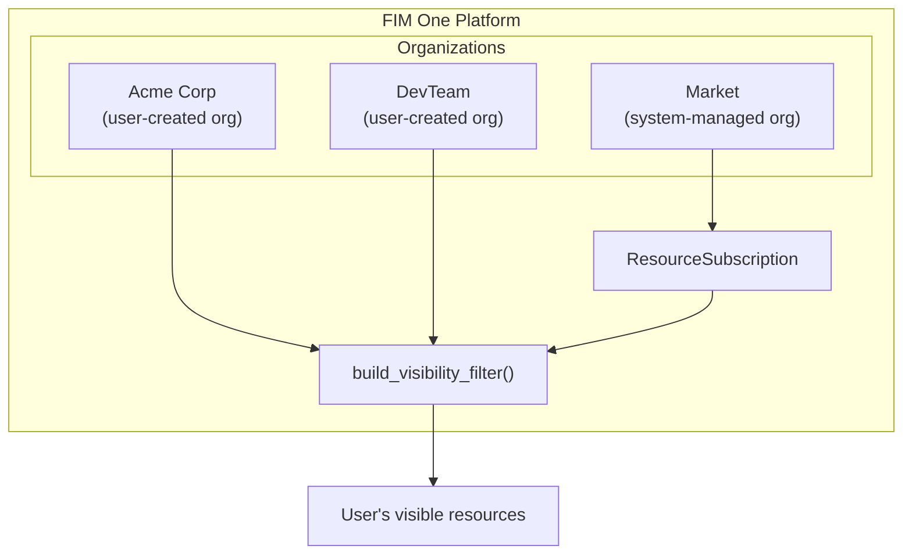
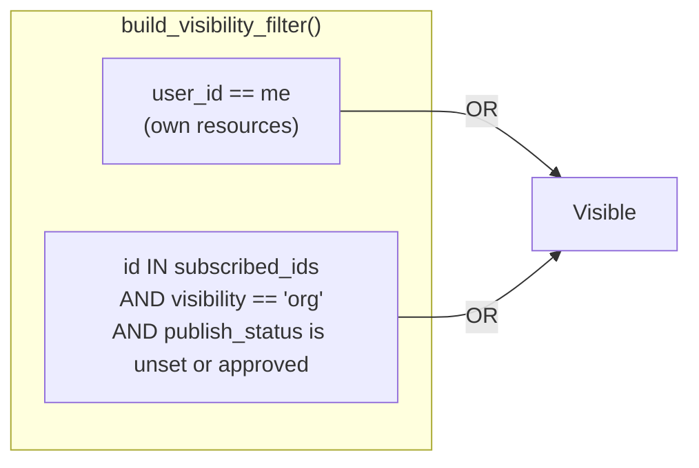
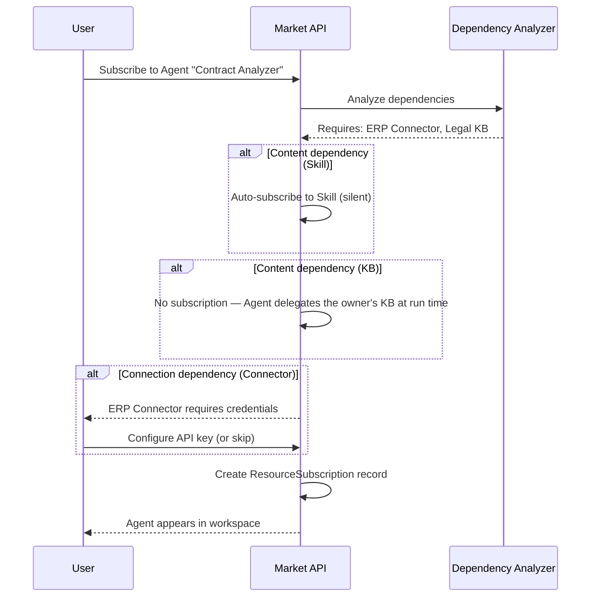
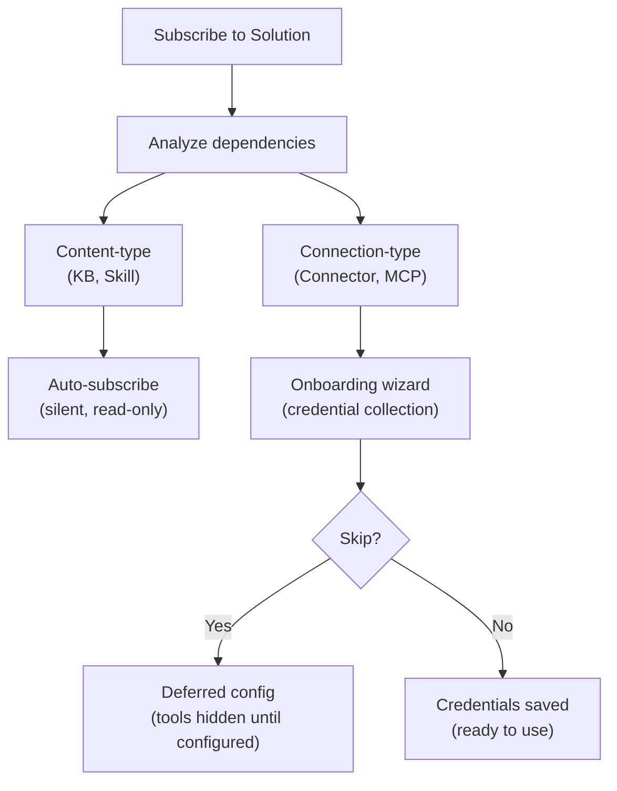

## Aperçu

Le Marché est la place de marché des ressources de FIM One. Les utilisateurs publient les ressources qu'ils ont créées, d'autres les découvrent et s'y abonnent, et les ressources auxquelles on est abonné apparaissent dans l'espace de travail de l'abonné comme s'il s'agissait des leurs. L'ensemble du système repose sur une seule idée architecturale : **le Marché est une organisation** — une organisation fantôme gérée par le système avec des règles de confiance spéciales.

Cette page explique l'architecture interne du Marché. Pour un aperçu orienté utilisateur de la publication et de l'abonnement, consultez [Marché (Fonctionnalités)](/concepts/market). Pour savoir comment les ressources auxquelles on est abonné sont chargées dans les ensembles d'outils, consultez [Découverte d'agent et de ressource](/architecture/agent-discovery).

## Classification à deux niveaux

Le Marché organise les ressources en deux catégories en fonction de ce que la ressource fait, et non de la façon dont elle est implémentée.

### Solutions

Solutions are things that **do work for you**. A user subscribes to a Solution and gets a ready-to-use capability.

| Resource Type | What It Does |
|---|---|
| **Agent** | A conversational AI assistant with bound tools, knowledge, and instructions |
| **Skill** | A global SOP (Standard Operating Procedure) that can orchestrate multiple agents via `call_agent` |
| **Workflow** | A DAG-based automation flow with visual editing and deterministic execution |

Skills and Workflows are optional modules, off by default. While a module is off its resources are absent from the Market and cannot be subscribed to.

Solutions may depend on other resources. An Agent might require a specific Connector for its API calls and a Knowledge Base for its retrieval pipeline. The Market handles these dependencies automatically during subscription (see [Dependency resolution](#dependency-resolution) below).

### Components

Components are **reusable building blocks** for developers. They provide capabilities that Solutions consume.

| Resource Type | What It Does |
|---|---|
| **Connector** | An API integration adapter definition (database connectors cannot be published) |
| **MCP Server** | A tool service configuration using the Model Context Protocol |

Components are simpler to subscribe to — they have no internal dependencies, only credential requirements.

### Pourquoi les bases de connaissances ne sont pas listées indépendamment

Les bases de connaissances ne sont pas partageables du tout — ni sur le Marché, ni avec une organisation. Une base de connaissances n'atteint d'autres utilisateurs que comme dépendance interne d'un Agent partagé : à l'exécution, l'Agent délègue le contenu du propriétaire, de sorte que l'abonné ne détient jamais d'abonnement à une base de connaissances et n'a jamais besoin de trouver, évaluer ou gérer les bases de connaissances séparément.

<Info>
La classification à deux niveaux (Solutions vs. Composants) est un **concept de couche d'affichage**. Elle est dérivée de `resource_type` au moment de la requête, et non stockée comme un champ séparé. Le mécanisme d'abonnement sous-jacent, le filtre de visibilité et le processus d'examen sont identiques pour tous les types de ressources.
</Info>

## Architecture unifiée

### Le Marché en tant qu'organisation fantôme

La décision architecturale la plus importante du Marché est qu'il n'est pas un sous-système séparé. C'est une **organisation** — une org gérée par le système avec un ID fixe (`MARKET_ORG_ID`), créée automatiquement lors de l'initialisation de la plateforme.

Cela signifie :

- **Le même filtre de visibilité** (`build_visibility_filter()`) gère les ressources personnelles, org et Marché dans une seule requête. Aucun code de cas particulier pour les recherches du Marché.
- **Le même mécanisme d'abonnement** (`ResourceSubscription`) s'applique aux ressources org et Marché. S'abonner à une ressource org et s'abonner à une ressource du Marché créent le même enregistrement.
- **La même gestion des identifiants** (fallback, remplacement par utilisateur) fonctionne dans les deux contextes. Le drapeau `allow_fallback` sur les Connecteurs et les Serveurs MCP se comporte de manière identique quelle que soit la source.
- **Le même processus d'examen** (`apply_publish_status()`) gère à la fois l'examen au niveau org et au niveau Marché. La seule différence est que l'org du Marché a tous les drapeaux d'examen verrouillés à `true`.

La distinction clé entre une organisation régulière et l'organisation du Marché :

| Aspect | Organisation | Marché |
|---|---|---|
| **Modèle de confiance** | Confiance élevée (appartenance à l'équipe) | Aucune confiance supposée (communauté mondiale) |
| **Examen** | Optionnel par type de ressource | Toujours obligatoire pour tous les types |
| **Accès** | Automatique pour tous les membres | Nécessite un abonnement explicite |
| **Portée** | Équipe ou entreprise | Mondiale |

<Tip>
Parce que le Marché est simplement une organisation avec des règles spéciales, toute fonctionnalité construite pour les organisations — flux de travail d'examen, gestion des identifiants, cycle de vie des ressources — fonctionne automatiquement pour le Marché sans implémentation supplémentaire.
</Tip>

### How the visibility filter handles it

Nobody holds membership in the Market org. Users do not "join" the Market — they subscribe to individual resources. This means `MARKET_ORG_ID` is never present in a user's `user_org_ids` list, and the org-membership visibility condition is naturally skipped for Market resources.

Instead, subscribed Market resources flow through the `subscribed_ids` path in `build_visibility_filter()`, the same path org-shared resources take:

This two-condition OR clause is the entire visibility model. Org membership alone grants nothing: org-shared and Market resources both reach a user through a subscription, and the share state is re-read on every query, so a subscription stops working as soon as the owner unpublishes the resource or it is awaiting or refused by review.

### Navigation basée sur la portée

La page Market fournit un **sélecteur de portée** qui bascule entre deux contextes de navigation :

| Portée | Ce qu'elle affiche | Qui examine |
|---|---|---|
| **Global Market** | Ressources publiées par n'importe qui vers l'org Market | Administrateurs de plateforme |
| **Organization: [name]** | Ressources publiées par les membres d'une org spécifique | Administrateurs d'org |

La même interface utilisateur, les mêmes onglets (Solutions / Composants) et le même flux d'abonnement s'appliquent dans les deux portées. Le changement de portée modifie uniquement le filtre `org_id` dans la requête de navigation. Du point de vue de l'utilisateur, l'expérience est identique — il parcourt un catalogue et choisit ce qu'il souhaite installer.

## Flux d'abonnement

### Parcourir et découvrir

Les utilisateurs parcourent le Marché via un catalogue paginé. Chaque ressource affiche son nom, sa description, son icône, le nom d'utilisateur de l'éditeur et un bouton d'abonnement. Les ressources auxquelles l'utilisateur s'est déjà abonné sont marquées en conséquence. L'API de parcours (`GET /api/market`) exclut les ressources de l'utilisateur — vous ne pouvez pas vous abonner à quelque chose que vous avez publié.

### S'abonner à une Solution

S'abonner à une Solution (Agent, Skill ou Workflow) implique une analyse des dépendances :

1. Le système analyse les dépendances de la Solution — quels Connectors, Knowledge Bases, MCP Servers et Skills elle nécessite.
2. **Les dépendances de type contenu** sont traitées sans demander à l'utilisateur. Un Skill est auto-abonné silencieusement. Un Knowledge Base n'est jamais abonné — l'Agent délègue le KB de son propriétaire à l'exécution, donc l'abonné n'a rien à provisionner.
3. **Les dépendances de type connexion** (Connector, MCP Server) sont listées comme exigences. Un assistant d'intégration collecte les identifiants.
4. L'enregistrement `ResourceSubscription` est créé, et la ressource apparaît dans le filtre de visibilité de l'utilisateur.

### S'abonner à un composant

Les composants (connecteurs et serveurs MCP) ont un flux plus simple — aucune analyse de dépendance n'est nécessaire. L'utilisateur s'abonne, configure optionnellement les identifiants, et le composant est prêt à être utilisé.

### Credential configuration

Credentials follow a **hybrid model** that balances convenience with flexibility:

- **Offered during subscription.** When a connection-type dependency requires credentials, the onboarding wizard presents the credential form immediately.
- **Skippable.** The user can choose "Skip, configure later." The resource is subscribed, but the tools that need those credentials stay out of the agent's toolset until the user configures them (or the publisher allows fallback).
- **Deferred configuration.** Users can configure or update credentials at any time from their settings page.

This is the same `allow_fallback` mechanism used in organizations. If the publisher has enabled fallback and set a default credential, subscribers can use the resource immediately without providing their own key. If fallback is disabled, each subscriber must bring their own.

<Warning>
When using a Market resource with credential fallback enabled, your API requests flow through the publisher's credentials. For sensitive operations, consider providing your own credentials or verifying the publisher's trustworthiness.
</Warning>

### Unsubscribing

Unsubscribing removes the `ResourceSubscription` record. The resource disappears from the user's visibility filter and is no longer loaded into tool sets. For Solutions, dependencies that were subscribed automatically (Skills, Connectors, MCP Servers) are removed as well when no other subscribed Solution needs them, along with the credentials saved for those Connectors and MCP Servers. Unsubscribing from a Connector or MCP Server directly removes the user's credential for it.

## Résolution des dépendances

Lorsqu'une Solution est publiée ou souscrite, le système analyse son arborescence de dépendances. Les dépendances se divisent en deux catégories avec des stratégies de traitement différentes.

### Dépendances de type de contenu

Les **Bases de connaissances** et les **Compétences** référencées par une Solution sont des dépendances de type de contenu. Elles fournissent des données en lecture seule — documents de récupération, procédures opérationnelles — que la Solution consomme.

- **Compétences — en abonnement :** auto-abonnées silencieusement. L'utilisateur ne voit pas d'étape d'abonnement séparée.
- **Bases de connaissances :** jamais abonnées. Une KB liée est déléguée par l'Agent propriétaire au moment de l'exécution (owner-delegation), donc il n'y a rien à provisionner ou nettoyer du côté de l'abonné.
- **Modèle d'accès :** référence en lecture seule à la ressource de l'auteur original. L'abonné ne peut pas modifier le contenu.
- **À la désinscription :** les dépendances auto-abonnées sont nettoyées automatiquement lorsque la Solution parente est désinscrite.

### Connection-type dependencies

**Connectors** and **MCP Servers** referenced by a Solution are connection-type dependencies. They require credentials to function.

- **On subscription:** subscribed together with the Solution and listed as requirements in the onboarding wizard. The user is prompted to configure credentials (or skip).
- **On unsubscription:** a Connector or MCP Server that was subscribed automatically with the Solution is removed with it, credentials included, unless another subscribed Solution still needs it. One the user subscribed to on their own is left in place with its credentials.

## Publication

### Publication d'une Solution

Lorsqu'un auteur publie un Agent, une Compétence ou un Flux de travail sur le Marché :

1. Le système définit `visibility: "org"` et `org_id: MARKET_ORG_ID` sur la ressource.
2. Le système analyse les dépendances de la Solution et crée un manifeste — listant les Connecteurs, les BCs et les Serveurs MCP requis.
3. Le manifeste est présenté à l'auteur pour confirmation.
4. `apply_publish_status()` définit la ressource sur `pending_review` (l'organisation du Marché a tous les indicateurs d'examen verrouillés sur `true`).
5. Un administrateur système examine et approuve ou rejette la ressource.

### Publication d'un composant

La publication d'un connecteur ou d'un serveur MCP est plus simple :

1. Le système définit la visibilité et org_id comme ci-dessus.
2. Le schéma des identifiants est extrait (les champs que les abonnés doivent remplir).
3. La ressource entre en `pending_review` et attend l'approbation de l'administrateur.

### Processus d'examen

Le processus d'examen est le même mécanisme utilisé par les organisations, avec une différence critique :

| Contexte | Examen requis ? | Qui examine |
|---|---|---|
| **Organisation** | Configurable par type de ressource (`review_agents`, `review_connectors`, etc.) | Administrateurs de l'organisation |
| **Marché** | Toujours requis pour tous les types de ressources | Administrateurs de la plateforme (propriétaire de l'organisation Marché) |

L'organisation Marché est initialisée avec les six indicateurs d'examen définis sur `true`, et cette configuration ne peut pas être modifiée. Chaque ressource publiée sur le Marché doit passer l'examen administrateur avant de devenir visible dans le catalogue de navigation.

<Note>
Les propriétaires d'organisation contournent automatiquement l'examen — leurs ressources publiées sont immédiatement disponibles. Pour le Marché, seul le propriétaire de l'organisation Marché (l'administrateur système) dispose de ce privilège de contournement.
</Note>

Lorsqu'une ressource approuvée est modifiée par son auteur, `check_edit_revert()` rétablit automatiquement le `publish_status` à `pending_review`. Cela garantit que les modifications apportées aux ressources du Marché en direct sont réexaminées avant de devenir visibles pour les abonnés.

## Notes d'implémentation

### The shadow org

The Market organization has a well-known fixed ID (`00000000-0000-0000-0000-000000000001`) and slug (`market`). It is created by `ensure_market_org()` during platform initialization, when the first user (the administrator) registers. The function is idempotent; calling it multiple times is safe.

### ResourceSubscription

La table `ResourceSubscription` est la structure de données centrale pour l'accès au Market :

| Colonne | Objectif |
|---|---|
| `user_id` | L'abonné |
| `resource_type` | `agent`, `connector`, `mcp_server`, `skill`, ou `workflow` (les bases de connaissances ne sont jamais abonnées — elles fonctionnent via la délégation du propriétaire d'Agent) |
| `resource_id` | L'ID de la ressource abonnée |
| `org_id` | L'org source (ID org Market ou un ID org régulier) |

Une contrainte d'unicité sur `(user_id, resource_type, resource_id)` empêche les abonnements en doublon. La colonne `org_id` suit l'origine de l'abonnement, permettant une désinscription consciente du périmètre.

### Visibility filter integration

The `resolve_visibility()` function performs two lookups in a single call:

1. Fetches the user's org memberships (`user_org_ids`)
2. Fetches the user's subscriptions (`subscribed_ids`)

These are passed to `build_visibility_filter()`, which produces a single SQL WHERE clause combining the two visibility conditions (own, or subscribed and still shared). This function is used everywhere resources are queried — agent lists, connector dropdowns, skill injection, auto-discovery mode — ensuring consistent visibility across the entire platform.

### Chiffrement des identifiants

Les identifiants configurés lors de l'abonnement (ou ultérieurement dans les paramètres) sont chiffrés au repos à l'aide de la clé de chiffrement de la plateforme. L'API Market n'expose jamais les valeurs des identifiants dans les réponses de navigation — seules les métadonnées (nom, description, icône, type) sont renvoyées dans les fonctions d'assistance `_*_market_info()`.

## Voir aussi

- [Organisation & Marché](/architecture/organization) -- modèle de partage et de confiance au niveau de l'organisation
- [Découverte d'Agent & de Ressource](/architecture/agent-discovery) -- comment les ressources souscrites sont chargées dans les ensembles d'outils
- [Architecture du Connecteur](/architecture/connector-architecture) -- conception du connecteur, injection d'authentification et audit
- [Aperçu du Système](/architecture/system-overview) -- l'abstraction d'outil unifiée dans laquelle convergent toutes les ressources
