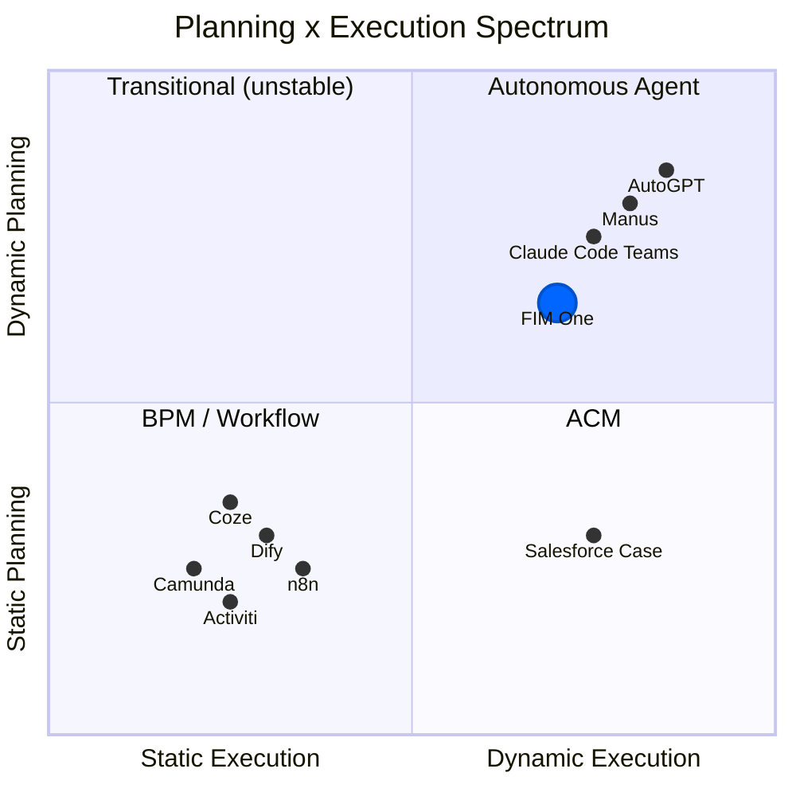
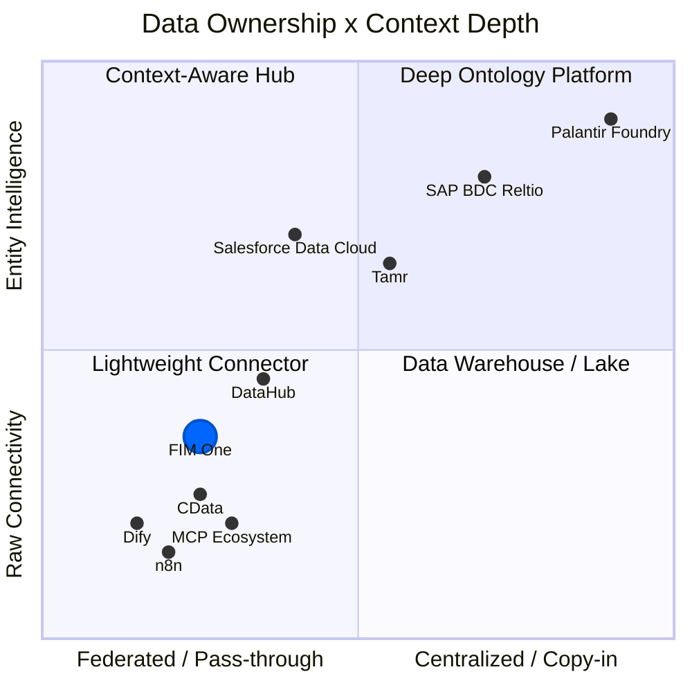

## Pourquoi la planification dynamique est le juste milieu difficile

Le paysage des agents IA s'est divisé en deux camps, et les deux ont choisi la voie facile. Les moteurs de workflow traditionnels -- Dify, n8n, Coze -- ont opté pour l'orchestration statique : des organigrammes visuels glisser-déposer avec des chemins d'exécution fixes. Ce n'était pas de l'ignorance ; les clients d'entreprise exigent du déterminisme (même entrée, sortie stable), et les graphes statiques le garantissent. À l'extrême opposé, les agents entièrement autonomes (AutoGPT et ses descendants) promettaient une autonomie de bout en bout mais se sont avérés impraticables : décomposition des tâches peu fiable, coûts en tokens qui s'envolent, et comportement que personne ne pouvait prédire ou déboguer.

Le juste milieu est étroit mais réel. Les tâches simples n'ont pas besoin de planificateur. Les tâches suffisamment complexes pour nécessiter des dizaines d'étapes interdépendantes submergent les LLM actuels. Mais entre les deux se trouve une riche classe de problèmes -- des tâches avec des sous-tâches parallèles claires qui sont fastidieuses à coder en dur mais tractables pour qu'un LLM les décompose. La planification DAG dynamique cible exactement cette zone : le modèle propose le graphe d'exécution à l'exécution, le framework valide la structure et l'exécute avec une concurrence maximale. Pas de glisser-déposer, pas d'autonomie YOLO.

## Le pari sur l'amélioration des modèles

Tous les quelques mois, les fondations se déplacent -- GPT-4, function calling, Claude 3, le protocole MCP. Construire une abstraction rigide sur un terrain mouvant est risqué ; la sur-abstraction de LangChain est l'histoire édifiante que tout le monde dans cet espace a intériorisée. FIM One adopte l'approche opposée : **abstraction minimale, extensibilité maximale**. Le framework gère l'orchestration, la concurrence et l'observabilité. L'intelligence provient du modèle, et le modèle s'améliore constamment.

Aujourd'hui, la précision de la décomposition des tâches LLM se situe autour de 70-80% pour des objectifs non triviaux. Quand cela atteindra 90%+, la « zone optimale » pour la planification dynamique s'élargira considérablement -- les problèmes qui étaient trop complexes hier deviennent tractables demain. Le framework DAG de FIM One est conçu pour capturer cette valeur croissante sans réécrire l'infrastructure.

## Will ReAct and DAG planning become obsolete?

ReAct will not disappear -- it will sink into the model. Consider the analogy: you do not hand-write TCP handshakes, but TCP did not go away; it got absorbed into the operating system. When models are strong enough, the think-act-observe loop becomes implicit behavior inside the model, not explicit framework code. This is already happening: Claude Code is essentially a ReAct agent where the loop is driven by the model itself, not by an external harness.

DAG planning's lasting value is not "helping dumb models decompose tasks" -- it is **concurrent scheduling**. Even with infinitely capable models, physics imposes latency: a serial chain of 10 LLM calls takes 10x longer than 3 parallel waves. DAG is an engineering problem (how to run things fast and reliably), not an intelligence problem (how to decide what to run). Retry logic, cost control, timeout management, observability -- these do not go away when models get smarter.

The endgame: **models own the "what" (planning intelligence internalizes into the model), frameworks own the "how" (concurrency, retry, monitoring, cost governance)**. A framework's lasting value is not intelligence -- it is governance.

This is the sentence the rest of FIM One is downstream of. Once the model owns the "what," durable value moves to governing the "how" -- and the highest-value "how" in any enterprise is *reach* into the systems that refuse to talk to each other. The integration layer is one inferential step from here, and the history shows it: the project began as a DAG orchestration framework (`fim-agent`) and became a connector platform within a single week -- not through a rewrite, but because this bet already required it.

## Why not mirror Dify's workflow editor

A natural question: if DAG covers the flexible case, shouldn't we also build a static workflow editor for the deterministic case?

Not as the core. FIM One does ship a visual Workflow editor (9 node types, cron and API triggers), but as an optional module that is off by default. The reasoning for keeping it secondary:

1. **The workflows already exist elsewhere.** Government and enterprise clients' fixed processes live in their OA, ERP, and legacy systems. They don't want to rebuild those flows in yet another platform -- they want AI that can connect to the systems where those flows already run. The Connector Platform (v0.6) solves this directly.

2. **Existing capabilities compose into fixed pipelines.** Scheduled Jobs (v1.0) trigger a DAG agent with a fixed prompt; the DAG dynamically plans the steps; Connectors (v0.6) connect to the target systems. The combination is equivalent to a static pipeline -- but more flexible, because the LLM can adjust its plan based on the data it encounters. No separate pipeline DSL needed.

3. **Investment mismatch.** A production-quality visual workflow editor (canvas, node types, variable passing, debug/replay) is months of dedicated effort. The result would be a low-fidelity copy of what Dify's 120K-star community already maintains. That effort is better spent on the Connector architecture -- a capability no competitor offers.

The strategic bet: **don't compete on workflow visualization; compete on being the agent platform where systems meet AI**. Let Dify own "build AI workflows visually." FIM One owns "the all-in-one agent platform for Global × China enterprises."

## Where FIM One stands

FIM One is not an "AGI task scheduler" and not primarily a static workflow engine. It occupies the middle ground: planning capability with constraints, concurrency with observability.

- Compared to **Dify**: more flexible -- runtime DAG generation vs. design-time flowcharts. You do not need to anticipate every execution path in advance. Does not compete on visual workflow editing; competes on legacy system integration.
- Compared to **AutoGPT**: more controlled -- bounded iterations, re-planning limits, with human confirmation gates. Autonomy within guardrails.

The strategy is straightforward: build the orchestration framework now, and let improving models fill it with capability over time.

## Where FIM One Sits: Planning x Execution Spectrum

The AI execution landscape can be mapped on two axes -- how plans are created (static vs dynamic) and how they are executed (rigid vs adaptive):

**Why Dify/n8n are Static Planning + Static Execution**: The DAG is drawn by a human on a visual canvas at design time. Each node executes a fixed operation (an LLM call with a fixed prompt, an HTTP request, a code block). There is no runtime replanning -- if a step fails, the workflow fails or follows a pre-wired error branch. This is structurally the same as BPM, just with AI nodes in the graph.

**FIM One's position: Dynamic Planning + Dynamic Execution**

- **DAG topology is generated by LLM at runtime** (dynamic planning) -- no human designs the graph
- **Each DAG node runs a full ReAct loop** (dynamic execution) -- nodes reason, use tools, and adapt
- **Re-planning mechanism** (execute → analyze → re-plan if unsatisfied)
- But bounded: max 3 rounds in total (the first plan plus 2 re-plans), token budgets, human confirmation gates

This places FIM One in the same quadrant as AutoGPT, but with engineering constraints that prevent runaway behavior. More flexible than BPM/Dify, more controlled than AutoGPT.

## Concept Glossary

For readers unfamiliar with the terminology used in this document:

| Term | One-line explanation | Relation to FIM One |
|------|---------------------|----------------------|
| **BPM** (Business Process Management) | Processes fully fixed at design time, executed rigidly. Camunda, Activiti. | FIM One is **not** BPM. Fixed processes are covered by the optional Workflow module, not the core. |
| **FSM** (Finite State Machine) | System is in exactly one state at any time; events trigger transitions. Supports loops (reject → resubmit). | Target systems (ERP, contract systems) use FSM internally. FIM One **doesn't need** its own FSM -- it calls the target system's API. |
| **ACM** (Adaptive Case Management) | Skeleton static, branches dynamic. Main flow pre-defined, each node adapts at runtime. | FIM One's DAG + ReAct naturally falls in this quadrant. |
| **HTN** (Hierarchical Task Network) | Recursive task decomposition: high-level → subtasks → atomic operations. | DAG re-planning covers most scenarios; full HTN not needed yet. |
| **iPaaS** (Integration Platform as a Service) | Cloud integration platform connecting multiple SaaS/on-prem systems. MuleSoft, Zapier. | FIM One's integration layer is like **AI-native iPaaS** -- natural language drives cross-system integration. |
| **MDM** (Master Data Management) | Deduplicates and unifies entity records across systems into a "golden record." Reltio, Informatica, Tamr. | FIM One **connects to** MDM systems; it does not replicate entity resolution. |
| **Context Layer / System of Context** | Unified entity + relationship graph that gives AI agents trusted business context. Term popularized by Reltio (2026). | FIM One delegates this to upstream MDM/data platforms. Skills provide lightweight aggregation for common cases. |

## Limite architecturale : FIM One ne réplique pas la logique de flux de travail

Les processus métier complexes (chaînes d'approbation, transferts, rejets, escalades, cosignature, contresignature) sont la **responsabilité du système cible**. Ces systèmes ont passé des années à construire cette logique -- les ERP, les systèmes OA, les systèmes de gestion de contrats ont tous des machines d'état matures.

Du point de vue du connecteur :

| Opération | Ce que fait le connecteur |
|-----------|------------------------|
| Transfert | Appeler une API, passer la personne cible |
| Rejet | Appeler une API, passer la raison du rejet |
| Escalade | Appeler une API, passer la liste des personnes d'escalade |
| Cosignature | Appeler une API, passer la liste des cosignataires |

Chaque opération de flux de travail complexe se réduit à une requête HTTP avec des paramètres. FIM One appelle l'API ; le système cible gère la machine d'état.

C'est une **limite architecturale délibérée**, pas une lacune en matière de capacités. Dupliquer la logique de flux de travail qui existe déjà dans les systèmes cibles entraînerait :
1. Une charge de maintenance (deux machines d'état à maintenir synchronisées)
2. Des modes de défaillance supplémentaires (et si elles ne concordaient pas ?)
3. Aucune valeur ajoutée (le système cible le fait déjà correctement)

Le modèle de connecteur est simple par conception : **une opération = un appel API**.

## Architecture Boundary: Connector Layer, Not Context Layer

Enterprise AI is converging on a layered architecture for agent context:

| Layer | What it does | Representative players |
|-------|-------------|----------------------|
| **Decision Traces** | Records *why* something happened -- audit trails, lineage | Palantir Decision Lineage, Arize |
| **Entity Context** | Unified golden records + relationship graphs -- the "System of Context" | Reltio/SAP, Informatica/Salesforce, Tamr |
| **Data Connectivity** | Connects agents to source systems via APIs and protocols | **FIM One**, CData, MCP ecosystem |
| **Source Systems** | CRM, ERP, contract management, databases, SaaS apps | SAP, Salesforce, custom systems |

FIM One operates at the **data connectivity layer**. It does not attempt to build the entity context layer above it. This is a deliberate choice, not a gap.

### Contexte industriel : la consolidation 2025-2026

Deux acquisitions majeures ont remodelé le paysage des données d'IA d'entreprise et ont fait de la couche de contexte un enjeu stratégique :

- **Salesforce a acquis Informatica** (novembre 2025) -- ajoutant la gestion des données de référence d'entreprise et la gouvernance des données à sa pile Data Cloud + Agentforce. L'objectif : rendre les agents Agentforce fiables en les ancrant dans les enregistrements de référence d'Informatica.
- **SAP a annoncé l'acquisition de Reltio** (mars 2026) -- ajoutant la résolution d'entités native à l'IA et les graphes de relations à son Business Data Cloud (BDC). L'objectif : créer un « Système de Contexte » qui s'étend aux environnements SAP et non-SAP, servant de fondation fiable pour les Agents Joule.

Ces mouvements signalent que les plus grandes plates-formes d'entreprise du monde considèrent désormais le contexte d'entité unifié comme un prérequis pour des agents d'IA fiables -- pas seulement un plus.

### Propriété des données × spectre de profondeur du contexte

**Lecture du graphique :**

- **En bas à gauche (Connecteur léger)** : propriété minimale des données et connectivité API brute. Dify, n8n et les serveurs MCP de base se situent ici — ils se connectent aux systèmes, mais ne comprennent pas les entités. FIM One se trouve dans ce quadrant, mais plus haut sur l’axe des y grâce aux méta-outils à divulgation progressive, à l’agrégation du contexte basée sur les Skills et à l’escalade tenant compte du domaine.
- **En haut à gauche (Hub sensible au contexte)** : accès fédéré avec compréhension au niveau des entités. Salesforce Data Cloud en est un exemple — fédération sans copie avec résolution d’entités à la demande. DataHub fournit un contexte au niveau des métadonnées (schéma, lignage, propriété) sans posséder les données métier.
- **En haut à droite (Plateforme ontologique approfondie)** : ingestion complète des données avec une intelligence approfondie des entités. SAP BDC + Reltio crée des enregistrements de référence persistants couvrant plusieurs domaines, avec des graphes de relations. Palantir va le plus loin — une ontologie à trois couches avec lignage des décisions.
- **En bas à droite (Entrepôt de données / lac de données)** : stockage centralisé des données sans sémantique des entités. Les plateformes de données traditionnelles qui ingèrent tout, mais ne disposent ni de résolution d’entités ni de modélisation des relations.

La position de FIM One reflète un choix délibéré : rester fédéré et léger, tout en investissant dans l’accessibilité du contexte des entités en amont (provenant de n’importe quel MDM) pour les agents.

### Trois modèles pour le contexte d'entité

**SAP : dossier unique multi-domaines (copie + gouvernance)**

SAP construit une architecture d'entreprise à trois niveaux :

| Couche | Système | Rôle |
|-------|--------|------|
| **Transaction** | S/4HANA | Exécution métier -- commandes, factures, livraisons |
| **Intelligence** | Business Data Cloud (BDC) + Reltio | Intégration sémantique, résolution d'entités, graphes de relations |
| **Agent** | Joule + Joule Agents | Compréhension d'intention, orchestration d'outils, exécution autonome |

Reltio se situe au cœur de la couche intelligence. Son rôle : ingérer les données d'entités provenant de systèmes SAP et non-SAP, résoudre les doublons via un appariement basé sur l'IA, et produire des **dossiers uniques multi-domaines** (client, fournisseur, produit, patient, actif) avec des graphes de relations. L'adoption précoce du **protocole MCP** par Reltio est stratégiquement significative -- elle positionne les dossiers uniques comme directement appelables par n'importe quel agent compatible MCP, pas seulement par Joule, le propre agent de SAP.

Le pari de SAP : les agents ont besoin d'une « source unique de vérité » persistante, gouvernée et inter-domaines pour fonctionner de manière fiable dans les processus d'entreprise critiques.

**Salesforce : fédération sans copie (fédérer + résoudre à la demande)**

Salesforce adopte une approche plus légère. Data Cloud ne nécessite pas de mouvement physique de données ; au lieu de cela, il utilise des **partenariats sans copie** (Databricks, Snowflake, BigQuery) pour fédérer les données sur place. La résolution d'entités se fait à la demande dans Data Cloud, créant des profils clients unifiés sans magasin de dossier unique persistant.

Chiffres clés (Q3 FY2026) : Data Cloud a ingéré 32 billions d'enregistrements, dont 15 billions via une approche sans copie (croissance de 341 % en glissement annuel). Cette échelle valide le modèle de fédération pour les cas d'usage centrés sur la CRM.

Les agents Agentforce sont ancrés dans ce contexte fédéré : ils raisonnent sur l'ensemble distribué de données sans nécessiter que toutes les données arrivent dans un seul système. Pour les scénarios front-office (ventes, service, marketing), c'est flexible et rapide à déployer.

Le pari de Salesforce : les agents n'ont pas besoin d'un magasin de dossier unique lourd -- ils ont besoin d'un accès en temps réel à un contexte fédéré et résolu là où il existe déjà.

**Palantir : ontologie approfondie (la référence lourde)**

À l'extrême, Palantir Foundry ingère toutes les données et construit une ontologie à trois niveaux (objets sémantiques + actions cinétiques + règles dynamiques) avec une traçabilité complète des décisions. C'est le système de contexte le plus complet en production, mais à des contrats de 10 M$ et plus et des déploiements de 6 à 18 mois. Il sert de architecture de référence, pas de modèle réaliste pour la plupart des organisations.

### Où FIM One s'inscrit

| Dimension | SAP + Reltio | Salesforce + Informatica | FIM One |
|-----------|-------------|-------------------------|---------|
| **Philosophie des données** | Copy-in : ingérer dans BDC, construire des enregistrements maîtres | Federate : accès sans copie, résoudre à la demande | Pass-through : se connecter à la source, ne pas stocker |
| **Résolution d'entités** | Profonde -- MDM natif IA avec graphiques de relations | Moyenne -- Résolution d'entités Data Cloud | Aucune -- délègue au MDM en amont |
| **Intégration d'agents** | Joule Agents + MCP | Agentforce + Data Cloud grounding | N'importe quel agent + n'importe quel connecteur |
| **Coût de déploiement** | Tarification de plateforme d'entreprise | Tarification SaaS d'entreprise | Léger, quelques heures à quelques jours |
| **Verrouillage** | Élevé (écosystème BDC + S/4HANA) | Moyen (écosystème Salesforce) | Faible -- les connecteurs sont interchangeables |
| **Meilleur cas d'usage** | Fabrication, chaîne d'approvisionnement, sciences de la vie (multi-domaine complexe) | Entreprises axées sur CRM (orientation front-office) | Mid-market, multi-systèmes, agnostique des fournisseurs |

FIM One s'aligne le plus étroitement avec la **philosophie Salesforce** (ne pas posséder les données, s'y connecter) mais sans la dépendance à l'écosystème Salesforce. La position stratégique : être agnostique des fournisseurs au niveau de la couche de connectivité, et laisser n'importe quel MDM -- qu'il s'agisse de SAP/Reltio, Salesforce/Informatica, Tamr, ou une solution personnalisée -- servir de source de contexte d'entité.

### Pourquoi FIM One reste à la couche connecteur

Construire une couche de contexte d'entité nécessite un stockage de données persistant, une résolution d'entité basée sur le ML, des règles de survivance, des moteurs de graphe de relations et des cadres de gouvernance. C'est une catégorie de produit distincte (MDM) avec une concurrence approfondie depuis une décennie (Reltio, Informatica, Tamr). Tenter de le faire :

1. **Transformerait FIM One d'un connecteur en plateforme de données** -- produit, équipe et stratégie de mise sur le marché fondamentalement différents
2. **Dupliquerait les capacités que les systèmes en amont fournissent déjà** -- le même anti-pattern que nous évitons avec la logique de flux de travail
3. **Augmenterait le verrouillage** -- une fois que les utilisateurs stockent les enregistrements de référence dans FIM One, les coûts de changement augmentent considérablement

La stratégie correcte : **être le meilleur point d'entrée pour tout système MDM**, pas un remplacement pour un. FIM One devrait rendre trivial pour Reltio, Informatica, Tamr ou un MDM personnalisé de servir le contexte d'entité aux agents -- via MCP Resources, les APIs de connecteur ou l'injection de base de connaissances.

### Approche actuelle : les compétences comme agrégation de contexte légère

Pour les scénarios nécessitant un contexte multi-connecteur (par exemple, un examen de contrat nécessitant des données de fournisseur + historique de paiement + indicateurs de risque), les **compétences** fournissent déjà une solution pragmatique. Le SOP d'une compétence peut orchestrer plusieurs actions de connecteur en séquence, agréger les résultats et présenter un contexte structuré à l'agent -- sans construire une couche d'entité persistante.

Cela couvre le cas à 80%. Si la demande émerge pour une résolution d'entité en temps réel au niveau du connecteur, l'architecture laisse de la place pour un futur type de connecteur `ContextSource` qui s'intègre avec des systèmes MDM externes -- mais c'est une considération future, pas un engagement actuel.

### L'analogie

La relation de FIM One à la couche de contexte est comme la relation de SQLAlchemy à la base de données : elle ne stocke ni ne gère les données, mais elle rend n'importe quelle source de données accessible à la couche application. Laissez les plateformes MDM posséder la résolution d'entités ; laissez FIM One posséder la connexion.

## Où FIM One s'inscrit dans la pile IA

### The Layered Model

A useful mental model (credit [Phil Schmid](https://www.philschmid.de/)) maps AI systems to a four-layer stack analogous to computing hardware:

| Layer | Analogy | FIM One Component |
|-------|---------|-------------------|
| **Model** | CPU | ModelRegistry -- any OpenAI-compatible LLM |
| **Context** | RAM | ContextGuard + Memory (Window / Summary / DB) |
| **Harness** | Operating System | ReAct Agent + DAG Planner + Hooks + ToolRegistry |
| **Application** | App | Portal, API |

FIM One operates at the **harness layer** -- it does not compete with models; it makes them productive by providing the right tools, constraints, and feedback loops. The model supplies intelligence; the harness supplies governance, concurrency, and reliability.

### Three Eras of AI Engineering

The discipline has evolved through distinct phases: **Prompt Engineering** focused on crafting better instructions to elicit correct behavior from a fixed model. **Context Engineering** shifted attention to assembling the right information -- retrieving documents, injecting tool results, managing memory -- so the model has what it needs to reason well. **Harness Engineering** goes further: designing the full execution environment around the model, including deterministic guardrails, tool orchestration, feedback loops, and cost controls.

FIM One's architecture embodies harness engineering principles. The [Hook System](/architecture/hook-system) runs platform code outside the LLM loop at well-defined lifecycle points — today `ApprovalGateHook` intercepts sensitive tool calls and routes approval to an in-portal card or an IM channel, and the same abstraction can carry audit logging, read-only-mode enforcement, rate limits, and result truncation if those are ever needed. ContextGuard manages what enters the context window and when. Dynamic tool selection (progressive-disclosure meta-tools) keeps the tool surface tractable as connector count grows. The ReAct loop's self-reflection mechanism and the DAG planner's re-plan cycle provide structured feedback that improves execution quality without requiring a more capable model.
