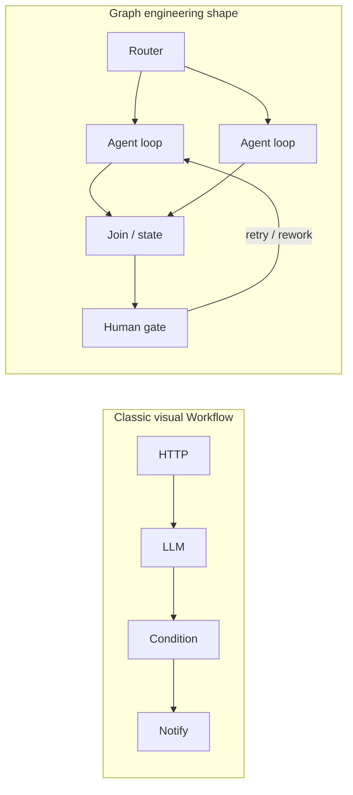
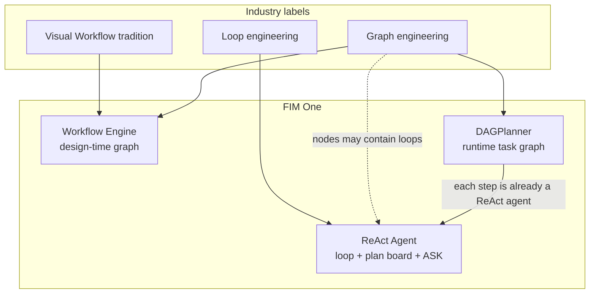
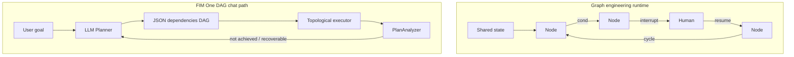
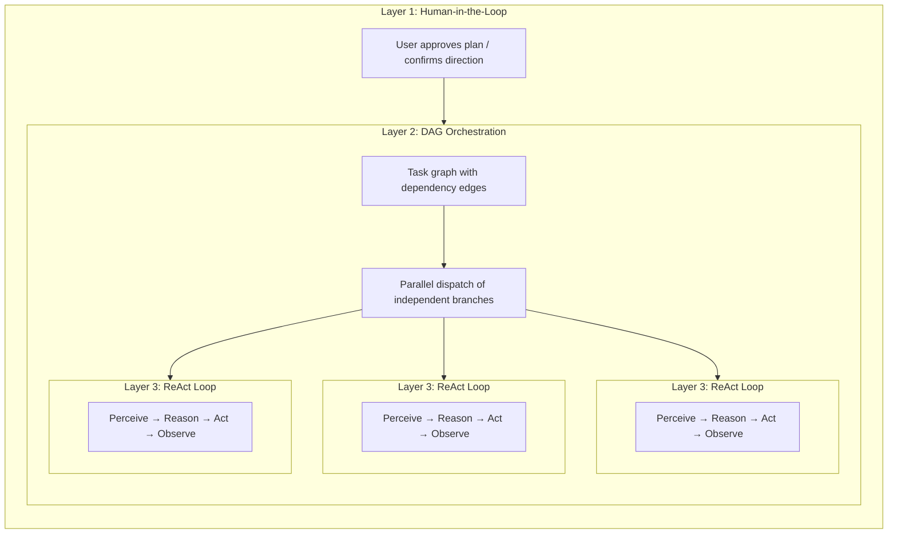

## Graph engineering (2026) et FIM One

Les discussions sectorielles encadrent souvent un passage du **loop engineering** (un seul agent pensant et agissant de manière répétée) au **graph engineering** (faire de la topologie multi-nœuds un objet d'ingénierie explicite). L'étiquette est nouvelle ; la pratique ne l'est pas. Les systèmes de style LangGraph et les organisations multi-agents utilisent les graphes depuis des années. Ce qui importe pour FIM One, c'est le **type** de graphe dont les gens parlent, et comment cela s'inscrit dans nos trois couches d'exécution.

### What graph engineering usually means

| Layer (common framing) | Concern |
|---|---|
| **Harness** | Tools, sandbox, auth, logging, quotas around the model |
| **Loop** | One agent's think → act → observe cycle |
| **Graph** | How **nodes** connect: branches, joins, cycles, human checkpoints, shared state |

Consensus across that framing: **graph does not replace loop**. Graph designs **relationships between processes**; each agentic node may still run a full loop.

"Graph" is overloaded in practice. Three usages get mixed:

| Usage | Example | Role |
|---|---|---|
| **Control-flow graph** | LangGraph `StateGraph`: conditional edges, retries, interrupt/resume | State machine for who runs next |
| **Task dependency graph** | Claude Code Tasks `blockedBy`; FIM One `dependencies` | Schedule and parallelize work |
| **Knowledge graph** | Entities and typed relations | Retrieval / memory (not orchestration) |

This page is about the first two (orchestration).

### Pas « Dify Workflow avec un nouveau nom »

Les **workflows visuels** de style Dify et l'ingénierie de graphes partagent une origine commune (**topologie explicite**) mais ce ne sont pas le même produit.

| | Workflow visuel classique (ex. Dify) | Ingénierie de graphes (usage 2026) |
|---|---|---|
| **Artefact principal** | Canevas / schéma que l'implémenteur dessine | Topologie en tant que conception système versionnée (code ou config) |
| **Nœuds** | Blocs de capacité fixes (LLM, HTTP, KB, condition…) | **Hétérogènes** : fonctions, routeurs, **agents complets**, humains, jointures |
| **Où réside l'intelligence** | Principalement à l'intérieur de nœuds LLM isolés ; le graphe est un tuyau | Souvent **à l'intérieur des nœuds** (chacun peut être une boucle) ; le graphe organise les rôles |
| **Arêtes** | Succès/échec du pipeline et branches | Flux de contrôle **et** transitions d'état, incluant **cycles contrôlés** |
| **Humain dans la boucle** | Formulaires / approbations comme modules complémentaires | Interruption / reprise comme primitives de première classe |
| **Relation à la boucle** | Souvent vendu comme « Workflow **vs** Agent » | Explicitement **Graphe plutôt que Boucle** |

Forme courte : le Workflow classique est un **tuyau déterministe (ou semi-déterministe)** avec des étapes LLM occasionnelles. L'ingénierie de graphes est une **topologie système multi-nœuds**, où les postes critiques peuvent toujours être des agents autonomes.

### How the industry map sits on FIM One

FIM One already spans the control spectrum; chat "Planner mode" is only one slice.

| Industry idea | Closest FIM One piece | Fit |
|---|---|---|
| Classic visual Workflow | **Workflow Engine** (design-time blueprint) | Strong |
| Control-flow graph + HITL + durable state | Workflow human steps + confirmation gates; partial on chat DAG | Medium |
| Task dependency graph + parallel schedule | **DAGPlanner** (`dependencies`, topological fan-out) | Strong on scheduling; weaker on mid-graph HITL |
| Single agent loop + checklist memory | **ReAct** (`update_plan`, tools, `ask_user_question`) | Strong |
| Runtime LLM-drawn plan every turn | **DAGPlanner** (not Dify; not LangGraph design-time DSL) | Distinct product |

### Graph engineering vs FIM One DAG (chat Planner)

Same family (explicit multi-step topology). Different species.

| Dimension | Graph engineering (typical) | FIM One DAG (chat) |
|---|---|---|
| **Who draws the graph** | Developer / implementer (stable topology) | **LLM at runtime** (new graph per goal) |
| **Edge meaning** | Often **control flow** (where next, including cycles) | Mostly **dependency / data** (`dependencies`, acyclic run) |
| **Correction** | Edge-level retry, human node, resume same graph | **PlanAnalyzer → replan** (often a **new** graph) |
| **Node depth** | Node may be a full agent loop | **Already full ReAct per step**: `DAGExecutor` runs `agent.run()` with a multi-iteration tool loop (default cap from `DAG_STEP_MAX_ITERATIONS`, commonly 15). Default model is registry **general** (not infrastructure fast); `model_hint` can escalate to reasoning or demote to fast. Tool cache, step/citation verification, and source evidence ship with each step. Step agents set `enable_plan_tool=False` (no `update_plan` board inside a step) because the unit of work is already a focused sub-task. |
| **Shared state** | First-class typed state + checkpoint narrative | Step results + memory/compact; step checkpoints exist |
| **Mid-run questions** | Interrupt as a product feature | Confirmation gates exist; **`ask_user_question` is ReAct-only** (chat outer loop), not a first-class DAG wait edge |
| **Product entry** | Framework or backend org chart | User-visible mode next to ReAct |

**Implication:** industry heat around graph engineering **validates keeping a graph/scheduling engine**. It does **not** require a chat default that forces users to pick "Planner" for every turn. Most tasks still want a strong loop; graphs earn their keep on parallel branches, fixed compliance paths, and multi-role orchestration.

### What FIM One can learn (empower ReAct, DAG, Workflow)

Concrete takeaways, not slogans. Ordered by leverage.

| # | Graph engineering idea | Apply to | Direction |
|---|---|---|---|
| 1 | **Graph over loop, not instead of** | Product + Auto routing | Default UX stays **ReAct** (loop + `update_plan` + `ask_user_question`). Use DAG/Workflow when topology earns cost. |
| 2 | **Heterogeneous deep nodes** | DAG | **Already the status quo.** Each step is a full ReAct agent (`agent.run`, multi-iteration tools, general-or-better model by default), not a one-shot LLM call. The one exception is a step the planner tags `llm_direct` (pure transformation of upstream outputs), which runs as a single tool-less call. Remaining knobs are optional (e.g. plan board on long steps), not a structural gap. |
| 3 | **Interrupt / resume as edges** | DAG + ReAct | Mid-run clarification belongs in the **outer** loop or as a first-class wait state. Avoid fake DAG steps that "ask the user" in text and then replan as "goal not achieved". |
| 4 | **Controlled cycles vs whole-graph replan** | DAG | Prefer step-local retry / partial carryover (already partly true for completed steps) over dumping all step text as a failed final answer. |
| 5 | **Typed shared state along edges** | DAG + Workflow | Stronger contracts for step I/O (schema, deliverables) reduce Analyzer false confidence and answer/source drift. |
| 6 | **Topology as a versioned asset** | Workflow | Keep human-authored graphs for audit; do not expect runtime LLM DAGs to replace compliance blueprints. |
| 7 | **Honest "most tasks never need a graph"** | Auto + docs | Route clarify-and-choose, short Q&A, and exploratory work to ReAct; reserve DAG for decomposable parallel work. |

**Anti-patterns to avoid when "doing graph":**

- Using a **dependency graph** to simulate a **human state machine** (multi-step "wait for answers" with no wait primitive).
- Equating ReAct **`update_plan`** (checklist memory) with graph engineering (scheduling topology).
- Shipping graph heat as a second chat personality instead of as **engine composition** (loop outside, schedule inside when needed).
- Describing FIM One DAG steps as "shallow LLM calls": that understates the engine and misleads product decisions.

## Cinq types de « planification » dans le paysage des outils IA

Le mot « planification » est surchargé. Au moins cinq approches distinctes existent aujourd'hui, et elles résolvent des problèmes différents :

| Approche | Format du plan | Exécution | Approbation | Valeur centrale |
|---|---|---|---|---|
| **Planification implicite du modèle** | Chaîne de pensée interne | Passage d'inférence unique | Aucune | Le modèle réfléchit aux étapes par lui-même |
| **Mode plan Claude Code** | Document Markdown | Série | Examen humain avant exécution | Aligner sur l'approche avant de toucher au code |
| **Claude Code Teams** | Liste de tâches avec arêtes de dépendance | **Concurrence** (multi-agent) | L'humain approuve le plan, puis autonome | Pool d'agents dynamique + exécution parallèle |
| **Développement piloté par spec Kiro** | Spec structuré (exigences + conception + tâches) | Série | Examen humain de la spec | Exigences traçables, critères d'acceptation |
| **DAG FIM One** | Graphe de dépendance JSON | **Concurrence** (orchestrateur unique) | Automatique (PlanAnalyzer) | Exécution parallèle + planification à l'exécution |

Les deux premiers sont une planification au **moment de la conception** — ils produisent un plan *avant* que le travail ne commence, et un humain (ou le modèle lui-même) le suit étape par étape. Les trois derniers introduisent une planification à l'**exécution** — les graphes d'exécution sont générés et planifiés par programmation, avec des branches indépendantes s'exécutant en parallèle. La différence réside dans *qui* exécute : Claude Code Teams lance des agents autonomes ; FIM One DAG distribue les étapes au sein d'un orchestrateur unique.

Ces approches ne sont pas des concurrentes ; ce sont des couches complémentaires. Une spec de style Kiro peut définir *quoi* construire, tandis qu'un DAG FIM One peut planifier *comment* exécuter les sous-tâches en concurrence. Le mode plan de Claude Code garantit qu'un humain accepte l'approche ; PlanAnalyzer de FIM One vérifie le résultat automatiquement.

## Three-Layer Nesting: The Full-Power Architecture

Both Claude Code Teams and FIM One DAG, at full capacity, exhibit a **three-layer nested architecture**:

- **Layer 1 — Human gate**: User reviews the plan and approves before execution begins.
- **Layer 2 — DAG orchestration**: The approved plan is decomposed into tasks with dependency edges. Independent tasks run in parallel; downstream tasks wait for their blockers to resolve.
- **Layer 3 — ReAct inner loop**: Each task is executed by an agent running a full ReAct cycle (Perceive → Reason → Act → Observe), capable of multi-step reasoning, tool use, and autonomous retry.

The key insight: **Claude Code Teams and FIM One DAG implement the same three layers, just with different Layer 2 mechanics** — message-passing vs dependency-edge resolution.

## Full-Power Runtime: FIM One vs Claude Code Teams

Both are genuine Agents — the core loop is identical: **Perceive → Reason → Act → Feedback**. The difference lies in how they orchestrate parallel work at full capacity.

| Dimension | Claude Code Teams | FIM One DAG |
|---|---|---|
| **Parallel model** | Leader spawns SubAgents, assigns tasks via messages | Topological sort auto-parallelizes independent steps |
| **Task graph** | TaskList with `blockedBy` / `blocks` edges (dynamic DAG) | Static JSON DAG with `dependencies` edges |
| **Coordination** | Explicit message passing (SendMessage / Broadcast) | Implicit dependency edges — no messages, just data flow |
| **Agent lifecycle** | Dynamic pool — agents spawned on demand, shut down when done | Per-step **ReAct agents** (fresh agent per step via `_resolve_agent`); each step runs a full multi-iteration tool loop |
| **Feedback & correction** | Each SubAgent retries autonomously; Leader re-assigns on failure | PlanAnalyzer evaluates outcomes → Re-Planning loop (up to 3 rounds in total: the first plan plus 2 re-plans); completed steps can carry into the next plan |
| **Human involvement** | Plan mode approval, then autonomous execution | Fully automatic — PlanAnalyzer decides pass/replan (chat-level ASK is ReAct-only) |
| **Context management** | Each SubAgent gets isolated context window (no cross-contamination) | Shared DbMemory + LLM Compact across the turn; each step agent still sees its task + dependency results, not a full peer transcript |
| **Token economics** | `N agents × per-agent tokens` — time↓ tokens↑ (multiplicative cost) | Parallel branches cost more than serial ReAct, but shared memory and step caps usually stay below multi-agent team spend |
| **Scaling pattern** | Add more SubAgents (horizontal, message-coupled) | Add more DAG branches (horizontal, dependency-coupled) |
| **Best suited for** | Diverse, loosely-related tasks (research + code + test) | Structured workflows with clear data dependencies |

### Benchmark réel : Système RAG v0.5

Claude Code Teams a construit l'intégralité du sous-système RAG v0.5 de FIM One en une seule session :

- **8 phases** : Embedding → Reranker → Loaders → Chunking → VectorStore → Retrieval → KB Backend → Frontend + Docs
- **46 tests** réussis, build frontend propre
- **Temps écoulé** : ~5 minutes
- **Coût en tokens** : ~100k tokens par tâche agent × 8+ tâches ≈ 800k+ tokens au total
- **Arêtes de dépendance** : Phase 5 dépend de Phase 4 + 1b ; Phase 6 dépend de Phase 5 + 2 + 3 — un véritable DAG

Cela démontre le compromis fondamental : **parallélisme temporel au prix d'une multiplication de tokens**. Claude Code Teams échange des dollars de calcul contre des heures de développeur.

### Converger, pas concurrencer

La frontière entre « collaboration d'équipe » et « ordonnancement de pipeline » s'estompe :

- **Les `blockedBy`/`blocks` de Claude Code Teams SONT un DAG** — les tâches ont des arêtes de dépendance explicites, et le leader distribue les tâches nouvellement débloquées à mesure que les prédécesseurs se terminent. C'est de l'ordonnancement topologique avec des étapes supplémentaires (messages).
- **Les étapes DAG de FIM One sont déjà des agents ReAct complets** — la couche 3 n'est pas aspirationnelle. Chaque étape exécute `agent.run()` avec des outils et des boucles multi-itérations ; les différences par rapport à un tour de chat ReAct de haut niveau sont délibérées (pas de tableau de plan par étape, pas d'attente `ask_user_question` au niveau du chat, modèle choisi par `model_hint` / défaut général).

**Conclusion :** Même essence d'agent, philosophies parallèles convergeant. Claude Code suit un modèle de **collaboration d'équipe** — un Leader délègue aux Workers qui communiquent via des messages. FIM One suit un modèle de **ordonnancement de pipeline** — un Exécuteur DAG distribue des **étapes ReAct** basées sur la résolution des dépendances. En pratique, les deux implémentent l'exécution parallèle pilotée par les dépendances ; la différence réside dans la surcharge de coordination (messages vs arêtes), l'isolation (agents pairs vs tâche + résultats de dépendance), et l'économie de tokens. L'écart produit est moins « transformer les nœuds en agents » et plus **quand ordonnancer un graphe vs rester dans une boucle de chat unique**, plus les **arêtes d'attente humaine** où le graphe ne peut pas se mettre en pause.

## Structured Output Degradation

All structured LLM call sites in the DAG pipeline (Planner, Analyzer, Tool Selection) use a unified `structured_llm_call()` utility that implements a 3-level degradation chain:

| Level | Condition | How it works |
|---|---|---|
| **Native FC** | `llm.abilities["tool_call"]` (and `tool_choice` not disabled) | Forces a virtual tool call; extracts from `tool_calls[0].arguments` |
| **JSON Mode** | `llm.abilities["json_mode"]` | Sets `response_format={"type":"json_object"}`; parses with `extract_json()` |
| **Plain text** | always available | Parses free-form content with `extract_json()`, then optional `regex_fallback()` |

Each text-based level retries once with a reformat prompt before falling to the next. The result is a `StructuredCallResult` containing the parsed value, which extraction level succeeded, and accumulated token usage.

This design means the same prompt works reliably across GPT-4 (native FC), Claude (JSON mode), and local models (plain text), with consistent error handling and retry logic in one place instead of scattered across four call sites.

## Three Execution Layers: Control Spectrum

Les cinq approches de planification ci-dessus décrivent le paysage. Au sein de FIM One lui-même, trois couches d'exécution offrent un **spectre de contrôle** allant du contrôle humain total à l'autonomie complète de l'IA. Par rapport à l'ingénierie de graphes : **Workflow** est le produit de graphe au moment de la conception ; **DAGPlanner** est un graphe de tâches à l'exécution ; **ReAct** est l'ingénierie de boucles (avec mémoire optionnelle du plan-board, pas un graphe d'ordonnancement).

| Couche | Graphe défini par | Le graphe existe quand ? | Rôle de l'ingénierie de graphes | Idéal pour |
|---|---|---|---|---|
| **Workflow Engine** | Utilisateur (canevas visuel / blueprint JSON) | Temps de conception | Closest to classic visual Workflow + durable process topology | Processus déterministes, pistes d'audit/conformité, automatisation planifiée |
| **DAGPlanner** | LLM (décompose automatiquement l'objectif) | Exécution | Graphe de dépendances de tâches + ordonnancement parallèle + analyse des résultats | Travail multi-étapes décomposable avec limites de sous-tâches claires |
| **ReAct Agent** | Aucun (boucle itérative) | Jamais comme graphe d'ordonnancement | Couche de boucle ; les nœuds dans un graphe plus large peuvent être des agents ReAct | Exploratoire, conversationnel, clarifier puis agir, raffinement itératif |

Le principe de conception : **donner aux utilisateurs exactement autant de contrôle qu'ils le souhaitent**.

- Besoin de prouver que chaque approbation de prêt passe par cinq étapes spécifiques ? → Workflow.
- Besoin de rechercher trois sujets en parallèle puis synthétiser ? → DAG.
- Besoin de rédiger, affiner ou poser des questions structurées en cours d'exécution ? → ReAct.
- Pas sûr ? → `execution_mode: "auto"` classe la requête et l'achemine vers DAG ou ReAct à l'exécution (préférer ReAct quand l'objectif est principalement la clarification ou l'exploration courte).

Cette stratification est ce qui distingue FIM One des outils monolithiques :

- **Dify** met l'accent sur la couche Workflow (graphes visuels statiques ou semi-statiques).
- **LangGraph** met l'accent sur un DSL de graphe de flux de contrôle au niveau du code (topologie définie par le développeur, routage dynamique, points de contrôle). Structurellement lié aux workflows visuels, exprimé sous forme de logiciel.
- **Les agents de classe Manus** mettent l'accent sur la couche Agent/boucle (exécution autonome, peu de structure définie par l'utilisateur).

FIM One couvre les trois couches, plus le routage automatique entre les moteurs de chat. La progression **graphe défini par l'utilisateur → graphe de tâches généré par LLM → pas de graphe d'ordonnancement** correspond à une honnêteté plus large de l'industrie : à mesure que les modèles s'améliorent, **la topologie explicite devient optionnelle pour la plupart des tours**, pas obligatoire dans l'interface utilisateur. La chaleur de l'ingénierie de graphes est une raison d'**investir dans les moteurs et la composition**, pas de forcer chaque chat à travers un planificateur.

### Documentation connexe

- [Moteur ReAct](/architecture/react-engine) — boucle, outils, tableau de planification, questions de clarification
- [Moteur DAG](/architecture/dag-engine) — planificateur, exécuteur, analyseur, replanification
- [Paysage concurrentiel](/strategy/competitive-landscape) — positionnement de Dify / Manus / Coze
