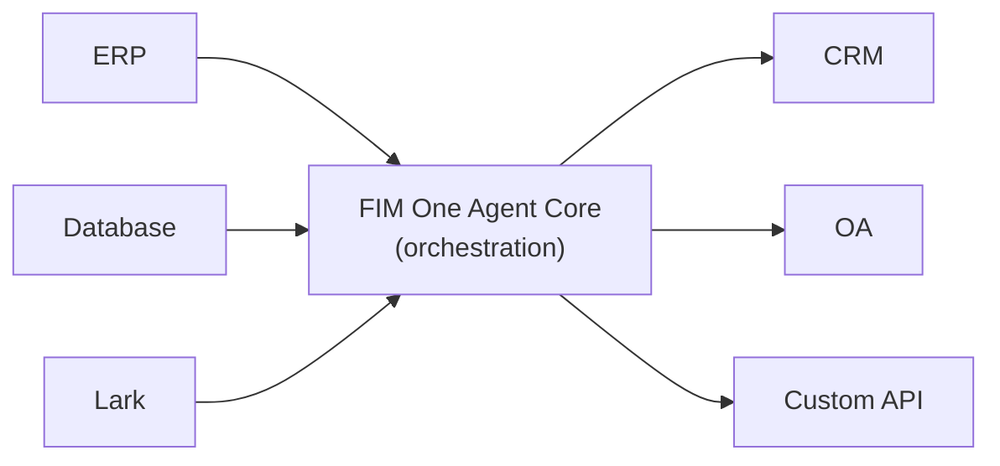

Bienvenue sur FIM One, un framework basé sur l’IA pour créer des agents capables de planifier et d’exécuter dynamiquement des tâches complexes sur l’ensemble de vos systèmes d’entreprise.

  <a href="https://one.fim.ai/">Site web</a> · <a href="https://github.com/fim-ai/fim-one">GitHub</a> · <a href="https://discord.gg/z64czxdC7z">Discord</a> · <a href="https://x.com/FIM_One">Twitter</a>

<Tip>
  **☁️ Essayez FIM One sur le Cloud — aucune configuration requise.**
  Une version gérée est disponible sur [**cloud.fim.ai**](https://cloud.fim.ai/) : pas de Docker, pas de clés API, connectez-vous simplement et commencez à connecter vos systèmes. _Accès anticipé — vos retours sont les bienvenus._
</Tip>

## Qu'est-ce que FIM One ?

FIM One est un framework Python agnostique des fournisseurs pour construire des agents IA qui fonctionnent avec vos systèmes existants. Contrairement aux générateurs de flux de travail qui vous demandent de répliquer la logique, FIM One relie vos systèmes de manière proactive — en lisant les bases de données, en appelant les API, en envoyant des notifications — tout cela via une interface IA unifiée.

L'idée centrale : **trois modes de livraison, un cœur d'agent unique**.

## Three Delivery Modes

| Mode | What it is | Delivery | Use Case |
|------|-----------|----------|----------|
| **Standalone** | General-purpose AI assistant — search, code, knowledge base | Portal | Chat, code execution, knowledge base Q&A |
| **Copilot** | AI embedded in a host system — works alongside users in their existing UI | API today; iframe / widget embed is planned | "Finance Copilot" in your ERP web UI |
| **Hub** | Central cross-system orchestration — all your systems connected | Portal / API | Agent queries ERP, checks OA, notifies via Lark |

## Un cœur d'agent unique, tous les systèmes

Le cœur de l'agent est le différenciateur — une couche d'orchestration centrale où le SaaS mondial, la pile d'entreprise chinoise et tout ce qui se trouve entre les deux rencontrent l'IA :

Chaque connecteur est un pont standardisé. L'agent ne sait pas et ne se soucie pas de savoir s'il communique avec SAP ou une base de données PostgreSQL personnalisée. Vos données restent dans vos systèmes ; FIM One fournit la couche IA qui orchestre l'ensemble.

## Commencer

Explorez les sections suivantes pour comprendre l'architecture de FIM One et le déployer :

- **[Démarrage rapide](/quickstart)** — Lancez FIM One en quelques minutes avec Docker ou le développement local
- **[Modes d'exécution](/concepts/execution-modes)** — Comprenez en profondeur les modes Standalone, Copilot et Hub
- **[Générateur IA](/concepts/ai-builder)** — Utilisez l'IA pour construire des connecteurs et des agents avec le langage naturel
- **[Architecture des connecteurs](/architecture/connector-architecture)** — Comment FIM One connecte les systèmes hérités via l'IA
- **[Philosophie](/architecture/philosophy)** — Pourquoi la planification dynamique est le juste équilibre entre les flux de travail rigides et les agents entièrement autonomes
