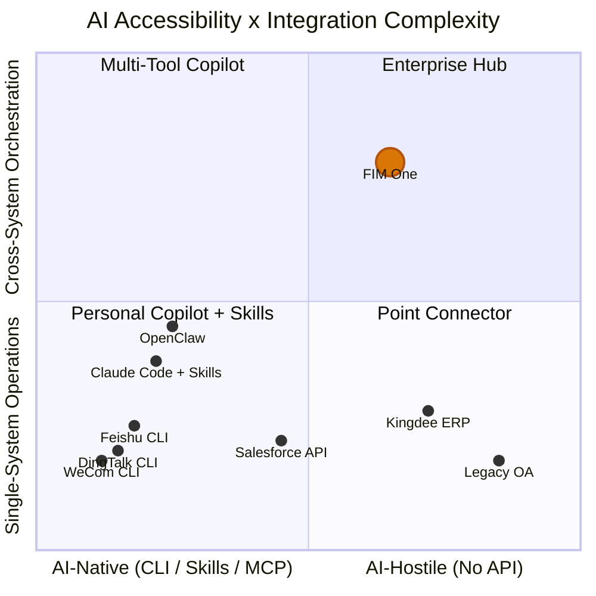

## Le Signal de Mars 2026

En mars 2026, trois grandes plateformes de travail chinoises ont ouvert le code source de leurs outils CLI au cours de la même semaine :

- **DingTalk** a publié `dws` — 104 outils répartis sur 12 domaines métier
- **Feishu/Lark** a publié `lark-cli` — 200+ commandes réparties sur 11 domaines
- **WeCom** a publié `wecom-cli` — couvrant 7 domaines métier

Aucun d'entre eux n'a choisi MCP. Les trois ont livré des outils CLI purs avec des Skills IA pré-packagés distribués via `npx skills add`. C'est la première fois que l'industrie a collectivement montré sa main sur la façon dont les agents IA devraient communiquer avec les systèmes d'entreprise — et la réponse n'était pas un protocole, mais un format de packaging.

Ce document analyse ce que cela signifie pour l'intégration IA-système en général, et pour la stratégie de FIM One spécifiquement.

## Trois paradigmes pour l'intégration système IA

### 1. REST API (Traditionnel)

La base de référence. Chaque plateforme SaaS expose des points de terminaison HTTP documentés avec des spécifications OpenAPI. L'intégration IA nécessite une couche adaptateur — quelque chose qui traduit entre « appeler ce point de terminaison API avec ces en-têtes et ce corps JSON » et « voici un outil que l'agent peut invoquer ».

C'est ce que le ConnectorToolAdapter de FIM One fait aujourd'hui. Cela fonctionne, mais chaque intégration nécessite un travail personnalisé : lire la documentation de l'API, gérer l'authentification, mapper les formats de réponse, gérer la pagination.

- **Qui l'utilise** : Chaque plateforme SaaS, intégrations héritées
- **Intégration IA** : Nécessite une couche adaptateur (ConnectorToolAdapter, code personnalisé)
- **Force** : Universel, bien compris, I/O JSON structuré
- **Faiblesse** : Chaque intégration nécessite un effort de développement personnalisé

### 2. CLI + Skills (Émergent)

La plateforme fournit un binaire CLI compilé. L'intégration IA se fait via des fichiers Skill pré-packagés — des documents markdown qui enseignent aux IDE IA comment invoquer les commandes CLI via subprocess. La distribution se fait via npm : `npx skills add dingtalk/dws`.

L'IA lit le fichier Skill, comprend quelles commandes sont disponibles et quels arguments elles prennent, puis invoque le CLI en tant que subprocess. La sortie est généralement du texte libre (tableaux, chaînes formatées) que l'IA doit analyser.

- **Qui l'utilise** : DingTalk, Feishu, WeCom (tous ont choisi cela en mars 2026)
- **Intégration IA** : `npx skills add platform/cli` — L'IDE IA lit le markdown Skill, invoque les commandes CLI
- **Point fort** : Rapide à déployer, fonctionne avec n'importe quel IDE IA supportant le format Skills
- **Point faible** : Sortie texte non structurée (l'IA doit analyser), pas de protocole de découverte standardisé, portée mono-plateforme

### 3. MCP (Model Context Protocol)

JSON-RPC sur stdio ou SSE. Découverte d'outils structurée (`tools/list`) et invocation (`tools/call`). Le client IA négocie les capacités avec le serveur, obtient un schéma typé pour chaque outil et reçoit des réponses `CallToolResult` structurées.

- **Qui l'utilise** : Écosystème Anthropic, nombre croissant d'outils de développement
- **Intégration IA** : Protocole natif — E/S structurée, découverte basée sur schéma
- **Force** : Standardisé, structuré, composable, conçu pour l'orchestration multi-outils
- **Faiblesse** : Coût d'implémentation plus élevé, pas encore adopté par les grandes plateformes de travail

### Comparaison

| Dimension | API REST | CLI + Skills | MCP |
|-----------|----------|-------------|-----|
| Standardisation | Moyen (OpenAPI) | Faible (Skills spécifiques au fournisseur) | Élevé (protocole JSON-RPC) |
| Convivialité pour l'IA | Faible (nécessite un adaptateur) | Moyen (E/S texte, analysé par l'IA) | Élevé (E/S JSON structuré) |
| Mécanisme de découverte | Spec OpenAPI / docs | `--help` + markdown Skill | Point de terminaison du protocole `tools/list` |
| Format de sortie | JSON structuré | Texte libre (nécessite une analyse par l'IA) | `CallToolResult` structuré |
| Temps de mise en œuvre | Semaines (par intégration) | Jours (encapsuler l'API existante) | Semaines (implémenter le protocole) |
| Orchestration multiplateforme | Nécessite un hub | Non intégré | Non intégré |
| Gouvernance d'entreprise | Nécessite un hub | Non intégré | Non intégré |

## Ce que les grandes plates-formes ont réellement choisi

| | DingTalk `dws` | Feishu `lark-cli` | WeCom `wecom-cli` |
|---|---|---|---|
| Langage | Go | Go + Python | Rust + TS |
| Outils | 104 / 12 domaines | 200+ / 11 domaines | 7 domaines |
| Support MCP | Non | Non | Non |
| Intégration IA | Markdown Skills + introspection de schéma | 19 Skills npm (`npx skills add`) | 12 Skills npm (`npx skills add`) |
| Formats de sortie | JSON / table / raw + `--jq` | JSON / table / csv / ndjson | JSON |
| Drapeaux compatibles avec les agents | `--yes`, `--dry-run`, correction intelligente des entrées | `--no-wait`, `--as user/bot`, `--dry-run` | Paramètres JSON directs |
| Découverte | `dws schema` (auto-introspection) | `lark-cli schema` (auto-introspection) | Via fichiers Skills uniquement |

Observation clé : `npx skills add` devient un canal de distribution de facto pour les intégrations d'outils IA, contournant entièrement MCP. Ces plates-formes ont choisi la rapidité de mise en marché plutôt que la normalisation des protocoles. L'écosystème des IDE IA (Cursor, Claude Code, Windsurf) comprend déjà les fichiers Skills, donc les plates-formes obtiennent une intégration IA immédiate sans avoir à implémenter un serveur de protocole.

## Le spectre d'accessibilité de l'IA

Tous les systèmes ne sont pas également faciles d'accès pour l'IA, et toutes les tâches ne sont pas également simples. Ces deux dimensions définissent où différentes approches d'intégration créent de la valeur.

**Lecture du graphique :**

- **Bas-gauche (Copilote personnel + Skills)** : Plateformes natives de l'IA avec des opérations simples. DingTalk, Feishu et WeCom se regroupent ici — ils livrent leur propre CLI + Skills, rendant l'intégration de l'IA sur une seule plateforme en libre-service. Les copilotes personnels comme OpenClaw et Claude Code with Skills occupent cette zone. FIM One ajoute peu de valeur ici — la plateforme a déjà fait le travail.
- **Haut-gauche (Copilote multi-outils)** : Plateformes natives de l'IA avec des besoins inter-systèmes. Un utilisateur installant plusieurs Skills (`dingtalk` + `feishu` + `wechat`) dans Claude Code peut tenter une coordination multi-plateforme, mais manque de gouvernance, de planification d'orchestration et de gestion unifiée des identifiants.
- **Bas-droit (Connecteur ponctuel)** : Systèmes hérités qui ont besoin d'un simple pont. Un seul Connecteur vers un ERP Kingdee ou un système OA hérité — FIM One est utile ici en tant qu'adaptateur, même pour des opérations sur un seul système, car ces systèmes n'ont pas de CLI et ont une API limitée ou inexistante.
- **Haut-droit (Hub d'entreprise)** : Systèmes hérités ou limités en API avec des exigences d'orchestration inter-systèmes. C'est le point fort de FIM One. Interroger des contrats dans un système de gestion hérité, les corréler avec les créances ERP et envoyer des avis de recouvrement via DingTalk — cela nécessite une planification DAG, une coordination multi-connecteurs, un coffre-fort d'identifiants, des pistes d'audit et des portes de confirmation humaine. Aucun copilote personnel, aucun CLI, aucun fichier Skills ne pourra jamais atteindre cela.

La valeur de FIM One augmente à mesure que vous vous déplacez vers le haut-droit : systèmes plus difficiles d'accès combinés à des besoins d'orchestration plus complexes. Les plateformes qui livrent leur propre CLI + Skills occupent le coin opposé — faciles d'accès, opérations simples — et représentent un marché que FIM One ne devrait pas poursuivre.

## Copilote personnel vs Hub d'entreprise

La prolifération des copilotes IA personnels (OpenClaw, Claude Code, Cursor, Windsurf) soulève une question de positionnement. Deux modèles fondamentalement différents existent :

### Copilote Personnel

- **Utilisateur** : Développeur individuel ou travailleur du savoir
- **Portée des données** : Mon calendrier, mes e-mails, mes documents
- **Authentification** : Mon token personnel, ma session OAuth
- **Portée de l'intégration** : Une seule personne, quelques plateformes, productivité personnelle
- **Gouvernance** : Aucune nécessaire — ce sont mes données, mes actions

### Plateforme d’intégration d’entreprise

- **Utilisateur** : Organisation (équipes, services, workflows transverses)
- **Périmètre des données** : Interservices et intersystèmes, incluant des données sensibles et réglementées
- **Authentification** : Autorisations attribuées par les administrateurs, principe du moindre privilège, stockage sécurisé des identifiants
- **Périmètre de l’intégration** : Orchestration multisystème, automatisation des processus métier
- **Gouvernance** : Journaux d’audit, RBAC, passerelles de confirmation, exigences de conformité

Ces solutions sont complémentaires, et non concurrentes. À mesure que les copilotes personnels se généralisent, les entreprises auront besoin d’un hub central pour gouverner les ressources auxquelles ces copilotes peuvent accéder. Une personne utilisant Claude Code avec `npx skills add dingtalk/dws` peut lire ses propres messages DingTalk. Mais lorsqu’un agent IA doit orchestrer des opérations entre DingTalk, l’ERP de l’entreprise et le système financier — avec des pistes d’audit, des contrôles d’autorisation et une confirmation humaine pour les opérations d’écriture — il s’agit d’un problème entièrement différent.

Les copilotes personnels banalisent les opérations simples sur une plateforme unique. Ce n’est pas le marché de FIM One. Le marché de FIM One est celui de l’intégration d’entreprise intersystèmes, nécessitant une gouvernance et intégrant les systèmes legacy, qu’aucun copilote personnel ne peut prendre en charge.

## Implications stratégiques pour FIM One

| Priorité | Action | Justification |
|----------|--------|-----------|
| Garder le cap | Continuer à investir dans la couche de gouvernance (identifiants, confirmation gates, audit) autour des accès à l’API, aux bases de données et à MCP | CLI + Skills n’atteindront jamais les systèmes existants, et les accès intersystèmes nécessitent une gouvernance |
| Adopter MCP | La prise en charge de MCP Server est déjà intégrée (MCPServerMetaTool) — continuons à la perfectionner | MCP est le protocole structuré sur lequel il faut miser ; certaines plateformes finiront par l’adopter |
| Surveiller Skills | Suivre l’écosystème `npx skills add`, sans chercher à le reproduire | Skills résout un problème de distribution que FIM One ne rencontre pas |
| Se différencier par la gouvernance | Audit, RBAC, confirmation gates, gestion des identifiants | Les copilotes personnels ne proposeront jamais une gouvernance d’entreprise |
| Se positionner clairement | « Plateforme d’agents tout-en-un pour les entreprises Global × China » — et non « une autre façon d’appeler DingTalk » | Éviter de se battre sur des intégrations simples que les plateformes offrent gratuitement |

La pire décision stratégique serait de réagir à la vague CLI + Skills en créant des adaptateurs Skills pour des plateformes qui fournissent déjà les leurs. Ce serait une course vers le bas face aux éditeurs de ces plateformes eux-mêmes. La bonne réponse consiste à rester concentré sur les systèmes que ces éditeurs n’atteindront jamais.

## La relation entre CLI, Skills et MCP

Ces trois concepts opèrent à des niveaux différents et sont souvent confondus dans les discussions. Voici une distinction précise :

- **CLI** est une interface utilisateur — des commandes shell, des entrées et sorties textuelles, un format d’interaction avec un système
- **Skills** est un mécanisme de distribution — des fichiers Markdown qui apprennent à l’IA à invoquer des commandes CLI, un format de packaging pour les intégrations d’outils d’IA
- **MCP** est un protocole — JSON-RPC, découverte et invocation structurées, une norme d’interopérabilité pour la communication entre l’IA et les outils

À long terme, ils ne se substituent pas les uns aux autres. Une CLI est le moyen par lequel un humain (ou un sous-processus d’IA) interagit avec un outil. Un fichier Skill est le moyen de distribuer cette CLI dans les IDE d’IA. MCP permet de mettre en œuvre une intégration structurée, typée par schéma et composable au niveau du protocole.

Cependant, à court terme (en 2026), CLI + Skills s’impose par sa vitesse d’adoption, car cette solution est moins coûteuse à implémenter que MCP. Une plateforme disposant déjà d’une CLI peut fournir un fichier Skills en une journée. La mise en œuvre d’un serveur MCP prend plusieurs semaines et nécessite de comprendre la spécification du protocole, les couches de transport et la négociation des capacités.

La convergence la plus probable est la suivante : les plateformes qui fournissent aujourd’hui des CLI pourront les encapsuler sous forme de serveurs MCP demain. Le transport stdio de MCP lance déjà des processus CLI — l’écart entre une « CLI invoquée par Skills » et une « CLI encapsulée sous forme de serveur MCP » est faible. Cette convergence n’est toutefois pas garantie. Si l’écosystème Skills se développe suffisamment rapidement et que les IDE d’IA l’adoptent comme standard, MCP pourrait rester un protocole destiné aux outils de développement plutôt que devenir une norme pour les outils d’entreprise.

Pour FIM One, la conclusion est claire : investissez dans la couche protocolaire (MCP) et la couche de gouvernance (identifiants, confirmation gates, audit), pas dans la couche de distribution (Skills). La distribution est un problème déjà résolu pour les fournisseurs de plateformes. C’est au niveau du protocole et de la gouvernance qu’un hub crée une valeur durable.
