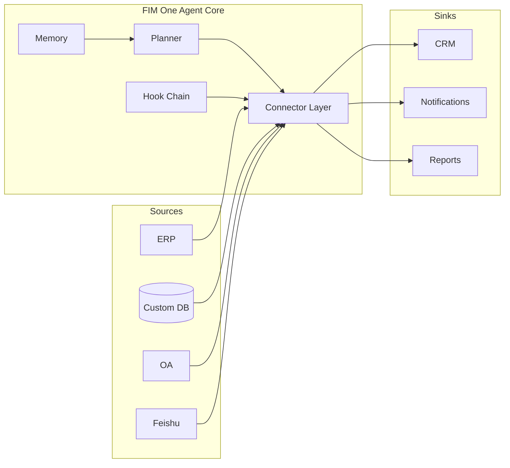

<Info>
  **Version 1.1 · avril 2026.** Ce livre blanc présente la vision architecturale, le positionnement de la catégorie et le modèle de déploiement de FIM One.
  Il s’adresse aux CTO, aux architectes d’entreprise, aux responsables de plateformes IA et aux investisseurs techniques qui évaluent comment intégrer l’IA aux systèmes qu’ils exploitent déjà.
</Info>

## Résumé exécutif

**Les données ne quittent jamais votre périmètre.** Cette seule phrase est la contrainte de conception de premier ordre derrière chaque décision dans FIM One, et c'est la raison pour laquelle une nouvelle couche d'infrastructure est nécessaire — pas un autre iPaaS, et pas un autre agent généraliste.

La plupart des entreprises disposent déjà des systèmes dont elles ont besoin — ERP, CRM, OA, bases de données personnalisées, API internes, SaaS sectoriels. Ce qui leur manque, c'est un moyen pour l'IA de **accéder** à ces systèmes sans migrer les données vers le cloud d'un fournisseur et sans un projet d'intégration de six mois pour chaque cas d'usage. Le marché est vaste, évolue rapidement et se repositionne déjà : les dépenses mondiales en infrastructure GenAI pour les entreprises devraient atteindre **18 milliards USD en 2025, avec une croissance de 3,2× en glissement annuel** (Menlo Ventures 2025). La Chine évolue encore plus vite — les dépenses en Agent IA pour les entreprises à **120% TCAC (2023–2027), atteignant ¥65,5 milliards d'ici 2027** (iResearch · CAICT 2025). Les entreprises centrales et détenues par l'État représentent **plus de 60% des achats de grands modèles**, et le déploiement privé Xinchuang (信创) est une contrainte incontournable.

Gartner a officiellement renommé cette catégorie « AI Agent Platform » (document 6300015, 2025) ; le rapport 2025 de CAICT sur la technologie Agentic AI l'appelle « 智能体平台 » ; MuleSoft, le leader historique de l'iPaaS, a été **rétrogradé de Leader à Challenger** dans le Magic Quadrant iPaaS 2025. La catégorie qui a dominé l'intégration d'entreprise pendant une décennie est remplacée en temps réel.

FIM One est conçu pour la nouvelle catégorie. C'est une **plateforme d'agent tout-en-un** pour les entreprises mondiales et chinoises — un framework Python agnostique vis-à-vis des fournisseurs où les agents IA planifient et exécutent dynamiquement des tâches dans vos systèmes existants, reliant les SaaS mondiaux et la pile chinoise via un cœur d'agent unique, déployé dans votre propre environnement, auditable de bout en bout. Un cœur d'agent, trois modes de livraison :

| Mode | Où il réside | Déploiement typique |
|---|---|---|
| **Standalone** | Un portail qui lui est propre | Q&A sur les connaissances, chat interne, bac à sable de code |
| **Copilot** | Intégré dans un système hôte | « Finance Copilot » dans une interface web ERP |
| **Hub** | Orchestrateur central inter-systèmes | L'agent interroge l'ERP, vérifie l'OA, notifie via Feishu |

Ce document explique pourquoi la catégorie évolue, pourquoi l'iPaaS ne peut pas absorber la nouvelle charge de travail, à quoi ressemble FIM One sous le capot, et comment le mettre en production.

## 1. Le problème : l'IA d'entreprise est un problème d'alignement

La conversation publique sur l'IA en 2025–2026 a été dominée par les capacités des modèles — contextes plus longs, meilleure capacité de raisonnement, tokens moins chers. Dans les entreprises, la capacité est rarement le goulot d'étranglement. Le goulot d'étranglement est que **l'IA n'a pas de mains à l'intérieur de vos systèmes**.

Un LLM de pointe qui peut lire une base de code de dix mille lignes et proposer une correction correcte ne peut pas, par lui-même :

- Extraire les chiffres d'inventaire d'hier d'une instance SAP sur site.
- Approuver une demande de congé dans un outil RH SaaS dont la seule surface d'intégration est une API SOAP héritée.
- Écrire une ligne dans un ERP conforme à Xinchuang dont l'authentification est un service de ticket de connexion au lieu d'OAuth2.
- Envoyer une notification dans un groupe Feishu, en respectant les règles d'approbation du groupe.

Chacun de ces éléments est un problème d'intégration résolu — une fois. La difficulté est que chaque entreprise dispose de dizaines de tels systèmes, chacun avec son propre modèle d'authentification, sa structure de données et ses modes de défaillance. Les coder en dur vous donne un monolithe fragile. Demander au LLM de les découvrir à l'exécution vous donne des appels API hallucinez.

**La primitive manquante est une surface alignée.** Une interface typée, authentifiée et découvrable entre le modèle et le système — une qui indique au modèle exactement ce qu'il peut faire, quel est le coût de chaque action, qui doit l'approuver et à quoi ressemblera le résultat. Cette primitive est ce que FIM One appelle un **Connector**.

## 2. Pourquoi les approches existantes sont insuffisantes

### 2.1 iPaaS et générateurs de flux de travail — Une catégorie en déclin

iPaaS (MuleSoft, Boomi, Workato) et la famille plus légère des flux de travail (n8n, Zapier, Dify, Coze) traitent l'intégration comme un problème de **conception** : un humain dessine un graphe de nœuds et les relie à granularité au niveau des champs, le graphe s'exécute de manière déterministe à l'exécution. Ce modèle fonctionnait quand les intégrations étaient peu nombreuses et stables.

Il ne fonctionne pas pour l'automatisation d'entreprise pilotée par l'IA, pour trois raisons qui s'aggravent mutuellement :

1. **La logique existe déjà dans le système cible.** Chaque nœud est un simple wrapper autour d'un appel API que vous devez maintenant gérer à deux endroits.
2. **L'humain doit connaître le plan à l'avance.** Les questions d'entreprise comme « clôturer le Q1 pour toutes les entités APAC » sont ouvertes — le plan doit être généré à l'exécution, pas dessiné par un concepteur.
3. **La cartographie au niveau des champs s'effondre à grande échelle.** Un graphe de mille nœuds sur une douzaine de systèmes est impossible à maintenir ; les surfaces d'action lisibles par l'IA la remplacent entièrement.

La catégorie est visiblement en mouvement. Gartner a reclassé l'espace en tant que « AI Agent Platform » en 2025 (document 6300015). CAICT a adopté le même cadre (« 智能体平台 ») dans son rapport 2025 Agentic AI Technology Report. Plus révélateur encore, **MuleSoft — le fournisseur iPaaS de référence pendant une décennie — a été rétrogradé de Leader à Challenger dans le Magic Quadrant iPaaS 2025 de Gartner**. En même temps, le protocole MCP d'Anthropic, lancé en novembre 2024, a atteint **10 000+ serveurs et 97 millions de téléchargements mensuels du SDK en 15 mois**. Le signal est sans équivoque : la couche d'intégration de l'automatisation d'entreprise est en train d'être reconstruite.

### 2.2 Agents polyvalents (Manus, AutoGPT, OpenAI Assistants)

Les agents polyvalents sont conçus pour les tâches de consommation et de travail intellectuel — navigation web, rédaction de documents, manipulation de feuilles de calcul. Ils ne peuvent pas accéder à votre VPN, s'authentifier auprès de votre ERP ou passer votre examen de sécurité. Intégrés autour de systèmes d'entreprise, ils deviennent des démonstrations qui disparaissent au stade pilote.

### 2.3 Vendor-Embedded AI (Feishu AI, SAP Joule, Salesforce Einstein)

Les fournisseurs ont intégré leur propre IA dans leurs propres produits. Le problème est structurel : **aucun fournisseur en amont n'a intérêt à briser son propre silo de données.** Feishu AI ne connaît pas vos données ERP ; DingTalk AI ne connaît pas l'état de vos contrats. L'IA de chaque fournisseur ne voit que ce que ce fournisseur vous a vendu. Pour les travaux multi-systèmes, ils ne sont pas viables.

### 2.4 Build-Your-Own and RPA

Les développements internes ont des délais longs et des coûts d'adaptation constants. L'RPA pilote l'interface utilisateur comme un humain — l'approche la plus générale et la plus fragile : chaque changement d'interface la casse, chaque invite d'authentification l'arrête. C'est un pansement sur des API manquantes, pas une fondation pour construire l'IA.

FIM One occupe l'espace que tous ces éléments laissent derrière : des API typées sur des systèmes réels, planifiées par le modèle, gouvernées par l'entreprise, déployées à l'intérieur des limites de l'entreprise.

## 3. La thèse de FIM One

Trois convictions façonnent chaque décision de conception.

**Conviction 1 — Les systèmes existent déjà.** Ne demandez pas à l'entreprise de tout reconstruire ; rencontrez-la où elle se trouve. Chaque connecteur est un pont, pas un remplacement. Les données ne quittent jamais la source de vérité, et elles ne quittent jamais les limites de l'entreprise.

**Conviction 2 — L'alignement surpasse la capacité.** Un modèle plus faible avec un ensemble d'outils alignés surpasse un modèle plus puissant qui tâtonne avec des API brutes. Le fossé concurrentiel, c'est la bibliothèque de connecteurs, son modèle d'authentification et la couche de gouvernance — pas le raisonnement brut de l'agent.

**Conviction 3 — La planification dynamique est le juste milieu.** Les workflows rigides (iPaaS, BPM) sont trop fragiles pour les vraies tâches d'entreprise ; les agents entièrement autonomes (AutoGPT, Manus) sont trop imprévisibles pour la production. FIM One planifie à l'exécution mais dans un espace d'action typé — chaque étape est un appel de connecteur, pas un monologue LLM sans limites. Autonomie bornée : `re-plan ≤ 3 | token budget | confirmation gate`.

### Au-delà d'iPaaS

FIM One n'est délibérément pas une iPaaS, et cette distinction n'est pas cosmétique. iPaaS fonctionne au niveau des champs, au moment de la conception, avec une modélisation humaine, et est hébergée dans le cloud du fournisseur. FIM One fonctionne au niveau des actions, à l'exécution, avec une planification par le modèle, et est hébergée en entreprise.

| Axe | iPaaS | FIM One |
|---|---|---|
| Granularité | Mappage de champs | Action typée |
| Moment de la planification | Moment de la conception | Exécution |
| Qui la modélise | Concepteur humain | Le modèle |
| Localisation des données | Cloud du fournisseur | Vos serveurs |
| Gouvernance | Complément externe | Hooks intégrés |
| Catégorie (Gartner 2025) | iPaaS MQ (en déclin) | Plateforme d'agents IA |

## 4. Architecture Principles

<CardGroup cols={2}>
  <Card title="Provider-Agnostic" icon="shuffle">
    Any OpenAI-compatible LLM — OpenAI, Anthropic, DeepSeek, Qwen, local Ollama, Xinchuang-certified models. Model choice is a deployment variable, not an architectural commitment.
  </Card>
  <Card title="Protocol-First" icon="network-wired">
    Every connector publishes a typed schema. The agent sees actions, parameters, and return types — never raw HTTP. OpenAPI, MCP, and direct database connections are first-class.
  </Card>
  <Card title="Three Execution Engines" icon="sitemap">
    **ReAct** for exploratory tasks, **DAG** for structured pipelines, **Workflow** (visual editor, 9 node types, an optional module) for deterministic human-designed pipelines. One agent core picks the engine per task.
  </Card>
  <Card title="Schema-First Tool Loading" icon="bolt">
    Tool schemas are pre-seeded at ~30 tokens each; the agent expands on demand. Per-session prompt overhead drops ~80%, and the platform scales to **10,000+ APIs** without blowing the context window.
  </Card>
  <Card title="Hook-Governed" icon="shield-halved">
    Every tool call passes through a configurable hook chain: audit, policy, human-in-the-loop approval. Hooks run outside the LLM loop — deterministic and auditable.
  </Card>
  <Card title="Memory-Aware" icon="brain">
    Short-term conversation, long-term knowledge base, and cross-session memory are first-class primitives, not bolt-ons.
  </Card>
</CardGroup>

## 5. Three Delivery Modes — One Agent Core

The same planner, memory, and connector library power three distinct product shapes. The choice is a deployment decision, not a code fork.

**Standalone** — a self-contained portal. The buyer wants a chat interface over a curated knowledge base, or a code sandbox, or a general assistant. No host system involved. Fits internal IT help desks, engineering productivity, customer-support KBs.

**Copilot** — the agent embedded inside an existing host system. Today the host UI calls the FIM One API; a drop-in iframe / widget embed, with the user's identity passed from the host, is planned. Fits Finance Copilot inside SAP Fiori, Sales Copilot inside Salesforce, DevOps Copilot inside an internal developer portal.

**Hub** — the central orchestration surface. Every connected system terminates here. Users ask cross-system questions; the agent plans and executes across systems. Fits "close out Q1 for all APAC entities", "find every customer who missed a renewal and draft outreach", "reconcile yesterday's payments between gateway and ledger".

## 6. Connector Alignment Model

A connector is a typed action surface backed by an auth strategy. FIM One defines three auth tiers that cover the vast majority of enterprise systems.

<AccordionGroup>
  <Accordion title="Tier 1 — Database Connectors">
    Direct connection to a relational database. The agent writes SQL against the introspected schema; a connector is read-only by default, stays private to its owner, and columns marked as personal data come back masked. Native support for **Xinchuang-compliant databases — Dameng (DM8), KingbaseES, HighGo** — alongside PostgreSQL and MySQL. Central/state-owned and regulated customers pass compliance procurement day-one.
  </Accordion>
  <Accordion title="Tier 2 — OpenAPI Connectors (User-Key)">
    Any REST API with an OpenAPI specification. The agent reads the spec, selects the endpoint, and calls it with the logged-in user's key. Covers modern SaaS (Slack, Linear, GitHub) and well-documented internal APIs.
  </Accordion>
  <Accordion title="Tier 3 — Login-Ticket / Legacy Connectors (planned)">
    For systems — particularly common in the Chinese market — that authenticate via a login-ticket service rather than OAuth2. The connector will manage the ticket lifecycle (acquire, refresh, invalidate) and present a normal typed surface upward. Not shipped yet: today API connectors authenticate with a bearer token, an API key, or basic auth.
  </Accordion>
</AccordionGroup>

Each connector also declares a **Channel/Integration duality**: the same underlying system can appear both as a *channel* (notification sink, approval surface) and as an *integration* (data source, action target). Feishu is both a notification channel and a group-chat data source; DingTalk and WeCom follow the same pattern.

## 7. Trustworthy Enterprise AI — Three Pillars

Enterprise AI fails in production not because the model is wrong but because the organization cannot prove it is right. FIM One treats trust as architecture, expressed in three pillars.

<CardGroup cols={3}>
  <Card title="Every Conclusion Is Cited" icon="paperclip">
    RAG retrieval + citation chain lets the agent reference a specific paragraph in a specific document for every claim. Conclusions are traceable and auditable. No black-box output.
  </Card>
  <Card title="Sensitive Actions Are Confirmed" icon="hand">
    Actions marked as requiring confirmation (or every tool call, when an agent is set to confirm all) pause before execution, waiting for a human approval — inline in the portal or out-of-band via a Feishu approval group. The hook chain is an architectural constraint, not a policy suggestion. It cannot be bypassed.
  </Card>
  <Card title="Every Release Is Measured" icon="chart-bar">
    Dataset-driven evaluation quantifies quality before each release. Every iteration is measurable; enterprise procurement gets evidence, not promises.
  </Card>
</CardGroup>

Supporting this, every agent run emits a structured trace: plan, tool calls, arguments, observations, approvals, final answer. Traces are the unit of audit. Credentials use Fernet encryption (AES-128-CBC + HMAC-SHA256). Full audit logs are stored and exportable.

When an operator rejects a tool call, the agent stops — it does not paraphrase and retry. Rejection is a policy decision, not an error to recover from.

## 8. Deployment and Business Model

FIM One ships with public source under the FIM One Source Available License (FIM-SAL) — source-available, not OSI-approved open source — with three deployment shapes and three edition tiers.

<CardGroup cols={3}>
  <Card title="Community" icon="code">
    Free forever. Self-hosted. For developers and evaluation teams.
  </Card>
  <Card title="Cloud" icon="cloud">
    FIM.AI-hosted on cloud.fim.ai. Per-user + per-connector subscription. Singapore entity handles overseas contracts.
  </Card>
  <Card title="Enterprise" icon="briefcase">
    Private deployment, custom pricing, compliance tooling, dedicated technical support. For large enterprises and government/state-owned customers.
  </Card>
</CardGroup>

The backend is ~106,000 lines of Python across 440+ modules, with 230+ test files and built-in support for 6 UI languages. Source is publicly available under FIM-SAL — enterprises can audit security themselves. The dominant runtime cost is LLM tokens, not infrastructure; provider-agnosticism means you benefit as the frontier pushes prices down, without migration.

## 9. Delivery Path

Production deployment follows a three-step path that keeps risk bounded and time-to-value short.

| Step | Timeline | What happens |
|---|---|---|
| **1. PoC** | 2 weeks | 1–2 representative scenarios (finance audit, contract review, data reporting), end-to-end on real data. First version in 7 days, validation report in 14. |
| **2. Pilot** | 1–2 months | Private deployment to your servers. First 3–5 connectors (ERP / OA / Feishu / DingTalk / database). One business line covered. Audit and approval baselines established. |
| **3. Scale** | 3–6 months | Expansion to more business lines and connectors. Industry Skill packs accumulated. Internal administrators trained. Operations runbook and SLA delivered. |

Eight pre-built Solution templates cover common scenarios: financial audit, contract review, data reporting, IT operations, HR onboarding, sales proposals, content creation, and meeting summaries.

## 10. Where This Goes

**Near-term — connector depth.** Tier-3 legacy connectors for the Chinese market, deeper Xinchuang certification, and an AI Builder that turns an OpenAPI spec or a database schema screenshot into a working connector in minutes.

**Near-term — governance depth.** Richer RBAC, four-tier connector permissions, independent IdP, SSO by default, SOC 2 and ISO 27001 posture.

**Mid-term — ecosystem.** Cloud SaaS, a Connector Marketplace, and industry Solution packs — the infrastructure layer that third parties build on top of.

The longer-term bet is that the shape of enterprise AI will look far more like a cross-system agent platform than a CLI. Knowledge workers will not install ten AI assistants; they will ask their company's agent platform, and the platform will know how to reach whatever system holds the answer — global SaaS, the China enterprise stack, or anything in between. FIM One is building that platform.

## 11. Appendice — Aller plus loin

- **[Aperçu du système](/architecture/system-overview)** — architecture au niveau des composants.
- **[Architecture des connecteurs](/architecture/connector-architecture)** — le contrat des connecteurs, le cycle de vie et le modèle d'extension.
- **[Philosophie de conception](/architecture/design-philosophy)** — pourquoi nous avons fait chaque compromis fondamental.
- **[Système de crochets](/architecture/hook-system)** — politique, approbation et audit en profondeur.
- **[Paysage concurrentiel](/strategy/competitive-landscape)** — positionnement de catégorie et comparaison directe.
- **[Démarrage rapide](/quickstart)** — exécutez FIM One sur votre ordinateur portable en moins de dix minutes.

<Tip>
  Questions, corrections ou demandes commerciales : hi@fim.ai · [Discord](https://discord.gg/z64czxdC7z) · [GitHub](https://github.com/fim-ai/fim-one)
</Tip>
