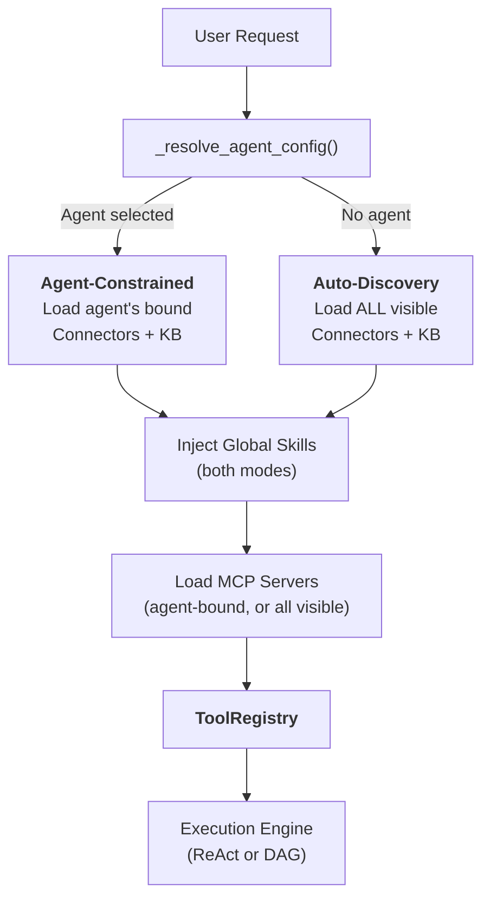
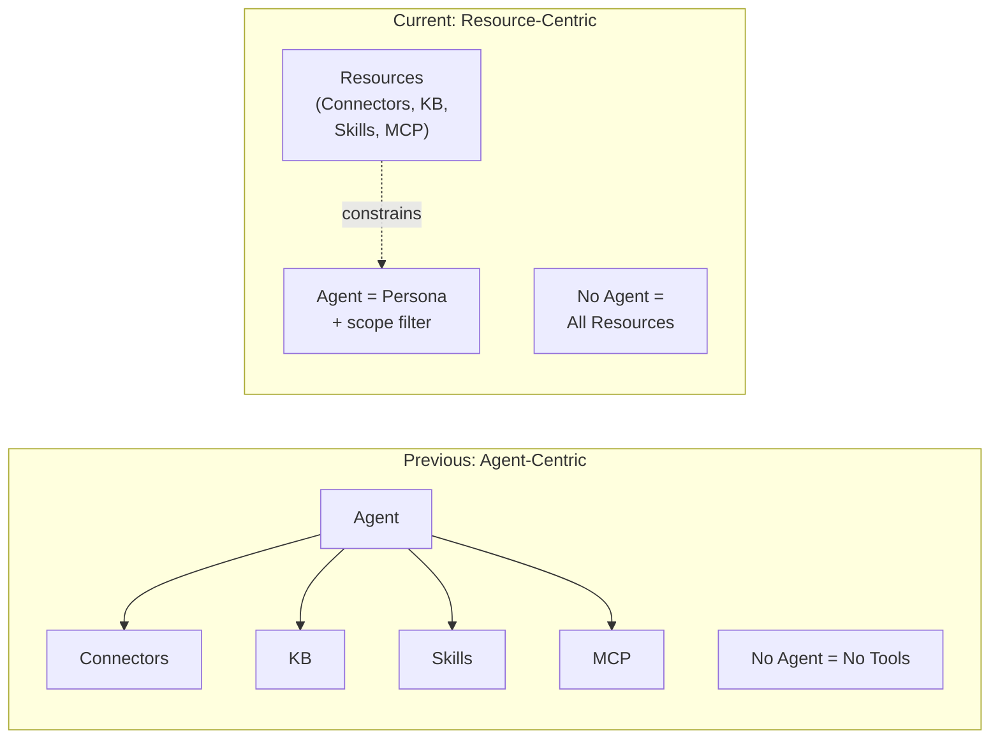
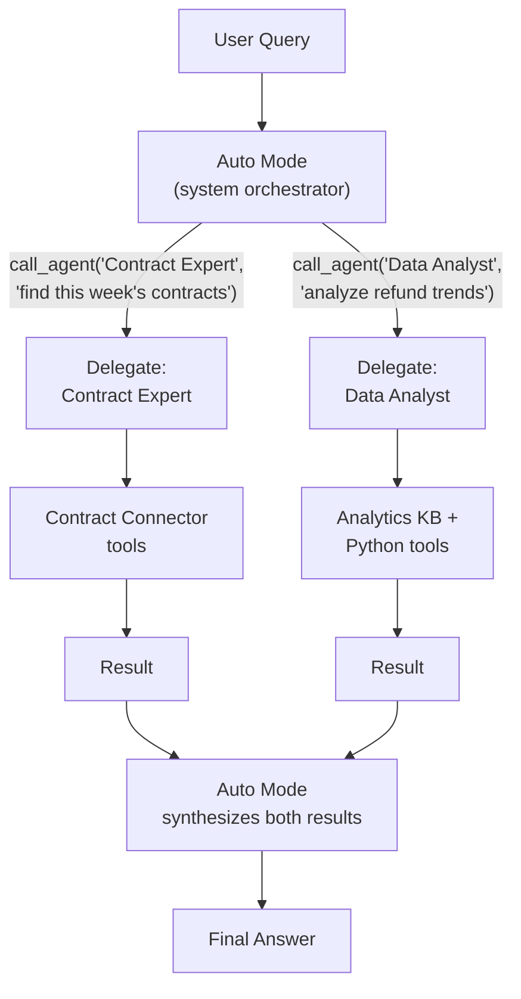
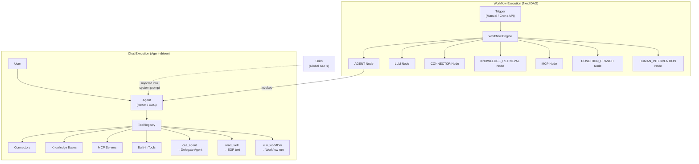

## The two modes

Every chat request in FIM One starts with a question: **is an Agent selected?** The answer determines how resources — Connectors, Knowledge Bases, Skills, and MCP servers — are discovered and assembled into the tool set the LLM can use.

**Agent-Constrained Mode** activates when the user picks a specific Agent. The system loads only the resources that Agent has been explicitly configured with:

- **Connectors**: only the Agent's bound `connector_ids` are loaded as tools.
- **Knowledge Bases**: only the Agent's bound `kb_ids` are injected as retrieval tools.
- **Skills**: globally available when the Skills module is enabled (it is off by default) — all active Skills visible to the user are injected, because Skills are organizational SOPs, not Agent-specific knowledge. (See [Skills as Global SOPs](#skills-as-global-sops) below.)
- **MCP Servers**: only the Agent's bound `mcp_server_ids` are loaded; an Agent with none bound gets no MCP tools.
- **Instructions**: the Agent's `instructions` field defines the persona and behavioral guidelines injected into the system prompt.

**Global Auto-Discovery Mode** activates when no Agent is selected (e.g., a new chat). The system auto-discovers everything accessible to the user:

- **Connectors**: all Connectors visible to the user (own + subscribed from an organization or the Market) are loaded.
- **Knowledge Bases**: the user's own KBs are available for retrieval via `kb_retrieve` (knowledge bases cannot be shared).
- **Skills**: all active Skills visible to the user are injected as SOP stubs.
- **MCP Servers**: all active servers visible to the user.
- **Instructions**: a generic assistant persona is used.

The branching happens inside `_resolve_tools()`, which is called on every chat request:



The practical effect: users can start chatting immediately without configuring an Agent. The system discovers available resources and exposes them as tools. Selecting an Agent narrows the scope — it does not unlock new capabilities, it focuses existing ones.

### What each mode discovers

The two modes differ in **scope**, not in kind. Both produce a `ToolRegistry` — they just fill it differently.

**Auto-Discovery Mode (no Agent selected):**

| Resource | Discovery | Tool Form |
|---|---|---|
| Connectors (API) | `resolve_visibility()` — all visible to user | `ConnectorMetaTool` (progressive) |
| Connectors (DB) | `resolve_visibility()` — all visible to user | `DatabaseMetaTool` (progressive) |
| Knowledge Bases | The user's own KBs | `kb_retrieve` |
| Skills | `resolve_visibility()` — all active | `read_skill` (progressive stubs) |
| MCP Servers | `resolve_visibility()` — all user-visible | `MCPServerMetaTool` (progressive) |
| Agents | `resolve_visibility()` — all active, non-builder | `call_agent` (delegation catalog) |
| Built-in Tools | `discover_builtin_tools()` — full set | No category filter applied |

**Agent-Constrained Mode (Agent selected):**

| Resource | Discovery | Tool Form |
|---|---|---|
| Connectors | Only `agent.connector_ids` | `ConnectorMetaTool` or legacy per-action |
| Knowledge Bases | Only `agent.kb_ids` | `GroundedRetrieveTool` / `KBRetrieveTool` |
| Skills | Global — **not constrained by Agent** | `read_skill` |
| MCP Servers | Only `agent.mcp_server_ids` | `MCPServerMetaTool` (progressive) |
| Agent Delegation | Not available — agents are specialized | _(disabled)_ |
| Built-in Tools | `agent.tool_categories` filter | Subset by category |

The key asymmetry: Connectors, Knowledge Bases and MCP Servers are scoped by the Agent, but Skills remain global in both modes. `CallAgentTool` (agent delegation) is only available in Auto-Discovery mode — it is **not** registered when a specific Agent is selected. This is a security measure: a marketplace agent could otherwise use `call_agent` to invoke other agents and access their private prompts. Skills are organizational rules (everyone follows the same SOPs), while Connectors and KBs are capability bindings (different agents connect to different systems).

## すべてはツールである

LLMレベルでは、すべてのリソースタイプは呼び出し可能なツールのフラットリストに収束します。LLMは、コネクタ、MCPサーバー、またはナレッジベースを呼び出しているかどうかについての構造的な認識を持ちません。`ToolRegistry`を見ます — 名前、説明、パラメータスキーマを持つ関数のセットです。

| リソースタイプ | LLMレベルでの変換 | ツール名パターン |
|---|---|---|
| Connector (プログレッシブ) | 単一のメタツール | `connector` |
| Connector (レガシー) | アクションごとにNツール | `{connector}__{action}` |
| Database Connector (プログレッシブ) | 単一のメタツール | `database` |
| Database Connector (レガシー) | データベースごとに3ツール | `{db}__list_tables`, `{db}__describe_table`, `{db}__query` |
| MCP Server (プログレッシブ) | 単一のメタツール | `mcp` |
| MCP Server (レガシー) | サーバーごとにNツール | `{server}__{tool}` |
| ナレッジベース | 検索ツール | `kb_retrieve` または `grounded_retrieve` |
| Skill (プログレッシブ) | 読み取りツール + システムプロンプトスタブ | `read_skill` |
| Skill (インライン) | システムプロンプトテキストのみ | _(ツールなし)_ |
| エージェント自体 | ツールとして表示されない | _(指示 + ツールアセンブリ)_ |

重要な洞察: **エージェントはツールではなく、ツールを使用するエンティティです。** エージェントはその指示をシステムプロンプトに寄与し、どのツールが利用可能かを決定します。しかし、LLMの観点からは、「エージェント」という概念は存在しません — システムプロンプトと呼び出し可能な関数のセットのみです。

この均一性がシステムを拡張可能にするものです。新しいリソースタイプを追加することは、`Tool`プロトコル（`name`、`description`、`parameters_schema`、`run()`）を実装することを意味します。実行エンジン、コンテキスト管理、およびLLM相互作用レイヤーは変わりません。

## スキルをグローバルSOPとして

スキルはエージェントの上位レイヤーに位置します。これらは組織のポリシーと手順であり、選択されたエージェントに関係なく、すべてのエージェントが従う必要があります。

### スキルがエージェントにバインドされない理由

「顧客苦情処理 SOP」のようなスキルは、顧客と対話するすべてのエージェントに適用されます。スキルをエージェントにバインドすると、双方向の所有権の問題が生じます。スキルがエージェントをオーケストレーションし、エージェントがスキルを所有する場合、誰が誰を制御するのでしょうか。

スキルはグローバル設計です。これらはエージェント固有の知識ではなく、会社のルールです。`_resolve_tools()` 関数は、エージェント選択に関係なく、ユーザーに表示されるすべてのアクティブなスキルを読み込みます。これは他のリソースに使用されるのと同じ `resolve_visibility()` フィルタを使用します。

### 2つのインジェクションモード

スキルは2つのインジェクションモードをサポートしています -- **progressive**（デフォルト）と**inline** -- これらは`SKILL_TOOL_MODE`またはエージェントの`model_config_json.skill_tool_mode`で制御されます。プログレッシブモードでは、コンパクトなスタブのみがシステムプロンプトに表示され、LLMは必要に応じて`read_skill(name)`を呼び出して完全なコンテンツを読み込みます。これはFIM Oneの広範な[Progressive Disclosure](/architecture/progressive-disclosure)アーキテクチャの一部であり、すべてのリソースタイプ全体でコンテキスト消費を最小化します。

## Agent as persona, not container

FIM One's architecture reflects a deliberate shift from an Agent-centric model to a Resource-centric model.

**Previous model:** the Agent was a container that gated access to all resources. No Agent selected meant no Connectors, no Skills, no specialized KB. The Agent was the mandatory entry point for any capability.

**Current model:** the Agent is a persona — a set of instructions and behavioral guidelines — combined with an optional resource constraint. Resources exist independently of Agents. Selecting an Agent narrows the scope; not selecting one opens it fully.



This means:

- **Users can start chatting immediately** without configuring an Agent.
- **The system auto-discovers available resources** and exposes them as tools.
- **Agents become lightweight personas** that can be created quickly — just write instructions and optionally bind specific Connectors and KBs.
- **Resource management is decoupled** from Agent management. Publishing a Connector to an organization makes it available to every member who subscribes to it — in auto-discovery mode, in Agent binding dropdowns, and in agent delegation resolution.

## エージェント委譲

FIM One は `CallAgentTool` を介して専門エージェントにタスクを委譲することをサポートしていますが、**自動モード**（エージェント未選択）でのみ可能です。ユーザーが特定のエージェントを選択すると、委譲は無効になり、そのエージェントは自身のツールのみに集中します。

### Two modes: Auto vs Agent-selected

| Aspect | Auto Mode (no agent selected) | Agent-Selected Mode |
|---|---|---|
| `call_agent` | Enabled — delegates to any visible agent | **Disabled** — not registered |
| Tool scope | All visible Connectors, KB, Skills, MCP | Only the Agent's bound resources + global Skills |
| Orchestration | System LLM dynamically picks the best agent per iteration | Agent uses its own tools directly |
| Use case | General queries, cross-domain tasks | Focused specialist tasks |

**Why delegation is disabled in Agent-selected mode:** Security. A marketplace agent could use `call_agent` to invoke other agents and read their private system prompts. By restricting delegation to Auto mode — where the system LLM (not any individual agent's prompt) controls the flow — private agent prompts are never exposed to untrusted agent configurations.

### オーケストレーションレイヤーとしてのオートモード

オートモードはUIの第一級の概念です。エージェントセレクターは「Auto」をデフォルトオプションとして表示します。オートモードがアクティブな場合、システムLLMはオーケストレーターとして機能します。つまり、表示されているすべてのエージェントの完全なカタログを確認し、各イテレーションで最適なスペシャリストにタスクを委譲できます。これにより、専用の「親エージェント」の必要性が排除されます。システム自体がオーケストレーターとなります。

### エージェント カタログ

実行時に、ユーザーに表示されるすべてのアクティブな非ビルダー エージェントがカタログに集約されます。各エージェントの名前と説明は `call_agent` ツールのパラメータ スキーマにリストされており、LLM が意味的に適切なスペシャリストを選択できます。ハードコードされたルーティングは不要です。

### Full tool inheritance

When a delegated agent is invoked via `call_agent(agent_id, task)`, it is assembled the way a chat with that agent is: a complete `ToolRegistry` built from its own configuration — its bound Connectors, Knowledge Bases and MCP servers (connected for the duration of the call) and its built-in tool categories — together with its own approval gate. Delegated agents are full execution units, not text-only advisors. An agent that has been switched off or is no longer visible to the user when it is called is reported as unavailable instead of being run.

### ワンレベルの委譲

無限再帰を防ぐため、委譲されたエージェントは `call_agent` ツールを受け取りません。委譲は常に1レベル深くなります：オートモードがスペシャリストを呼び出し、スペシャリストが実行して結果を返します。システムは複数の委譲されたエージェントからの結果を統合します。

### 並列実行

ネイティブ関数呼び出しモードでは、LLMは単一のターンで複数の`call_agent`呼び出しを実行できます。これらは`asyncio.gather`を介して同時に実行され、「3つのソースを同時に検索する」などのパターンを可能にします。



## Visibility model

All resource discovery — in both modes — is governed by a unified visibility model with two tiers:

| Tier | Description | Example |
|---|---|---|
| **Own** | Created by the user. Always visible. | A Connector you built for your team's API |
| **Subscribed** | Resources published to one of the user's organizations or to the Market that the user has subscribed to. Visible while the resource is still shared and approved. Org membership alone grants nothing. | A company-wide ERP Connector published by IT, or a community-built Slack Connector you installed |

The `resolve_visibility()` function in `web/visibility.py` builds a SQL filter that covers both tiers in a single query:

```python
conditions = [
    model.user_id == user_id,                    # own resources
    and_(model.id.in_(subscribed_ids),           # subscribed, and still shared
         model.visibility == "org",
         or_(model.publish_status.is_(None),
             model.publish_status == "approved")),
]
```

This same filter is used everywhere:

- Auto-discovering Connectors in no-agent mode
- Building the Agent catalog for `CallAgentTool`
- Loading visible Skills for system prompt injection
- MCP server resolution
- Agent configuration lookup (ensuring a user can only select Agents visible to them)

The uniformity means that **a Connector published to an organization becomes available to its subscribers** in auto-discovery mode, in Agent binding dropdowns, and in agent delegation resolution — no special wiring required. The visibility model is the single source of truth for "what can this user access."

## Relationship map

FIM One has two parallel execution paradigms — **Chat (Agent-driven)** and **Workflow (DAG-driven)** — that share the same underlying resources but orchestrate them differently.



Key takeaways from the diagram:

- **Agent and Workflow are parallel paradigms.** Both can use Connectors, Knowledge Bases, and MCP Servers — but through different mechanisms. Agents use them as tools in a `ToolRegistry`; Workflows use them as typed DAG nodes.
- **Workflow can orchestrate Agents** via the `AGENT` node — a Workflow step can invoke a full Agent with its own ReAct/DAG loop. The reverse also works: an Agent can run a Workflow through the `run_workflow` tool when the Workflows module is enabled, except workflows that contain a Human Intervention step.
- **Skills are injected into Agents only.** Skills are system prompt text — they guide Agent behavior. Workflows don't consume Skills because Workflow nodes execute deterministic logic, not LLM-guided reasoning.
- **Shared resources, different access patterns.** A Connector can be called by an Agent (via `ConnectorToolAdapter`), by a Workflow (via `CONNECTOR` node), or by both in the same business process — e.g., a Workflow triggers an Agent that queries the same Connector the Workflow also uses in a later step.

## Workflow Engine — the other execution paradigm

While this document focuses on Agent-driven chat execution, FIM One includes a full **Workflow Engine** — a visual DAG editor with 9 node types for fixed-process automation. It is an optional module, off by default.

| Aspect | Agent (Chat) | Workflow |
|---|---|---|
| Orchestration | LLM decides next step dynamically | Fixed DAG defined at design time |
| Best for | Exploratory tasks, conversations, flexible reasoning | Approval chains, scheduled ETL, multi-step automations |
| Can call | Connectors, KB, MCP, Built-in Tools, Delegated Agents, Skills, Workflows (`run_workflow`) | Agents, Connectors, KB, MCP, LLM, Human approval |
| Trigger | User message in chat | Manual, cron schedule, or API/webhook |
| Nesting | One-level delegation (Auto mode → delegated Agent) | No sub-workflow nesting |

The two paradigms are complementary. Use Agents when the task is open-ended ("analyze this quarter's sales data and recommend actions"). Use Workflows when the process is known ("every Monday, pull new invoices from ERP, run compliance checks, and route exceptions to a human reviewer"). A Workflow can invoke an Agent for any step that needs flexible reasoning within an otherwise fixed pipeline.

For details on Agent execution modes and Workflow node types, see [Execution Modes](/concepts/execution-modes).
