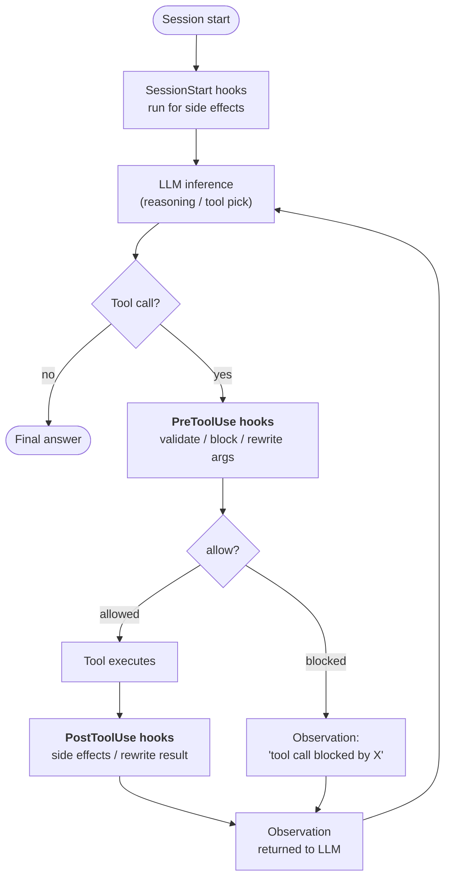
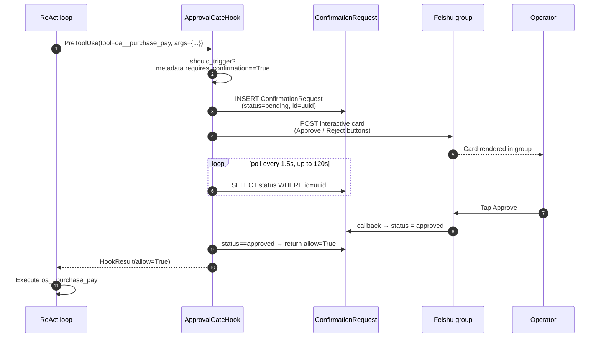

## フックが存在する理由

システムプロンプトの指示は**提案**です。十分に頑固または混乱したLLMはそれらを無視できます。ほとんどの智能体の動作では、それはまさにあなたが望むことです — 指示はモデルに適応する余地を与えます。

しかし、いくつかの要件は提案ではありません。「すべての機密ツール呼び出しはログに記録される必要があります」「書き込み操作は、組織が読み取り専用モードの場合はブロックされます」「¥50k以上の支払いは実行前に人間の確認が必要です」。これらは**不変条件** — モデルがどのターンで何を決定しようとも成立する必要があるシステムについての事実です。

フックは、智能体の実行ライフサイクルの明確に定義されたポイントで**LLMループの外で**実行されるコードです。LLMはフックを見ることができません。LLMはフックに異議を唱えることができません。LLMはフックにステップをスキップするよう説得することはできません。`PreToolUse`フックが`allow=False`を返した場合、ツール呼び出しは発生しません — 推理トレースがどれほど執拗であっても関係ありません。

これが重要なアーキテクチャ上の区別です：

| メカニズム | 実行場所 | 制御者 | 保証 |
|---|---|---|---|
| **システムプロンプト指示** | LLM推論内 | モデル | 「おそらく従う」 |
| **ツール説明 / スキーマ** | LLM推論内 | モデル | 「おそらく従う」 |
| **フック** | LLM推論の周囲 | プラットフォームコード | **常に実行される** |

フックは、FIM Oneが「智能体は...することになっている」を「智能体は...をバイパスできない」に変える方法です。

## Where hooks plug in

Three hook points are defined today. Each marks a boundary the agent crosses during one loop iteration:



| Hook point | Fires when | Can it block? | Can it mutate data? |
|---|---|---|---|
| `SessionStart` | Before the first LLM call of a session | No | No — runs for side effects only |
| `PreToolUse` | After the LLM picks a tool, before the tool runs | **Yes** (via `allow=False`) | Yes — can rewrite `tool_args` before execution |
| `PostToolUse` | After the tool returns, before the observation goes to the LLM | No | Yes — can rewrite the observation |

Multiple hooks at the same point run in priority order. An earlier `PreToolUse` hook's rewritten args are carried forward to later hooks, so middleware composes.

## フックと命令のどちらを使うか

要件をプロンプト命令またはフックで解決するかの判断は、「実行時アサーション対コードコメント」と同じ計算です：

| 症状 | ソリューション |
|---|---|
| 「智能体はYの場合、Xを優先すべき」 | 命令 — ソフトガイダンス、モデルに裁量がある |
| 「智能体はコネクタZへのすべての呼び出しをログに記録する必要がある」 | **PostToolUse フック** — モデルが記憶することに依存できない |
| 「¥50k以上の支払いには人間の承認が必要」 | **PreToolUse フック** — モデルに尋ねることに依存できない |
| 「智能体は中国語で自己紹介すべき」 | 命令 — スタイル的、見落とされても低コスト |
| 「智能体は読み取り専用モードで本番データベースに書き込むことはできない」 | **PreToolUse フック** — セキュリティ不変式、ゼロトレランス |
| 「智能体は長いDBクエリ結果を要約すべき」 | どちらでもよいが、フックはより堅牢 — PostToolUse truncateを参照 |

経験則：**間違った動作がインシデントの場合はフックを使用します。間違った動作が軽微な不便の場合は、命令で問題ありません。**

## The hook contract

A hook is a subclass of `PreToolUseHook` or `PostToolUseHook` (a session-start hook is registered as a plain `Hook` object) with one required method:

```python
class ReadOnlyGuard(PreToolUseHook):
    name = "readonly_guard"
    priority = 5                          # lower runs earlier

    def should_trigger(self, ctx: HookContext) -> bool:
        return ctx.tool_name.startswith("sql_")

    async def execute(self, ctx: HookContext) -> HookResult:
        if org_is_readonly(ctx.metadata["org_id"]):
            return HookResult(
                allow=False,
                error="Org is in read-only mode — write blocked.",
                side_effects=["readonly_guard: blocked sql write"],
            )
        return HookResult()               # default: allow=True, no mutation
```

The `HookContext` passed in carries `tool_name`, `tool_args`, `agent_id`, `user_id`, and a flexible `metadata` dict the engine populates with per-request facts (org id, tool call id, the connector action's `requires_confirmation` flag).

The `HookResult` returned controls the outcome:

- `allow: bool = True` — whether the tool call proceeds (ignored for `PostToolUse` / `SessionStart`)
- `error: str | None` — human-readable reason, surfaced to the LLM as the observation when blocked
- `modified_args: dict | None` — if set, replaces the tool args before execution
- `modified_result: str | None` — if set (PostToolUse), replaces the observation before it returns to the LLM
- `side_effects: list[str]` — notes on what the hook did, collected by the registry (not surfaced in the agent's trace today)

## Case study: `ApprovalGateHook`

The first hook shipped on top of this system is `ApprovalGateHook` (`fim_one.core.assembly.confirmation`; registry key `approval_gate`, formerly `feishu_gate` / `FeishuGateHook`) — a `PreToolUse` hook that turns any tool call needing confirmation (the action's `requires_confirmation` flag, or the agent's confirm-all setting) into a human approval. The hook builds a `ConfirmationSpec` and hands it to `ConfirmationService`, which records the request, delivers it as a card in the portal chat or as a Feishu card in the approval channel bound to the agent, according to the agent's confirmation mode (Auto / Inline only / Channel only), and waits for the decision; Auto uses the in-portal card when no channel is bound. In a chat with no agent the tool's own flag alone decides, and the person chatting approves inline. Who may decide is written on the request when it is created and read back by the portal and the channel callback alike.

This hook exercises the full lifecycle:



What this design is buying:

- **The tool call is genuinely suspended.** The agent's SSE stream pauses between "I will call `oa__purchase_pay`" and the observation. The user sees the agent waiting, which matches what is happening under the hood.
- **Approval survives a process restart.** The pending row is in the database, not in memory. If the backend restarts while a card is outstanding, the next poll picks up where it left off.
- **The decision is audited.** `ConfirmationRequest` keeps `payload`, `responded_at`, `responded_by_open_id`, and the final status — an auditable record of who approved what and when.
- **No LLM in the decision loop.** The model produces the tool call. Humans produce the verdict. The hook is the deterministic bridge.

The channel path depends on a [Feishu Channel](/configuration/channels/feishu) bound as the agent's approval channel. The service asks only whether the channel implements `ApprovalCarrier` (`send_approval`, `parse_decision`, `approval_target`), never which platform it is; the Feishu channel is the first implementation. The separation is deliberate: the service owns the approval state machine, the channel owns the IM platform mechanics. A Slack or WeCom channel that implements the carrier protocol would carry approvals without a change to the gate. A callback can decide only requests its own channel delivered.

## 候補となるフック（予定なし）

同じライフサイクルに適合するフックのパターンは4つあります。いずれも現在のロードマップには含まれておらず、導入先から要望があるまで保留されています。

| フック | タイミング | 目的 |
|---|---|---|
| `AuditLogHook` | PostToolUse | コネクターが呼び出されるたびに `ConnectorCallLog` を自動で記録します。現在は手動で行っていますが、フックにすることで記録漏れを防げます。 |
| `ReadOnlyGuard` | PreToolUse | 組織が読み取り専用モードのとき、書き込みをブロックします。 |
| `ResultTruncateHook` | PostToolUse | 大きすぎるツールの観測結果（8k文字超）を、LLMのコンテキストに渡す前に切り詰めます。 |
| `ConnectorRateLimitHook` | PreToolUse | LLMのレート制限とは独立して、コネクターごと・ユーザーごとの呼び出し頻度を制限します。 |

ユーザー定義のフックレイヤーも同様の理由で保留されています。これは、ツールイベントに一致したときに実行するシェルコマンドやPythonの呼び出し可能オブジェクトを宣言する、エージェントごとのYAML設定（`hooks: [...]`）です。この方式は、現代のエージェントフレームワーク（Claude Code、OpenDevin）で定着しているパターンに沿ったものです。フックベースの適用により、「常に実行しなければならない」ロジックをプロンプトから切り離せます。

## Hooks vs. Channels

The two abstractions solve orthogonal problems:

| Concept | What it models | Lifetime | Example |
|---|---|---|---|
| **Hook** | A point in the agent's execution where platform code runs | Per tool call | `ApprovalGateHook`, `AuditLogHook` |
| **Channel** | A pluggable adapter to an external messaging platform | Long-lived per org | `FeishuChannel`, planned `SlackChannel` |

Hooks consume Channels — a hook that needs to talk to the outside world (send a card, post an alert, escalate to a group) calls into the org's Channel. A channel without any hook using it is still useful (e.g. agents can proactively send notifications via a tool), but the approval-gate pattern specifically requires both halves to be in place.

Put differently: **Channels are the "where do I talk to humans" plumbing, Hooks are the "when do I have to talk to humans" policy**. Production human-in-the-loop workflows need both.

## Current state (v0.9.4)

Snapshot of what shipped and what is still ahead:

- ✅ `HookRegistry`, `HookContext`, `HookResult` primitives wired into both ReAct and DAG
- ✅ `PreToolUseHook` / `PostToolUseHook` abstract bases
- ✅ `ApprovalGateHook` and `ConfirmationService` — complete, including the `ConfirmationRequest` table, polling loop, timeout/expire, and callback-driven state flips; workflow approval steps and confirmations of connector actions in a workflow use the same service, and instead of polling they suspend the run and are told of the decision through `ConfirmationService.on_decided`
- ✅ Feishu channel callback endpoint that decodes `card.action.trigger` and updates the pending row
- ✅ Agent-level hook declarations: `agent.model_config_json.hooks.class_hooks` resolves to an instantiated `HookRegistry` on every ReAct/DAG session
- ✅ **Hooks fire on every execution surface**: the main chat path (Portal, API, DAG), delegated sub-agents (`CallAgentTool`), and Workflow `AGENT` nodes. Eval Center runs intentionally **bypass** hooks (automated evaluation must not block on human approval).

  A delegated agent does not inherit its caller's registry — it builds **its own** from its own `model_config_json`. Because the confirmation gate is auto-attached to every agent, rebuilding is a superset of inheriting: the delegate gets the gate *plus* whatever it declares for itself, and the gate resolves the delegate's `require_confirmation_for_all` rather than its caller's. Both surfaces fail **closed**: an agent whose hooks cannot be built is not run.
- ❌ `AuditLogHook`, `ReadOnlyGuard`, `ResultTruncateHook`, `ConnectorRateLimitHook` (not planned)
- ❌ User-defined YAML hook declarations (not planned)

The Hook System is a **load-bearing foundation** for production hardening. Its first user (`ApprovalGateHook`) is also a production feature in its own right, which is why the skeleton shipped early for the 2026-04-24 roadshow rather than waiting for the full hook catalog.
