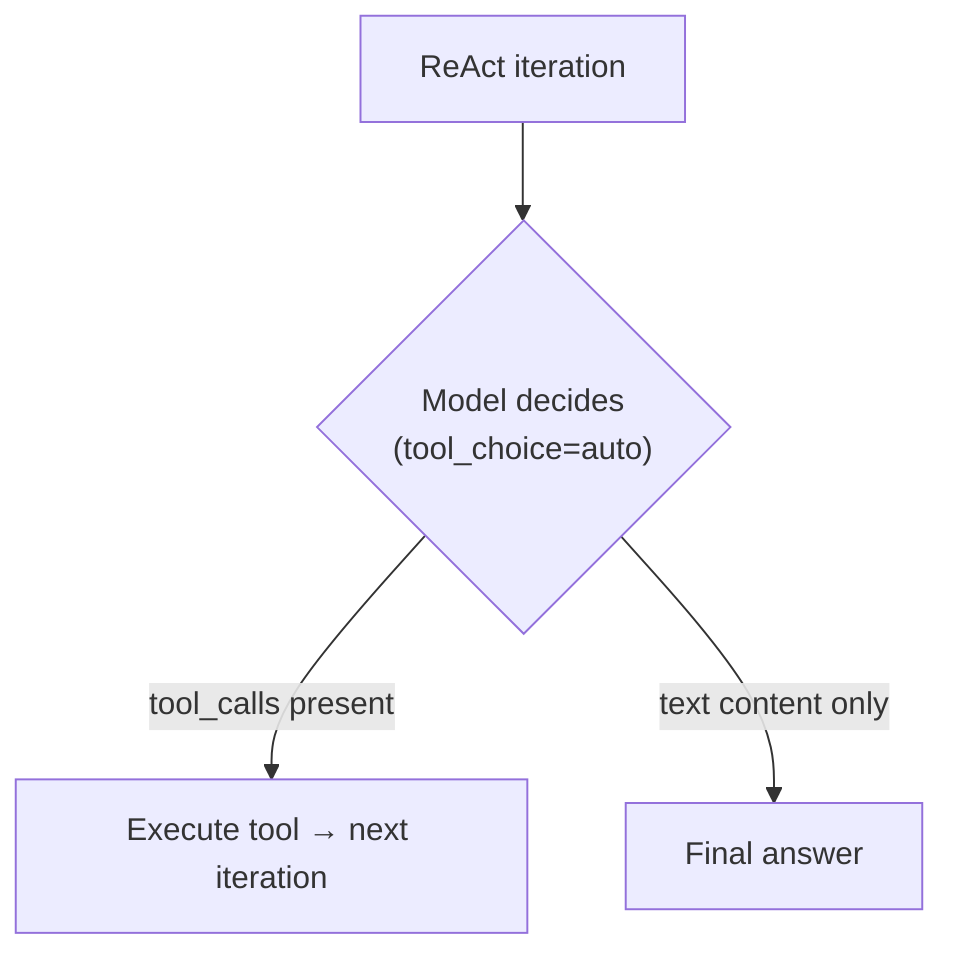
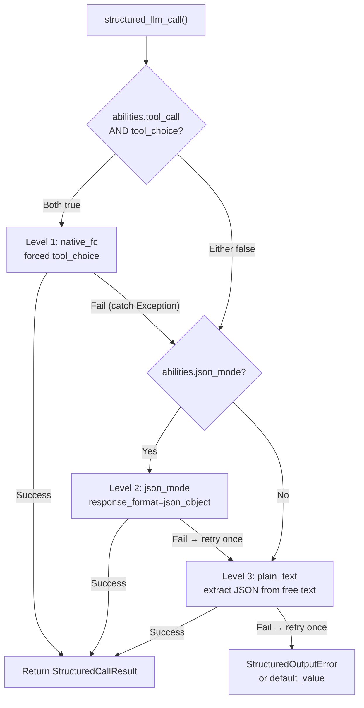

## Provider detection

FIM One uses LiteLLM as a universal adapter. The `_resolve_litellm_model()` function in `core/model/openai_compatible.py` maps the user's `LLM_BASE_URL` + `LLM_MODEL` to a LiteLLM model identifier with a provider prefix. The prefix determines how LiteLLM routes the request — native API protocol (Anthropic Messages API, Gemini, etc.) or generic OpenAI-compatible `/v1/chat/completions`.

Resolution order:

1. **Explicit provider** (from the `provider` field of a legacy `ModelConfig` row or an agent's inline model config; models added under Admin → Models have no provider field, so for them resolution starts at step 2) — highest priority. If the provider matches a known domain in the URL, no `api_base` is returned (LiteLLM routes natively). Otherwise, `api_base` is set to the relay URL.
2. **Domain match** against `KNOWN_DOMAINS` — official API endpoints are recognized by hostname.
3. **URL path hint** against `PATH_PROVIDER_HINTS` — common on relay platforms like UniAPI where `/claude` or `/anthropic` in the path indicates the upstream protocol.
4. **Fallback** — `openai/` prefix (generic OpenAI-compatible).

| Domain / Path | Provider prefix | Protocol |
|---|---|---|
| `api.openai.com` | `openai/` | OpenAI Chat Completions |
| `anthropic.com` | `anthropic/` | Anthropic Messages API |
| `generativelanguage.googleapis.com` | `gemini/` | Google Gemini |
| `api.deepseek.com` | `deepseek/` | DeepSeek (OpenAI-compatible) |
| `api.mistral.ai` | `mistral/` | Mistral |
| Path contains `/claude` or `/anthropic` | `anthropic/` | Anthropic Messages API (via relay) |
| Path contains `/gemini` | `gemini/` | Google Gemini (via relay) |
| Anything else | `openai/` | Generic OpenAI-compatible |

When the provider prefix is a native protocol (anthropic, gemini, etc.) and the URL is not the official endpoint, LiteLLM uses the native protocol but sends requests to the relay's `api_base`. This means provider-specific behaviors — including the Bedrock prefill issue described below — apply regardless of whether the request goes to the official API or through a relay.

<Warning>
If your relay URL contains `/claude` in the path, FIM One automatically routes via Anthropic's native protocol. This is usually correct (better streaming, thinking support), but means provider-specific behaviors apply — including the Bedrock prefill issue described below.
</Warning>

## tool_choice — 4つのモード

`tool_choice` パラメータは OpenAI 形式で標準化されています。LiteLLM はリクエストを送信する前に、各プロバイダーのネイティブプロトコルに変換します。

| モード | 意味 | プロバイダーサポート |
|---|---|---|
| `"auto"` | モデルがツール呼び出しまたはテキスト応答を決定 | すべてのプロバイダー |
| `"required"` | ツール呼び出しが必須だが、モデルが選択 | ほとんどのプロバイダー |
| `{"type":"function","function":{"name":"X"}}` | 関数 X の呼び出しが必須 | ほとんどのプロバイダー — **Anthropic thinking と互換性なし** |
| `"none"` | ツール使用不可、テキストのみ | すべてのプロバイダー |

`"auto"` と強制モード（`{"type":"function",...}`）の区別は、FIM One のあらゆる互換性問題の核心です。これら 2 つのモードは、異なる要件を持つまったく異なるサブシステムで使用されています。

## tool_choiceが使用される場所

2つのサブシステムが`tool_choice`を使用しており、それらは根本的に異なる方法でそれを使用しています。

### ReAct エンジン — tool_choice="auto"

ReAct ループでは、モデルが各イテレーションで以下を決定する必要があります: ツールを呼び出すか、最終的な回答を提供するか。ここで意味があるのは `"auto"` だけです — モデルは `tool_calls` を生成するか、テキスト コンテンツを生成するかを自由に選択します。これはすべてのプロバイダー、すべてのモデル、拡張思考を含むすべてのモードと互換性があります。



ReAct エンジンは、`abilities["tool_call"] = True` の場合にネイティブ関数呼び出し (`_run_native`) を使用し、それ以外の場合は JSON-in-content モード (`_run_json`) にフォールバックします。両方のモードで `"auto"` を使用します — 違いは、ツールが `tools` パラメータを介して渡されるか、システム プロンプトで説明されるかです。詳細は [ReAct エンジン — デュアルモード実行](/architecture/react-engine#dual-mode-execution) を参照してください。

### structured_llm_call — tool_choice=forced

One-shot の構造化抽出（スキーマアノテーション、DAG 計画、計画分析）。モデルに特定の仮想関数の呼び出しを強制し、構造化された JSON 出力を保証します。これはプロバイダー固有のエラーを引き起こす呼び出し箇所です。

`structured_llm_call` は、3 段階の縮退チェーンを実装します。3 つの段階はコードにちなんで命名されており、[以下のセクション](#structured-output-the-four-guarantee-tiers)で説明する 4 つの保証レベルとは番号が一致しません。



重要な設計上の違いは、`structured_llm_call` のフォールバックが **ランタイム** で行われる点です。各レベルを動的に試行し、例外を捕捉して次のレベルへ移行します。一方、ReAct エンジンのモード選択は **ビルド時** に行われます。開始時に `_native_mode_active` を一度確認し、ループ全体を通じて 1 つのモードを使用します。つまり、`structured_llm_call` はプロバイダー固有の 400 エラーから透過的に復旧できますが、ReAct はあらかじめモードが正しく選択されていることを前提とします。

## 構造化出力：4つの保証レベル

「構造化出力」は、4つの異なる仕組みを包括する表現です。いずれも JSON を生成しますが、同じ保証を提供するわけではありません。違いを分けるのは制約が存在する場所です。デコーダー内にある場合は、スキーマで禁止された token を出力できません。一方、prompt 内にある場合は、要求することしかできません。

| レベル | リクエストに含まれるもの | ペイロードの到着先 | 保証される内容 | 適用する仕組み |
|---|---|---|---|---|
| **T1 — ネイティブな function calling、`strict: true`** | 関数定義に `strict` を設定した `tools=[…]` | `tool_calls[0].function.arguments` 内の JSON 文字列 | スキーマレベル：すべての必須フィールドが存在し、未宣言のキーがなく、型と enum が正しい | デコーダーのステートマシン |
| **T2 — `response_format: {"type": "json_schema"}`** | `strict: true` を設定した、`response_format` 内のスキーマ自体 | `message.content` 内の JSON 文字列 | T1 と同じスキーマレベル。ただし、tool call ではなく assistant 自身の返信に対して適用 | デコーダーのステートマシン |
| **T3 — `response_format: {"type": "json_object"}`** | スキーマなしで、型のみ | `message.content` 内の JSON 文字列 | 構文上のみ：テキストが JSON として解析できること。どのキーが含まれるかは制約されない | デコーダー（構文） |
| **T4 — 自由形式のテキストと指示** | 何もなし。スキーマは prompt で説明する | `message.content`。説明文やコードフェンスで囲まれる場合がある | なし | prompt |

T1 と T2 の背後にある仕組みは、制約付きデコーディングです。プロバイダーはスキーマを文法にコンパイルし、各デコーディングステップで、その出力をスキーマに照らして解析不能にするすべての token をマスクします。必須フィールドを省略することはできません。そのフィールドが出力されるまで、オブジェクトを閉じる token は許可された集合に含まれないためです。これは「モデルに丁寧に頼んだら従った」という主張とは異なる種類のものです。そのため、prompt への従属性が期待できない temperature 1 や小規模モデルでも、T1/T2 は保証を維持できます。

### T1とT2は互換性がありません

両者は異なるチャネルを通じて同じ保証を提供しますが、そのチャネルの違いは3つの点で重要です。

**ターンの形状が異なります。** T1はツール呼び出しターンを返します。つまり、モデルは*実行する*ことを決定しています。T2は通常のアシスタントメッセージを返します。つまり、モデルはある形で*回答しています*。呼び出し元が必要としているのが1回の抽出であり、エージェントループではない場合、T2はモデルが「呼び出す」ための仮想関数を作り出すことなく、その意図を直接示します。

**T1の強制は、思考と衝突します。** T1からスキーマで制約されたペイロードを取得するには、通常、`required` または名前付き関数のいずれかによって選択を強制する必要があります。拡張思考が有効な場合、強制されたツール選択を拒否するプロバイダーがいくつかあります。どのプロバイダーが該当するかは、下記の表Bに記載されています。T2にはこのような競合がありません。T2はツールの制約ではなくレスポンスの制約であるため、思考を有効にした状態でも利用できる唯一のスキーマ制約付きパスです。推論モデルを標準とするデプロイメントにとって、これはスタイル上の選択ではなく、T2を選ぶ実務的な理由になります。

**T1では、T2にはないスキーマ連携のラウンドが必要です。** 仮想関数には、名前、説明、そしてモデルがその関数の呼び出しを拒否できるようにするかどうかの判断が必要です。

### T2 のコスト

制約付きデコーディングは無料ではなく、すでに用意しているスキーマが、そのまま受け入れられるスキーマであるとは限りません。

- **スキーマのサブセット。** OpenAI の strict mode では、すべてのオブジェクトに `additionalProperties: false` を指定し、すべてのプロパティを `required` に列挙する必要があります。オプショナル性は `required` から省略するのではなく、`null` とのユニオンとして表現します。ルートはオブジェクトでなければなりません。プロパティの総数とネストの深さには上限があります。手書きのスキーマの多くは、利用可能にする前に編集が必要です。
- **文法のコンパイル。** 新しいスキーマを含む最初のリクエストでは、プロバイダー側で一度だけコンパイルレイテンシが発生します。安定したスキーマを再利用すればそのコストを分散できますが、リクエストごとに新しいスキーマを生成すると分散できません。
- **新たな失敗パターン。** モデルが回答しない場合、スキーマに沿ったオブジェクトではなく拒否を返すため、呼び出し側でそのための分岐が必要になります。

### どのティアでも保証されないこと

すべてのティアは形式を制約しますが、真実性を制約するものはありません。T2 のレスポンスはスキーマに完全に準拠していても、事実としては誤っている可能性があります。また、列挙型で制約されたフィールドは、正しい値がどれも存在しない場合でも、許可された値のいずれかを返します。これは、デコーダーの役割が答えを知ることではなく、出力を文法の範囲内に収めることだからです。スキーマによるゲーティングによって、解析エラーやフィールド形式の不具合は解消されます。しかし、値の内容を確認する必要がなくなるわけではありません。

<Warning>
**2 つの番号体系があり、対応していません。** このページでは、上記の保証ティアに **T1–T4** を使用しています。一方、`structured_llm_call` の劣化チェーンにおける 3 つの段階には **Level 1/2/3** を使用しています。これらはコード内の名称（`native_fc`、`json_mode`、`plain_text`）にちなんだものです。FIM One の Level 2 は `json_object` であり、T2 ではなく **T3** です。このチェーンが 3 つの段階で構成されているのは、T2 を完全にスキップしているためであり、ティアが 3 つしかないためではありません。
</Warning>

### FIM Oneの位置付け

| `structured_llm_call` level | Tier | コードが実際に行うこと |
|---|---|---|
| Level 1 — `native_fc` | **`strict` なしの T1** | `_build_tool_def` は `name` / `description` / `parameters` だけを出力する。呼び出し箇所で `strict` を設定しているものはないため、`responses_adapter.py` の `convert_tools` ではデフォルトで `False` になる。スキーマは、生成すべき内容の説明としてモデルに渡されるのであって、生成可能な内容を制約するものではない |
| *(absent)* | **T2** | 未実装。`json_schema` はコードベースのどこにも登場せず、`abilities` にもモデルごとのサポートを表現できるフラグはない |
| Level 2 — `json_mode` | **T3** | `structured.py::_call_llm` と `react.py::_json_response_format` にハードコードされた `{"type": "json_object"}` |
| Level 3 — `plain_text` | **T4** | 自由形式のコンテンツに対する `extract_json()`。呼び出し箇所ごとに、オプションで正規表現のフォールバックを使用できる |

ここから、現在の設計における正直な制約として、5つの帰結が導かれます。

1. **チェーンには、スキーマによって制約されたフォールバック段階がない。** Level 1 が失敗した場合、次の段階は `json_object` であり、保証されるのはテキストをパースできることだけです。フィールドを引き続き強制する中間段階はありません。
2. **Level 1 の保証は、その名前から受ける印象よりも弱い。** `strict` なしのネイティブ function calling は、2024年以前の非 strict 形式です。モデルは通常スキーマに従いますが、必須フィールドの省略、存在しないキーの追加、数値として宣言された値の文字列での返却を防ぐことはできません。
3. **`anthropic/` ルートでは、Level 2 は実質的には T3 ではない。** Anthropic Messages API には `response_format` がないため、LiteLLM は assistant prefill を注入して JSON mode をエミュレートします。これはプロンプト層の仕組みなので、実効的な保証は T4 と T3 の間に位置し、T3 と同等ではありません。以下で説明する Bedrock の prefill trap は、このエミュレーションが明示的に失敗するケースです。より見えにくい問題は、パラメーター名が示唆するような保証が、そもそも存在していなかったことです。
4. **結果が後からスキーマに対して検証されることはない。** `jsonschema` は依存関係に含まれていません。行われる検証はすべてオプションの `parse_fn` 内、呼び出し箇所ごとのものであり、その厳密さは呼び出し箇所によって異なります。
5. **失敗は表面化せず、吸収される。** ほぼすべての呼び出し元が `default_value` を渡すため、チェーンを使い切っても例外を送出せず、一見もっともらしいオブジェクトを返します。`StructuredCallResult.level_used` にはどの段階で値が生成されたかが記録されますが、これを読み取る呼び出し箇所はありません。また、`default_value` の経路では、実際には何も生成されていないチェーンについても `plain_text` と報告されます。

**実際にどの段階にいるかを確認する方法。** `structured_llm_call` は、完了した各呼び出しについて `INFO` レベルで1行をログに記録します。このログはデータが `parse_fn` を通過した後にのみ出力されるため、実際に成功した段階が示されます。

```
structured_llm_call: fn=classify_mode level=native_fc attempt=first calls=1
structured_llm_call: fn=annotate_tables level=json_mode attempt=reformat_retry calls=3
```

完全な失敗は `WARNING` レベルで `level=none outcome=default_value` として記録されます。この2行を1日分のトラフィックに対して grep することだけが、デプロイ環境において T2 の欠落がコストを生んでいるかどうかを知る方法です。`default_value` の設計により、症状はエラーではなく、質の低い回答として現れるためです。

### 各ティアのプロバイダーサポート

<Note>
**この表が記載するのは、FIM One のコードパスではなくアップストリーム API です。** このページにある他の表では、すべて動作を実装する関数を示しています。この表でそれができないのは、FIM One がどのプロバイダーの T2 機能も使用せず、いずれにも `strict` を設定していないためです。ここでは、T2 を実装する判断を、実際に利用可能な機能に基づいて開始できるようにしています。ベンダーの機能は急速に変化しており、あるファミリー内でも一部のモデルに先行してサポートが追加されることがあります。行の内容を前提にする前に、ベンダーの公式ドキュメントを再確認してください。
</Note>

| プロバイダー | T1 `strict` | T2 `json_schema` | T3 `json_object` | 備考 |
|---|---|---|---|---|
| **OpenAI** | ✅ | ✅ | ✅ | 両方の strict ティアのリファレンス実装です。Strict function calling と `response_format: json_schema` は、同じ文法エンジンと同じスキーマサブセットを共有します。`json_object` は互換性のために維持されている旧来の JSON モードです |
| **Anthropic** | ⚠️ | ⚠️ | ❌ | Messages API に `response_format` はまったくありません。tool の `input_schema` は検証されますが、デコーダーによる強制は行われません。Strict tool use とスキーマ制約付き出力フォーマットは、最近の Claude モデルでベータヘッダー経由により利用できます。FIM One は LiteLLM 経由で Anthropic にアクセスしますが、LiteLLM は prefill によって JSON モードをエミュレートし、ベータ機能は使用しません。そのため、ここではこれらの機能はどれも有効ではありません |
| **Gemini** | ✅ | ✅ | ✅ | `responseSchema`（OpenAPI 3.0 のサブセット）と後発の `responseJsonSchema` はデコーダーによって強制されます。また、OpenAI 互換エンドポイントでは `response_format: json_schema` を受け付けます。強制呼び出しには、`allowed_function_names` を指定した `ANY` を使用します |
| **xAI (Grok)** | ✅ | ✅ | ✅ | strict structured outputs を含む OpenAI 互換のサーフェスです |
| **Mistral** | ✅ | ✅ | ✅ | ユーザーが指定した JSON Schema を受け付けるカスタム structured outputs を提供します |
| **DeepSeek** | ❌ | ❌ | ✅ | JSON 出力は `json_object` のみです。ドキュメント上の要件は、プロンプトに "json" という単語を含め、例を示すことです。これは T3 パラメーターに付加された T4 の仕組みです。さらに `deepseek-reasoner` は強制された tool choice を拒否するため、そのスキーマでゲートされたパスは両端で閉じられています |
| **Qwen** (DashScope) | ⚠️ | ⚠️ | ✅ | 互換性エンドポイントでは `json_object` を利用できます。スキーマ制約付きデコーディングは、API ではなくサービングスタックを通じてセルフホスト Qwen で安定して動作します。DashScope 自体の `json_schema` サポートはモデル世代によって異なります。モデルごとに確認してください |
| **GLM** (Zhipu / Z.AI) | ❌ | ⚠️ | ✅ | OpenAI 互換エンドポイントで `json_object` を利用できます。強制された tool choice は完全にサポートされていないため、Table B では `tool_choice_enabled=false` を推奨設定としています。プラットフォームが使用するモデルについて明示的にドキュメント化していない限り、`json_schema` は利用できないものとして扱ってください |
| **Kimi** (Moonshot) | ⚠️ | ⚠️ | ✅ | `json_object` がドキュメント化されています。Thinking バリアントでは `auto` tool choice のみを受け付けるため、`strict` のサポートにかかわらず、これらのモデルでは T1 パスを強制できません |
| **MiniMax** | ⚠️ | ⚠️ | ✅ | thinking が常に有効な場合でも、強制された choice による Function calling が動作します。そのため、常時 thinking を行うモデルの中では、最も利用しやすい T1 の経路です。スキーマレベルの強制はドキュメント化されていないため、T1 は non-strict と想定してください |
| **Doubao** (Volcengine Ark) | ⚠️ | ⚠️ | ✅ | Ark は Doubao の製品ラインの一部について structured output をドキュメント化しています。対応状況はモデルごとに異なるため、アカウントで使用するモデルに機能があると想定する前に確認してください |
| **Ollama / vLLM / llama.cpp** | ✅ | ✅ | ✅ | この一覧の中で最も強力なティアサポートを提供しますが、最も宣伝されていないものでもあります。文法制約付きデコーディング（GBNF、XGrammar、Outlines）はローカルで実行されるため、上記のホスト型 API のいくつかでは提供できない保証を、セルフホストの 14B モデルに与えることができます。サーバーに応じて、Ollama の `format`、vLLM の guided decoding パラメーター、または OpenAI 互換の `response_format` として公開されます |

単に表を言い換えるのではなく、その構成を説明する重要なパターンが 3 つあります。

**T3 は普遍的ですが、T2 はそうではありません。** FIM One がサポートするすべてのプロバイダーが `json_object` を提供していますが、スキーマティアを提供するプロバイダーはおよそ半数です。したがって、移植可能な structured-output パスは T3 以下を基盤に構築する必要があります。これが FIM One のチェーンが現在の形になっている理由です。T2 を追加するには、グローバルスイッチではなく、モデルごとの機能フラグを追加する必要があります。

**常時有効な thinking は、T1 の扉を閉ざす傾向があります。** GLM、Kimi の thinking モデル、`deepseek-reasoner` はいずれも強制された tool choice を制限または拒否し、Anthropic も thinking が有効な間はそれを拒否します。MiniMax はその反例です。扉が閉じている場合、残されたスキーマでゲートされた選択肢は T2 だけです。そのため、OpenAI のデプロイメントよりも中国系モデルのデプロイメントで、欠けている段がより重要になります。

**セルフホストでは、通常の順序が逆転します。** 制約付きデコーディングはサービングスタックの特性であるため、命令追従能力が最先端モデルよりはるかに弱いローカルチェックポイントでも利用できます。スキーマによるゲーティングを最も必要とするモデルこそ、それを最も容易に得られるモデルなのです。

## Bedrock プリフィル トラップ

`response_format={"type":"json_object"}` が `anthropic/` プレフィックスで解決されたモデルに渡される場合、LiteLLM は内部的にアシスタント プリフィル メッセージを挿入して JSON モードをシミュレートします。Anthropic Messages API には ネイティブな `response_format` パラメータがないため、LiteLLM は開き括弧をアシスタント コンテンツとして先頭に追加することで近似します：

```json
{"role": "assistant", "content": "{"}
```

これは Anthropic の直接 API では機能します。ただし、より新しい AWS Bedrock モデル バージョンは、最後のメッセージが `role: "assistant"` を持つ会話を拒否します。これを「アシスタント メッセージ プリフィル」と呼び、以下をスローします：

```
ValidationException: This model does not support assistant message prefill.
The conversation must end with a user message.
```

このエラーは、**以下の 3 つの条件がすべて同時に満たされる場合**にのみ発生します：

1. モデルが `anthropic/` プレフィックスで解決されている（ドメイン マッチまたは URL パス ヒント経由）。
2. `response_format={"type":"json_object"}` が渡されている（`structured_llm_call` の json_mode コード パス）。
3. 実際のバックエンドが AWS Bedrock である（プリフィルを拒否）。

<Tip>
**OpenAI 互換エンドポイント経由の Bedrock？** Bedrock リレーが OpenAI 互換 `/v1/chat/completions` エンドポイント（AWS 独自の OpenAI 互換ゲートウェイまたはサードパーティ プロキシ）を公開し、URL パスに `/claude` または `/anthropic` が含まれていない場合、FIM One は `openai/` プレフィックスで解決します。LiteLLM はバックエンドを標準 OpenAI 互換サーバーとして扱い、プリフィルを挿入せずに `response_format` を直接渡し、サーバーが JSON 制約をネイティブに処理します。**プリフィル トラップは適用されません** — `json_mode_enabled=false` を設定する必要はありません。
</Tip>

<Warning>
これはネイティブ ツール呼び出し（`tool_choice="auto"` と `tools=` パラメータ）には影響しません。プリフィル挿入は `response_format` に対してのみ発生します。ReAct エージェント実行は完全に影響を受けません。
</Warning>

Level 1（native_fc）と Level 2（json_mode）の両方が Bedrock で失敗した場合、システムは Level 3（plain_text）で復旧します。以下で説明する `json_mode_enabled` フラグは、無駄な Level 2 呼び出しを排除します。

### 修正: json_mode_enabled

モデルごとの `json_mode_enabled` フラグは、レベル 2（json_mode）を試行するかどうかを制御します。

- **DB で構成されたモデル**: Admin → Models → Advanced settings で切り替えます。このフラグは `ModelProviderModel.json_mode_enabled` に保存されます（デフォルトは `TRUE`）。
- **ENV で構成されたモデル**: 環境変数に `LLM_JSON_MODE_ENABLED=false` を設定します。
- **効果**: 無効にすると、`abilities["json_mode"]` は `False` を返すため、`response_format` が渡されることはなく、prefill も行われません。その結果、Bedrock が動作します。フォールバックチェーンは `native_fc → plain_text` となり、失敗する json_mode 呼び出しを完全にスキップします。
- **スキップによるコスト**: システムプロンプトが JSON を要求し、最新のモデルでは `extract_json()` が自由形式のコンテンツを確実に解析できるため、実際にはモデルは引き続き有効な JSON を返します。失われるのは出力そのものではなく保証です。チェーンは T4 で終了し、結果を制約するのはプロンプトだけになります。`anthropic/` ルートでは、この損失は見た目ほど大きくありません。エミュレートされた JSON モードも、デコーダーレベルでの保証ではなかったためです。

## 思考モデル + 強制 tool_choice

複数のプロバイダーは、拡張思考がアクティブな状態で強制 `tool_choice` を拒否します。特定の関数呼び出しをピン留めすることが、モデルが最初に推論する自由と矛盾するという理由からです：

```
tool_choice 'specified' is incompatible with thinking enabled
```

**これはプロバイダーごとのルールであり、思考モデルの法則ではありません。** Anthropic はこれをプロトコルレベルで強制し、Moonshot（Kimi）も同じように動作しますが、MiniMax はすべての呼び出しで思考し、それでも強制ツール選択を受け入れます。[プロバイダー機能マトリックス](#provider-capability-matrix)の表 B は、プロバイダーごとの判定を記録しています。1 つの行から一般化しないでください。

Anthropic モデルの場合、`structured_llm_call` はネイティブ FC レベルで `reasoning_effort=None` を渡すことで競合を自動的に解決し、その 1 つの呼び出しで思考をオフにします（`structured.py::_call_llm`）。構造化出力には**スキーマ準拠**が必要であり、深い推論は不要なため、ここで思考を無効にすることは正しく、かつより安価です。

API を通じて思考をオフにできない場合、native_fc はすべての構造化呼び出しで 400 で失敗し、チェーンが json_mode にフォールスルーする前に約 10 秒かかります。Kimi が一般的なケースです。思考がオンの場合、`auto` のみがサポートされ、強制ツール選択には思考をオフにする必要があります。Moonshot はこれをモデル ID を通じてのみ公開しています（`kimi-k2` はオフ、`kimi-k2.5` と `kimi-k2-thinking` はオン）。FIM One にはそれを切り替えるパラメータがないため、以下の `tool_choice_enabled` フラグが対策です。

### 修正: tool_choice_enabled

モデルごとの `tool_choice_enabled` フラグは、Level 1 (native_fc) が試行されるかどうかを制御します:

- **DB設定モデル**: Admin → Models → Advanced → "Native Function Calling" で切り替え。フラグは `ModelProviderModel.tool_choice_enabled` に保存されます (デフォルト `TRUE`)。
- **ENV設定モデル**: 環境で `LLM_TOOL_CHOICE_ENABLED=false` を設定。
- **効果**: 無効にすると、`abilities["tool_choice"]` は `False` を返す → 劣化チェーンは Level 2 (json_mode) または Level 3 (plain_text) から開始され、native_fc は完全にスキップされます。これにより、互換性のないモデルの構造化呼び出しあたり約10秒のペナルティが排除されます。
- **ReAct エージェントは影響を受けない**: `tool_choice_enabled` は `structured_llm_call` での強制ツール選択のみを制御します。ReAct エンジンは `tool_choice="auto"` (モデルが自由に決定) を使用し、この設定に関係なくすべてのモデルで動作します。

<Note>
`tool_choice_enabled` と `tool_call` は別の能力フラグです。`tool_call` (`OpenAICompatibleLLM` では常に `True`) は、ツールがモデルに渡されるかどうかを制御します — これを無効にすると ReAct エージェントが破損します。`tool_choice` は、構造化出力抽出のための**強制**ツール選択が試行されるかどうかのみを制御します。
</Note>

`tool_choice="auto"` は思考モードの影響を受けません。ReAct エンジンは `"auto"` のみを使用するため、思考が有効な場合でもエージェント実行は機能します。

<Warning>
この制約を回避するために `abilities["tool_call"] = False` を設定しないでください。これにより ReAct の `_run_native` モード (`tool_choice="auto"` を使用し、思考で正常に動作) が無効になり、信頼性の低い `_run_json` モードに強制されます。
</Warning>

<Note>
**プロバイダー移行に関する注記:** 一部のサードパーティリレーは `reasoning_effort` などのサポートされていないパラメータを静かにドロップします (`drop_params=True`)。そのため、設定されていても思考は決してアクティブ化されません。思考を適切にサポートするプロバイダー (Bedrock、直接 Anthropic API) に移行する場合、native_fc の `reasoning_effort=None` は一貫した動作を保証します。ユーザーアクションは不要です — 構造化出力はすべてのプロバイダーで同じように機能します。
</Note>

## プロバイダー機能マトリックス

このセクションは、各プロバイダーが何をサポートしており、FIM Oneがそれについて何をするかの信頼できる記録です。すべての行は動作を実装する関数に名前を付けているため、ここでの主張はコードに対して確認できます。他のページはデータを繰り返す代わりにここにリンクしています。コードが変わると、このセクションも変わります。

行は単一のモデルではなく、プロバイダーのプロトコルを説明しています。1つのファミリー内のモデルが異なる場合（DeepSeek chatと推論器、Kimiは思考をオンにするかオフにするか）、セルはそのことを示しています。

### Table A: Protocol routing

How a configured `base_url` plus `model` becomes a LiteLLM call, and what happens when the first choice of interface is unavailable.

| Provider | Detected by | LiteLLM prefix | Interface surface | Downgrade chain | Code anchor |
|---|---|---|---|---|---|
| **OpenAI** | Domain `api.openai.com`, or an explicit `provider` of `openai` on the model config | `openai/` | `completions`. GPT-5.x uses `responses-native` (`litellm.aresponses`), with `responses-bridge` (`openai/responses/<model>`) retained as a rollback | GPT-5.x talks Responses natively, falls back to `completions` on a 404 (cached per endpoint and model in `_RESPONSES_NATIVE_SUPPORT`) or on a 400 (not cached). `gpt-6.1-*` and `gpt-6-astra` keep a 400 on a request with tools instead of falling back, since their `completions` rejects tools. Every other model goes straight to `completions` | `_resolve_litellm_model`, `_should_use_native_responses`, `_dispatch_acompletion` |
| **Anthropic** (Bedrock note below) | Domain `anthropic.com`, path segment `/claude` or `/anthropic`, or an explicit `provider` of `anthropic` | `anthropic/` | `anthropic messages` | None. Native routes never enter the Responses bridge; their protocol is built in `_build_request_kwargs` | `_resolve_litellm_model`, `_dispatch_acompletion` |
| **Gemini** | Domain `generativelanguage.googleapis.com`, path segment `/gemini`, or an explicit `provider` of `gemini` | `gemini/` | `gemini` | None. A domain match also drops `api_base`, so an OpenAI-compat suffix such as `/v1beta/openai/` is ignored and the call goes to the native Gemini API | `_resolve_litellm_model` |
| **xAI (Grok)** | No domain or path entry. Resolves as generic OpenAI-compatible unless `provider` is set explicitly on the model config | `openai/` with `api_base`, or the explicit provider prefix | `completions` | None | `_resolve_litellm_model` |
| **DeepSeek** | Domain `api.deepseek.com` | `deepseek/` | `completions` | None | `_resolve_litellm_model` |
| **Qwen** (DashScope) | Generic fallback | `openai/` with `api_base` | `completions` | None | `_resolve_litellm_model` |
| **GLM** (Zhipu, Z.AI) | Generic fallback | `openai/` with `api_base` | `completions` | None | `_resolve_litellm_model` |
| **MiniMax** | Generic fallback | `openai/` with `api_base` | `completions` | None | `_resolve_litellm_model` |
| **Kimi** (Moonshot) | Generic fallback | `openai/` with `api_base` | `completions` | None | `_resolve_litellm_model` |
| **Doubao** (Volcengine) | Generic fallback | `openai/` with `api_base` | `completions` | None | `_resolve_litellm_model` |
| **Mistral** | Domain `api.mistral.ai` | `mistral/` | `completions` | None | `_resolve_litellm_model` |
| **Ollama / local** | Generic fallback, typically `http://localhost:11434/v1` | `openai/` with `api_base` | `completions` | None | `_resolve_litellm_model` |
| **Relay / proxy** | Path hint first, then the generic fallback. An explicit `provider` on the model config outranks both | The hinted provider prefix, else `openai/`, always with `api_base` pointing at the relay | Whatever the resolved prefix implies | None beyond the resolved prefix. See the relay gotchas below | `_resolve_litellm_model` |

**How GPT-5.x picks a protocol.** `FIM_GPT5_RESPONSES_MODE` selects it: `native` (the default) talks `/v1/responses` directly through `litellm.aresponses`, `bridge` uses LiteLLM's chat-completions translation, and `off` forces plain chat completions. The native path exists because the bridge is lossy in the one place that matters: it discards the reasoning items, so a GPT-5.x agent re-derives its chain of thought on every tool round. Talking the protocol directly lets those items be replayed. A call that explicitly passes `reasoning_effort=None`, which is what `structured_llm_call` and the finish-signal probes do, stays on chat completions, because a call that wants no thinking has no reasoning state to preserve. The exception is models that cannot switch reasoning off (`gpt-6.1-*`, `gpt-6-astra`): their chat completions reject function tools at any `reasoning_effort`, so those calls stay on `/v1/responses` and run at the lowest effort, `low`. For the same reason `off`, or an endpoint without `/v1/responses`, leaves these models without tool calls.

Two properties of that native request are load-bearing and easy to get wrong:

- `store=false` keeps the conversation stateless upstream, and `include=["reasoning.encrypted_content"]` asks for the encrypted payload to be returned. Without the include, the reasoning items arrive empty and replay silently becomes a no-op.
- A replayed reasoning item must have its server-side `id` stripped. With `store=false` nothing is persisted upstream, so echoing the id back earns `Item with id 'rs_...' not found. Items are not persisted when 'store' is set to false`. The `encrypted_content` blob carries the state on its own, so dropping the id costs nothing (`sanitize_reasoning_item`).

**User-supplied endpoints.** The table describes endpoints an operator configured (environment variables, Admin → Models). An endpoint that comes from a user, i.e. `base_url` in an agent's inline model settings, does not go through LiteLLM at all (`OpenAICompatibleLLM(untrusted_endpoint=True)`, `_call_pinned`). It must come with its own `api_key`: the platform's keys are never used for it, and an empty key is refused. It is called as OpenAI-compatible chat completions at the URL as typed, by the OpenAI SDK on a dedicated HTTP client that refuses private, loopback, link-local and metadata addresses when it connects and does not follow redirects. The model name is sent as a field of the request and selects no route, provider or protocol; there is no path hint, no `provider`, no Responses route. When such an endpoint fails, the error names the kind of failure and the HTTP status, not the response body. Models on internal networks, or that need a provider's native protocol, are added by an administrator under Admin → Models and selected by the agent.

**Bedrock.** Bedrock-hosted Claude follows the row it resolves to, not the fact that Bedrock is hosting it. Reached through an `anthropic/`-routed relay it inherits Anthropic protocol behaviour, including LiteLLM's json-mode assistant prefill, which newer Bedrock versions reject. Reached through an OpenAI-compatible gateway it resolves as `openai/`, no prefill is injected, and `json_mode_enabled` can stay on.

### Table B: 競合と回避策

FIM Oneは4つの`tool_choice`状態のうち3つを発行します：ReACtループからの`auto`（`react.py::_run_native`）、構造化出力からの名前付き関数（`structured.py::_call_llm`）、および終了シグナル応答がツールペイロードを再生するときの`none`。呼び出しサイトは`required`を発行しません。その列はプロバイダーの`auto`以外のツール選択に対する制約を記録しており、`required`と名前付き関数の両方に適用されます。

| プロバイダー | `auto` | `required` | 名前付き関数 | `none` | 思考有効時 | FIM Oneの回避策 | コードアンカー |
|---|---|---|---|---|---|---|---|
| **OpenAI** | ✅ | ✅ | ✅ | ✅ | チャット補完上のGPT-5.xは推論と組み合わせたツールを拒否 | GPT-5.xをResponsesで実行します。ここでは両方が許可されています。チャット補完フォールバックでは、ツールが存在するときは常に明示的な`reasoning_effort`を`none`に設定します | `_should_use_native_responses`、`_build_request_kwargs` |
| **Anthropic** | ✅ | ⚠️ | ⚠️ | ✅ | 思考がオフの間は受け入れられ、オンの間は400で拒否されます。`auto`はどちらの場合も影響を受けません | `structured_llm_call`はネイティブFC レベルで`reasoning_effort=None`を渡すため、その1つの呼び出しでは思考がオフになります。ReActは`auto`を保持し、思考を保持します | `structured.py::_call_llm` |
| **Gemini** | ✅ | ✅ | ✅ | ✅ | 競合なし | デフォルト：`tool_choice_enabled`と`json_mode_enabled`の両方がオン | `OpenAICompatibleLLM.abilities` |
| **xAI (Grok)** | ✅ | ✅ | ✅ | ✅ | 推論バリアントはツールを受け入れます | デフォルト、両方オン | `OpenAICompatibleLLM.abilities` |
| **DeepSeek** | ✅ | ⚠️ | ⚠️ | ✅ | `deepseek-chat`（V3.2、非思考）は強制ツール選択を受け入れます。`deepseek-reasoner`（V3.2思考モード）はこれを拒否します | `deepseek-reasoner`のみで`tool_choice_enabled=false`を設定します。`deepseek-chat`ではオンのままにします | `OpenAICompatibleLLM.abilities` |
| **Qwen** | ✅ | ✅ | ✅ | ✅ | `enable_thinking`はプロバイダー側のスイッチで、FIM Oneは送信しないため、思考はモデルのデフォルトに従います | デフォルト、両方オン | `_build_request_kwargs` |
| **GLM** | ✅ | ❌ | ❌ | ✅ | 強制ツール選択はモデルが思考するかどうかに関わらずサポートされていません | `tool_choice_enabled=false`を設定 | `OpenAICompatibleLLM.abilities` |
| **MiniMax** | ✅ | ✅ | ✅ | ✅ | 思考は常にオンで、強制ツール選択は引き続き機能します。これは「常にオンの思考は強制ツールを拒否する」ルールの反例です | デフォルト、両方オン。思考は`<think>`タグとして到着し、推論ストリームに再ルーティングされます | `_ThinkTagStreamParser` |
| **Kimi**（Moonshot） | ✅ | ⚠️ | ⚠️ | ✅ | 思考がオンの場合のみ`auto`がサポートされます。強制ツール選択には思考をオフにする必要があります。`kimi-k2`はオフ、`kimi-k2.5`と`kimi-k2-thinking`はオンです | APIパラメータはMoonshot思考をフリップしないため、思考モデルで`tool_choice_enabled=false`を設定します | `OpenAICompatibleLLM.abilities` |
| **Doubao** | ✅ | ✅ | ✅ | ✅ | ツールと共に`reasoning_effort`を受け入れます | デフォルト、両方オン | `_build_request_kwargs` |
| **Mistral** | ✅ | ✅ | ✅ | ✅ | 思考モードなし | デフォルト、両方オン | `OpenAICompatibleLLM.abilities` |
| **Ollama / ローカル** | ⚠️ 異なる | ⚠️ 異なる | ⚠️ 異なる | ⚠️ 異なる | チェックポイントに完全に依存 | 14Bパラメータは使用可能なツール呼び出しの最小値で、32Bが実用的なターゲットです。小さいモデルでは両方のフラグをオフにして、構造化出力がプレーンテキストに直接進むようにします | `OpenAICompatibleLLM.abilities` |
| **Relay / プロキシ** | アップストリームを継承 | アップストリームを継承 | アップストリームを継承 | アップストリームを継承 | アップストリームを継承し、サポートされていないパラメータは拒否されるのではなく削除されます（`litellm.drop_params=True`） | モデルごとのフラグ、およびリレー注意事項以下 | `_build_request_kwargs` |

### Table C: 思考プロトコル

`LLM_REASONING_EFFORT`は`low`、`medium`、`high`を受け入れます。その他の値は未設定として読み込まれます（`deps.py::_reasoning_effort`）。FIM Oneがワイヤに送信するのはプロバイダごとであり、このテーブルはそれを記録します。replayカラムは`reasoning_replay_policy`の戻り値で、プロバイダごとのリストではなく、4つの状態の小さなクローズドセットです。

| プロバイダ | 思考の有効化方法 | 受け入れられる`effort`値 | リプレイポリシー | 出力の場所 | コードアンカー |
|---|---|---|---|---|---|
| **OpenAI GPT-5.x** | Responses上の`{effort, summary: "auto"}`の`reasoning`、チャット補完上の`reasoning_effort` | 設定からの`low`、`medium`、`high`、チャット補完上にツールが存在する場合の強制`none` | `openai_responses`：不透明な推論アイテムはResponses上で逐語的にリプレイされ、読み取り可能なテキストはチャット補完上で`informational_only`と同じように削除されます | 暗号化されたアイテムと読み取り可能なサマリー、推論パネルにレンダリング。チャット補完は推論テキストを返しません | `_build_responses_kwargs`、`reasoning_replay_policy` |
| **OpenAI o-series** | 常に有効 | `reasoning_effort`は変更されずに渡されます | `informational_only`、`o1`、`o3`、`o4`フラグメントでマッチ | 内部。トークンは課金されますが返されません | `reasoning_replay_policy` |
| **Anthropic、適応型**（Opus 4.6 / 4.7 / 4.8、Sonnet 4.6、Fable 5、Mythos 5） | `adaptive`型の`thinking`と`output_config.effort` | `low`、`medium`、`high` | `anthropic_thinking`：ブロックとその`signature`は逐語的にリプレイされるか、APIがターンを拒否します | `reasoning_content`と`signature`、推論パネルにレンダリング | `_uses_adaptive_thinking`、`_extract_thinking_signature` |
| **Anthropic、レガシー**（4.5以前） | `LLM_REASONING_BUDGET_TOKENS`が設定されている場合は`budget_tokens`付きの`enabled`型の`thinking`、そうでない場合はLiteLLMに渡される`reasoning_effort` | `low`、`medium`、`high`、または1024の下限を持つ明示的なトークン予算 | `anthropic_thinking` | 適応型と同じ | `_build_request_kwargs` |
| **Gemini** | 互換性エンドポイント上の`reasoning_effort` | `low`、`medium`、`high` | `flash-thinking`フラグメントを含むIDの場合`informational_only`。その他のGemini IDは`unsupported`に解決され、フィールドを同じように削除します | 内部 | `reasoning_replay_policy` |
| **xAI（Grok）** | LiteLLMを通じた`reasoning_effort` | プロバイダ定義 | `informational_only`、汎用`reasoning`フラグメントが単語を含むIDと一致するため | 内部 | `reasoning_replay_policy` |
| **DeepSeek** | モデルID：V3.2思考モード用`deepseek-reasoner`、非思考用`deepseek-chat` | なし。努力パラメータはありません | `informational_only` | `reasoning_content`フィールド、推論パネルにレンダリング | `_parse_choice_message` |
| **Qwen** | `enable_thinking`、プロバイダ側。FIM Oneは送信しません | 該当なし | `qwq` IDの場合`informational_only`、その他の場合`unsupported` | コンテンツ内の`<think>`タグ、推論ストリームに再ルーティング | `_ThinkTagStreamParser` |
| **GLM** | `glm-5`に組み込まれています。APIトグルはありません | 該当なし | `unsupported` | 外部化されていません | `reasoning_replay_policy` |
| **MiniMax** | 常に有効。トグルなし | 該当なし | `unsupported` | コンテンツ内の`<think>`タグ、再ルーティング | `_ThinkTagStreamParser`、`_THINK_RE` |
| **Kimi**（Moonshot） | モデルID：`kimi-k2-thinking`、`kimi-k2.5`はデフォルトで思考 | 該当なし | `unsupported` | APIの推論フィールド、`reasoning_content`または`reasoning`として読み取り | `_parse_choice_message` |
| **Doubao** | `reasoning_effort` | プロバイダは`minimal`、`low`、`medium`、`high`を文書化しています。FIM Oneは中央の3つのみを発行します | `unsupported` | 内部 | `_build_request_kwargs` |
| **Mistral** | 思考モードなし | 該当なし | `unsupported` | 該当なし | `reasoning_replay_policy` |
| **Ollama / ローカル** | モデル依存 | 該当なし | `deepseek-r1`蒸留と`qwq`ビルドの場合`informational_only`、その他の場合`unsupported` | チェックポイントが発行する場所の`<think>`タグ | `_ThinkTagStreamParser` |
| **リレー / プロキシ** | アップストリームが受け入れるもの | アップストリームが受け入れるもの | 直接ルートと同じようにモデルIDから正確に解決 | アップストリームに依存します。汎用`openai/`リレーの背後にあるClaude適応型思考モデルは思考をまったく取得しません。コンストラクタは警告をログに記録します | `OpenAICompatibleLLM.__init__` |

`unsupported`と`informational_only`はワイヤ上で同じバイトを生成します。どちらも発信履歴から`reasoning_content`と`signature`を削除します。意図が異なるため、明らかに推論するがランディングが`unsupported`のモデルは、ライブバグではなくフラグメントテーブルのギャップです。

### Relay/proxy gotchas

Third-party gateways fail in ways a direct provider does not, and most of those failures are silent. Each row below pairs the symptom with its mechanism and with what FIM One already does about it.

<Note>
**Support boundary.** FIM One guarantees the behaviour documented on this page for first-party endpoints: OpenAI's own API, Anthropic, Google, and any vendor serving its own models directly. Third-party relays are supported on a best-effort basis and are not covered by that guarantee, because what a relay does to a request is outside our control and frequently outside its own documentation. A relay can drop a parameter, rewrite history, strip a cache breakpoint, or answer a protocol it only partially implements, and in most of those cases it returns a `200` rather than an error.

This is a statement about what we promise, not a restriction on what runs. FIM One does not maintain an allowlist of approved hosts, and nothing here is gated on a domain. Capability is decided by what an endpoint actually does: a missing route answers `404` and is remembered, an ignored `include` yields empty reasoning items and the replay becomes a no-op, and a rejected request falls back for that call. Probing the endpoint is more accurate than inferring its capabilities from its hostname, and it is the only approach that keeps working for Azure OpenAI, enterprise gateways, and self-hosted proxies that implement the protocol correctly.

If a relay misbehaves in a way the fallbacks do not catch, pin the protocol yourself with `FIM_GPT5_RESPONSES_MODE` (`bridge` or `off`) or the per-model `tool_choice_enabled` and `json_mode_enabled` toggles, and reproduce against the first-party endpoint before filing it as a FIM One bug.
</Note>

| Symptom | Mechanism | What FIM One does |
|---|---|---|
| Thinking is configured but never appears | The relay path has no `/claude` hint, so the model resolves as `openai/`. The Chat Completions schema has no thinking concept, so the parameter is dropped before the request leaves the process | Logs a warning at construction naming the model and the resolved prefix, and telling you to use an Anthropic base URL (a `/claude` or `/anthropic` path) (`OpenAICompatibleLLM.__init__`) |
| A parameter appears to be accepted and has no effect | `litellm.drop_params=True` removes anything the resolved provider does not declare, silently and per-parameter | Deliberate. It keeps one request builder working across every provider. The cost is that "no error" is not evidence the parameter arrived |
| First token takes minutes on a non-OpenAI model, or the agent returns text and makes no tool calls | The relay advertises `/v1/responses` for a model that is not OpenAI's, accepts the request, then buffers the whole answer before replaying it. Observed on Uniapi with Claude at roughly four minutes to first token, and in a second reproduction the call returned normally but the agent then made zero tool calls. Nothing errors, so an error-triggered fallback never fires | The bridge is benefit-gated to GPT-5.x, the one family that gains capability from Responses. Everything else goes straight to chat completions and never probes (`_dispatch_acompletion`, commit `137ede4c`) |
| `ValidationException: This model does not support assistant message prefill` | json_mode on an `anthropic/`-routed Bedrock relay. LiteLLM simulates `response_format` by prefilling an opening brace as an assistant message, and newer Bedrock versions reject a conversation ending in an assistant turn | Set `json_mode_enabled=false` for that model, or route through an OpenAI-compatible gateway where no prefill is injected |
| `404` on every call to a Zhipu endpoint | The client appends an OpenAI-style `/v1` to a base URL that already ends in `/v4` | Configure the base URL exactly as the provider documents it. FIM One passes `api_base` through unchanged |
| `APIConnectionError: Connection error` after a quiet period | An intermediary reaped an idle pooled connection without sending FIN or RST, and httpx handed back the half-dead socket on the next write | Keep-alive expiry defaults to 5 seconds so cross-turn idle connections are discarded rather than reused. Set `LLM_HTTP_MAX_KEEPALIVE=0` to disable reuse entirely (`_get_shared_http_client`) |
| `Cannot send a request, as the client has been closed` | LiteLLM evicted a cached SDK client on its idle TTL, and the OpenAI SDK closed the shared httpx session that client was holding | The pool is re-validated before every attempt and rebuilt when closed, and LiteLLM's stale client cache is flushed alongside it (`_get_shared_http_client`, `_flush_litellm_client_cache`) |
| Billed input tokens do not match the reported cache reads | The relay strips `cache_control` before forwarding, so you pay full price while the response still reports cache counters | `TurnProfiler` logs `read_tokens` and `create_tokens` per turn, which doubles as a relay honesty probe. Compare it against the invoice |
| `Function tools with reasoning_effort are not supported ... Please use /v1/responses instead` | The relay guards chat completions on the presence of the `reasoning_effort` field, not on its value, so the explicit `none` FIM One sends to disable reasoning trips the guard too. Observed on Uniapi with `gpt-5.6-luna` | Nothing, and nothing is needed while the Responses path is working: that model only reaches chat completions after a Responses request has already failed. Read it as a sign the relay wants Responses, not as a reason to set `FIM_GPT5_RESPONSES_MODE=off` |
| GPT-5.x stays on chat completions on an endpoint that does support Responses | A `404` was cached as a negative verdict for that endpoint and model | Only a `404` is cached, because a missing route is structural. A `400` falls back for that one call and is deliberately not cached, so a single stale reasoning item cannot blacklist the endpoint permanently (`_remember_native_failure`). The cache is per process, so a restart re-probes either way |
| Thinking blocks are rejected or the prefix cache never hits | The relay rewrites or reorders history, so the replayed `signature` no longer matches | Replay is decided centrally by `reasoning_replay_policy`, and only Anthropic-family ids replay at all. If a Claude model behind a relay carries an unrecognisable id, add its fragment to the policy table |

## モデルごとの推奨設定

`tool_choice_enabled`と`json_mode_enabled`は、Admin → Models → Advanced settingsでモデルごとにトグル切り替えできます。デフォルト値はどちらも`TRUE`で、ほとんどのプロバイダーに適切です。エラーやレイテンシーの無駄が見られる場合のみ調整してください。調整が必要なプロバイダーは上記の表Bに記載されており、オペレーターが入力するモデルごとのビューは[Model Management](/configuration/model-management#per-provider-configuration-matrix)にあります。

<Tip>
**変更するタイミング：** ログに`structured_llm_call: native_fc call raised`警告が表示され、その後json_mode抽出が成功する場合、そのモデルはネイティブ関数呼び出しの恩恵を受けていません。そのモデルの「Native Function Calling」を無効にして、無駄なAPI呼び出し（構造化出力リクエストあたり約10秒）を排除してください。
</Tip>

**ENV レベルのオーバーライド** は、環境変数経由で設定されたすべてのモデルに適用されます（Admin UIではなく）：

```bash
# Disable native_fc globally (for thinking-model-only deployments)
LLM_TOOL_CHOICE_ENABLED=false

# Disable json_mode globally (for Bedrock relay deployments)
LLM_JSON_MODE_ENABLED=false
```

## Reasoning effort and thinking configuration

FIM One exposes two env vars for controlling extended thinking / reasoning (the reasoning tier has its own pair, `REASONING_LLM_EFFORT` and `REASONING_LLM_BUDGET`, falling back to these). They apply to the ENV-configured General model and to the Reasoning slot; the Fast model never gets reasoning, and General and Fast models from an active Model Group run without it:

| Variable | Values | Effect |
|---|---|---|
| `LLM_REASONING_EFFORT` | `low`, `medium`, `high` | Turns thinking on. Anything outside this set is read as unset (`deps.py::_reasoning_effort`). How the level is translated, and which values the provider itself accepts, is per-provider: see Table C in the [Provider Capability Matrix](#provider-capability-matrix). |
| `LLM_REASONING_BUDGET_TOKENS` | integer (e.g. `10000`) | Anthropic legacy path only: sets an explicit `thinking.budget_tokens` cap on models that still take the `enabled` form, bypassing LiteLLM's auto-mapping. Adaptive-thinking models ignore it in favour of `output_config.effort`. |

Two behaviours follow automatically once thinking is on, and neither needs user configuration:

1. **Temperature is handled for you.** On an `anthropic/` route with thinking active, `_build_request_kwargs` sends `temperature` 1.0 for Claude 4.5 and older, which is what Bedrock demands, and removes `temperature` for adaptive-thinking models (4.6 and newer). Models that reject sampling parameters outright (Opus 4.7 and 4.8, Fable 5, Mythos 5) have `temperature` removed from the request entirely, thinking or not. Do not set `LLM_TEMPERATURE=1` by hand for this.
2. **GPT-5.x keeps tools and reasoning together where it can.** FIM One talks `/v1/responses` directly for GPT-5.x, because that is the only surface where the two combine. An endpoint with no `/v1/responses` route (404) falls back to chat completions and the verdict is cached per endpoint and model; a 400 falls back for that call only. On that path a request carrying `tools` sends an explicit `reasoning_effort` of `none`. Omitting the field is not equivalent, since the server default is not `none`.

## 構造化出力の防御的パース

native_fcが正しく動作している場合でも、構造化出力パイプラインには、任意のプロバイダーまたは互換性レイヤーからのエッジケースを処理するための防御的パース層が含まれています。

DAGプランナーの`_dict_to_steps`パーサーは、3つの一般的なエッジケースを処理します:

1. **配列の代わりに単一オブジェクト。** 一部のモデルは`{"steps": [{"id": "1", "task": "..."}]}`（配列）の代わりに`{"steps": {"id": "1", "task": "..."}}`（単一ステップオブジェクト）を返します。パーサーは`id`または`task`キーをチェックしてこれを検出し、オブジェクトをリストでラップします。

2. **ダブルエンコードされたJSON文字列。** 構造化出力がスキーマ強制を欠くjson_modeにフォールバックする場合、一部のプロバイダーは`steps`値をネイティブ配列ではなくJSON文字列として返します。例えば`{"steps": "[{\"id\": \"1\", ...}]"}`です。この文字列には、標準的な`json.loads`を破壊するモデルのフォーマットからのリテラル改行も含まれる場合があります。パーサーは`extract_json_value()`（`_repair_json_strings`を含む）を使用して以下を処理します:
   - JSON文字列値内のリテラル改行
   - 無効なエスケープシーケンス（LaTeXまたはコードコンテンツで一般的）
   - 互換性レイヤーからの他のシリアライゼーション特性

3. **`steps`ラッパーの欠落。** モデルは`steps`ラッパーキーなしでトップレベルオブジェクトとして単一ステップを返す場合があります。パーサーはルートレベルで`id`と`task`を検出し、それに応じてラップします。

<Note>
通常の動作では、native_fcは適切に構造化されたツール呼び出し引数を返し、これらのエッジケースは発生しません。防御的パーサーは、カスタム`BaseLLM`サブクラス、異常なプロバイダー動作、または構造化出力がjson_modeまたはplain_textに低下するフォールバックシナリオのための安全ネットとして存在します。
</Note>

## プロンプトキャッシング（クロスプロバイダー）

FIM One は Anthropic の明示的なプロンプトキャッシング（`cache_control` ブレークポイント経由）を実装し、同時に**プロンプトセクションレジストリ**を通じて他のすべてのプロバイダーの自動プレフィックスキャッシングの恩恵を受けます。目標は、呼び出しごとのプロンプト形状の相違なく、すべてのプロバイダーで機能する単一のプロンプト組立パスです。

### アーキテクチャ

`fim_one.core.prompt` モジュールは3つのプリミティブを公開しています：

- **`PromptSection`** — 静的な `content: str` または動的な `content: Callable` を持つ名前付きフラグメント
- **`PromptRegistry`** — メモ化されたストア（静的セクションは1回レンダリングされ、動的セクションはコール毎に再レンダリングされます）
- **`DYNAMIC_BOUNDARY`** — レジストリが最後の静的セクションと最初の動的セクションの間に挿入するセンチネルマーカー。呼び出し元がキャッシュ破断点でレンダリングされた提示词を分割できるようにします

ReAct のシステム提示词（JSON モード、ネイティブ関数呼び出しモード、合成）は以下に分割されます：

- **静的プレフィックス**（提示词の約95%）— アイデンティティ、コアガイドライン、ツール説明
- **動的サフィックス** — 現在の日時、リクエスト毎の言語指示、ハンドオフコンテキスト

### キャパビリティ検出

`fim_one.core.prompt.caching.is_cache_capable(model_id)` は、モデル ID に `claude`、`anthropic`、`bedrock/anthropic`、`vertex_ai/claude` のいずれかが含まれている場合に `True` を返します。これらのプロバイダーは、最初の（静的な）メッセージに `cache_control: {"type": "ephemeral"}` を付けた **2 つ** の `role="system"` メッセージを受け取ります。

その他すべてのプロバイダーは、`cache_control` フィールドなしの **単一の** 連結されたシステムメッセージを受け取ります。これは、Anthropic 以外のエンドポイントがこのフィールドを拒否するか暗黙的に削除するため、また一部のリレーを通じて送信すると `400 unknown parameter` エラーが発生するため、必要です。

### プロバイダー間の対応状況

| プロバイダー | 方式 | 読み取り時の割引率 | 対応方法 |
|---|---|---|---|
| **Anthropic Claude** (3, 3.5, 4) | 明示的な `cache_control` | 0.10× | 一時的なブレークポイントを設定した2つのシステムメッセージ |
| **AWS Bedrock Anthropic** | Anthropicのキャッシュをそのまま利用 | 0.10× | Anthropicと同じ |
| **GCP Vertex AI Claude** | Anthropicのキャッシュをそのまま利用 | 0.10× | Anthropicと同じ |
| **OpenAI GPT / o-series** | プレフィックスハッシュの自動生成（≥1024トークン） | 0.50× | Section Registryを通じてバイト単位で同一のプレフィックスを維持 → 自動的にキャッシュヒット |
| **DeepSeek (v3 / R1)** | ディスクベースのプレフィックスキャッシュを自動利用 | 0.10× | OpenAIと同じ |
| **Moonshot Kimi (K1/K2)** | プレフィックスキャッシュを自動利用 | 0.10×/0.50× | 同じ |
| **ZhipuAI GLM-4.5+** | 長いコンテキストのキャッシュを自動利用 | 0.20× | 同じ |
| **Grok (xAI)** | プレフィックスキャッシュを自動利用 | 0.25× | 同じ |
| **Google Gemini** | 独立した `createCachedContent` API | 0.25× | **未実装** — `GeminiCacheAdapter` は保留中で、実装予定はありません |
| **Mistral / Cohere** | ネイティブキャッシュなし | N/A | N/A |

`PromptRegistry` は、プレフィックスキャッシュを自動利用するすべてのプロバイダーで「そのまま」効果を発揮します。呼び出し間で静的な部分をバイト単位で同一に保つことで（現在日時はプレフィックスではなく動的なサフィックスに置かれます）、自動キャッシュを利用する各プロバイダーでハッシュが一致し、キャッシュヒットします。そのため、Anthropic固有の `cache_control` を考慮する前から、Registryはモデルに依存しない基盤的な利点となります。

### Observability

Every `chat/*` response's `done_payload` now includes:

```json
"cache": {
  "read_tokens": 1067,
  "creation_tokens": 0
}
```

`TurnProfiler` emits a structured log line per turn: `turn_cache conv=<id> turn=<n> model=claude-sonnet-4-6 read_tokens=1067 create_tokens=0 saved_input_tokens=961 (~90%)`. This also functions as a **relay honesty probe** — if you route through an API relay, compare actual billed input vs `read_tokens` to detect whether the relay strips `cache_control` or keeps the 0.10× discount.

No dollar estimate is returned at the LLM layer — pricing and relay markup are applied above, so the LLM layer only returns objective token counts.

### マルチターンキャッシュ ROI

Claude 4 ReAct ターンでデフォルトエージェント提示词で測定:

| モード | 静的プレフィックストークン | 動的サフィックストークン | キャッシュ比率 |
|---|---|---|---|
| JSON モード、ツールなし | ~753 | ~46 | 94.2% |
| JSON モード、~10 ツール付き | ~1067 | ~46 | 95.9% |
| ネイティブ関数呼び出し | ~523 | ~46 | 91.9% |

10 ツール付きの 10 イテレーション ReAct 実行は、最初のターン後、ターンあたり ~8,640 入力トークンを節約します (9 キャッシュヒット × 1067 トークン × 90%)。Anthropic は最初の呼び出しでキャッシュ書き込みに 1.25 倍の料金を請求するため、損益分岐点は**2 番目**の呼び出しです — シングルショットクエリは利益を得ません。

## 推論リプレイポリシー（モデルレス正確性）

拡張思考／推論ブロックはプロバイダー間で異なる動作をします。統一されたシリアライゼーションポリシーはプロトコルコントラクトと自動プレフィックスキャッシュの両方を破壊します。`fim_one.core.prompt.reasoning.reasoning_replay_policy(model_id)` は4つの値のいずれかを返し、`OpenAICompatibleLLM._build_request_kwargs()` 内の `ChatMessage.to_openai_dict(replay_policy=...)` をゲートします。

### Four policies

- **`anthropic_thinking`** — Claude family (including `anthropic/`, `bedrock/anthropic`, `vertex_ai/claude`). Thinking blocks MUST be replayed with `signature` attached; Anthropic rejects subsequent turns if the signature is missing or altered.
- **`informational_only`** — models that emit CoT but do NOT expect replay: DeepSeek reasoning mode (`deepseek-reasoner` on V3.2, and the older `deepseek-r1` and R1-Distill ids the fragment table still matches), Qwen QwQ, Gemini flash-thinking, OpenAI o1 / o3 / o4. Their documentation explicitly says "do not send `reasoning_content` back in message history". Sending it anyway:
  - Violates the provider contract (may start rejecting in future versions)
  - **Silently invalidates their automatic prefix cache** — message bytes mutate on every turn, breaking the hash
- **`openai_responses`** — GPT-5.x and later, matched on the `gpt-5` and `gpt-6` fragments. Its reasoning state is not text but a sequence of opaque items carrying encrypted payloads, and only `/v1/responses` has a slot for them. On that protocol the items are replayed verbatim, which is what keeps the model's chain of thought alive across tool rounds. The readable summary is still dropped from outgoing requests, so on the chat-completions fallback this behaves exactly like `informational_only`. Checked before the informational fragments, whose generic `reasoning` entry would otherwise swallow proxy-tagged GPT-5 ids.
- **`unsupported`** — the catch-all: models with no reasoning capability (GPT-4o, Gemini 1.5, Mistral, Llama), and reasoning models whose id matches no fragment (GLM, MiniMax, Kimi, Doubao). No field should be replayed either way, so this policy puts the same bytes on the wire as `informational_only`. It is also the safe default for unknown model ids.

The readable `reasoning_content` and the opaque `reasoning_items` are independent fields on `ChatMessage`. `to_openai_dict()` never serialises the items at all, so they are structurally incapable of leaking onto a chat-completions request, whatever the policy says.

### 実装

すべてのポリシー評価は1つの場所（`_build_request_kwargs`）で行われます。`ChatMessage.to_openai_dict(replay_policy=None)`はA3の寛容なデフォルトを保持するため、調整されていない呼び出し元は回帰しません。クロスプロバイダーテストマトリックスは`tests/test_reasoning_replay_policy.py`に存在し、**逆アサーション**によって非Anthropicリクエストが`reasoning_content`をリークしないことを証明しています。

### ユーザー向け

機能とバグの動作は自動的です — 何も設定する必要はありません。ワークフローへの影響：

- **同じ会話内でClaudeとDeepSeekの間でエージェントを切り替える場合**、履歴は思考ブロックをそのまま保存されます。次のターンで、送信メッセージの形状は現在のモデルに適応します。
- **プロキシ / カスタム `BaseLLM` サブクラスを使用する場合**、そのモデルIDが認識可能であることを確認してください（フラグメントの1つを含む）。そうでない場合、デフォルトの `unsupported` ポリシーが適用されます — これは安全ですが、異常なプロキシの背後にあるClaudeが思考リプレイを失う可能性があります。モデルIDフラグメントを `_CACHE_CAPABLE_MODEL_FRAGMENTS`（`core/prompt/caching.py` 内）および/または推理ポリシー検索に追加してください。

## Troubleshooting

**"This model does not support assistant message prefill"**
Bedrock + json_mode. Two fixes: (1) set `LLM_JSON_MODE_ENABLED=false` or disable JSON Mode in the admin model settings; or (2) if your Bedrock provider offers an OpenAI-compatible `/v1/chat/completions` endpoint, switch to that — FIM One resolves it as `openai/` and the prefill injection never occurs.

**"Thinking may not be enabled when tool_choice forces tool use"** / **"tool_choice 'specified' is incompatible with thinking enabled"**
For Anthropic models, `structured_llm_call` disables thinking for native_fc calls automatically. Where thinking cannot be turned off through the API, such as `kimi-k2.5` and `kimi-k2-thinking` or `deepseek-reasoner`, disable "Native Function Calling" in the model's Advanced settings, or set `LLM_TOOL_CHOICE_ENABLED=false` globally. The degradation chain will skip native_fc and extract structured output via json_mode or plain_text instead. Check Table B of the [Provider Capability Matrix](#provider-capability-matrix) before assuming a thinking model has this problem; MiniMax does not.

**"DAG pipeline failed: LLM 'steps' is not an array"**
The LLM returned the `steps` field as a string or single object instead of an array. This typically means structured output fell through to json_mode (which lacks schema enforcement). Check the log for `structured_llm_call: level=xxx` — if it shows `json_mode` instead of `native_fc`, native_fc is failing silently. If using a custom `BaseLLM` subclass, verify it accepts the `reasoning_effort` kwarg.

**ReAct falls back to JSON mode unexpectedly**
Check that the model's `abilities["tool_call"]` is `True`. This is always `True` for `OpenAICompatibleLLM`, but a custom `BaseLLM` subclass might override it.

**structured_llm_call exhausts all levels and raises StructuredOutputError**
The model failed to produce parseable JSON at any level. This is rare with modern models. Check: (1) the schema is valid JSON Schema, (2) the model has enough `max_tokens` to produce the full response, (3) the system prompt is not contradicting the schema instructions. The DAG planner and analyzer both provide `default_value` fallbacks, so this error only propagates from call sites that explicitly omit defaults.
