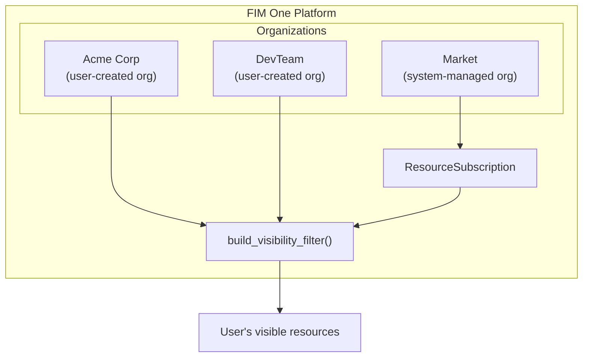
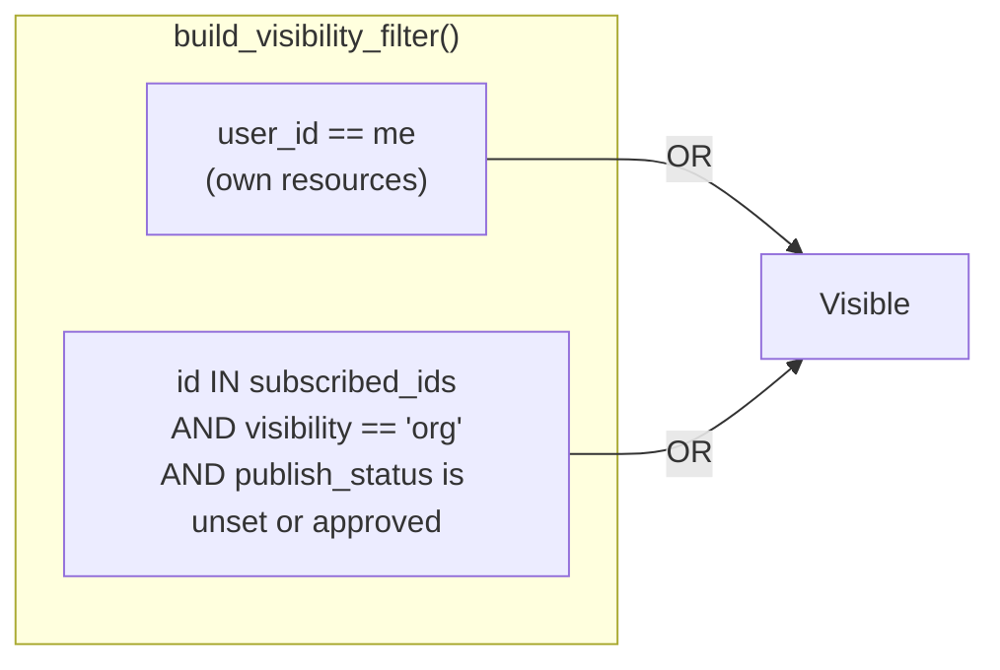
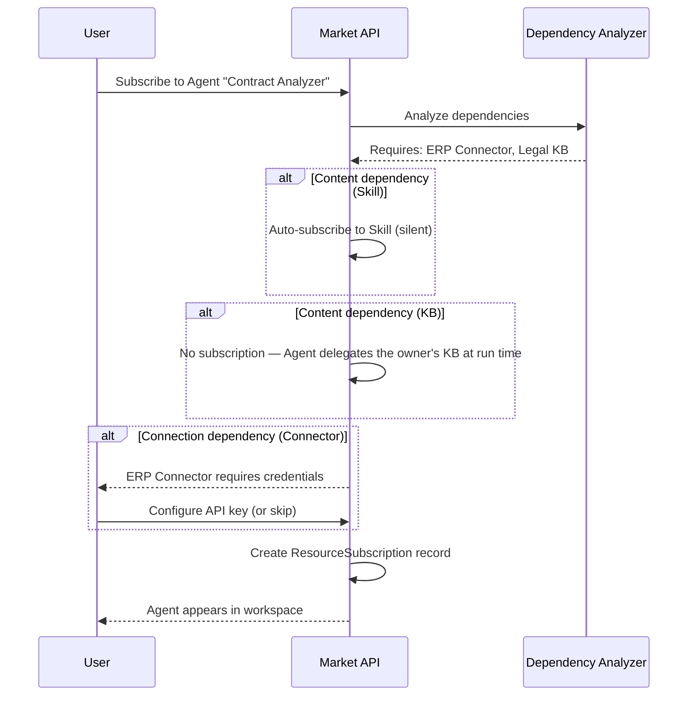
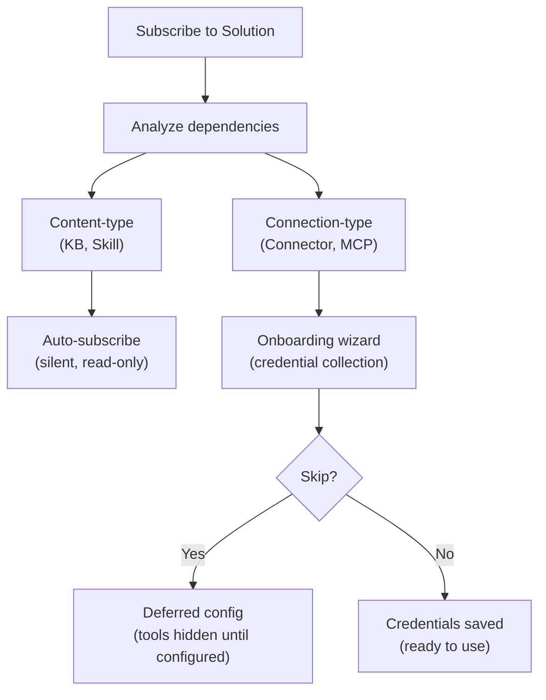

## 概要

Market は FIM One のリソースマーケットプレイスです。ユーザーが構築したリソースを公開し、他のユーザーがそれらを発見して購読し、購読したリソースは購読者のワークスペースに自分のものであるかのように表示されます。システム全体は、単一のアーキテクチャ上の洞察に基づいて構築されています：**Market は組織である** — システムが管理するシャドウ組織で、特別な信頼ルールを持ちます。

このページでは、Market の内部アーキテクチャについて説明します。公開と購読のユーザー向け概要については、[Market (Features)](/concepts/market) を参照してください。購読したリソースがツールセットに読み込まれる方法については、[エージェント & リソース発見](/architecture/agent-discovery) を参照してください。

## 2段階分類

マーケットプレイスは、リソースがどのように実装されているかではなく、リソースが何をするかに基づいて、リソースを2つのカテゴリに整理しています。

### Solutions

Solutions are things that **do work for you**. A user subscribes to a Solution and gets a ready-to-use capability.

| Resource Type | What It Does |
|---|---|
| **Agent** | A conversational AI assistant with bound tools, knowledge, and instructions |
| **Skill** | A global SOP (Standard Operating Procedure) that can orchestrate multiple agents via `call_agent` |
| **Workflow** | A DAG-based automation flow with visual editing and deterministic execution |

Skills and Workflows are optional modules, off by default. While a module is off its resources are absent from the Market and cannot be subscribed to.

Solutions may depend on other resources. An Agent might require a specific Connector for its API calls and a Knowledge Base for its retrieval pipeline. The Market handles these dependencies automatically during subscription (see [Dependency resolution](#dependency-resolution) below).

### Components

Components are **reusable building blocks** for developers. They provide capabilities that Solutions consume.

| Resource Type | What It Does |
|---|---|
| **Connector** | An API integration adapter definition (database connectors cannot be published) |
| **MCP Server** | A tool service configuration using the Model Context Protocol |

Components are simpler to subscribe to — they have no internal dependencies, only credential requirements.

### Knowledge Basesが独立してリストされない理由

Knowledge Basesは共有できません——Marketでも、organizationでも。KBは、共有されたAgentの内部依存関係としてのみ他のユーザーに到達します。実行時にAgentが所有者のコンテンツを委譲するため、購読者はKB購読を保有せず、KBを個別に検索、評価、または管理する必要がありません。

<Info>
2層分類（SolutionsとComponents）は**表示層の概念**です。クエリ時に`resource_type`から派生し、別のフィールドとして保存されません。基盤となる購読メカニズム、可視性フィルター、およびレビュープロセスは、すべてのリソースタイプで同じです。
</Info>

## 統一されたアーキテクチャ

### マーケットプレイスをシャドウ組織として

マーケットプレイスの最も重要なアーキテクチャ上の決定は、それが独立したサブシステムではないということです。それは**組織**です — システム管理の組織で、固定ID（`MARKET_ORG_ID`）を持ち、プラットフォーム初期化時に自動的に作成されます。

これは以下を意味します：

- **同じ可視性フィルター**（`build_visibility_filter()`）が、個人、組織、およびマーケットプレイスのリソースを単一クエリで処理します。マーケットプレイス検索用の特殊なコードはありません。
- **同じサブスクリプション機構**（`ResourceSubscription`）が、組織とマーケットプレイスの両方のリソースに適用されます。組織リソースへのサブスクリプションとマーケットプレイスリソースへのサブスクリプションは、同じレコードを作成します。
- **同じ認証情報処理**（フォールバック、ユーザーごとのオーバーライド）が両方のコンテキストで機能します。コネクターとMCP サーバーの`allow_fallback`フラグは、ソースに関わらず同じように動作します。
- **同じレビュープロセス**（`apply_publish_status()`）が、組織レベルとマーケットプレイスレベルの両方を処理します。唯一の違いは、マーケットプレイス組織がすべてのレビューフラグを`true`にロックしていることです。

通常の組織とマーケットプレイス組織の主な違い：

| 側面 | 組織 | マーケットプレイス |
|---|---|---|
| **信頼モデル** | 高信頼（チームメンバーシップ） | 信頼なし（グローバルコミュニティ） |
| **レビュー** | リソースタイプごとにオプション | すべてのタイプで常に必須 |
| **アクセス** | すべてのメンバーに自動 | 明示的なサブスクリプションが必要 |
| **スコープ** | チームまたは企業 | グローバル |

<Tip>
マーケットプレイスは特別なルールを持つ単なる組織であるため、組織向けに構築されたすべての機能 — レビューワークフロー、認証情報管理、リソースライフサイクル — は、追加の実装なしで自動的にマーケットプレイスで機能します。
</Tip>

### How the visibility filter handles it

Nobody holds membership in the Market org. Users do not "join" the Market — they subscribe to individual resources. This means `MARKET_ORG_ID` is never present in a user's `user_org_ids` list, and the org-membership visibility condition is naturally skipped for Market resources.

Instead, subscribed Market resources flow through the `subscribed_ids` path in `build_visibility_filter()`, the same path org-shared resources take:

This two-condition OR clause is the entire visibility model. Org membership alone grants nothing: org-shared and Market resources both reach a user through a subscription, and the share state is re-read on every query, so a subscription stops working as soon as the owner unpublishes the resource or it is awaiting or refused by review.

### スコープベースのブラウジング

Market ページは、2 つのブラウジング コンテキスト間を切り替える**スコープ セレクター**を提供します:

| スコープ | 表示内容 | レビュー担当者 |
|---|---|---|
| **Global Market** | Market org に誰かが公開したリソース | プラットフォーム管理者 |
| **Organization: [name]** | 特定の org のメンバーが公開したリソース | org 管理者 |

同じ UI、同じタブ (Solutions / Components)、同じサブスクリプション フローが両方のスコープに適用されます。スコープを切り替えると、ブラウズ クエリの `org_id` フィルターのみが変わります。ユーザーの観点からは、エクスペリエンスは同じです。つまり、カタログをブラウジングして、インストールするものを選択しています。

## サブスクリプションフロー

### ブラウジングと検出

ユーザーはページネーション付きカタログを通じてマーケットをブラウジングします。各リソースには、名前、説明、アイコン、パブリッシャーのユーザー名、および購読ボタンが表示されます。ユーザーが既に購読しているリソースは、それに応じてマークされます。ブラウズAPI（`GET /api/market`）はユーザー自身のリソースを除外します。公開したものは購読できません。

### ソリューションへのサブスクリプション

ソリューション（Agent、Skill、または Workflow）へのサブスクリプションには、依存関係の分析が含まれます：

1. システムはソリューションの依存関係を分析します——どの Connector、Knowledge Base、MCP Server、および Skill が必要かを確認します。
2. **コンテンツタイプの依存関係**はユーザーに確認することなく処理されます。Skill は自動的にサイレントでサブスクライブされます。Knowledge Base は決してサブスクライブされません——Agent は実行時に所有者の KB を委譲するため、サブスクライバーはプロビジョニングする必要がありません。
3. **接続タイプの依存関係**（Connector、MCP Server）は要件として一覧表示されます。オンボーディングウィザードが認証情報を収集します。
4. `ResourceSubscription` レコードが作成され、リソースはユーザーの表示フィルターに表示されます。

### コンポーネントへのサブスクライブ

コンポーネント（コネクタと MCP サーバー）はより単純なフローを持っています — 依存関係分析は不要です。ユーザーがサブスクライブし、必要に応じて認証情報を設定すると、コンポーネントは使用可能になります。

### Credential configuration

Credentials follow a **hybrid model** that balances convenience with flexibility:

- **Offered during subscription.** When a connection-type dependency requires credentials, the onboarding wizard presents the credential form immediately.
- **Skippable.** The user can choose "Skip, configure later." The resource is subscribed, but the tools that need those credentials stay out of the agent's toolset until the user configures them (or the publisher allows fallback).
- **Deferred configuration.** Users can configure or update credentials at any time from their settings page.

This is the same `allow_fallback` mechanism used in organizations. If the publisher has enabled fallback and set a default credential, subscribers can use the resource immediately without providing their own key. If fallback is disabled, each subscriber must bring their own.

<Warning>
When using a Market resource with credential fallback enabled, your API requests flow through the publisher's credentials. For sensitive operations, consider providing your own credentials or verifying the publisher's trustworthiness.
</Warning>

### Unsubscribing

Unsubscribing removes the `ResourceSubscription` record. The resource disappears from the user's visibility filter and is no longer loaded into tool sets. For Solutions, dependencies that were subscribed automatically (Skills, Connectors, MCP Servers) are removed as well when no other subscribed Solution needs them, along with the credentials saved for those Connectors and MCP Servers. Unsubscribing from a Connector or MCP Server directly removes the user's credential for it.

## 依存関係の解決

ソリューションが公開または購読されると、システムはその依存関係ツリーを分析します。依存関係は2つのカテゴリに分かれており、異なる処理戦略があります。

### コンテンツタイプの依存関係

**ナレッジベース**と**スキル**は、ソリューションによって参照されるコンテンツタイプの依存関係です。これらは読み取り専用データ——検索ドキュメント、SOP手順——をソリューションが消費します。

- **スキル——サブスクリプション時:** 自動的にサイレントサブスクライブされます。ユーザーは個別のサブスクリプションステップを表示されません。
- **ナレッジベース:** サブスクライブされません。バインドされたKBは実行時に所有エージェントによって委譲されるため（所有者委譲）、サブスクライバー側でプロビジョニングやクリーンアップを行う必要はありません。
- **アクセスモデル:** 元の作成者のリソースへの読み取り専用参照。サブスクライバーはコンテンツを変更できません。
- **サブスクリプション解除時:** 親ソリューションがサブスクリプション解除されると、自動サブスクライブされた依存関係は自動的にクリーンアップされます。

### Connection-type dependencies

**Connectors** and **MCP Servers** referenced by a Solution are connection-type dependencies. They require credentials to function.

- **On subscription:** subscribed together with the Solution and listed as requirements in the onboarding wizard. The user is prompted to configure credentials (or skip).
- **On unsubscription:** a Connector or MCP Server that was subscribed automatically with the Solution is removed with it, credentials included, unless another subscribed Solution still needs it. One the user subscribed to on their own is left in place with its credentials.

## 公開

### ソリューションの公開

著者がエージェント、スキル、またはワークフローをマーケットプレイスに公開する場合:

1. システムはリソースに `visibility: "org"` と `org_id: MARKET_ORG_ID` を設定します。
2. システムはソリューションの依存関係を分析し、マニフェストを構築します — 必要なコネクタ、KB、および MCP サーバーをリストアップします。
3. マニフェストが著者に確認のため表示されます。
4. `apply_publish_status()` はリソースを `pending_review` に設定します (マーケットプレイス組織のすべてのレビューフラグは `true` にロックされています)。
5. システム管理者がリソースをレビューして承認または却下します。

### コンポーネントの公開

Connectorまたはサーバーの公開はより簡単です：

1. システムが上記のように可視性とorg_idを設定します。
2. 認証情報スキーマが抽出されます（サブスクライバーが入力する必要があるフィールド）。
3. リソースが`pending_review`に入り、管理者の承認を待ちます。

### レビュープロセス

レビュープロセスは、組織で使用されるのと同じメカニズムですが、1つの重要な違いがあります:

| コンテキスト | レビューが必要? | レビュー担当者 |
|---|---|---|
| **Organization** | リソースタイプごとに設定可能（`review_agents`、`review_connectors`など） | 組織管理者 |
| **Market** | すべてのリソースタイプで常に必須 | プラットフォーム管理者（Market組織の所有者） |

Market組織は6つのレビューフラグすべてが`true`に設定された状態で初期化され、この設定は変更できません。Marketに公開されるすべてのリソースは、ブラウズカタログに表示される前に管理者レビューに合格する必要があります。

<Note>
組織の所有者は自動的にレビューをバイパスします — 公開されたリソースはすぐに利用可能になります。Marketの場合、Market組織の所有者（システム管理者）のみがこのバイパス特権を持ちます。
</Note>

承認されたリソースが著者によって編集されると、`check_edit_revert()`は自動的に`publish_status`を`pending_review`に戻します。これにより、ライブMarketリソースへの変更がサブスクライバーに表示される前に再度レビューされることが保証されます。

## 実装に関する注記

### The shadow org

The Market organization has a well-known fixed ID (`00000000-0000-0000-0000-000000000001`) and slug (`market`). It is created by `ensure_market_org()` during platform initialization, when the first user (the administrator) registers. The function is idempotent; calling it multiple times is safe.

### ResourceSubscription

`ResourceSubscription`テーブルはMarket アクセスのコアデータ構造です：

| Column | Purpose |
|---|---|
| `user_id` | サブスクライバー |
| `resource_type` | `agent`、`connector`、`mcp_server`、`skill`、または`workflow`（ナレッジベースはサブスクライブされません——Agent オーナー委譲で処理されます） |
| `resource_id` | サブスクライブされたリソースのID |
| `org_id` | ソース組織（Market 組織IDまたは通常の組織ID） |

`(user_id, resource_type, resource_id)`に対するユニーク制約により、重複したサブスクリプションを防ぎます。`org_id`カラムはサブスクリプションの出所を追跡し、スコープ対応のアンサブスクリプションを可能にします。

### Visibility filter integration

The `resolve_visibility()` function performs two lookups in a single call:

1. Fetches the user's org memberships (`user_org_ids`)
2. Fetches the user's subscriptions (`subscribed_ids`)

These are passed to `build_visibility_filter()`, which produces a single SQL WHERE clause combining the two visibility conditions (own, or subscribed and still shared). This function is used everywhere resources are queried — agent lists, connector dropdowns, skill injection, auto-discovery mode — ensuring consistent visibility across the entire platform.

### 認証情報の暗号化

サブスクリプション中（またはその後の設定で）に設定された認証情報は、プラットフォームの暗号化キーを使用して保存時に暗号化されます。Market API は参照レスポンスで認証情報の値を公開することはありません — `_*_market_info()` ヘルパー関数ではメタデータ（名前、説明、アイコン、タイプ）のみが返されます。

## 関連項目

- [Organization & Market](/architecture/organization) -- 組織レベルの共有と信頼モデル
- [Agent & Resource Discovery](/architecture/agent-discovery) -- サブスクライブされたリソースがツールセットにどのように読み込まれるか
- [Connector Architecture](/architecture/connector-architecture) -- コネクタ設計、認証注入、監査
- [System Overview](/architecture/system-overview) -- すべてのリソースが収束する統一ツール抽象化
