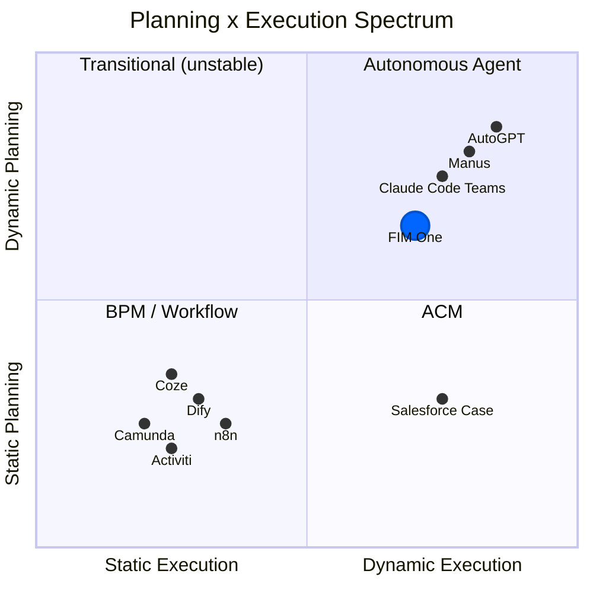
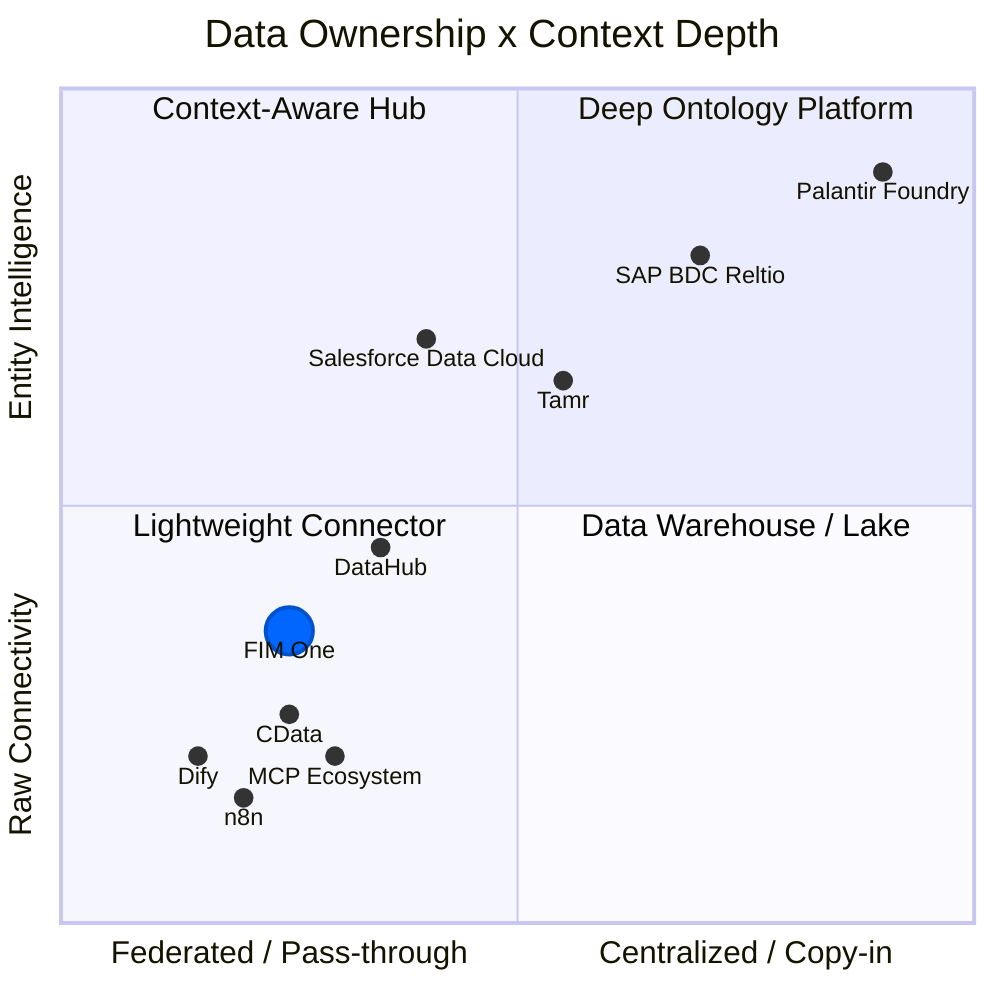

## 動的計画が難しい中間地点である理由

AIエージェントの風景は2つのキャンプに分かれ、どちらも簡単な道を選びました。従来のワークフローエンジン（Dify、n8n、Coze）は静的オーケストレーションを選択しました。ビジュアルドラッグアンドドロップフローチャートと固定実行パスです。これは無知ではなく、エンタープライズ顧客は決定論を要求し（同じ入力で安定した出力）、静的グラフはそれを実現します。一方の極端では、完全に自律的なエージェント（AutoGPTとその派生物）はエンドツーエンドの自律性を約束しましたが、実用的ではないことが判明しました。信頼できないタスク分解、暴走するトークンコスト、そして誰も予測またはデバッグできない動作です。

スイートスポットは狭いですが、実在します。シンプルなタスクはプランナーを必要としません。数十の相互依存するステップが必要なほど複雑なタスクは、現在のLLMを圧倒します。しかし、その間には豊かな問題のクラスがあります。明確な並列サブタスクを持つタスクで、ハードコーディングするには退屈だが、LLMが分解するには実行可能です。動的DAG計画はこのゾーンをまさに対象としています。モデルが実行時に実行グラフを提案し、フレームワークが構造を検証して最大並行性で実行します。ドラッグアンドドロップなし、無謀な自律性なし。

## モデル改善への賭け

数ヶ月ごとに基盤が変わる -- GPT-4、function calling、Claude 3、MCP protocol。移動する地盤の上に厳密な抽象化を構築するのはリスキーだ。LangChainの過度な抽象化は、このスペースの誰もが内在化している警告の話だ。FIM Oneは逆のアプローチを取る：**最小限の抽象化、最大限の拡張性**。フレームワークはオーケストレーション、並行処理、可観測性を所有する。インテリジェンスはモデルから来ており、モデルは常に改善し続けている。

今日、LLM タスク分解の精度は、非自明な目標に対して約70-80%である。それが90%以上に達すると、動的計画の「スイートスポット」は劇的に拡大する -- 昨日は複雑すぎた問題が明日は扱いやすくなる。FIM OneのDAGフレームワークは、配管を書き直すことなく、その拡大する価値をキャプチャするように設計されている。

## Will ReAct and DAG planning become obsolete?

ReAct will not disappear -- it will sink into the model. Consider the analogy: you do not hand-write TCP handshakes, but TCP did not go away; it got absorbed into the operating system. When models are strong enough, the think-act-observe loop becomes implicit behavior inside the model, not explicit framework code. This is already happening: Claude Code is essentially a ReAct agent where the loop is driven by the model itself, not by an external harness.

DAG planning's lasting value is not "helping dumb models decompose tasks" -- it is **concurrent scheduling**. Even with infinitely capable models, physics imposes latency: a serial chain of 10 LLM calls takes 10x longer than 3 parallel waves. DAG is an engineering problem (how to run things fast and reliably), not an intelligence problem (how to decide what to run). Retry logic, cost control, timeout management, observability -- these do not go away when models get smarter.

The endgame: **models own the "what" (planning intelligence internalizes into the model), frameworks own the "how" (concurrency, retry, monitoring, cost governance)**. A framework's lasting value is not intelligence -- it is governance.

This is the sentence the rest of FIM One is downstream of. Once the model owns the "what," durable value moves to governing the "how" -- and the highest-value "how" in any enterprise is *reach* into the systems that refuse to talk to each other. The integration layer is one inferential step from here, and the history shows it: the project began as a DAG orchestration framework (`fim-agent`) and became a connector platform within a single week -- not through a rewrite, but because this bet already required it.

## Why not mirror Dify's workflow editor

A natural question: if DAG covers the flexible case, shouldn't we also build a static workflow editor for the deterministic case?

Not as the core. FIM One does ship a visual Workflow editor (9 node types, cron and API triggers), but as an optional module that is off by default. The reasoning for keeping it secondary:

1. **The workflows already exist elsewhere.** Government and enterprise clients' fixed processes live in their OA, ERP, and legacy systems. They don't want to rebuild those flows in yet another platform -- they want AI that can connect to the systems where those flows already run. The Connector Platform (v0.6) solves this directly.

2. **Existing capabilities compose into fixed pipelines.** Scheduled Jobs (v1.0) trigger a DAG agent with a fixed prompt; the DAG dynamically plans the steps; Connectors (v0.6) connect to the target systems. The combination is equivalent to a static pipeline -- but more flexible, because the LLM can adjust its plan based on the data it encounters. No separate pipeline DSL needed.

3. **Investment mismatch.** A production-quality visual workflow editor (canvas, node types, variable passing, debug/replay) is months of dedicated effort. The result would be a low-fidelity copy of what Dify's 120K-star community already maintains. That effort is better spent on the Connector architecture -- a capability no competitor offers.

The strategic bet: **don't compete on workflow visualization; compete on being the agent platform where systems meet AI**. Let Dify own "build AI workflows visually." FIM One owns "the all-in-one agent platform for Global × China enterprises."

## Where FIM One stands

FIM One is not an "AGI task scheduler" and not primarily a static workflow engine. It occupies the middle ground: planning capability with constraints, concurrency with observability.

- Compared to **Dify**: more flexible -- runtime DAG generation vs. design-time flowcharts. You do not need to anticipate every execution path in advance. Does not compete on visual workflow editing; competes on legacy system integration.
- Compared to **AutoGPT**: more controlled -- bounded iterations, re-planning limits, with human confirmation gates. Autonomy within guardrails.

The strategy is straightforward: build the orchestration framework now, and let improving models fill it with capability over time.

## Where FIM One Sits: Planning x Execution Spectrum

The AI execution landscape can be mapped on two axes -- how plans are created (static vs dynamic) and how they are executed (rigid vs adaptive):

**Why Dify/n8n are Static Planning + Static Execution**: The DAG is drawn by a human on a visual canvas at design time. Each node executes a fixed operation (an LLM call with a fixed prompt, an HTTP request, a code block). There is no runtime replanning -- if a step fails, the workflow fails or follows a pre-wired error branch. This is structurally the same as BPM, just with AI nodes in the graph.

**FIM One's position: Dynamic Planning + Dynamic Execution**

- **DAG topology is generated by LLM at runtime** (dynamic planning) -- no human designs the graph
- **Each DAG node runs a full ReAct loop** (dynamic execution) -- nodes reason, use tools, and adapt
- **Re-planning mechanism** (execute → analyze → re-plan if unsatisfied)
- But bounded: max 3 rounds in total (the first plan plus 2 re-plans), token budgets, human confirmation gates

This places FIM One in the same quadrant as AutoGPT, but with engineering constraints that prevent runaway behavior. More flexible than BPM/Dify, more controlled than AutoGPT.

## Concept Glossary

For readers unfamiliar with the terminology used in this document:

| Term | One-line explanation | Relation to FIM One |
|------|---------------------|----------------------|
| **BPM** (Business Process Management) | Processes fully fixed at design time, executed rigidly. Camunda, Activiti. | FIM One is **not** BPM. Fixed processes are covered by the optional Workflow module, not the core. |
| **FSM** (Finite State Machine) | System is in exactly one state at any time; events trigger transitions. Supports loops (reject → resubmit). | Target systems (ERP, contract systems) use FSM internally. FIM One **doesn't need** its own FSM -- it calls the target system's API. |
| **ACM** (Adaptive Case Management) | Skeleton static, branches dynamic. Main flow pre-defined, each node adapts at runtime. | FIM One's DAG + ReAct naturally falls in this quadrant. |
| **HTN** (Hierarchical Task Network) | Recursive task decomposition: high-level → subtasks → atomic operations. | DAG re-planning covers most scenarios; full HTN not needed yet. |
| **iPaaS** (Integration Platform as a Service) | Cloud integration platform connecting multiple SaaS/on-prem systems. MuleSoft, Zapier. | FIM One's integration layer is like **AI-native iPaaS** -- natural language drives cross-system integration. |
| **MDM** (Master Data Management) | Deduplicates and unifies entity records across systems into a "golden record." Reltio, Informatica, Tamr. | FIM One **connects to** MDM systems; it does not replicate entity resolution. |
| **Context Layer / System of Context** | Unified entity + relationship graph that gives AI agents trusted business context. Term popularized by Reltio (2026). | FIM One delegates this to upstream MDM/data platforms. Skills provide lightweight aggregation for common cases. |

## アーキテクチャ境界: FIM One はワークフロー ロジックを複製しない

複雑なビジネス プロセス (承認チェーン、転送、却下、エスカレーション、連署、副署) は、**ターゲット システムの責任**です。これらのシステムはこのロジックを何年もかけて構築してきました -- ERP、OA、契約管理システムはすべて成熟したステート マシンを備えています。

コネクタの観点から:

| 操作 | コネクタが行うこと |
|-----------|------------------------|
| 転送 | 1 つの API を呼び出し、対象者を渡す |
| 却下 | 1 つの API を呼び出し、却下理由を渡す |
| エスカレーション | 1 つの API を呼び出し、エスカレーション対象者リストを渡す |
| 連署 | 1 つの API を呼び出し、連署者リストを渡す |

複雑なワークフロー操作はすべて、パラメータを持つ HTTP リクエストに集約されます。FIM One は API を呼び出し、ターゲット システムがステート マシンを管理します。

これは**意図的なアーキテクチャ境界**であり、機能ギャップではありません。ターゲット システムに既に存在するワークフロー ロジックを複製することは:
1. メンテナンス負担を生じさせます (2 つのステート マシンを同期させる必要があります)
2. 障害モードを追加します (それらが一致しない場合はどうなりますか?)
3. 追加の価値を提供しません (ターゲット システムは既にこれを正しく実行しています)

コネクタ パターンは設計上シンプルです: **1 つの操作 = 1 つの API 呼び出し**。

## アーキテクチャ境界: コンテキストレイヤーではなくコネクタレイヤー

エンタープライズAIは、エージェントコンテキストのための層状アーキテクチャに収束しています:

| レイヤー | 機能 | 代表的なプレイヤー |
|-------|-------------|----------------------|
| **Decision Traces** | 何が起こったのか、なぜ起こったのかを記録 -- 監査証跡、系統 | Palantir Decision Lineage、Arize |
| **Entity Context** | 統一されたゴールデンレコード + 関係グラフ -- 「System of Context」 | Reltio/SAP、Informatica/Salesforce、Tamr |
| **Data Connectivity** | APIとプロトコルを介してエージェントをソースシステムに接続 | **FIM One**、CData、MCPエコシステム |
| **Source Systems** | CRM、ERP、契約管理、データベース、SaaSアプリ | SAP、Salesforce、カスタムシステム |

FIM Oneは**データ接続レイヤー**で動作します。その上のエンティティコンテキストレイヤーを構築しようとはしません。これは意図的な選択であり、ギャップではありません。

### 業界コンテキスト：2025-2026年の統合

2つのランドマーク的な買収がエンタープライズAIデータランドスケープを再構成し、コンテキストレイヤーを戦略的な競争地点にしました：

- **Salesforceが Informaticaを買収** (2025年11月) -- エンタープライズMDMとデータガバナンスをData Cloud + Agentforceスタックに追加。目標：Informaticaのゴールデンレコードに基づいてAgentforceエージェントを信頼できるものにする。
- **SAPが Reltioの買収を発表** (2026年3月) -- AI ネイティブなエンティティ解決と関係グラフをBusiness Data Cloud (BDC)に追加。目標：SAPおよび非SAP環境にまたがる「System of Context」を作成し、Joule Agentの信頼できる基盤として機能させる。

これらの動きは、世界最大級のエンタープライズプラットフォームが、統一されたエンティティコンテキストを信頼できるAIエージェントの前提条件と考えていることを示しています -- 単なるあると便利な機能ではなく。

### データ所有権 × コンテキストの深度スペクトラム

**グラフの読み方:**

- **左下（軽量コネクター）**: 最小限のデータ所有権と、未加工の API 接続。Dify、n8n、基本的な MCP サーバーはここに位置します。システムには接続しますが、エンティティを理解していません。FIM One もこの象限に位置しますが、段階的開示を行うメタツール、Skill ベースのコンテキスト集約、ドメイン認識型のエスカレーションにより、y 軸ではより上に位置します。
- **左上（コンテキスト対応ハブ）**: エンティティレベルの理解を備えたフェデレーションアクセス。Salesforce Data Cloud がこの例です。オンデマンドのエンティティ解決を伴うゼロコピー・フェデレーションを実現します。DataHub は、ビジネスデータ自体を所有することなく、メタデータレベルのコンテキスト（スキーマ、リネージュ、所有権）を提供します。
- **右上（深いオントロジープラットフォーム）**: 高度なエンティティインテリジェンスを備えた、完全なデータ取り込み。SAP BDC + Reltio は、関係グラフを備えた永続的なマルチドメインのゴールデンレコードを構築します。Palantir はさらに進んでおり、3 層のオントロジーと意思決定のリネージュを備えています。
- **右下（データウェアハウス / レイク）**: エンティティのセマンティクスを持たない、集中型のデータストレージ。あらゆるデータを取り込む一方で、エンティティ解決や関係モデリングを欠く従来型のデータプラットフォームです。

FIM One の位置付けは、意図的な選択を反映しています。フェデレーション型かつ軽量であり続けながら、上流のエンティティコンテキスト（任意の MDM から取得）をエージェントが簡単に利用できるようにすることに投資しています。

### 3つのエンティティコンテキストモデル

**SAP: マルチドメイン・ゴールデンレコード（コピーイン + ガバナンス）**

SAPは3層のエンタープライズアーキテクチャを構築しています：

| レイヤー | システム | 役割 |
|-------|--------|------|
| **トランザクション** | S/4HANA | ビジネス実行 -- 注文、請求書、納品 |
| **インテリジェンス** | Business Data Cloud (BDC) + Reltio | セマンティック統合、エンティティ解決、関係グラフ |
| **エージェント** | Joule + Joule Agents | インテント理解、ツールオーケストレーション、自律実行 |

Reltioはインテリジェンスレイヤーの中核に位置しています。その役割：SAPおよび非SAPシステムからエンティティデータを取り込み、AI ベースのマッチングを通じて重複を解決し、関係グラフを備えた**マルチドメイン・ゴールデンレコード**（顧客、サプライヤー、製品、患者、資産）を生成することです。Reltioの**MCPプロトコル**の早期採用は戦略的に重要です -- ゴールデンレコードをSAPのJouleだけでなく、MCPに対応したあらゆるエージェントから直接呼び出し可能な位置づけにしています。

SAPの賭け：エージェントは高リスクのエンタープライズプロセスで確実に動作するために、永続的で統治された、クロスドメインの「単一の情報源」が必要です。

**Salesforce: ゼロコピー・フェデレーション（フェデレート + オンデマンド解決）**

Salesforceはより軽量なアプローチを採用しています。Data Cloudは物理的なデータ移動を必要としません。代わりに**ゼロコピー・パートナーシップ**（Databricks、Snowflake、BigQuery）を使用してデータをインプレイスでフェデレートします。エンティティ解決はData Cloud内でオンデマンドで実行され、永続的なゴールデンレコードストアを必要とせずに統一された顧客プロファイルを作成します。

主要な数字（Q3 FY2026）：Data Cloudは32兆件のレコードを取り込み、そのうち15兆件がゼロコピー経由です（前年同期比341%の成長）。このスケールはCRM中心のユースケースに対するフェデレーションモデルを検証しています。

Agentforceエージェントはこのフェデレーションコンテキストに基づいています：すべてのデータを1つのシステムに集約することなく、分散データ資産全体で推論します。フロントオフィスシナリオ（営業、サービス、マーケティング）では、これは柔軟で展開が迅速です。

Salesforceの賭け：エージェントは重量級のゴールデンレコードストアを必要としません -- データがすでに存在する場所でフェデレーション、解決されたコンテキストへのリアルタイムアクセスが必要です。

**Palantir: ディープオントロジー（重量級リファレンス）**

極端な例として、Palantir Foundryはすべてのデータを取り込み、完全な決定系統を備えた3層のオントロジー（セマンティックオブジェクト + キネティックアクション + ダイナミックルール）を構築します。これは本番環境で最も完全なコンテキストシステムですが、1000万ドル以上の契約と6～18ヶ月の展開期間が必要です。ほとんどの組織にとって現実的なモデルではなく、リファレンスアーキテクチャとして機能します。

### FIM Oneの位置づけ

| 次元 | SAP + Reltio | Salesforce + Informatica | FIM One |
|-----------|-------------|-------------------------|---------|
| **データ哲学** | コピーイン：BDCに取り込み、ゴールデンレコードを構築 | フェデレーション：ゼロコピーアクセス、オンデマンド解決 | パススルー：ソースに接続、保存しない |
| **エンティティ解決** | 深い -- AI ネイティブ MDM と関係グラフ | 中程度 -- Data Cloud エンティティ解決 | なし -- 上流の MDM に委譲 |
| **エージェント統合** | Joule エージェント + MCP | Agentforce + Data Cloud グラウンディング | 任意のエージェント + 任意のコネクタ |
| **デプロイメントコスト** | エンタープライズプラットフォーム価格 | エンタープライズ SaaS 価格 | 軽量、数時間から数日 |
| **ロックイン** | 高い（BDC + S/4HANA エコシステム） | 中程度（Salesforce エコシステム） | 低い -- コネクタは相互交換可能 |
| **最適な用途** | 製造業、サプライチェーン、ライフサイエンス（複雑なマルチドメイン） | CRM 駆動型企業（フロントオフィス重視） | 中堅企業、マルチシステム、プロバイダーに依存しない |

FIM One は **Salesforce の哲学**（データを所有しない、接続する）に最も密接に一致していますが、Salesforce エコシステムへの依存がありません。戦略的な位置づけ：接続レイヤーでプロバイダーに依存しない状態を保ち、SAP/Reltio、Salesforce/Informatica、Tamr、またはカスタムソリューションなど、任意の MDM がエンティティコンテキストソースとして機能できるようにします。

### FIM One がコネクタレイヤーに留まる理由

エンティティコンテキストレイヤーを構築するには、永続的なデータストレージ、ML ベースのエンティティ解決、サバイバーシップルール、リレーションシップグラフエンジン、およびガバナンスフレームワークが必要です。これは異なる製品カテゴリ（MDM）であり、10 年以上の競争が存在します（Reltio、Informatica、Tamr）。これを試みると：

1. **FIM One をコネクタからデータプラットフォームに変換する** -- 根本的に異なる製品、チーム、およびゴー・トゥ・マーケット戦略
2. **アップストリームシステムが既に提供する機能を複製する** -- ワークフロー ロジックで回避する同じアンチパターン
3. **ロックインを増加させる** -- ユーザーが FIM One にゴールデンレコードを保存すると、切り替えコストが劇的に上昇

正しい戦略：**任意の MDM システムの最高のイングレスポイントになる**、MDM の代替ではなく。FIM One は、Reltio、Informatica、Tamr、またはカスタム MDM が MCP リソース、コネクタ API、またはナレッジベースインジェクション経由でエージェントにエンティティコンテキストを提供することを簡単にする必要があります。

### 現在のアプローチ: 軽量なコンテキスト集約としてのスキル

複数のコネクタにまたがるコンテキストが必要なシナリオ（例えば、サプライヤーデータ + 支払い履歴 + リスクフラグを必要とする契約レビュー）では、**スキル**は既に実用的なソリューションを提供しています。スキルの SOP は複数のコネクタアクションを順序立てて調整し、結果を集約し、永続的なエンティティレイヤーを構築することなく、構造化されたコンテキストをエージェントに提示できます。

これは 80% のユースケースをカバーしています。コネクタレベルでのリアルタイムエンティティ解決の需要が生じた場合、アーキテクチャは外部 MDM システムと統合する将来の `ContextSource` コネクタタイプの余地を残しています -- ただし、これは将来の検討事項であり、現在のコミットメントではありません。

### アナロジー

FIM Oneとコンテキストレイヤーの関係は、SQLAlchemyとデータベースの関係のようなものです。データを保存または管理するのではなく、任意のデータソースをアプリケーションレイヤーからアクセス可能にします。エンティティ解決はMDMプラットフォームに任せ、FIM Oneは接続を所有します。

## FIM One が AI スタックのどこに位置するか

### The Layered Model

A useful mental model (credit [Phil Schmid](https://www.philschmid.de/)) maps AI systems to a four-layer stack analogous to computing hardware:

| Layer | Analogy | FIM One Component |
|-------|---------|-------------------|
| **Model** | CPU | ModelRegistry -- any OpenAI-compatible LLM |
| **Context** | RAM | ContextGuard + Memory (Window / Summary / DB) |
| **Harness** | Operating System | ReAct Agent + DAG Planner + Hooks + ToolRegistry |
| **Application** | App | Portal, API |

FIM One operates at the **harness layer** -- it does not compete with models; it makes them productive by providing the right tools, constraints, and feedback loops. The model supplies intelligence; the harness supplies governance, concurrency, and reliability.

### Three Eras of AI Engineering

The discipline has evolved through distinct phases: **Prompt Engineering** focused on crafting better instructions to elicit correct behavior from a fixed model. **Context Engineering** shifted attention to assembling the right information -- retrieving documents, injecting tool results, managing memory -- so the model has what it needs to reason well. **Harness Engineering** goes further: designing the full execution environment around the model, including deterministic guardrails, tool orchestration, feedback loops, and cost controls.

FIM One's architecture embodies harness engineering principles. The [Hook System](/architecture/hook-system) runs platform code outside the LLM loop at well-defined lifecycle points — today `ApprovalGateHook` intercepts sensitive tool calls and routes approval to an in-portal card or an IM channel, and the same abstraction can carry audit logging, read-only-mode enforcement, rate limits, and result truncation if those are ever needed. ContextGuard manages what enters the context window and when. Dynamic tool selection (progressive-disclosure meta-tools) keeps the tool surface tractable as connector count grows. The ReAct loop's self-reflection mechanism and the DAG planner's re-plan cycle provide structured feedback that improves execution quality without requiring a more capable model.
