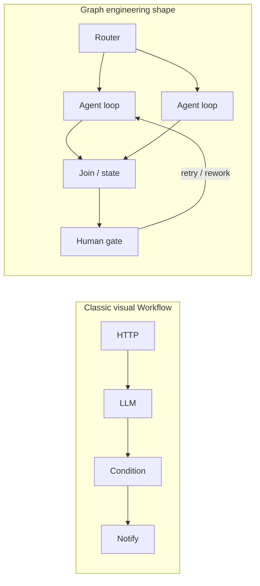
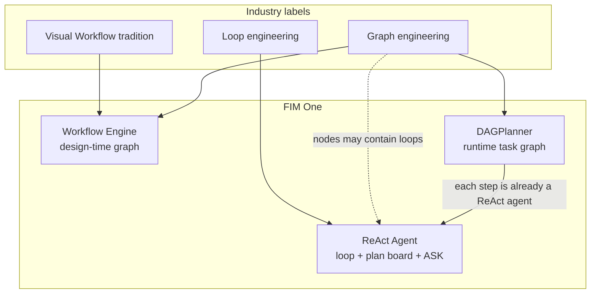
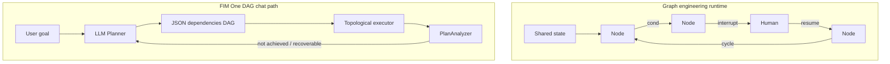
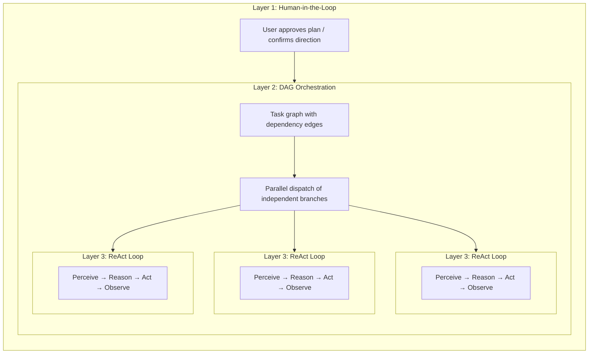

## グラフエンジニアリング（2026年）とFIM One

業界の議論では、しばしば**ループエンジニアリング**（単一のエージェントが繰り返し思考と行動を行う）から**グラフエンジニアリング**（マルチノードトポロジーを明示的なエンジニアリングオブジェクトにする）への転換が取り上げられます。このラベルは新しいものですが、実践は新しくありません。LangGraphスタイルのシステムとマルチエージェント組織は、数年前からグラフを使用しています。FIM Oneにとって重要なのは、人々が意図する**グラフの種類**と、それが3つの実行レイヤーにどのようにマッピングされるかです。

### What graph engineering usually means

| Layer (common framing) | Concern |
|---|---|
| **Harness** | Tools, sandbox, auth, logging, quotas around the model |
| **Loop** | One agent's think → act → observe cycle |
| **Graph** | How **nodes** connect: branches, joins, cycles, human checkpoints, shared state |

Consensus across that framing: **graph does not replace loop**. Graph designs **relationships between processes**; each agentic node may still run a full loop.

"Graph" is overloaded in practice. Three usages get mixed:

| Usage | Example | Role |
|---|---|---|
| **Control-flow graph** | LangGraph `StateGraph`: conditional edges, retries, interrupt/resume | State machine for who runs next |
| **Task dependency graph** | Claude Code Tasks `blockedBy`; FIM One `dependencies` | Schedule and parallelize work |
| **Knowledge graph** | Entities and typed relations | Retrieval / memory (not orchestration) |

This page is about the first two (orchestration).

### 「Difyワークフローの新しい名前」ではない

Difyスタイルの**ビジュアルワークフロー**とグラフエンジニアリングは共通の起源（**明示的なトポロジー**）を持ちますが、同じ製品ではありません。

| | クラシックビジュアルワークフロー（例：Dify） | グラフエンジニアリング（2026年の用法） |
|---|---|---|
| **主要成果物** | 実装者が描くキャンバス／ブループリント | バージョン管理されたシステム設計としてのトポロジー（コードまたは設定） |
| **ノード** | 固定機能ブロック（LLM、HTTP、KB、条件…） | **異種混在**：関数、ルーター、**完全な智能体**、人間、結合 |
| **インテリジェンスの所在** | ほとんどが分離されたLLMノード内；グラフはパイプ | しばしば**ノード内**（各ノードはループの可能性あり）；グラフは役割を整理 |
| **エッジ** | パイプラインの成功／失敗と分岐 | 制御フロー**および**状態遷移（**制御されたサイクル**を含む） |
| **ヒューマンインザループ** | フォーム／承認がアドオン | 割り込み／再開が第一級プリミティブ |
| **ループとの関係** | しばしば「ワークフロー**対**智能体」として販売 | 明示的に**ループ上のグラフ** |

短縮形：クラシックワークフローは**決定論的（または半決定論的）パイプ**で時々LLMステップが入ります。グラフエンジニアリングは**マルチノードシステムトポロジー**で、重要なポストは依然として自律的な智能体となります。

### How the industry map sits on FIM One

FIM One already spans the control spectrum; chat "Planner mode" is only one slice.

| Industry idea | Closest FIM One piece | Fit |
|---|---|---|
| Classic visual Workflow | **Workflow Engine** (design-time blueprint) | Strong |
| Control-flow graph + HITL + durable state | Workflow human steps + confirmation gates; partial on chat DAG | Medium |
| Task dependency graph + parallel schedule | **DAGPlanner** (`dependencies`, topological fan-out) | Strong on scheduling; weaker on mid-graph HITL |
| Single agent loop + checklist memory | **ReAct** (`update_plan`, tools, `ask_user_question`) | Strong |
| Runtime LLM-drawn plan every turn | **DAGPlanner** (not Dify; not LangGraph design-time DSL) | Distinct product |

### Graph engineering vs FIM One DAG (chat Planner)

Same family (explicit multi-step topology). Different species.

| Dimension | Graph engineering (typical) | FIM One DAG (chat) |
|---|---|---|
| **Who draws the graph** | Developer / implementer (stable topology) | **LLM at runtime** (new graph per goal) |
| **Edge meaning** | Often **control flow** (where next, including cycles) | Mostly **dependency / data** (`dependencies`, acyclic run) |
| **Correction** | Edge-level retry, human node, resume same graph | **PlanAnalyzer → replan** (often a **new** graph) |
| **Node depth** | Node may be a full agent loop | **Already full ReAct per step**: `DAGExecutor` runs `agent.run()` with a multi-iteration tool loop (default cap from `DAG_STEP_MAX_ITERATIONS`, commonly 15). Default model is registry **general** (not infrastructure fast); `model_hint` can escalate to reasoning or demote to fast. Tool cache, step/citation verification, and source evidence ship with each step. Step agents set `enable_plan_tool=False` (no `update_plan` board inside a step) because the unit of work is already a focused sub-task. |
| **Shared state** | First-class typed state + checkpoint narrative | Step results + memory/compact; step checkpoints exist |
| **Mid-run questions** | Interrupt as a product feature | Confirmation gates exist; **`ask_user_question` is ReAct-only** (chat outer loop), not a first-class DAG wait edge |
| **Product entry** | Framework or backend org chart | User-visible mode next to ReAct |

**Implication:** industry heat around graph engineering **validates keeping a graph/scheduling engine**. It does **not** require a chat default that forces users to pick "Planner" for every turn. Most tasks still want a strong loop; graphs earn their keep on parallel branches, fixed compliance paths, and multi-role orchestration.

### What FIM One can learn (empower ReAct, DAG, Workflow)

Concrete takeaways, not slogans. Ordered by leverage.

| # | Graph engineering idea | Apply to | Direction |
|---|---|---|---|
| 1 | **Graph over loop, not instead of** | Product + Auto routing | Default UX stays **ReAct** (loop + `update_plan` + `ask_user_question`). Use DAG/Workflow when topology earns cost. |
| 2 | **Heterogeneous deep nodes** | DAG | **Already the status quo.** Each step is a full ReAct agent (`agent.run`, multi-iteration tools, general-or-better model by default), not a one-shot LLM call. The one exception is a step the planner tags `llm_direct` (pure transformation of upstream outputs), which runs as a single tool-less call. Remaining knobs are optional (e.g. plan board on long steps), not a structural gap. |
| 3 | **Interrupt / resume as edges** | DAG + ReAct | Mid-run clarification belongs in the **outer** loop or as a first-class wait state. Avoid fake DAG steps that "ask the user" in text and then replan as "goal not achieved". |
| 4 | **Controlled cycles vs whole-graph replan** | DAG | Prefer step-local retry / partial carryover (already partly true for completed steps) over dumping all step text as a failed final answer. |
| 5 | **Typed shared state along edges** | DAG + Workflow | Stronger contracts for step I/O (schema, deliverables) reduce Analyzer false confidence and answer/source drift. |
| 6 | **Topology as a versioned asset** | Workflow | Keep human-authored graphs for audit; do not expect runtime LLM DAGs to replace compliance blueprints. |
| 7 | **Honest "most tasks never need a graph"** | Auto + docs | Route clarify-and-choose, short Q&A, and exploratory work to ReAct; reserve DAG for decomposable parallel work. |

**Anti-patterns to avoid when "doing graph":**

- Using a **dependency graph** to simulate a **human state machine** (multi-step "wait for answers" with no wait primitive).
- Equating ReAct **`update_plan`** (checklist memory) with graph engineering (scheduling topology).
- Shipping graph heat as a second chat personality instead of as **engine composition** (loop outside, schedule inside when needed).
- Describing FIM One DAG steps as "shallow LLM calls": that understates the engine and misleads product decisions.

## AIツーリングランドスケープにおける5つの「計画」

「計画」という言葉は多義的です。今日、少なくとも5つの異なるアプローチが存在し、それぞれが異なる問題を解決しています：

| アプローチ | 計画形式 | 実行 | 承認 | コア価値 |
|---|---|---|---|---|
| **暗黙的モデル計画** | 内部思考連鎖 | 単一推論パス | なし | モデルが独自にステップを考える |
| **Claude Code計画モード** | Markdownドキュメント | 直列 | 実行前に人間がレビュー | 実行前にアプローチを調整 |
| **Claude Code Teams** | 依存関係エッジ付きタスクリスト | **並行**（マルチエージェント） | 人間が計画を承認、その後自律実行 | 動的エージェントプール＋並列実行 |
| **Kiro仕様駆動開発** | 構造化仕様（要件＋設計＋タスク） | 直列 | 人間が仕様をレビュー | 追跡可能な要件、受け入れ基準 |
| **FIM One DAG** | JSON依存グラフ | **並行**（単一オーケストレータ） | 自動（PlanAnalyzer） | 並列実行＋ランタイムスケジューリング |

最初の2つは**設計時**計画です——作業開始*前*に計画を生成し、人間（またはモデル自体）がそれをステップバイステップで実行します。最後の3つは**ランタイム**計画を導入します——実行グラフはプログラム的に生成・スケジュールされ、独立したブランチが並列で実行されます。違いは*誰が*実行するかです：Claude Code Teamsは自律エージェントを生成し、FIM One DAGは単一オーケストレータ内のステップをディスパッチします。

これらのアプローチは競合ではなく、補完的なレイヤーです。Kiro形式の仕様は*何を*構築するかを定義でき、FIM One DAGはサブタスクを並行して*どのように*実行するかをスケジュールできます。Claude Codeの計画モードは人間がアプローチに同意することを保証し、FIM Oneの PlanAnalyzerは結果を自動的に検証します。

## 三層ネスティング：フルパワーアーキテクチャ

Claude Code TeamsとFIM One DAGは、フル容量で動作する場合、**三層ネスティングアーキテクチャ**を示します：

- **レイヤー1 — ヒューマンゲート**：ユーザーが計画をレビューし、実行開始前に承認します。
- **レイヤー2 — DAGオーケストレーション**：承認された計画は依存関係エッジを持つタスクに分解されます。独立したタスクは並列実行され、ダウンストリームタスクはブロッカーの解決を待ちます。
- **レイヤー3 — ReAct内部ループ**：各タスクは完全なReAct サイクル（認識 → 推論 → 行動 → 観察）を実行するエージェントによって実行され、マルチステップ推論、ツール使用、自律的な再試行が可能です。

重要な洞察：**Claude Code TeamsとFIM One DAGは同じ三層を実装していますが、レイヤー2のメカニクスが異なります**——メッセージパッシング対依存関係エッジ解決。

## Full-Power Runtime: FIM One vs Claude Code Teams

Both are genuine Agents — the core loop is identical: **Perceive → Reason → Act → Feedback**. The difference lies in how they orchestrate parallel work at full capacity.

| Dimension | Claude Code Teams | FIM One DAG |
|---|---|---|
| **Parallel model** | Leader spawns SubAgents, assigns tasks via messages | Topological sort auto-parallelizes independent steps |
| **Task graph** | TaskList with `blockedBy` / `blocks` edges (dynamic DAG) | Static JSON DAG with `dependencies` edges |
| **Coordination** | Explicit message passing (SendMessage / Broadcast) | Implicit dependency edges — no messages, just data flow |
| **Agent lifecycle** | Dynamic pool — agents spawned on demand, shut down when done | Per-step **ReAct agents** (fresh agent per step via `_resolve_agent`); each step runs a full multi-iteration tool loop |
| **Feedback & correction** | Each SubAgent retries autonomously; Leader re-assigns on failure | PlanAnalyzer evaluates outcomes → Re-Planning loop (up to 3 rounds in total: the first plan plus 2 re-plans); completed steps can carry into the next plan |
| **Human involvement** | Plan mode approval, then autonomous execution | Fully automatic — PlanAnalyzer decides pass/replan (chat-level ASK is ReAct-only) |
| **Context management** | Each SubAgent gets isolated context window (no cross-contamination) | Shared DbMemory + LLM Compact across the turn; each step agent still sees its task + dependency results, not a full peer transcript |
| **Token economics** | `N agents × per-agent tokens` — time↓ tokens↑ (multiplicative cost) | Parallel branches cost more than serial ReAct, but shared memory and step caps usually stay below multi-agent team spend |
| **Scaling pattern** | Add more SubAgents (horizontal, message-coupled) | Add more DAG branches (horizontal, dependency-coupled) |
| **Best suited for** | Diverse, loosely-related tasks (research + code + test) | Structured workflows with clear data dependencies |

### 実世界ベンチマーク: v0.5 RAG システム

Claude Code Teams は FIM One の v0.5 RAG サブシステム全体を単一セッションで構築しました：

- **8 フェーズ**: Embedding → Reranker → Loaders → Chunking → VectorStore → Retrieval → KB Backend → Frontend + Docs
- **46 テスト**合格、フロントエンドビルドクリーン
- **実行時間**: 約 5 分
- **トークンコスト**: エージェントタスクあたり約 100k トークン × 8+ タスク ≈ 合計 800k+ トークン
- **依存関係エッジ**: フェーズ 5 はフェーズ 4 + 1b に依存、フェーズ 6 はフェーズ 5 + 2 + 3 に依存 — 真の DAG

これは中核的なトレードオフを実証しています：**トークン乗算の代償としての時間並列性**。Claude Code Teams は開発者時間のためにコンピュート費用をトレードしています。

### 収束、競争ではなく

「チームコラボレーション」と「パイプラインスケジューリング」の境界は曖昧になっています：

- **Claude Code Teams の `blockedBy`/`blocks` は DAG そのもの** — タスクは明示的な依存関係エッジを持ち、リーダーは先行タスクが完了すると新たにブロック解除されたタスクをディスパッチします。これはトポロジカルスケジューリングに追加ステップ（メッセージ）を加えたものです。
- **FIM One DAG ステップはすでに完全な ReAct エージェント** — レイヤー3 は理想ではなく現実です。各ステップは `agent.run()` をツールと複数反復ループで実行します。トップレベルの ReAct チャットターンとの違いは意図的です（ステップごとのプランボードなし、チャットレベルの `ask_user_question` 待機なし、`model_hint` / 一般的なデフォルトで選択されたモデル）。

**要点：** 同じエージェント本質、収束する並列哲学。Claude Code は **チームコラボレーション** モデルに従います — リーダーがワーカーにタスクを委譲し、ワーカーはメッセージで通信します。FIM One は **パイプラインスケジューリング** モデルに従います — DAG エグゼキューターが依存関係解決に基づいて **ReAct ステップ** をディスパッチします。実際には、両者とも依存関係駆動の並列実行を実装しています。違いは調整オーバーヘッド（メッセージ対エッジ）、分離（ピアエージェント対タスク＋依存関係結果）、トークン経済学です。製品ギャップは「ノードをエージェントにする」というより、**グラフをスケジュールするか 1 つのチャットループに留まるか**、および **グラフが一時停止できない場所での人間待機エッジ** です。

## Structured Output Degradation

All structured LLM call sites in the DAG pipeline (Planner, Analyzer, Tool Selection) use a unified `structured_llm_call()` utility that implements a 3-level degradation chain:

| Level | Condition | How it works |
|---|---|---|
| **Native FC** | `llm.abilities["tool_call"]` (and `tool_choice` not disabled) | Forces a virtual tool call; extracts from `tool_calls[0].arguments` |
| **JSON Mode** | `llm.abilities["json_mode"]` | Sets `response_format={"type":"json_object"}`; parses with `extract_json()` |
| **Plain text** | always available | Parses free-form content with `extract_json()`, then optional `regex_fallback()` |

Each text-based level retries once with a reformat prompt before falling to the next. The result is a `StructuredCallResult` containing the parsed value, which extraction level succeeded, and accumulated token usage.

This design means the same prompt works reliably across GPT-4 (native FC), Claude (JSON mode), and local models (plain text), with consistent error handling and retry logic in one place instead of scattered across four call sites.

## 3つの実行レイヤー：制御スペクトラム

上記の5つの計画アプローチはランドスケープを説明しています。FIM One自体では、3つの実行レイヤーが完全な人間制御から完全なAI自律性までの**制御スペクトラム**を提供します。グラフエンジニアリングに関連して：**Workflow**はデザイン時のグラフプロダクト、**DAGPlanner**はランタイムタスクグラフ、**ReAct**はループエンジニアリング（オプションのプラン・ボード・メモリ付き、スケジュールグラフではない）です。

| レイヤー | グラフの定義者 | グラフが存在する時期 | グラフエンジニアリングの役割 | 最適な用途 |
|---|---|---|---|---|
| **Workflow Engine** | ユーザー（ビジュアルキャンバス / JSONブループリント） | デザイン時 | 従来のビジュアルWorkflow + 永続的なプロセストポロジーに最も近い | 決定論的プロセス、コンプライアンス/監査証跡、cron スケジュール自動化 |
| **DAGPlanner** | LLM（目標を自動分解） | ランタイム | タスク依存グラフ + 並列スケジュール + 結果分析 | 明確なサブタスク境界を持つ分解可能なマルチステップワーク |
| **ReAct Agent** | なし（反復ループ） | スケジュールグラフとしては存在しない | ループレイヤー；より大きなグラフ内のノードはReActエージェントになることができる | 探索的、会話的、明確化してから実行、反復的改善 |

設計原則：**ユーザーが望む正確な量の制御を提供する**。

- すべてのローン承認が5つの特定のステップを通過することを証明する必要がある？ → Workflow。
- 3つのトピックを並列で調査してから統合する必要がある？ → DAG。
- 実行中にドラフト、改善、または構造化された質問をする必要がある？ → ReAct。
- 不確かな場合？ → `execution_mode: "auto"`がクエリを分類し、ランタイムでDAGまたはReActにルーティングします（目標が主に明確化または短い探索の場合はReActを優先）。

このレイヤリングがFIM Oneを単一パラダイムツールから区別するものです：

- **Dify**はWorkflowレイヤーを強調しています（静的または半静的なビジュアルグラフ）。
- **LangGraph**はコードレベルの制御フローグラフDSLを強調しています（開発者定義のトポロジー、動的ルーティング、チェックポイント）。構造的にはビジュアルワークフローに関連していますが、ソフトウェアとして表現されています。
- **Manus級エージェント**はエージェント/ループレイヤーを強調しています（自律実行、ユーザー定義構造が少ない）。

FIM Oneは3つのレイヤーすべてをカバーしており、さらにチャットエンジン間の自動ルーティングも行います。**ユーザー定義グラフ → LLM生成タスクグラフ → スケジュールグラフなし**の進行は、より広い業界の誠実さと一致しています：モデルが改善するにつれて、**明示的なトポロジーはほとんどのターンでは必須UIではなく、オプション**になります。グラフエンジニアリングの熱は、すべてのチャットをプランナーを通して強制することではなく、**エンジンと構成への投資**の理由です。

### 関連ドキュメント

- [ReAct Engine](/architecture/react-engine) — ループ、ツール、プランボード、明確化質問
- [DAG Engine](/architecture/dag-engine) — プランナー、エグゼキューター、アナライザー、リプラン
- [Competitive Landscape](/strategy/competitive-landscape) — Dify / Manus / Coze ポジショニング
