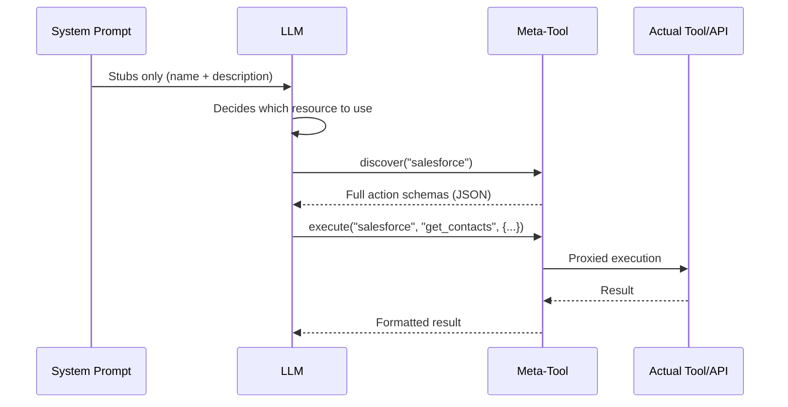
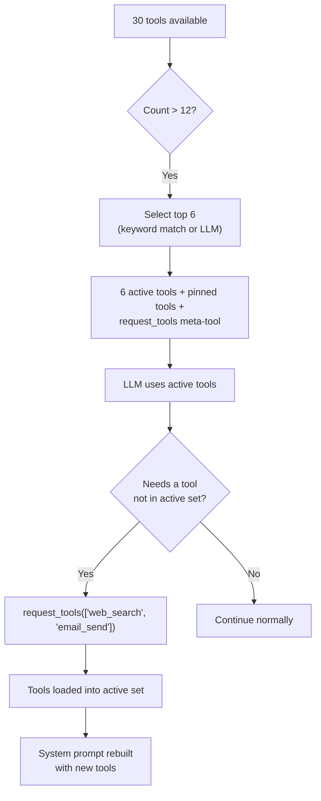

## 問題

LLMはコンテキストに対して2つの通貨で支払います：トークンとアテンション。システムプロンプトに注入されたすべてのツール定義は両方のコストがかかります。単一のMCPサーバーは90以上のツールを公開できます。20個のアクションを持つ5つのAPIコネクタは100個のツール定義を生成します。30個のテーブルを持つ3つのデータベースコネクタはさらに90個のスキーマ説明を生成します。ユーザーが一言も入力する前に、システムプロンプトは50～100KBのコンテキストを消費できます。これは128Kモデルの予算の半分です。

コストはトークンだけではありません。研究と実践は一貫して**LLMの精度は無関係なコンテキストが増えるにつれて低下する**ことを示しています。システムプロンプトに80個のツール定義を持つエージェントは、6個のツール定義を持つエージェントよりもツール選択で測定可能に悪いパフォーマンスを示します。モデルは決して使用しないツールスキーマにアテンションを費やし、重要なツールと指示への焦点を薄めます。

素朴なソリューション――すべてを注入し、モデルに整理させる――はスケールしません。FIM Oneは反対のアプローチを採用しています：**LLMが決定を下すために必要な最小限を表示し、必要に応じてより多くをリクエストさせる。**

## パターン

プログレッシブディスクロージャーは、すべてのリソースタイプ全体で2層アーキテクチャに従います：

1. **Tier 1 -- システムプロンプト内のスタブ。** 軽量なサマリー：名前、短い説明、およびLLMが詳細が必要かどうかを判断するのに十分なメタデータ（アクション数、テーブル数、ツール数）。

2. **Tier 2 -- オンデマンドの完全な詳細。** LLMがメタツールを呼び出して、完全なスキーマ、パラメータ、および実行機能を取得します。完全な詳細は、ツール結果メッセージとして会話に入ります -- システムプロンプトに永続的に占有されるのではなく、そのターンにスコープされます。



重要な洞察：**完全なツールスキーマは会話スコープであり、プロンプトスコープではありません。** これらはツール結果メッセージとして表示され、コンテキスト管理システムは後のターンで要約または切り詰めることができます。対照的に、システムプロンプトコンテンツは会話全体を通じて完全なサイズで永続化します。

## Five disclosure mechanisms

FIM One applies progressive disclosure uniformly across five resource types. Each uses the same two-tier pattern but with a meta-tool tailored to its semantics.

| Resource | Meta-Tool | Stubs Show | On-Demand Returns | Config Var | Default |
|---|---|---|---|---|---|
| Skills (when the module is enabled; off by default) | `read_skill` | Name + description (120 chars) | Full SOP content + embedded script | `SKILL_TOOL_MODE` | `progressive` |
| API Connectors | `connector` | Connector name + action list | Full action schemas with parameters | `CONNECTOR_TOOL_MODE` | `progressive` |
| Database Connectors | `database` | DB name + table names + counts | Column schemas, SQL query execution | `DATABASE_TOOL_MODE` | `progressive` |
| MCP Servers | `mcp` | Server name + tool list | Full tool schemas + invocation | `MCP_TOOL_MODE` | `progressive` |
| Built-in Tools | `request_tools` | Compact catalog (name + 80-char desc) | Full tool schema injected into session | _(auto)_ | Auto when >12 tools |

### Skills -- `read_skill`

**What the LLM sees initially:**

```
## Available Skills
Call read_skill(name) to load full content before executing any of these:
- Customer Complaint SOP: Handle escalations per company policy...
- Refund Processing: Step-by-step refund workflow with approval gates...
```

Each stub is roughly 30 tokens -- a name plus the Skill's description, truncated to 120 characters (`SKILL_STUB_DESC_LENGTH`).

**What happens on demand:** The LLM calls `read_skill("Customer Complaint SOP")` and receives the complete SOP text -- potentially thousands of tokens of step-by-step instructions, decision trees, and embedded scripts. This content enters as a tool result, not as system prompt text, so it is subject to normal context management (summarization, truncation) in later turns.

**Legacy mode:** `SKILL_TOOL_MODE=inline` embeds the full Skill content directly in the system prompt. Suitable when you have few, small Skills -- but scales poorly.

**Context savings:** A deployment with 10 Skills averaging 2,000 tokens each consumes ~300 tokens in progressive mode (stubs only) vs. ~20,000 tokens in inline mode. That is a 98% reduction in persistent context cost.

### APIコネクタ -- `connector`

**LLMが最初に見るもの:**

```
Interact with external services. Available connectors:
  - salesforce: CRM system -- actions: get_contacts, create_lead, update_opportunity
  - jira: Project management -- actions: create_issue, get_issue, search_issues

Subcommands:
  discover <name> -- list actions with full parameter schemas
  execute <name> <action> {"param": "value"} -- run an action
```

各コネクタスタブはアクション名をリストしますが、パラメータスキーマは含みません。LLMは*どのような*アクションが存在するかは知っていますが、*どのように*呼び出すかは知りません。これはコネクタを使用するかどうかを決定するための正確な詳細レベルです。

**オンデマンドで発生すること:** `connector("discover", "salesforce")` はHTTPメソッド、URLパス、パラメータJSONスキーマ、リクエストボディテンプレートを含む完全なアクションスキーマを返します。`connector("execute", "salesforce", "get_contacts", {"limit": 10})` は完全な認証注入と監査ログを備えた `ConnectorToolAdapter` を通じて実行をプロキシします。

**レガシーモード:** `CONNECTOR_TOOL_MODE=legacy` は各アクションを個別のツール（`salesforce__get_contacts`、`salesforce__create_lead` など）として登録します。20個のアクションを持つコネクタはシステムプロンプト内の20個のツール定義になります。

**コンテキスト節約:** 15個のアクションを持つコネクタはスタブで約50トークン対完全スキーマで約3,000トークンを生成します。5つのコネクタ：段階的に約250トークン対レガシーで約15,000トークン。

### データベースコネクタ -- `database`

**LLMが最初に見るもの:**

```
Query connected databases. Available databases:
  - hr_postgres: HR system (12 tables: employees, departments, salaries ...)
  - analytics_db: Analytics warehouse (45 tables: events, sessions, users ...)

Subcommands:
  list_tables <database> -- table names, descriptions, column counts
  discover <database> [table] -- full column schemas for one or all tables
  query <database> <sql> -- execute a SQL query
```

データベーススタブには、テーブル名（最大10個）とカウントが含まれており、LLMが列スキーマを読み込まずにクエリするデータベースを決定するのに十分な情報を提供します。

**オンデマンドで実行されるもの:** 3つのサブコマンドが自然な探索フローを形成します:

1. `database("list_tables", "hr_postgres")` -- すべてのテーブル名、説明、列数を返します。
2. `database("discover", "hr_postgres", table="employees")` -- 完全な列スキーマ（名前、型、null許容、主キー、説明）を返します。
3. `database("query", "hr_postgres", sql="SELECT ...")` -- 検証済みのSQLクエリを安全性チェックと行制限で実行します。

3段階のフローは、開発者が新しいデータベースを探索する方法を反映しています: テーブルを参照し、スキーマを検査してからクエリを実行します。LLMは同じパターンに自然に従います。

**レガシーモード:** `DATABASE_TOOL_MODE=legacy`は、データベースごとに3つのツール（`{db}__list_tables`、`{db}__describe_table`、`{db}__query`）を登録します。5つのデータベースコネクタがある場合、1つではなく15個のツール定義になります。

**コンテキスト削減:** 30個のテーブルと200列を持つデータベースは、スタブで約80トークン対フルスキーマで約5,000トークンを生成します。複数のデータベースがある場合、削減効果は複合します。

### MCP サーバー -- `mcp`

**LLM が最初に見るもの:**

```
Interact with MCP servers. Available servers:
  - github: GitHub (35 tools: create_issue, list_repos, get_pull_request ...)
  - slack: Slack (12 tools: send_message, list_channels, upload_file ...)

Subcommands:
  discover <server> -- list tools with full parameter schemas
  call <server> <tool> {"param": "value"} -- invoke an MCP tool
```

MCP サーバーは段階的な情報開示の最も劇的なケースです。GitHub MCP サーバーは 35 以上のツールを公開します。ファイルシステムサーバーは 20 以上を公開します。段階的な情報開示がなければ、3 つの MCP サーバーを接続すると、システムプロンプトに 70 以上のツール定義が注入される可能性があります。各ツールには完全な JSON Schema パラメータが含まれます。

**オンデマンドで何が起こるか:** `mcp("discover", "github")` は完全なツールカタログとパラメータスキーマを返します。`mcp("call", "github", "create_issue", {"title": "Bug report", "body": "..."})` は保存された `MCPToolAdapter` に委譲され、MCP サーバープロセスと通信します。

**レガシーモード:** `MCP_TOOL_MODE=legacy` は各 MCP ツールを個別のツール (`github__create_issue`、`github__list_repos` など) として登録します。これにより、ツール選択の閾値を簡単に超過し、不要な選択フェーズをトリガーする可能性があります。

**コンテキスト削減:** ここでの削減は極めて大きいです。GitHub MCP サーバーの 35 個のツールは 10,000 トークン以上のスキーマを消費する可能性があります。段階的モードでは、スタブは約 100 トークンのコストがかかります。ユーザーがそのコンバーセーション内で GitHub を必要としない場合、これらの 10,000 トークンは決して使用されません。

### Built-in Tools -- `request_tools`

The fifth mechanism is architecturally different from the other four. It does not consolidate a resource type behind a meta-tool. Instead, it addresses the **tool selection bottleneck** -- what happens when the agent has more than 12 tools available.

**How it works:** When the total tool count exceeds `REACT_TOOL_SELECTION_THRESHOLD` (default: 12), the ReAct engine selects up to 6 relevant tools for the current query (a keyword match first, a lightweight fast-LLM call otherwise) and adds pinned tools such as `read_skill` and `update_plan` on top. The remaining tools are stored in a full registry. A `request_tools` meta-tool is automatically registered, listing all unloaded tools as a compact catalog (name + 80-character description).



**What the LLM sees initially:**

```
Load additional tools into the current session.
Available tools not yet loaded:
- web_search: Search the web for current information and return relevant results...
- email_send: Send an email to one or more recipients with subject, body, and opt...
- python_exec: Execute Python code in a sandboxed environment and return the output...
```

**What happens on demand:** `request_tools(tool_names=["web_search", "email_send"])` copies those tools from the full registry into the active registry. The system prompt is rebuilt on the next iteration so the LLM sees the full schemas. This is a side-effect -- the tool mutates the active tool set mid-conversation.

**No env var:** This mechanism activates automatically when tool selection filters the set. There is no `REQUEST_TOOLS_MODE` environment variable. If you want to disable tool selection entirely, set `REACT_TOOL_SELECTION_THRESHOLD` to a very high number.

**Context savings:** The savings depend on how many tools are available and how many the selection picks. An agent with 30 tools seeing only 6 active schemas + the `request_tools` catalog saves roughly 60--70% of the tool schema context.

## How it fits into the tool assembly pipeline

The [System Overview](/architecture/system-overview) describes an 8-step per-request tool assembly pipeline. Progressive disclosure acts at multiple points:

| Pipeline Step | Progressive Disclosure Role |
|---|---|
| **1. Base discovery** | No effect -- built-in tools are loaded normally |
| **2. Agent category filter** | No effect -- category filtering applies regardless of mode |
| **3. KB injection** | No effect -- KB tools are naturally lightweight (1--2 tools) |
| **4. Connector loading** | `ConnectorMetaTool` consolidates all API connectors; `DatabaseMetaTool` consolidates all DB connectors |
| **5. MCP loading** | `MCPServerMetaTool` consolidates all MCP servers into one tool |
| **6. Skills injection** | `ReadSkillTool` replaces full content with compact stubs in system prompt |
| **7. CallAgent registration** | No effect -- `call_agent` is already a single tool with a catalog |
| **8. Runtime selection** | `request_tools` meta-tool registered when selection filters the set |

The net effect: steps 4--6 each reduce their tool count to 1 (or a small constant), and step 8 adds a safety net for dynamically loading anything the selection phase missed. An agent that would have 50+ tools in legacy mode might present 8--10 in progressive mode -- well below the selection threshold.

## 設定

4つの環境変数がリソースタイプごとに段階的な開示を制御します：

| 変数 | 値 | デフォルト | 効果 |
|---|---|---|---|
| `SKILL_TOOL_MODE` | `progressive` / `inline` | `progressive` | スキル：スタブ + `read_skill` vs. システムプロンプト内の完全なコンテンツ |
| `CONNECTOR_TOOL_MODE` | `progressive` / `legacy` | `progressive` | APIコネクタ：単一の `connector` メタツール vs. 個別のアクションツール |
| `DATABASE_TOOL_MODE` | `progressive` / `legacy` | `progressive` | DBコネクタ：単一の `database` メタツール vs. データベースあたり3つのツール |
| `MCP_TOOL_MODE` | `progressive` / `legacy` | `progressive` | MCPサーバー：単一の `mcp` メタツール vs. 個別のサーバーツール |

**エージェントレベルのオーバーライド。** 各環境変数は `model_config_json` フィールドを介してエージェントごとにオーバーライドできます：

```json
{
  "model_config_json": {
    "skill_tool_mode": "inline",
    "connector_tool_mode": "legacy",
    "database_tool_mode": "progressive",
    "mcp_tool_mode": "progressive"
  }
}
```

**優先順位：** エージェント設定 > 環境変数 > デフォルト。

つまり、グローバルに `progressive` を実行し（デフォルト）、特定のエージェントに対して選択的にオーバーライドできます。単一の小さなスキルを持つエージェントは `inline` モードを使用する場合があります。LLMがすべてのコネクタアクションを事前に確認する必要があるエージェント（例えば、メタツールを確実に呼び出さない微調整されたモデル）は `legacy` モードを使用する場合があります。

**`request_tools` に設定はありません。** ツール選択がフィルタされたサブセットを生成する場合、自動的にアクティブになります。閾値は `REACT_TOOL_SELECTION_THRESHOLD`（デフォルト：12）で制御され、最大選択数は `REACT_TOOL_SELECTION_MAX`（デフォルト：6）で制御されます。

## デザイン上の決定

### なぜ明示的（LLM駆動）ではなく暗黙的（フレームワーク駆動）なのか？

別の設計アプローチとしては、フレームワークがヒューリスティックに基づいてツールスキーマを自動的に展開する方法が考えられます。例えば、ユーザーのクエリがどのコネクターに関するものかを検出し、LLMがプロンプトを見る前にそのスキーマを注入するといったものです。FIM Oneは3つの理由から、LLM駆動のアプローチを意図的に選択しました：

1. **LLMはヒューリスティックよりも意図検出に優れている。** 「顧客がオープンなチケットを持っているか確認して、プロフィールを更新する」というようなクエリは2つのコネクターを含みます。キーワードのヒューリスティックマッチングは脆弱ですが、LLMは自然に両方を識別します。

2. **透明性。** LLMが`connector("discover", "jira")`を呼び出すと、そのアクションはツールトレースに表示されます。ユーザー（およびデバッグしている開発者）は、どのスキーマがいつ読み込まれたかを正確に確認できます。暗黙的な展開は見えません。

3. **コンテキスト効率。** フレームワークはLLMがコネクター内のどのアクションを必要とするかを知ることができません。コネクターのすべてのアクションを展開すると、無関係なものにトークンを浪費します。LLMはまずアクション名を（スタブ経由で）確認してから、特定のアクションのスキーマのみをリクエストします。これは純粋な2段階開示です。

### Why per-resource meta-tools rather than one universal tool?

A single `discover_resource(type, name)` tool would be simpler to implement but worse for the LLM. Per-resource meta-tools provide:

- **Typed parameters.** `connector` has `subcommand`, `connector`, `action`, `parameters`. `database` has `subcommand`, `database`, `table`, `sql`. The parameter schemas tell the LLM exactly what is expected.
- **Enum constraints.** Each meta-tool lists its valid names (connector names, database names, server names) as enum values in the schema. The LLM cannot hallucinate a connector name.
- **Category semantics.** The `connector` tool has category `connector`, `database` has category `database`, `mcp` has category `mcp`. An agent's `tool_categories` filter applies to built-in tools only; which meta-tools appear is decided by the agent's bound connectors and MCP servers.

### なぜプログレッシブモードとレガシーモードの両方があるのか？

すべてのLLMがメタツールを同じように処理できるわけではありません。小規模なモデルまたはファインチューニングされたモデルは、2ステップの検出-実行パターンに苦労する可能性があります。レガシーモードは、すべてのアクションがスタンドアロンツールであり、その完全なスキーマが表示される直接的なフォールバックを提供します。メタツールの間接参照は必要ありません。

デュアルモード設計は移行もサポートしています。既存のデプロイメントは、単一の環境変数を変更することで、一度に1つのリソースタイプをテストしながら、段階的にプログレッシブモードに切り替えることができます。各環境変数は機能フラグとして機能します。影響範囲は単一のリソースタイプに限定され、ロールバックは1行の設定変更です。

3番目のより実用的な理由は、**デバッグです。** レガシーモードでは、すべてのツール呼び出しが明示的で自己完結しています。`salesforce__get_contacts(limit=10)` はログとトレースで即座に読み取ることができます。プログレッシブモードでは、同じ呼び出しは `connector("execute", "salesforce", "get_contacts", {"limit": 10})` です。実際に何が起こったかを理解するためにメタツール引数を解析する必要がある追加の間接参照レイヤーです。開発とトラブルシューティング中に、単一のリソースタイプをレガシーモードに戻すことで、他のリソースタイプに影響を与えることなく、診断を大幅に高速化できます。
