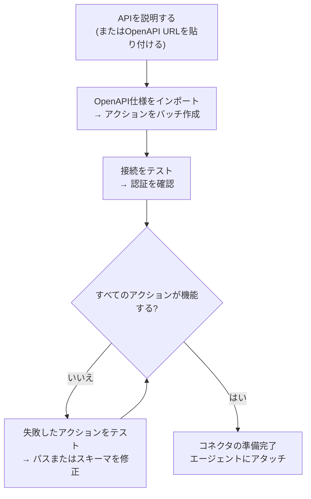
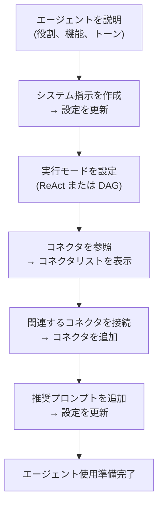

## 概要

AI Builderを使用すると、プレーンテキストで必要な内容を説明し、AIエージェントがそれを設定してくれます。2つのモードで動作します:

| モード | 動作方法 | 最適な用途 |
|------|-------------|---------|
| **クイック提案** | 単一のLLM呼び出しで設定を生成 | 迅速な初期ドラフト、シンプルなAPI |
| **高度なビルダー** | ReActエージェントがループ内でツールを使用して構築、テスト、改善 | 複雑なAPI、OpenAPIインポート、反復的な改善 |

いつでもモード間を切り替えることができます。クイックモードは開始点を作成し、高度なビルダーでは反復処理が可能です。

---

## コネクタビルダー

**コネクタ**は、FIM Oneが外部システムと通信する方法を定義します。ベースURL、認証、および公開する特定のAPIアクションが含まれます。コネクタビルダーは、AIエージェントに9つのツールを提供し、あなたの代わりにこの設定を構築・管理します。

### ツール

| ツール | 機能 |
|------|-------------|
| **Get Settings** | 現在のコネクタ設定を読み取る（URL、認証タイプ、認証設定） |
| **Update Settings** | コネクタ名、ベースURL、または認証認証情報を変更する |
| **List Actions** | 既存のすべてのAPIアクションとそのメソッドおよびパスを表示する |
| **Create Action** | 新しいAPIエンドポイントを追加する — HTTPメソッド、パス、パラメータ、ボディテンプレート |
| **Update Action** | 既存のアクションを変更する（説明、スキーマ、レスポンス抽出） |
| **Delete Action** | 不要になったアクションを削除する |
| **Test Action** | 任意のアクションのライブHTTPリクエストを送信し、レスポンスを検査する |
| **Test Connection** | ベースURLに到達可能であり、認証情報が受け入れられることを確認する |
| **Import OpenAPI** | Swagger 2.xまたはOpenAPI 3.xスペックから最大50個のエンドポイントを一括インポートする |

### 典型的ワークフロー

最も一般的なパターン：OpenAPI URLを貼り付けて、ビルダーに残りの処理を任せます。

**プロンプトの例：**
> "OpenAPI仕様を`https://api.acme.com/openapi.json`からインポートし、`order_id=12345`で`GET /orders`エンドポイントをテストしてください。"

ビルダーは仕様を取得し、すべてのアクションを自動的に作成し、テストリクエストを実行し、結果を報告します。フォームに触れることなくすべてが完了します。

---

## エージェントビルダー

**エージェント**は、一連の指示、ツール、および（オプション）コネクタを備えた名前付きのAIペルソナです。エージェントビルダーは、AIエージェントに別のエージェントをゼロから構成するための6つのツールを提供します。

### ツール

| ツール | 機能 |
|------|-------------|
| **Get Settings** | 現在のエージェント設定（指示、実行モード、ツール、モデル）を読み取る |
| **Update Settings** | 名前、説明、システムプロンプト、実行モード、または提案されたプロンプトを変更する |
| **List Connectors** | 利用可能なすべてのコネクタ（接続済みおよび未接続）を参照する |
| **Add Connector** | コネクタを接続して、エージェントがそのアクションをツールとして呼び出せるようにする |
| **Remove Connector** | コネクタを切断する（コネクタ自体は削除されない） |
| **Set Model** | 基盤となるLLMを切り替えるか、温度と最大トークン数を調整する |

### 典型的ワークフロー

説明から始めて、ビルダーがエージェント全体を設定します:

**プロンプト例:**
> "Finance Copilotを作成してください。Acmeコネクタを使用して、注文と請求書に関する質問に答える必要があります。ReActモードを使用し、一般的な質問用に3つの推奨プロンプトを追加してください。"

ビルダーは現在の設定を読み取り、システムプロンプトを作成し、コネクタを接続し、実行モードを設定し、推奨プロンプトを追加します — すべて1回の会話ターンで行われます。

---

## How it works

Under the hood, the builders share the same infrastructure as regular agents:

| Builder mode | Mechanism |
|-------------|-----------|
| **Quick suggestions** | A single LLM inference call generates the full configuration as structured JSON |
| **Advanced builder** | A ReAct agent loop: Reason → call a builder tool → observe the result → decide next step |

The advanced builder is a full ReAct agent that happens to have a restricted toolset — the 9 Connector or 6 Agent builder tools (the Connector builder also gets web search and fetch, to read API docs) and no code execution. A third builder with its own tool set configures database connectors: connection test, table listing, schema annotation and sample queries. It reads the current state of the target resource, plans what needs to change, calls the appropriate tools, and verifies the result before declaring it done.

This means the advanced builder can handle ambiguity: if the OpenAPI import creates 30 actions but only 5 are relevant, you can tell it "keep only the order-related endpoints" and it will delete the rest.
