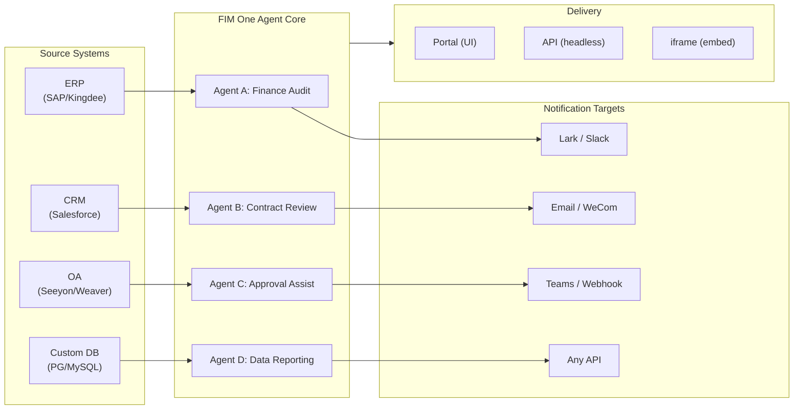

> Goal: Build an **all-in-one agent platform for Global × China enterprises** — delivered through three progressive modes: Standalone (portal assistant), Copilot (embedded in host system), Hub (central cross-system orchestration).
>
> Principles: **Provider-agnostic** (no vendor lock-in), **minimal-abstraction**, **protocol-first**, **connector-first** (integration is the core value).

## 製品ビジョン

FIM Oneは、3つの段階的なデリバリーモードに対応する**オールインワンエージェントプラットフォーム**です。

```
Standalone   → Your own AI assistant (Portal)
Copilot      → AI embedded in a host system (iframe / widget / embed)
Hub          → Central cross-system orchestration (Portal / API)
```

**クロスシステムオーケストレーションが中核的な差別化要因です。** エンタープライズクライアントはレガシーシステム（ERP、CRM、OA、財務、HR）を保有しており、これらをAIを通じて相互に連携させる必要があります。



**GTMパス：ランド・アンド・エクスパンド**

| ステップ | モード | 実行内容 |
|------|------|-------------|
| ランド | Copilot | 1つのシステムに組み込み、そのUI内で価値を実証 |
| エクスパンド | Copilot → Hub | より多くのシステムにロールアウト。Hubモードはそれらを統合 |

## Known Issues

本番環境で再現可能だが、まだ修正されていない追跡中のバグです。各項目は症状、疑わしい影響範囲、および回避策（ある場合）を記載しています。修正がスコープされ、スケジュール化されると、アイテムはバージョンセクションに移動します。

- **Playground の停止と再試行で一時的なビジュアルアーティファクトが表示され、ページ更新で常にクリアされます。** 3つの同時レンダリングソース——`activeConversation.messages`（DBスナップショット）、SSE `messages` ストリーム、および楽観的な `pendingQuery` プレースホルダー——が単一の派生状態に統合されていないため、「再試行」をクリックしてからペアのアシスタント応答が到着するまでの間、UI は (a) ストリーム前ウィンドウで同じクエリを一時的に2回レンダリングし、(b) `hasLiveMessages` が true で、スナップショットが再ロードされる前に再試行履歴から以前の孤立したユーザーバブルをドロップし、(c) SSE「done」イベントと次の `selectConversation` 更新の間の狭いウィンドウでちらつく可能性があります。**データは決して失われません**——すべてのユーザーメッセージ（中止された再試行を含む）は `conversation.messages` に永続化され、`normalize_alternating_messages` 経由で次の LLM 呼び出しに持ち込まれ、`48ba08c6` レンダリング修正で導入された `HistoryTurn.orphanUserContents` 経由で更新後に正しくレンダリングされます。文脈として、Claude 独自のウェブ UI も同様のクラスのバグを示しています——応答の途中で停止して直後にフォローアップクエリを送信すると、フォローアップが最初のクエリの兄弟編集ブランチとしてフォークされることがあり、新しいターンとして追加されるのではなく——これは楽観的 UI + SSE + 永続化履歴設計における既知の難しい問題であり、FIM One 固有の欠陥ではありません。適切な修正には、3つのレンダリングソースを単一の派生状態に統合する必要があります。より広い Playground ステートマシンリファクタリングまで延期されています。

## 出荷済みバージョン

### v0.1 (2026-02-22) — MVP: ReAct + DAG Planner
- ReActAgent（計算機、python_exec、web_search ツール付き）
- DAG Planner（LLM が依存関係グラフを生成）
- Portal UI（ストリーミング + KaTeX 対応）

### v0.2 (2026-02-24) — Multi-Model + Memory
- リトライ / レート制限 / 使用状況追跡
- ネイティブ関数呼び出し (JSON のみの解析なし)
- マルチモデルサポート (fast + main LLM)
- メモリ: WindowMemory、SummaryMemory
- SSE ストリーミング対応の FastAPI バックエンド

### v0.3 (2026-02-25) — Web Tools + MCP
- Webツール（web_search、web_fetch）Jina/Tavily/Brave経由
- ファイル操作ツール
- MCPクライアント（標準ツール統合）
- ツール自動検出 + カテゴリ
- クリックしてスクロール可能なDAG可視化
- Dockerでのコード実行（`--network=none`）

### v0.4 (2026-02-25) — マルチターン + エージェント
- マルチターン会話 (DbMemory)
- ツールステップ折りたたみUI
- HTTPリクエスト + シェル実行ツール
- エージェント管理 (作成、設定、公開)
- JWT認証
- エージェント単位の実行モード + 温度制御

### v0.5 (2026-02-28) — Full RAG + Grounded Gen
- Full RAG パイプライン (embedding + vector store + FTS + RRF + reranker)
- Grounded Generation (citations、confidence scores)
- Knowledge base ドキュメント管理 (CRUD、search、retry、schema migration)
- ContextGuard + pinned messages (token budget manager)
- DbMemory persistence + LLM Compact
- DAG Re-Planning (up to 3 rounds)

### v0.6 (2026-03-01) — Connector Platform
- **Connector CRUD**: create, read, update, delete
- **ConnectorToolAdapter**: converts Connector → BaseTool
- **Per-user credentials**: AES-GCM encryption
- **Confirmation gate**: 確認闸門
- **Audit logging**: all tool calls recorded
- **Circuit breaker**: graceful degradation on failures
- **Utility tools**: email_send, json_transform, template_render, text_utils
- **Embedding options**: Jina, OpenAI, custom providers

### v0.7 (2026-03-06) — Admin Platform + Multi-Tenant
- **Admin Platform**: ユーザー管理、ロール切り替え、パスワードリセット、アカウント有効化/無効化
- **招待制登録**: 3つのモード（開放/招待/無効）+ 招待コード CRUD
- **ストレージ管理**: ユーザーごとのディスク使用量、クリア、孤立ファイルのクリーンアップ
- **会話モデレーション**: 管理者による一覧表示/削除
- **ユーザーごとの強制ログアウト**: すべてのトークンを無効化
- **API ヘルスダッシュボード**: システム統計、コネクター メトリクス
- **初回セットアップウィザード**: ガイド付き管理者アカウント作成
- **個人センター**: ユーザーごとのグローバル指示、言語設定
- **JWT 認証**: トークンベースの SSE 認証、会話の所有権
- **グローバル MCP サーバー**: 管理者がプロビジョニング、すべてのセッションで読み込み
- **後方互換性**: registration_enabled → registration_mode 自動マイグレーション

### v0.7.x (2026-03-07 to 2026-03-12) — 安定性 + 改善
- 招待コード管理
- ユーザーごとのクォータ（429 の適用）
- 構造化監査ログ
- センシティブワードフィルタリング
- 管理者のログイン履歴
- 管理者用ファイルブラウザー
- 管理者ビューの強化（model_name、tools、kb_ids フィールド）
- Docker Compose デプロイ（単一イメージ、名前付きボリューム）
- window.location からの OAuth 自動検出
- OpenAI o-series、Gemini 2.5+、Claude 向けの拡張思考 / 推論サポート（`LLM_REASONING_EFFORT`、`LLM_REASONING_BUDGET_TOKENS`）
- 管理者によるツールごとの有効化 / 無効化（無効なツールは実行時にチャットから除外）
- MCP サーバー管理をConnectorsページに移動
- データベースのデュアルサポート：SQLite（設定不要のデフォルト）+ PostgreSQL（本番環境）；Docker Compose が PostgreSQL を自動プロビジョニング
- プロバイダーごとの拡張思考セットアップを含む、モデル設定のドキュメントページ
- SSE Protocol v2：`delta_reasoning`、`usage` フィールドと、分割された `done` / `suggestions` / `title` / `end` イベントによるリアルタイム回答ストリーミング；SQLite プールサイズを 5 から 20 に変更
- AI Builder の拡張：7 個の新しいビルダーツール（コネクター向けの GetSettings、TestConnection、ImportOpenAPI；エージェント向けの ListConnectors、AddConnector、RemoveConnector、SetModel）、エージェントの `is_builder` フラグ、ビルダープロンプトの自動更新、SSRF ガード
- SSE v2 フロントエンド：ストリーミング中のドットパルスカーソル、折りたたみ可能なカードとして表示する DAG 再計画ラウンドのスナップショット、DAG レイアウトとステップ状態の分離
- コネクターおよびエージェントのビルダーガイドを含む、AI Builder コンセプトのドキュメントページ
- 組織システム：ロールベースのメンバーシップ（owner/admin/member）を備えた完全な CRUD、管理者管理 UI
- エージェント、コネクター、ナレッジベース、MCP サーバー向けの 3 段階のリソース可視性（personal/org/global）
- すべてのリソースタイプ向けの公開 / 非公開 API；公開されたエージェントの所有者委任
- 管理者用可視性設定エンドポイント（クローンしてグローバル化する方式に置き換え）；統一された `build_visibility_filter()` クエリーヘルパー
- データベースコネクター（フェーズ 1〜3）：PG/MySQL + 中国のレガシーデータベースへの直接 SQL アクセス；スキーマイントロスペクション、AI アノテーション、読み取り専用クエリ実行、認証情報の暗号化、コネクターごとの 3 ツール（`list_tables`、`describe_table`、`query`）
- **評価センター**：エージェント品質の定量的ベンチマーク — テストデータセット CRUD（プロンプト + 期待される動作 + アサーション）、評価実行（並列実行 + LLM 評価器 + ケースごとの合否 / レイテンシ / トークン結果）、自動ポーリング対応の結果ビューアー；マイグレーション `r8t0v2x4z567`
- 3 つのモデルロール（General/Fast/Reasoning）と階層ごとの環境設定の分離；Fast モデルがメインモデルの設定を継承しないように変更
- 構造化データとアーティファクトの受け渡しのため、単純な文字列のステップ結果を置き換える `StepOutput` データクラス
- DAG 実行用ツールキャッシュ — 実行ごとに同一のツール呼び出しをキャッシュし、非同期ロックによってスタンピードを防止（`DAG_TOOL_CACHE`）
- ステップごとの LLM 検証と、失敗時の 1 回の再試行（`DAG_STEP_VERIFICATION`）
- 自動ルーティング：Fast LLM がクエリを ReAct または DAG として分類；`/api/auto` エンドポイント；フロントエンドの 3 方向モード切り替え（`AUTO_ROUTING`）
- [x] ~~**Shadow Market Organization + Resource Subscriptions**~~：組み込みの Market 組織（シャドー、オートジョインなし）が Platform 組織に置き換わる；マーケットプレイスの閲覧によってリソースを発見し、明示的にサブスクライブ（プルモデル）；共有リソースをサブスクライブする Market API；Market への公開には常にレビューが必要；リソースサブスクリプションテーブル；グローバルな可視性に代わる組織ベースのリソース共有
- [x] ~~**Agent Auto-discovery and Sub-agent Binding**~~：エージェントの `discoverable` フラグ；`sub_agent_ids` ホワイトリスト；専門エージェントにタスクを委任する CallAgentTool
- [x] ~~**MCP Server Credentials + Per-User Override**~~：`mcp_server_credentials` テーブル；`PUT /api/mcp-servers/{id}/my-credentials` エンドポイント；認証情報のフォールバック動作を制御する `allow_fallback` フラグ
- [x] ~~**Connector/KB Toggle**~~：リソースを一時停止 / 再開する `POST /api/connectors/{id}/toggle` および `POST /api/knowledge-bases/{id}/toggle`
- [x] ~~**Standalone KB Conversations**~~：エージェントにバインドせず KB と直接チャットするための会話の `kb_ids` フィールド

### v0.8 (2026-03-20) — コネクタの宣言的設定 + 段階的開示
- [x] **データベースコネクタ**: 直接 SQL アクセス（PostgreSQL、MySQL） *(v0.7.x で提供済み — フェーズ 1〜3)*
- [x] **RBAC**: ユーザー／ロールごとのコネクタアクセス制御 *(v0.7.x で提供済み — 組織システム + 3 層の可視性)*
- [x] **コネクタ認証情報の暗号化 + ユーザーごとの上書き**: `connector_credentials` テーブル、`CREDENTIAL_ENCRYPTION_KEY` による Fernet 暗号化、`allow_fallback` フラグ、`GET/PUT/DELETE /my-credentials` エンドポイント、チャットのツール読み込み時のユーザーごとの認証情報解決
- [x] **公開レビュー UI**: 組織レベルの公開レビュ​​ーシステム — 組織ごとのレビュー切り替え、承認／拒否ワークフローを備えた ReviewsSheet、リソースカード上のステータスバッジ、公開ダイアログ内のレビュー通知、拒否されたリソースの再申請
- [x] **コネクタの段階的開示（フェーズ 1〜2）**: アクションごとのツールを単一の `ConnectorMetaTool` に置き換え。システムプロンプトには軽量な **スタブ** のみ（名前 + 1 行の説明、コネクタあたり約 30 トークン、アクションあたり約 250 トークン）を渡し、エージェントは `discover(connector)` を呼び出して必要に応じて完全なアクションスキーマを読み込む — スキーマはモデルがコネクタを選択した場合にのみ読み込まれるため、キャッシュ用のプロンプトプレフィックスを安定させられます。現代的なエージェントフレームワークで一般的な遅延ツール読み込みパターンに準拠。`execute` サブコマンド、後方互換性のための機能フラグ。
- [x] **エージェントスキルシステム + コンパクトな指示**: エージェントの指示を必要に応じて読み込むスキル読み込み — `Skill` モデル（名前、コンテンツ／SOP、オプションのスクリプト）をエージェントにアタッチし、システムプロンプトでは名前のみを参照（スキルあたり約 10 トークン）。エージェントは `read_skill(name)` を呼び出して必要に応じて完全なコンテンツを読み込みます。より豊富な SOP ライブラリを利用できる一方で、会話ごとの指示トークンコストを約 80% 削減。指示レベルに適用される、ConnectorMetaTool の段階的開示に対応する機能です。「指示 + ツール + スキル」という差別化ストーリーを実現します。さらに、Agent モデルに `compact_instructions` フィールドを追加 — 圧縮時に `ContextGuard` へ注入される、エージェントごとの圧縮優先リスト（例: 「注文 ID と金額は保持し、生の API レスポンスは削除」）で、現在の静的な汎用プロンプトを置き換えます。現代的なエージェントフレームワークで広く採用されている Compact Instructions の規約に準拠。
- [x] **コネクタのインポート／エクスポート**: コネクタテンプレートを共有
- [x] **コネクタのフォーク**: 既存のコネクタを複製してカスタマイズ
- [x] **ワークフローのフェーズ 2 ノード**: Iterator、Loop、VariableAggregator、ParameterExtractor、ListOperation、Transform、DocumentExtractor、QuestionUnderstanding、HumanIntervention — フロントエンドとバックエンドを完全実装した 9 種類の高度なノード、および新規テスト 150 件（合計 275 件）。指数バックオフによるノードリトライ、安全な式評価。成功率バー付きの統計パネル。組み込みテンプレート 12 種類。ペインのコンテキストメニュー（貼り付け、すべて選択、表示に合わせる、自動レイアウト）。
- [x] **ワークフローのフェーズ 3 ノード: SubWorkflow + ENV** — 新しいノードタイプ 2 種類（合計 25 ノード）、新規テスト 14 件（合計 306 件）、組み込みテンプレート 14 種類。SubWorkflow: 対象ワークフローの選択、変数マッピング、無限再帰を防ぐ設定可能な深度制限を備えた、DB バックエンドのネストされたワークフロー実行機能を完全実装。ENV: キーピッカーとフォールバックデフォルトを使用して、暗号化された環境変数を読み込みます。フロントエンドを完全実装（ノードコンポーネント、設定パネル、パレットエントリ、ミニマップの色）。ノードごとの実行統計パネル（成功率、実行時間、失敗数を最悪のものから順に表示）。`getNodeStats` API クライアント + `NodeStatEntry` 型。キーボードショートカットダイアログ（`?` キー）。
- [x] **ワークフローのスケジュールトリガー**: タイムゾーン、デフォルト入力、次回実行時刻の計算に対応した、ワークフローごとの cron 設定。cron プリセットボタン、トリガーテスト 30 件。
- [x] **ワークフローの API トリガー**: 外部からユーザー認証なしで実行できる、ワークフローごとの公開 API キー（`wf_` プレフィックス）とレート制限。生成／再生成／失効、トリガー URL、cURL／JS の例に対応した API キー管理ダイアログ。
- [x] **ワークフローのバッチ実行**: 最大 100 件の入力セット、設定可能な並列度（1〜10）、折りたたみ可能な項目ごとの結果、JSON エクスポートに対応する `POST /batch-run`。バッチ実行テスト 14 件。
- [x] **ワークフロー実行ログビューアー**: 実行パネルに、タイムスタンプ、色分けされたバッジ、イベントタイプのフィルタートグルを備えた、リアルタイムの時系列 SSE イベントストリームを表示。
- [x] **ワークフロー実行統計**: GROUP BY サブクエリを使用してバックエンドで実行数と成功率を一括取得。フロントエンドでは、色分けされた成功率インジケーターとともにワークフローカードへ統計を表示。
- [x] **ワークフロースケジューラーデーモン**: cron ベースのワークフローで実行時刻になったものを 60 秒ごとにポーリングするバックグラウンド非同期サービス。Croniter のタイムゾーン対応、セマフォによる同時実行制御、`last_scheduled_at` の追跡、Webhook 配信。テスト 14 件。
- [x] **ワークフローインポート競合リゾルバー**: インポート時に解決されていないエージェント／コネクタ／KB／MCP 参照を検出。可視性フィルタリングを伴う DB クエリの一括実行、フロントエンドのトースト警告。テスト 17 件。
- [x] **ワークフローのテストノード実行**: モック変数を使用した単一ノードの分離テストをエディターに統合（設定パネルのテストボタン + コンテキストメニュー）。テスト 23 件。
- [x] **ワークフローバージョン差分**: ノード／エッジの変更検出と色分けされたインジケーター（追加／削除／変更）を備えた、サイドバイサイドのブループリント比較。
- [x] **ワークフロー実行管理**: 個別の実行を削除（`DELETE /runs/{run_id}`）し、完了したすべての実行を消去（`DELETE /runs`）。フロントエンドの確認ダイアログにも対応。
- [x] **ワークフロー実行リプレイオーバーレイ**: 実行履歴の「キャンバス上で表示」ボタンから、過去の実行結果をキャンバス上に重ねて表示。再実行せずにノードごとのステータスと出力を確認可能。
- [x] **ワークフローのお気に入り／ピン留め**: localStorage に保存しながら、ワークフローをリストの先頭にスター付け／ピン留め。
- [x] **ワークフロー実行履歴のエクスポート**: 完全な実行メタデータとノードごとの結果を含む実行履歴を JSON ファイルとしてダウンロード。
- [x] **管理者向けワークフロー管理**: すべてのユーザーのワークフローを管理する管理パネルのタブ — 一覧表示、有効／無効の切り替え、確認付き削除。監査ログを伴う削除、切り替え、公開の一括エンドポイント。
- [x] **ワークフローテンプレートシステム**: 管理者向け CRUD、公開一覧／クローン API、初回起動時に自動挿入されるシードテンプレート 5 種類を備えた `WorkflowTemplate` ORM モデル。
- [x] **ワークフローのインライン検証バッジ**: 編集中にすぐ視覚的なフィードバックを得られる、エラー／警告ツールチップ付きの、キャンバス上のノードごとのリアルタイム `ValidationBadge`。
- [x] **ワークフロー実行トレースビューアー**: エンジンの `trace_level` パラメーターとノードごとの変数スナップショットを備えた、ステップ実行デバッグ用のタイムラインベースのトレースビューアー Sheet。
- [x] **ワークフローのレート制限とタイムアウト**: ユーザーごとの `WorkflowRateLimiter`（スライディングウィンドウで 10 回／分、同時実行 3 件）と、デフォルト 10 分のグローバル実行タイムアウト。
- [x] **ワークフローブループリントシステム**: 複数ステップの自動化ブループリントを設計・実行するビジュアルワークフローエディター — `Workflow`／`WorkflowRun` ORM モデル、完全な CRUD + SSE 実行 API、インポート／エクスポート、複製、ブループリント検証エンドポイント、トポロジカルソート + セマフォベースの同時実行 + 条件分岐を備えた `WorkflowEngine`、12 種類のノード（Start、End、LLM、ConditionBranch、QuestionClassifier、Agent、KnowledgeRetrieval、Connector、HTTPRequest、VariableAssign、TemplateTransform、CodeExecution）、`{{node_id.output}}` 補間と `env.*` 名前空間を備えた `VariableStore`、ノードごとのエラー戦略（STOP_WORKFLOW / CONTINUE / FAIL_BRANCH）、ノードごとのタイムアウトと高度な設定 UI、ドラッグ＆ドロップ式パレット + ノード設定パネル + 変数ピッカーコンボボックス + エッジ上へのノード追加 + 自動レイアウト（ELK.js）+ 実行履歴シートを備えた React Flow v12 ビジュアルエディター、リングベースの実行ステータス表示とアニメーション付きエッジ遷移を備えた Dify スタイルのコンパクトなノードデザイン、テンプレートピッカーダイアログと `GET /templates` + `POST /from-template` API を備えた組み込みスターターテンプレート 4 種類（Simple LLM Chain、Conditional Router、Knowledge-Augmented QA、HTTP API Pipeline）、統計エンドポイント、`?run=true` URL パラメーターによる自動オープン、サブプロセスベースのコード実行セキュリティ、105 件のテストスイート（テンプレート、評価名前空間のフラット化、ブループリント検証警告、ノード／エッジの削除、インポート／エクスポート／複製、デッドロック検出、複数条件分岐）
- [x] **操作監査**: 誰が何を行ったかを詳細にログ記録 — 組織／リソースごとの公開レビュートレイルを確認できる管理者向けレビュー監査タブを追加
- [x] **セマンティックスキーマアノテーション**: コネクタスキーマのフィールドを `semantic_tag`、`description`、`pii` フラグで拡張。アノテーションを LLM ツールの説明に反映し、カラム名から推測しなくてもエージェントがフィールドの意図を理解できるようにします

### v0.8.1 (2026-03-29) — プログレッシブディスクロージャー成熟度 + ReAct強化
- DB コネクタ（`DatabaseMetaTool`）、MCP サーバー（`MCPServerMetaTool`）、オンデマンドツール読み込み（`request_tools` メタツール）のプログレッシブディスクロージャー
- DAG 品質全面改善（5 つの改善：モデルアップグレード、スキル自動検出、引用検証、構造化コンテンツ保持、ドメイン対応ルーティング）
- ReAct のドメインモデルエスカレーション（スペシャリストドメインが推論モデルに自動エスカレート）
- モデル別ネイティブ関数呼び出しトグル（`tool_choice_enabled`）
- ReAct サイクル検出（決定論的重複ツール呼び出し防止）
- ReAct 完了チェックリスト（ツール使用時の事前回答検証）
- リソースフォークフェーズ 1（系統追跡付き MCP サーバー + スキルフォークエンドポイント）
- ワークフロー接続依存関係自動サブスクライブ（再帰的サブワークフロー依存関係解決）
- プリビルトソリューションテンプレート（初回登録時にマーケットにシードされた 8 つの業界別ソリューション）
- 管理者通知改善（タイムゾーン対応、マスタースイッチ、SMTP Reply-To）
- ターンごとのトークン予算サーキットブレーカー（`REACT_MAX_TURN_TOKENS`）
- 一元化されたツール切り詰め、動的システムプロンプト予算配分
- ファイル添付ダウンロード、重複メッセージ送信修正

### v0.8.2 (2026-04-10) — エージェントコア強化 + ビジョンドキュメント
- **エージェントコア フェーズ 0** — コンパクトプロンプトが9セクション構造化フォーマットにアップグレード；空のツール結果保護（`(no output)` の代わりに説明メッセージ）；アンチループプロンプト + サイクル検出閾値を2に低下；ドメイン分類器 + プリフライトDB設定解決を並列化（リクエストあたり400～1100ms削減）；SSE `end` イベントが回答直後に送信され、タイトル/提案はバックグラウンドタスクに移動
- **エージェントコア フェーズ 1（コンテキスト アンチブロート）** — `MicroCompact` ルールベースの古いツール結果クリーンアップ（最後の6つを保持）；`REACT_TOOL_RESULT_BUDGET=40000` 集約上限；コンテキストオーバーフロー時のリアクティブコンパクト（クラッシュの代わりに自動的に予算の50%にコンパクトしてリトライ）
- **エージェントコア フェーズ 2（速度）** — キーワードベースのツール事前選択（明らかなマッチでLLM呼び出しをスキップ、200～500ms削減）；`SharedHttpClient` LLM接続プーリング；200トークン以上の回答では完了チェックをスキップ；`FallbackLLM` がプライマリ+高速をラップし、429/503/529/接続エラーで自動フェイルオーバー
- **インテリジェントドキュメント処理（ビジョン対応）** — 適応的なドキュメント処理：PDFページはビジョン対応モデル（GPT-4o、Claude 3/4、Gemini）用にPyMuPDFで画像としてレンダリング；テキストのみフォールバックはpdfplumberで実行。モデルごとの `supports_vision` フラグ。`DOCUMENT_PROCESSING_MODE`、`DOCUMENT_VISION_DPI`、`DOCUMENT_VISION_MAX_PAGES` 経由のモード。DOCX/PPTX埋め込み画像抽出。会話ターン全体でのマルチターンビジョン永続化。スマートPDF処理（テキストリッチページはテキスト+画像を抽出；スキャンページはフルページPNGとしてレンダリング）。`--network=none` コード実行用の一般的なデータサイエンスパッケージを備えた事前構築サンドボックスイメージ（`Dockerfile.sandbox`）
- **リソースフォーク完了** — エージェント/コネクタ/ワークフロー フォークエンドポイント追加、5タイプ系統追跡完成（KBフォーク削除 — 本質的にユーザーローカル）
- **ファイル整合性ガードレール** — システムプロンプトルールがターゲットファイルが読み取り不可の場合、エージェントが無関係なファイルコンテンツを代替することを防止；アップロードされたファイルにはメッセージコンテキストに `file_id` が含まれ、直接 `read_uploaded_file` アクセス用

### v0.8.3 (2026-04-16) — ユニバーサルドキュメント変換 + エージェントコア フェーズ 3
- **ユニバーサルドキュメント変換（`convert_to_markdown` + OCR）** — Microsoft MarkItDownをラップした組み込みエージェントツール。PDF、Word、Excel、PowerPoint、HTML、JSON、CSV、XML、ZIP、EPUB、Outlook .msg、画像、音声、YouTube URLをMarkdownに変換します。`LiteLLMOpenAIShim`は任意のビジョン対応LLM（Claude、Gemini、Bedrock、Azure）経由でOCRを有効にします。ビジョン対応RAG取り込みと、テキストのみのフォールバック（回帰なし）。`LLM_SUPPORTS_VISION`環境変数でオプトアウト可能
- **エージェントコア フェーズ 3（ランタイム不変性の強化）** — 会話復旧（ぶら下がり`tool_use`の自動修復）；構造化コンパクトワークカード（圧縮ラウンド全体での`WorkCard`型マージ）；ターンレベルプロファイラー（`REACT_TURN_PROFILE_ENABLED`）；ユーザーごとのレート制限（`LLM_RATE_LIMIT_PER_USER`）；`tool_calls`を含む空コンテンツアシスタントメッセージは削除されなくなりました

### v0.8.4 (2026-04-17) — プロンプトキャッシュ + 推論正確性
- **システムプロンプトセクションレジストリとキャッシュブレークポイント** — メモ化された `PromptRegistry` がシステムプロンプトを安定したプレフィックス + 動的サフィックスに分割；キャッシュ対応プロバイダー（Claude、Bedrock Anthropic、Vertex Claude）はプレフィックスに `cache_control: {"type": "ephemeral"}` を受け取り、ターンあたりの入力トークン削減率は約60～80%。非キャッシュプロバイダーは単一の連結メッセージを取得（動作変化なし）
- **プロンプトキャッシュ可視化** — `cache_read_input_tokens` と `cache_creation_input_tokens` が `UsageSummary` → `TurnProfiler` → `done_payload.cache` フィールドを通じて追跡；ターンごとに構造化された `turn_cache` ログ行。リレーキャッシュ正当性プローブとしても機能
- **会話復旧MVP** — 合成 `tool_result` 行が中断されたターン後に永続化；`POST /chat/resume` がモノトニックカーソルからキャッシュされたSSEイベントをリプレイ；フロントエンド `useSseResume` フックが指数バックオフ（300ms → 1s → 3s、最大3回試行）と「再接続中…」インジケーターで自動再接続
- **思考ブロック永続化と署名** — `reasoning_content` + Anthropic `signature` が `metadata_["thinking"]` に永続化され、後続ターンでリプレイ；Claude 4マルチターン会話でのHTTP 400署名不一致を修正
- **プロバイダー認識推論リプレイポリシー** — `core/prompt/reasoning.py` の集中化された `reasoning_replay_policy()` がプロバイダーファミリーごとにシリアル化をゲート：Claude は署名付きで思考ブロックをリプレイ；DeepSeek-R1/Qwen-QwQ/Gemini-thinking/o-series はアウトバウンドで `reasoning_content` を削除（以前はリークしており、プロバイダーKVキャッシュを破損させ、APIドキュメントに違反していた）

### v0.8.5 (2026-04-23) — Channel Integration + Hook System + Contributor i18n
- **Feishu Channel (Phase 1 subset)** — Org-scoped `Channel` リソースと Fernet 暗号化認証情報; `FeishuChannel` はインタラクティブカード送信 + コールバック（署名検証 + URL チャレンジ）をサポート; Settings → Channels 管理 UI（リスト、ダーティ状態保護付きの作成/編集、コピー可能なコールバック URL を含む詳細、テスト送信）; CRUD API（`/api/channels`）とイベントコールバックエンドポイント（`/api/channels/{id}/callback`）。2026-04-24 路演向けに早期リリース
- **Agent Hook System（ReAct + DAG ランタイムで稼働中）** — `src/fim_one/core/hooks/` の `PreToolUseHook` / `PostToolUseHook` 抽象化; `model_config_json` で `hooks.class_hooks` を宣言するエージェントは、チャットセッションごとにフックがインスタンス化および登録されます。最初のコンシューマー `FeishuGateHook` は、エージェントが `requires_confirmation=True` ツールを呼び出すときにリンクされた Feishu グループに承認/却下カードをポストし、実行をブロックし、判定に基づいて再開または中止します
- **設定可能な確認ゲート（インラインまたはチャネル）** — すべてのエージェントは、3 つのルーティングモード（自動 / インラインのみ / チャネルのみ）、承認者スコープセレクター（開始者 / 所有者 / 組織内の誰でも）、ツール単位のオーバーライド、および明示的な承認チャネルピッカーを備えた Approval セクションを取得します。自動モードは、チャネルがリンクされていない場合、インライン承認カードに適切にフォールバックします。`POST /api/confirmations/{id}/respond` は Feishu webhook と単一の決定記録パスを共有します
- **エージェント単位のタスク完了通知** — 長時間実行される ReAct または DAG エージェントは、タスク完了時に組織のチャネルにサマリーカードをプッシュできます。汎用アウトバウンド通知パターンの最初のコンシューマー
- **Hook Approval Playground** — Channels 詳細シートには「Test Approval Flow」アクションがあり、完全な本番パス（本物の `ConfirmationRequest` 行、実際の Feishu コールバック、ステータス遷移）を実行します——本番フックが使用するのと同じコードパス
- **Contributor フレンドリーな i18n CI フォールバック** — `.github/workflows/i18n-sync.yml` は PR マージ後にマスターで EN → ZH/JA/KO/DE/FR に翻訳し、`[skip ci]` で自動コミット; 貢献者はもはやローカルで `LLM_API_KEY` を必要としません。プリコミットロケール編集ガードは生成されたロケールファイルへの手動編集を拒否します（正当な翻訳修正の場合は `ALLOW_LOCALE_EDIT=1` オーバーライド）。スモークテストプッシュで end-to-end 検証済み
- **Exa 統合ドキュメント** — 専用 Integrations セクションと、完全な Exa 検索サーフェス（neural / fast / deep-reasoning / instant）、フィルタリング、コンテンツ取得、および 3 つのチューニング済みプリセットをカバーする第一級の Exa ページ
- **Xinchuang (信創) データベースサポート** — Database Connector は PostgreSQL/MySQL と並んで KingbaseES (人大金仓)、HighGo (瀚高)、DM8 (达梦) をリストします。PG 互換ドライバーは `asyncpg` を再利用; DM8 は `dmPython` を使用します。`scripts/test_xinchuang_dbs.py` は CLI からのライブ接続を検証します
- **Channels + Hook System アーキテクチャドキュメント** — `docs/architecture/hook-system.mdx` は 3 つのフックポイントを説明し、FeishuGateHook を end-to-end で説明; 既存のアーキテクチャページはクロスリンク; README は Messaging Channels を第一級の機能としてリストします
- **強化** — 重複する Feishu コールバッククリックは二重決定の代わりに置換カードを生成; 並行コールバッククリックは条件付き `UPDATE ... WHERE status='pending'` 行数チェックで解決; 保留中の承認は `CHANNEL_CONFIRMATION_TTL_MINUTES`（デフォルト 24h）後にバックグラウンドスイーパーで自動期限切れ; Settings → Channels は組織ロールを尊重（メンバーは読み取り専用 UI を表示）; 並行ツール呼び出しアグリゲーターは、すべてのデルタに対して `index=0` を再利用するプロバイダーを処理; セッション期限切れリダイレクトはクエリ文字列を保持

### v0.8.6 (2026-05-08) — Stripe 請求 + 改善
- [x] Stripe 請求 MVP — Free + Pro ティア、Checkout、Customer Portal、webhook ライフサイクル、`/settings?tab=billing`、管理者プラン/サブスクリプション CRUD、クォータ強制は各ユーザーのプランを尊重
- [x] 管理者制御の請求機能フラグ — `system_settings.billing_enabled` は Stripe パイプライン全体をゲートするため、Stripe 認証情報のないプライベートデプロイメントは機能しない支払い UX を表示しない
- [x] ユーザーあたりの無制限クォータ — 空は グローバルデフォルトを継承、`0` は無制限を付与。以前は両方が同じ状態に折りたたまれていた
- [x] 翻訳用語集を単一の情報源として — `scripts/translation-glossary.md` はロケール別ルールを統合。プリコミットは生成されたロケールファイルへの手動編集を無条件に拒否
- [x] ライセンス + 準拠法を FIM Labs Pte. Ltd. (シンガポール) に移行。SIAC 仲裁は英語。新しいトップレベル `NOTICE` ファイル
- [x] Playground フォローアップ提案を復元、エージェントごとにオプトイン
- [x] 安定性の修正 — 厳密交互プロバイダー履歴、並列ツール呼び出し境界検出、バインドされていないエージェント確認フロー、チャネルロールゲーティング、再試行重複抑制、拒否後の言い換えなし

### v0.8.7 (2026-06-10) — セキュリティ強化 + ガードレール v0 + 請求の正確性
- [x] JWTトークンタイプの制限 — 同じ署名のトークン（一時/リフレッシュ/チケット）がAPIおよびSSEエンドポイントを認証できる2FAバイパスを修正
- [x] OAuth強化 — メール自動リンクはプロバイダー検証済みメール（アカウント乗っ取り対策）が必須；OAuth リフレッシュトークンはハッシュ化して保存されセッションローテーションが機能
- [x] コンテンツガードレール v0 — 入出力トリップワイヤーレイヤー（`core/agent/guardrail`）；ジェイルブレイク検出器と最大長出力ガードレール搭載、環境変数で設定可能
- [x] `file_ops.apply_patch` — V4A差分パッチ（ファジー空白マッチング対応、`find_replace`を補完）
- [x] 請求サイクルの正確性 — クォータはサブスクリプション記念日にリセット（暦月ではなく）；更新は権威あるStripeルックアップで期間を進める；使用状況表示は実行ウィンドウに合わせる
- [x] 信頼性の改善 — 疑似プロトコルツール呼び出しリークを回答から削除；調整可能なHTTP キープアライブで`APIConnectionError`バーストを終了；API キー使用統計は読み取り専用リクエストで永続化
- [x] 請求タブのビジュアル刷新 — フルワイド、他の設定タブと統一

### v0.8.8 (2026-06-22) — SSRF強化 + 信頼性と推論の修正
- [x] SSRF強化 — ブロックリストがIPv4マップIPv6（`::ffff:` インスタンスメタデータバイパス）をアンラップ；MCP SSE/Streamable-HTTPサーバーURL は作成時と接続時にSSRF検証
- [x] LLM信頼性 — 共有HTTPプールがLiteLLMクライアントキャッシュ削除後に自己修復；チャットがストリームを即座に送信（履歴はバックグラウンドで折りたたみ、フルリロードなし）
- [x] Anthropic適応思考プロトコル（Opus 4.6+/Sonnet 4.6/Fable 5対応） — 拡張思考が古い固定予算パラメータの4.7/4.8での400エラーで動作；OpenAIプロキシ誤ルーティングで警告
- [x] 推論詳細をエンドツーエンドで保持 — 本物の最終回答がそのままストリーム配信；圧縮、コンテキスト再構築、サブエージェントステップで生き残る（ロッシーな再合成なし）
- [x] PreToolUse強制フック — エラー時にフェイルクローズ；クラッシュした確認ゲートが呼び出しを暗黙的に許可しなくなる；非強制フックは`fail_open`経由でフェイルオープンを維持
- [x] Force-logoutタイムスタンプ比較をUTC変換で正規化 + Docker Compose `POSTGRES_*` 認証情報オーバーライド（出荷時の`fim:fim`デフォルトなし）

### v0.8.9 (2026-07-08) — モジュール スリム化 + 共有の統合 + 承認の強化
- [x] スキルとワークフロー — 管理者モジュールフラグの背後にソフトシェルフ化（デフォルト無効）、コアのみブート、削除なし、Admin → Settings → Modules から復帰可能
- [x] 共有の統合 — KB共有を削除（KBは共有エージェント経由でのみ他に到達）、DBコネクタは共有不可 + 生SQL所有者のみ、ワークフロービルダーを9つの参照のみノードに削減
- [x] Feishu承認の強化 — カードクリックは承認者のアイデンティティを強制、コールバック署名はフェイルクローズ + 暗号化エンベロープ復号化、承認は意図しないチャットにルーティングされない
- [x] 使用時アクセス再確認 — 共有MCP サーバーとバインドされたKBは実行ごとに再検証、組織を離れるとサブスクリプションと保存認証情報が即座に取り消される
- [x] エージェントループの強化 — プランボード、バックグラウンドツール、増分DAG再プラン + チェックポイント再開、圧縮はツールペアリングを保持、切り詰め継続、529/504リトライ
- [x] `run_workflow` エージェントツール + ワークフロー正確性 — エージェントノードは完全なエージェントを実行、確認ゲートはフェイルクローズ、コネクタ呼び出しはアクセス確認と監査ログ
- [x] アカウント削除の統一 — 管理者とセルフサービスは1つのパージルーチンを通じて、すべてのレコードとディスク上ファイルをカバー、組織所有者は最初に所有権を譲渡する必要あり
- [x] 所有者認証情報フォールバックはオプトイン化（破壊的変更） — コネクタ/MCP サーバーはデフォルト `allow_fallback` オフ、既存行は反転、フォールバックなしリソースで認証情報がないものはツールセットから非表示
- [x] Webhook/cronワークフロー実行は所有者のトークンクォータに制限 — 無制限の無料LLMトリガーパスは閉鎖
- [x] リソースバインディングは可視性で統一 — サブスクライブされたコネクタ/KB/MCP サーバーはエージェントにバインド可能、ワークフローコネクタステップは実行者のアクセスを強制
- [x] 会話ワークスペースはチャットに配線 — `workspace://` 超大型ツール結果のオフロード、予算切り詰め救済、圧縮前トランスクリプトスナップショット

### v0.8.10 (2026-08-28) — ストリーミング回答 + リッチレンダリング + GPT-5 Responses + アクセスモデル
- [x] 最終回答は `finish` ハンドオフを通じてネイティブにストリーミングされ、ストリーミングされたMarkdownはブロック単位でレンダリングされ、安定してちらつきなし
- [x] 回答はMermaidダイアグラム、SVG図、カードスタイルの比較表をレンダリングし、回答・コードブロック・表のコピー/エクスポートおよびファイルダウンロードに対応
- [x] レンダリングされたMarkdownはサニタイズ済み（生HTMLインジェクションを遮断）；会話エクスポートはCJK向けに組版（PDFには実フォントを埋め込み、DOCXは東アジアフォントを宣言）
- [x] 推論は1行プレビューに折りたたまれ、実行中のエージェントステップは生成された1行タイトルを会話履歴に保持して表示
- [x] サイドバーをチャットクラスター中心に再編成；`/clear` コマンドを追加；管理者モデルリストにShiftクリック範囲選択と一括削除対応のチェックボックス複数選択を追加
- [x] 新規送信メッセージはトランスクリプトの先頭に移動；リストページはカードをずらしながら表示；すべてのアニメーションはreduce-motionを尊重
- [x] エージェントが実行中に複数選択の明確化質問を行う（ask_user_question）——ターンはチャット内カードで一時停止し、回答とともに再開
- [x] コンポーザーは会話ごとに未送信の下書きを保持し、テキスト専用モデルに画像を送信しようとすると警告し、送信時にアップロード完了を待機
- [x] GPT-5.xはResponses APIファーストに移行し、ツールラウンドをまたいで暗号化された推論リプレイを実施（`FIM_GPT5_RESPONSES_MODE` でロールバック可能）
- [x] 出力制限超過時はツールコールバッチ全体を破棄し、より小さな再試行を要求
- [x] 型付きDAGステップ——純粋な変換/合成ステップは単一の直接LLM呼び出しとして実行；ask-firstゴールは1ラウンドで完了
- [x] コンテキストバジェットはモデルのハードリミットより8%低く設定；プランボードの規律（繰り返し/プランなしリマインダー、完了前の検証）
- [x] 審批闸門は委譲をまたいで保持——`call_agent` およびワークフローのAGENTノードは、なしではなくエージェント自身のフックを実行
- [x] OAuth自動リンクは両側で確認済みアドレスを要求；リフレッシュトークンのローテーションは一意の `jti` を持ち、古いトークンは即座に無効化
- [x] Feishuコールバック URLは検証を通過——未署名のプッシュはEncrypt Keyエンベロープ + Verification Tokenで認証
- [x] 課金用インスタンスアクセスモデル——サブスクリプションなし / 含まれる+有料 / 有料のみのポスチャー、含まれるデフォルトプランは削除不可

### v0.8.11 (2026-09-03) — Floating Composer
- [x] チャットコンポーザーがメッセージストリームの上に浮かぶ1つのピル形UIになりました — 添付ファイル、モード/エージェントセレクター、送信ボタンが1つの入力欄に統合され、メッセージはその下にスクロールされます

### v0.8.12 (2026-09-04) — 共有コンポーザー + ENV同期
- [x] KB／エージェント／コネクターのAIアシスタントがチャットと同じフローティングコンポーザーを使用するようになり、IME入力中にEnterキーを押しても送信されなくなりました
- [x] `scripts/env_from_active_group.py` により、`.env` のモデルフォールバックが管理パネルのアクティブグループと同期されます
- [x] OpenAIの `gpt-image-*` モデルで画像生成が動作します

### v0.9.0 (2026-10-01) — 安全に共有 {/* dev: dev/connector-rbac/00-overview.md */}
- [x] PII列のマーキング — マーキングされた列はスキーマに残り、すべてのクエリ結果で値がマスクされる
- [x] スキーマの可視性 — テーブル／列の許可・拒否設定と動詞のブロック（読み取り専用の強制）
- [x] フェンスの監査可能性 — `ConnectorCallLog` の `scope_rules_applied` に、各呼び出しに適用されたフェンスを記録
- [x] 共有解除が機能 — サブスクリプションがアクセスを許可するのは、リソースが共有されたままの場合に限られ、利用時に再確認される
- [x] Admin Marketでの取り下げにより、リソースは一覧から非表示になるだけでなく、非公開に戻る
- [x] ソリューションのサブスクリプションを解除しても、ユーザー自身が設定したコネクターや認証情報が削除されなくなった
- [x] 組織を削除すると、公開済みリソースは所有者に戻り、組織スコープのサブスクリプションは失効する
- [x] GPT-6モデル（6-luna、6-sol、6.1-sol、6-astra）が、GPT-5.xのリクエストパスでツールと構造化出力に対応 ma。

### v0.9.1 (2026-10-07) — Credential Binding Patch
- [x] 保存されたデータベースパスワードは、コネクターの所有者が、保存時に指定された対象に対してのみ使用できます

### v0.9.2 (2026-10-09) — アウトバウンドリクエストの修正
- [x] Webhook とリダイレクトは送信時にプライベートアドレスに対してチェックされます。Alibaba Cloud のメタデータ範囲をブロックしました

### v0.9.3 (2026-11-04) — 認証強化パッチ
- [x] サインインプロバイダーのリンクには完全なサインインが必要 ([GHSA-x8r3-xjc7-ph3c](https://github.com/fim-ai/fim-one/security/advisories/GHSA-x8r3-xjc7-ph3c))
- [x] すべてのルートで API キースコープを強制、デフォルト拒否 ([GHSA-j575-3grh-pvcw](https://github.com/fim-ai/fim-one/security/advisories/GHSA-j575-3grh-pvcw))

### v0.9.4 (2026-11-09) — ツールと承認のゲーティングパッチ
- [x] インスタンス全体のチャネル（通知、メール）に投稿するエージェントツールは、オペレーターが有効にするまで無効のままになります
- [x] 割り当てのないワークフロー承認を実行のユーザーに限定し、Feishu のメール照合は信頼されたテナントに対してのみ実行します
- [x] 拒否された呼び出しを繰り返して停止した実行を終了し、どのように進めるかを確認します。実行ごとに任意の時間制限を設定できます

## 今後の予定バージョン

2026-09-06に計画を見直しました。中核部分は完成しています。ReActエンジン、コネクタ、認証情報、承認ゲート、監査、マルチテナント組織が含まれます。ここからは、コードベースにすでに存在する機能を完成させ、正しく維持することに取り組みます。新たな機能領域には着手しません。以下に記載されていないものは予定していません。最後の注記を参照してください。

### v0.9.5 — 未完了部分の仕上げ

**目標**: ツリー内に残っている未完了のパスを仕上げる。

- [ ] メインのチャットパスにチャンク化されたコンパクション入力とモデル対応の予算を導入し、どのモデルの組み合わせでもウィンドウ内に収まるようにする
- [ ] 次回の LiteLLM アップグレードで Responses-bridge のストリーミング使用量を検証する（上流側のマッピングミスが疑われる）
- [ ] ネイティブな GPT-5.x パスがリリース全体で稼働した後、LiteLLM の chat→responses ブリッジを廃止する
- [ ] Stripe billing の本番稼働 — 受信漏れの webhook を検出するため Stripe と毎晩照合し、フルスタックの回帰テストと本番用の price ID を用意する

### v0.9 プリプランから出荷済み

- [x] ~~認証とセキュリティ: JWT トークンタイプ制限 + OAuth 修正 (v0.8.7); PG タイムゾーン対応タイムスタンプ (v0.8.6); 強制ログアウト UTC + `POSTGRES_*` オーバーライド + SSRF IPv6 マップ修正 (v0.8.8); オーナーフォールバック オプトイン + 統一可視性バインディング + webhook/cron メータリング (v0.8.9)~~
- [x] ~~プロバイダー互換性: Anthropic 適応推論 + 共有 LLM プール自己修復 (v0.8.8)~~
- [x] ~~コンテンツガードレール v0: トリップワイヤーレイヤー + ジェイルブレイク検出器 (v0.8.7)~~ {/* dev: dev/archive/openai-agents-insights.md */}
- [x] ~~フックシステム: スケルトン + FeishuGateHook + 承認演練場 + ReAct/DAG ランタイム (v0.8.5); PreToolUse 強制フェイルクローズ (v0.8.8)~~
- [x] ~~Feishu 通道フェーズ 1 + タスク完了通知 (v0.8.5)~~
- [x] ~~`run_workflow` 智能体ツール (v0.8.9); 推論詳細エンドツーエンド保持 (v0.8.8); ワークスペースツール出力オフロード チャットに統合 (v0.8.9)~~
- [x] ~~エージェントループ強化: プランボード、LLM コール復元力、バックグラウンドツール、段階的 DAG 再プラン + チェックポイント再開、圧縮ツールペアリング (v0.8.9)~~ {/* dev: dev/archive/incremental-dag.md */}

- [x] ~~サーキットブレーカー、ワークフロー実行保持クリーンアップ、ワークフローバージョン差分サマリー~~ *(v0.8 / v0.8.1)*
- [x] ~~DAG 品質オーバーホール、ドメインモデルエスカレーション、モデルごと NFC トグル~~ *(v0.8.1)*
- [x] ~~DatabaseMetaTool、MCPServerMetaTool、オンデマンド `request_tools`~~ *(v0.8.1)*
- [x] ~~ワークフロー接続依存関係自動サブスクライブ、ワークフロー実エグゼキューター~~ *(v0.8.1)*
- [x] ~~ReAct サイクル検出、完了チェックリスト~~ *(v0.8.1)*
- [x] ~~プリビルトソリューションテンプレート (8 垂直バンドル)、リソースフォーク (MCP/Skill/Agent/Connector/Workflow)~~ *(v0.8.1)*
- [x] ~~ビジョンドキュメント処理 (PDF / DOCX / PPTX)、MarkItDown OCR~~ *(v0.8.2 / v0.8.3)*
- [x] ~~スマートファイルコンテンツインジェクション + `read_uploaded_file`~~ *(v0.8)*
- [x] ~~エージェントコアフェーズ 3: 会話復復 MVP、コンパクトワークカード、ターンプロファイラー、ユーザーごとレート制限~~ *(v0.8.3)*
- [x] ~~会話再開 MVP、システムプロンプトレジストリ + キャッシュ、シンキングブロック永続化、推論リプレイポリシー、キャッシュ可観測性~~ *(v0.8.4)*

## 凍結機能（リリース済み、メンテナンスのみ）

[直交性戦略](/strategy/orthogonality-strategy)に従い、これらの機能はリリース済みで動作していますが、新しい機能は追加されません（バグ修正のみ）：

| 機能 | バージョン | 凍結理由 |
|---------|---------|-----------|
| ReAct Agent | v0.1、v0.9 | モデルがネイティブツール呼び出しを備えるようになった。ループ中の自己反省（v0.9）は長いチェーンでの目標ドリフトを防止。ツール観測合成品質が向上（8K文字、`REACT_TOOL_OBS_TRUNCATION`で設定可能） |
| DAG Planning / Re-Planning | v0.1、v0.5、v0.7.5 | モデルの推論機能が向上。分解がシングルショット化。ステップごとの検証がv0.7.5で実装（`DAG_STEP_VERIFICATION`）。強化：カスケード障害伝播、検証者ステータス修正、プランナーツール説明、完全な再計画履歴、ホワイトリストベースのツールキャッシュ。14個のエンジン定数がENV変数として公開——追加の計画プリミティブは計画されていない |
| Memory（Window、Summary、Compact） | v0.2、v0.5 | コンテキストウィンドウが拡大（200K以上）。外部メモリ管理の必要性が低下 |
| RAG パイプライン | v0.5 | プロバイダーがネイティブ検索を構築中（OpenAI file_search、Gemini Search Grounding） |
| Grounded Generation | v0.5 | モデルの引用精度が向上。5段階パイプラインは効果が減少 |
| ContextGuard / Pinned Messages | v0.5 | 現状のままリリース。新機能なし |

## このロードマップにはないもの

上記に記載されていない機能は、計画されていません。これは見落としではなく、意図的な選択です。プロジェクトはメンテナンス段階にあり、機能一覧を充実させることではなく、実際に誰かが必要としているものを優先して作業を進めています。

不足しているものがある場合は、行き詰まっている問題を説明する issue を作成してください。具体的にブロックされているユースケースこそが、項目をこのページに追加するきっかけになります。
