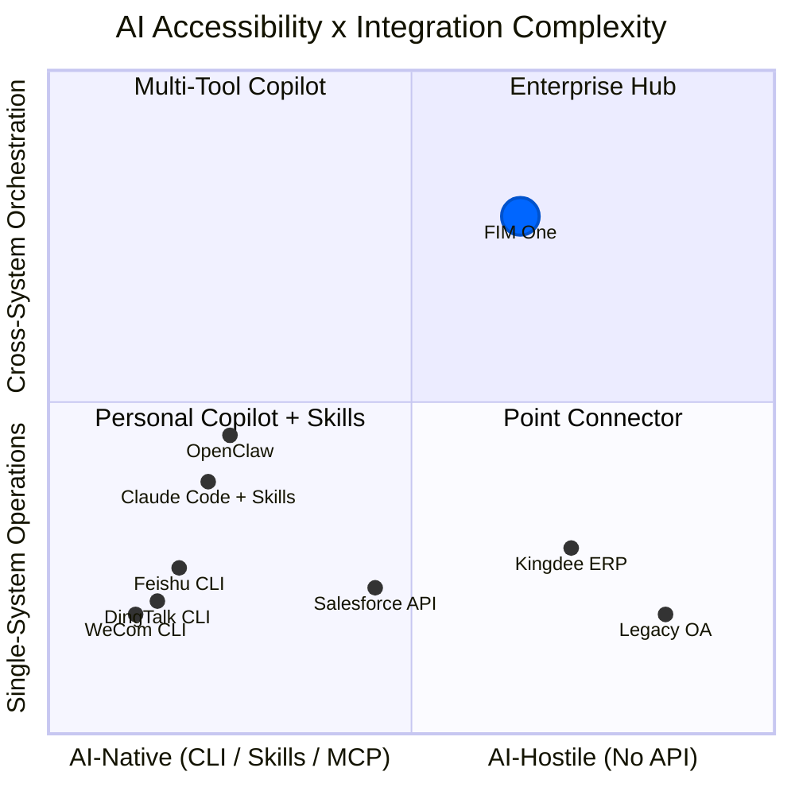

## 2026年3月信号

2026年3月，三个主要的中国工作场所平台在同一周内开源了CLI工具：

- **DingTalk** 发布了 `dws` — 跨12个业务领域的104个工具
- **Feishu/Lark** 发布了 `lark-cli` — 跨11个领域的200+个命令
- **WeCom** 发布了 `wecom-cli` — 覆盖7个业务领域

这三个平台都没有选择MCP。它们都发布了纯CLI工具，通过 `npx skills add` 分发预打包的AI Skills。这是业界首次集体展示AI智能体应该如何与企业系统交互的方式 — 答案不是一个协议，而是一个打包格式。

本文档分析了这对AI系统集成的广泛意义，以及对FIM One战略的具体影响。

## AI システム統合の 3 つのパラダイム

### 1. REST API (従来型)

基本的なアプローチです。すべてのSaaSプラットフォームはOpenAPI仕様で文書化されたHTTPエンドポイントを公開しています。AI統合には、アダプタレイヤーが必要です。つまり、「このAPIエンドポイントをこれらのヘッダーとこのJSONボディで呼び出す」から「ここに智能体が呼び出せるツールがあります」への変換を行うものです。

これが現在FIM OneのConnectorToolAdapterが行っていることです。機能しますが、各統合にはカスタム作業が必要です。APIドキュメントの読み取り、認証の処理、レスポンス形式のマッピング、ページネーションの対応などです。

- **使用者**: すべてのSaaSプラットフォーム、レガシー統合
- **AI統合**: アダプタレイヤー（ConnectorToolAdapter、カスタムコード）が必要
- **強み**: ユニバーサル、よく理解されている、構造化されたJSON I/O
- **弱み**: 各統合にはカスタム開発作業が必要

### 2. CLI + Skills (新興)

プラットフォームはコンパイル済みのCLIバイナリを提供します。AI統合は事前パッケージ化されたSkillファイル（AIIDEにCLIコマンドをsubprocess経由で呼び出す方法を教えるマークダウンドキュメント）を通じて行われます。配布はnpmを通じて行われます：`npx skills add dingtalk/dws`。

AIはSkillファイルを読み取り、利用可能なコマンドとそれが受け取る引数を理解し、CLIをsubprocessとして呼び出します。出力は通常、自由形式のテキスト（テーブル、フォーマット済み文字列）であり、AIがこれを解析する必要があります。

- **使用者**: DingTalk、Feishu、WeCom（すべて2026年3月に選択）
- **AI統合**: `npx skills add platform/cli` — AI IDEはSkillマークダウンを読み取り、CLIコマンドを呼び出す
- **強み**: 出荷が速く、Skills形式をサポートするあらゆるAI IDEで動作
- **弱み**: 非構造化テキスト出力（AIが解析する必要がある）、標準化された検出プロトコルなし、単一プラットフォームスコープ

### 3. MCP (Model Context Protocol)

JSON-RPC over stdio or SSE. 構造化されたツール検出（`tools/list`）と呼び出し（`tools/call`）。AIクライアントはサーバーとの機能をネゴシエートし、すべてのツールに対して型付きスキーマを取得し、構造化された`CallToolResult`レスポンスを受け取ります。

- **使用者**: Anthropicエコシステム、増加中の開発者ツール
- **AI統合**: ネイティブプロトコル — 構造化I/O、スキーマベースの検出
- **強み**: 標準化、構造化、合成可能、マルチツールオーケストレーション向けに構築
- **弱み**: 実装コストが高い、主要なワークプレイスプラットフォームではまだ採用されていない

### 比較

| 次元 | REST API | CLI + Skills | MCP |
|-----------|----------|-------------|-----|
| 標準化 | 中程度 (OpenAPI) | 低い (ベンダー固有のSkills) | 高い (JSON-RPC プロトコル) |
| AI フレンドリー性 | 低い (アダプタが必要) | 中程度 (テキスト I/O、AI により解析) | 高い (構造化 JSON I/O) |
| ディスカバリーメカニズム | OpenAPI spec / ドキュメント | `--help` + Skill マークダウン | `tools/list` プロトコルエンドポイント |
| 出力形式 | 構造化 JSON | 自由形式テキスト (AI 解析が必要) | 構造化 `CallToolResult` |
| リリースまでの時間 | 数週間 (統合ごと) | 数日 (既存 API をラップ) | 数週間 (プロトコル実装) |
| クロスプラットフォームオーケストレーション | ハブが必要 | 組み込みなし | 組み込みなし |
| エンタープライズガバナンス | ハブが必要 | 組み込みなし | 組み込みなし |

## 主要プラットフォームが実際に選択したもの

| | DingTalk `dws` | Feishu `lark-cli` | WeCom `wecom-cli` |
|---|---|---|---|
| Language | Go | Go + Python | Rust + TS |
| Tools | 104 / 12 domains | 200+ / 11 domains | 7 domains |
| MCP support | No | No | No |
| AI integration | Markdown Skills + schema introspection | 19 npm Skills (`npx skills add`) | 12 npm Skills (`npx skills add`) |
| Output formats | JSON / table / raw + `--jq` | JSON / table / csv / ndjson | JSON |
| Agent-friendly flags | `--yes`, `--dry-run`, smart input correction | `--no-wait`, `--as user/bot`, `--dry-run` | Direct JSON params |
| Discovery | `dws schema` (self-introspection) | `lark-cli schema` (self-introspection) | Via Skill files only |

主な観察: `npx skills add` はAIツール統合の事実上の配布チャネルになりつつあり、MCPを完全に迂回しています。これらのプラットフォームはプロトコル標準化よりも出荷速度を優先しました。AI IDE エコシステム (Cursor、Claude Code、Windsurf) は既に Skills ファイルを理解しているため、プラットフォームはプロトコルサーバーを実装することなく、即座に AI 統合を実現できます。

## AIアクセシビリティのスペクトラム

すべてのシステムがAIから同じようにアクセスしやすいわけではなく、すべてのタスクが同じように単純なわけでもありません。この2つの次元によって、異なる統合アプローチが価値を生み出す領域が決まります。

**チャートの読み方：**

- **左下（パーソナルCopilot + Skills）**：シンプルな操作を備えたAIネイティブプラットフォームです。DingTalk、Feishu、WeComはこちらに集中しています。独自のCLI + Skillsを提供しているため、単一プラットフォームへのAI統合をセルフサービスで行えます。OpenClawやClaude CodeのようにSkillsを利用するパーソナルCopilotもこの領域に位置します。ここではプラットフォームがすでに作業を完了しているため、FIM Oneが付加できる価値はほとんどありません。
- **左上（マルチツールCopilot）**：複数システムにまたがるニーズを持つAIネイティブプラットフォームです。Claude Codeに複数のSkills（`dingtalk` + `feishu` + `wechat`）をインストールしたユーザーは、複数プラットフォーム間の調整を試みることができますが、ガバナンス、オーケストレーション計画、統合された認証情報管理が不足しています。
- **右下（ポイントコネクタ）**：シンプルなブリッジを必要とするレガシーシステムです。Kingdee ERPやレガシーOAシステムへの単一のコネクタとして、FIM Oneはアダプターとして有用です。これらのシステムにはCLIがなく、APIも限定的または存在しないため、単一システムの操作であっても役立ちます。
- **右上（エンタープライズハブ）**：システム間のオーケストレーション要件を持つ、レガシーシステムまたはAPIに制約のあるシステムです。ここがFIM Oneの最も得意とする領域です。レガシー管理システム全体で契約を検索し、ERPの売掛金情報と関連付け、DingTalk経由で回収通知を送信するには、DAG計画、複数コネクタの連携、認証情報の保管庫、監査証跡、人による確認ゲートが必要です。パーソナルCopilotも、CLIも、Skillsファイルも、この領域に到達することは決してありません。

FIM Oneの価値は、右上に進むほど高まります。つまり、アクセスしにくいシステムと、より複雑なオーケストレーション要件が組み合わさるほど価値が増します。独自のCLI + Skillsを提供するプラットフォームは、反対側の角——アクセスしやすく、操作が単純な領域——を占めており、FIM Oneが追うべきではない市場を形成しています。

## パーソナルコパイロット対エンタープライズハブ

個人用AI copilot（OpenClaw、Claude Code、Cursor、Windsurf）の急増により、ポジショニングの問題が生じています。2つの根本的に異なるモデルが存在します：

### パーソナルコパイロット

- **ユーザー**: 個人開発者またはナレッジワーカー
- **データスコープ**: 自分のカレンダー、自分のメール、自分のドキュメント
- **認証**: 個人トークン、個人のOAuthセッション
- **統合スコープ**: 単一ユーザー、少数のプラットフォーム、個人の生産性向上
- **ガバナンス**: 不要 — 自分のデータ、自分のアクション

### エンタープライズ統合プラットフォーム

- **ユーザー**: 組織（チーム、部門、部門横断ワークフロー）
- **データ範囲**: 部門横断、システム横断。機密データや規制対象データを含む
- **認証**: 管理者が割り当てる権限、最小権限、認証情報の保管
- **統合範囲**: 複数システムのオーケストレーション、ビジネスプロセスの自動化
- **ガバナンス**: 監査ログ、RBAC、確認ゲート、コンプライアンス要件

これらは競合するものではなく、相互に補完し合うものです。個人向けコパイロットが普及するにつれて、企業には、それらのコパイロットがアクセスできる対象を管理する中央ハブが必要になります。`npx skills add dingtalk/dws` を使用する個人は、自分のDingTalkメッセージを読むことができます。しかし、AIエージェントがDingTalk、企業のERP、財務システムをまたいでオーケストレーションを行い、監査証跡、権限管理、書き込み操作に対する人間による確認まで必要になる場合、それはまったく別の課題です。

個人向けコパイロットは、単一プラットフォーム上の単純な操作をコモディティ化します。これはFIM Oneの市場ではありません。FIM Oneの市場は、個人向けコパイロットでは対応できない、システム横断でガバナンスが必要な、レガシーシステムも含むエンタープライズ統合です。

## FIM Oneにとっての戦略的含意

| 優先事項 | アクション | 理由 |
|----------|--------|-----------|
| 方針を堅持する | API、データベース、MCPへのアクセスを取り巻くガバナンス層（認証情報、確認ゲート、監査）への投資を継続する | CLI + Skillsではレガシーシステムに到達できず、システム横断のアクセスにはガバナンスが必要 |
| MCPを受け入れる | MCP Serverのサポートはすでに構築済み（MCPServerMetaTool）なので、引き続き洗練させる | MCPは構造化プロトコルとして有望であり、一部のプラットフォームはいずれ採用する |
| Skillsを監視する | `npx skills add` エコシステムを追跡するが、追随に躍起にならない | SkillsはFIM Oneが抱えていない配布上の問題を解決するもの |
| ガバナンスで差別化する | 監査、RBAC、確認ゲート、認証情報管理 | パーソナルコパイロットがエンタープライズガバナンスを提供することはない |
| 明確に位置付ける | 「Global × China企業向けのオールインワンエージェントプラットフォーム」——「DingTalkを呼び出す別の方法」ではない | プラットフォームが無料で提供する単純な統合で競争するのを避ける |

最も望ましくない戦略的対応は、CLI + Skillsの波に反応して、独自のSkillsをすでに提供しているプラットフォーム向けのSkillsアダプターを構築することです。それは、プラットフォームベンダー自身を相手にした消耗戦にほかなりません。正しい対応は、そうしたベンダーが決して到達できないシステムに引き続き注力することです。

## CLI、スキル、MCPの関係

これら3つの概念は異なるレイヤーで機能しますが、議論の中では混同されることがよくあります。正確に区別すると、次のようになります。

- **CLI** はユーザーインターフェースです。シェルコマンド、テキスト入出力、システムとやり取りするための形式を指します
- **Skills** は配布メカニズムです。AIにCLIコマンドの呼び出し方を教えるMarkdownファイルであり、AIツール統合のパッケージ形式です
- **MCP** はプロトコルです。JSON-RPC、構造化された検出と呼び出し、AIとツール間の通信における相互運用標準を提供します

長期的には、これらは互いの代替ではありません。CLIは、人間（またはAIのサブプロセス）がツールとやり取りする方法です。スキルファイルは、そのCLIをAI IDEに配布する方法です。MCPは、構造化され、スキーマで型付けされ、組み合わせ可能な統合をプロトコルレベルで実現する方法です。

ただし短期的には（2026年時点）、MCPよりも実装コストが低いため、導入の速さではCLI + Skillsが優勢です。既存のCLIを持つプラットフォームであれば、1日でスキルファイルを提供できます。一方、MCPサーバーの実装には数週間かかり、プロトコル仕様、トランスポート層、機能ネゴシエーションを理解する必要があります。

予想される収束の形は、現在CLIを提供しているプラットフォームが、将来的にそれをMCPサーバーとしてラップすることです。MCPのstdioトランスポートはすでにCLIプロセスを起動できるため、「Skillsによって呼び出されるCLI」と「MCPサーバーとしてラップされたCLI」の間にある隔たりは小さいものです。ただし、この収束が保証されているわけではありません。Skillsエコシステムが十分な速さで成長し、AI IDEがそれを中心に標準化されれば、MCPはエンタープライズツールの標準ではなく、開発者ツール向けのプロトコルにとどまる可能性があります。

FIM Oneにとっての結論は明確です。配布レイヤー（Skills）ではなく、プロトコルレイヤー（MCP）とガバナンスレイヤー（認証情報、確認ゲート、監査）に投資すべきです。プラットフォームベンダーにとって、配布はすでに解決済みの問題です。ハブが持続的な価値を生み出せるのは、プロトコルとガバナンスの領域です。
