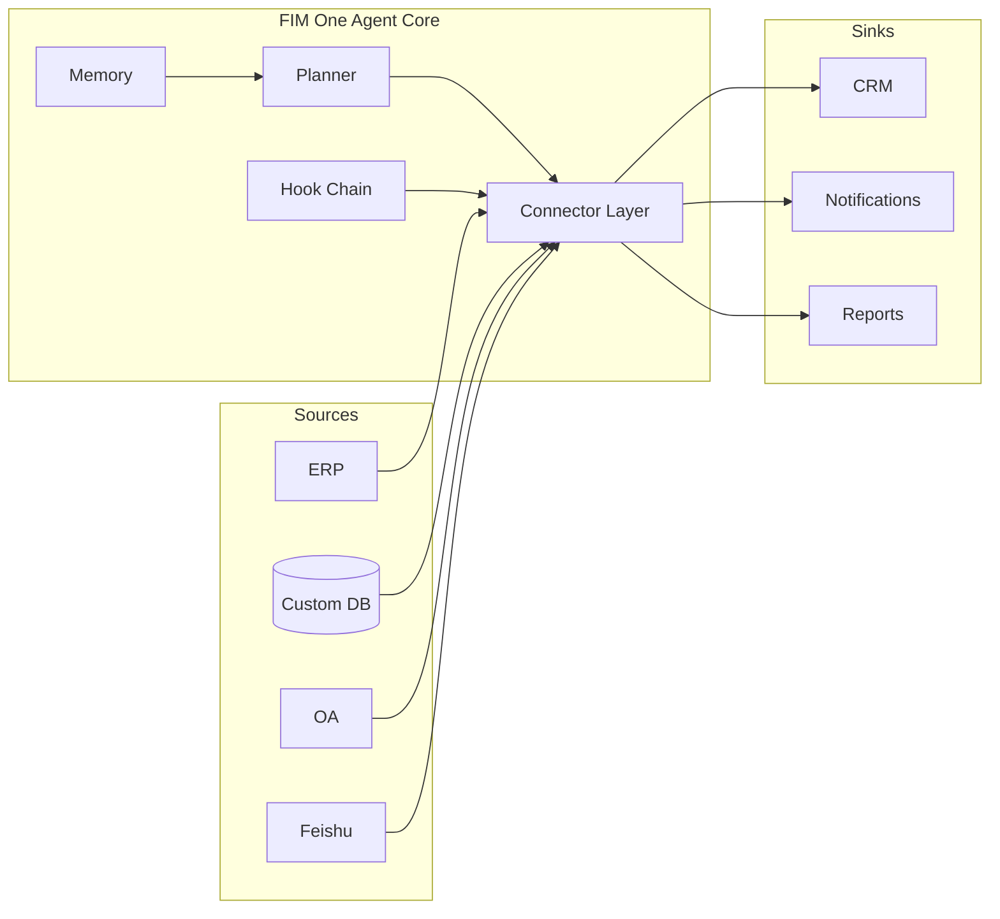

<Info>
  **バージョン 1.1 · 2026年4月。** このホワイトペーパーでは、FIM Oneのアーキテクチャ上の主張、カテゴリにおけるポジショニング、デプロイモデルについて説明します。
  すでに運用しているシステムにAIを導入する方法を評価するCTO、エンタープライズアーキテクト、AIプラットフォーム責任者、テクノロジー投資家を対象としています。
</Info>

## エグゼクティブサマリー

**データは決してあなたの境界を離れません。** この単一の文が、FIM Oneのあらゆる決定の背後にある第一次設計制約であり、新しいインフラストラクチャレイヤーが必要とされる理由です——別のiPaaSではなく、別の汎用エージェントでもありません。

ほとんどのエンタープライズは既に必要なシステムを持っています——ERP、CRM、OA、カスタムデータベース、内部API、業界別SaaS。彼らに欠けているのは、AIがベンダークラウドへのデータ移行なしに、また各ユースケースごとに6ヶ月のインテグレーションプロジェクトなしに、これらのシステムに**到達**する方法です。市場は大きく、急速に動いており、既に再編成されています：グローバルエンタープライズGenAIインフラストラクチャ支出は2025年に**米国180億ドルと予測され、前年比3.2倍で成長**しています（Menlo Ventures 2025）。中国はさらに速く動いています——エンタープライズAIエージェント支出は**120% CAGR（2023–2027）で、2027年までに¥65.5B**に達します（iResearch · CAICT 2025）。中央・国有企業は**大規模言語モデル調達の60%以上**を占めており、信創（Xinchuang）プライベートデプロイメントは厳しい制約です。

Gartnerはこのカテゴリを正式に「AI Agent Platform」（ドキュメント6300015、2025）に改名しました；CAICTの2025 Agentic AI Technology Reportではこれを「智能体平台」と呼んでいます；歴史的なiPaaSリーダーであるMuleSoftは、2025年のiPaaS Magic Quadrantで**リーダーからチャレンジャーに格下げ**されました。10年間エンタープライズインテグレーションを支配していたカテゴリは、リアルタイムで置き換わっています。

FIM Oneは新しいカテゴリのために構築されています。これは**グローバル×中国エンタープライズ向けのオールインワンエージェントプラットフォーム**です——プロバイダーに依存しないPythonフレームワークで、AIエージェントが既存システム全体にわたってタスクを動的に計画・実行し、グローバルSaaSと中国スタックを1つのエージェントコアで接続し、あなた自身の環境にデプロイされ、エンドツーエンドで監査可能です。1つのエージェントコア、3つのデリバリーモード：

| モード | 配置場所 | 典型的なデプロイメント |
|---|---|---|
| **スタンドアロン** | 独自のポータル | ナレッジQ&A、内部チャット、コードサンドボックス |
| **コパイロット** | ホストシステム内に埋め込み | ERPウェブUIの「Finance Copilot」 |
| **ハブ** | クロスシステム中央オーケストレーター | エージェントがERP照会、OA確認、Feishu経由で通知 |

本論文では、カテゴリが移動している理由、iPaaSが新しいワークロードを吸収できない理由、FIM Oneの内部がどのように見えるか、そして本番環境にそれを導入する方法を説明します。

## 1. The Problem: Enterprise AI Is an Alignment Problem

2025–2026年の公開AI議論はモデル能力——より長いコンテキスト、より優れた推論、より安いトークン——に支配されてきました。エンタープライズ内では、能力はめったにボトルネックになりません。ボトルネックは**AIがあなたのシステム内に手を持たない**ことです。

1万行のコードベースを読んで正しい修正を提案できるフロンティアLLMは、それ自体では以下のことができません：

- オンプレミスのSAPインスタンスから昨日の在庫数を取得する。
- 唯一の統合サーフェスがレガシーSOAP APIであるSaaS HRツールで休暇申請を承認する。
- Xinchuang準拠のERPに行を書き込む。その認証はOAuth2ではなくログインチケットサービスです。
- グループ独自の承認ルールを尊重しながら、Feishuグループに通知を送信する。

これらの各々は、一度解決された統合問題です。難しいのは、すべてのエンタープライズが数十のそのようなシステムを持っており、それぞれが独自の認証モデル、データ形状、および障害モードを持っていることです。それらをハードコーディングすると、脆いモノリスが得られます。LLMに実行時にそれらを発見するよう求めると、幻覚的なAPI呼び出しが得られます。

**不足しているプリミティブは整列されたサーフェスです。** モデルとシステム間の型付き、認証済み、発見可能なインターフェース——モデルに正確に何ができるか、各アクションのコストは何か、誰がそれを承認する必要があるか、結果がどのように見えるかを伝えるもの。そのプリミティブが、FIM Oneが**Connector**と呼ぶものです。

## 2. 既存のアプローチが不十分な理由

### 2.1 iPaaS とワークフロービルダー — 衰退するカテゴリ

iPaaS（MuleSoft、Boomi、Workato）と軽量ワークフローファミリー（n8n、Zapier、Dify、Coze）は、統合を**設計時**の問題として扱います。人間がノードのグラフを描き、フィールドレベルの粒度で配線し、グラフは実行時に決定論的に実行されます。統合が少なく安定していた時代には、このアプローチは機能していました。

AI駆動のエンタープライズオートメーションには対応できません。3つの複合的な理由があります：

1. **ロジックはすでにターゲットシステム内に存在します。** すべてのノードは、現在2つの場所で保守する必要があるAPI呼び出しの薄いラッパーです。
2. **人間は事前に計画を知っておく必要があります。** 「すべてのAPAC エンティティのQ1をクローズアウトする」のようなエンタープライズの質問はオープンエンドです。計画は実行時に生成される必要があり、デザイナーが描くものではありません。
3. **フィールドレベルのマッピングはスケール下で崩壊します。** 数十のシステムにまたがる数千ノードのグラフは保守不可能です。AI可読のアクションサーフェスがそれを完全に置き換えます。

このカテゴリは明らかに変わっています。Gartnerは2025年にこのスペースを「AI Agent Platform」として再分類しました（ドキュメント6300015）。CAICTも2025年の「Agentic AI Technology Report」で同じフレーミング（「智能体平台」）を採用しました。最も注目すべきことに、**10年間のiPaaS参照ベンダーであるMuleSoftは、Gartnerの2025年iPaaS Magic QuadrantでLeaderからChallengerにダウングレードされました**。同時に、2024年11月にリリースされたAnthropicのMCPプロトコルは、**15ヶ月で10,000以上のサーバーと月間9,700万のSDKダウンロードに成長しました**。シグナルは明確です。エンタープライズオートメーションの統合レイヤーが再構築されています。

### 2.2 汎用エージェント（Manus、AutoGPT、OpenAI Assistants）

汎用エージェントは、Webブラウジング、ドキュメント作成、スプレッドシート操作など、消費者向けおよび知識労働タスク向けに設計されています。VPNに接続したり、ERPに認証したり、セキュリティレビューに合格することはできません。エンタープライズシステムでラップされると、パイロット段階で終わるデモになってしまいます。

### 2.3 ベンダー組み込みAI（Feishu AI、SAP Joule、Salesforce Einstein）

ベンダーは独自のAIを独自の製品に組み込んでいます。問題は構造的です：**上流のベンダーには、独自のデータサイロを破壊するインセンティブがありません。** Feishu AIはERP データを認識しません。DingTalk AIは契約ステータスを認識しません。各ベンダーのAIは、そのベンダーが販売したものだけを認識します。クロスシステム作業では、これらは実用的ではありません。

### 2.4 自社開発とRPA

自社開発には長い開発期間と継続的な適応コストがかかります。RPAはUIを人間のように操作します——最も汎用的なアプローチですが、最も脆弱です。UIの変更のたびに破損し、認証プロンプトのたびに停止します。これはAPIの欠落に対する一時的な対処であり、AIを構築するための基盤ではありません。

FIM Oneはこれらすべてが残す隙間を埋めます。実システム上の型付きAPI、モデルによって計画され、エンタープライズによって管理され、エンタープライズ境界内にデプロイされます。

## 3. FIM One テーゼ

三つの信念が、すべての設計判断を形作っています。

**信念 1 — システムはすでに存在する。** エンタープライズに再構築を求めないでください。現状のままで対応します。すべてのコネクタはブリッジであり、置き換えではありません。データはデータソースを離れることはなく、エンタープライズの境界を越えることもありません。

**信念 2 — 能力よりも整合性が重要。** 整合性の取れたツールセットを備えた弱いモデルは、生の API に手探りで対応する強いモデルを上回ります。競争優位性は、エージェントの生の推論能力ではなく、コネクタライブラリ、その認証モデル、およびガバナンスレイヤーにあります。

**信念 3 — 動的計画は適切な中間地点。** 厳密なワークフロー（iPaaS、BPM）は実際のエンタープライズタスクには脆すぎます。完全に自律的なエージェント（AutoGPT、Manus）は本番環境には予測不可能すぎます。FIM One は実行時に計画しますが、型付きアクション空間内で行います——すべてのステップはコネクタ呼び出しであり、オープンエンドな LLM 独白ではありません。制限された自律性：`re-plan ≤ 3 | token budget | confirmation gate`。

### iPaaS を超えて

FIM One は意図的に iPaaS ではなく、その違いは表面的なものではありません。iPaaS はフィールドレベル、設計時、人間がモデル化、ベンダークラウドホスト型です。FIM One はアクションレベル、ランタイム、モデル計画型、エンタープライズホスト型です。

| 軸 | iPaaS | FIM One |
|---|---|---|
| 粒度 | フィールドマッピング | 型付きアクション |
| 計画時間 | 設計時 | ランタイム |
| モデル化する者 | 人間デザイナー | モデル |
| データの場所 | ベンダークラウド | お客様のサーバー |
| ガバナンス | 外部アドオン | 組み込みフック |
| カテゴリ（Gartner 2025） | iPaaS MQ（衰退中） | AI Agent Platform |

## 4. Architecture Principles

<CardGroup cols={2}>
  <Card title="Provider-Agnostic" icon="shuffle">
    Any OpenAI-compatible LLM — OpenAI, Anthropic, DeepSeek, Qwen, local Ollama, Xinchuang-certified models. Model choice is a deployment variable, not an architectural commitment.
  </Card>
  <Card title="Protocol-First" icon="network-wired">
    Every connector publishes a typed schema. The agent sees actions, parameters, and return types — never raw HTTP. OpenAPI, MCP, and direct database connections are first-class.
  </Card>
  <Card title="Three Execution Engines" icon="sitemap">
    **ReAct** for exploratory tasks, **DAG** for structured pipelines, **Workflow** (visual editor, 9 node types, an optional module) for deterministic human-designed pipelines. One agent core picks the engine per task.
  </Card>
  <Card title="Schema-First Tool Loading" icon="bolt">
    Tool schemas are pre-seeded at ~30 tokens each; the agent expands on demand. Per-session prompt overhead drops ~80%, and the platform scales to **10,000+ APIs** without blowing the context window.
  </Card>
  <Card title="Hook-Governed" icon="shield-halved">
    Every tool call passes through a configurable hook chain: audit, policy, human-in-the-loop approval. Hooks run outside the LLM loop — deterministic and auditable.
  </Card>
  <Card title="Memory-Aware" icon="brain">
    Short-term conversation, long-term knowledge base, and cross-session memory are first-class primitives, not bolt-ons.
  </Card>
</CardGroup>

## 5. Three Delivery Modes — One Agent Core

The same planner, memory, and connector library power three distinct product shapes. The choice is a deployment decision, not a code fork.

**Standalone** — a self-contained portal. The buyer wants a chat interface over a curated knowledge base, or a code sandbox, or a general assistant. No host system involved. Fits internal IT help desks, engineering productivity, customer-support KBs.

**Copilot** — the agent embedded inside an existing host system. Today the host UI calls the FIM One API; a drop-in iframe / widget embed, with the user's identity passed from the host, is planned. Fits Finance Copilot inside SAP Fiori, Sales Copilot inside Salesforce, DevOps Copilot inside an internal developer portal.

**Hub** — the central orchestration surface. Every connected system terminates here. Users ask cross-system questions; the agent plans and executes across systems. Fits "close out Q1 for all APAC entities", "find every customer who missed a renewal and draft outreach", "reconcile yesterday's payments between gateway and ledger".

## 6. Connector Alignment Model

A connector is a typed action surface backed by an auth strategy. FIM One defines three auth tiers that cover the vast majority of enterprise systems.

<AccordionGroup>
  <Accordion title="Tier 1 — Database Connectors">
    Direct connection to a relational database. The agent writes SQL against the introspected schema; a connector is read-only by default, stays private to its owner, and columns marked as personal data come back masked. Native support for **Xinchuang-compliant databases — Dameng (DM8), KingbaseES, HighGo** — alongside PostgreSQL and MySQL. Central/state-owned and regulated customers pass compliance procurement day-one.
  </Accordion>
  <Accordion title="Tier 2 — OpenAPI Connectors (User-Key)">
    Any REST API with an OpenAPI specification. The agent reads the spec, selects the endpoint, and calls it with the logged-in user's key. Covers modern SaaS (Slack, Linear, GitHub) and well-documented internal APIs.
  </Accordion>
  <Accordion title="Tier 3 — Login-Ticket / Legacy Connectors (planned)">
    For systems — particularly common in the Chinese market — that authenticate via a login-ticket service rather than OAuth2. The connector will manage the ticket lifecycle (acquire, refresh, invalidate) and present a normal typed surface upward. Not shipped yet: today API connectors authenticate with a bearer token, an API key, or basic auth.
  </Accordion>
</AccordionGroup>

Each connector also declares a **Channel/Integration duality**: the same underlying system can appear both as a *channel* (notification sink, approval surface) and as an *integration* (data source, action target). Feishu is both a notification channel and a group-chat data source; DingTalk and WeCom follow the same pattern.

## 7. Trustworthy Enterprise AI — Three Pillars

Enterprise AI fails in production not because the model is wrong but because the organization cannot prove it is right. FIM One treats trust as architecture, expressed in three pillars.

<CardGroup cols={3}>
  <Card title="Every Conclusion Is Cited" icon="paperclip">
    RAG retrieval + citation chain lets the agent reference a specific paragraph in a specific document for every claim. Conclusions are traceable and auditable. No black-box output.
  </Card>
  <Card title="Sensitive Actions Are Confirmed" icon="hand">
    Actions marked as requiring confirmation (or every tool call, when an agent is set to confirm all) pause before execution, waiting for a human approval — inline in the portal or out-of-band via a Feishu approval group. The hook chain is an architectural constraint, not a policy suggestion. It cannot be bypassed.
  </Card>
  <Card title="Every Release Is Measured" icon="chart-bar">
    Dataset-driven evaluation quantifies quality before each release. Every iteration is measurable; enterprise procurement gets evidence, not promises.
  </Card>
</CardGroup>

Supporting this, every agent run emits a structured trace: plan, tool calls, arguments, observations, approvals, final answer. Traces are the unit of audit. Credentials use Fernet encryption (AES-128-CBC + HMAC-SHA256). Full audit logs are stored and exportable.

When an operator rejects a tool call, the agent stops — it does not paraphrase and retry. Rejection is a policy decision, not an error to recover from.

## 8. Deployment and Business Model

FIM One ships with public source under the FIM One Source Available License (FIM-SAL) — source-available, not OSI-approved open source — with three deployment shapes and three edition tiers.

<CardGroup cols={3}>
  <Card title="Community" icon="code">
    Free forever. Self-hosted. For developers and evaluation teams.
  </Card>
  <Card title="Cloud" icon="cloud">
    FIM.AI-hosted on cloud.fim.ai. Per-user + per-connector subscription. Singapore entity handles overseas contracts.
  </Card>
  <Card title="Enterprise" icon="briefcase">
    Private deployment, custom pricing, compliance tooling, dedicated technical support. For large enterprises and government/state-owned customers.
  </Card>
</CardGroup>

The backend is ~106,000 lines of Python across 440+ modules, with 230+ test files and built-in support for 6 UI languages. Source is publicly available under FIM-SAL — enterprises can audit security themselves. The dominant runtime cost is LLM tokens, not infrastructure; provider-agnosticism means you benefit as the frontier pushes prices down, without migration.

## 9. Delivery Path

Production deployment follows a three-step path that keeps risk bounded and time-to-value short.

| Step | Timeline | What happens |
|---|---|---|
| **1. PoC** | 2 weeks | 1–2 representative scenarios (finance audit, contract review, data reporting), end-to-end on real data. First version in 7 days, validation report in 14. |
| **2. Pilot** | 1–2 months | Private deployment to your servers. First 3–5 connectors (ERP / OA / Feishu / DingTalk / database). One business line covered. Audit and approval baselines established. |
| **3. Scale** | 3–6 months | Expansion to more business lines and connectors. Industry Skill packs accumulated. Internal administrators trained. Operations runbook and SLA delivered. |

Eight pre-built Solution templates cover common scenarios: financial audit, contract review, data reporting, IT operations, HR onboarding, sales proposals, content creation, and meeting summaries.

## 10. Where This Goes

**Near-term — connector depth.** Tier-3 legacy connectors for the Chinese market, deeper Xinchuang certification, and an AI Builder that turns an OpenAPI spec or a database schema screenshot into a working connector in minutes.

**Near-term — governance depth.** Richer RBAC, four-tier connector permissions, independent IdP, SSO by default, SOC 2 and ISO 27001 posture.

**Mid-term — ecosystem.** Cloud SaaS, a Connector Marketplace, and industry Solution packs — the infrastructure layer that third parties build on top of.

The longer-term bet is that the shape of enterprise AI will look far more like a cross-system agent platform than a CLI. Knowledge workers will not install ten AI assistants; they will ask their company's agent platform, and the platform will know how to reach whatever system holds the answer — global SaaS, the China enterprise stack, or anything in between. FIM One is building that platform.

## 11. 付録 — さらに詳しく

- **[System Overview](/architecture/system-overview)** — コンポーネントレベルのアーキテクチャ。
- **[Connector Architecture](/architecture/connector-architecture)** — コネクタの契約、ライフサイクル、および拡張モデル。
- **[Design Philosophy](/architecture/design-philosophy)** — 各コア トレードオフを行った理由。
- **[Hook System](/architecture/hook-system)** — ポリシー、承認、および監査の詳細。
- **[Competitive Landscape](/strategy/competitive-landscape)** — カテゴリーのポジショニングおよび競合比較。
- **[Quickstart](/quickstart)** — FIM One をノートパソコンで 10 分以内に実行します。

<Tip>
  ご質問、修正、または商業的なお問い合わせ: hi@fim.ai · [Discord](https://discord.gg/z64czxdC7z) · [GitHub](https://github.com/fim-ai/fim-one)
</Tip>
