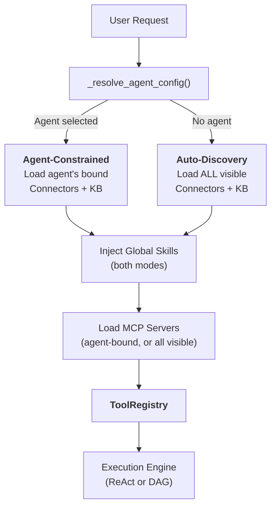
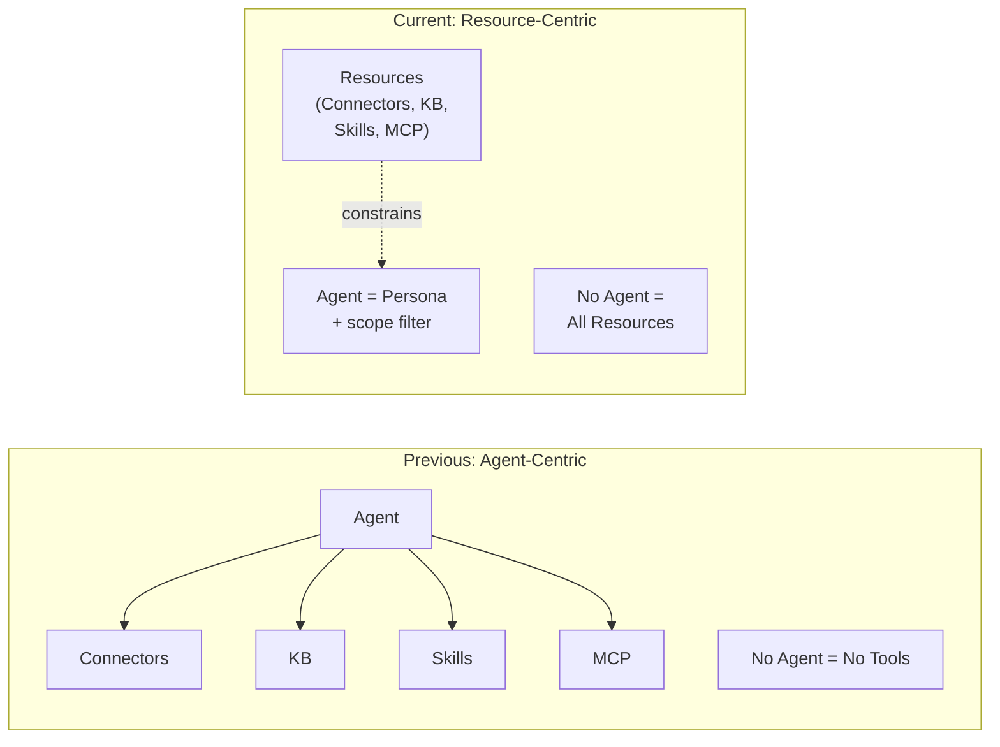
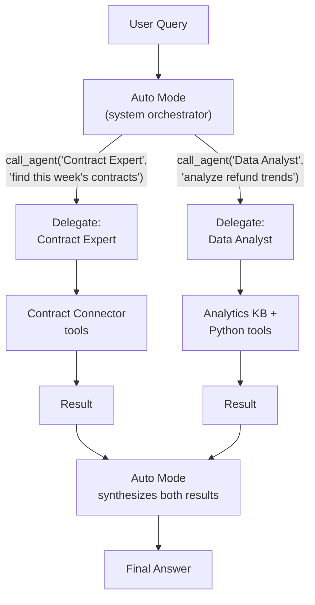
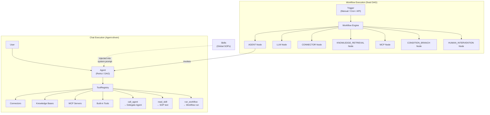

## The two modes

Every chat request in FIM One starts with a question: **is an Agent selected?** The answer determines how resources — Connectors, Knowledge Bases, Skills, and MCP servers — are discovered and assembled into the tool set the LLM can use.

**Agent-Constrained Mode** activates when the user picks a specific Agent. The system loads only the resources that Agent has been explicitly configured with:

- **Connectors**: only the Agent's bound `connector_ids` are loaded as tools.
- **Knowledge Bases**: only the Agent's bound `kb_ids` are injected as retrieval tools.
- **Skills**: globally available when the Skills module is enabled (it is off by default) — all active Skills visible to the user are injected, because Skills are organizational SOPs, not Agent-specific knowledge. (See [Skills as Global SOPs](#skills-as-global-sops) below.)
- **MCP Servers**: only the Agent's bound `mcp_server_ids` are loaded; an Agent with none bound gets no MCP tools.
- **Instructions**: the Agent's `instructions` field defines the persona and behavioral guidelines injected into the system prompt.

**Global Auto-Discovery Mode** activates when no Agent is selected (e.g., a new chat). The system auto-discovers everything accessible to the user:

- **Connectors**: all Connectors visible to the user (own + subscribed from an organization or the Market) are loaded.
- **Knowledge Bases**: the user's own KBs are available for retrieval via `kb_retrieve` (knowledge bases cannot be shared).
- **Skills**: all active Skills visible to the user are injected as SOP stubs.
- **MCP Servers**: all active servers visible to the user.
- **Instructions**: a generic assistant persona is used.

The branching happens inside `_resolve_tools()`, which is called on every chat request:



The practical effect: users can start chatting immediately without configuring an Agent. The system discovers available resources and exposes them as tools. Selecting an Agent narrows the scope — it does not unlock new capabilities, it focuses existing ones.

### What each mode discovers

The two modes differ in **scope**, not in kind. Both produce a `ToolRegistry` — they just fill it differently.

**Auto-Discovery Mode (no Agent selected):**

| Resource | Discovery | Tool Form |
|---|---|---|
| Connectors (API) | `resolve_visibility()` — all visible to user | `ConnectorMetaTool` (progressive) |
| Connectors (DB) | `resolve_visibility()` — all visible to user | `DatabaseMetaTool` (progressive) |
| Knowledge Bases | The user's own KBs | `kb_retrieve` |
| Skills | `resolve_visibility()` — all active | `read_skill` (progressive stubs) |
| MCP Servers | `resolve_visibility()` — all user-visible | `MCPServerMetaTool` (progressive) |
| Agents | `resolve_visibility()` — all active, non-builder | `call_agent` (delegation catalog) |
| Built-in Tools | `discover_builtin_tools()` — full set | No category filter applied |

**Agent-Constrained Mode (Agent selected):**

| Resource | Discovery | Tool Form |
|---|---|---|
| Connectors | Only `agent.connector_ids` | `ConnectorMetaTool` or legacy per-action |
| Knowledge Bases | Only `agent.kb_ids` | `GroundedRetrieveTool` / `KBRetrieveTool` |
| Skills | Global — **not constrained by Agent** | `read_skill` |
| MCP Servers | Only `agent.mcp_server_ids` | `MCPServerMetaTool` (progressive) |
| Agent Delegation | Not available — agents are specialized | _(disabled)_ |
| Built-in Tools | `agent.tool_categories` filter | Subset by category |

The key asymmetry: Connectors, Knowledge Bases and MCP Servers are scoped by the Agent, but Skills remain global in both modes. `CallAgentTool` (agent delegation) is only available in Auto-Discovery mode — it is **not** registered when a specific Agent is selected. This is a security measure: a marketplace agent could otherwise use `call_agent` to invoke other agents and access their private prompts. Skills are organizational rules (everyone follows the same SOPs), while Connectors and KBs are capability bindings (different agents connect to different systems).

## 모든 것이 도구입니다

LLM 수준에서 모든 리소스 유형은 호출 가능한 도구의 평면 목록으로 수렴됩니다. LLM은 커넥터, MCP 서버 또는 Knowledge Base를 호출하는지 여부에 대한 구조적 인식이 없습니다. `ToolRegistry`를 보게 됩니다 — 이름, 설명 및 매개변수 스키마가 있는 함수 집합입니다.

| 리소스 유형 | LLM 수준에서 변환됨 | 도구 이름 패턴 |
|---|---|---|
| 커넥터 (progressive) | 단일 메타 도구 | `connector` |
| 커넥터 (legacy) | 작업당 N개 도구 | `{connector}__{action}` |
| 데이터베이스 커넥터 (progressive) | 단일 메타 도구 | `database` |
| 데이터베이스 커넥터 (legacy) | 데이터베이스당 3개 도구 | `{db}__list_tables`, `{db}__describe_table`, `{db}__query` |
| MCP 서버 (progressive) | 단일 메타 도구 | `mcp` |
| MCP 서버 (legacy) | 서버당 N개 도구 | `{server}__{tool}` |
| Knowledge Base | 검색 도구 | `kb_retrieve` 또는 `grounded_retrieve` |
| 스킬 (progressive) | 읽기 도구 + 시스템 프롬프트 스텁 | `read_skill` |
| 스킬 (inline) | 시스템 프롬프트 텍스트만 | _(도구 없음)_ |
| 에이전트 자체 | 도구로 표시되지 않음 | _(지시사항 + 도구 조립)_ |

핵심 통찰: **에이전트는 도구가 아닙니다 — 도구를 사용하는 엔티티입니다.** 에이전트는 시스템 프롬프트에 지시사항을 제공하고 사용 가능한 도구를 결정합니다. 하지만 LLM의 관점에서는 "에이전트" 개념이 없습니다 — 시스템 프롬프트와 호출 가능한 함수 집합만 있습니다.

이러한 균일성이 시스템을 확장 가능하게 만드는 것입니다. 새로운 리소스 유형을 추가하는 것은 `Tool` 프로토콜(`name`, `description`, `parameters_schema`, `run()`)을 구현하는 것을 의미합니다. 실행 엔진, 컨텍스트 관리 및 LLM 상호작용 계층은 변경되지 않습니다.

## 글로벌 SOP로서의 스킬

스킬은 에이전트 위의 계층을 차지합니다. 이들은 선택된 에이전트가 무엇이든 상관없이 모든 에이전트가 따라야 하는 조직 정책 및 절차입니다.

### 스킬이 에이전트에 바인딩되지 않는 이유

"고객 불만 처리 SOP"와 같은 스킬은 고객과 상호작용하는 모든 에이전트에 적용됩니다. 스킬을 에이전트에 바인딩하면 양방향 소유권 문제가 발생합니다: 스킬이 에이전트를 조율하고 에이전트가 스킬을 소유한다면, 누가 누구를 제어합니까?

스킬은 설계상 전역적입니다 — 이들은 회사 규칙이지 에이전트별 지식이 아닙니다. `_resolve_tools()` 함수는 에이전트 선택과 관계없이 사용자에게 표시되는 모든 활성 스킬을 로드하며, 다른 리소스에 사용되는 것과 동일한 `resolve_visibility()` 필터를 사용합니다.

### 두 가지 주입 모드

스킬은 두 가지 주입 모드를 지원합니다 -- **progressive** (기본값)와 **inline** -- `SKILL_TOOL_MODE` 또는 에이전트의 `model_config_json.skill_tool_mode`로 제어됩니다. progressive 모드에서는 시스템 프롬프트에 컴팩트한 스텁만 나타나고, LLM은 필요에 따라 `read_skill(name)`을 호출하여 전체 콘텐츠를 로드합니다. 이는 모든 리소스 유형에서 컨텍스트 소비를 최소화하는 FIM One의 광범위한 [Progressive Disclosure](/architecture/progressive-disclosure) 아키텍처의 일부입니다.

## Agent as persona, not container

FIM One's architecture reflects a deliberate shift from an Agent-centric model to a Resource-centric model.

**Previous model:** the Agent was a container that gated access to all resources. No Agent selected meant no Connectors, no Skills, no specialized KB. The Agent was the mandatory entry point for any capability.

**Current model:** the Agent is a persona — a set of instructions and behavioral guidelines — combined with an optional resource constraint. Resources exist independently of Agents. Selecting an Agent narrows the scope; not selecting one opens it fully.



This means:

- **Users can start chatting immediately** without configuring an Agent.
- **The system auto-discovers available resources** and exposes them as tools.
- **Agents become lightweight personas** that can be created quickly — just write instructions and optionally bind specific Connectors and KBs.
- **Resource management is decoupled** from Agent management. Publishing a Connector to an organization makes it available to every member who subscribes to it — in auto-discovery mode, in Agent binding dropdowns, and in agent delegation resolution.

## 에이전트 위임

FIM One은 `CallAgentTool`을 통해 전문 에이전트에게 작업을 위임하는 것을 지원합니다. 단, **자동 모드**(에이전트 미선택)에서만 가능합니다. 사용자가 특정 에이전트를 선택하면 위임이 비활성화되고 해당 에이전트는 자신의 도구에만 집중합니다.

### Two modes: Auto vs Agent-selected

| Aspect | Auto Mode (no agent selected) | Agent-Selected Mode |
|---|---|---|
| `call_agent` | Enabled — delegates to any visible agent | **Disabled** — not registered |
| Tool scope | All visible Connectors, KB, Skills, MCP | Only the Agent's bound resources + global Skills |
| Orchestration | System LLM dynamically picks the best agent per iteration | Agent uses its own tools directly |
| Use case | General queries, cross-domain tasks | Focused specialist tasks |

**Why delegation is disabled in Agent-selected mode:** Security. A marketplace agent could use `call_agent` to invoke other agents and read their private system prompts. By restricting delegation to Auto mode — where the system LLM (not any individual agent's prompt) controls the flow — private agent prompts are never exposed to untrusted agent configurations.

### 오토 모드를 오케스트레이션 레이어로

오토 모드는 UI의 일급 개념입니다. 에이전트 선택기는 "Auto"를 기본 옵션으로 표시합니다. 오토가 활성화되면, 시스템 LLM이 오케스트레이터로 작동합니다. 즉, 표시되는 모든 에이전트의 전체 카탈로그를 보고 각 반복에서 최적의 전문가 에이전트에게 작업을 위임할 수 있습니다. 이는 전용 "부모 에이전트"의 필요성을 없애줍니다 — 시스템 자체가 오케스트레이터입니다.

### 에이전트 카탈로그

런타임에 사용자에게 보이는 모든 활성, 비빌더 에이전트는 카탈로그로 조립됩니다. 각 에이전트의 이름과 설명은 `call_agent` 도구의 매개변수 스키마에 나열되어 있으므로, LLM이 의미론적으로 올바른 전문가를 선택할 수 있습니다 — 하드코딩된 라우팅 없이.

### Full tool inheritance

When a delegated agent is invoked via `call_agent(agent_id, task)`, it is assembled the way a chat with that agent is: a complete `ToolRegistry` built from its own configuration — its bound Connectors, Knowledge Bases and MCP servers (connected for the duration of the call) and its built-in tool categories — together with its own approval gate. Delegated agents are full execution units, not text-only advisors. An agent that has been switched off or is no longer visible to the user when it is called is reported as unavailable instead of being run.

### 일단계 위임

무한 재귀를 방지하기 위해 위임된 에이전트는 `call_agent` 도구를 받지 않습니다. 위임은 항상 일단계 깊이입니다: Auto 모드가 전문가를 호출하면, 전문가가 실행하고 결과를 반환합니다. 시스템은 여러 위임된 에이전트의 결과를 종합합니다.

### 병렬 실행

네이티브 함수 호출 모드에서 LLM은 단일 턴에서 여러 `call_agent` 호출을 실행할 수 있습니다. 이들은 `asyncio.gather`를 통해 동시에 실행되므로 "세 가지 소스를 동시에 검색"과 같은 패턴을 활성화합니다.



## Visibility model

All resource discovery — in both modes — is governed by a unified visibility model with two tiers:

| Tier | Description | Example |
|---|---|---|
| **Own** | Created by the user. Always visible. | A Connector you built for your team's API |
| **Subscribed** | Resources published to one of the user's organizations or to the Market that the user has subscribed to. Visible while the resource is still shared and approved. Org membership alone grants nothing. | A company-wide ERP Connector published by IT, or a community-built Slack Connector you installed |

The `resolve_visibility()` function in `web/visibility.py` builds a SQL filter that covers both tiers in a single query:

```python
conditions = [
    model.user_id == user_id,                    # own resources
    and_(model.id.in_(subscribed_ids),           # subscribed, and still shared
         model.visibility == "org",
         or_(model.publish_status.is_(None),
             model.publish_status == "approved")),
]
```

This same filter is used everywhere:

- Auto-discovering Connectors in no-agent mode
- Building the Agent catalog for `CallAgentTool`
- Loading visible Skills for system prompt injection
- MCP server resolution
- Agent configuration lookup (ensuring a user can only select Agents visible to them)

The uniformity means that **a Connector published to an organization becomes available to its subscribers** in auto-discovery mode, in Agent binding dropdowns, and in agent delegation resolution — no special wiring required. The visibility model is the single source of truth for "what can this user access."

## Relationship map

FIM One has two parallel execution paradigms — **Chat (Agent-driven)** and **Workflow (DAG-driven)** — that share the same underlying resources but orchestrate them differently.



Key takeaways from the diagram:

- **Agent and Workflow are parallel paradigms.** Both can use Connectors, Knowledge Bases, and MCP Servers — but through different mechanisms. Agents use them as tools in a `ToolRegistry`; Workflows use them as typed DAG nodes.
- **Workflow can orchestrate Agents** via the `AGENT` node — a Workflow step can invoke a full Agent with its own ReAct/DAG loop. The reverse also works: an Agent can run a Workflow through the `run_workflow` tool when the Workflows module is enabled, except workflows that contain a Human Intervention step.
- **Skills are injected into Agents only.** Skills are system prompt text — they guide Agent behavior. Workflows don't consume Skills because Workflow nodes execute deterministic logic, not LLM-guided reasoning.
- **Shared resources, different access patterns.** A Connector can be called by an Agent (via `ConnectorToolAdapter`), by a Workflow (via `CONNECTOR` node), or by both in the same business process — e.g., a Workflow triggers an Agent that queries the same Connector the Workflow also uses in a later step.

## Workflow Engine — the other execution paradigm

While this document focuses on Agent-driven chat execution, FIM One includes a full **Workflow Engine** — a visual DAG editor with 9 node types for fixed-process automation. It is an optional module, off by default.

| Aspect | Agent (Chat) | Workflow |
|---|---|---|
| Orchestration | LLM decides next step dynamically | Fixed DAG defined at design time |
| Best for | Exploratory tasks, conversations, flexible reasoning | Approval chains, scheduled ETL, multi-step automations |
| Can call | Connectors, KB, MCP, Built-in Tools, Delegated Agents, Skills, Workflows (`run_workflow`) | Agents, Connectors, KB, MCP, LLM, Human approval |
| Trigger | User message in chat | Manual, cron schedule, or API/webhook |
| Nesting | One-level delegation (Auto mode → delegated Agent) | No sub-workflow nesting |

The two paradigms are complementary. Use Agents when the task is open-ended ("analyze this quarter's sales data and recommend actions"). Use Workflows when the process is known ("every Monday, pull new invoices from ERP, run compliance checks, and route exceptions to a human reviewer"). A Workflow can invoke an Agent for any step that needs flexible reasoning within an otherwise fixed pipeline.

For details on Agent execution modes and Workflow node types, see [Execution Modes](/concepts/execution-modes).
