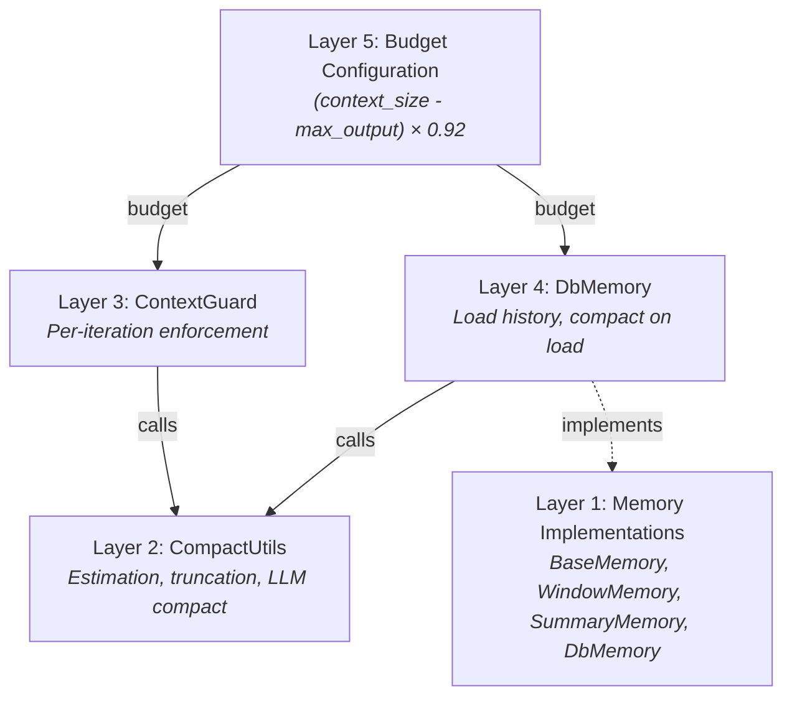
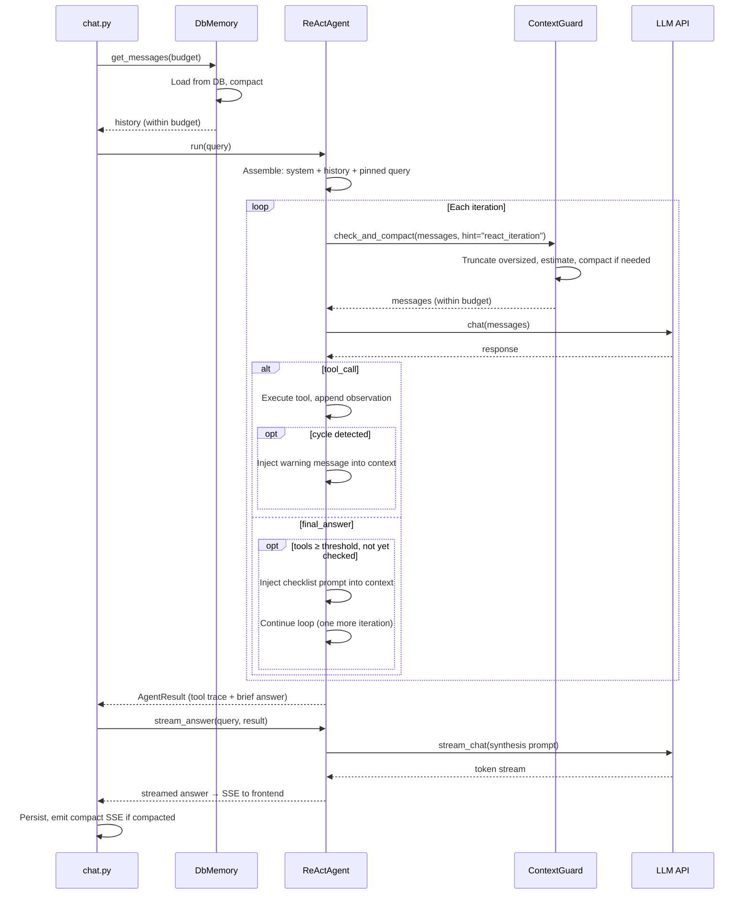
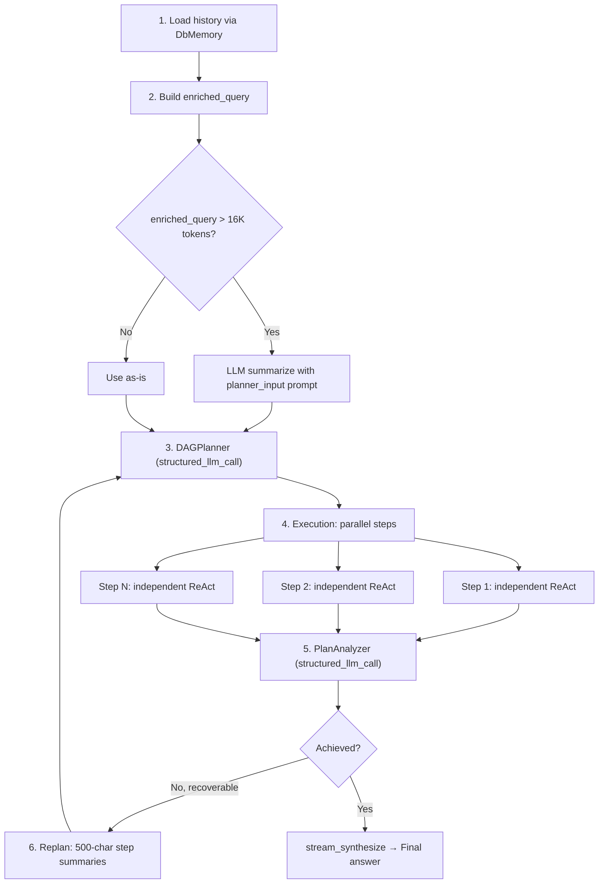

## 문제점

LLM은 유한한 컨텍스트 윈도우를 가지고 있습니다. 128K 토큰 모델은 관대해 보이지만, 출력 예산, 시스템 프롬프트, 도구 설명, 그리고 다중 턴 대화의 누적된 이력을 빼면 이야기가 달라집니다. 긴 대화, 큰 도구 결과, 그리고 다단계 에이전트 루프는 모두 이 한계에 압박을 가합니다 — 종종 단일 세션 내에서.

순진한 해결책은 자르기입니다: 윈도우가 가득 차면 이전 메시지를 삭제합니다. 이는 빠르고 예측 가능하지만, 무분별하게 컨텍스트를 파괴합니다. 사용자의 원래 의도, 이전 턴의 주요 결정, 그리고 중요한 데이터 포인트는 모두 무딘 문자 자르기에 의해 사라집니다. 반대 극단 — 매 턴마다 LLM 기반 요약 — 의미론적 내용은 보존하지만 비용이 많이 들고, 느리며, 자체 실패 모드를 도입합니다(환각된 요약, 손실된 수치 정밀도).

진정한 과제는 "윈도우에 맞추기"가 아닙니다. 그것은: **중요한 정보를 잃지 않으면서 우아하게 성능 저하, 불필요한 압축에 토큰을 낭비하지 않으면서, 사용자가 느낄 수 있는 지연을 추가하지 않으면서.**

FIM One은 5계층 심층 방어 아키텍처로 이를 해결합니다. 각 계층은 문제의 다른 규모를 다루며, 깔끔하게 구성됩니다 — 어떤 단일 계층도 완벽할 필요가 없습니다. 왜냐하면 다음 계층이 놓친 것을 포착하기 때문입니다.

## Five layers of defense

Context management is not a single mechanism. It is a stack, where each layer handles a specific concern at a specific granularity:

| Layer | Component | What it does | When it acts |
|-------|-----------|-------------|-------------|
| **5** | Budget Configuration | Computes usable input token budget from model specs | At startup / per-request |
| **4** | DbMemory | Loads persisted history, compacts on load | Once per request |
| **3** | ContextGuard | Per-iteration budget enforcement | Every ReAct iteration |
| **2** | CompactUtils | Token estimation, smart truncation, LLM compaction | Called by layers 3 and 4 |
| **1** | Memory Implementations | Abstract interface + concrete strategies | Framework-level |

The layers are numbered bottom-up because higher layers depend on lower ones. Layer 5 sets the budget. Layer 4 does the initial load-time compaction. Layer 3 enforces the budget on every iteration. Layers 2 and 1 provide the primitives that layers 3 and 4 use.



### Layer 5 — Budget Configuration

The budget is computed from two values of the model in use:

```
usable_input_tokens = (context_size - max_output_tokens) × 0.92
```

With defaults: `(128,000 - 64,000) × 0.92 = 58,880 tokens`. The 8% margin absorbs the error of heuristic token estimation, so compaction triggers before the provider's hard limit.

No static system prompt reserve is subtracted. The system prompt (agent instructions, tool descriptions, formatting overhead) is included in the message list that ContextGuard estimates dynamically — subtracting a fixed reserve on top would double-count it and waste budget. A typical system prompt consumes 3K-5K tokens; agents with many tools or long instructions may use more. ContextGuard accounts for the actual size automatically.

The values come from the models a chat turn resolved: the agent's own model and fast model when it sets them, otherwise the active model group, otherwise the system default. Each resolved model reports its own `context_size` and `max_output_tokens`, so two agents on different models get different budgets in the same deployment.

A model with no context size configured (the field left empty in its model configuration) falls back to the system budget for its role, resolved in priority order:

1. **System ModelConfig for the role** — `context_size` and `max_output_tokens` of the system `general` or `fast` model set by the admin.
2. **Environment variables** — `LLM_CONTEXT_SIZE` / `FAST_LLM_CONTEXT_SIZE` and `LLM_MAX_OUTPUT_TOKENS`.
3. **Hardcoded defaults** — 128K context, 64K output.

The main LLM and fast LLM have independent budgets, and which one applies depends on who reads the message list:

- **ReAct mode** sends one message list to both models: the fast model decides tool calls, the main model writes the final answer (and the fast model stands in when the main model is unavailable). The list is budgeted against the **smaller** of the two budgets, so any mix of windows stays within both. When a legal, medical or similar domain query escalates the turn to the reasoning model, that model's window replaces the main model's in the comparison.
- **DAG mode** budgets history loading and planning against the main model, and each step against the model that runs it (the general model by default, or the one the step's `model_hint` selects).

At startup the backend logs a warning when the system fast model's window is smaller than the general model's budget: nothing overflows, but conversations compact earlier than the general model alone would need.

A floor of 4,000 tokens is enforced — if misconfigured values would produce a smaller budget, the system clamps to 4K rather than failing silently. One misconfiguration is handled before the floor: when the output reserve is as large as the window itself (a small model whose max output tokens was left at the 64K default), half the window is reserved instead. Set the model's max output tokens to get an exact budget.

### Layer 4 — DbMemory

`DbMemory` is the production memory implementation. It loads persisted conversation history from the database and compacts it to fit the token budget before the agent sees it.

The design is **read-only by intention**. Persistence is handled by `chat.py` — the API layer that owns the full message lifecycle (including metadata, usage tracking, and image attachments). `DbMemory` does not persist conversation turns: its `add_message()` and `clear()` methods are no-ops, and its only write is a synthetic `tool` result row for a tool call left dangling by an interrupted turn. This separation prevents double-writes and keeps the persistence logic in one place.

On load, `DbMemory`:

1. Queries all `user`, `assistant` and `tool` messages for the conversation, ordered by creation time.
2. Drops the trailing user message (the current query, which the agent will re-append).
3. Reconstructs image attachments — user messages that included images store metadata (`file_id`, `mime_type`) in the database, and `DbMemory` rebuilds the base64 data-URLs from disk so the LLM can "see" images from earlier turns.
4. Compacts: if a `compact_llm` was provided, uses `CompactUtils.llm_compact()`. Otherwise, falls back to `CompactUtils.smart_truncate()`. The whole stored conversation is the input here, so this is where the history most often exceeds the summarising model's window; it is then summarised in parts (see [Chunked compaction input](#chunked-compaction-input)).

After compaction, `DbMemory` sets tracking flags (`was_compacted`, `_original_count`, `_compacted_count`) that the SSE layer uses to emit a `compact` event to the frontend.

### Layer 3 — ContextGuard

`ContextGuard` is the per-iteration budget enforcer. It is called at the top of every ReAct iteration — both in standalone ReAct mode and inside each DAG step's agent. This is the last line of defense before the messages hit the LLM API.

The enforcement follows a three-step process:

1. **Truncate oversized individual messages.** Any single message exceeding 50K characters is hard-truncated with a `[Truncated]` suffix. This catches runaway tool outputs — a web scrape that returns an entire webpage, a file read that dumps a large dataset.

2. **Estimate total tokens.** If the total fits within budget, return immediately. Most iterations pass here — compaction is the exception, not the norm.

3. **Compact if over budget.** If a `compact_llm` is available, use LLM-powered compaction with a hint-specific prompt. Otherwise, fall back to `smart_truncate`.

The **hint system** is what makes ContextGuard context-aware rather than one-size-fits-all. Different situations need different compaction strategies:

| Hint | Used by | Preserves | Drops |
|------|---------|-----------|-------|
| `react_iteration` | ReAct agent loop | Recent reasoning chain, current goal, critical data | Old redundant steps, failed retries, verbose tool outputs |
| `planner_input` | DAG enriched query | User intent evolution, key decisions, constraints | Dialogue details, greetings, tool call mechanics |
| `step_dependency` | Defined, no caller today | Key data, numbers, conclusions | Reasoning process, failed attempts, verbose formatting |
| `general` | Default fallback | Key facts, decisions, tool results | Greetings, filler, redundant back-and-forth |

Each hint maps to a carefully worded system prompt that tells the compaction LLM what to keep and what to discard. Each prompt instructs the LLM to write in the same language as the conversation — a detail that matters for CJK users whose summaries would otherwise default to English.

If LLM compaction fails (network error, empty response, any exception), ContextGuard falls back to `smart_truncate` silently. The agent never sees the failure. This is a deliberate reliability choice: better to lose some context via heuristic truncation than to crash the iteration.

#### Chunked compaction input

The summariser is the fast model, and its window can be smaller than the history it is asked to condense: a large main model paired with a small fast one, or a long stored conversation loaded by `DbMemory`. Sending that history as one request overflows the summariser, and compaction degrades to truncation exactly when it is needed.

`CompactUtils.summarize_history()` is the single summarising step behind `ContextGuard`, `DbMemory` and the DAG planner-input summary. It takes the summariser's own input budget (from the window that model declares) and guarantees no request exceeds it:

1. History that fits goes out as one request, as before.
2. Longer history is cut into consecutive parts. A tool call and its results always land in the same part; only a single exchange larger than a whole part is split, and an over-long message is cut rather than dropped.
3. The parts are folded in order: the first is summarised on its own, and each later request carries the summary so far (capped at 10K tokens, or a quarter of the summariser's budget if smaller) plus the next part, and asks for one updated summary in the same format.
4. `CONTEXT_GUARD_MAX_COMPACT_CHUNKS` (default 8) bounds the number of requests. History needing more parts keeps the first part and the most recent ones, and the summariser is told there is a gap.

If the compact prompt alone leaves no room for history in the summariser's window, or any part fails, the result is the same `smart_truncate` fallback. The split only concerns the text the summariser reads: the message list kept for the main model still never starts with tool results whose tool call was summarised away.

### Layer 2 — CompactUtils

`CompactUtils` is a stateless utility class — no instances, no state, just pure functions. It provides three capabilities that layers 3 and 4 build on.

**Token estimation** converts text to an approximate token count without importing a tokenizer library. The heuristic:

- ASCII characters: ~4 characters per token
- CJK / non-ASCII characters: ~1.5 characters per token
- Images: 765 tokens per image (flat cost)
- Per-message overhead: 4 tokens (role marker, delimiters)

**`smart_truncate`** is the heuristic fallback. It keeps pinned messages unconditionally, then walks backward through non-pinned messages, accumulating until the budget is exhausted. The result is a suffix of the conversation that fits. It also ensures the result never starts with an assistant message — an orphaned assistant turn with no preceding user message confuses LLMs.

**`llm_compact`** is the LLM-powered path. It splits messages into three groups — system messages (always kept), pinned messages (always kept), and compactable messages. The oldest compactable messages are summarized into a single `[Conversation summary]` system message (in parts when they exceed the summariser's window); the most recent 4 messages are kept verbatim, more when the cut would otherwise separate a tool call from its results. If the compacted result is still too long, it falls back to `smart_truncate` on the compacted output — belt and suspenders.

### Layer 1 — 메모리 구현

메모리 레이어는 `BaseMemory` 인터페이스를 정의합니다: `add_message()`, `get_messages()`, `clear()`. 세 가지 구현이 존재합니다:

- **WindowMemory** — 개수 기반 슬라이딩 윈도우. 마지막 N개의 비시스템 메시지를 유지합니다. 단순하고 예측 가능하며 LLM 호출이 없습니다. 프로덕션에서 사용되지 않으며, 테스트 및 상태 비저장 시나리오에 유용합니다.

- **SummaryMemory** — 메시지 개수가 임계값을 초과할 때 LLM 요약을 트리거합니다. 이전 메시지를 `[Conversation summary]` 시스템 메시지로 압축합니다. 프로덕션에서 사용되지 않으며, 더 정교한 ContextGuard 접근 방식보다 앞선 것입니다.

- **DbMemory** — 프로덕션 구현(Layer 4에서 설명). 데이터베이스 기반, 읽기 전용, 로드 시 LLM 또는 휴리스틱 압축을 사용합니다.

WindowMemory와 SummaryMemory는 테스트를 위한 유용한 프리미티브로 사용되고 웹 레이어 없이 FIM One의 핵심 라이브러리를 임베드하는 사용자를 위해 코드베이스에 남아 있습니다. 이들은 죽은 코드가 아니라 아키텍처가 성장해 나온 단순한 경우들입니다.

## How context flows through ReAct

The ReAct agent uses context management at two distinct phases: load time and iteration time.



Tool iterations run on the fast model when one is configured (non-streaming `chat()` in JSON mode, `stream_chat()` in native mode); the answer is streamed through `stream_answer()`. This two-phase split — tool loop followed by a streamed answer — optimizes both latency and user experience. For full ReAct engine architecture including dual-mode execution and tool selection, see [ReAct Engine](/architecture/react-engine).

The key insight: **DbMemory handles the historical context problem (turns from previous requests), while ContextGuard handles the within-request growth problem (tool results accumulating during an agent loop).** They operate at different timescales and catch different failure modes.

The user's current query is always marked as `pinned=True`. This ensures it survives all compaction — both `smart_truncate` and `llm_compact` preserve pinned messages unconditionally. No matter how aggressively the history is compressed, the user's actual question is never lost.

## How context flows through DAG

DAG mode has a fundamentally different context shape than ReAct. Instead of one long conversation thread, it has a tree: a planning phase, multiple parallel execution steps, and an analysis phase. Each phase has its own context management strategy.



**Phase 1 — History loading.** DbMemory loads and compacts conversation history, same as ReAct. The compacted history is formatted into a text block prefixed with `"Previous conversation:"`.

**Phase 2 — Enriched query construction.** The history text and current query are combined into an `enriched_query`. If this exceeds 16K tokens, it is LLM-summarized using the `planner_input` hint prompt, in parts when the history exceeds the fast model's window. The 16K threshold is chosen because the planner needs to read the entire query in a single pass — unlike ReAct, there is no iterative compaction during planning.

**Phase 3 — Planning.** The planner receives a 2-message prompt: system prompt plus enriched query. No ContextGuard here — the enriched query is already size-controlled by the 16K check.

**Phase 4 — Step execution.** Each DAG step runs as an independent ReAct agent with its own ContextGuard. Critically, these step agents have **no memory** — they start fresh with only their task description and dependency context. This is by design: DAG steps should be self-contained units of work. Dependency results are injected via `_build_step_context`, which character-truncates at 50K (the ContextGuard's `max_message_chars` limit).

**Phase 5 — Analysis.** Step results are formatted for the analyzer LLM with per-step truncation at 10K characters. This prevents a single step's verbose output from dominating the analysis context.

**Phase 6 — Replanning.** When the analyzer determines the goal was not achieved and does not judge it unreachable, step results are truncated to 500 characters each for the latest round (200 for older rounds) in the replanning context. Replanning needs to know *what happened* and *what went wrong*, not the full detail of every step's output. This aggressive truncation keeps the replan prompt compact enough for the planner to process efficiently.

For the full DAG pipeline architecture including the LLM Call Map and re-planning logic, see [DAG Engine](/architecture/dag-engine).

## 고정된 메시지

고정 메커니즘은 압축이 반드시 유지되어야 하는 메시지를 파괴하는 것을 방지합니다. 두 가지 범주의 메시지가 고정됩니다:

1. **현재 사용자 쿼리** — 항상 고정됩니다. 사용자가 질문을 하고 히스토리가 너무 길면, 시스템은 히스토리를 압축하지 질문을 압축하지 않습니다.

2. **스트림 중간에 주입된 메시지** — 사용자가 에이전트가 실행 중인 동안 후속 메시지를 보내면, 주입된 메시지는 고정으로 표시되어 에이전트가 다음 반복에서 이를 볼 수 있습니다.

고정의 위험은 누적입니다. 많은 주입된 메시지가 있는 긴 세션에서, 고정된 콘텐츠는 예산의 대부분을 소비하여 실제 대화 히스토리를 위한 공간을 남기지 않을 수 있습니다. ContextGuard는 하드 캡으로 이를 해결합니다: **고정된 토큰이 예산의 50%를 초과하면, 가장 오래된 주입된 메시지는 고정 해제되고 압축 가능한 풀로 이동됩니다.** 가장 최근의 고정된 메시지(현재 쿼리)만 유지됩니다.

이것은 트레이드오프입니다. 오래된 주입된 메시지의 고정을 해제하면 이들이 요약되거나 잘릴 수 있습니다. 하지만 대안 — 고정된 메시지가 다른 모든 컨텍스트를 밀어내도록 허용하는 것 — 은 더 나쁩니다. 시스템은 가장 최근의 컨텍스트를 유지하는 것을 선호하며, 이는 거의 항상 오래된 주입보다 더 관련성이 있습니다.

## Token estimation

FIM One uses heuristic token estimation rather than a real tokenizer. This is a deliberate choice with clear trade-offs.

**Why not a real tokenizer?** Three reasons:

1. **Dependency cost.** `tiktoken` (OpenAI's tokenizer) is 15MB of compiled Rust bindings. `sentencepiece` (used by some open-source models) has its own build requirements. For a framework that targets multiple LLM providers, there is no single correct tokenizer — each model family uses a different one.

2. **Speed.** Heuristic estimation is a single pass over the string. Real tokenization involves vocabulary lookup, BPE merge operations, and special token handling. ContextGuard calls estimation on every iteration, sometimes multiple times — the speed difference matters.

3. **Good enough.** The heuristic is tuned for mixed-language text (the ASCII/CJK split covers the two major cases). It can be 1.5-2x off for edge cases (heavily punctuated code, unusual Unicode), but context management is inherently approximate. Being 30% off on a ~59K budget still leaves a comfortable margin.

The concrete heuristics:

| Content type | Ratio | Rationale |
|-------------|-------|-----------|
| ASCII text | ~4 chars/token | English prose and code average 3.5-4.5 chars/token across GPT/Claude tokenizers |
| CJK / non-ASCII | ~1.5 chars/token | Each CJK character is typically 1-2 tokens; 1.5 is the geometric mean |
| Images | 765 tokens/image | Approximate cost of a base64-encoded image in the vision API |
| Per-message overhead | 4 tokens | Role marker, delimiters, formatting |

The estimation always returns at least 1 token for non-empty content. This prevents division-by-zero edge cases in budget arithmetic.

## What the user sees

Context management is designed to be invisible in the common case and minimally intrusive when it activates. The user-facing signals are:

**CompactDivider.** When `DbMemory` compacts history on load, the frontend renders a dashed divider with the text "Earlier context (N messages) was summarized by AI." This appears between the summary and the preserved recent messages, giving the user a visual cue that older context has been compressed without interrupting the conversation flow.

**Token usage display.** The `done` card at the end of each response shows "X.Xk in / X.Xk out" — the total input and output tokens consumed. Tokens the fast LLM spends on compaction are not included in this figure.

**Graceful error handling.** If context management fails entirely — a scenario that should not happen given the fallback chain, but could in theory — the error surfaces as agent error text in the response, not as a system crash. The conversation continues; the user can retry or rephrase.

The goal is that most users never think about context management. They have long conversations, the system handles the budget transparently, and the only visible artifact is an occasional compact divider. For power users and operators who care about token efficiency, the usage display and the configurable budget parameters provide the control they need.
