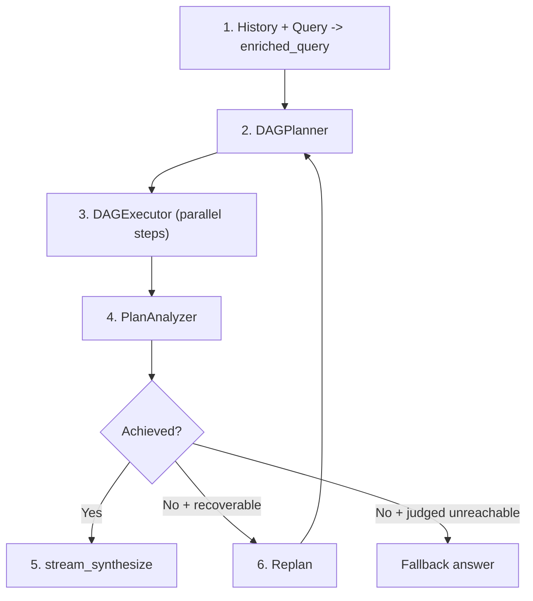
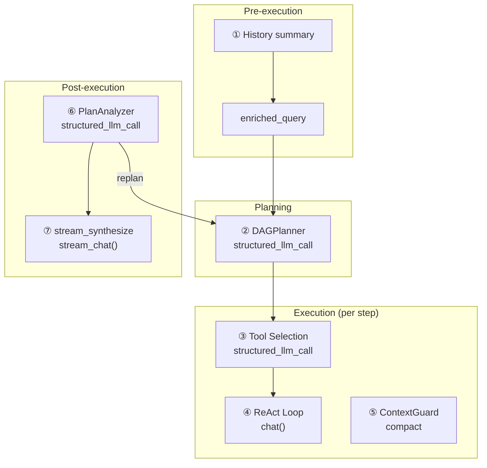
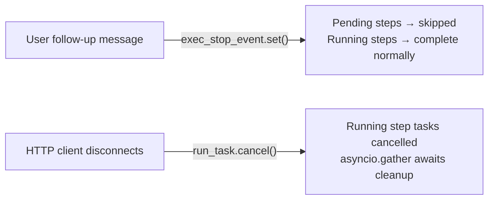

이 엔진이 업계 **그래프 엔지니어링**, 클래식 시각적 워크플로우, ReAct 루프와 어떻게 관련되는지는 [Planning Landscape](/architecture/planning-landscape)를 참조하세요.

## The pipeline

DAG mode decomposes a complex goal into a directed acyclic graph of steps, executes them with maximum parallelism, then reflects on whether the goal was actually achieved. If not, it re-plans and tries again — autonomously, up to a configurable budget.

The pipeline has four phases that form a loop:

**Plan.** The smart LLM decomposes the enriched query into steps (2-4 for simple goals, up to 10 for complex ones) with explicit dependency edges. Each step gets a task description, optional tool hint, and a model hint that controls whether it runs on the fast or smart LLM.

**Execute.** The DAGExecutor launches independent steps in parallel (up to 5 concurrent), respecting the dependency graph. Each step runs as a self-contained ReAct agent with no memory — it receives only its task description and the results of its completed dependencies. Steps the planner marks `llm_direct` (pure transformation of dependency outputs) run as a single tool-less LLM call instead.

**Analyze.** The PlanAnalyzer evaluates whether the executed plan achieved the original goal, producing a structured verdict: `achieved` (boolean), `confidence` (0.0-1.0), `reasoning`, and an optional `final_answer`.

**Re-plan.** If the goal was not achieved and the analyzer does not judge it unreachable, the pipeline loops back to planning with a replan context that summarizes what happened and what went wrong. `DAG_MAX_REPLAN_ROUNDS` (default 3) caps the rounds in total: the first plan plus up to N−1 autonomous re-plans.

Two LLMs collaborate throughout: a **smart LLM** handles planning, analysis, and answer synthesis (tasks requiring high reasoning capability), while the **general LLM** handles step execution by default (with `model_hint="fast"` steps delegated to the fast LLM for cost savings). Context compaction and history summary use the fast LLM. Every structured output call uses `structured_llm_call`, which provides a 3-level degradation chain (Native FC, JSON Mode, plain text with regex fallback) to handle model-specific output quirks.

## LLM 호출 맵

전체 DAG 파이프라인은 7가지의 서로 다른 LLM 호출 카테고리를 만듭니다. 각 호출이 어디서 발생하는지, 어떤 모델이 처리하는지, 그리고 실패 시 어떤 일이 발생하는지 이해하는 것은 디버깅과 비용 최적화에 필수적입니다.

| # | 호출 위치 | 모듈 | LLM 역할 | 형식 | 폴백 |
|---|-----------|--------|----------|--------|----------|
| 1 | 히스토리 요약 | chat.py | 빠른 LLM | 평문 | 마지막 20K 문자 잘라내기 |
| 2 | DAGPlanner | planner.py | 스마트 LLM | structured\_llm\_call | 3단계 저하 |
| 3 | 도구 선택 | react.py | 스텝 LLM | structured\_llm\_call | 모든 도구 반환 |
| 4 | ReAct 루프 (단계별) | react.py | 일반 LLM (기본값) / 빠른 LLM (`model_hint="fast"`) / 추론 LLM (`model_hint="reasoning"`) | chat() | 재시도/폴백 |
| 5 | ContextGuard 압축 | context\_guard.py | 빠른 LLM | 평문 | smart\_truncate |
| 6 | PlanAnalyzer | analyzer.py | 스마트 LLM | structured\_llm\_call | regex + 기본값 |
| 7 | stream\_synthesize | analyzer.py | 스마트 LLM | stream\_chat() | analysis.final\_answer |

호출 1과 5는 **사용자에게 보이지 않습니다** — 컨텍스트 크기를 관리하는 인프라 호출입니다. 호출 2, 6, 7은 높은 추론 능력이 필요하기 때문에 **스마트 LLM**을 사용합니다 (목표 분해, 달성 판단, 일관된 답변 합성). 호출 4는 기본적으로 **일반 LLM**을 사용합니다 — `model_hint="fast"`로 명시적으로 표시된 스텝만 빠른 LLM으로 다운그레이드되고, `model_hint="reasoning"`으로 표시된 스텝은 추론 LLM으로 업그레이드됩니다. 호출 3은 해당 스텝에 대해 결정된 동일한 LLM을 사용합니다.

## DAGPlanner

The planner's job is to turn a high-level goal into a valid DAG of concrete, actionable steps. It does this with a single `structured_llm_call` to the smart LLM.

**Prompt design.** The planning prompt injects the current datetime and year (so the LLM can plan time-aware searches), enforces language matching (task descriptions must use the same language as the goal), and constrains step count (2-4 for simple goals, 5-8 for moderately complex ones, up to 10). Each step has six fields: `id`, `task`, `dependencies`, `tool_hint`, `model_hint`, and `step_type` (`react` or `llm_direct`). The prompt explicitly discourages splitting trivially related sub-tasks — "do NOT create separate steps for trivially related sub-tasks that can be done in a single script."

**Structured extraction.** The planner uses `structured_llm_call` with a `_PLAN_SCHEMA` that defines the `steps` array schema and a `parse_fn` that converts raw dicts to `PlanStep` objects. If the LLM returns a single step object instead of a `{"steps": [...]}` wrapper, the parser auto-recovers. The 3-level degradation chain documented in [ReAct Engine — structured\_llm\_call](/architecture/react-engine#structured_llm_call--unified-output-extraction) handles model output quirks across providers.

**DAG validation.** After extraction, the planner validates the graph structure using Kahn's algorithm for topological sorting. Two invariants are checked:

1. **No dangling references.** If a step references a dependency ID that does not exist in the plan, the reference is silently pruned with a warning log. This is a recovery mechanism — LLMs sometimes omit steps they referenced, and hard-failing would waste the entire planning call.

2. **No cycles.** If Kahn's algorithm cannot visit all nodes (meaning at least one cycle exists), the planner raises a `ValueError`. Cycles are unrecoverable — a cyclic plan cannot be executed.

**model\_hint.** The planner assigns `"fast"` to steps it considers simple and deterministic (data lookup, format conversion, straightforward retrieval), `null` to steps requiring standard reasoning (resolved to the general model), and `"reasoning"` to steps requiring deep analysis. The executor uses this hint to select the appropriate LLM per step via the `ModelRegistry`. When in doubt, the prompt instructs the LLM to use `null` — it is always safer to use the more capable model. For domain-specific tasks (legal, medical, financial), the planner receives domain context from the router and is guided to assign `model_hint="reasoning"` to steps requiring specialist accuracy.

**Input construction.** The enriched query combines conversation history with the current request. If the conversation is long, history is loaded via `DbMemory` and formatted as `"Previous conversation: ..."`. When the resulting enriched query exceeds 16K tokens (estimated via `CompactUtils.estimate_tokens`), it is LLM-summarized using the `planner_input` hint prompt from ContextGuard before being passed to the planner. The fallback when no fast LLM is available: hard-truncate to the last 20K characters.

## DAGExecutor

The executor takes a validated `ExecutionPlan` and runs its steps concurrently, respecting dependency edges and enforcing resource limits.

**Concurrency model.** An `asyncio.Semaphore` limits parallel step execution to `max_concurrency` (default 5, configurable via `MAX_CONCURRENCY` env var). The dispatch loop identifies all steps whose dependencies have completed, launches them as `asyncio.Task` instances, and waits for at least one to finish before checking again. Steps are launched in sorted ID order for deterministic behavior.

**Per-step ReAct agent.** Each step runs as an independent ReAct agent created by `_resolve_agent()`. If the step has a `model_hint` that matches a role in the `ModelRegistry`, a temporary agent is created with the corresponding LLM. With no hint the `general` role is used; if the requested role is not registered, the step falls back to the executor's base agent. These per-step agents have **no memory** — they start fresh with only their task description, the original goal, any tool hints, and the results of completed dependencies. This isolation is deliberate: DAG steps should be self-contained units of work that do not leak state across the graph. Because each step is a standard `ReActAgent` instance, it automatically inherits all harness features: [cycle detection](/architecture/react-engine#cycle-detection) prevents a step from looping on the same failing tool, and the [completion checklist](/architecture/react-engine#completion-checklist) verifies conclusions before a step finalizes its result.

**Dependency context injection.** `_build_step_context()` formats the results of all completed dependency steps into a text block: each dependency's ID, status, task description, and result. If a `ContextGuard` is configured and the combined context exceeds `max_message_chars`, it is hard-truncated with a `[Dependency context truncated]` suffix. This prevents a step that depends on multiple verbose predecessors from blowing out its own context window.

**Structured content multiplier.** When dependency results contain structured content — legal citations, markdown tables, or code blocks — `_build_step_context()` applies a multiplier to the truncation budget (default `3.0`, configurable via `DAG_STRUCTURED_CONTEXT_MULTIPLIER`). This ensures that citations, tabular data, and other structured artifacts are preserved across step boundaries rather than being truncated mid-reference.

**Step timeout.** Each step is wrapped in `asyncio.wait_for` with a default timeout of 600 seconds (10 minutes). If a step exceeds this, it is cancelled and marked as `"failed"` with a timeout message. The timeout is per-step, not per-plan — a 5-step plan can theoretically run for 50 minutes if steps execute sequentially.

**Interruption and cancellation.** The executor has two distinct cancellation paths, each triggered by a different event:

*Graceful skip — stop event.* When a user sends a follow-up message during execution, the orchestrator in `chat.py` sets `exec_stop_event`. The executor checks this flag at the top of each dispatch cycle: if set, all remaining `pending` steps are immediately marked `"skipped"` with the reason `"Skipped — user changed requirements"`, and the loop exits. Steps already running are allowed to complete — only unstarted steps are abandoned. This fast-exit lets the pipeline re-plan around the user's updated intent without waiting for the full original plan to finish.

*Immediate abort — asyncio cancellation.* When the HTTP client disconnects, `chat.py` cancels the top-level `run_task` via `asyncio.Task.cancel()`. The executor catches `asyncio.CancelledError`, cancels all currently-running step tasks, waits for them to acknowledge via `asyncio.gather(..., return_exceptions=True)`, then re-raises. Client disconnect is detected by polling `await request.is_disconnected()` every 0.5 seconds inside the SSE event loop.

The semantic difference matters: **stop event** means "skip what hasn't started yet, but preserve what's already running" — completed step results remain available to inform re-planning. **CancelledError** means "abort everything immediately" — all in-flight work is dropped with no result recovery.

**Deadlock detection.** If the dispatch loop finds no tasks running and no steps ready to launch (because their dependencies failed), all remaining pending steps are marked `"failed"` with a message explaining that their dependencies never completed. This prevents the executor from hanging indefinitely.

**Progress callbacks.** The executor fires `(step_id, event, data)` callbacks for three core event types: `"started"` (step launched), `"iteration"` (tool call within a step), and `"completed"` (step finished), plus verification events (`"verifying"`, `"verification"`, `"re_verification"`, `"citation_verification"`) and `"thinking_delta"`. The SSE layer in `chat.py` bridges these callbacks to `step_progress` events that the frontend uses to render real-time DAG visualization.

## 인용 검증

각 단계가 완료된 후, 실행자는 선택적으로 **인용 검증자**를 실행하여 단계의 출력에서 사실적 주장을 확인합니다. 이는 `DAG_CITATION_VERIFICATION` 환경 변수(`기본값: true`)로 제어되며, 부정확한 인용이 높은 위험을 초래하는 영역을 대상으로 합니다 — 법정 법령, 의료 참고자료, 금융 규정.

검증자는 세 단계로 작동합니다:

1. **추출.** 정규식 패턴이 단계 결과에서 인용과 유사한 문자열을 식별합니다(예: 판례 번호, 법령 참고자료, 규정 코드).
2. **검증.** 추출된 각 인용은 타당성과 내부 일관성을 확인하는 LLM 판단 호출로 평가됩니다.
3. **실패 시 재시도.** 검증이 실패하면, 단계는 수정 피드백이 작업 설명에 추가된 상태로 재시도되어 에이전트가 부정확한 참고자료를 수정할 기회를 제공합니다.

인용 검증은 인용을 포함하는 단계에 지연을 추가하지만 인용이 없는 단계에는 영향을 주지 않습니다. 사용 사례에 인용에 민감한 영역이 포함되지 않는 경우 `DAG_CITATION_VERIFICATION=false`를 설정하여 비활성화하십시오.

## Domain-aware routing

Before execution, the ReAct and DAG endpoints each classify the query with `classify_domain()` on the fast LLM, producing a **`domain_hint`**; the auto-router only chooses the mode. Recognized domains default to `legal`, `medical`, `financial`, `tax`, `compliance`, and `patent` (`ESCALATION_DOMAINS`); queries outside these domains receive `null`.

Domain classification influences the pipeline in two ways:

**DAG mode.** When a DAG request has a non-null `domain_hint`, the domain context is injected into the planner prompt. This guides the planner toward assigning `model_hint="reasoning"` for steps that require specialist accuracy and suggesting `tool_hint="read_skill"` for steps that match available domain skills.

**ReAct mode.** For a domain-specific ReAct request, the system escalates from the general model to the **reasoning model** via `registry.get_by_role("reasoning")`. Additionally, instructions are injected telling the agent to verify any cited laws, regulations, or precedents with `web_search` before writing, and to answer directly when the provided context is sufficient. The `read_skill` tool is pinned in tool selection (not filtered out), ensuring domain knowledge is always accessible.

In DAG mode the planner is also told to keep tightly-coupled domain analysis (where multiple sub-tasks share context and citations) together in fewer, deeper steps, to avoid losing context across step boundaries.

## PlanAnalyzer

The analyzer evaluates whether the executed plan achieved the original goal. It produces a structured `AnalysisResult` with five fields (the four below plus `unrecoverable`, a boolean set when another round could not reach the goal):

- **`achieved`** (boolean) — `true` only if the goal was fully accomplished.
- **`confidence`** (float, 0.0-1.0) — how certain the analyzer is in its assessment. Sources that contradict each other lower this score.
- **`final_answer`** (string or null) — a synthesized answer when achieved, `null` otherwise.
- **`reasoning`** (string) — the LLM's chain-of-thought justification.

**Structured extraction.** The analyzer uses `structured_llm_call` with `_ANALYSIS_SCHEMA`, a `parse_fn` that handles type coercion and confidence clamping, and a `regex_fallback` for malformed JSON. The regex fallback (`_regex_extract_analysis`) extracts `achieved`, `confidence`, `final_answer`, and `reasoning` fields from partially valid JSON using pattern matching. This matters because analysis responses tend to be longer and more complex than planning responses, making JSON formatting errors more likely.

**Safe default.** If all extraction levels fail (native FC, JSON mode, plain text, regex), the analyzer returns `AnalysisResult(achieved=False, confidence=0.0, reasoning="Could not parse analysis response")`. This ensures the pipeline always gets a usable result — a parse failure becomes a "not achieved" verdict, which triggers re-planning rather than crashing.

**Step result formatting.** Each step's result is truncated to 10K characters in the analysis prompt. This prevents a single step's verbose output (e.g., a large web scrape or file dump) from dominating the analyzer's context window and crowding out other steps' results.

**Multi-source comparison.** The analysis prompt includes a directive to explicitly compare results from different sources. When web search results, knowledge base retrieval, and file operations all contribute data, the analyzer must flag contradictions (different numbers, dates, claims) and indicate which source is likely more authoritative. Contradictions lower the confidence score, which in turn influences the re-planning decision.

## Re-planning

The re-planning loop is the DAG engine's most distinctive feature: it can autonomously recover from partial failures by reflecting on what went wrong and trying a different approach.

**Decision logic.** After each round of plan-execute-analyze, the orchestrator in `chat.py` evaluates the analysis result:

1. **`achieved == True`** — exit the loop, proceed to streaming synthesis.
2. **User inject occurred during this round** — always re-plan, regardless of confidence or budget. User follow-up messages are treated as requirement changes that demand a fresh attempt. This does not consume the autonomous replan budget.
3. **Autonomous replan budget exhausted** — exit the loop. The budget is `max_replan_rounds - 1` autonomous replans (default: 2 autonomous replans from a budget of 3 total rounds).
4. **`unrecoverable` and `confidence >= replan_stop_confidence`** — exit the loop. The analyzer judged that another round cannot reach the goal (impossible request, missing capability, dead resource) and is confident about it (default threshold: 0.8, configurable via `DAG_REPLAN_STOP_CONFIDENCE`). A confident "not achieved yet" still re-plans.
5. **Otherwise** — re-plan. The goal was not achieved, confidence is low, and budget remains.

**Replan context.** When re-planning, the orchestrator calls `_format_replan_context()` to build a summary of the previous round. This includes the analyzer's reasoning and a truncated preview of each step's result (500 characters per step for the latest round, 200 for older rounds; `DAG_REPLAN_RECENT_TRUNCATION` / `DAG_REPLAN_OLDER_TRUNCATION`). Steps that already completed carry over into the next plan with their results. The aggressive truncation is deliberate: the planner needs to know *what happened* and *what went wrong*, not the full detail of every step's output. This context is passed to `DAGPlanner.plan()` as the `context` parameter, alongside the original enriched query.

**Max rounds.** The `DAG_MAX_REPLAN_ROUNDS` environment variable (default 3) controls the total number of planning rounds. With default settings, the first round is the initial plan, leaving up to 2 autonomous re-plans. User-triggered re-plans (via message injection) do not count against this budget — a user can steer the pipeline indefinitely.

**SSE event.** When the pipeline decides to re-plan, it emits a `replanning` phase event containing the analyzer's reasoning. The frontend uses this to show the user why the pipeline is retrying.

**enriched\_query accumulation.** User follow-up messages are appended to the enriched query across rounds: `enriched_query += "\n\n[User follow-up]: {content}"`. This means the planner sees the full evolution of the user's intent — the original request plus all subsequent clarifications — when building a revised plan.

## Streaming synthesis

When the analyzer confirms the goal was achieved (`analysis.achieved == True`), the pipeline streams a synthesized final answer to the user via `PlanAnalyzer.stream_synthesize()`.

**Input.** The synthesis call receives three inputs: the original goal, the formatted step results (10K characters max per step), and the analyzer's reasoning from the non-streaming analysis call. The reasoning provides a "roadmap" for what the synthesis should cover.

**System prompt.** The synthesis prompt instructs the LLM to answer directly without meta-commentary ("do NOT include phrases like 'based on the results'"), match the language of the original goal, and compare results from different sources when applicable. A language directive from user preferences is appended if available.

**Streaming.** The method uses `stream_chat()` to yield tokens incrementally. The SSE layer wraps each chunk in an `answer` event with `status: "delta"`, giving the frontend real-time rendering of the final answer.

**Fallback chain.** Two fallback paths handle failure:

1. **stream\_synthesize raises an exception** — fall back to `analysis.final_answer` from the non-streaming `analyze()` call. This answer was already generated during analysis, so it is available even if the streaming call fails.

2. **Goal not achieved (no synthesis attempted)** — concatenate all completed step results, separated by horizontal rules. Each result is prefixed with its step ID. If no steps completed at all, return a short message saying the task could not be completed and suggesting the user rephrase or simplify the goal.

The fallback design ensures the user always gets an answer — degraded but never empty.

## Multi-LLM architecture

The DAG engine's cost and latency profile is shaped by its multi-model design. The division of labor is:

| Role | Used for | Optimized for |
|------|----------|---------------|
| **Smart LLM** | Planning, analysis, answer synthesis | Reasoning capability |
| **General LLM** | Step execution (default), ReAct agent | Balance of capability and cost |
| **Fast LLM** | `model_hint="fast"` steps, context compaction, history summary | Cost and latency |
| **Reasoning LLM** | `model_hint="reasoning"` steps, domain-escalated ReAct | Deep analysis capability |

The smart LLM handles the three calls that require the deepest reasoning: decomposing a goal into a coherent plan, judging whether the plan achieved the goal, and synthesizing a final answer that coherently integrates multiple step results. These calls happen once per round (or once total for synthesis), so their higher per-token cost is amortized.

The general LLM handles step execution by default — each DAG step's ReAct loop runs on the general model unless the planner explicitly assigns a different `model_hint`. The fast LLM is reserved for steps tagged `model_hint="fast"` (simple lookups, format conversions) and for infrastructure calls (context compaction, history summarization). The reasoning LLM is used for steps tagged `model_hint="reasoning"` and for domain-escalated ReAct tasks (see [Domain-aware routing](#domain-aware-routing)).

**Per-step override.** The `model_hint` field on each `PlanStep` controls which LLM runs that step. When `model_hint` is `null`, the executor uses the general model. When it is `"fast"`, the executor uses the fast LLM via the model registry. When it is `"reasoning"`, the executor uses the reasoning LLM. The planner is instructed to set `"fast"` for deterministic tasks, `null` for standard reasoning, and `"reasoning"` for deep analysis — but it can also be set to any custom role registered in the `ModelRegistry`. Model resolution happens **once per step** via `_resolve_agent()` immediately before that step's ReAct loop begins — all iterations within the step (tool selection, the ReAct loop) use the same resolved LLM; ContextGuard compaction uses the fast LLM. The model never changes mid-step.

**Budget independence.** Each LLM role has an independent context budget, computed from its model configuration. DAG step execution uses the resolved step model's budget (general by default); planning and analysis calls use the smart LLM's budget. This is important because operators often pair a large-context model (128K+) for planning with different models for step execution. For details on how budgets are computed, see [Context Management — Budget Configuration](/architecture/context-management#layer-5--budget-configuration).
