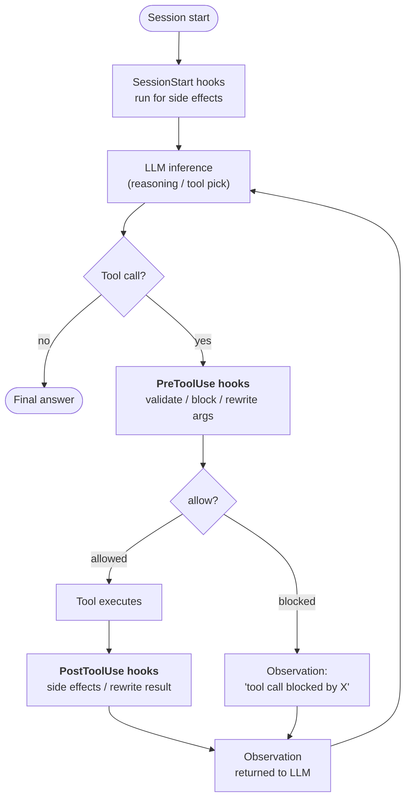
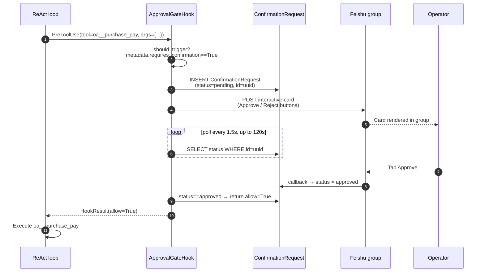

## 훅이 존재하는 이유

시스템 프롬프트의 지시사항은 **제안**입니다. 충분히 고집스럽거나 혼란스러운 LLM은 이를 무시할 수 있습니다. 대부분의 에이전트 동작에서는 정확히 그것이 원하는 것입니다 — 지시사항은 모델이 적응할 수 있는 여지를 제공합니다.

하지만 일부 요구사항은 제안이 아닙니다. "모든 민감한 도구 호출은 반드시 기록되어야 한다." "쓰기 작업은 조직이 읽기 전용 모드일 때 차단된다." "¥50k 이상의 결제는 실행 전에 사람의 승인이 필요하다." 이것들은 **불변식**입니다 — 모델이 어떤 턴에서 결정하든 관계없이 반드시 유지되어야 하는 시스템의 사실입니다.

훅은 에이전트의 실행 생명주기에서 잘 정의된 지점에서 **LLM 루프 외부에서** 실행되는 코드입니다. LLM은 훅을 볼 수 없습니다. LLM은 훅에 이의를 제기할 수 없습니다. LLM은 훅을 단계를 건너뛰도록 설득할 수 없습니다. `PreToolUse` 훅이 `allow=False`를 반환하면, 추론 추적이 아무리 강력하더라도 도구 호출은 발생하지 않습니다.

이것이 중요한 아키텍처 구분입니다:

| 메커니즘 | 실행 위치 | 제어자 | 보장 |
|---|---|---|---|
| **시스템 프롬프트 지시사항** | LLM 추론 내부 | 모델 | "아마도 따를 것" |
| **도구 설명 / 스키마** | LLM 추론 내부 | 모델 | "아마도 따를 것" |
| **훅** | LLM 추론 주변 | 플랫폼 코드 | **항상 실행됨** |

훅은 FIM One이 "에이전트는 ~해야 한다"를 "에이전트는 ~할 수 없다"로 바꾸는 방법입니다.

## Where hooks plug in

Three hook points are defined today. Each marks a boundary the agent crosses during one loop iteration:



| Hook point | Fires when | Can it block? | Can it mutate data? |
|---|---|---|---|
| `SessionStart` | Before the first LLM call of a session | No | No — runs for side effects only |
| `PreToolUse` | After the LLM picks a tool, before the tool runs | **Yes** (via `allow=False`) | Yes — can rewrite `tool_args` before execution |
| `PostToolUse` | After the tool returns, before the observation goes to the LLM | No | Yes — can rewrite the observation |

Multiple hooks at the same point run in priority order. An earlier `PreToolUse` hook's rewritten args are carried forward to later hooks, so middleware composes.

## 훅 vs. 명령어 선택 기준

요구사항을 프롬프트 명령어로 해결할지 훅으로 해결할지 결정하는 것은 "런타임 어설션 vs. 코드 주석" 계산과 동일합니다:

| 증상 | 해결책 |
|---|---|
| "에이전트가 Y일 때 X를 선호해야 한다" | 명령어 — 소프트 가이드, 모델이 자유도를 가짐 |
| "에이전트가 커넥터 Z에 대한 모든 호출을 로깅해야 한다" | **PostToolUse 훅** — 모델이 기억하도록 의존할 수 없음 |
| "¥50k 이상의 결제는 인간 승인이 필요하다" | **PreToolUse 훅** — 모델이 요청하도록 의존할 수 없음 |
| "에이전트가 중국어로 자신을 소개해야 한다" | 명령어 — 스타일 관련, 누락되어도 비용이 낮음 |
| "에이전트가 읽기 전용 모드에서 프로덕션 데이터베이스에 쓸 수 없다" | **PreToolUse 훅** — 안전 불변식, 영 허용 불가 |
| "에이전트가 긴 DB 쿼리 결과를 요약해야 한다" | 둘 다 가능하지만 훅이 더 견고함 — PostToolUse 자르기 참조 |

경험칙: **잘못된 동작이 인시던트라면 훅을 사용하세요. 잘못된 동작이 사소한 불편함이라면 명령어로 충분합니다.**

## The hook contract

A hook is a subclass of `PreToolUseHook` or `PostToolUseHook` (a session-start hook is registered as a plain `Hook` object) with one required method:

```python
class ReadOnlyGuard(PreToolUseHook):
    name = "readonly_guard"
    priority = 5                          # lower runs earlier

    def should_trigger(self, ctx: HookContext) -> bool:
        return ctx.tool_name.startswith("sql_")

    async def execute(self, ctx: HookContext) -> HookResult:
        if org_is_readonly(ctx.metadata["org_id"]):
            return HookResult(
                allow=False,
                error="Org is in read-only mode — write blocked.",
                side_effects=["readonly_guard: blocked sql write"],
            )
        return HookResult()               # default: allow=True, no mutation
```

The `HookContext` passed in carries `tool_name`, `tool_args`, `agent_id`, `user_id`, and a flexible `metadata` dict the engine populates with per-request facts (org id, tool call id, the connector action's `requires_confirmation` flag).

The `HookResult` returned controls the outcome:

- `allow: bool = True` — whether the tool call proceeds (ignored for `PostToolUse` / `SessionStart`)
- `error: str | None` — human-readable reason, surfaced to the LLM as the observation when blocked
- `modified_args: dict | None` — if set, replaces the tool args before execution
- `modified_result: str | None` — if set (PostToolUse), replaces the observation before it returns to the LLM
- `side_effects: list[str]` — notes on what the hook did, collected by the registry (not surfaced in the agent's trace today)

## Case study: `ApprovalGateHook`

The first hook shipped on top of this system is `ApprovalGateHook` (`fim_one.core.assembly.confirmation`; registry key `approval_gate`, formerly `feishu_gate` / `FeishuGateHook`) — a `PreToolUse` hook that turns any tool call needing confirmation (the action's `requires_confirmation` flag, or the agent's confirm-all setting) into a human approval. The hook builds a `ConfirmationSpec` and hands it to `ConfirmationService`, which records the request, delivers it as a card in the portal chat or as a Feishu card in the approval channel bound to the agent, according to the agent's confirmation mode (Auto / Inline only / Channel only), and waits for the decision; Auto uses the in-portal card when no channel is bound. In a chat with no agent the tool's own flag alone decides, and the person chatting approves inline. Who may decide is written on the request when it is created and read back by the portal and the channel callback alike.

This hook exercises the full lifecycle:



What this design is buying:

- **The tool call is genuinely suspended.** The agent's SSE stream pauses between "I will call `oa__purchase_pay`" and the observation. The user sees the agent waiting, which matches what is happening under the hood.
- **Approval survives a process restart.** The pending row is in the database, not in memory. If the backend restarts while a card is outstanding, the next poll picks up where it left off.
- **The decision is audited.** `ConfirmationRequest` keeps `payload`, `responded_at`, `responded_by_open_id`, and the final status — an auditable record of who approved what and when.
- **No LLM in the decision loop.** The model produces the tool call. Humans produce the verdict. The hook is the deterministic bridge.

The channel path depends on a [Feishu Channel](/configuration/channels/feishu) bound as the agent's approval channel. The service asks only whether the channel implements `ApprovalCarrier` (`send_approval`, `parse_decision`, `approval_target`), never which platform it is; the Feishu channel is the first implementation. The separation is deliberate: the service owns the approval state machine, the channel owns the IM platform mechanics. A Slack or WeCom channel that implements the carrier protocol would carry approvals without a change to the gate. A callback can decide only requests its own channel delivered.

## 후보 훅 (계획 없음)

네 가지 훅 패턴이 동일한 라이프사이클에 적용됩니다. 현재 로드맵에는 포함되지 않았으며, 배포 환경에서 필요해질 때까지 보류됩니다.

| 훅 | 시점 | 목적 |
|---|---|---|
| `AuditLogHook` | PostToolUse | 모든 커넥터 호출에 대해 `ConnectorCallLog`를 자동으로 기록합니다. 현재는 수동으로 처리하며, 훅으로 만들면 모든 호출을 기록할 수 있습니다. |
| `ReadOnlyGuard` | PreToolUse | 조직이 읽기 전용 모드일 때 쓰기를 차단합니다. |
| `ResultTruncateHook` | PostToolUse | 크기가 너무 큰 도구 관찰 결과(8k자 초과)를 잘라 LLM 컨텍스트에 전달하기 전에 줄입니다. |
| `ConnectorRateLimitHook` | PreToolUse | LLM 속도 제한과 별개로 커넥터별, 사용자별 호출 빈도를 제한합니다. |

사용자 정의 훅 계층도 같은 조건으로 보류되어 있습니다. 에이전트별 YAML 구성(`hooks: [...]`)에 일치하는 도구 이벤트에서 실행할 셸 명령이나 Python 호출 가능 객체를 선언하는 방식입니다. 이는 최신 에이전트 프레임워크(Claude Code, OpenDevin)에서 자리 잡은 패턴을 따릅니다. 훅 기반 시행을 사용하면 “항상 수행되어야 하는” 로직을 프롬프트에서 분리할 수 있습니다.

## Hooks vs. Channels

The two abstractions solve orthogonal problems:

| Concept | What it models | Lifetime | Example |
|---|---|---|---|
| **Hook** | A point in the agent's execution where platform code runs | Per tool call | `ApprovalGateHook`, `AuditLogHook` |
| **Channel** | A pluggable adapter to an external messaging platform | Long-lived per org | `FeishuChannel`, planned `SlackChannel` |

Hooks consume Channels — a hook that needs to talk to the outside world (send a card, post an alert, escalate to a group) calls into the org's Channel. A channel without any hook using it is still useful (e.g. agents can proactively send notifications via a tool), but the approval-gate pattern specifically requires both halves to be in place.

Put differently: **Channels are the "where do I talk to humans" plumbing, Hooks are the "when do I have to talk to humans" policy**. Production human-in-the-loop workflows need both.

## Current state (v0.9.4)

Snapshot of what shipped and what is still ahead:

- ✅ `HookRegistry`, `HookContext`, `HookResult` primitives wired into both ReAct and DAG
- ✅ `PreToolUseHook` / `PostToolUseHook` abstract bases
- ✅ `ApprovalGateHook` and `ConfirmationService` — complete, including the `ConfirmationRequest` table, polling loop, timeout/expire, and callback-driven state flips; workflow approval steps and confirmations of connector actions in a workflow use the same service, and instead of polling they suspend the run and are told of the decision through `ConfirmationService.on_decided`
- ✅ Feishu channel callback endpoint that decodes `card.action.trigger` and updates the pending row
- ✅ Agent-level hook declarations: `agent.model_config_json.hooks.class_hooks` resolves to an instantiated `HookRegistry` on every ReAct/DAG session
- ✅ **Hooks fire on every execution surface**: the main chat path (Portal, API, DAG), delegated sub-agents (`CallAgentTool`), and Workflow `AGENT` nodes. Eval Center runs intentionally **bypass** hooks (automated evaluation must not block on human approval).

  A delegated agent does not inherit its caller's registry — it builds **its own** from its own `model_config_json`. Because the confirmation gate is auto-attached to every agent, rebuilding is a superset of inheriting: the delegate gets the gate *plus* whatever it declares for itself, and the gate resolves the delegate's `require_confirmation_for_all` rather than its caller's. Both surfaces fail **closed**: an agent whose hooks cannot be built is not run.
- ❌ `AuditLogHook`, `ReadOnlyGuard`, `ResultTruncateHook`, `ConnectorRateLimitHook` (not planned)
- ❌ User-defined YAML hook declarations (not planned)

The Hook System is a **load-bearing foundation** for production hardening. Its first user (`ApprovalGateHook`) is also a production feature in its own right, which is why the skeleton shipped early for the 2026-04-24 roadshow rather than waiting for the full hook catalog.
