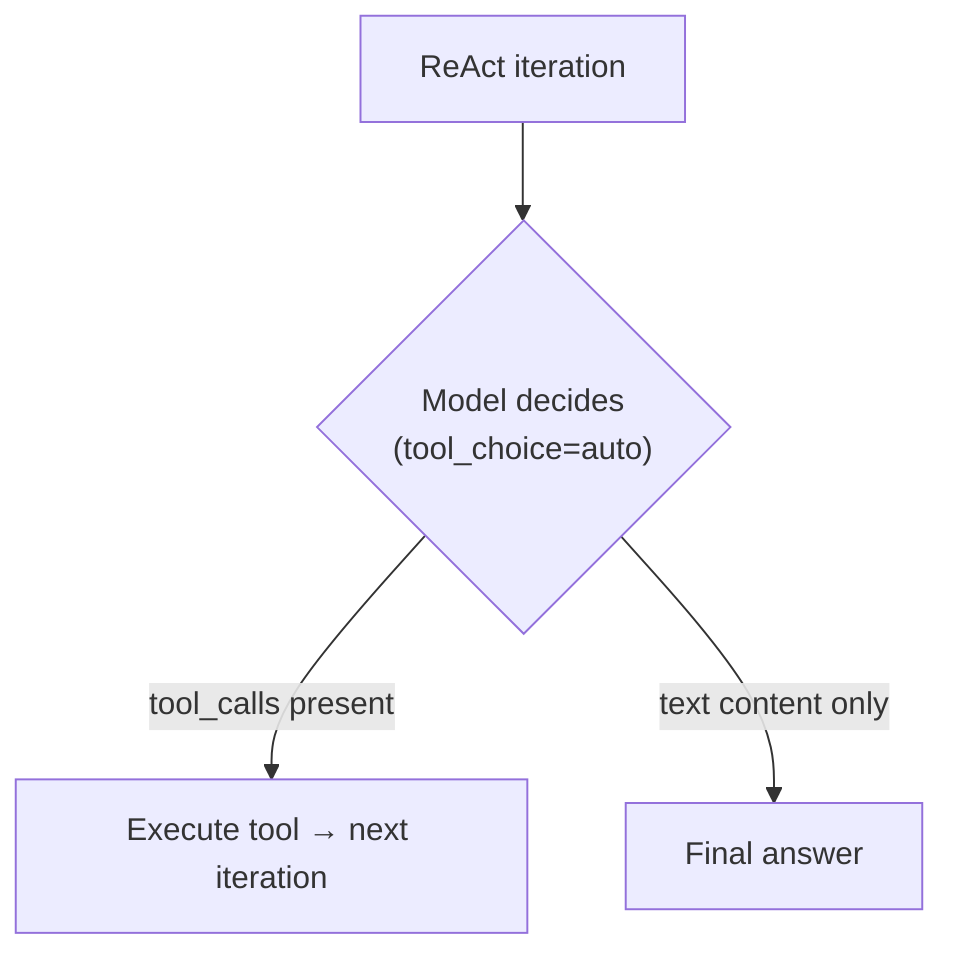
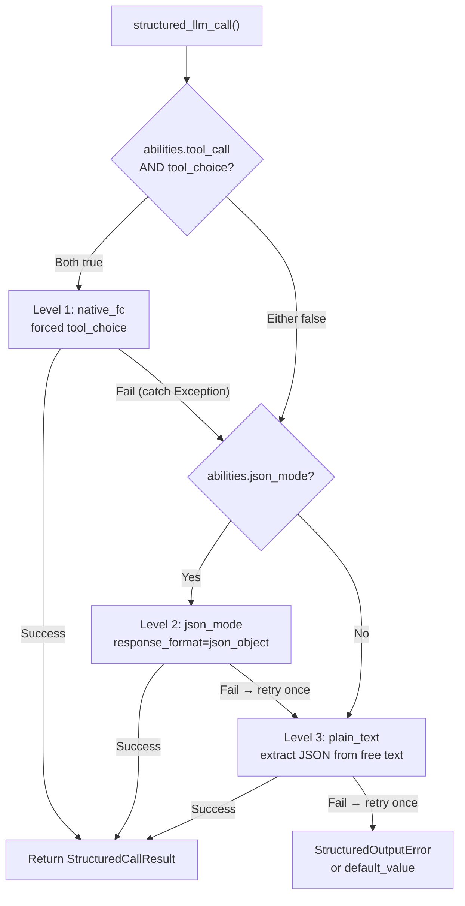

## Provider detection

FIM One uses LiteLLM as a universal adapter. The `_resolve_litellm_model()` function in `core/model/openai_compatible.py` maps the user's `LLM_BASE_URL` + `LLM_MODEL` to a LiteLLM model identifier with a provider prefix. The prefix determines how LiteLLM routes the request — native API protocol (Anthropic Messages API, Gemini, etc.) or generic OpenAI-compatible `/v1/chat/completions`.

Resolution order:

1. **Explicit provider** (from the `provider` field of a legacy `ModelConfig` row or an agent's inline model config; models added under Admin → Models have no provider field, so for them resolution starts at step 2) — highest priority. If the provider matches a known domain in the URL, no `api_base` is returned (LiteLLM routes natively). Otherwise, `api_base` is set to the relay URL.
2. **Domain match** against `KNOWN_DOMAINS` — official API endpoints are recognized by hostname.
3. **URL path hint** against `PATH_PROVIDER_HINTS` — common on relay platforms like UniAPI where `/claude` or `/anthropic` in the path indicates the upstream protocol.
4. **Fallback** — `openai/` prefix (generic OpenAI-compatible).

| Domain / Path | Provider prefix | Protocol |
|---|---|---|
| `api.openai.com` | `openai/` | OpenAI Chat Completions |
| `anthropic.com` | `anthropic/` | Anthropic Messages API |
| `generativelanguage.googleapis.com` | `gemini/` | Google Gemini |
| `api.deepseek.com` | `deepseek/` | DeepSeek (OpenAI-compatible) |
| `api.mistral.ai` | `mistral/` | Mistral |
| Path contains `/claude` or `/anthropic` | `anthropic/` | Anthropic Messages API (via relay) |
| Path contains `/gemini` | `gemini/` | Google Gemini (via relay) |
| Anything else | `openai/` | Generic OpenAI-compatible |

When the provider prefix is a native protocol (anthropic, gemini, etc.) and the URL is not the official endpoint, LiteLLM uses the native protocol but sends requests to the relay's `api_base`. This means provider-specific behaviors — including the Bedrock prefill issue described below — apply regardless of whether the request goes to the official API or through a relay.

<Warning>
If your relay URL contains `/claude` in the path, FIM One automatically routes via Anthropic's native protocol. This is usually correct (better streaming, thinking support), but means provider-specific behaviors apply — including the Bedrock prefill issue described below.
</Warning>

## tool_choice — 네 가지 모드

`tool_choice` 매개변수는 OpenAI 형식을 통해 표준화됩니다. LiteLLM은 요청을 보내기 전에 각 제공자의 네이티브 프로토콜로 변환합니다.

| 모드 | 의미 | 제공자 지원 |
|---|---|---|
| `"auto"` | 모델이 도구를 호출할지 또는 텍스트로 응답할지 결정 | 모든 제공자 |
| `"required"` | 도구를 반드시 호출해야 하지만 모델이 선택 | 대부분의 제공자 |
| `{"type":"function","function":{"name":"X"}}` | 특정 함수 X를 반드시 호출 | 대부분의 제공자 — **Anthropic 사고와 호환되지 않음** |
| `"none"` | 도구를 사용할 수 없음, 텍스트만 가능 | 모든 제공자 |

`"auto"`와 강제(`{"type":"function",...}`) 간의 구분은 FIM One의 모든 호환성 문제의 핵심입니다. 이 두 모드는 서로 다른 요구사항을 가진 완전히 다른 하위 시스템에서 사용됩니다.

## tool_choice가 사용되는 곳

두 개의 서브시스템이 `tool_choice`를 사용하며, 이들은 근본적으로 다른 방식으로 사용합니다.

### ReAct 엔진 — tool_choice="auto"

ReAct 루프는 모델이 각 반복마다 결정해야 합니다: 도구를 호출할지, 아니면 최종 답변을 제공할지. 여기서는 `"auto"`만 의미가 있습니다 — 모델이 `tool_calls`를 생성하거나 텍스트 콘텐츠를 생성하는 것 중 자유롭게 선택합니다. 이는 모든 제공자, 모든 모델, 확장 사고를 포함한 모든 모드와 호환됩니다.



ReAct 엔진은 `abilities["tool_call"] = True`일 때 네이티브 함수 호출(`_run_native`)을 사용하고, 그렇지 않으면 JSON-in-content 모드(`_run_json`)로 폴백합니다. 두 모드 모두 `"auto"`를 사용합니다 — 차이점은 도구가 `tools` 매개변수를 통해 전달되는지, 아니면 시스템 프롬프트에서 설명되는지입니다. 자세한 내용은 [ReAct 엔진 — 이중 모드 실행](/architecture/react-engine#dual-mode-execution)을 참조하세요.

### structured_llm_call — tool_choice=forced

한 번의 호출로 수행하는 구조화된 추출(스키마 주석, DAG 계획, 계획 분석)입니다. 모델이 특정 가상 함수를 호출하도록 강제하여 구조화된 JSON 출력을 보장합니다. 이 호출 지점에서 제공업체별 오류가 발생합니다.

`structured_llm_call`은 3단계 성능 저하 체인을 구현합니다. 세 단계의 이름은 코드에서 따온 것이며, 번호는 [아래 섹션](#structured-output-the-four-guarantee-tiers)에서 설명하는 네 가지 보장 계층의 번호와 일치하지 않습니다.



핵심적인 설계 차이는 다음과 같습니다. `structured_llm_call`의 fallback은 **런타임**에 수행됩니다. 각 단계를 동적으로 시도하고 예외를 포착하여 다음 단계로 넘어갑니다. 반면 ReAct 엔진의 모드 선택은 **빌드 타임**에 수행됩니다. 시작 시 `_native_mode_active`를 한 번 확인하고 전체 루프에서 하나의 모드로 실행합니다. 따라서 `structured_llm_call`은 제공업체별 400 오류가 발생해도 투명하게 복구할 수 있지만, ReAct는 처음부터 모드가 올바르게 선택되어 있어야 합니다.

## 구조화된 출력: 네 가지 보장 수준

"구조화된 출력"은 서로 다른 네 가지 메커니즘을 포괄하는 표현입니다. 이 메커니즘은 모두 JSON을 생성하지만 동일한 수준의 보장을 제공하지는 않습니다. 차이를 만드는 것은 제약이 적용되는 위치입니다. 스키마에서 금지한 토큰을 디코더가 생성할 수 없도록 디코더 내부에 제약이 적용되거나, 단지 요청만 할 수 있는 프롬프트 내부에 제약이 적용됩니다.

| 수준 | 요청에 포함되는 내용 | 페이로드가 전달되는 위치 | 보장되는 내용 | 적용 주체 |
|---|---|---|---|---|
| **T1 — 네이티브 함수 호출, `strict: true`** | 함수 정의에 `strict`가 설정된 `tools=[…]` | `tool_calls[0].function.arguments`의 JSON 문자열 | 스키마 수준: 모든 필수 필드가 포함되고, 선언되지 않은 키가 없으며, 타입과 열거형이 올바름 | 디코더 상태 머신 |
| **T2 — `response_format: {"type": "json_schema"}`** | `response_format` 내부의 스키마 자체와 `strict: true` | `message.content`의 JSON 문자열 | T1과 동일한 스키마 수준의 보장이 적용되지만, 도구 호출이 아닌 어시스턴트 자체의 응답에 적용됨 | 디코더 상태 머신 |
| **T3 — `response_format: {"type": "json_object"}`** | 스키마 없이 타입만 지정 | `message.content`의 JSON 문자열 | 구문 수준만 보장: 텍스트가 JSON으로 파싱됨. 어떤 키가 포함되는지는 제한되지 않음 | 디코더(구문) |
| **T4 — 지침이 포함된 자유 형식 텍스트** | 없음. 프롬프트에서 스키마를 설명함 | `message.content`, 설명문이나 코드 펜스로 감싸질 수 있음 | 없음 | 프롬프트 |

T1과 T2를 뒷받침하는 메커니즘은 제약 디코딩입니다. 제공업체는 스키마를 문법으로 컴파일하고, 각 디코딩 단계에서 해당 출력이 스키마에 따라 파싱되지 않도록 만드는 모든 토큰을 마스킹합니다. 필수 필드는 반드시 출력되기 전까지 객체를 닫게 만드는 토큰이 허용 집합에 포함되지 않으므로 건너뛸 수 없습니다. 이는 "모델에 정중하게 요청했고 모델이 따랐다"는 주장과는 다른 종류의 보장이며, 프롬프트 준수가 보장되지 않는 temperature 1이나 소형 모델에서도 T1/T2가 보장되는 이유입니다.

### T1과 T2는 서로 대체할 수 없습니다

두 방식은 서로 다른 채널을 통해 동일한 보장을 제공하며, 채널은 세 가지 측면에서 중요합니다.

**턴의 형태가 다릅니다.** T1은 도구 호출 턴을 반환하며, 모델이 *행동하기로 결정했음*을 의미합니다. T2는 일반적인 assistant 메시지를 반환하며, 모델이 특정 형태로 *답변했음*을 의미합니다. 호출자가 에이전트 루프가 아닌 하나의 추출만 원할 때 T2는 모델이 "호출"할 가상 함수를 만들어 내지 않고 그 의도를 직접 전달합니다.

**T1을 강제하면 사고 과정과 충돌합니다.** T1에서 스키마로 제한된 페이로드를 얻으려면 일반적으로 선택을 강제해야 하며, `required` 또는 이름이 지정된 함수 중 하나를 사용합니다. 여러 provider는 확장된 사고 과정이 활성화된 상태에서 강제된 도구 선택을 거부합니다. 아래 표 B에는 이를 지원하는 provider가 정리되어 있습니다. T2에는 이러한 충돌이 없습니다. T2는 도구 제약이 아니라 응답 제약이므로, 사고 과정이 활성화된 상태에서도 동작하는 유일한 스키마 제한 경로입니다. 추론 모델을 표준으로 사용하는 배포 환경에서는 이것이 스타일이 아닌 실용적인 측면에서 T2를 선택해야 하는 이유입니다.

**T1은 T2에는 없는 스키마 연결 작업을 한 라운드 추가로 요구합니다.** 가상 함수에는 이름과 설명이 필요하며, 모델이 해당 함수를 호출하지 않고 거부할 수 있도록 허용할지 결정해야 합니다.

### T2의 비용

제약 디코딩은 무료가 아니며, 이미 보유한 스키마가 일반적으로 해당 스키마가 허용하는 스키마와 일치하지 않습니다.

- **스키마의 부분 집합.** OpenAI의 strict mode에서는 모든 객체에 `additionalProperties: false`를 지정하고 모든 속성을 `required`에 나열해야 합니다. 선택 사항은 `required`에서 생략하는 대신 `null`과의 유니온으로 표현합니다. 루트는 객체여야 합니다. 전체 속성 수와 중첩 깊이에도 제한이 있습니다. 직접 작성한 스키마 대부분은 사용 가능해지기 전에 수정이 필요합니다.
- **문법 컴파일.** 새로운 스키마를 포함하는 첫 번째 요청은 provider 측에서 일회성 컴파일 지연을 발생시킵니다. 안정적인 스키마를 재사용하면 이 비용을 분산할 수 있지만, 요청마다 새로운 스키마를 생성하면 그렇지 않습니다.
- **새로운 실패 지점.** 응답하지 않는 모델은 스키마 형태의 객체 대신 refusal을 반환하므로, 호출자는 이를 처리하는 분기를 추가해야 합니다.

### 어떤 tier도 보장하지 않는 것

모든 tier는 형식을 제한합니다. 진실성을 보장하는 tier는 없습니다. T2 응답은 스키마에 완전히 부합하면서도 사실과 다를 수 있으며, enum으로 제한된 필드는 허용된 값 중 어느 것도 올바르지 않은 경우에도 그중 하나를 반환합니다. 디코더의 역할은 정답을 아는 것이 아니라 출력이 문법의 범위 안에 있도록 유지하는 것이기 때문입니다. 스키마 게이팅은 파싱 실패와 필드 형식 오류를 제거합니다. 하지만 값이 무엇을 의미하는지 확인해야 할 필요성까지 없애지는 않습니다.

<Warning>
**두 가지 번호 체계가 있으며, 서로 일치하지 않습니다.** 이 페이지에서는 위의 보장 tier에 **T1–T4**를 사용합니다. 또한 `structured_llm_call`의 성능 저하 체계에 있는 세 단계에는 **Level 1/2/3**을 사용하며, 각 단계의 이름은 코드(`native_fc`, `json_mode`, `plain_text`)에서 따왔습니다. FIM One의 Level 2는 `json_object`이며, 이는 T2가 아닌 **T3**입니다. 이 체계에 세 단계만 있는 이유는 tier가 세 개뿐이어서가 아니라 T2를 건너뛰기 때문입니다.
</Warning>

### FIM One의 위치

| `structured_llm_call` 수준 | 등급 | 코드가 실제로 수행하는 작업 |
|---|---|---|
| Level 1 — `native_fc` | **`strict`가 없는 T1** | `_build_tool_def`는 `name` / `description` / `parameters`만 내보냅니다. 호출 지점에서 `strict`를 설정하는 곳이 없으므로 `responses_adapter.py`의 `convert_tools`는 기본값인 `False`를 사용합니다. 따라서 스키마는 모델이 생성해야 할 내용에 대한 설명으로 전달될 뿐, 모델이 생성할 수 있는 내용을 제한하지 않습니다. |
| *(없음)* | **T2** | 구현되지 않았습니다. 코드베이스 어디에도 `json_schema`가 나타나지 않으며, `abilities`에도 모델별 지원 여부를 표현할 수 있는 플래그가 없습니다. |
| Level 2 — `json_mode` | **T3** | `structured.py::_call_llm`과 `react.py::_json_response_format`에 `{"type": "json_object"}`로 하드코딩되어 있습니다. |
| Level 3 — `plain_text` | **T4** | 자유 형식 콘텐츠에 `extract_json()`을 적용하며, 호출 지점별로 선택적인 정규 표현식 폴백을 사용할 수 있습니다. |

현재 설계의 정직한 한계는 다음 다섯 가지입니다.

1. **체인에는 스키마로 제한된 대체 단계가 없습니다.** Level 1이 실패하면 다음 단계는 `json_object`이며, 이는 텍스트가 파싱된다는 것만 보장합니다. 필드를 계속 강제하는 중간 단계는 없습니다.
2. **Level 1의 보장은 이름이 암시하는 것보다 약합니다.** `strict`가 없으면 네이티브 함수 호출은 2024년 이전의 비엄격 방식으로 동작합니다. 모델은 일반적으로 스키마를 따르지만, 필수 필드를 누락하거나, 존재하지 않는 키를 만들거나, 숫자로 선언된 위치에 문자열을 반환하는 것이 방지되지는 않습니다.
3. **`anthropic/` 경로에서는 Level 2가 실제로 T3가 아닙니다.** Anthropic Messages API에는 `response_format`이 없으므로 LiteLLM은 assistant 프리필을 삽입해 JSON 모드를 에뮬레이션합니다. 이는 프롬프트 계층의 장치이므로 실질적인 보장은 T4와 T3 사이에 있으며, T3 수준의 보장을 제공하지 않습니다. 아래에 설명된 Bedrock 프리필 문제는 이 에뮬레이션이 명시적으로 실패하는 경우입니다. 더 조용한 문제는 매개변수 이름이 암시하는 보장이 애초에 제공되지 않았다는 점입니다.
4. **이후 결과를 스키마에 대해 검증하는 과정이 없습니다.** `jsonschema`는 의존성에 포함되어 있지 않습니다. 수행되는 검사는 무엇이든 선택적 `parse_fn` 내부의 호출 지점별 검사이며, 엄격성은 호출 지점마다 다릅니다.
5. **실패가 드러나지 않고 흡수됩니다.** 거의 모든 호출자가 `default_value`를 전달하므로, 체인을 모두 소진해도 예외가 발생하는 대신 그럴듯해 보이는 객체가 반환됩니다. `StructuredCallResult.level_used`는 값을 생성한 단계를 기록하지만, 어떤 호출 지점에서도 이를 읽지 않습니다. 또한 `default_value` 경로에서는 실제로 아무것도 생성되지 않은 체인인데도 `plain_text`로 보고합니다.

**현재 실제로 어느 단계에 있는지 확인하는 방법.** `structured_llm_call`은 완료된 호출마다 `INFO` 수준으로 한 줄을 기록합니다. 이 로그는 데이터가 `parse_fn`을 통과한 후에만 생성되므로, 실제로 성공한 단계를 나타냅니다.

```
structured_llm_call: fn=classify_mode level=native_fc attempt=first calls=1
structured_llm_call: fn=annotate_tables level=json_mode attempt=reformat_retry calls=3
```

전체 실패는 `level=none outcome=default_value`로 `WARNING` 수준에 기록됩니다. 하루 동안의 트래픽에서 이 두 줄을 grep하는 것이 특정 배포 환경에서 누락된 T2 단계가 비용을 발생시키는지 확인할 수 있는 유일한 방법입니다. `default_value` 설계 때문에 증상이 오류가 아니라 평범하지 못한 응답으로 나타나기 때문입니다.

### 각 tier의 Provider 지원

<Note>
**이 표는 FIM One의 코드 경로가 아니라 upstream API를 설명합니다.** 이 페이지의 다른 모든 표에는 동작을 구현하는 함수가 명시되어 있습니다. 이 표에는 해당 함수를 명시할 수 없습니다. FIM One은 어떤 provider에서도 T2 기능을 사용하지 않으며, 어느 provider에도 `strict`를 설정하지 않기 때문입니다. 이 표는 T2 구현을 결정할 때 실제로 사용 가능한 기능을 기준으로 검토할 수 있도록 제공됩니다. Vendor의 기능은 빠르게 변경되며, 지원이 한 제품군의 일부 모델에 먼저 적용되는 경우가 많습니다. 따라서 표의 항목을 사용하기 전에 vendor의 공식 문서를 다시 확인하세요.
</Note>

| Provider | T1 `strict` | T2 `json_schema` | T3 `json_object` | Notes |
|---|---|---|---|---|
| **OpenAI** | ✅ | ✅ | ✅ | 두 strict tier의 reference implementation입니다. Strict function calling과 `response_format: json_schema`는 하나의 grammar engine과 하나의 schema subset을 공유합니다. `json_object`는 호환성을 위해 유지되는 이전 JSON mode입니다 |
| **Anthropic** | ⚠️ | ⚠️ | ❌ | Messages API에는 `response_format`이 전혀 없으며, tool의 `input_schema`는 decoder가 강제하는 것이 아니라 검증만 수행합니다. 최근 Claude 모델에서는 beta header를 통해 strict tool use와 schema-constrained output format을 사용할 수 있습니다. FIM One은 LiteLLM을 통해 Anthropic에 연결되며, LiteLLM은 prefill로 JSON mode를 에뮬레이트하고 beta를 사용하지 않습니다. 따라서 이 기능들은 여기에서 활성화되어 있지 않습니다 |
| **Gemini** | ✅ | ✅ | ✅ | `responseSchema`(OpenAPI 3.0 subset)와 이후 추가된 `responseJsonSchema`는 decoder가 강제하며, OpenAI-compatible endpoint는 `response_format: json_schema`를 허용합니다. 강제 호출은 `allowed_function_names`와 함께 `ANY`를 사용합니다 |
| **xAI (Grok)** | ✅ | ✅ | ✅ | strict structured outputs를 포함한 OpenAI-compatible surface입니다 |
| **Mistral** | ✅ | ✅ | ✅ | 사용자 지정 JSON Schema를 허용하는 custom structured outputs를 지원합니다 |
| **DeepSeek** | ❌ | ❌ | ✅ | JSON output은 `json_object`만 지원합니다. 문서에 명시된 요구 사항은 prompt에 "json"이라는 단어를 포함하고 예시를 보여 주는 것입니다. 이는 T3 parameter에 연결된 T4 device입니다. 또한 `deepseek-reasoner`는 강제된 tool choice를 거부하므로 schema-gated path가 양쪽 끝에서 모두 차단됩니다 |
| **Qwen** (DashScope) | ⚠️ | ⚠️ | ✅ | compatibility endpoint에서 `json_object`를 사용할 수 있습니다. Schema-constrained decoding은 API보다 serving stack을 통해 self-hosted Qwen에서 안정적으로 작동합니다. DashScope 자체의 `json_schema` 지원 여부는 model generation에 따라 다릅니다. model별로 확인하세요 |
| **GLM** (Zhipu / Z.AI) | ❌ | ⚠️ | ✅ | OpenAI-compatible endpoint에서 `json_object`를 사용할 수 있습니다. 강제된 tool choice는 아예 지원되지 않으므로 Table B에서는 `tool_choice_enabled=false`를 권장합니다. 플랫폼이 해당 model에 대해 지원한다고 문서화하지 않은 한 `json_schema`는 사용할 수 없는 것으로 간주하세요 |
| **Kimi** (Moonshot) | ⚠️ | ⚠️ | ✅ | `json_object`가 문서화되어 있습니다. Thinking variant는 `auto` tool choice만 허용하므로, `strict` 지원 여부와 관계없이 해당 모델에서는 T1 path를 강제할 수 없습니다 |
| **MiniMax** | ⚠️ | ⚠️ | ✅ | thinking이 항상 활성화된 상태에서도 강제 choice를 사용한 function calling이 작동하므로, always-thinking model 중 가장 사용하기 쉬운 T1 경로입니다. Schema-level enforcement는 문서화되어 있지 않으므로 T1은 non-strict로 간주하세요 |
| **Doubao** (Volcengine Ark) | ⚠️ | ⚠️ | ✅ | Ark는 Doubao 제품군 일부에 대해 structured output을 문서화하고 있습니다. 지원 범위는 model별로 다르므로 계정의 model이 이를 지원한다고 가정하기 전에 확인하세요 |
| **Ollama / vLLM / llama.cpp** | ✅ | ✅ | ✅ | 이 목록의 어떤 항목보다 tier 지원이 강력하면서도 가장 덜 알려져 있습니다. Grammar-constrained decoding(GBNF, XGrammar, Outlines)이 로컬에서 실행되므로, self-hosted 14B model에 위의 여러 hosted API가 제공하지 못하는 보장을 적용할 수 있습니다. 서버에 따라 Ollama의 `format`, vLLM의 guided decoding parameters 또는 OpenAI-compatible `response_format`으로 노출됩니다 |

단순히 표를 다시 설명하는 것이 아니라 표의 형태를 이해하는 데 도움이 되는 세 가지 패턴을 살펴보겠습니다.

**T3는 보편적이지만 T2는 그렇지 않습니다.** FIM One이 지원하는 모든 provider는 `json_object`를 제공하지만, schema tier를 제공하는 provider는 대략 절반입니다. 따라서 이식 가능한 structured-output 경로는 T3 이하를 기반으로 구축해야 하며, 이것이 FIM One의 chain이 현재와 같은 형태를 갖는 이유입니다. T2를 추가하려면 전역 switch가 아니라 model별 capability flag를 추가해야 합니다.

**항상 활성화된 thinking은 T1 경로를 닫는 경향이 있습니다.** GLM, Kimi의 thinking model, `deepseek-reasoner`는 모두 강제된 tool choice를 제한하거나 거부하며, Anthropic은 thinking이 활성화된 동안 이를 거부합니다. MiniMax는 이에 대한 반례입니다. 경로가 닫혀 있는 경우 T2가 남은 유일한 schema-gated option이므로, OpenAI보다 Chinese-model deployment에서 누락된 rung이 더 중요합니다.

**Self-hosting은 일반적인 우선순위를 뒤집습니다.** Constrained decoding은 serving stack의 속성이므로, instruction-following이 frontier model보다 훨씬 약한 local checkpoint에서도 사용할 수 있습니다. Schema gating이 가장 필요한 model일수록 이를 적용할 수 있는 가능성도 가장 큽니다.

## Bedrock prefill 함정

`response_format={"type":"json_object"}`이 `anthropic/` 접두사로 해석된 모델에 전달되면, LiteLLM은 JSON 모드를 시뮬레이션하기 위해 내부적으로 어시스턴트 프리필 메시지를 주입합니다. Anthropic Messages API는 기본 `response_format` 매개변수가 없으므로, LiteLLM은 어시스턴트 콘텐츠로 여는 중괄호를 앞에 붙여서 근사합니다:

```json
{"role": "assistant", "content": "{"}
```

이는 Anthropic의 직접 API에서 작동합니다. 그러나 최신 AWS Bedrock 모델 버전은 마지막 메시지가 `role: "assistant"`인 대화를 거부합니다 — 이를 "어시스턴트 메시지 프리필"이라고 부르며 다음을 발생시킵니다:

```
ValidationException: This model does not support assistant message prefill.
The conversation must end with a user message.
```

이 오류는 **세 가지 조건이 모두 동시에 충족될 때만** 발생합니다:

1. 모델이 `anthropic/` 접두사로 해석됩니다(도메인 일치 또는 URL 경로 힌트를 통해).
2. `response_format={"type":"json_object"}`이 전달됩니다(`structured_llm_call`의 json_mode 코드 경로).
3. 실제 백엔드는 AWS Bedrock입니다(프리필을 거부함).

<Tip>
**OpenAI 호환 엔드포인트를 통한 Bedrock?** Bedrock 릴레이가 OpenAI 호환 `/v1/chat/completions` 엔드포인트를 노출하고(AWS의 자체 OpenAI 호환 게이트웨이 또는 제3자 프록시), URL 경로에 `/claude` 또는 `/anthropic`이 **포함되지 않으면**, FIM One은 이를 `openai/` 접두사로 해석합니다. LiteLLM은 백엔드를 표준 OpenAI 호환 서버로 취급하고, 프리필 주입 없이 `response_format`을 직접 전달하며, 서버가 JSON 제약을 기본적으로 처리합니다. **프리필 함정이 적용되지 않습니다** — `json_mode_enabled=false`를 설정할 필요가 없습니다.
</Tip>

<Warning>
이는 기본 도구 호출(`tool_choice="auto"`과 `tools=` 매개변수 포함)에 영향을 주지 않습니다. 프리필 주입은 `response_format`에만 발생합니다. ReAct 에이전트 실행은 완전히 영향을 받지 않습니다.
</Warning>

Level 1(native_fc)과 Level 2(json_mode)가 모두 Bedrock에서 실패하면, 시스템은 Level 3(plain_text)에서 복구됩니다. 아래에 설명된 `json_mode_enabled` 플래그는 낭비되는 Level 2 호출을 제거합니다.

### 해결 방법: json_mode_enabled

모델별 `json_mode_enabled` 플래그는 Level 2 (`json_mode`)를 시도할지 여부를 제어합니다.

- **DB로 구성된 모델**: 관리자 → 모델 → 고급 설정에서 토글합니다. 이 플래그는 `ModelProviderModel.json_mode_enabled`에 저장되며 기본값은 `TRUE`입니다.
- **ENV로 구성된 모델**: 환경에 `LLM_JSON_MODE_ENABLED=false`를 설정합니다.
- **효과**: 비활성화하면 `abilities["json_mode"]`가 `False`를 반환하므로 `response_format`이 전달되지 않고, 프리필도 수행되지 않아 Bedrock이 작동합니다. 성능 저하 체인은 `native_fc → plain_text`가 되며, 문제가 발생하는 `json_mode` 호출을 완전히 건너뜁니다.
- **건너뛰기의 비용**: 시스템 프롬프트가 JSON 형식으로 반환하도록 요청하고 최신 모델에서는 `extract_json()`이 자유 형식 콘텐츠를 안정적으로 파싱하므로, 실제로 모델은 여전히 유효한 JSON을 반환합니다. 손실되는 것은 출력이 아니라 보장입니다. 이제 체인은 T4에서 끝나며, 결과를 제약하는 것은 프롬프트뿐입니다. `anthropic/` 라우트에서는 에뮬레이트된 JSON 모드가 디코더 수준의 보장을 제공한 적이 없으므로 이러한 손실이 보이는 것보다 작습니다.

## Thinking models + forced tool_choice

여러 제공자는 확장 사고가 활성화된 상태에서 강제 `tool_choice`를 거부합니다. 특정 함수 호출을 고정하는 것이 모델의 먼저 추론할 자유를 모순된다는 이유로:

```
tool_choice 'specified' is incompatible with thinking enabled
```

**이것은 thinking models의 법칙이 아니라 제공자별 규칙입니다.** Anthropic은 프로토콜 수준에서 이를 강제하고 Moonshot(Kimi)도 같은 방식으로 동작하지만, MiniMax는 모든 호출에서 사고하며 여전히 강제 tool choice를 허용합니다. [Provider Capability Matrix](#provider-capability-matrix)의 표 B는 제공자별로 판정을 기록합니다. 한 행에서 다른 행으로 일반화하지 마세요.

Anthropic 모델의 경우, `structured_llm_call`은 native-FC 수준에서 `reasoning_effort=None`을 전달하여 충돌을 자체적으로 해결하며, 이는 해당 호출에 대해 사고를 끕니다(`structured.py::_call_llm`). 구조화된 출력은 깊은 추론이 아니라 **스키마 준수**가 필요하므로, 여기서 사고를 비활성화하는 것은 올바르고 더 저렴합니다.

API를 통해 사고를 전환할 수 없는 경우, native_fc는 모든 구조화된 호출에서 400으로 실패하며 체인이 json_mode로 떨어지기 전에 약 10초가 소요됩니다. Kimi가 일반적인 경우입니다. 사고가 켜져 있을 때는 `auto`만 지원되며, 강제 tool choice는 사고를 꺼야 하는데, Moonshot은 이를 모델 id를 통해서만 노출합니다(`kimi-k2`는 꺼져 있고, `kimi-k2.5`와 `kimi-k2-thinking`은 켜져 있음). FIM One은 이를 전환하는 매개변수가 없으므로, 해결책은 아래의 `tool_choice_enabled` 플래그입니다.

### 해결책: tool_choice_enabled

모델별 `tool_choice_enabled` 플래그는 Level 1 (native_fc)이 시도되는지 여부를 제어합니다:

- **DB 구성 모델**: Admin → Models → Advanced → "Native Function Calling"에서 토글합니다. 플래그는 `ModelProviderModel.tool_choice_enabled`에 저장됩니다 (기본값 `TRUE`).
- **ENV 구성 모델**: 환경에서 `LLM_TOOL_CHOICE_ENABLED=false`를 설정합니다.
- **효과**: 비활성화되면 `abilities["tool_choice"]`는 `False`를 반환 → 저하 체인이 Level 2 (json_mode) 또는 Level 3 (plain_text)에서 시작되며, native_fc를 완전히 건너뜁니다. 이는 호환되지 않는 모델에 대한 구조화된 호출당 약 10초의 페널티를 제거합니다.
- **ReAct 에이전트 영향 없음**: `tool_choice_enabled`는 `structured_llm_call`에서만 강제 도구 선택을 제어합니다. ReAct 엔진은 `tool_choice="auto"` (모델이 자유롭게 결정)를 사용하며, 이 설정과 관계없이 모든 모델에서 작동합니다.

<Note>
`tool_choice_enabled`와 `tool_call`은 별도의 능력 플래그입니다. `tool_call` (`OpenAICompatibleLLM`의 경우 항상 `True`)은 도구가 모델에 전달되는지 여부를 제어합니다 — 비활성화하면 ReAct 에이전트가 손상됩니다. `tool_choice`는 구조화된 출력 추출을 위해 **강제** 도구 선택이 시도되는지만 제어합니다.
</Note>

`tool_choice="auto"`는 사고 모드의 영향을 받지 않습니다. ReAct 엔진은 `"auto"`만 사용하므로, 사고가 활성화된 상태에서 에이전트 실행이 작동합니다.

<Warning>
이 제약을 피하기 위해 `abilities["tool_call"] = False`를 설정하지 마세요. 이는 ReAct의 `_run_native` 모드 (이는 `tool_choice="auto"`를 사용하고 사고와 잘 작동함)를 비활성화하여, 덜 안정적인 `_run_json` 모드로 강제합니다.
</Warning>

<Note>
**제공자 마이그레이션 참고:** 일부 타사 릴레이는 `reasoning_effort` (`drop_params=True`)와 같은 지원되지 않는 매개변수를 자동으로 삭제하므로, 구성된 경우에도 사고가 활성화되지 않습니다. 사고를 적절히 지원하는 제공자 (Bedrock, 직접 Anthropic API)로 마이그레이션할 때, native_fc의 `reasoning_effort=None`은 일관된 동작을 보장합니다. 사용자 조치가 필요하지 않습니다 — 구조화된 출력은 모든 제공자에서 동일하게 작동합니다.
</Note>

## Provider Capability Matrix

이 섹션은 각 제공자가 지원하는 기능과 FIM One이 이에 대해 수행하는 작업의 권위 있는 기록입니다. 모든 행은 동작을 구현하는 함수의 이름을 지정하므로 여기서 제시된 모든 주장은 코드에 대해 확인할 수 있습니다. 다른 페이지는 데이터를 반복하는 대신 여기에 링크합니다. 코드가 변경되면 이 섹션도 함께 변경됩니다.

한 행은 단일 모델이 아닌 제공자의 프로토콜을 설명합니다. 한 제품군 내의 모델이 다른 경우(DeepSeek chat 대 reasoner, Kimi thinking 켜짐 대 꺼짐), 셀에 그 내용이 표시됩니다.

### Table A: Protocol routing

How a configured `base_url` plus `model` becomes a LiteLLM call, and what happens when the first choice of interface is unavailable.

| Provider | Detected by | LiteLLM prefix | Interface surface | Downgrade chain | Code anchor |
|---|---|---|---|---|---|
| **OpenAI** | Domain `api.openai.com`, or an explicit `provider` of `openai` on the model config | `openai/` | `completions`. GPT-5.x uses `responses-native` (`litellm.aresponses`), with `responses-bridge` (`openai/responses/<model>`) retained as a rollback | GPT-5.x talks Responses natively, falls back to `completions` on a 404 (cached per endpoint and model in `_RESPONSES_NATIVE_SUPPORT`) or on a 400 (not cached). `gpt-6.1-*` and `gpt-6-astra` keep a 400 on a request with tools instead of falling back, since their `completions` rejects tools. Every other model goes straight to `completions` | `_resolve_litellm_model`, `_should_use_native_responses`, `_dispatch_acompletion` |
| **Anthropic** (Bedrock note below) | Domain `anthropic.com`, path segment `/claude` or `/anthropic`, or an explicit `provider` of `anthropic` | `anthropic/` | `anthropic messages` | None. Native routes never enter the Responses bridge; their protocol is built in `_build_request_kwargs` | `_resolve_litellm_model`, `_dispatch_acompletion` |
| **Gemini** | Domain `generativelanguage.googleapis.com`, path segment `/gemini`, or an explicit `provider` of `gemini` | `gemini/` | `gemini` | None. A domain match also drops `api_base`, so an OpenAI-compat suffix such as `/v1beta/openai/` is ignored and the call goes to the native Gemini API | `_resolve_litellm_model` |
| **xAI (Grok)** | No domain or path entry. Resolves as generic OpenAI-compatible unless `provider` is set explicitly on the model config | `openai/` with `api_base`, or the explicit provider prefix | `completions` | None | `_resolve_litellm_model` |
| **DeepSeek** | Domain `api.deepseek.com` | `deepseek/` | `completions` | None | `_resolve_litellm_model` |
| **Qwen** (DashScope) | Generic fallback | `openai/` with `api_base` | `completions` | None | `_resolve_litellm_model` |
| **GLM** (Zhipu, Z.AI) | Generic fallback | `openai/` with `api_base` | `completions` | None | `_resolve_litellm_model` |
| **MiniMax** | Generic fallback | `openai/` with `api_base` | `completions` | None | `_resolve_litellm_model` |
| **Kimi** (Moonshot) | Generic fallback | `openai/` with `api_base` | `completions` | None | `_resolve_litellm_model` |
| **Doubao** (Volcengine) | Generic fallback | `openai/` with `api_base` | `completions` | None | `_resolve_litellm_model` |
| **Mistral** | Domain `api.mistral.ai` | `mistral/` | `completions` | None | `_resolve_litellm_model` |
| **Ollama / local** | Generic fallback, typically `http://localhost:11434/v1` | `openai/` with `api_base` | `completions` | None | `_resolve_litellm_model` |
| **Relay / proxy** | Path hint first, then the generic fallback. An explicit `provider` on the model config outranks both | The hinted provider prefix, else `openai/`, always with `api_base` pointing at the relay | Whatever the resolved prefix implies | None beyond the resolved prefix. See the relay gotchas below | `_resolve_litellm_model` |

**How GPT-5.x picks a protocol.** `FIM_GPT5_RESPONSES_MODE` selects it: `native` (the default) talks `/v1/responses` directly through `litellm.aresponses`, `bridge` uses LiteLLM's chat-completions translation, and `off` forces plain chat completions. The native path exists because the bridge is lossy in the one place that matters: it discards the reasoning items, so a GPT-5.x agent re-derives its chain of thought on every tool round. Talking the protocol directly lets those items be replayed. A call that explicitly passes `reasoning_effort=None`, which is what `structured_llm_call` and the finish-signal probes do, stays on chat completions, because a call that wants no thinking has no reasoning state to preserve. The exception is models that cannot switch reasoning off (`gpt-6.1-*`, `gpt-6-astra`): their chat completions reject function tools at any `reasoning_effort`, so those calls stay on `/v1/responses` and run at the lowest effort, `low`. For the same reason `off`, or an endpoint without `/v1/responses`, leaves these models without tool calls.

Two properties of that native request are load-bearing and easy to get wrong:

- `store=false` keeps the conversation stateless upstream, and `include=["reasoning.encrypted_content"]` asks for the encrypted payload to be returned. Without the include, the reasoning items arrive empty and replay silently becomes a no-op.
- A replayed reasoning item must have its server-side `id` stripped. With `store=false` nothing is persisted upstream, so echoing the id back earns `Item with id 'rs_...' not found. Items are not persisted when 'store' is set to false`. The `encrypted_content` blob carries the state on its own, so dropping the id costs nothing (`sanitize_reasoning_item`).

**User-supplied endpoints.** The table describes endpoints an operator configured (environment variables, Admin → Models). An endpoint that comes from a user, i.e. `base_url` in an agent's inline model settings, does not go through LiteLLM at all (`OpenAICompatibleLLM(untrusted_endpoint=True)`, `_call_pinned`). It must come with its own `api_key`: the platform's keys are never used for it, and an empty key is refused. It is called as OpenAI-compatible chat completions at the URL as typed, by the OpenAI SDK on a dedicated HTTP client that refuses private, loopback, link-local and metadata addresses when it connects and does not follow redirects. The model name is sent as a field of the request and selects no route, provider or protocol; there is no path hint, no `provider`, no Responses route. When such an endpoint fails, the error names the kind of failure and the HTTP status, not the response body. Models on internal networks, or that need a provider's native protocol, are added by an administrator under Admin → Models and selected by the agent.

**Bedrock.** Bedrock-hosted Claude follows the row it resolves to, not the fact that Bedrock is hosting it. Reached through an `anthropic/`-routed relay it inherits Anthropic protocol behaviour, including LiteLLM's json-mode assistant prefill, which newer Bedrock versions reject. Reached through an OpenAI-compatible gateway it resolves as `openai/`, no prefill is injected, and `json_mode_enabled` can stay on.

### Table B: 충돌 및 해결 방법

FIM One은 네 가지 `tool_choice` 상태 중 세 가지를 발생시킵니다: ReAct 루프(`react.py::_run_native`)의 `auto`, 구조화된 출력(`structured.py::_call_llm`)의 명명된 함수, 그리고 finish-signal 답변이 도구 페이로드를 재생할 때의 `none`. 어떤 호출 사이트도 `required`를 발생시키지 않습니다. 해당 열은 `required`와 명명된 함수 모두에 적용되는 비`auto` 도구 선택에 대한 제공자의 제약을 기록합니다.

| Provider | `auto` | `required` | Named function | `none` | With thinking on | FIM One's workaround | Code anchor |
|---|---|---|---|---|---|---|---|
| **OpenAI** | ✅ | ✅ | ✅ | ✅ | GPT-5.x on chat completions은 추론과 결합된 도구를 거부합니다 | GPT-5.x를 Responses에서 실행합니다. 여기서 둘 다 허용됩니다. chat-completions 폴백에서는 도구가 있을 때마다 명시적 `reasoning_effort`를 `none`으로 전송합니다 | `_should_use_native_responses`, `_build_request_kwargs` |
| **Anthropic** | ✅ | ⚠️ | ⚠️ | ✅ | 사고가 꺼져 있을 때 수락되고, 켜져 있을 때 400으로 거부됩니다. `auto`는 어느 쪽이든 영향을 받지 않습니다 | `structured_llm_call`은 native-FC 수준에서 `reasoning_effort=None`을 전달하므로 해당 호출에서 사고가 꺼집니다. ReAct는 `auto`를 유지하고 사고를 유지합니다 | `structured.py::_call_llm` |
| **Gemini** | ✅ | ✅ | ✅ | ✅ | 충돌 없음 | 기본값: `tool_choice_enabled`과 `json_mode_enabled` 모두 켜짐 | `OpenAICompatibleLLM.abilities` |
| **xAI (Grok)** | ✅ | ✅ | ✅ | ✅ | 추론 변형은 도구를 수락합니다 | 기본값, 둘 다 켜짐 | `OpenAICompatibleLLM.abilities` |
| **DeepSeek** | ✅ | ⚠️ | ⚠️ | ✅ | `deepseek-chat`(V3.2, 비사고)은 강제 도구 선택을 수락합니다. `deepseek-reasoner`(V3.2 사고 모드)는 거부합니다 | `deepseek-reasoner`에서만 `tool_choice_enabled=false`로 설정합니다. `deepseek-chat`에서는 켜진 상태로 둡니다 | `OpenAICompatibleLLM.abilities` |
| **Qwen** | ✅ | ✅ | ✅ | ✅ | `enable_thinking`은 FIM One이 절대 전송하지 않는 제공자 측 스위치이므로 사고는 모델 기본값을 따릅니다 | 기본값, 둘 다 켜짐 | `_build_request_kwargs` |
| **GLM** | ✅ | ❌ | ❌ | ✅ | 강제 도구 선택은 모델이 사고하는지 여부와 관계없이 지원되지 않습니다 | `tool_choice_enabled=false`로 설정 | `OpenAICompatibleLLM.abilities` |
| **MiniMax** | ✅ | ✅ | ✅ | ✅ | 사고는 항상 켜져 있고 강제 도구 선택은 여전히 작동합니다. 이것은 "항상 켜진 사고가 강제 도구를 거부한다"는 규칙의 반례입니다 | 기본값, 둘 다 켜짐. 사고는 `<think>` 태그로 도착하고 추론 스트림으로 재라우팅됩니다 | `_ThinkTagStreamParser` |
| **Kimi** (Moonshot) | ✅ | ⚠️ | ⚠️ | ✅ | 사고가 켜져 있을 때만 `auto`가 지원됩니다. 강제 도구 선택은 사고를 끄야 합니다. `kimi-k2`는 꺼져 있고, `kimi-k2.5`와 `kimi-k2-thinking`은 켜져 있습니다 | API 매개변수가 Moonshot 사고를 뒤집지 않으므로 사고 모델에서 `tool_choice_enabled=false`로 설정합니다 | `OpenAICompatibleLLM.abilities` |
| **Doubao** | ✅ | ✅ | ✅ | ✅ | 도구와 함께 `reasoning_effort`를 수락합니다 | 기본값, 둘 다 켜짐 | `_build_request_kwargs` |
| **Mistral** | ✅ | ✅ | ✅ | ✅ | 사고 모드 없음 | 기본값, 둘 다 켜짐 | `OpenAICompatibleLLM.abilities` |
| **Ollama / local** | ⚠️ varies | ⚠️ varies | ⚠️ varies | ⚠️ varies | 체크포인트에 완전히 따라 다릅니다 | 14B 매개변수는 사용 가능한 도구 호출의 최소값이고 32B는 실제 목표입니다. 더 작은 모델의 경우 두 플래그를 모두 끄면 구조화된 출력이 일반 텍스트로 직접 이동합니다 | `OpenAICompatibleLLM.abilities` |
| **Relay / proxy** | Inherits upstream | Inherits upstream | Inherits upstream | Inherits upstream | 업스트림을 상속하고, 지원되지 않는 매개변수는 거부되지 않고 삭제됩니다(`litellm.drop_params=True`) | 모델별 플래그, 그리고 아래의 릴레이 주의사항 | `_build_request_kwargs` |

### Table C: Thinking protocol

`LLM_REASONING_EFFORT`는 `low`, `medium`, `high`를 허용하며, 다른 값은 미설정으로 읽힙니다 (`deps.py::_reasoning_effort`). FIM One이 와이어에 전송하는 것은 제공자별이며, 이 표는 그것을 기록합니다. replay 열은 `reasoning_replay_policy`의 반환값으로, 제공자별 목록이 아닌 4가지 상태의 작은 폐쇄 집합입니다.

| Provider | Thinking enabled by | Accepted `effort` values | Replay policy | Where the output lands | Code anchor |
|---|---|---|---|---|---|
| **OpenAI GPT-5.x** | Responses의 `reasoning` of `{effort, summary: "auto"}`; chat completions의 `reasoning_effort` | 설정의 `low`, `medium`, `high`, 그리고 chat completions에 도구가 있을 때 강제된 `none` | `openai_responses`: 불투명한 reasoning 항목은 Responses에서 그대로 재생되고, 읽을 수 있는 텍스트는 chat completions에서 `informational_only`처럼 정확히 삭제됨 | 암호화된 항목과 읽을 수 있는 요약, Reasoning 패널에서 렌더링됨. Chat completions는 reasoning 텍스트를 반환하지 않음 | `_build_responses_kwargs`, `reasoning_replay_policy` |
| **OpenAI o-series** | 항상 활성화됨 | `reasoning_effort` 변경 없이 전달됨 | `informational_only`, `o1`, `o3`, `o4` 조각에서 일치 | 내부; 토큰은 청구되지만 반환되지 않음 | `reasoning_replay_policy` |
| **Anthropic, adaptive** (Opus 4.6 / 4.7 / 4.8, Sonnet 4.6, Fable 5, Mythos 5) | `adaptive` 타입의 `thinking` 및 `output_config.effort` | `low`, `medium`, `high` | `anthropic_thinking`: 블록과 그 `signature`는 그대로 재생되거나 API가 턴을 거부함 | `reasoning_content` 및 `signature`, Reasoning 패널에서 렌더링됨 | `_uses_adaptive_thinking`, `_extract_thinking_signature` |
| **Anthropic, legacy** (4.5 이상) | `LLM_REASONING_BUDGET_TOKENS`이 설정되었을 때 `budget_tokens`를 포함한 `enabled` 타입의 `thinking`, 그렇지 않으면 LiteLLM에 전달된 `reasoning_effort` | `low`, `medium`, `high`, 또는 1024의 하한값을 가진 명시적 토큰 예산 | `anthropic_thinking` | adaptive와 동일 | `_build_request_kwargs` |
| **Gemini** | 호환성 엔드포인트의 `reasoning_effort` | `low`, `medium`, `high` | `flash-thinking` 조각을 포함하는 id의 경우 `informational_only`. 다른 Gemini id는 `unsupported`로 해석되며, 이는 필드를 동일하게 삭제함 | 내부 | `reasoning_replay_policy` |
| **xAI (Grok)** | LiteLLM을 통한 `reasoning_effort` | 제공자 정의 | `informational_only`, 일반 `reasoning` 조각이 단어를 포함하는 모든 id와 일치하기 때문 | 내부 | `reasoning_replay_policy` |
| **DeepSeek** | 모델 id: V3.2 thinking 모드의 경우 `deepseek-reasoner`, non-thinking의 경우 `deepseek-chat` | 없음. effort 매개변수가 없음 | `informational_only` | `reasoning_content` 필드, Reasoning 패널에서 렌더링됨 | `_parse_choice_message` |
| **Qwen** | `enable_thinking`, 제공자 측. FIM One은 전송하지 않음 | 해당 없음 | `qwq` id의 경우 `informational_only`, 그 외의 경우 `unsupported` | 콘텐츠 내 `<think>` 태그, reasoning 스트림으로 재라우팅됨 | `_ThinkTagStreamParser` |
| **GLM** | `glm-5`에 내장됨; API 토글 없음 | 해당 없음 | `unsupported` | 외부화되지 않음 | `reasoning_replay_policy` |
| **MiniMax** | 항상 활성화됨; 토글 없음 | 해당 없음 | `unsupported` | 콘텐츠 내 `<think>` 태그, 재라우팅됨 | `_ThinkTagStreamParser`, `_THINK_RE` |
| **Kimi** (Moonshot) | 모델 id: `kimi-k2-thinking`, 그리고 `kimi-k2.5`는 기본적으로 생각함 | 해당 없음 | `unsupported` | API reasoning 필드, `reasoning_content` 또는 `reasoning`으로 읽음 | `_parse_choice_message` |
| **Doubao** | `reasoning_effort` | 제공자는 `minimal`, `low`, `medium`, `high`를 문서화함; FIM One은 중간 3개만 내보냄 | `unsupported` | 내부 | `_build_request_kwargs` |
| **Mistral** | Thinking 모드 없음 | 해당 없음 | `unsupported` | 해당 없음 | `reasoning_replay_policy` |
| **Ollama / local** | 모델 종속 | 해당 없음 | `deepseek-r1` distill 및 `qwq` 빌드의 경우 `informational_only`, 그 외의 경우 `unsupported` | 체크포인트가 내보내는 곳의 `<think>` 태그 | `_ThinkTagStreamParser` |
| **Relay / proxy** | 업스트림이 허용하는 것 | 업스트림이 허용하는 것 | 직접 경로와 정확히 동일하게 모델 id에서 해석됨 | 업스트림에 따라 다름. 일반 `openai/` 릴레이 뒤의 Claude adaptive-thinking 모델은 thinking을 전혀 얻지 못하며, 생성자는 그렇다고 말하는 경고를 기록함 | `OpenAICompatibleLLM.__init__` |

`unsupported`와 `informational_only`는 와이어에서 동일한 바이트를 생성합니다: 둘 다 나가는 히스토리에서 `reasoning_content`와 `signature`를 제거합니다. 의도가 다르므로, 명확하게 reasoning하지만 `unsupported`에 속하는 모델은 라이브 버그가 아닌 조각 표의 간격입니다.

### Relay/proxy gotchas

Third-party gateways fail in ways a direct provider does not, and most of those failures are silent. Each row below pairs the symptom with its mechanism and with what FIM One already does about it.

<Note>
**Support boundary.** FIM One guarantees the behaviour documented on this page for first-party endpoints: OpenAI's own API, Anthropic, Google, and any vendor serving its own models directly. Third-party relays are supported on a best-effort basis and are not covered by that guarantee, because what a relay does to a request is outside our control and frequently outside its own documentation. A relay can drop a parameter, rewrite history, strip a cache breakpoint, or answer a protocol it only partially implements, and in most of those cases it returns a `200` rather than an error.

This is a statement about what we promise, not a restriction on what runs. FIM One does not maintain an allowlist of approved hosts, and nothing here is gated on a domain. Capability is decided by what an endpoint actually does: a missing route answers `404` and is remembered, an ignored `include` yields empty reasoning items and the replay becomes a no-op, and a rejected request falls back for that call. Probing the endpoint is more accurate than inferring its capabilities from its hostname, and it is the only approach that keeps working for Azure OpenAI, enterprise gateways, and self-hosted proxies that implement the protocol correctly.

If a relay misbehaves in a way the fallbacks do not catch, pin the protocol yourself with `FIM_GPT5_RESPONSES_MODE` (`bridge` or `off`) or the per-model `tool_choice_enabled` and `json_mode_enabled` toggles, and reproduce against the first-party endpoint before filing it as a FIM One bug.
</Note>

| Symptom | Mechanism | What FIM One does |
|---|---|---|
| Thinking is configured but never appears | The relay path has no `/claude` hint, so the model resolves as `openai/`. The Chat Completions schema has no thinking concept, so the parameter is dropped before the request leaves the process | Logs a warning at construction naming the model and the resolved prefix, and telling you to use an Anthropic base URL (a `/claude` or `/anthropic` path) (`OpenAICompatibleLLM.__init__`) |
| A parameter appears to be accepted and has no effect | `litellm.drop_params=True` removes anything the resolved provider does not declare, silently and per-parameter | Deliberate. It keeps one request builder working across every provider. The cost is that "no error" is not evidence the parameter arrived |
| First token takes minutes on a non-OpenAI model, or the agent returns text and makes no tool calls | The relay advertises `/v1/responses` for a model that is not OpenAI's, accepts the request, then buffers the whole answer before replaying it. Observed on Uniapi with Claude at roughly four minutes to first token, and in a second reproduction the call returned normally but the agent then made zero tool calls. Nothing errors, so an error-triggered fallback never fires | The bridge is benefit-gated to GPT-5.x, the one family that gains capability from Responses. Everything else goes straight to chat completions and never probes (`_dispatch_acompletion`, commit `137ede4c`) |
| `ValidationException: This model does not support assistant message prefill` | json_mode on an `anthropic/`-routed Bedrock relay. LiteLLM simulates `response_format` by prefilling an opening brace as an assistant message, and newer Bedrock versions reject a conversation ending in an assistant turn | Set `json_mode_enabled=false` for that model, or route through an OpenAI-compatible gateway where no prefill is injected |
| `404` on every call to a Zhipu endpoint | The client appends an OpenAI-style `/v1` to a base URL that already ends in `/v4` | Configure the base URL exactly as the provider documents it. FIM One passes `api_base` through unchanged |
| `APIConnectionError: Connection error` after a quiet period | An intermediary reaped an idle pooled connection without sending FIN or RST, and httpx handed back the half-dead socket on the next write | Keep-alive expiry defaults to 5 seconds so cross-turn idle connections are discarded rather than reused. Set `LLM_HTTP_MAX_KEEPALIVE=0` to disable reuse entirely (`_get_shared_http_client`) |
| `Cannot send a request, as the client has been closed` | LiteLLM evicted a cached SDK client on its idle TTL, and the OpenAI SDK closed the shared httpx session that client was holding | The pool is re-validated before every attempt and rebuilt when closed, and LiteLLM's stale client cache is flushed alongside it (`_get_shared_http_client`, `_flush_litellm_client_cache`) |
| Billed input tokens do not match the reported cache reads | The relay strips `cache_control` before forwarding, so you pay full price while the response still reports cache counters | `TurnProfiler` logs `read_tokens` and `create_tokens` per turn, which doubles as a relay honesty probe. Compare it against the invoice |
| `Function tools with reasoning_effort are not supported ... Please use /v1/responses instead` | The relay guards chat completions on the presence of the `reasoning_effort` field, not on its value, so the explicit `none` FIM One sends to disable reasoning trips the guard too. Observed on Uniapi with `gpt-5.6-luna` | Nothing, and nothing is needed while the Responses path is working: that model only reaches chat completions after a Responses request has already failed. Read it as a sign the relay wants Responses, not as a reason to set `FIM_GPT5_RESPONSES_MODE=off` |
| GPT-5.x stays on chat completions on an endpoint that does support Responses | A `404` was cached as a negative verdict for that endpoint and model | Only a `404` is cached, because a missing route is structural. A `400` falls back for that one call and is deliberately not cached, so a single stale reasoning item cannot blacklist the endpoint permanently (`_remember_native_failure`). The cache is per process, so a restart re-probes either way |
| Thinking blocks are rejected or the prefix cache never hits | The relay rewrites or reorders history, so the replayed `signature` no longer matches | Replay is decided centrally by `reasoning_replay_policy`, and only Anthropic-family ids replay at all. If a Claude model behind a relay carries an unrecognisable id, add its fragment to the policy table |

## 모델별 권장 구성

`tool_choice_enabled`과 `json_mode_enabled`는 관리자 → 모델 → 고급 설정에서 모델별로 토글할 수 있습니다. 기본값인 `TRUE`는 대부분의 제공자에게 올바르지만, 오류나 불필요한 지연이 발생할 때만 조정하세요. 조정이 필요한 제공자는 위의 표 B에 기록되어 있으며, 운영자가 작성하는 모델별 보기는 [모델 관리](/configuration/model-management#per-provider-configuration-matrix)에 있습니다.

<Tip>
**변경 시기:** 로그에서 `structured_llm_call: native_fc call raised` 경고 다음에 성공적인 json_mode 추출이 표시되면, 해당 모델은 native_fc의 이점을 얻지 못합니다. 해당 모델에 대해 "Native Function Calling"을 비활성화하여 낭비되는 API 호출(구조화된 출력 요청당 약 10초)을 제거하세요.
</Tip>

**ENV 수준 재정의**는 환경 변수를 통해 구성된 모든 모델에 적용됩니다(관리자 UI 제외):

```bash
# Disable native_fc globally (for thinking-model-only deployments)
LLM_TOOL_CHOICE_ENABLED=false

# Disable json_mode globally (for Bedrock relay deployments)
LLM_JSON_MODE_ENABLED=false
```

## Reasoning effort and thinking configuration

FIM One exposes two env vars for controlling extended thinking / reasoning (the reasoning tier has its own pair, `REASONING_LLM_EFFORT` and `REASONING_LLM_BUDGET`, falling back to these). They apply to the ENV-configured General model and to the Reasoning slot; the Fast model never gets reasoning, and General and Fast models from an active Model Group run without it:

| Variable | Values | Effect |
|---|---|---|
| `LLM_REASONING_EFFORT` | `low`, `medium`, `high` | Turns thinking on. Anything outside this set is read as unset (`deps.py::_reasoning_effort`). How the level is translated, and which values the provider itself accepts, is per-provider: see Table C in the [Provider Capability Matrix](#provider-capability-matrix). |
| `LLM_REASONING_BUDGET_TOKENS` | integer (e.g. `10000`) | Anthropic legacy path only: sets an explicit `thinking.budget_tokens` cap on models that still take the `enabled` form, bypassing LiteLLM's auto-mapping. Adaptive-thinking models ignore it in favour of `output_config.effort`. |

Two behaviours follow automatically once thinking is on, and neither needs user configuration:

1. **Temperature is handled for you.** On an `anthropic/` route with thinking active, `_build_request_kwargs` sends `temperature` 1.0 for Claude 4.5 and older, which is what Bedrock demands, and removes `temperature` for adaptive-thinking models (4.6 and newer). Models that reject sampling parameters outright (Opus 4.7 and 4.8, Fable 5, Mythos 5) have `temperature` removed from the request entirely, thinking or not. Do not set `LLM_TEMPERATURE=1` by hand for this.
2. **GPT-5.x keeps tools and reasoning together where it can.** FIM One talks `/v1/responses` directly for GPT-5.x, because that is the only surface where the two combine. An endpoint with no `/v1/responses` route (404) falls back to chat completions and the verdict is cached per endpoint and model; a 400 falls back for that call only. On that path a request carrying `tools` sends an explicit `reasoning_effort` of `none`. Omitting the field is not equivalent, since the server default is not `none`.

## 구조화된 출력을 위한 방어적 파싱

native_fc가 올바르게 작동하더라도, 구조화된 출력 파이프라인에는 모든 제공자 또는 호환성 계층의 엣지 케이스를 처리하기 위한 방어적 파싱 계층이 포함되어 있습니다.

DAG 플래너의 `_dict_to_steps` 파서는 세 가지 일반적인 엣지 케이스를 처리합니다:

1. **배열 대신 단일 객체.** 일부 모델은 배열 `{"steps": [{"id": "1", "task": "..."}]}` 대신 `{"steps": {"id": "1", "task": "..."}}` (단일 스텝 객체)를 반환합니다. 파서는 `id` 또는 `task` 키를 확인하여 이를 감지하고 객체를 리스트로 래핑합니다.

2. **이중 인코딩된 JSON 문자열.** 구조화된 출력이 json_mode (스키마 강제가 없음)로 폴백될 때, 일부 제공자는 `steps` 값을 네이티브 배열 대신 JSON 문자열로 반환합니다 — 예: `{"steps": "[{\"id\": \"1\", ...}]"}`. 이 문자열에는 표준 `json.loads`를 깨뜨리는 리터럴 줄바꿈 (모델의 포매팅에서 발생)이 포함될 수도 있습니다. 파서는 `extract_json_value()` (이는 `_repair_json_strings`를 포함)를 사용하여 다음을 처리합니다:
   - JSON 문자열 값 내의 리터럴 줄바꿈
   - 잘못된 이스케이프 시퀀스 (LaTeX 또는 코드 콘텐츠에서 일반적)
   - 호환성 계층의 기타 직렬화 특이성

3. **누락된 `steps` 래퍼.** 모델이 `steps` 래퍼 키 없이 최상위 객체로 단일 스텝을 반환할 수 있습니다. 파서는 루트 레벨에서 `id`와 `task`를 감지하고 그에 따라 래핑합니다.

<Note>
정상 작동 중에는 native_fc가 올바르게 구조화된 도구 호출 인자를 반환하며 이러한 엣지 케이스는 발생하지 않습니다. 방어적 파서는 사용자 정의 `BaseLLM` 서브클래스, 비정상적인 제공자 동작 또는 구조화된 출력이 json_mode 또는 plain_text로 저하되는 폴백 시나리오에 대한 안전망으로 존재합니다.
</Note>

## 프롬프트 캐싱 (크로스 제공자)

FIM One은 Anthropic의 명시적 프롬프트 캐싱을 `cache_control` 중단점을 통해 구현하며, 동시에 **프롬프트 섹션 레지스트리**를 통해 다른 모든 제공자의 자동 접두사 캐싱의 이점을 누립니다. 목표는 호출별 프롬프트 형태 차이 없이 모든 제공자에서 작동하는 단일 프롬프트 조립 경로입니다.

### 아키텍처

`fim_one.core.prompt` 모듈은 세 가지 기본 요소를 노출합니다:

- **`PromptSection`** — 정적 `content: str` 또는 동적 `content: Callable`을 가진 명명된 조각
- **`PromptRegistry`** — 메모이제이션된 저장소 (정적 섹션은 한 번만 렌더링되고, 동적 섹션은 호출마다 다시 렌더링됨)
- **`DYNAMIC_BOUNDARY`** — 레지스트리가 마지막 정적 섹션과 첫 번째 동적 섹션 사이에 삽입하는 센티널 마커로, 호출자가 캐시 중단점에서 렌더링된 提示词을 분할할 수 있도록 함

ReAct(JSON 모드, 네이티브 함수 호출 모드, 합성)의 시스템 提示词는 다음과 같이 분할됩니다:

- **정적 접두사** (~提示词의 95%) — 정체성, 핵심 지침, 도구 설명
- **동적 접미사** — 현재 날짜/시간, 요청별 언어 지시문, 인계 컨텍스트

### 기능 감지

`fim_one.core.prompt.caching.is_cache_capable(model_id)`은 모델 ID에 `claude`, `anthropic`, `bedrock/anthropic`, `vertex_ai/claude` 중 하나라도 포함되어 있으면 `True`를 반환합니다. 이러한 제공자들은 첫 번째 (정적) 메시지에 `cache_control: {"type": "ephemeral"}`을 포함한 **두 개**의 `role="system"` 메시지를 받습니다.

다른 모든 제공자는 `cache_control` 필드가 없는 **단일** 연결된 시스템 메시지를 받습니다. 이는 Anthropic이 아닌 엔드포인트들이 해당 필드를 거부하거나 자동으로 삭제하기 때문이며, 일부 릴레이를 통해 전송하면 `400 unknown parameter` 오류가 발생하기 때문입니다.

### 제공업체 간 지원 범위

| 제공업체 | 메커니즘 | 읽기 할인율 | 처리 방식 |
|---|---|---|---|
| **Anthropic Claude** (3, 3.5, 4) | 명시적 `cache_control` | 0.10× | 임시 브레이크포인트가 있는 두 개의 시스템 메시지 |
| **AWS Bedrock Anthropic** | Anthropic 캐시로 전달 | 0.10× | Anthropic과 동일 |
| **GCP Vertex AI Claude** | Anthropic 캐시로 전달 | 0.10× | Anthropic과 동일 |
| **OpenAI GPT / o-series** | 자동 접두사 해시 (≥1024 토큰) | 0.50× | Section Registry를 통해 바이트 단위로 동일한 접두사를 유지 → 자동 적중 |
| **DeepSeek (v3 / R1)** | 자동 디스크 기반 접두사 캐시 | 0.10× | OpenAI와 동일 |
| **Moonshot Kimi (K1/K2)** | 자동 접두사 캐시 | 0.10×/0.50× | 동일 |
| **ZhipuAI GLM-4.5+** | 자동 장문 컨텍스트 캐시 | 0.20× | 동일 |
| **Grok (xAI)** | 자동 접두사 캐시 | 0.25× | 동일 |
| **Google Gemini** | 별도의 `createCachedContent` API | 0.25× | **구현되지 않음** — `GeminiCacheAdapter`는 보류 중이며 계획에 없음 |
| **Mistral / Cohere** | 기본 캐시 없음 | 해당 없음 | 해당 없음 |

`PromptRegistry`는 자동 접두사 캐싱을 지원하는 모든 제공업체에서 “무료로” 이점을 제공합니다. 정적 부분이 호출 간 바이트 단위로 동일하게 유지되도록 하고(현재 날짜 및 시간은 접두사가 아닌 동적 접미사에 포함), 각 자동 캐싱 제공업체의 해시가 일치해 캐시를 적중하게 합니다. 따라서 Anthropic 전용 `cache_control`을 고려하기 전부터 `PromptRegistry`는 모델에 종속되지 않는 근본적인 이점을 제공합니다.

### Observability

Every `chat/*` response's `done_payload` now includes:

```json
"cache": {
  "read_tokens": 1067,
  "creation_tokens": 0
}
```

`TurnProfiler` emits a structured log line per turn: `turn_cache conv=<id> turn=<n> model=claude-sonnet-4-6 read_tokens=1067 create_tokens=0 saved_input_tokens=961 (~90%)`. This also functions as a **relay honesty probe** — if you route through an API relay, compare actual billed input vs `read_tokens` to detect whether the relay strips `cache_control` or keeps the 0.10× discount.

No dollar estimate is returned at the LLM layer — pricing and relay markup are applied above, so the LLM layer only returns objective token counts.

### 멀티턴 캐시 ROI

Claude 4 ReAct 턴에서 기본 에이전트 프롬프트로 측정:

| 모드 | 정적 접두사 토큰 | 동적 접미사 토큰 | 캐시 비율 |
|---|---|---|---|
| JSON 모드, 도구 없음 | ~753 | ~46 | 94.2% |
| JSON 모드 ~10개 도구 포함 | ~1067 | ~46 | 95.9% |
| 네이티브 함수 호출 | ~523 | ~46 | 91.9% |

10개 도구를 사용한 10회 반복 ReAct 실행은 첫 번째 이후 각 턴마다 ~8,640개의 입력 토큰을 절약합니다(9개 캐시 히트 × 1067 토큰 × 90%). Anthropic은 첫 번째 호출에서 캐시 쓰기에 1.25배를 청구하므로, 손익분기점은 **두 번째** 호출에서 달성됩니다 — 단일 쿼리는 이점을 얻지 못합니다.

## 추론 재생 정책 (모델 없는 정확성)

확장 사고 / 추론 블록은 제공자마다 다르게 작동합니다. 균일한 직렬화 정책은 프로토콜 계약과 자동 접두사 캐시를 모두 깨뜨립니다. `fim_one.core.prompt.reasoning.reasoning_replay_policy(model_id)`는 네 가지 값 중 하나를 반환하며 `OpenAICompatibleLLM._build_request_kwargs()`에서 `ChatMessage.to_openai_dict(replay_policy=...)`를 제어합니다.

### Four policies

- **`anthropic_thinking`** — Claude family (including `anthropic/`, `bedrock/anthropic`, `vertex_ai/claude`). Thinking blocks MUST be replayed with `signature` attached; Anthropic rejects subsequent turns if the signature is missing or altered.
- **`informational_only`** — models that emit CoT but do NOT expect replay: DeepSeek reasoning mode (`deepseek-reasoner` on V3.2, and the older `deepseek-r1` and R1-Distill ids the fragment table still matches), Qwen QwQ, Gemini flash-thinking, OpenAI o1 / o3 / o4. Their documentation explicitly says "do not send `reasoning_content` back in message history". Sending it anyway:
  - Violates the provider contract (may start rejecting in future versions)
  - **Silently invalidates their automatic prefix cache** — message bytes mutate on every turn, breaking the hash
- **`openai_responses`** — GPT-5.x and later, matched on the `gpt-5` and `gpt-6` fragments. Its reasoning state is not text but a sequence of opaque items carrying encrypted payloads, and only `/v1/responses` has a slot for them. On that protocol the items are replayed verbatim, which is what keeps the model's chain of thought alive across tool rounds. The readable summary is still dropped from outgoing requests, so on the chat-completions fallback this behaves exactly like `informational_only`. Checked before the informational fragments, whose generic `reasoning` entry would otherwise swallow proxy-tagged GPT-5 ids.
- **`unsupported`** — the catch-all: models with no reasoning capability (GPT-4o, Gemini 1.5, Mistral, Llama), and reasoning models whose id matches no fragment (GLM, MiniMax, Kimi, Doubao). No field should be replayed either way, so this policy puts the same bytes on the wire as `informational_only`. It is also the safe default for unknown model ids.

The readable `reasoning_content` and the opaque `reasoning_items` are independent fields on `ChatMessage`. `to_openai_dict()` never serialises the items at all, so they are structurally incapable of leaking onto a chat-completions request, whatever the policy says.

### 강제 실행

모든 정책 평가는 한 곳(`_build_request_kwargs`)에서 발생합니다. `ChatMessage.to_openai_dict(replay_policy=None)`은 A3 허용적 기본값을 유지하므로 조정되지 않은 호출자들이 회귀하지 않습니다. 크로스 제공자 테스트 매트릭스는 `tests/test_reasoning_replay_policy.py`에 있으며 **역방향 어설션**이 비-Anthropic 요청이 `reasoning_content`를 유출하지 않음을 증명합니다.

### 사용자용

기능 및 버그 동작은 자동이므로 아무것도 구성할 필요가 없습니다. 워크플로우 영향:

- **같은 대화에서 Claude와 DeepSeek 간에 에이전트를 전환하는 경우**, 히스토리는 thinking 블록이 그대로 저장되며, 다음 턴에서 발신 메시지 형태는 현재 모델에 맞게 조정됩니다.
- **프록시 / 커스텀 `BaseLLM` 서브클래스를 사용하는 경우**, 모델 id가 인식 가능한지 확인하세요(조각 중 하나를 포함). 그렇지 않으면 기본 `unsupported` 정책이 적용되며, 이는 안전하지만 비정상적인 프록시 뒤의 Claude가 thinking 재생을 잃을 수 있습니다. 모델 id 조각을 `_CACHE_CAPABLE_MODEL_FRAGMENTS`(`core/prompt/caching.py`에 있음) 및/또는 reasoning 정책 조회에 추가하세요.

## Troubleshooting

**"This model does not support assistant message prefill"**
Bedrock + json_mode. Two fixes: (1) set `LLM_JSON_MODE_ENABLED=false` or disable JSON Mode in the admin model settings; or (2) if your Bedrock provider offers an OpenAI-compatible `/v1/chat/completions` endpoint, switch to that — FIM One resolves it as `openai/` and the prefill injection never occurs.

**"Thinking may not be enabled when tool_choice forces tool use"** / **"tool_choice 'specified' is incompatible with thinking enabled"**
For Anthropic models, `structured_llm_call` disables thinking for native_fc calls automatically. Where thinking cannot be turned off through the API, such as `kimi-k2.5` and `kimi-k2-thinking` or `deepseek-reasoner`, disable "Native Function Calling" in the model's Advanced settings, or set `LLM_TOOL_CHOICE_ENABLED=false` globally. The degradation chain will skip native_fc and extract structured output via json_mode or plain_text instead. Check Table B of the [Provider Capability Matrix](#provider-capability-matrix) before assuming a thinking model has this problem; MiniMax does not.

**"DAG pipeline failed: LLM 'steps' is not an array"**
The LLM returned the `steps` field as a string or single object instead of an array. This typically means structured output fell through to json_mode (which lacks schema enforcement). Check the log for `structured_llm_call: level=xxx` — if it shows `json_mode` instead of `native_fc`, native_fc is failing silently. If using a custom `BaseLLM` subclass, verify it accepts the `reasoning_effort` kwarg.

**ReAct falls back to JSON mode unexpectedly**
Check that the model's `abilities["tool_call"]` is `True`. This is always `True` for `OpenAICompatibleLLM`, but a custom `BaseLLM` subclass might override it.

**structured_llm_call exhausts all levels and raises StructuredOutputError**
The model failed to produce parseable JSON at any level. This is rare with modern models. Check: (1) the schema is valid JSON Schema, (2) the model has enough `max_tokens` to produce the full response, (3) the system prompt is not contradicting the schema instructions. The DAG planner and analyzer both provide `default_value` fallbacks, so this error only propagates from call sites that explicitly omit defaults.
