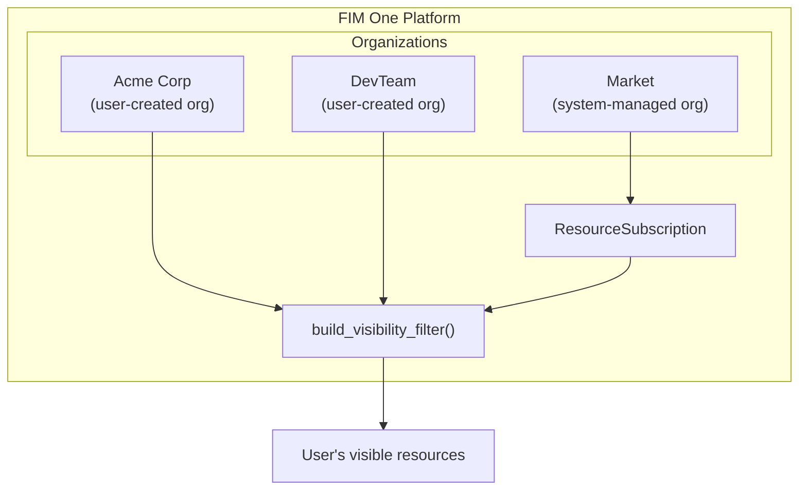
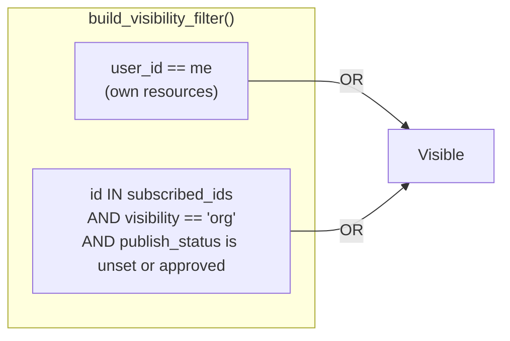
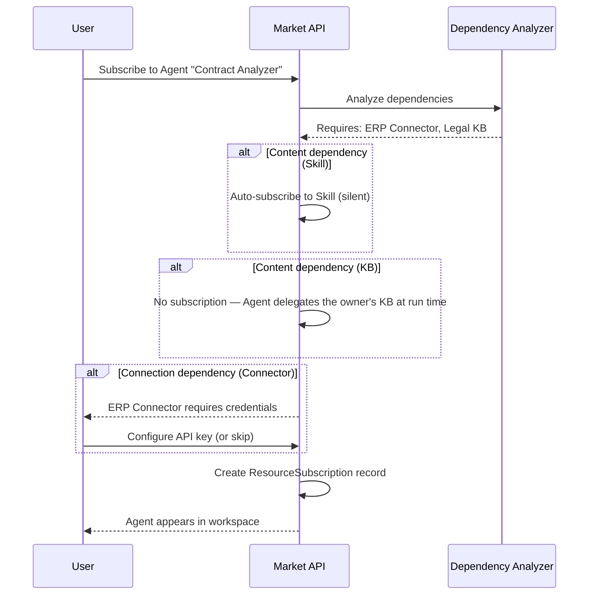
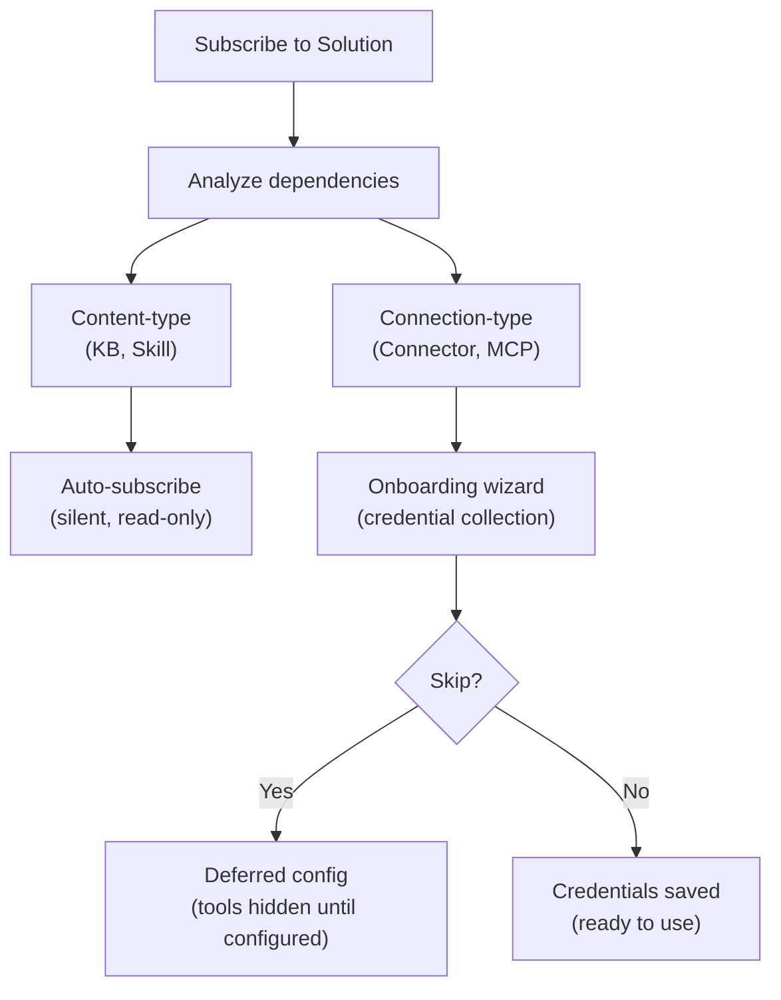

## 개요

Market은 FIM One의 리소스 마켓플레이스입니다. 사용자는 자신이 구축한 리소스를 게시하고, 다른 사용자는 이를 발견하고 구독할 수 있으며, 구독한 리소스는 구독자의 워크스페이스에 자신의 것처럼 나타납니다. 전체 시스템은 하나의 아키텍처 통찰력을 기반으로 구축되었습니다: **Market은 조직입니다** — 특별한 신뢰 규칙을 가진 시스템 관리 섀도우 조직입니다.

이 페이지는 Market의 내부 아키텍처를 설명합니다. 게시 및 구독에 대한 사용자 중심 개요는 [Market (기능)](/concepts/market)을 참조하세요. 구독한 리소스가 도구 집합에 로드되는 방식에 대해서는 [에이전트 및 리소스 발견](/architecture/agent-discovery)을 참조하세요.

## 이중 분류

Market은 리소스가 어떻게 구현되었는지가 아니라 리소스가 무엇을 하는지에 따라 리소스를 두 가지 범주로 구성합니다.

### Solutions

Solutions are things that **do work for you**. A user subscribes to a Solution and gets a ready-to-use capability.

| Resource Type | What It Does |
|---|---|
| **Agent** | A conversational AI assistant with bound tools, knowledge, and instructions |
| **Skill** | A global SOP (Standard Operating Procedure) that can orchestrate multiple agents via `call_agent` |
| **Workflow** | A DAG-based automation flow with visual editing and deterministic execution |

Skills and Workflows are optional modules, off by default. While a module is off its resources are absent from the Market and cannot be subscribed to.

Solutions may depend on other resources. An Agent might require a specific Connector for its API calls and a Knowledge Base for its retrieval pipeline. The Market handles these dependencies automatically during subscription (see [Dependency resolution](#dependency-resolution) below).

### Components

Components are **reusable building blocks** for developers. They provide capabilities that Solutions consume.

| Resource Type | What It Does |
|---|---|
| **Connector** | An API integration adapter definition (database connectors cannot be published) |
| **MCP Server** | A tool service configuration using the Model Context Protocol |

Components are simpler to subscribe to — they have no internal dependencies, only credential requirements.

### Knowledge Bases가 독립적으로 나열되지 않는 이유

Knowledge Bases는 전혀 공유할 수 없습니다 — Market에서도 아니고, 조직에도 아닙니다. KB는 공유된 Agent의 내부 종속성으로만 다른 사용자에게 도달합니다. 런타임에 Agent가 소유자의 콘텐츠를 위임하므로, 구독자는 KB 구독을 보유하지 않으며 KB를 별도로 찾거나, 평가하거나, 관리할 필요가 없습니다.

<Info>
2계층 분류(Solutions vs. Components)는 **디스플레이 레이어 개념**입니다. 쿼리 시간에 `resource_type`에서 파생되며, 별도의 필드로 저장되지 않습니다. 기본 구독 메커니즘, 가시성 필터, 검토 프로세스는 모든 리소스 유형에서 동일합니다.
</Info>

## 통합 아키텍처

### 마켓을 섀도우 조직으로

마켓의 가장 중요한 아키텍처 결정은 별도의 하위 시스템이 아니라는 것입니다. 이는 **조직** — 고정 ID(`MARKET_ORG_ID`)를 가진 시스템 관리 조직으로, 플랫폼 초기화 중에 자동으로 생성됩니다.

이는 다음을 의미합니다:

- **동일한 가시성 필터**(`build_visibility_filter()`)가 단일 쿼리에서 개인, 조직 및 마켓 리소스를 처리합니다. 마켓 조회를 위한 특수 사례 코드가 없습니다.
- **동일한 구독 메커니즘**(`ResourceSubscription`)이 조직 및 마켓 리소스 모두에 적용됩니다. 조직 리소스를 구독하고 마켓 리소스를 구독하면 동일한 레코드가 생성됩니다.
- **동일한 자격 증명 처리**(폴백, 사용자별 재정의)가 두 컨텍스트에서 모두 작동합니다. 커넥터 및 MCP 서버의 `allow_fallback` 플래그는 소스에 관계없이 동일하게 작동합니다.
- **동일한 검토 프로세스**(`apply_publish_status()`)가 조직 수준 및 마켓 수준 검토를 모두 처리합니다. 유일한 차이점은 마켓 조직이 모든 검토 플래그를 `true`로 잠금한다는 것입니다.

일반 조직과 마켓 조직 간의 주요 구분:

| 측면 | 조직 | 마켓 |
|---|---|---|
| **신뢰 모델** | 높은 신뢰(팀 멤버십) | 신뢰 없음(글로벌 커뮤니티) |
| **검토** | 리소스 유형별 선택 사항 | 모든 유형에 대해 항상 필수 |
| **접근** | 모든 멤버에게 자동 | 명시적 구독 필요 |
| **범위** | 팀 또는 회사 | 글로벌 |

<Tip>
마켓은 특수 규칙이 있는 조직일 뿐이므로, 조직을 위해 구축된 모든 기능 — 검토 워크플로우, 자격 증명 관리, 리소스 라이프사이클 — 추가 구현 없이 마켓에서 자동으로 작동합니다.
</Tip>

### How the visibility filter handles it

Nobody holds membership in the Market org. Users do not "join" the Market — they subscribe to individual resources. This means `MARKET_ORG_ID` is never present in a user's `user_org_ids` list, and the org-membership visibility condition is naturally skipped for Market resources.

Instead, subscribed Market resources flow through the `subscribed_ids` path in `build_visibility_filter()`, the same path org-shared resources take:

This two-condition OR clause is the entire visibility model. Org membership alone grants nothing: org-shared and Market resources both reach a user through a subscription, and the share state is re-read on every query, so a subscription stops working as soon as the owner unpublishes the resource or it is awaiting or refused by review.

### 범위 기반 탐색

Market 페이지는 두 가지 탐색 컨텍스트 간에 전환하는 **범위 선택기**를 제공합니다:

| 범위 | 표시 내용 | 검토자 |
|---|---|---|
| **Global Market** | Market 조직의 누구든지 게시한 리소스 | 플랫폼 관리자 |
| **Organization: [name]** | 특정 조직의 멤버가 게시한 리소스 | 조직 관리자 |

동일한 UI, 동일한 탭(Solutions / Components), 그리고 동일한 구독 흐름이 두 범위 모두에 적용됩니다. 범위를 전환하면 탐색 쿼리의 `org_id` 필터만 변경됩니다. 사용자 관점에서 경험은 동일합니다 — 카탈로그를 탐색하고 설치할 항목을 선택하는 것입니다.

## 구독 흐름

### 브라우징 및 검색

사용자는 페이지 매김된 카탈로그를 통해 Market을 탐색합니다. 각 리소스는 이름, 설명, 아이콘, 게시자 사용자명 및 구독 버튼을 표시합니다. 사용자가 이미 구독한 리소스는 그에 따라 표시됩니다. 브라우징 API(`GET /api/market`)는 사용자 자신의 리소스를 제외합니다 — 게시한 항목을 구독할 수 없습니다.

### 솔루션 구독

솔루션(Agent, Skill, 또는 Workflow) 구독에는 종속성 분석이 포함됩니다:

1. 시스템은 솔루션의 종속성(필요한 Connectors, Knowledge Bases, MCP Servers, Skills)을 분석합니다.
2. **콘텐츠 유형 종속성**은 사용자에게 묻지 않고 처리됩니다. Skill은 자동으로 조용히 구독됩니다. Knowledge Base는 절대 구독되지 않습니다. Agent가 런타임에 소유자의 KB를 위임하므로 구독자는 프로비저닝할 것이 없습니다.
3. **연결 유형 종속성**(Connector, MCP Server)은 요구사항으로 나열됩니다. 온보딩 마법사가 자격증명을 수집합니다.
4. `ResourceSubscription` 레코드가 생성되고 리소스가 사용자의 가시성 필터에 나타납니다.

### 컴포넌트 구독

컴포넌트(커넥터 및 MCP 서버)는 더 간단한 흐름을 가지고 있습니다 — 종속성 분석이 필요하지 않습니다. 사용자가 구독하고, 선택적으로 자격증명을 구성한 후 컴포넌트를 사용할 수 있습니다.

### Credential configuration

Credentials follow a **hybrid model** that balances convenience with flexibility:

- **Offered during subscription.** When a connection-type dependency requires credentials, the onboarding wizard presents the credential form immediately.
- **Skippable.** The user can choose "Skip, configure later." The resource is subscribed, but the tools that need those credentials stay out of the agent's toolset until the user configures them (or the publisher allows fallback).
- **Deferred configuration.** Users can configure or update credentials at any time from their settings page.

This is the same `allow_fallback` mechanism used in organizations. If the publisher has enabled fallback and set a default credential, subscribers can use the resource immediately without providing their own key. If fallback is disabled, each subscriber must bring their own.

<Warning>
When using a Market resource with credential fallback enabled, your API requests flow through the publisher's credentials. For sensitive operations, consider providing your own credentials or verifying the publisher's trustworthiness.
</Warning>

### Unsubscribing

Unsubscribing removes the `ResourceSubscription` record. The resource disappears from the user's visibility filter and is no longer loaded into tool sets. For Solutions, dependencies that were subscribed automatically (Skills, Connectors, MCP Servers) are removed as well when no other subscribed Solution needs them, along with the credentials saved for those Connectors and MCP Servers. Unsubscribing from a Connector or MCP Server directly removes the user's credential for it.

## 의존성 해결

솔루션이 게시되거나 구독될 때, 시스템은 해당 의존성 트리를 분석합니다. 의존성은 서로 다른 처리 전략을 가진 두 가지 범주로 나뉩니다.

### 콘텐츠 유형 종속성

**지식 베이스**와 **스킬**은 솔루션에서 참조되는 콘텐츠 유형 종속성입니다. 이들은 읽기 전용 데이터(검색 문서, SOP 절차)를 제공하며, 솔루션이 이를 사용합니다.

- **스킬 — 구독 시:** 자동으로 자동 구독됩니다. 사용자는 별도의 구독 단계를 보지 않습니다.
- **지식 베이스:** 구독되지 않습니다. 바인딩된 KB는 소유 에이전트에 의해 런타임에 위임되므로(소유자 위임), 구독자 쪽에서 프로비저닝하거나 정리할 것이 없습니다.
- **액세스 모델:** 원본 작성자의 리소스에 대한 읽기 전용 참조입니다. 구독자는 콘텐츠를 수정할 수 없습니다.
- **구독 해제 시:** 자동 구독 종속성은 부모 솔루션이 구독 해제될 때 자동으로 정리됩니다.

### Connection-type dependencies

**Connectors** and **MCP Servers** referenced by a Solution are connection-type dependencies. They require credentials to function.

- **On subscription:** subscribed together with the Solution and listed as requirements in the onboarding wizard. The user is prompted to configure credentials (or skip).
- **On unsubscription:** a Connector or MCP Server that was subscribed automatically with the Solution is removed with it, credentials included, unless another subscribed Solution still needs it. One the user subscribed to on their own is left in place with its credentials.

## 게시

### 솔루션 게시

작성자가 에이전트, 스킬 또는 워크플로우를 마켓에 게시할 때:

1. 시스템이 리소스에 `visibility: "org"`와 `org_id: MARKET_ORG_ID`를 설정합니다.
2. 시스템이 솔루션의 종속성을 분석하고 매니페스트를 빌드합니다 — 필요한 커넥터, KB 및 MCP 서버를 나열합니다.
3. 매니페스트가 작성자에게 확인을 위해 표시됩니다.
4. `apply_publish_status()`가 리소스를 `pending_review`로 설정합니다 (마켓 조직은 모든 검토 플래그가 `true`로 잠겨 있습니다).
5. 시스템 관리자가 리소스를 검토하고 승인하거나 거부합니다.

### 컴포넌트 게시

커넥터 또는 MCP 서버를 게시하는 것은 더 간단합니다:

1. 시스템이 위와 같이 가시성 및 org_id를 설정합니다.
2. 자격증명 스키마가 추출됩니다(구독자가 입력해야 할 필드).
3. 리소스가 `pending_review` 상태로 진입하고 관리자 승인을 기다립니다.

### 검토 프로세스

검토 프로세스는 조직에서 사용하는 것과 동일한 메커니즘이지만, 한 가지 중요한 차이점이 있습니다:

| 컨텍스트 | 검토 필수? | 검토자 |
|---|---|---|
| **조직** | 리소스 유형별로 구성 가능 (`review_agents`, `review_connectors` 등) | 조직 관리자 |
| **마켓** | 모든 리소스 유형에 대해 항상 필수 | 플랫폼 관리자 (마켓 조직 소유자) |

마켓 조직은 6개의 검토 플래그가 모두 `true`로 설정된 상태로 초기화되며, 이 구성은 변경할 수 없습니다. 마켓에 게시되는 모든 리소스는 브라우즈 카탈로그에서 표시되기 전에 관리자 검토를 통과해야 합니다.

<Note>
조직 소유자는 자동으로 검토를 우회합니다 — 게시된 리소스는 즉시 사용 가능합니다. 마켓의 경우, 마켓 조직 소유자(시스템 관리자)만 이 우회 권한을 가집니다.
</Note>

승인된 리소스가 작성자에 의해 편집되면, `check_edit_revert()`는 자동으로 `publish_status`를 `pending_review`로 되돌립니다. 이는 라이브 마켓 리소스의 변경 사항이 구독자에게 표시되기 전에 다시 검토되도록 보장합니다.

## 구현 참고 사항

### The shadow org

The Market organization has a well-known fixed ID (`00000000-0000-0000-0000-000000000001`) and slug (`market`). It is created by `ensure_market_org()` during platform initialization, when the first user (the administrator) registers. The function is idempotent; calling it multiple times is safe.

### ResourceSubscription

`ResourceSubscription` 테이블은 Market 접근의 핵심 데이터 구조입니다:

| Column | Purpose |
|---|---|
| `user_id` | 구독자 |
| `resource_type` | `agent`, `connector`, `mcp_server`, `skill`, 또는 `workflow` (지식 베이스는 구독되지 않음 — Agent 소유자 위임을 통해 제공됨) |
| `resource_id` | 구독된 리소스의 ID |
| `org_id` | 소스 조직 (Market 조직 ID 또는 일반 조직 ID) |

`(user_id, resource_type, resource_id)`에 대한 고유 제약은 중복 구독을 방지합니다. `org_id` 열은 구독의 출처를 추적하여 범위 인식 구독 해제를 가능하게 합니다.

### Visibility filter integration

The `resolve_visibility()` function performs two lookups in a single call:

1. Fetches the user's org memberships (`user_org_ids`)
2. Fetches the user's subscriptions (`subscribed_ids`)

These are passed to `build_visibility_filter()`, which produces a single SQL WHERE clause combining the two visibility conditions (own, or subscribed and still shared). This function is used everywhere resources are queried — agent lists, connector dropdowns, skill injection, auto-discovery mode — ensuring consistent visibility across the entire platform.

### 자격증명 암호화

구독 중(또는 나중에 설정에서) 구성된 자격증명은 플랫폼의 암호화 키를 사용하여 저장 시 암호화됩니다. Market API는 browse 응답에서 자격증명 값을 노출하지 않습니다. `_*_market_info()` 헬퍼 함수에서는 메타데이터(이름, 설명, 아이콘, 유형)만 반환됩니다.

## 참고 항목

- [Organization & Market](/architecture/organization) -- 조직 수준의 공유 및 신뢰 모델
- [Agent & Resource Discovery](/architecture/agent-discovery) -- 구독한 리소스가 도구 집합에 로드되는 방식
- [Connector Architecture](/architecture/connector-architecture) -- 커넥터 설계, 인증 주입 및 감사
- [System Overview](/architecture/system-overview) -- 모든 리소스가 수렴하는 통합 도구 추상화
