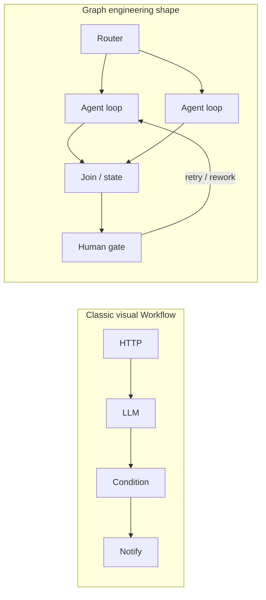
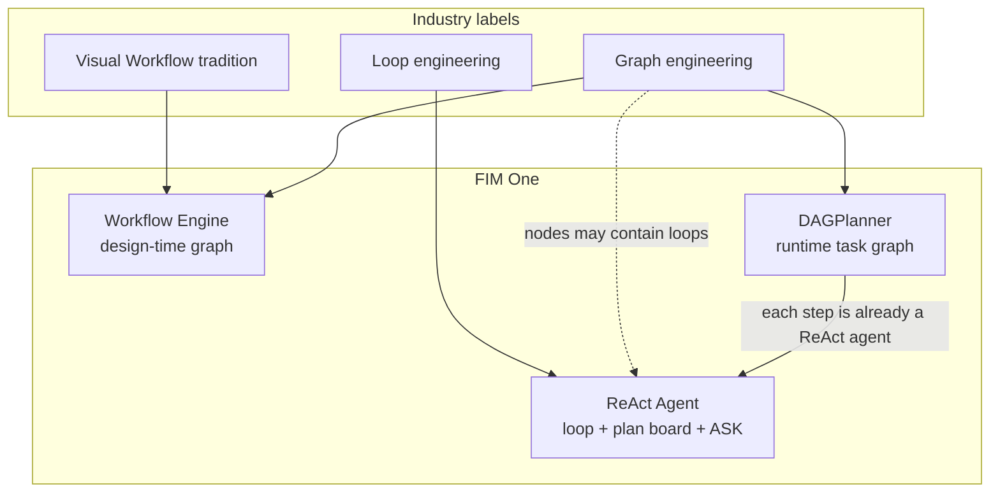
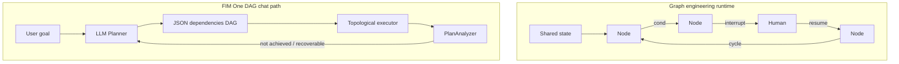
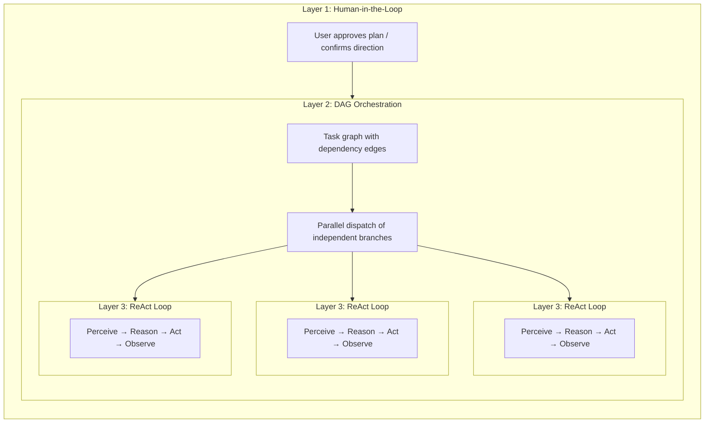

## 그래프 엔지니어링(2026)과 FIM One

업계 논의에서는 종종 **루프 엔지니어링**(단일 에이전트가 반복적으로 생각하고 행동하는 방식)에서 **그래프 엔지니어링**(다중 노드 토폴로지를 명시적인 엔지니어링 객체로 만드는 방식)으로의 전환을 언급합니다. 이 용어는 새롭지만, 실제 관행은 그렇지 않습니다. LangGraph 스타일의 시스템과 멀티 에이전트 조직들은 수년간 그래프를 사용해왔습니다. FIM One에 중요한 것은 사람들이 의미하는 **그래프의 종류**와 그것이 우리의 세 가지 실행 계층에 어떻게 매핑되는지입니다.

### What graph engineering usually means

| Layer (common framing) | Concern |
|---|---|
| **Harness** | Tools, sandbox, auth, logging, quotas around the model |
| **Loop** | One agent's think → act → observe cycle |
| **Graph** | How **nodes** connect: branches, joins, cycles, human checkpoints, shared state |

Consensus across that framing: **graph does not replace loop**. Graph designs **relationships between processes**; each agentic node may still run a full loop.

"Graph" is overloaded in practice. Three usages get mixed:

| Usage | Example | Role |
|---|---|---|
| **Control-flow graph** | LangGraph `StateGraph`: conditional edges, retries, interrupt/resume | State machine for who runs next |
| **Task dependency graph** | Claude Code Tasks `blockedBy`; FIM One `dependencies` | Schedule and parallelize work |
| **Knowledge graph** | Entities and typed relations | Retrieval / memory (not orchestration) |

This page is about the first two (orchestration).

### "Dify Workflow with a new name"이 아님

Dify 스타일의 **시각적 워크플로우**와 그래프 엔지니어링은 공통의 혈통(**명시적 토폴로지**)을 공유하지만 동일한 제품이 아닙니다.

| | 클래식 시각적 워크플로우 (예: Dify) | 그래프 엔지니어링 (2026년 사용) |
|---|---|---|
| **주요 산출물** | 구현자가 그리는 캔버스 / 블루프린트 | 버전 관리되는 시스템 설계로서의 토폴로지 (코드 또는 설정) |
| **노드** | 고정된 기능 블록 (LLM, HTTP, KB, 조건…) | **이질적**: 함수, 라우터, **완전한 에이전트**, 인간, 조인 |
| **지능이 위치하는 곳** | 주로 격리된 LLM 노드 내부; 그래프는 파이프 | 종종 **노드 내부** (각각이 루프일 수 있음); 그래프는 역할을 조직화 |
| **엣지** | 파이프라인 성공/실패 및 분기 | 제어 흐름 **및** 상태 전환, **제어된 사이클** 포함 |
| **휴먼-인-더-루프** | 폼 / 승인을 추가 기능으로 | 인터럽트 / 재개를 1급 원시 요소로 |
| **루프와의 관계** | 종종 "워크플로우 **vs** 에이전트"로 판매됨 | 명시적으로 **루프보다 그래프** |

간단히 말해: 클래식 워크플로우는 **결정론적 (또는 반결정론적) 파이프**이며 가끔 LLM 단계가 있습니다. 그래프 엔지니어링은 **다중 노드 시스템 토폴로지**이며, 중요한 지점은 여전히 자율 에이전트일 수 있습니다.

### How the industry map sits on FIM One

FIM One already spans the control spectrum; chat "Planner mode" is only one slice.

| Industry idea | Closest FIM One piece | Fit |
|---|---|---|
| Classic visual Workflow | **Workflow Engine** (design-time blueprint) | Strong |
| Control-flow graph + HITL + durable state | Workflow human steps + confirmation gates; partial on chat DAG | Medium |
| Task dependency graph + parallel schedule | **DAGPlanner** (`dependencies`, topological fan-out) | Strong on scheduling; weaker on mid-graph HITL |
| Single agent loop + checklist memory | **ReAct** (`update_plan`, tools, `ask_user_question`) | Strong |
| Runtime LLM-drawn plan every turn | **DAGPlanner** (not Dify; not LangGraph design-time DSL) | Distinct product |

### Graph engineering vs FIM One DAG (chat Planner)

Same family (explicit multi-step topology). Different species.

| Dimension | Graph engineering (typical) | FIM One DAG (chat) |
|---|---|---|
| **Who draws the graph** | Developer / implementer (stable topology) | **LLM at runtime** (new graph per goal) |
| **Edge meaning** | Often **control flow** (where next, including cycles) | Mostly **dependency / data** (`dependencies`, acyclic run) |
| **Correction** | Edge-level retry, human node, resume same graph | **PlanAnalyzer → replan** (often a **new** graph) |
| **Node depth** | Node may be a full agent loop | **Already full ReAct per step**: `DAGExecutor` runs `agent.run()` with a multi-iteration tool loop (default cap from `DAG_STEP_MAX_ITERATIONS`, commonly 15). Default model is registry **general** (not infrastructure fast); `model_hint` can escalate to reasoning or demote to fast. Tool cache, step/citation verification, and source evidence ship with each step. Step agents set `enable_plan_tool=False` (no `update_plan` board inside a step) because the unit of work is already a focused sub-task. |
| **Shared state** | First-class typed state + checkpoint narrative | Step results + memory/compact; step checkpoints exist |
| **Mid-run questions** | Interrupt as a product feature | Confirmation gates exist; **`ask_user_question` is ReAct-only** (chat outer loop), not a first-class DAG wait edge |
| **Product entry** | Framework or backend org chart | User-visible mode next to ReAct |

**Implication:** industry heat around graph engineering **validates keeping a graph/scheduling engine**. It does **not** require a chat default that forces users to pick "Planner" for every turn. Most tasks still want a strong loop; graphs earn their keep on parallel branches, fixed compliance paths, and multi-role orchestration.

### What FIM One can learn (empower ReAct, DAG, Workflow)

Concrete takeaways, not slogans. Ordered by leverage.

| # | Graph engineering idea | Apply to | Direction |
|---|---|---|---|
| 1 | **Graph over loop, not instead of** | Product + Auto routing | Default UX stays **ReAct** (loop + `update_plan` + `ask_user_question`). Use DAG/Workflow when topology earns cost. |
| 2 | **Heterogeneous deep nodes** | DAG | **Already the status quo.** Each step is a full ReAct agent (`agent.run`, multi-iteration tools, general-or-better model by default), not a one-shot LLM call. The one exception is a step the planner tags `llm_direct` (pure transformation of upstream outputs), which runs as a single tool-less call. Remaining knobs are optional (e.g. plan board on long steps), not a structural gap. |
| 3 | **Interrupt / resume as edges** | DAG + ReAct | Mid-run clarification belongs in the **outer** loop or as a first-class wait state. Avoid fake DAG steps that "ask the user" in text and then replan as "goal not achieved". |
| 4 | **Controlled cycles vs whole-graph replan** | DAG | Prefer step-local retry / partial carryover (already partly true for completed steps) over dumping all step text as a failed final answer. |
| 5 | **Typed shared state along edges** | DAG + Workflow | Stronger contracts for step I/O (schema, deliverables) reduce Analyzer false confidence and answer/source drift. |
| 6 | **Topology as a versioned asset** | Workflow | Keep human-authored graphs for audit; do not expect runtime LLM DAGs to replace compliance blueprints. |
| 7 | **Honest "most tasks never need a graph"** | Auto + docs | Route clarify-and-choose, short Q&A, and exploratory work to ReAct; reserve DAG for decomposable parallel work. |

**Anti-patterns to avoid when "doing graph":**

- Using a **dependency graph** to simulate a **human state machine** (multi-step "wait for answers" with no wait primitive).
- Equating ReAct **`update_plan`** (checklist memory) with graph engineering (scheduling topology).
- Shipping graph heat as a second chat personality instead of as **engine composition** (loop outside, schedule inside when needed).
- Describing FIM One DAG steps as "shallow LLM calls": that understates the engine and misleads product decisions.

## AI 도구 환경에서 "계획"의 다섯 가지 종류

"계획"이라는 단어는 과부하 상태입니다. 현재 최소 다섯 가지의 서로 다른 접근 방식이 존재하며, 각각 다른 문제를 해결합니다:

| 접근 방식 | 계획 형식 | 실행 | 승인 | 핵심 가치 |
|---|---|---|---|---|
| **암묵적 모델 계획** | 내부 사고 연쇄 | 단일 추론 패스 | 없음 | 모델이 자체적으로 단계를 생각함 |
| **Claude Code 계획 모드** | Markdown 문서 | 순차적 | 실행 전 인간이 검토 | 코드 작업 전에 접근 방식 정렬 |
| **Claude Code Teams** | 의존성 엣지가 있는 작업 목록 | **동시적** (다중 에이전트) | 인간이 계획 승인, 이후 자율 실행 | 동적 에이전트 풀 + 병렬 실행 |
| **Kiro 스펙 기반 개발** | 구조화된 스펙 (요구사항 + 설계 + 작업) | 순차적 | 인간이 스펙 검토 | 추적 가능한 요구사항, 수용 기준 |
| **FIM One DAG** | JSON 의존성 그래프 | **동시적** (단일 오케스트레이터) | 자동 (PlanAnalyzer) | 병렬 실행 + 런타임 스케줄링 |

처음 두 가지는 **설계 시간** 계획입니다 — 작업이 시작되기 전에 계획을 생성하며, 인간(또는 모델 자체)이 단계별로 따릅니다. 마지막 세 가지는 **런타임** 계획을 도입합니다 — 실행 그래프가 프로그래밍 방식으로 생성되고 스케줄되며, 독립적인 분기가 병렬로 실행됩니다. 차이점은 *누가* 실행하는가입니다: Claude Code Teams는 자율 에이전트를 생성하고, FIM One DAG는 단일 오케스트레이터 내에서 단계를 디스패치합니다.

이러한 접근 방식들은 경쟁 관계가 아닙니다. 이들은 상호 보완적인 계층입니다. Kiro 스타일의 스펙은 *무엇을* 구축할지 정의할 수 있고, FIM One DAG는 부작업을 동시에 *어떻게* 실행할지 스케줄할 수 있습니다. Claude Code의 계획 모드는 인간이 접근 방식에 동의하도록 보장하고, FIM One의 PlanAnalyzer는 결과를 자동으로 검증합니다.

## Three-Layer Nesting: The Full-Power Architecture

Claude Code Teams와 FIM One DAG는 최대 용량에서 **3계층 중첩 아키텍처**를 나타냅니다:

- **Layer 1 — Human gate**: 사용자가 계획을 검토하고 실행이 시작되기 전에 승인합니다.
- **Layer 2 — DAG orchestration**: 승인된 계획이 의존성 엣지를 가진 작업으로 분해됩니다. 독립적인 작업은 병렬로 실행되고, 다운스트림 작업은 차단 요소가 해결될 때까지 대기합니다.
- **Layer 3 — ReAct inner loop**: 각 작업은 완전한 ReAct 사이클(Perceive → Reason → Act → Observe)을 실행하는 에이전트에 의해 실행되며, 다단계 추론, 도구 사용 및 자동 재시도가 가능합니다.

핵심 통찰: **Claude Code Teams와 FIM One DAG는 동일한 3계층을 구현하며, Layer 2 메커니즘만 다릅니다** — 메시지 전달 vs 의존성 엣지 해결.

## Full-Power Runtime: FIM One vs Claude Code Teams

Both are genuine Agents — the core loop is identical: **Perceive → Reason → Act → Feedback**. The difference lies in how they orchestrate parallel work at full capacity.

| Dimension | Claude Code Teams | FIM One DAG |
|---|---|---|
| **Parallel model** | Leader spawns SubAgents, assigns tasks via messages | Topological sort auto-parallelizes independent steps |
| **Task graph** | TaskList with `blockedBy` / `blocks` edges (dynamic DAG) | Static JSON DAG with `dependencies` edges |
| **Coordination** | Explicit message passing (SendMessage / Broadcast) | Implicit dependency edges — no messages, just data flow |
| **Agent lifecycle** | Dynamic pool — agents spawned on demand, shut down when done | Per-step **ReAct agents** (fresh agent per step via `_resolve_agent`); each step runs a full multi-iteration tool loop |
| **Feedback & correction** | Each SubAgent retries autonomously; Leader re-assigns on failure | PlanAnalyzer evaluates outcomes → Re-Planning loop (up to 3 rounds in total: the first plan plus 2 re-plans); completed steps can carry into the next plan |
| **Human involvement** | Plan mode approval, then autonomous execution | Fully automatic — PlanAnalyzer decides pass/replan (chat-level ASK is ReAct-only) |
| **Context management** | Each SubAgent gets isolated context window (no cross-contamination) | Shared DbMemory + LLM Compact across the turn; each step agent still sees its task + dependency results, not a full peer transcript |
| **Token economics** | `N agents × per-agent tokens` — time↓ tokens↑ (multiplicative cost) | Parallel branches cost more than serial ReAct, but shared memory and step caps usually stay below multi-agent team spend |
| **Scaling pattern** | Add more SubAgents (horizontal, message-coupled) | Add more DAG branches (horizontal, dependency-coupled) |
| **Best suited for** | Diverse, loosely-related tasks (research + code + test) | Structured workflows with clear data dependencies |

### Real-World Benchmark: v0.5 RAG System

Claude Code Teams built FIM One's entire v0.5 RAG subsystem in a single session:

- **8 phases**: Embedding → Reranker → Loaders → Chunking → VectorStore → Retrieval → KB Backend → Frontend + Docs
- **46 tests** passing, frontend build clean
- **Wall time**: ~5 minutes
- **Token cost**: ~100k tokens per agent task × 8+ tasks ≈ 800k+ total tokens
- **Dependency edges**: Phase 5 depends on Phase 4 + 1b; Phase 6 depends on Phase 5 + 2 + 3 — a genuine DAG

This demonstrates the core trade-off: **시간 병렬화로 인한 토큰 증가의 대가**. Claude Code Teams는 개발자 시간을 절약하기 위해 컴퓨팅 비용을 증가시킵니다.

### 수렴, 경쟁이 아님

"팀 협업"과 "파이프라인 스케줄링" 간의 경계가 흐릿해지고 있습니다:

- **Claude Code Teams의 `blockedBy`/`blocks`는 DAG입니다** — 작업은 명시적 의존성 엣지를 가지며, 리더는 선행 작업이 완료되면 새로 차단 해제된 작업을 디스패치합니다. 이는 추가 단계(메시지)가 있는 위상 정렬 스케줄링입니다.
- **FIM One DAG 스텝은 이미 완전한 ReAct 에이전트입니다** — Layer 3은 염원이 아닙니다. 각 스텝은 도구와 다중 반복 루프를 사용하여 `agent.run()`을 실행합니다. 최상위 ReAct 채팅 턴과의 차이는 의도적입니다(스텝별 계획 보드 없음, 채팅 레벨 `ask_user_question` 대기 없음, `model_hint` / 일반 기본값으로 선택된 모델).

**핵심:** 동일한 에이전트 본질, 수렴하는 병렬 철학. Claude Code는 **팀 협업** 모델을 따릅니다 — 리더가 메시지를 통해 통신하는 워커에게 위임합니다. FIM One은 **파이프라인 스케줄링** 모델을 따릅니다 — DAG 실행기가 의존성 해결을 기반으로 **ReAct 스텝**을 디스패치합니다. 실제로 두 모델 모두 의존성 기반 병렬 실행을 구현합니다. 차이는 조정 오버헤드(메시지 vs 엣지), 격리(피어 에이전트 vs 작업 + 의존성 결과), 토큰 경제학입니다. 제품 격차는 "노드를 에이전트로 만들기"보다는 **그래프를 스케줄할 시기 vs 하나의 채팅 루프에 머물 시기**, 그리고 **그래프가 일시 중지할 수 없는 인간 대기 엣지**입니다.

## Structured Output Degradation

All structured LLM call sites in the DAG pipeline (Planner, Analyzer, Tool Selection) use a unified `structured_llm_call()` utility that implements a 3-level degradation chain:

| Level | Condition | How it works |
|---|---|---|
| **Native FC** | `llm.abilities["tool_call"]` (and `tool_choice` not disabled) | Forces a virtual tool call; extracts from `tool_calls[0].arguments` |
| **JSON Mode** | `llm.abilities["json_mode"]` | Sets `response_format={"type":"json_object"}`; parses with `extract_json()` |
| **Plain text** | always available | Parses free-form content with `extract_json()`, then optional `regex_fallback()` |

Each text-based level retries once with a reformat prompt before falling to the next. The result is a `StructuredCallResult` containing the parsed value, which extraction level succeeded, and accumulated token usage.

This design means the same prompt works reliably across GPT-4 (native FC), Claude (JSON mode), and local models (plain text), with consistent error handling and retry logic in one place instead of scattered across four call sites.

## 세 가지 실행 계층: 제어 스펙트럼

위의 다섯 가지 계획 접근 방식은 전체 그림을 설명합니다. FIM One 내에서 세 가지 실행 계층은 완전한 인간 제어에서 완전한 AI 자율성까지의 **제어 스펙트럼**을 제공합니다. 그래프 엔지니어링과의 관계: **Workflow**는 설계 시간 그래프 제품입니다. **DAGPlanner**는 런타임 작업 그래프입니다. **ReAct**는 루프 엔지니어링입니다(선택적 계획 보드 메모리 포함, 스케줄 그래프 아님).

| 계층 | 그래프 정의자 | 그래프 존재 시점 | 그래프 엔지니어링 역할 | 최적 사용 사례 |
|---|---|---|---|---|
| **Workflow Engine** | 사용자(시각적 캔버스 / JSON 블루프린트) | 설계 시간 | 클래식 시각적 Workflow + 지속적 프로세스 토폴로지에 가장 근접 | 결정론적 프로세스, 컴플라이언스/감사 추적, cron 스케줄 자동화 |
| **DAGPlanner** | LLM(목표를 자동으로 분해) | 런타임 | 작업 종속성 그래프 + 병렬 스케줄 + 결과 분석 | 명확한 하위 작업 경계가 있는 분해 가능한 다단계 작업 |
| **ReAct Agent** | 없음(반복 루프) | 스케줄 그래프로는 절대 아님 | 루프 계층; 더 큰 그래프의 노드는 ReAct 에이전트가 될 수 있음 | 탐색적, 대화형, 명확히 한 후 실행, 반복적 개선 |

설계 원칙: **사용자에게 원하는 만큼의 제어를 정확히 제공합니다**.

- 모든 대출 승인이 다섯 가지 특정 단계를 통과하는지 증명해야 하나요? → Workflow.
- 세 가지 주제를 병렬로 조사한 후 종합해야 하나요? → DAG.
- 실행 중간에 초안 작성, 개선 또는 구조화된 질문을 해야 하나요? → ReAct.
- 확실하지 않나요? → `execution_mode: "auto"`는 쿼리를 분류하고 런타임에 DAG 또는 ReAct로 라우팅합니다(목표가 주로 명확화 또는 짧은 탐색일 때 ReAct 선호).

이 계층화는 FIM One을 단일 패러다임 도구와 구분하는 것입니다:

- **Dify**는 Workflow 계층을 강조합니다(정적 또는 반정적 시각적 그래프).
- **LangGraph**는 코드 수준의 제어 흐름 그래프 DSL을 강조합니다(개발자 정의 토폴로지, 동적 라우팅, 체크포인팅). 구조적으로 시각적 워크플로우와 관련이 있으며 소프트웨어로 표현됩니다.
- **Manus 클래스 에이전트**는 Agent/루프 계층을 강조합니다(자율 실행, 사용자 정의 구조 최소화).

FIM One은 세 가지 계층 모두를 포함하며, 채팅 엔진 간의 자동 라우팅도 포함합니다. **사용자 정의 그래프 → LLM 생성 작업 그래프 → 스케줄 그래프 없음**의 진행은 더 광범위한 산업의 정직함과 일치합니다: 모델이 개선됨에 따라 **명시적 토폴로지는 필수 UI가 아닌 대부분의 턴에서 선택 사항이 됩니다**. 그래프 엔지니어링 열은 모든 채팅을 플래너를 통해 강제하는 것이 아니라 **엔진과 구성에 투자**하는 이유입니다.

### 관련 문서

- [ReAct Engine](/architecture/react-engine) — 루프, 도구, 계획 보드, 명확화 질문
- [DAG Engine](/architecture/dag-engine) — 플래너, 실행자, 분석기, 재계획
- [Competitive Landscape](/strategy/competitive-landscape) — Dify / Manus / Coze 포지셔닝
