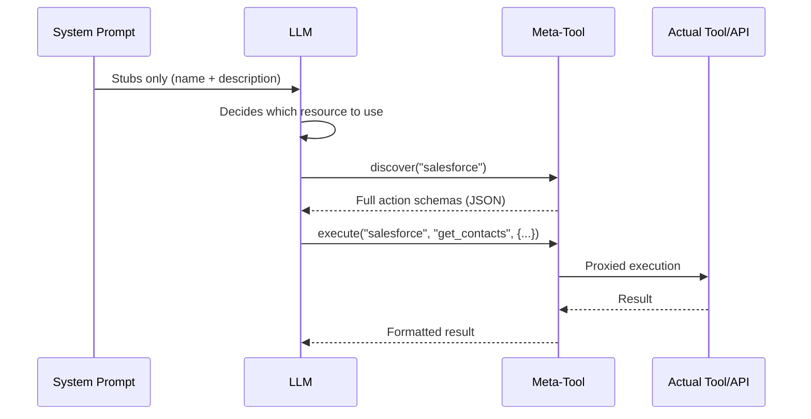
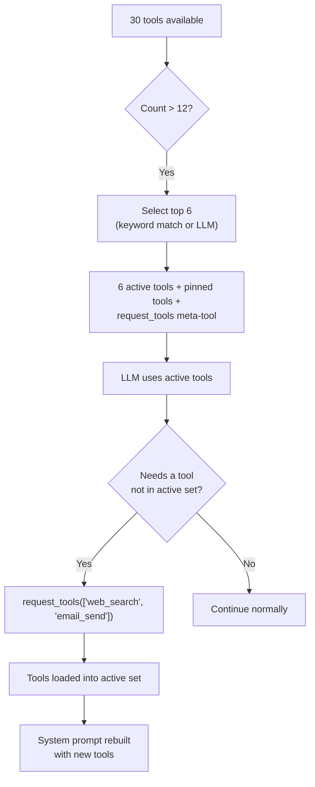

## 문제

LLM은 두 가지 통화로 컨텍스트 비용을 지불합니다: 토큰과 어텐션입니다. 시스템 프롬프트에 주입된 모든 도구 정의는 둘 다의 비용이 듭니다. 단일 MCP 서버는 90개 이상의 도구를 노출할 수 있습니다. 각각 20개의 작업이 있는 5개의 API 커넥터는 100개의 도구 정의를 생성합니다. 각각 30개의 테이블이 있는 3개의 데이터베이스 커넥터는 또 다른 90개의 스키마 설명을 생성합니다. 사용자가 한 글자도 입력하기 전에 시스템 프롬프트는 50~100KB의 컨텍스트를 소비할 수 있습니다 -- 128K 모델 예산의 절반입니다.

비용은 단순히 토큰만이 아닙니다. 연구와 실무에서 일관되게 보여주는 것은 **관련 없는 컨텍스트가 증가함에 따라 LLM 정확도가 저하된다**는 것입니다. 시스템 프롬프트에 80개의 도구 정의가 있는 에이전트는 6개가 있는 에이전트보다 도구 선택에서 측정 가능하게 더 나쁜 성능을 보입니다. 모델은 절대 사용하지 않을 도구 스키마에 어텐션을 소비하여 중요한 도구와 지시사항에 대한 집중력을 희석시킵니다.

순진한 해결책 -- 모든 것을 주입하고 모델이 정렬하도록 하는 것 -- 은 확장되지 않습니다. FIM One은 반대의 접근 방식을 취합니다: **LLM에 결정을 내리는 데 필요한 최소한의 것만 보여주고, 더 필요할 때 더 요청하도록 하세요.**

## 패턴

점진적 공개는 모든 리소스 유형에 걸쳐 2계층 아키텍처를 따릅니다:

1. **계층 1 -- 시스템 프롬프트의 스텁.** 경량 요약: 이름, 짧은 설명, LLM이 더 많은 정보가 필요한지 결정할 수 있도록 충분한 메타데이터(작업 수, 테이블 수, 도구 수).

2. **계층 2 -- 필요에 따른 전체 세부 정보.** LLM이 메타 도구를 호출하여 완전한 스키마, 매개변수 및 실행 기능을 검색합니다. 전체 세부 정보는 도구 결과 메시지로 대화에 입력되며, 시스템 프롬프트에 영구적으로 차지하지 않고 해당 턴으로 범위가 지정됩니다.



핵심 통찰: **전체 도구 스키마는 대화 범위이지, 프롬프트 범위가 아닙니다.** 이들은 컨텍스트 관리 시스템이 이후 턴에서 요약하거나 자를 수 있는 도구 결과 메시지로 나타납니다. 반대로 시스템 프롬프트 콘텐츠는 전체 대화에 걸쳐 전체 크기로 유지됩니다.

## Five disclosure mechanisms

FIM One applies progressive disclosure uniformly across five resource types. Each uses the same two-tier pattern but with a meta-tool tailored to its semantics.

| Resource | Meta-Tool | Stubs Show | On-Demand Returns | Config Var | Default |
|---|---|---|---|---|---|
| Skills (when the module is enabled; off by default) | `read_skill` | Name + description (120 chars) | Full SOP content + embedded script | `SKILL_TOOL_MODE` | `progressive` |
| API Connectors | `connector` | Connector name + action list | Full action schemas with parameters | `CONNECTOR_TOOL_MODE` | `progressive` |
| Database Connectors | `database` | DB name + table names + counts | Column schemas, SQL query execution | `DATABASE_TOOL_MODE` | `progressive` |
| MCP Servers | `mcp` | Server name + tool list | Full tool schemas + invocation | `MCP_TOOL_MODE` | `progressive` |
| Built-in Tools | `request_tools` | Compact catalog (name + 80-char desc) | Full tool schema injected into session | _(auto)_ | Auto when >12 tools |

### Skills -- `read_skill`

**What the LLM sees initially:**

```
## Available Skills
Call read_skill(name) to load full content before executing any of these:
- Customer Complaint SOP: Handle escalations per company policy...
- Refund Processing: Step-by-step refund workflow with approval gates...
```

Each stub is roughly 30 tokens -- a name plus the Skill's description, truncated to 120 characters (`SKILL_STUB_DESC_LENGTH`).

**What happens on demand:** The LLM calls `read_skill("Customer Complaint SOP")` and receives the complete SOP text -- potentially thousands of tokens of step-by-step instructions, decision trees, and embedded scripts. This content enters as a tool result, not as system prompt text, so it is subject to normal context management (summarization, truncation) in later turns.

**Legacy mode:** `SKILL_TOOL_MODE=inline` embeds the full Skill content directly in the system prompt. Suitable when you have few, small Skills -- but scales poorly.

**Context savings:** A deployment with 10 Skills averaging 2,000 tokens each consumes ~300 tokens in progressive mode (stubs only) vs. ~20,000 tokens in inline mode. That is a 98% reduction in persistent context cost.

### API 커넥터 -- `connector`

**LLM이 초기에 보는 것:**

```
Interact with external services. Available connectors:
  - salesforce: CRM system -- actions: get_contacts, create_lead, update_opportunity
  - jira: Project management -- actions: create_issue, get_issue, search_issues

Subcommands:
  discover <name> -- list actions with full parameter schemas
  execute <name> <action> {"param": "value"} -- run an action
```

각 커넥터 스텁은 액션 이름을 나열하지만 파라미터 스키마는 나열하지 않습니다. LLM은 *어떤* 액션이 존재하는지는 알지만 *어떻게* 호출하는지는 모릅니다 -- 이는 커넥터를 사용할지 여부를 결정하기 위한 정확한 수준의 세부 정보입니다.

**필요에 따라:** `connector("discover", "salesforce")`는 HTTP 메서드, URL 경로, 파라미터 JSON 스키마 및 요청 본문 템플릿을 포함한 전체 액션 스키마를 반환합니다. `connector("execute", "salesforce", "get_contacts", {"limit": 10})`는 전체 인증 주입 및 감사 로깅과 함께 `ConnectorToolAdapter`를 통해 실행을 프록시합니다.

**레거시 모드:** `CONNECTOR_TOOL_MODE=legacy`는 각 액션을 별도의 도구로 등록합니다(`salesforce__get_contacts`, `salesforce__create_lead` 등). 20개의 액션이 있는 커넥터는 시스템 프롬프트에서 20개의 도구 정의가 됩니다.

**컨텍스트 절약:** 15개의 액션이 있는 커넥터는 스텁의 ~50 토큰 대 전체 스키마의 ~3,000 토큰을 생성합니다. 5개의 커넥터: 점진적 ~250 토큰 대 레거시 ~15,000 토큰입니다.

### 데이터베이스 커넥터 -- `database`

**LLM이 처음 보는 내용:**

```
Query connected databases. Available databases:
  - hr_postgres: HR system (12 tables: employees, departments, salaries ...)
  - analytics_db: Analytics warehouse (45 tables: events, sessions, users ...)

Subcommands:
  list_tables <database> -- table names, descriptions, column counts
  discover <database> [table] -- full column schemas for one or all tables
  query <database> <sql> -- execute a SQL query
```

데이터베이스 스텁에는 테이블 이름(최대 10개)과 개수가 포함되어 있어 LLM이 열 스키마를 로드하지 않고도 어떤 데이터베이스를 쿼리할지 결정할 수 있습니다.

**필요에 따라 발생하는 작업:** 세 가지 부명령이 자연스러운 검색 흐름을 형성합니다:

1. `database("list_tables", "hr_postgres")` -- 모든 테이블 이름, 설명 및 열 개수를 반환합니다.
2. `database("discover", "hr_postgres", table="employees")` -- 전체 열 스키마(이름, 유형, nullable, 기본 키, 설명)를 반환합니다.
3. `database("query", "hr_postgres", sql="SELECT ...")` -- 안전 검사 및 행 제한이 적용된 검증된 SQL 쿼리를 실행합니다.

3단계 흐름은 개발자가 새 데이터베이스를 탐색하는 방식을 반영합니다: 테이블 찾아보기, 스키마 검사, 그 다음 쿼리. LLM도 자연스럽게 같은 패턴을 따릅니다.

**레거시 모드:** `DATABASE_TOOL_MODE=legacy`는 데이터베이스당 3개의 도구(`{db}__list_tables`, `{db}__describe_table`, `{db}__query`)를 등록합니다. 5개의 데이터베이스 커넥터가 있으면 1개 대신 15개의 도구 정의가 됩니다.

**컨텍스트 절감:** 30개 테이블과 200개 열이 있는 데이터베이스는 스텁의 경우 약 80개 토큰 대 전체 스키마의 약 5,000개 토큰을 생성합니다. 절감액은 여러 데이터베이스에서 누적됩니다.

### MCP 서버 -- `mcp`

**LLM이 처음 보는 것:**

```
Interact with MCP servers. Available servers:
  - github: GitHub (35 tools: create_issue, list_repos, get_pull_request ...)
  - slack: Slack (12 tools: send_message, list_channels, upload_file ...)

Subcommands:
  discover <server> -- list tools with full parameter schemas
  call <server> <tool> {"param": "value"} -- invoke an MCP tool
```

MCP 서버는 점진적 공개의 가장 극적인 사례입니다. GitHub MCP 서버는 35개 이상의 도구를 노출합니다. 파일 시스템 서버는 20개 이상을 노출합니다. 점진적 공개가 없으면 3개의 MCP 서버를 연결하면 시스템 프롬프트에 70개 이상의 도구 정의가 주입될 수 있습니다. 각각 전체 JSON Schema 매개변수를 포함합니다.

**필요에 따라 발생하는 것:** `mcp("discover", "github")`는 매개변수 스키마가 포함된 전체 도구 카탈로그를 반환합니다. `mcp("call", "github", "create_issue", {"title": "Bug report", "body": "..."})`는 저장된 `MCPToolAdapter`에 위임하며, 이는 MCP 서버 프로세스와 통신합니다.

**레거시 모드:** `MCP_TOOL_MODE=legacy`는 각 MCP 도구를 별도의 도구(`github__create_issue`, `github__list_repos` 등)로 등록합니다. 이는 도구 선택 임계값을 쉽게 초과하고 불필요한 선택 단계를 트리거할 수 있습니다.

**컨텍스트 절약:** 여기서의 절약은 극단적입니다. GitHub MCP 서버의 35개 도구는 스키마의 10,000개 이상의 토큰을 소비할 수 있습니다. 점진적 모드에서는 스텁 비용이 약 100개 토큰입니다. 사용자가 해당 대화에서 GitHub이 필요하지 않으면 이 10,000개 토큰은 절대 소비되지 않습니다.

### Built-in Tools -- `request_tools`

The fifth mechanism is architecturally different from the other four. It does not consolidate a resource type behind a meta-tool. Instead, it addresses the **tool selection bottleneck** -- what happens when the agent has more than 12 tools available.

**How it works:** When the total tool count exceeds `REACT_TOOL_SELECTION_THRESHOLD` (default: 12), the ReAct engine selects up to 6 relevant tools for the current query (a keyword match first, a lightweight fast-LLM call otherwise) and adds pinned tools such as `read_skill` and `update_plan` on top. The remaining tools are stored in a full registry. A `request_tools` meta-tool is automatically registered, listing all unloaded tools as a compact catalog (name + 80-character description).



**What the LLM sees initially:**

```
Load additional tools into the current session.
Available tools not yet loaded:
- web_search: Search the web for current information and return relevant results...
- email_send: Send an email to one or more recipients with subject, body, and opt...
- python_exec: Execute Python code in a sandboxed environment and return the output...
```

**What happens on demand:** `request_tools(tool_names=["web_search", "email_send"])` copies those tools from the full registry into the active registry. The system prompt is rebuilt on the next iteration so the LLM sees the full schemas. This is a side-effect -- the tool mutates the active tool set mid-conversation.

**No env var:** This mechanism activates automatically when tool selection filters the set. There is no `REQUEST_TOOLS_MODE` environment variable. If you want to disable tool selection entirely, set `REACT_TOOL_SELECTION_THRESHOLD` to a very high number.

**Context savings:** The savings depend on how many tools are available and how many the selection picks. An agent with 30 tools seeing only 6 active schemas + the `request_tools` catalog saves roughly 60--70% of the tool schema context.

## How it fits into the tool assembly pipeline

The [System Overview](/architecture/system-overview) describes an 8-step per-request tool assembly pipeline. Progressive disclosure acts at multiple points:

| Pipeline Step | Progressive Disclosure Role |
|---|---|
| **1. Base discovery** | No effect -- built-in tools are loaded normally |
| **2. Agent category filter** | No effect -- category filtering applies regardless of mode |
| **3. KB injection** | No effect -- KB tools are naturally lightweight (1--2 tools) |
| **4. Connector loading** | `ConnectorMetaTool` consolidates all API connectors; `DatabaseMetaTool` consolidates all DB connectors |
| **5. MCP loading** | `MCPServerMetaTool` consolidates all MCP servers into one tool |
| **6. Skills injection** | `ReadSkillTool` replaces full content with compact stubs in system prompt |
| **7. CallAgent registration** | No effect -- `call_agent` is already a single tool with a catalog |
| **8. Runtime selection** | `request_tools` meta-tool registered when selection filters the set |

The net effect: steps 4--6 each reduce their tool count to 1 (or a small constant), and step 8 adds a safety net for dynamically loading anything the selection phase missed. An agent that would have 50+ tools in legacy mode might present 8--10 in progressive mode -- well below the selection threshold.

## 구성

네 개의 환경 변수가 리소스 유형별로 점진적 공개를 제어합니다:

| 변수 | 값 | 기본값 | 효과 |
|---|---|---|---|
| `SKILL_TOOL_MODE` | `progressive` / `inline` | `progressive` | 스킬: 스텁 + `read_skill` vs. 시스템 프롬프트의 전체 콘텐츠 |
| `CONNECTOR_TOOL_MODE` | `progressive` / `legacy` | `progressive` | API 커넥터: 단일 `connector` 메타 도구 vs. 개별 작업 도구 |
| `DATABASE_TOOL_MODE` | `progressive` / `legacy` | `progressive` | DB 커넥터: 단일 `database` 메타 도구 vs. 데이터베이스당 3개 도구 |
| `MCP_TOOL_MODE` | `progressive` / `legacy` | `progressive` | MCP 서버: 단일 `mcp` 메타 도구 vs. 개별 서버 도구 |

**에이전트 수준 재정의.** 각 환경 변수는 `model_config_json` 필드를 통해 에이전트별로 재정의할 수 있습니다:

```json
{
  "model_config_json": {
    "skill_tool_mode": "inline",
    "connector_tool_mode": "legacy",
    "database_tool_mode": "progressive",
    "mcp_tool_mode": "progressive"
  }
}
```

**우선순위:** 에이전트 구성 > 환경 변수 > 기본값.

이는 전역적으로 `progressive`를 실행하고(기본값) 특정 에이전트에 대해 선택적으로 재정의할 수 있음을 의미합니다. 단일 소규모 스킬을 가진 에이전트는 `inline` 모드를 사용할 수 있습니다. LLM이 모든 커넥터 작업을 미리 확인해야 하는 에이전트(예: 메타 도구를 안정적으로 호출하지 않는 미세 조정된 모델)는 `legacy` 모드를 사용할 수 있습니다.

**`request_tools`는 구성이 없습니다.** 도구 선택이 필터링된 부분 집합을 생성할 때 자동으로 활성화됩니다. 임계값은 `REACT_TOOL_SELECTION_THRESHOLD`(기본값: 12)로 제어되고 최대 선택 개수는 `REACT_TOOL_SELECTION_MAX`(기본값: 6)로 제어됩니다.

## 설계 결정

### LLM 기반(명시적)이 프레임워크 기반(암시적)보다 나은 이유는?

대안적 설계는 프레임워크가 휴리스틱을 기반으로 도구 스키마를 자동으로 확장하는 것입니다. 예를 들어, 사용자의 쿼리가 어느 커넥터에 관한 것인지 감지하고 LLM이 프롬프트를 보기 전에 해당 스키마를 주입하는 방식입니다. FIM One은 세 가지 이유로 LLM 기반 접근 방식을 의도적으로 선택했습니다:

1. **LLM이 휴리스틱보다 의도 감지에 더 뛰어납니다.** "고객이 미해결 티켓을 가지고 있는지 확인하고 프로필을 업데이트하세요"와 같은 쿼리는 두 개의 커넥터를 포함합니다. 키워드 기반 휴리스틱 매칭은 취약하지만, LLM은 자연스럽게 둘 다 식별합니다.

2. **투명성.** LLM이 `connector("discover", "jira")`를 호출할 때, 해당 작업이 도구 추적에 나타납니다. 사용자(및 디버깅 중인 개발자)는 정확히 어떤 스키마가 언제 로드되었는지 볼 수 있습니다. 암시적 확장은 보이지 않습니다.

3. **컨텍스트 효율성.** 프레임워크는 LLM이 필요로 할 커넥터 내의 어떤 작업인지 알 수 없습니다. 커넥터의 모든 작업을 확장하면 관련 없는 작업에 토큰을 낭비합니다. LLM은 먼저 작업 이름을 본 후(스텁을 통해), 특정 작업의 스키마만 요청합니다. 이것이 2단계 공개의 가장 순수한 형태입니다.

### Why per-resource meta-tools rather than one universal tool?

A single `discover_resource(type, name)` tool would be simpler to implement but worse for the LLM. Per-resource meta-tools provide:

- **Typed parameters.** `connector` has `subcommand`, `connector`, `action`, `parameters`. `database` has `subcommand`, `database`, `table`, `sql`. The parameter schemas tell the LLM exactly what is expected.
- **Enum constraints.** Each meta-tool lists its valid names (connector names, database names, server names) as enum values in the schema. The LLM cannot hallucinate a connector name.
- **Category semantics.** The `connector` tool has category `connector`, `database` has category `database`, `mcp` has category `mcp`. An agent's `tool_categories` filter applies to built-in tools only; which meta-tools appear is decided by the agent's bound connectors and MCP servers.

### 왜 프로그레시브 모드와 레거시 모드 둘 다 필요한가?

모든 LLM이 메타-도구를 동등하게 처리하지는 않습니다. 더 작거나 미세 조정된 모델은 2단계 발견-후-실행 패턴에서 어려움을 겪을 수 있습니다. 레거시 모드는 모든 액션이 전체 스키마가 표시되는 독립형 도구인 직접 폴백을 제공합니다 -- 메타-도구 간접 처리가 필요하지 않습니다.

이중 모드 설계는 마이그레이션도 지원합니다. 기존 배포는 단일 환경 변수를 변경하여 한 번에 하나의 리소스 타입을 테스트하면서 프로그레시브 모드로 점진적으로 전환할 수 있습니다. 각 환경 변수는 기능 플래그 역할을 합니다 -- 영향 범위는 단일 리소스 타입으로 제한되며, 롤백은 한 줄의 설정 변경입니다.

세 번째, 더 실질적인 이유: **디버깅입니다.** 레거시 모드에서는 모든 도구 호출이 명시적이고 자체 포함됩니다 -- `salesforce__get_contacts(limit=10)`은 로그와 추적에서 즉시 읽을 수 있습니다. 프로그레시브 모드에서는 동일한 호출이 `connector("execute", "salesforce", "get_contacts", {"limit": 10})`입니다 -- 메타-도구 인자를 파싱하여 실제로 무엇이 일어났는지 이해해야 하는 추가 간접 처리 계층입니다. 개발 및 문제 해결 중에 단일 리소스 타입을 레거시 모드로 다시 전환하면 다른 리소스 타입에 영향을 주지 않으면서 진단 속도를 크게 높일 수 있습니다.
