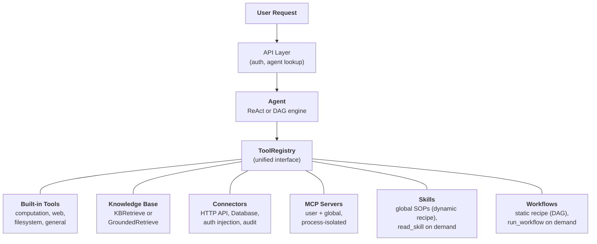
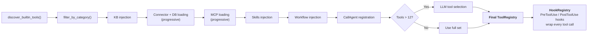
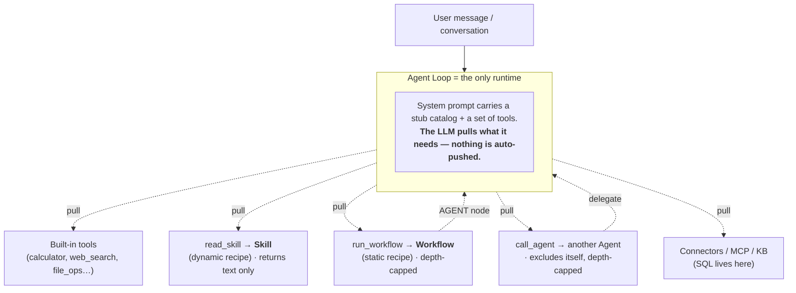

## The unified tool abstraction

The central design insight in FIM One is that **everything the agent can do is a tool**. A calculator, a knowledge base query, an ERP API call, and a third-party MCP server all implement the same `Tool` protocol: `name`, `description`, `parameters_schema`, `category`, and `run()`. The agent does not know or care whether it is calling a local Python function, querying a vector database, proxying into a legacy system, or invoking a community MCP server. It sees a flat list of callable tools in a `ToolRegistry`.

This is a deliberate architectural choice, not an accidental simplification. It means adding a new capability source never requires changing the agent, the execution engines, or the context management layer. You register tools; the agent uses them.

Six capability sources converge into one registry. The agent draws from all of them equally. Skills and Workflows are optional modules, off by default: until an administrator enables them under Admin → Settings → Modules, agents see neither. The last two are a matched pair: a **Skill** is a *dynamic recipe* (an SOP the LLM interprets step by step), and a **Workflow** is a *static recipe* (a deterministic graph that runs the same way every time). Both are pulled through a tool — `read_skill` and `run_workflow` respectively — and neither contains the other; they are peers consumed by the same runtime.

## 여섯 가지 기능 소스

### 내장 도구

`discover_builtin_tools()`를 통해 시작 시 자동으로 발견됩니다. `BaseTool` 서브클래스를 `core/tool/builtin/`에 드롭하면 별도의 설정 없이 등록됩니다. 카테고리에는 계산(`calculator`, `python_exec`), 웹(`web_search`, `web_fetch`), 파일시스템(`file_ops`), 일반(`json_transform`, `template_render`, `text_utils`)이 포함됩니다. 이들은 에이전트의 기본 능력입니다 — 항상 사용 가능하며 설정이 필요 없습니다. 운영자 소유 채널(`email_send`, `send_notification`)에 도달하는 도구는 운영자가 활성화할 때만 제공됩니다.

### 지식 기반

조건부. 에이전트가 `kb_ids`를 바인딩했을 때, 일반 `kb_retrieve` 도구는 특화된 검색 도구로 교체됩니다. **단순 모드**에서 `KBRetrieveTool`은 기본 RAG 검색을 수행합니다. **근거 모드**에서 `GroundedRetrieveTool`은 5단계 파이프라인을 실행합니다: 다중-KB 검색, 인용 추출, 정렬 점수 계산, 충돌 감지, 신뢰도 계산. 지식 기반은 에이전트 옆에 있는 별도의 하위 시스템이 아닙니다. 에이전트에 특화된 도구로 진입하며, 다른 모든 것과 동일한 `Tool` 프로토콜의 적용을 받습니다.

### Connector

`ConnectorToolAdapter` wraps enterprise system actions as tools. Each action becomes a tool named `{connector}__{action}`, categorized as `connector`. The adapter adds HTTP proxy with auth injection (bearer, API key, basic), a per-action confirmation flag, response truncation, and audit logging. For direct database access, `DatabaseToolAdapter` provides schema-aware SQL execution, read-only by default. Connectors are the bridge between AI and legacy systems -- the core differentiator. See [Connector Architecture](/architecture/connector-architecture) for the full design.

### MCP

External MCP servers provide third-party tools via the standard protocol. An HTTP server is a remote endpoint; a stdio server is a process the platform starts inside its own container, which is why only system administrators can configure one. Tools are adapted into the `Tool` protocol and registered under category `mcp`. Admins can provision **global MCP servers** that load for all users automatically. MCP is the ecosystem play -- any MCP-compatible server works without custom integration.

### 스킬

스킬은 재사용 가능한 표준 운영 절차(SOP)입니다 -- 회사 정책, 처리 절차, 단계별 워크플로우 -- 선택된 에이전트와 관계없이 전역적으로 적용됩니다. 커넥터 및 지식 베이스(특정 에이전트로 범위를 지정할 수 있음)와 달리 스킬은 가시성(개인, 조직 공유 또는 마켓 구독)에 따라 모든 사용자에 대해 항상 로드됩니다.

스킬은 두 가지 주입 모드를 지원합니다 -- **점진적**(기본값) 및 **인라인** -- `SKILL_TOOL_MODE`로 제어됩니다. 점진적 모드에서는 컴팩트한 스텁이 시스템 프롬프트에 나타나고 LLM은 필요에 따라 `read_skill(name)`을 호출합니다. 이는 스킬, 커넥터, 데이터베이스 및 MCP 서버 전체에 동일한 스텁 우선, 요청 시 세부 정보 패턴을 적용하는 더 광범위한 [점진적 공개](/architecture/progressive-disclosure) 아키텍처의 일부입니다.

스킬이 전역적(에이전트에 바인딩되지 않음)인 이유와 이중 모드 리소스 검색과 상호 작용하는 방식에 대한 더 자세한 내용은 [에이전트 및 리소스 검색](/architecture/agent-discovery)을 참조하세요.

### Workflows

A Workflow is the **static recipe** to a Skill's dynamic one: a deterministic DAG an agent reaches for when a sub-task must run identically every time and leave an audit trail (scheduled reconciliations, multi-step approval-free pipelines). Like Skills, runnable Workflows are loaded globally per user by visibility — independent of agent selection — and exposed through a single `run_workflow(name, inputs)` tool, with each workflow's input fields advertised as a compact system-prompt stub. The LLM pulls one by name when a task maps onto it.

Only Workflows that are **active** and **free of human-approval (`HUMAN_INTERVENTION`) nodes** are inline-runnable — a gate that blocks for minutes or hours cannot sit inside an agent turn, so those Workflows remain trigger-only from the Workflows page. Inline runs execute as the user chatting with the agent: their connector and MCP credentials, their token quota, and the author's environment variables only when they are the author. Each run persists a `WorkflowRun` for the audit trail and is protected by a re-entrancy guard plus a nesting-depth cap so a Workflow's `AGENT` node can never start an unbounded call cycle.

## Per-request tool assembly

Every chat request assembles a fresh tool set through a filtering pipeline in `_resolve_tools()`. This is not a static configuration -- it is computed per request based on the agent's settings, the user's identity, and the available connectors and MCP servers.

The eight steps:

1. **Base discovery.** `discover_builtin_tools()` loads all built-in tools, scoped to the conversation's sandbox.
2. **Agent category filter.** `filter_by_category(*agent.tool_categories)` restricts to only the categories the agent is allowed to use.
3. **KB injection.** If the agent has `kb_ids`, the generic retrieval tool is replaced with `KBRetrieveTool` or `GroundedRetrieveTool` based on retrieval mode.
4. **Connector loading.** In agent-constrained mode, only the agent's bound connectors are loaded. In auto-discovery mode (no agent selected), all connectors visible to the user are loaded. Both API connectors (`ConnectorMetaTool`) and database connectors (`DatabaseMetaTool`) use [progressive disclosure](/architecture/progressive-disclosure) by default -- lightweight stubs in the system prompt, full schemas loaded on demand.
5. **MCP loading.** The user's personal MCP servers plus admin-provisioned global MCP servers are loaded and connected. In progressive mode (default), a single `MCPServerMetaTool` consolidates all servers; the LLM calls `discover` and `call` subcommands on demand. See [Progressive Disclosure](/architecture/progressive-disclosure).
6. **Skills + Workflows injection.** All active Skills visible to the user are loaded -- regardless of agent selection. In progressive mode, `ReadSkillTool` is registered with compact stubs in the system prompt; in inline mode, full Skill content is embedded directly. The same step loads all active, inline-runnable Workflows and registers `RunWorkflowTool` with one stub per workflow (name, description, input fields). Workflows carrying a human-approval node are skipped here.
7. **CallAgent registration (Auto mode only).** When no specific Agent is selected, all active, visible Agents are assembled into a catalog and exposed via `CallAgentTool`, enabling the LLM to delegate tasks to specialist agents. Delegated agents receive a full `ToolRegistry` built from their own configuration but exclude `call_agent` to prevent infinite recursion. When a specific Agent is selected, `CallAgentTool` is not registered — agents are specialized and do not delegate to other agents. This prevents marketplace agents from accessing other agents' private prompts.
8. **Runtime selection.** If the total tool count exceeds 12, a lightweight LLM call picks the most relevant subset (up to 6) for this specific query. A `request_tools` meta-tool is automatically registered, allowing the LLM to dynamically load additional tools mid-conversation if the initial selection missed a needed tool. Selection failure is non-fatal -- the agent falls back to the full set. See [Progressive Disclosure](/architecture/progressive-disclosure).
9. **Hook registration.** The agent's declared hooks (from `model_config_json.hooks`) are instantiated and attached to a `HookRegistry`. Each chosen tool call will be wrapped: `PreToolUse` hooks can block or rewrite args before execution; `PostToolUse` hooks can rewrite the observation before it returns to the LLM. Hooks run **outside the LLM loop** and cannot be bypassed by agent instructions — see [Hook System](/architecture/hook-system).

The result: the agent sees exactly the tools it needs, no more. A simple agent with no connectors and no KB might see 5 tools. An agent connected to 3 enterprise systems with a grounded knowledge base and 2 MCP servers might see 30 -- but after selection, only the 6 most relevant make it into the context.

## When to use what

| Need | Use | Why |
|------|-----|-----|
| General computation, code execution, text transforms | Built-in Tool | Always available, no config needed |
| Enterprise system integration (ERP, CRM, OA) | Connector | Auth governance, audit trail, per-action confirmation |
| Knowledge retrieval with citations and evidence | Knowledge Base | RAG pipeline, grounded generation, confidence scoring |
| Third-party tool ecosystem | MCP | Standard protocol, process isolation, community servers |
| Organizational policies, SOPs, handling procedures | Skill (dynamic recipe) | Global by default, progressive loading, visibility-scoped |
| A deterministic, repeatable multi-step process invoked mid-conversation | Workflow (static recipe) | Same output every run, audit trail, runs as the chatting user; human-gated ones stay trigger-only |
| Delegating tasks to specialist agents | CallAgent | Semantic agent routing, full tool inheritance, parallel execution |
| Direct database access | Database Connector | Schema-aware SQL, read-only by default |
| Custom internal tooling | MCP or Built-in | MCP for process isolation; built-in for tight integration |

The categories are not mutually exclusive. A single agent can use all five capability sources in one conversation -- loading a Skill for the complaint handling SOP, querying a knowledge base for policy documents, calling a connector to check the ERP, delegating analysis to a specialist agent (in Auto mode), and using a built-in tool to format the results.

## Execution engines are orthogonal

The tool system and execution engines are independent concerns. The LLM-driven engines (ReAct and DAG) consume tools from the same `ToolRegistry`. The choice of engine affects how tools are orchestrated, not which tools are available.

**ReAct** is an iterative tool loop. The agent reasons, picks a tool, observes the result, and repeats until done. It excels at exploratory, conversational tasks where the next step depends on the previous result. The loop runs up to 20 iterations by default (`REACT_MAX_ITERATIONS`) with per-iteration context management via ContextGuard. See [ReAct Engine](/architecture/react-engine) for implementation details.

**DAG** decomposes a goal into 2-6 parallel steps. Each step runs an independent ReAct agent. A PlanAnalyzer evaluates whether the goal was achieved; if not, the pipeline re-plans autonomously (up to 3 rounds in total: the first plan plus 2 re-plans). DAG excels at tasks with clear subtasks that can run concurrently -- "search three sources and compare results" finishes in the time of one search, not three. See [DAG Engine](/architecture/dag-engine) for the full pipeline.

The two engines share infrastructure: `structured_llm_call` for reliable structured output, `ContextGuard` for token budget enforcement, and the `ToolRegistry` for tool resolution. Adding a new tool requires zero changes to either engine. Adding a new engine (should one ever be needed) requires zero changes to the tool system.

Both engines also support **agent delegation** via `CallAgentTool` when in Auto mode (no agent selected). In native function-calling mode, the LLM can invoke multiple `call_agent` calls in a single turn, which execute concurrently via `asyncio.gather`. Each delegated agent receives its own `ToolRegistry` and runs as a full execution unit. For the detailed design of agent discovery, Skills as global SOPs, and agent delegation, see [Agent & Resource Discovery](/architecture/agent-discovery).

### Workflow Engine — 세 번째 패러다임

LLM 기반 ReAct 및 DAG 엔진과 함께 FIM One은 **Workflow Engine**을 포함합니다. 이는 9가지 핵심 노드 유형(Start, End, LLM, Condition Branch, Agent, Knowledge Retrieval, Connector, MCP, Human Intervention)을 갖춘 시각적 DAG 편집기로, 고정 프로세스 자동화를 위해 설계되었습니다. 유연하고 탐색적인 작업에는 Agents를 사용하고, 결정론적이고 반복 가능한 프로세스에는 Workflows를 사용하세요. 자세한 내용은 [Execution Modes](/concepts/execution-modes)를 참조하세요.

두 가지는 **양방향으로 구성**되지만, 각 방향은 단일 런타임인 에이전트 루프를 통해 라우팅됩니다. 두 번째 실행 엔진을 통하지 않습니다:

- **Workflow → Agent.** Workflow의 `AGENT` 노드는 에이전트를 하나의 결정론적 단계로 실행합니다.
- **Agent → Workflow.** 에이전트(또는 이를 따르는 Skill)는 `run_workflow`를 호출하여 결정론적으로 실행되어야 하는 하위 작업을 위임합니다.

이것이 명백한 순환 우려에 대한 해결책입니다: 오직 **에이전트 루프만이 런타임**입니다. Skills와 Workflows는 이것이 로드하는 불활성 레시피이며, 서로를 실행하지 않습니다. "Skill이 Workflow를 호출하는" 것은 물리적으로 에이전트가 Skill의 SOP를 따르면서 `run_workflow`를 호출하는 것을 의미합니다. 모든 호출은 에이전트를 통과하므로 호출 그래프는 **별 모양**이지 메시입니다. 역간선은 제한됩니다(`read_skill`은 텍스트만 반환하고, `call_agent`와 `run_workflow`는 깊이 상한과 재진입 보호를 수행합니다).

같은 그림의 두 가지 해석: **도구는 푸시되지 않고 풀링됩니다**(LLM이 선택하지 않은 Skill이나 Workflow는 절대 실행되지 않습니다. 이것이 동적 기능이 쿼리가 하나와 일치할 때까지 보이지 않는 것처럼 느껴질 수 있는 이유입니다), 그리고 **Skills와 Workflows는 피어**로서 서로 중첩되지 않고 하나의 런타임을 통해 라우팅됩니다.

## Lifecycle overview

**Startup.** `start.sh` runs Alembic migrations, launches the FastAPI server, discovers built-in tools, and establishes MCP server connections for any pre-configured global servers.

**Per-request.** JWT authentication, agent configuration lookup, tool assembly (the 9-step pipeline above), engine selection (ReAct or DAG based on agent config), execution with SSE streaming, and result persistence.

**Cross-cutting concerns.** [Context management](/architecture/context-management) (5-layer token budget) protects every LLM call from overflow. The [Hook System](/architecture/hook-system) wraps every tool call with platform-controlled `PreToolUse` / `PostToolUse` logic — the mechanism behind human-in-the-loop approval (`ApprovalGateHook`), audit logging, and read-only-mode enforcement. Audit logging tracks every connector tool invocation. Sandbox isolation contains code execution tools. The two-LLM architecture (smart + fast) optimizes cost across planning, execution, and synthesis.

The architecture is designed so that each concern -- tool registration, execution orchestration, context management, security -- can evolve independently. A new connector type, a new execution engine, or a new context strategy can be added without cascading changes across the system.
