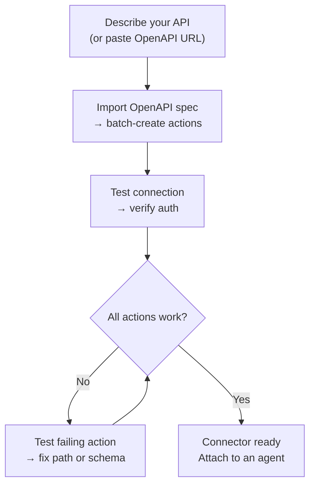
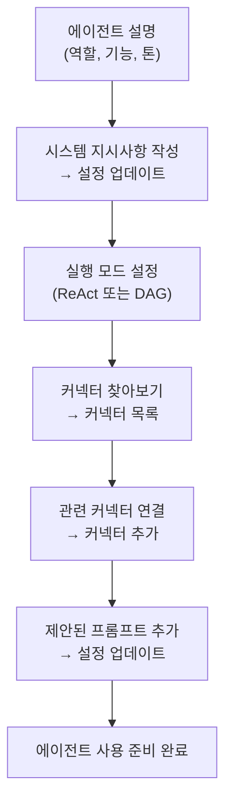

## 개요

AI Builder를 사용하면 일반 언어로 필요한 사항을 설명하고 AI 에이전트가 이를 구성하도록 할 수 있습니다. 두 가지 모드로 작동합니다:

| 모드 | 작동 방식 | 최적 용도 |
|------|-------------|---------|
| **빠른 제안** | 단일 LLM 호출이 구성을 생성합니다 | 빠른 초안 작성, 간단한 API |
| **고급 빌더** | ReAct 에이전트가 루프에서 도구를 사용하여 구축, 테스트 및 개선합니다 | 복잡한 API, OpenAPI 가져오기, 반복적 개선 |

언제든지 모드 간에 전환할 수 있습니다. 빠른 모드는 시작점을 만들고, 고급 빌더를 사용하면 반복할 수 있습니다.

---

## 커넥터 빌더

**커넥터**는 FIM One이 외부 시스템과 통신하는 방식을 정의합니다 — 기본 URL, 인증, 그리고 노출하는 특정 API 작업들입니다. 커넥터 빌더는 AI 에이전트에게 이 구성을 대신 빌드하고 관리할 수 있는 9가지 도구를 제공합니다.

### 도구

| 도구 | 기능 |
|------|-------------|
| **설정 가져오기** | 현재 커넥터 구성(URL, 인증 유형, 인증 구성) 읽기 |
| **설정 업데이트** | 커넥터 이름, 기본 URL 또는 인증 자격증명 변경 |
| **작업 나열** | 모든 기존 API 작업과 해당 메서드 및 경로 확인 |
| **작업 생성** | 새 API 엔드포인트 추가 — HTTP 메서드, 경로, 매개변수, 본문 템플릿 |
| **작업 업데이트** | 기존 작업 수정(설명, 스키마, 응답 추출) |
| **작업 삭제** | 더 이상 필요하지 않은 작업 제거 |
| **작업 테스트** | 모든 작업에 대해 라이브 HTTP 요청을 보내고 응답 검사 |
| **연결 테스트** | 기본 URL에 도달 가능한지 확인하고 자격증명이 수락되는지 확인 |
| **OpenAPI 가져오기** | Swagger 2.x 또는 OpenAPI 3.x 사양에서 최대 50개 엔드포인트 일괄 가져오기 |

### 일반적인 워크플로우

가장 일반적인 패턴: OpenAPI URL을 붙여넣고 빌더가 나머지를 처리하도록 합니다.

**예시 프롬프트:**
> "Import the OpenAPI spec from `https://api.acme.com/openapi.json`, then test the `GET /orders` endpoint with `order_id=12345`."

빌더가 스펙을 가져오고, 모든 작업을 자동으로 생성하며, 테스트 요청을 실행하고, 결과를 보고합니다 — 모두 양식을 건드릴 필요 없이 진행됩니다.

---

## 에이전트 빌더

**에이전트**는 일련의 지시사항, 도구, 그리고 (선택적으로) 커넥터를 가진 명명된 AI 페르소나입니다. 에이전트 빌더는 AI 에이전트에게 처음부터 다른 에이전트를 구성할 수 있는 6가지 도구를 제공합니다.

### 도구

| 도구 | 기능 |
|------|-------------|
| **설정 가져오기** | 현재 에이전트 구성 읽기 (지시사항, 실행 모드, 도구, 모델) |
| **설정 업데이트** | 이름, 설명, 시스템 프롬프트, 실행 모드 또는 제안된 프롬프트 변경 |
| **커넥터 나열** | 사용 가능한 모든 커넥터 탐색 (연결됨 및 미연결) |
| **커넥터 추가** | 커넥터를 연결하여 에이전트가 해당 작업을 도구로 호출할 수 있도록 함 |
| **커넥터 제거** | 커넥터 분리 (커넥터 자체는 삭제되지 않음) |
| **모델 설정** | 기본 LLM 전환 또는 온도 및 최대 토큰 조정 |

### 일반적인 워크플로우

설명으로 시작하여 빌더가 전체 에이전트를 구성하도록 합니다:

**예시 프롬프트:**
> "Finance Copilot을 만들어주세요. Acme 커넥터를 사용하여 주문 및 송장에 대한 질문에 답변해야 합니다. ReAct 모드를 사용하고 일반적인 질문을 위한 3개의 제안된 프롬프트를 추가하세요."

빌더는 현재 설정을 읽고, 시스템 프롬프트를 작성하고, 커넥터를 연결하고, 실행 모드를 설정하고, 제안된 프롬프트를 추가합니다 — 단 하나의 대화 턴에서 모두 완료합니다.

---

## How it works

Under the hood, the builders share the same infrastructure as regular agents:

| Builder mode | Mechanism |
|-------------|-----------|
| **Quick suggestions** | A single LLM inference call generates the full configuration as structured JSON |
| **Advanced builder** | A ReAct agent loop: Reason → call a builder tool → observe the result → decide next step |

The advanced builder is a full ReAct agent that happens to have a restricted toolset — the 9 Connector or 6 Agent builder tools (the Connector builder also gets web search and fetch, to read API docs) and no code execution. A third builder with its own tool set configures database connectors: connection test, table listing, schema annotation and sample queries. It reads the current state of the target resource, plans what needs to change, calls the appropriate tools, and verifies the result before declaring it done.

This means the advanced builder can handle ambiguity: if the OpenAPI import creates 30 actions but only 5 are relevant, you can tell it "keep only the order-related endpoints" and it will delete the rest.
