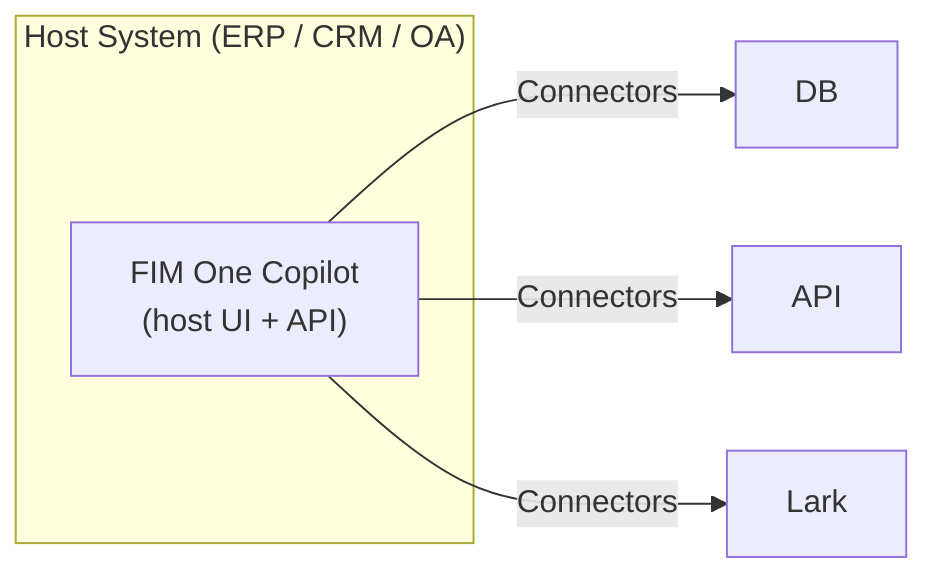
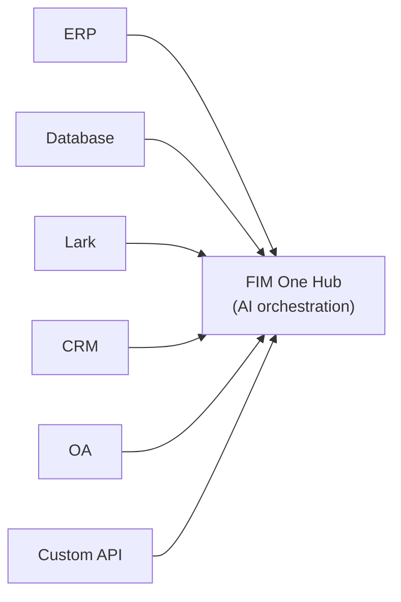
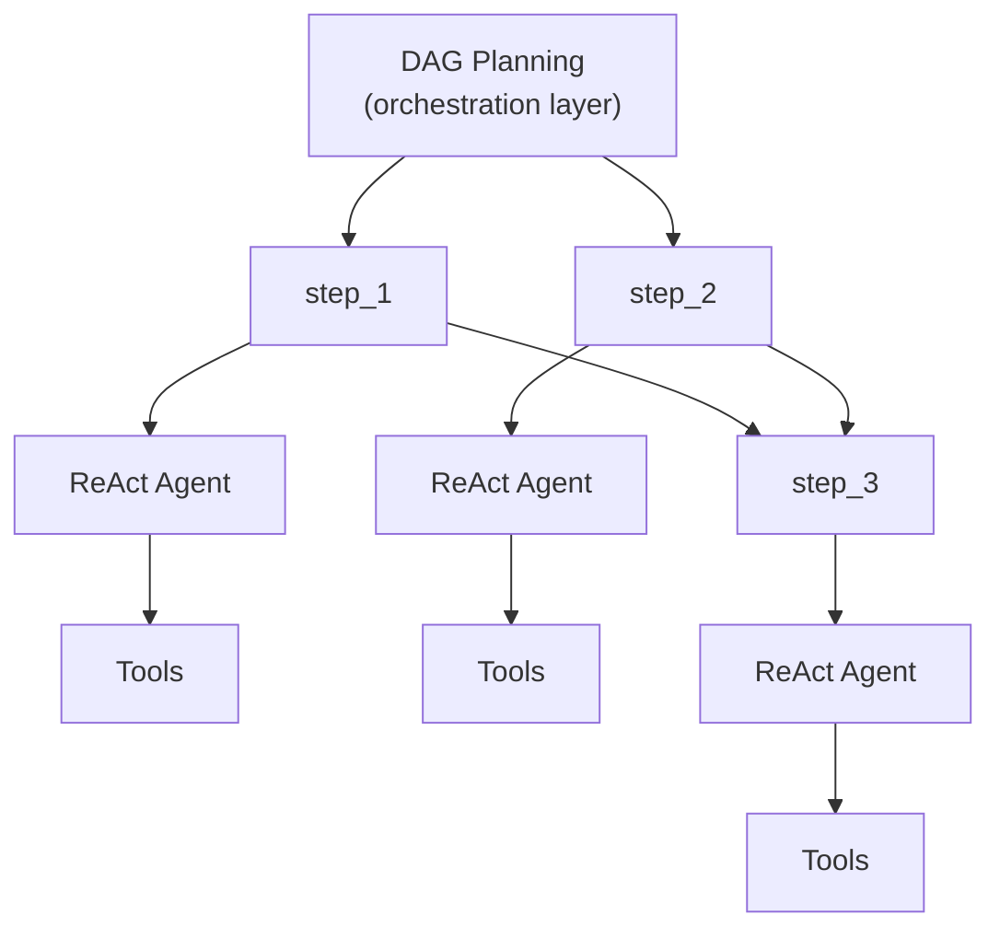

## Three modes

FIM One operates in three modes, determined by how the agent is deployed and used:

| Mode | What it is | Delivery | Example |
|------|-----------|----------|---------|
| **Standalone** | General-purpose AI assistant | Portal | Chat, search, code execution, knowledge base Q&A |
| **Copilot** | AI embedded in a host system | API today; iframe / widget embed is planned | "Finance Copilot" embedded in ERP web UI |
| **Hub** | Central cross-system orchestration | Portal / API | Agent queries ERP, checks OA approvals, notifies via Lark |

The progression is natural: start standalone, embed into a host system as a Copilot, then set up a Hub for cross-system orchestration. The Copilot keeps running embedded; the Hub adds a central orchestration layer.

<Note>
FIM One does not ship an embeddable iframe or widget yet. Today a Copilot is built by calling the API from the host system's own UI; the drop-in embed is planned.
</Note>

## 모드 세부 정보

### 독립형 (0개 커넥터)

기본 모드입니다. FIM One은 완전한 기능의 AI 어시스턴트로 작동합니다:

- 기본 제공 도구: 웹 검색, Python 실행, 계산기, 파일 작업, 셸 명령
- RAG를 포함한 지식 베이스 (PDF, DOCX, Markdown, HTML, CSV)
- 복잡한 다단계 작업을 위한 동적 DAG 계획
- DAG 시각화를 포함한 실시간 스트리밍

외부 시스템 접근이 필요하지 않습니다. 일반적인 분석, 연구 및 코드 작업에 유용합니다.

### Copilot (embedded)

Put FIM One inside a host system's web UI, today by having the host page call the API. The agent works alongside users in their familiar interface — no context switching required. Copilot mode can use multiple connectors (e.g., the host system's DB + a notification service).

Examples:
- **Finance Copilot**: Connected to Kingdee (金蝶) via DB connector → query financial statements, generate analysis reports
- **Contract Copilot**: Connected to contract management system via API connector → search contracts, extract clauses, assess risk
- **HR Copilot**: Connected to HR system via API connector → query employee info, generate statistics

The agent uses the same ReAct/DAG engine as Standalone mode, but now has access to real business data through the connector.

### Hub (중앙 오케스트레이션)

Hub는 중앙 인텔리전스 계층 역할을 하는 독립형 포털(또는 API)입니다. 단일 시스템에 내장되지 않으며, 대신 모든 시스템에 연결됩니다. 사용자는 Portal UI 또는 API를 통해 액세스합니다.

예시:
- "CRM에서 연체 계약 확인, ERP 결제와 교차 참조, Lark에서 재무팀에 알림"
- "OA 승인 완료 시, CRM에서 계약 상태 업데이트 및 감사 데이터베이스에 기록"
- "Salesforce에서 판매 데이터 조회, 비즈니스 DB를 사용하여 예측 생성, 경영진에게 요약 이메일 발송"

각 커넥터는 독립적인 브릿지입니다. 하나를 추가하거나 제거해도 다른 것에는 영향을 주지 않습니다.

## Delivery methods

| Delivery | Description | Typical mode |
|----------|-------------|-------------|
| **Portal (Web UI)** | Built-in Next.js interface | Standalone, Hub |
| **API (headless)** | HTTP/SSE endpoints (`POST /api/react`, `/api/dag`, `/api/auto`) | Hub (programmatic access), Copilot |
| **iframe / Embed** | Injected into host system pages (planned, not shipped) | Copilot |

Delivery and mode are related but not locked: you can access a Hub via API, or use a standalone agent through the Portal. But the typical pattern is Portal for Hub and the API for Copilot.

## Execution engines (internal implementation)

Under the hood, FIM One provides two execution engines:

| Engine | Best for | How it works |
|--------|----------|-------------|
| **ReAct** | Single complex queries | Reason → Act → Observe loop with tools |
| **DAG Planning** | Multi-step parallel tasks | LLM generates dependency graph, independent steps run concurrently |

ReAct is the atomic unit; DAG is the orchestration layer. Both engines work in all three modes (Standalone, Copilot, Hub). In Hub mode, a single DAG step might call connectors to different systems.

New agents and plain chat run on ReAct by default. DAG can be selected per agent or per message, and Auto lets a fast model pick between the two for each request.

## Two execution paradigms

FIM One provides two complementary paradigms for getting work done:

| Paradigm | Orchestration | Best for |
|----------|--------------|----------|
| **Agent (Chat)** | LLM decides next step dynamically (ReAct or DAG) | Exploratory tasks, conversations, flexible reasoning |
| **Workflow** | Fixed DAG defined at design time (visual editor, 9 node types) | Approval chains, scheduled runs, multi-step automations |

**Agents** excel when the task is open-ended — "analyze this quarter's data and recommend actions." The LLM plans and adapts on the fly.

**Workflows** excel when the process is known and repeatable — "every Monday, pull invoices from ERP, run compliance checks, route exceptions to a reviewer." The visual editor lets you wire nodes (Start, End, LLM, Condition Branch, Agent, Knowledge Retrieval, Connector, MCP, Human Intervention) into a fixed DAG.

**Runs, approvals and inputs.** A run belongs to whoever started it (for a trigger key or a schedule, the workflow's owner) and does not depend on the browser tab that started it: close the tab and it continues; reopen the workflow or its Run History to see where it is. A run that reaches a Human Intervention step, or a Connector step whose action requires confirmation, is stored as *waiting* (encrypted) and takes no server resources while it waits. Whoever may decide (the assignee of an approval step, otherwise the person the run belongs to) finds the request under Workflows → Approvals and approves or rejects it there. The run then continues after the step, or fails at it when the request is rejected or runs out of time, including when the server was restarted in between. Before it continues, the run is checked like a new run would be (accounts, quota, plan) and it takes a concurrent-run slot; what a confirmed connector action sends is exactly what the request showed. The Start step lists the workflow's inputs with a type (Text, Number, Boolean, JSON, List) and whether each is required; with its "Check inputs before a run starts" switch on, a run whose inputs do not fit is refused before any step runs, with an error naming the input. A required input must be given (or have a default); an optional input left empty is not passed to the steps, except a Text input, for which empty text is itself a value. A run that was executing when the server stopped is closed as failed and can be started again.

Workflows are an optional module, off by default. An administrator turns it on under Admin → Settings → Modules; until then the Workflows page, its APIs and triggers are unavailable.

The two paradigms compose in both directions. A Workflow can invoke an Agent at any step that needs flexible reasoning within an otherwise fixed pipeline. An Agent can run a Workflow mid-conversation through the `run_workflow` tool, which is offered for active workflows without a Human Intervention step that the user owns or has subscribed to; the run uses the chatting user's credentials and token quota.

<Tip>
**When to choose which:** If you find yourself writing very specific, step-by-step instructions for an Agent, that process probably belongs in a Workflow. If the task requires judgment, exploration, or adapting to unexpected data, keep it as an Agent.
</Tip>
