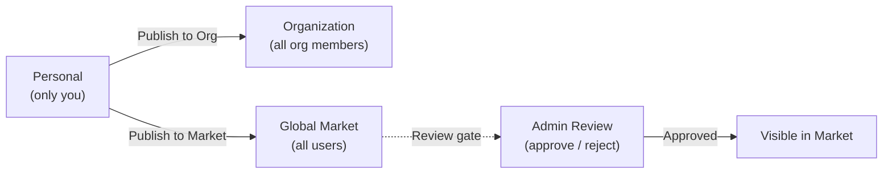

The Market is FIM One's built-in resource marketplace. It organizes shared resources into two tiers:

- **Solutions** -- high-level resources that deliver end-to-end capabilities: Agents, Skills, and Workflows.
- **Components** -- building blocks that Solutions depend on: Connectors and MCP Servers.

Skills and Workflows are optional modules, off by default. They appear in the Market only after an administrator enables them under Admin → Settings → Modules.

You browse by scope (your Organization or the Global Market), find what you need, subscribe, and start using it -- all without leaving FIM One.

<Info>
The Market uses a **pull model**: resources are discovered by browsing and explicitly subscribed to. There is no auto-join or push mechanism -- you choose what to install, and you can filter by scope at any time.
</Info>

## 무엇을 찾을 수 있나요?

### 솔루션

솔루션은 구독하여 즉시 사용할 수 있는 완전하고 준비된 기능입니다.

| 리소스 | 카테고리 | 제공 내용 |
|---|---|---|
| **에이전트** | 솔루션 | 바인딩된 도구와 지식을 갖춘 전문 AI 어시스턴트 |
| **스킬** | 솔루션 | 시스템 프롬프트에 주입되는 글로벌 SOP, 에이전트를 오케스트레이션할 수 있음 |
| **워크플로우** | 솔루션 | 예약되거나 트리거된 실행을 위한 DAG 자동화 흐름 |

### Components

Components are the integrations and tool services that Solutions are built from.

| Resource | Category | What you get |
|---|---|---|
| **Connector** | Component | API integration available as agent tools (database connectors cannot be published) |
| **MCP Server** | Component | Third-party tool service loaded into sessions |

<Tip>
Knowledge Bases never appear in the Market and are never subscribed. An Agent that uses a KB delegates its owner's content at run time, so subscribing to the Agent is all you need.
</Tip>

## Scope

The Market has a scope selector at the top of the page. The UI and subscription flow are identical in both scopes -- only the visibility of resources changes.

- **Organization** -- resources shared within your team or company. Publishing here does not require review unless the organization has turned review on for that resource type.
- **Global Market** -- resources from the entire FIM One community. Publishing here requires admin approval.

Switch between scopes at any time to explore what is available.

## 어떻게 구독하나요?

원하는 리소스를 찾으면 **구독**을 클릭하세요. 온보딩 마법사가 필요한 설정(예: 커넥터의 API 자격증명 입력)을 안내합니다. 마법사를 건너뛰고 나중에 자격증명을 구성할 수도 있습니다.

구독 후:

- **에이전트**는 에이전트 선택기와 `call_agent` 카탈로그에 나타납니다.
- **스킬**은 시스템 프롬프트에 자동으로 주입됩니다.
- **워크플로우**는 워크플로우 목록에 나타나며 실행할 준비가 됩니다.
- **커넥터**는 도구 집합과 에이전트 바인딩 드롭다운에 나타납니다.
- **MCP 서버**는 도구를 세션에 로드합니다.

솔루션이 컴포넌트에 종속된 경우(예: 특정 커넥터를 사용하는 에이전트), 이러한 종속성은 구독 중에 자동으로 해결됩니다. 필요한 자격증명을 입력하라는 메시지가 표시됩니다.

구독은 즉시 이루어지며 게시자의 승인이 필요하지 않습니다. 언제든지 구독을 취소하여 워크스페이스에서 리소스를 제거할 수 있습니다.

## How Do I Publish?

Any resource owner can publish to make their resource discoverable. Publishing can target either your Organization or the Global Market.

| Target | Who can see it | Review required? |
|---|---|---|
| **Organization** | All members of your org | No by default; an org can require review per resource type |
| **Global Market** | All authenticated users | Yes -- admin approval required |

Publishing to the Global Market always goes through a review gate. Admins can approve, reject (with a note), or leave the resource pending. Rejected resources can be revised and resubmitted.

## What About Credentials?

When you subscribe to a resource that requires credentials (API keys, OAuth tokens), the onboarding wizard collects them during subscription. Credentials are stored securely and scoped to your account -- no one else can see them.

You can update or rotate credentials at any time from the resource's settings page.

## How It Integrates

Under the hood, the Market is implemented as a **shadow organization** -- an invisible system org that holds no members. Resources published to the Global Market are set to `visibility: "org"` within this shadow org, which allows the existing visibility system to include them naturally.

This means the Market requires **zero special-case code** in the tool assembly pipeline. The same visibility filter (own, or subscribed and still shared) that loads personal and org resources also loads Market resources. When you subscribe, a subscription record is created, and the resource appears in your visibility filter automatically.

For Solutions that bundle dependencies (e.g., an Agent with bound Connectors and Knowledge Bases), the subscription process resolves and provisions those dependencies so everything works out of the box.

For technical details on how the visibility filter works across all resource types, see [Agent & Resource Discovery -- Visibility Model](/architecture/agent-discovery#visibility-model).
