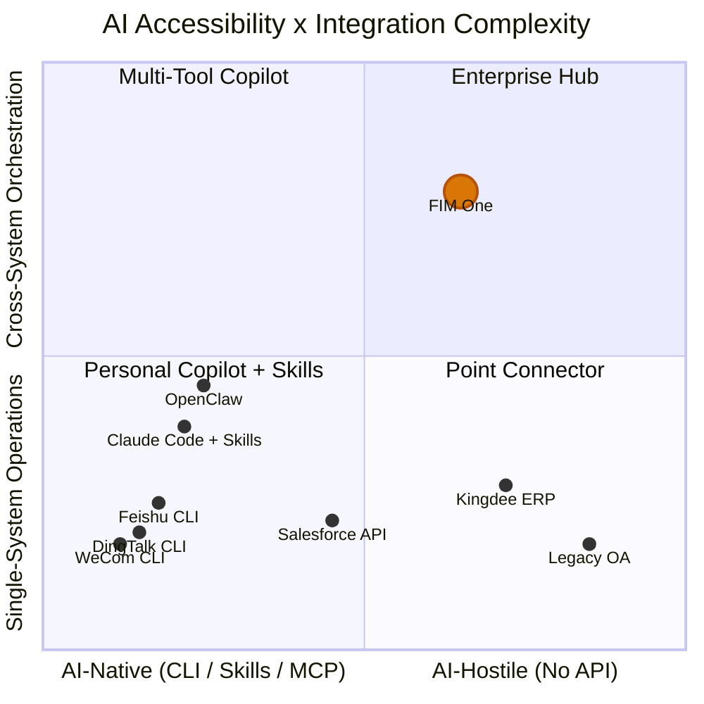

## 2026년 3월 신호

2026년 3월, 중국의 세 대형 직장 플랫폼이 같은 주 내에 CLI 도구를 오픈소스화했습니다:

- **DingTalk**는 `dws` 출시 — 12개 비즈니스 도메인에 걸친 104개 도구
- **Feishu/Lark**는 `lark-cli` 출시 — 11개 도메인에 걸친 200+ 명령어
- **WeCom**은 `wecom-cli` 출시 — 7개 비즈니스 도메인 포함

이들 중 누구도 MCP를 선택하지 않았습니다. 세 회사 모두 `npx skills add`를 통해 배포되는 사전 패키징된 AI Skills를 포함한 순수 CLI 도구를 출시했습니다. 이는 업계가 AI 에이전트가 엔터프라이즈 시스템과 어떻게 통신해야 하는지에 대해 집단적으로 입장을 보인 첫 번째 사례입니다 — 그리고 그 답변은 프로토콜이 아니라 패키징 형식이었습니다.

이 문서는 이것이 AI 시스템 통합 전반에 무엇을 의미하는지, 그리고 FIM One의 전략에 구체적으로 무엇을 의미하는지 분석합니다.

## AI 시스템 통합을 위한 세 가지 패러다임

### 1. REST API (Traditional)

기본 방식입니다. 모든 SaaS 플랫폼은 OpenAPI 스펙으로 문서화된 HTTP 엔드포인트를 노출합니다. AI 통합에는 어댑터 레이어가 필요합니다 — "이 API 엔드포인트를 이 헤더와 JSON 본문으로 호출하세요"를 "지금 지능체가 호출할 수 있는 도구입니다"로 변환하는 것입니다.

이것이 FIM One의 ConnectorToolAdapter가 현재 수행하는 작업입니다. 작동하지만 각 통합에는 사용자 정의 작업이 필요합니다: API 문서 읽기, 인증 처리, 응답 형식 매핑, 페이지네이션 처리.

- **사용자**: 모든 SaaS 플랫폼, 레거시 통합
- **AI 통합**: 어댑터 레이어 필요 (ConnectorToolAdapter, 사용자 정의 코드)
- **강점**: 범용적, 잘 이해됨, 구조화된 JSON I/O
- **약점**: 각 통합에 사용자 정의 개발 노력 필요

### 2. CLI + Skills (Emerging)

플랫폼은 컴파일된 CLI 바이너리를 제공합니다. AI 통합은 사전 패키징된 Skill 파일을 통해 이루어집니다 — AI IDE에 CLI 명령을 subprocess를 통해 호출하는 방법을 알려주는 마크다운 문서입니다. 배포는 npm을 통해 이루어집니다: `npx skills add dingtalk/dws`.

AI는 Skill 파일을 읽고, 사용 가능한 명령과 해당 인자를 이해한 후, CLI를 subprocess로 호출합니다. 출력은 일반적으로 자유 텍스트(표, 형식화된 문자열)이며 AI가 파싱해야 합니다.

- **사용자**: DingTalk, Feishu, WeCom (모두 2026년 3월에 선택)
- **AI 통합**: `npx skills add platform/cli` — AI IDE는 Skill 마크다운을 읽고 CLI 명령을 호출
- **장점**: 빠른 배포, Skills 형식을 지원하는 모든 AI IDE와 호환
- **단점**: 비정형 텍스트 출력 (AI가 파싱해야 함), 표준화된 발견 프로토콜 없음, 단일 플랫폼 범위

### 3. MCP (Model Context Protocol)

JSON-RPC over stdio or SSE. 구조화된 도구 검색(`tools/list`)과 호출(`tools/call`). AI 클라이언트는 서버와 기능을 협상하고, 모든 도구에 대한 타입이 지정된 스키마를 얻으며, 구조화된 `CallToolResult` 응답을 수신합니다.

- **사용자**: Anthropic 생태계, 증가하는 개발자 도구 수
- **AI 통합**: 네이티브 프로토콜 — 구조화된 I/O, 스키마 기반 검색
- **강점**: 표준화됨, 구조화됨, 조합 가능, 다중 도구 오케스트레이션을 위해 설계됨
- **약점**: 높은 구현 비용, 주요 직장 플랫폼에서 아직 채택되지 않음

### 비교

| 차원 | REST API | CLI + Skills | MCP |
|-----------|----------|-------------|-----|
| 표준화 | 중간 (OpenAPI) | 낮음 (공급업체별 Skills) | 높음 (JSON-RPC 프로토콜) |
| AI 친화성 | 낮음 (어댑터 필요) | 중간 (텍스트 I/O, AI가 파싱) | 높음 (구조화된 JSON I/O) |
| 검색 메커니즘 | OpenAPI 스펙 / 문서 | `--help` + Skill markdown | `tools/list` 프로토콜 엔드포인트 |
| 출력 형식 | 구조화된 JSON | 자유 텍스트 (AI 파싱 필요) | 구조화된 `CallToolResult` |
| 출시 시간 | 주 단위 (통합당) | 일 단위 (기존 API 래핑) | 주 단위 (프로토콜 구현) |
| 크로스플랫폼 오케스트레이션 | 허브 필요 | 내장되지 않음 | 내장되지 않음 |
| 엔터프라이즈 거버넌스 | 허브 필요 | 내장되지 않음 | 내장되지 않음 |

## 주요 플랫폼이 실제로 선택한 것

| | DingTalk `dws` | Feishu `lark-cli` | WeCom `wecom-cli` |
|---|---|---|---|
| 언어 | Go | Go + Python | Rust + TS |
| 도구 | 104 / 12개 도메인 | 200+ / 11개 도메인 | 7개 도메인 |
| MCP 지원 | 아니오 | 아니오 | 아니오 |
| AI 통합 | Markdown Skills + schema introspection | 19개 npm Skills (`npx skills add`) | 12개 npm Skills (`npx skills add`) |
| 출력 형식 | JSON / table / raw + `--jq` | JSON / table / csv / ndjson | JSON |
| 에이전트 친화적 플래그 | `--yes`, `--dry-run`, smart input correction | `--no-wait`, `--as user/bot`, `--dry-run` | Direct JSON params |
| 검색 | `dws schema` (self-introspection) | `lark-cli schema` (self-introspection) | Skill 파일을 통해서만 |

핵심 관찰: `npx skills add`는 MCP를 우회하는 AI 도구 통합의 사실상 표준 배포 채널이 되고 있습니다. 이 플랫폼들은 프로토콜 표준화보다 빠른 출시 속도를 선택했습니다. AI IDE 생태계(Cursor, Claude Code, Windsurf)는 이미 Skills 파일을 이해하므로, 플랫폼들은 프로토콜 서버를 구현하지 않고도 즉시 AI 통합을 얻을 수 있습니다.

## AI 접근성 스펙트럼

모든 시스템이 AI에 동등하게 접근 가능한 것은 아니며, 모든 작업이 동등하게 단순한 것도 아닙니다. 이 두 가지 차원이 서로 다른 통합 접근 방식이 가치를 창출하는 위치를 정의합니다.

**차트 읽기:**

- **좌하단 (Personal Copilot + Skills)**: 단순한 작업을 수행하는 AI 네이티브 플랫폼. DingTalk, Feishu, WeCom이 여기에 집중되어 있습니다 — 자체 CLI + Skills를 제공하여 단일 플랫폼 AI 통합을 셀프서비스로 만듭니다. OpenClaw 및 Claude Code with Skills와 같은 Personal copilot이 이 영역을 차지합니다. FIM One은 여기서 거의 가치를 추가하지 않습니다 — 플랫폼이 이미 작업을 완료했기 때문입니다.
- **좌상단 (Multi-Tool Copilot)**: 크로스 시스템 요구사항이 있는 AI 네이티브 플랫폼. Claude Code에서 여러 Skills(`dingtalk` + `feishu` + `wechat`)를 설치하는 사용자는 다중 플랫폼 조정을 시도할 수 있지만, 거버넌스, 오케스트레이션 계획, 통합 자격증명 관리가 부족합니다.
- **우하단 (Point Connector)**: 단순한 브릿지가 필요한 레거시 시스템. Kingdee ERP 또는 레거시 OA 시스템에 대한 단일 Connector — FIM One은 단일 시스템 작업에서도 유용합니다. 이러한 시스템은 CLI가 없고 API가 제한적이거나 없기 때문입니다.
- **우상단 (Enterprise Hub)**: 크로스 시스템 오케스트레이션 요구사항이 있는 레거시 또는 API 제한 시스템. 이것이 FIM One의 최적 영역입니다. 레거시 관리 시스템 전체에서 계약을 쿼리하고, ERP 수금과 상관관계를 지정하고, DingTalk를 통해 수금 공지를 보내기 — 이는 DAG 계획, 다중 Connector 조정, 자격증명 보관, 감사 추적, 인적 확인 게이트가 필요합니다. 어떤 personal copilot, CLI, Skills 파일도 여기에 도달할 수 없습니다.

FIM One의 가치는 우상단으로 이동할수록 증가합니다: 도달하기 어려운 시스템과 더 복잡한 오케스트레이션 요구사항의 조합. 자체 CLI + Skills를 제공하는 플랫폼은 반대쪽 모서리를 차지합니다 — 접근하기 쉽고 단순한 작업 — 그리고 FIM One이 추구해서는 안 되는 시장을 나타냅니다.

## 개인용 Copilot vs 엔터프라이즈 Hub

개인용 AI copilot(OpenClaw, Claude Code, Cursor, Windsurf)의 확산은 포지셔닝 문제를 야기합니다. 두 가지 근본적으로 다른 모델이 존재합니다:

### 개인용 Copilot

- **사용자**: 개별 개발자 또는 지식 근로자
- **데이터 범위**: 내 캘린더, 내 이메일, 내 문서
- **인증**: 내 개인 token, 내 OAuth 세션
- **통합 범위**: 단일 사용자, 소수 플랫폼, 개인 생산성
- **거버넌스**: 필요 없음 — 내 데이터, 내 작업

### 엔터프라이즈 통합 플랫폼

- **사용자**: 조직(팀, 부서, 부서 간 워크플로)
- **데이터 범위**: 부서 간, 시스템 간 데이터, 민감 데이터 및 규제 대상 데이터 포함
- **인증**: 관리자가 할당한 권한, 최소 권한 원칙, 자격 증명 보관
- **통합 범위**: 다중 시스템 오케스트레이션, 비즈니스 프로세스 자동화
- **거버넌스**: 감사 로그, RBAC, 확인 게이트, 규정 준수 요구 사항

이 둘은 상호 보완적이며 경쟁 관계가 아닙니다. 개인용 코파일럿이 확산됨에 따라 기업은 이러한 코파일럿이 액세스할 수 있는 항목을 관리할 중앙 허브를 필요로 하게 됩니다. `npx skills add dingtalk/dws`와 함께 Claude Code를 사용하는 개인 사용자는 자신의 DingTalk 메시지를 읽을 수 있습니다. 하지만 AI 에이전트가 감사 추적, 권한 제어, 쓰기 작업에 대한 사람의 확인을 거치며 DingTalk, 회사 ERP, 재무 시스템 전반을 오케스트레이션해야 한다면, 이는 전혀 다른 문제입니다.

개인용 코파일럿은 단순한 단일 플랫폼 작업을 범용화합니다. 이것은 FIM One의 시장이 아닙니다. FIM One의 시장은 개인용 코파일럿으로는 처리할 수 없는 시스템 간 통합, 거버넌스가 필요한 통합, 레거시 시스템을 포함하는 엔터프라이즈 통합입니다.

## FIM One에 대한 전략적 시사점

| 우선순위 | 조치 | 근거 |
|----------|--------|-----------|
| 현재 방향 유지 | API, 데이터베이스, MCP 액세스에 대한 거버넌스 계층(자격 증명, 확인 게이트, 감사)에 계속 투자 | CLI + Skills는 레거시 시스템에 절대 도달할 수 없으며, 시스템 간 액세스에는 거버넌스가 필요함 |
| MCP 수용 | MCP Server 지원이 이미 구축되어 있으므로(`MCPServerMetaTool`) 계속 완성도를 높일 것 | MCP는 구조화된 프로토콜에 대한 전략적 선택이며, 일부 플랫폼은 결국 이를 채택할 것임 |
| Skills 모니터링 | `npx skills add` 생태계를 추적하되 이를 좇지는 말 것 | Skills는 FIM One에 없는 배포 문제를 해결함 |
| 거버넌스로 차별화 | 감사, RBAC, 확인 게이트, 자격 증명 관리 | 개인용 코파일럿은 엔터프라이즈 거버넌스를 제공할 수 없음 |
| 명확한 포지셔닝 | “글로벌 × 중국 기업을 위한 올인원 에이전트 플랫폼” — “DingTalk를 호출하는 또 다른 방법”이 아님 | 플랫폼이 무료로 제공하는 단순한 통합 기능을 두고 경쟁하는 일을 피할 것 |

가장 나쁜 전략적 선택은 CLI + Skills의 흐름에 대응하기 위해 플랫폼이 이미 자체적으로 제공하는 기능에 대한 Skills 어댑터를 구축하는 것입니다. 이는 플랫폼 공급업체와 직접 바닥을 향해 경쟁하는 일이 됩니다. 올바른 대응은 해당 공급업체가 결코 도달하지 못할 시스템에 계속 집중하는 것입니다.

## CLI, Skills, MCP의 관계

이 세 가지 개념은 서로 다른 계층에서 작동하며, 논의 과정에서 혼동되는 경우가 많습니다. 정확히 구분하면 다음과 같습니다.

- **CLI**는 사용자 인터페이스입니다. 셸 명령, 텍스트 I/O, 시스템과 상호 작용하기 위한 폼 팩터를 의미합니다.
- **Skills**는 배포 메커니즘입니다. AI에게 CLI 명령을 호출하는 방법을 알려 주는 Markdown 파일이자, AI 도구 통합을 위한 패키징 형식입니다.
- **MCP**는 프로토콜입니다. JSON-RPC, 구조화된 검색 및 호출, AI 도구 통신을 위한 상호 운용성 표준을 제공합니다.

장기적으로 이들은 서로를 대체하지 않습니다. CLI는 사람(또는 AI 하위 프로세스)이 도구와 상호 작용하는 방식입니다. Skill 파일은 해당 CLI를 AI IDE에 배포하는 방식입니다. MCP는 프로토콜 수준에서 구조화되고 스키마로 타입이 지정되며 조합 가능한 통합을 구현하는 방식입니다.

하지만 단기적으로(2026년) CLI + Skills는 MCP보다 구현 비용이 저렴하기 때문에 도입 속도 측면에서 우위를 점하고 있습니다. 기존 CLI가 있는 플랫폼은 하루 만에 Skills 파일을 제공할 수 있습니다. 반면 MCP 서버를 구현하려면 수 주가 걸리며, 프로토콜 사양, 전송 계층, 기능 협상에 대한 이해가 필요합니다.

예상되는 수렴 방향은 다음과 같습니다. 현재 CLI를 제공하는 플랫폼은 향후 이를 MCP 서버로 래핑할 수 있습니다. MCP의 stdio 전송은 이미 CLI 프로세스를 실행하므로, "Skills로 호출되는 CLI"와 "MCP 서버로 래핑된 CLI" 사이의 간극은 작습니다. 그러나 이러한 수렴이 보장되는 것은 아닙니다. Skills 생태계가 충분히 빠르게 성장하고 AI IDE가 이를 중심으로 표준화된다면, MCP는 엔터프라이즈 도구 표준이 아니라 개발자 도구 프로토콜로 남을 수도 있습니다.

FIM One에 주는 시사점은 분명합니다. 배포 계층(Skills)이 아니라 프로토콜 계층(MCP)과 거버넌스 계층(자격 증명, 확인 게이트, 감사)에 투자해야 합니다. 플랫폼 공급업체에게 배포는 이미 해결된 문제입니다. 허브가 지속적인 가치를 창출하는 영역은 프로토콜과 거버넌스입니다.
