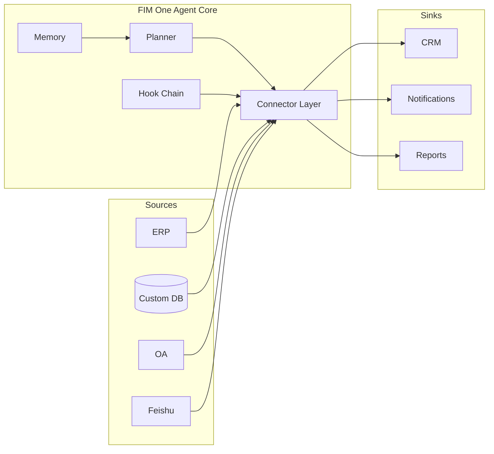

<Info>
  **버전 1.1 · 2026년 4월.** 이 백서는 FIM One의 아키텍처적 관점, 카테고리 포지셔닝 및 배포 모델을 설명합니다.
  이미 운영 중인 시스템에 AI를 도입하는 방법을 평가하는 CTO, 엔터프라이즈 아키텍트, AI 플랫폼 리더 및 기술 투자자를 대상으로 합니다.
</Info>

## Executive Summary

**데이터는 절대 귀사의 경계를 벗어나지 않습니다.** 이 한 문장이 FIM One의 모든 의사결정 뒤에 있는 1차 설계 제약이며, 새로운 인프라 계층이 필요한 이유입니다 — 또 다른 iPaaS가 아니고, 또 다른 범용 에이전트도 아닙니다.

대부분의 엔터프라이즈는 이미 필요한 시스템을 갖추고 있습니다 — ERP, CRM, OA, 커스텀 데이터베이스, 내부 API, 산업별 SaaS. 부족한 것은 AI가 벤더 클라우드로 데이터를 마이그레이션하지 않고, 모든 사용 사례마다 6개월 통합 프로젝트를 거치지 않고도 이러한 시스템에 **접근**할 수 있는 방법입니다. 시장은 크고 빠르게 움직이고 있으며, 이미 재편되고 있습니다: 글로벌 엔터프라이즈 GenAI 인프라 지출은 **2025년 미화 18억 달러로 예상되며, 전년 대비 3.2배 성장** (Menlo Ventures 2025). 중국은 더욱 빠르게 움직이고 있습니다 — 엔터프라이즈 AI Agent 지출이 **120% CAGR (2023–2027)로 2027년까지 ¥65.5B에 도달** (iResearch · CAICT 2025). 중앙/국영 기업이 **대규모 모델 조달의 60% 이상**을 차지하고 있으며, Xinchuang (信创) 자체 배포는 필수 제약입니다.

Gartner는 공식적으로 이 카테고리를 "AI Agent Platform"으로 명명했습니다 (문서 6300015, 2025); CAICT의 2025 Agentic AI Technology Report는 이를 "智能体平台"이라고 부릅니다; 역사적 iPaaS 리더인 MuleSoft는 **2025 iPaaS Magic Quadrant에서 Leader에서 Challenger로 강등**되었습니다. 지난 10년간 엔터프라이즈 통합을 지배했던 카테고리가 실시간으로 대체되고 있습니다.

FIM One은 새로운 카테고리를 위해 구축되었습니다. 이는 글로벌 × 중국 엔터프라이즈를 위한 **올인원 에이전트 플랫폼**입니다 — AI 에이전트가 기존 시스템 전반에서 동적으로 작업을 계획하고 실행하는 공급자 무관 Python 프레임워크로, 글로벌 SaaS와 중국 스택을 하나의 에이전트 코어로 연결하고, 귀사 환경에 배포되며, 엔드투엔드 감사 가능합니다. 하나의 에이전트 코어, 세 가지 배포 모드:

| 모드 | 위치 | 일반적 배포 |
|---|---|---|
| **Standalone** | 자체 포털 | 지식 Q&A, 내부 채팅, 코드 샌드박스 |
| **Copilot** | 호스트 시스템 내 임베드 | ERP 웹 UI 내 "Finance Copilot" |
| **Hub** | 중앙 크로스시스템 오케스트레이터 | 에이전트가 ERP를 쿼리하고, OA를 확인하고, Feishu를 통해 알림 |

이 문서는 카테고리가 왜 이동하고 있는지, iPaaS가 새로운 워크로드를 흡수할 수 없는 이유, FIM One이 내부적으로 어떻게 보이는지, 그리고 프로덕션에 어떻게 배포하는지를 설명합니다.

## 1. The Problem: Enterprise AI Is an Alignment Problem

2025–2026년의 공개 AI 논의는 모델 성능——더 긴 컨텍스트, 더 나은 추론, 저렴한 토큰——에 의해 지배되어 왔습니다. 엔터프라이즈 내부에서는 성능이 거의 차단 요소가 아닙니다. 차단 요소는 **AI가 당신의 시스템 내부에 손을 가지고 있지 않다**는 것입니다.

만 줄의 코드베이스를 읽고 올바른 수정을 제안할 수 있는 최첨단 LLM도 자체적으로는 다음을 할 수 없습니다:

- 온프레미스 SAP 인스턴스에서 어제의 재고 수치를 추출합니다.
- 유일한 통합 인터페이스가 레거시 SOAP API인 SaaS HR 도구에서 휴가 요청을 승인합니다.
- OAuth2 대신 로그인 티켓 서비스를 인증으로 사용하는 Xinchuang 준수 ERP에 행을 작성합니다.
- Feishu 그룹의 자체 승인 규칙을 준수하면서 그룹에 알림을 보냅니다.

이들 각각은 한 번 해결된 통합 문제입니다. 어려움은 모든 엔터프라이즈가 각각 자체 인증 모델, 데이터 형태 및 실패 모드를 가진 수십 개의 이러한 시스템을 가지고 있다는 것입니다. 이들을 하드코딩하면 취약한 모놀리식 구조를 얻게 됩니다. LLM에 런타임에 이들을 발견하도록 요청하면 환각된 API 호출을 얻게 됩니다.

**누락된 기본 요소는 정렬된 인터페이스입니다.** 모델과 시스템 사이의 타입화되고 인증된 발견 가능한 인터페이스——모델에 정확히 무엇을 할 수 있는지, 각 작업의 비용이 무엇인지, 누가 승인해야 하는지, 결과가 어떻게 보일지를 알려주는 인터페이스입니다. 이 기본 요소가 FIM One이 **Connector**라고 부르는 것입니다.

## 2. 기존 접근 방식이 부족한 이유

### 2.1 iPaaS 및 워크플로우 빌더 — 쇠퇴하는 카테고리

iPaaS(MuleSoft, Boomi, Workato)와 경량 워크플로우 제품군(n8n, Zapier, Dify, Coze)은 통합을 **설계 시점** 문제로 취급합니다. 사용자가 노드 그래프를 그리고 필드 수준의 세분성으로 연결하면, 그래프는 런타임에 결정론적으로 실행됩니다. 통합이 적고 안정적일 때는 이 방식이 작동했습니다.

하지만 AI 기반 엔터프라이즈 자동화에는 작동하지 않습니다. 세 가지 복합적인 이유 때문입니다:

1. **논리가 이미 대상 시스템 내부에 존재합니다.** 모든 노드는 이제 두 곳에서 유지보수해야 하는 API 호출의 얇은 래퍼입니다.
2. **사용자가 미리 계획을 알아야 합니다.** "모든 APAC 엔티티의 Q1 마감"과 같은 엔터프라이즈 질문은 개방형입니다. 계획은 설계자가 그리는 것이 아니라 런타임에 생성되어야 합니다.
3. **필드 수준 매핑은 규모에서 붕괴됩니다.** 수십 개 시스템에 걸친 수천 개 노드 그래프는 유지보수 불가능합니다. AI 가독형 작업 표면이 이를 완전히 대체합니다.

이 카테고리는 명백히 변화하고 있습니다. Gartner는 2025년에 이 공간을 "AI Agent Platform"으로 재분류했습니다(문서 6300015). CAICT는 2025년 Agentic AI Technology Report에서 동일한 프레임워크("智能体平台")를 채택했습니다. 가장 주목할 점은 **10년간 iPaaS의 기준 벤더였던 MuleSoft가 Gartner의 2025년 iPaaS Magic Quadrant에서 Leader에서 Challenger로 강등되었다는 것입니다**. 동시에 2024년 11월 출시된 Anthropic의 MCP 프로토콜은 **15개월 만에 10,000개 이상의 서버와 월 9,700만 SDK 다운로드로 성장했습니다**. 신호는 명확합니다. 엔터프라이즈 자동화의 통합 계층이 재구축되고 있습니다.

### 2.2 범용 에이전트 (Manus, AutoGPT, OpenAI Assistants)

범용 에이전트는 웹 브라우징, 문서 작성, 스프레드시트 조작 등 소비자 및 지식 작업을 위해 설계되었습니다. VPN에 접근하거나, ERP에 인증하거나, 보안 검토를 통과할 수 없습니다. 엔터프라이즈 시스템을 감싸면 파일럿 단계에서 사라지는 데모가 될 뿐입니다.

### 2.3 공급업체 내장형 AI (Feishu AI, SAP Joule, Salesforce Einstein)

공급업체들은 자신의 제품에 자체 AI를 탑재했습니다. 문제는 구조적입니다: **어떤 상류 공급업체도 자신의 데이터 사일로를 깨뜨릴 인센티브가 없습니다.** Feishu AI는 귀사의 ERP 데이터를 알지 못하고, DingTalk AI는 계약 상태를 알지 못합니다. 각 공급업체의 AI는 해당 공급업체가 판매한 것만 볼 수 있습니다. 시스템 간 작업의 경우 이들은 시작점이 될 수 없습니다.

### 2.4 자체 구축 및 RPA

자체 구축은 긴 개발 기간과 지속적인 적응 비용이 소요됩니다. RPA는 UI를 인간처럼 조작합니다——가장 일반적인 접근 방식이지만 가장 취약합니다. UI 변경이 발생할 때마다 작동이 중단되고, 인증 프롬프트가 나타나면 멈춥니다. 이는 누락된 API에 대한 임시방편일 뿐, AI를 구축하기 위한 기초가 아닙니다.

FIM One은 이 모든 것들이 남겨둔 공백을 채웁니다. 실제 시스템에 대한 타입화된 API를 제공하며, 모델이 계획하고, 엔터프라이즈가 관리하고, 엔터프라이즈 경계 내에 배포됩니다.

## 3. FIM One 논제

세 가지 신념이 모든 설계 결정을 주도합니다.

**신념 1 — 시스템은 이미 존재합니다.** 엔터프라이즈에 재구축을 요구하지 마세요. 현재 상태에서 만나세요. 모든 connector는 대체가 아닌 다리입니다. 데이터는 신뢰할 수 있는 출처를 떠나지 않으며, 엔터프라이즈 경계를 벗어나지 않습니다.

**신념 2 — 정렬이 능력을 이깁니다.** 정렬된 도구 세트를 갖춘 약한 모델이 원시 API를 헤매는 강한 모델을 능가합니다. 경쟁 우위는 connector 라이브러리, 인증 모델, 거버넌스 계층에 있습니다. 에이전트의 순수한 추론 능력이 아닙니다.

**신념 3 — 동적 계획이 올바른 중간 지점입니다.** 엄격한 워크플로우(iPaaS, BPM)는 실제 엔터프라이즈 작업에 너무 취약합니다. 완전히 자율적인 에이전트(AutoGPT, Manus)는 프로덕션에 너무 예측 불가능합니다. FIM One은 런타임에 계획하지만 타입이 지정된 액션 공간 내에서 계획합니다. 모든 단계는 connector 호출이지, 개방형 LLM 독백이 아닙니다. 제한된 자율성: `re-plan ≤ 3 | token budget | confirmation gate`.

### iPaaS를 넘어서

FIM One은 의도적으로 iPaaS가 아니며, 이 구분은 단순한 용어의 차이가 아닙니다. iPaaS는 필드 수준, 설계 시점, 인간 모델링, 벤더 클라우드 호스팅입니다. FIM One은 작업 수준, 런타임, 모델 계획, 엔터프라이즈 호스팅입니다.

| 축 | iPaaS | FIM One |
|---|---|---|
| 세분화 | 필드 매핑 | 타입 지정 작업 |
| 계획 시점 | 설계 시점 | 런타임 |
| 모델링 담당 | 인간 설계자 | 모델 |
| 데이터 위치 | 벤더 클라우드 | 귀사 서버 |
| 거버넌스 | 외부 추가 기능 | 내장 훅 |
| 카테고리 (Gartner 2025) | iPaaS MQ (감소 중) | AI Agent Platform |

## 4. Architecture Principles

<CardGroup cols={2}>
  <Card title="Provider-Agnostic" icon="shuffle">
    Any OpenAI-compatible LLM — OpenAI, Anthropic, DeepSeek, Qwen, local Ollama, Xinchuang-certified models. Model choice is a deployment variable, not an architectural commitment.
  </Card>
  <Card title="Protocol-First" icon="network-wired">
    Every connector publishes a typed schema. The agent sees actions, parameters, and return types — never raw HTTP. OpenAPI, MCP, and direct database connections are first-class.
  </Card>
  <Card title="Three Execution Engines" icon="sitemap">
    **ReAct** for exploratory tasks, **DAG** for structured pipelines, **Workflow** (visual editor, 9 node types, an optional module) for deterministic human-designed pipelines. One agent core picks the engine per task.
  </Card>
  <Card title="Schema-First Tool Loading" icon="bolt">
    Tool schemas are pre-seeded at ~30 tokens each; the agent expands on demand. Per-session prompt overhead drops ~80%, and the platform scales to **10,000+ APIs** without blowing the context window.
  </Card>
  <Card title="Hook-Governed" icon="shield-halved">
    Every tool call passes through a configurable hook chain: audit, policy, human-in-the-loop approval. Hooks run outside the LLM loop — deterministic and auditable.
  </Card>
  <Card title="Memory-Aware" icon="brain">
    Short-term conversation, long-term knowledge base, and cross-session memory are first-class primitives, not bolt-ons.
  </Card>
</CardGroup>

## 5. Three Delivery Modes — One Agent Core

The same planner, memory, and connector library power three distinct product shapes. The choice is a deployment decision, not a code fork.

**Standalone** — a self-contained portal. The buyer wants a chat interface over a curated knowledge base, or a code sandbox, or a general assistant. No host system involved. Fits internal IT help desks, engineering productivity, customer-support KBs.

**Copilot** — the agent embedded inside an existing host system. Today the host UI calls the FIM One API; a drop-in iframe / widget embed, with the user's identity passed from the host, is planned. Fits Finance Copilot inside SAP Fiori, Sales Copilot inside Salesforce, DevOps Copilot inside an internal developer portal.

**Hub** — the central orchestration surface. Every connected system terminates here. Users ask cross-system questions; the agent plans and executes across systems. Fits "close out Q1 for all APAC entities", "find every customer who missed a renewal and draft outreach", "reconcile yesterday's payments between gateway and ledger".

## 6. Connector Alignment Model

A connector is a typed action surface backed by an auth strategy. FIM One defines three auth tiers that cover the vast majority of enterprise systems.

<AccordionGroup>
  <Accordion title="Tier 1 — Database Connectors">
    Direct connection to a relational database. The agent writes SQL against the introspected schema; a connector is read-only by default, stays private to its owner, and columns marked as personal data come back masked. Native support for **Xinchuang-compliant databases — Dameng (DM8), KingbaseES, HighGo** — alongside PostgreSQL and MySQL. Central/state-owned and regulated customers pass compliance procurement day-one.
  </Accordion>
  <Accordion title="Tier 2 — OpenAPI Connectors (User-Key)">
    Any REST API with an OpenAPI specification. The agent reads the spec, selects the endpoint, and calls it with the logged-in user's key. Covers modern SaaS (Slack, Linear, GitHub) and well-documented internal APIs.
  </Accordion>
  <Accordion title="Tier 3 — Login-Ticket / Legacy Connectors (planned)">
    For systems — particularly common in the Chinese market — that authenticate via a login-ticket service rather than OAuth2. The connector will manage the ticket lifecycle (acquire, refresh, invalidate) and present a normal typed surface upward. Not shipped yet: today API connectors authenticate with a bearer token, an API key, or basic auth.
  </Accordion>
</AccordionGroup>

Each connector also declares a **Channel/Integration duality**: the same underlying system can appear both as a *channel* (notification sink, approval surface) and as an *integration* (data source, action target). Feishu is both a notification channel and a group-chat data source; DingTalk and WeCom follow the same pattern.

## 7. Trustworthy Enterprise AI — Three Pillars

Enterprise AI fails in production not because the model is wrong but because the organization cannot prove it is right. FIM One treats trust as architecture, expressed in three pillars.

<CardGroup cols={3}>
  <Card title="Every Conclusion Is Cited" icon="paperclip">
    RAG retrieval + citation chain lets the agent reference a specific paragraph in a specific document for every claim. Conclusions are traceable and auditable. No black-box output.
  </Card>
  <Card title="Sensitive Actions Are Confirmed" icon="hand">
    Actions marked as requiring confirmation (or every tool call, when an agent is set to confirm all) pause before execution, waiting for a human approval — inline in the portal or out-of-band via a Feishu approval group. The hook chain is an architectural constraint, not a policy suggestion. It cannot be bypassed.
  </Card>
  <Card title="Every Release Is Measured" icon="chart-bar">
    Dataset-driven evaluation quantifies quality before each release. Every iteration is measurable; enterprise procurement gets evidence, not promises.
  </Card>
</CardGroup>

Supporting this, every agent run emits a structured trace: plan, tool calls, arguments, observations, approvals, final answer. Traces are the unit of audit. Credentials use Fernet encryption (AES-128-CBC + HMAC-SHA256). Full audit logs are stored and exportable.

When an operator rejects a tool call, the agent stops — it does not paraphrase and retry. Rejection is a policy decision, not an error to recover from.

## 8. Deployment and Business Model

FIM One ships with public source under the FIM One Source Available License (FIM-SAL) — source-available, not OSI-approved open source — with three deployment shapes and three edition tiers.

<CardGroup cols={3}>
  <Card title="Community" icon="code">
    Free forever. Self-hosted. For developers and evaluation teams.
  </Card>
  <Card title="Cloud" icon="cloud">
    FIM.AI-hosted on cloud.fim.ai. Per-user + per-connector subscription. Singapore entity handles overseas contracts.
  </Card>
  <Card title="Enterprise" icon="briefcase">
    Private deployment, custom pricing, compliance tooling, dedicated technical support. For large enterprises and government/state-owned customers.
  </Card>
</CardGroup>

The backend is ~106,000 lines of Python across 440+ modules, with 230+ test files and built-in support for 6 UI languages. Source is publicly available under FIM-SAL — enterprises can audit security themselves. The dominant runtime cost is LLM tokens, not infrastructure; provider-agnosticism means you benefit as the frontier pushes prices down, without migration.

## 9. Delivery Path

Production deployment follows a three-step path that keeps risk bounded and time-to-value short.

| Step | Timeline | What happens |
|---|---|---|
| **1. PoC** | 2 weeks | 1–2 representative scenarios (finance audit, contract review, data reporting), end-to-end on real data. First version in 7 days, validation report in 14. |
| **2. Pilot** | 1–2 months | Private deployment to your servers. First 3–5 connectors (ERP / OA / Feishu / DingTalk / database). One business line covered. Audit and approval baselines established. |
| **3. Scale** | 3–6 months | Expansion to more business lines and connectors. Industry Skill packs accumulated. Internal administrators trained. Operations runbook and SLA delivered. |

Eight pre-built Solution templates cover common scenarios: financial audit, contract review, data reporting, IT operations, HR onboarding, sales proposals, content creation, and meeting summaries.

## 10. Where This Goes

**Near-term — connector depth.** Tier-3 legacy connectors for the Chinese market, deeper Xinchuang certification, and an AI Builder that turns an OpenAPI spec or a database schema screenshot into a working connector in minutes.

**Near-term — governance depth.** Richer RBAC, four-tier connector permissions, independent IdP, SSO by default, SOC 2 and ISO 27001 posture.

**Mid-term — ecosystem.** Cloud SaaS, a Connector Marketplace, and industry Solution packs — the infrastructure layer that third parties build on top of.

The longer-term bet is that the shape of enterprise AI will look far more like a cross-system agent platform than a CLI. Knowledge workers will not install ten AI assistants; they will ask their company's agent platform, and the platform will know how to reach whatever system holds the answer — global SaaS, the China enterprise stack, or anything in between. FIM One is building that platform.

## 11. 부록 — 더 깊이 있는 학습

- **[System Overview](/architecture/system-overview)** — 컴포넌트 수준의 아키텍처.
- **[Connector Architecture](/architecture/connector-architecture)** — 연결기 계약, 생명주기 및 확장 모델.
- **[Design Philosophy](/architecture/design-philosophy)** — 각 핵심 트레이드오프를 선택한 이유.
- **[Hook System](/architecture/hook-system)** — 정책, 승인 및 감사 심화.
- **[Competitive Landscape](/strategy/competitive-landscape)** — 카테고리 포지셔닝 및 직접 비교.
- **[Quickstart](/quickstart)** — 10분 이내에 노트북에서 FIM One을 실행하세요.

<Tip>
  질문, 수정 사항 또는 상업적 문의: hi@fim.ai · [Discord](https://discord.gg/z64czxdC7z) · [GitHub](https://github.com/fim-ai/fim-one)
</Tip>
