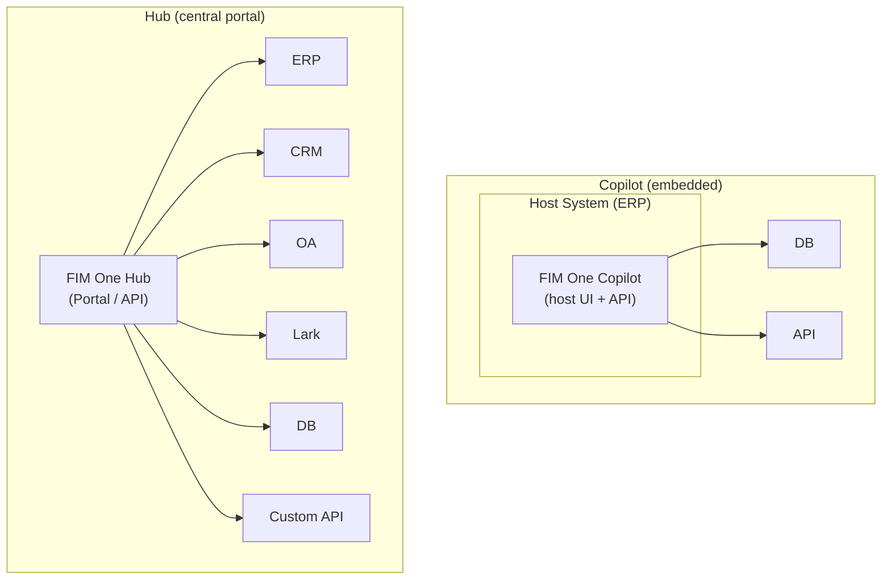
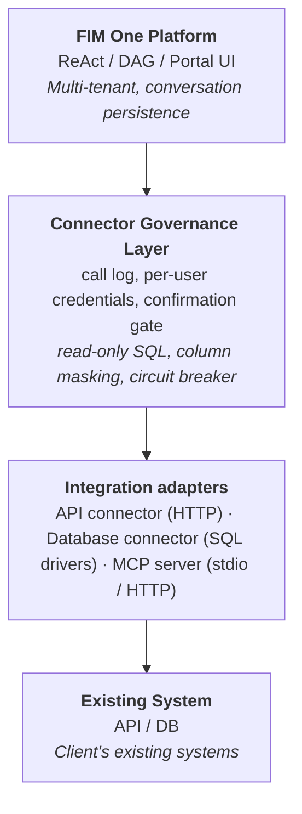
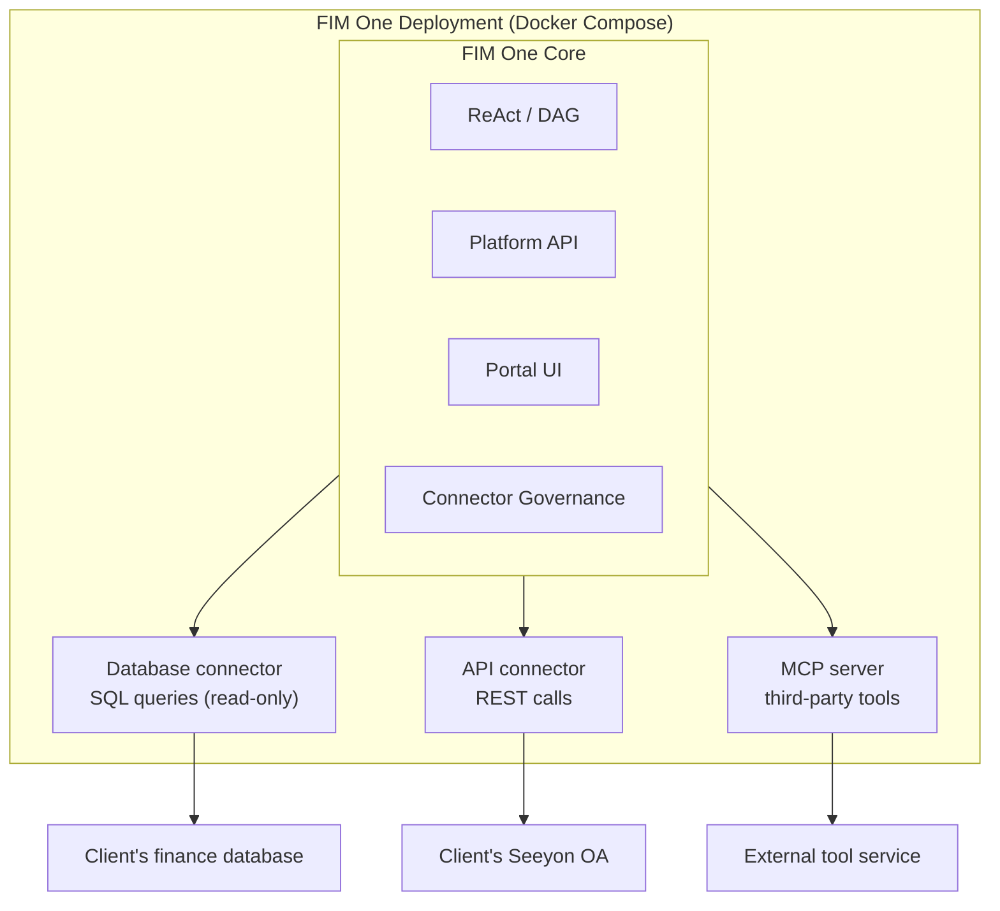
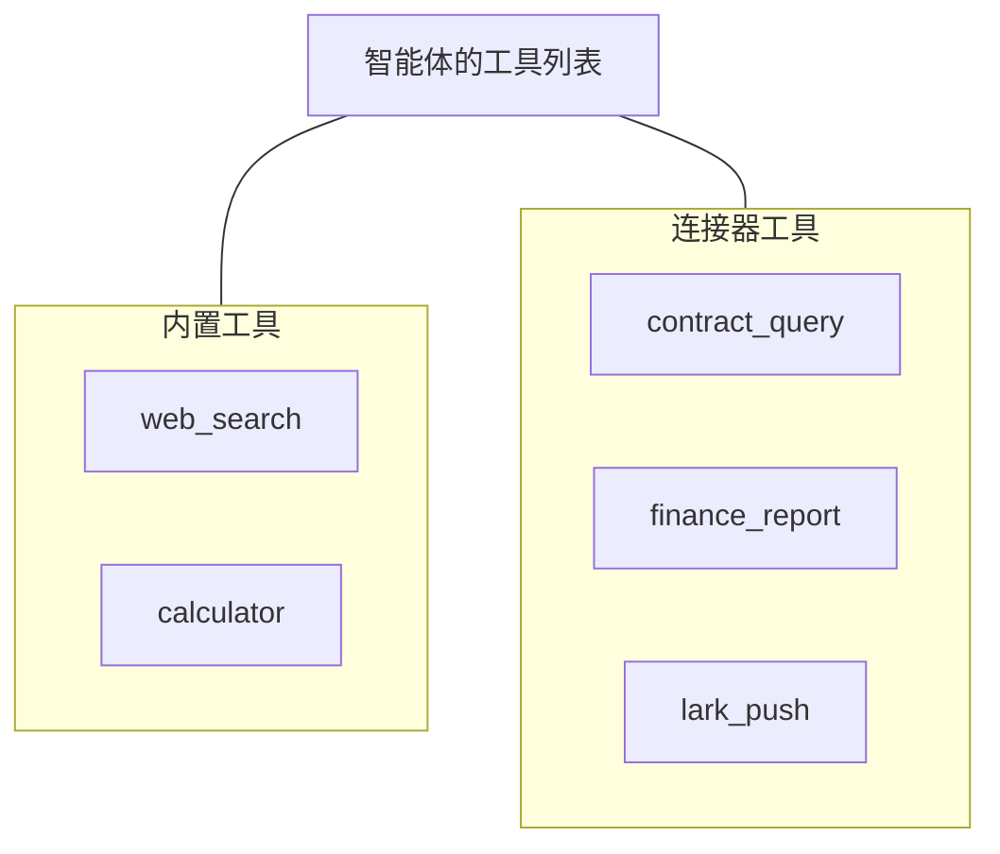
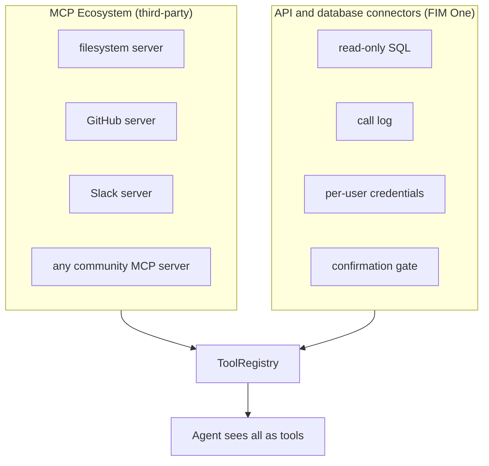

## Copilot vs Hub

The architecture supports two integration scales:



**Copilot** puts the agent inside a host system's UI, today by having the host page call the FIM One API (a drop-in iframe / widget embed is planned). Users interact with AI without leaving their familiar interface. It can use multiple connectors (host DB + notification service, etc.).

**Hub** is a standalone portal that connects all systems. It's not embedded in any single system -- it's the central intelligence layer where systems meet AI.

Same connector architecture, different delivery. A Copilot uses the same `ConnectorToolAdapter` as a Hub.

## 核心原则

**客户端零代码改动。** FIM One 主动集成到他们的系统中——读取他们的数据库、调用他们的 API、推送到他们的消息总线。客户端仅需提供凭证和网络访问权限。

## Three-Layer Architecture



Each layer has a distinct responsibility:

| Layer | Owns | Changes when... |
|---|---|---|
| **Platform** | Orchestration, multi-tenant, UI | New platform features ship |
| **Connector Governance Layer** | Enterprise governance policies | Security/compliance requirements change |
| **Integration adapters** | Talking to one kind of system | A new protocol or database driver is added |
| **Existing System** | Business data and logic | Never (that's the whole point) |

## Three Integration Types

In the portal these live under **Integrations**, with one tab each:

| Type | What it is | Runs as |
|---|---|---|
| **API connector** | A base URL, an auth method (none, bearer, API key, basic) and a list of actions (method, path, parameter schema). Created by hand, by importing an OpenAPI spec, or with the AI builder | `ConnectorToolAdapter`, an in-process HTTP client that injects the caller's credential |
| **Database connector** | A connection to PostgreSQL, MySQL, DM, KingbaseES or HighGo, with an introspected and annotatable schema | `DatabaseToolAdapter` over the matching driver; SQL is validated and read-only by default |
| **MCP server** | Any server speaking the Model Context Protocol, over stdio or HTTP | A separate process (stdio) or remote endpoint, adapted into the same `Tool` protocol |

API and database connectors are records in the database. A connector that is created or edited in the portal is picked up by the next chat request; nothing is redeployed or restarted. MCP is the route for third-party tool servers and for adapters that need their own process.

### What the governance layer adds

| Concern | What FIM One does |
|---|---|
| Read-only SQL | Database connectors reject anything but `SELECT` unless the owner switches `read_only` off. The SQL is checked first, and on PostgreSQL, KingbaseES, HighGo and MySQL the query then runs in a read-only transaction, so the database itself refuses a write (MySQL's does not cover `CREATE`/`DROP`/`ALTER`, which the check refuses; DM8 has the check only). The check also refuses functions that act outside the query (`dblink*`, `pg_read_*`, `pg_ls_*`, `lo_import`/`lo_export`, `pg_terminate_backend`, `pg_reload_conf`, `pg_sleep*` and the like). It is a list of known names, not a sandbox: the real fence is the database account. Give the connector an account that can only `SELECT` the tables it should see, with no superuser, file or replication rights |
| Call log | Every connector, database and MCP call is recorded: time, user, where it came from (chat, a delegated agent, a workflow step), the connector or MCP server, the action or tool, status, duration, and whose credential it used |
| Per-user credentials | Each user stores their own credential; the owner's is used only when the owner allows fallback (see [Sharing and credentials](/architecture/sharing-and-credentials)) |
| Confirmation gate | Actions marked `requires_confirmation` (or every tool call, when the agent is set to confirm all) pause for human approval, in chat (`awaiting_confirmation` SSE event) or in a Feishu approval card |
| Circuit breaker | Repeated failures against a connector stop further calls for a cool-down period |
| Column-level masking | Database columns marked as personal data return a mask instead of their values |
| Sharing limits | API connectors and MCP servers can be published to an organization or the Market; database connectors cannot, and their SQL tool is offered only to the owner |

### 数据库列脱敏

数据库连接器通常配置一个高权限账户，因此每个调用方都能访问相同的表。在连接器的模式管理器中将某一列标记为**PII**，可以缩小智能体能看到的数据范围：

- 该列仍会列在模式中并带有标记，这样模型知道它存在，不会为它臆造替代列；
- 在结果到达模型之前，该列名下返回的任何值都会被替换为`***`，包括通过`SELECT *`返回的值；
- 调用日志会记录哪些列已被脱敏，以及连接器是否处于只读模式。

匹配依据是列名，这是结果集携带的唯一标识符。由此产生两个限制，而且都是有意设计的：数据库仍会*使用*该列，因此`WHERE salary > 5000`仍会正常进行筛选；而重命名列的查询——例如`SELECT salary AS s`——会返回未脱敏的值。如果要求查询账户完全无法读取某一列，请在数据库中授予相应权限，并让连接器使用受限账户。

所有者自己的查询演练场不会进行脱敏。脱敏控制的是到达智能体和对话记录的内容，而不是配置连接的人员能够查看的内容。

### Values bound into a workflow step's SQL

A `{{variable}}` in the SQL of a workflow database step is sent to the database as a value, never as SQL text. How it is compared is then up to the database:

- **PostgreSQL, KingbaseES, HighGo, DM8**: a parameter of the type the query expects. Text that is not a number fails the step where a number is expected.
- **MySQL, MariaDB**: every value is sent as text. Compared with a text column it is compared as text. Compared with a numeric column, MySQL converts the text by its own lenient rule: `'5abc'` counts as 5 and text with no leading digits as 0, with a warning and no error, so `WHERE id = {{v}}` with `abc` matches the row whose id is 0. `CAST({{v}} AS SIGNED)` follows the same rule and does not help. If an input must be a number, check it before the query, in a Condition step ahead of the database step; the Start step records the inputs it is given and does not check their type.

## Deployment Model

Everything runs in a single Docker Compose deployment. The client installs nothing.



<Note>
All provided by FIM One. Client provides only:
- Database credentials (read-only account recommended)
- API endpoints and keys (if available)
- Network whitelist access
</Note>

**Access hierarchy**: FIM One adapts to whatever access the client can provide:

| What client has | How FIM One connects |
|---|---|
| API with an OpenAPI spec | API connector, actions imported from the spec (best case) |
| API without documentation | API connector with actions defined by hand or with the AI builder |
| Database access only | Database connector (direct SQL, read-only by default) |

## 智能体-连接器解耦

智能体将连接器视为普通工具。它不知道也不关心某个工具是内置的、第三方 MCP Server 还是遗留系统连接器。



这意味着：

- **添加**新系统 = 添加连接器配置。智能体代码无需更改。
- **移除**连接器 = 移除配置。无需代码更改。
- 同一个智能体可以在单个任务中同时使用内置工具和连接器。

## Adding a Connector

No code and no restart are involved. A connector is created in the portal in one of three ways:

| Way | What you provide | Who does it |
|---|---|---|
| **Import an OpenAPI spec** | A YAML / JSON spec or its URL; actions are generated from it | Implementation engineer |
| **AI builder** | A description of the API in natural language; the builder writes and tests the actions | Implementation engineer, with review |
| **Manual** | Base URL, auth method, and each action's method, path and parameters | Implementation engineer |

Database connectors take connection details instead and introspect the schema. Systems that need custom code are wrapped as an MCP server and added under the MCP tab.

## Data Flow Example

User: "Check all overdue contracts from the finance system and push a summary to Lark."

```
1. User sends message via Portal / API

2. FIM One (ReAct mode):
   Think: I need to query the finance DB for overdue contracts, then push to Lark.

3. Act: database("query", "finance_db", sql="SELECT ... FROM contracts WHERE status='overdue' AND ...")
   → Connector Governance: SQL validated as read-only, call logged
   → Database connector: runs the query on the client DB
   ← Returns 7 overdue contracts

4. Think: Found 7 overdue contracts. I'll summarize and push.

5. Act: lark_push(message="7 overdue contracts found: ...")
   → Connector Governance: call logged, action requires confirmation → confirmation gate
   → User approves via Portal
   → API connector: POST to Lark webhook
   ← Push successful

6. Answer: "Found 7 overdue contracts. Summary pushed to Lark group."
```

## Relationship to Existing MCP Ecosystem

FIM One's MCP client supports third-party MCP servers alongside its own API and database connectors. All three end up in the same `ToolRegistry`, so the agent treats them alike.



Connectors do not replace MCP. They cover the common cases (a REST API, a SQL database) with governance built in; MCP covers everything that ships as a tool server. MCP servers carry per-user credentials and the same fallback switch as connectors.
