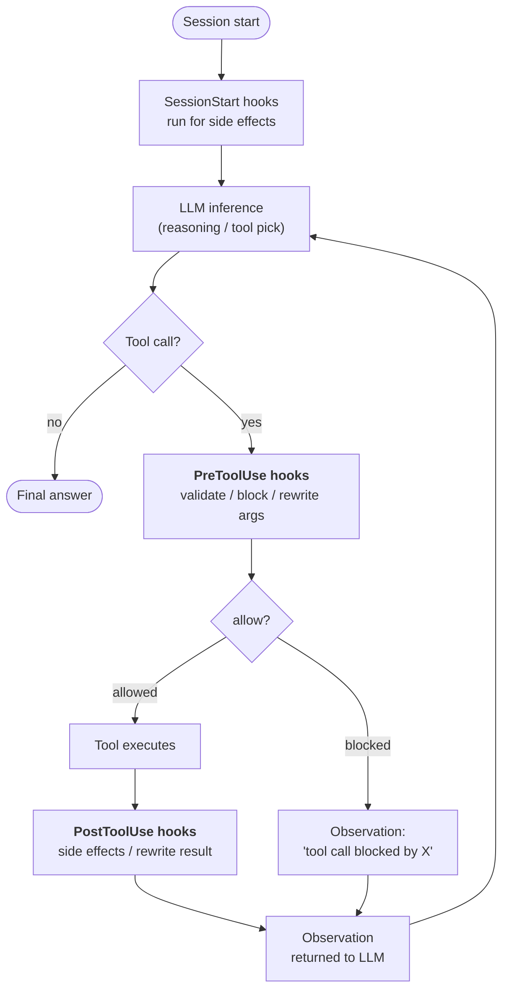
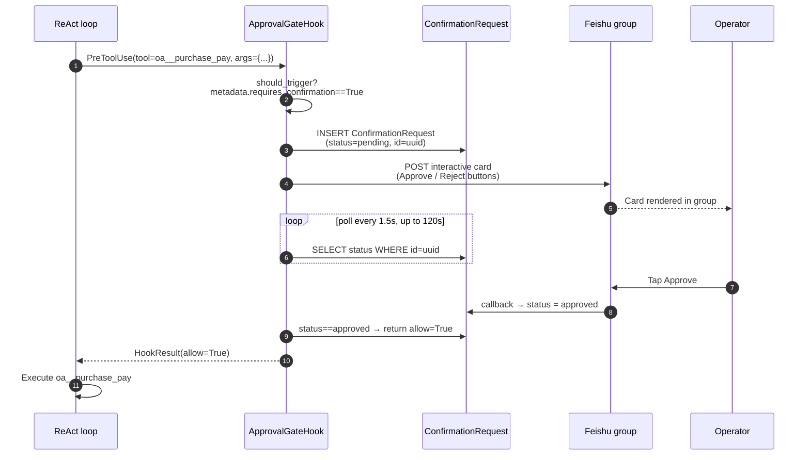

## 为什么需要 hooks

系统提示词中的指令是**建议**。足够固执或困惑的 LLM 可以忽略它们。对于大多数智能体行为，这正是你想要的——指令给模型适应的空间。

但某些要求不是建议。"每个敏感工具调用都必须被记录。" "当组织处于只读模式时，写操作被阻止。" "超过 ¥50k 的付款在执行前需要人工确认。" 这些是**不变量**——关于系统的事实，无论模型在任何给定轮次中做什么决定，都必须成立。

Hook 是在智能体执行生命周期中明确定义的点**在 LLM 循环之外**运行的代码。LLM 看不到 hook。LLM 无法与 hook 争论。LLM 无法说服 hook 跳过某个步骤。如果 `PreToolUse` hook 返回 `allow=False`，工具调用就不会发生——无论推理跟踪有多坚持。

这是关键的架构区别：

| 机制 | 运行位置 | 谁控制它 | 保证 |
|---|---|---|---|
| **系统提示词指令** | LLM 推理内部 | 模型 | "可能遵循它" |
| **工具描述 / schema** | LLM 推理内部 | 模型 | "可能遵循它" |
| **Hook** | LLM 推理周围 | 平台代码 | **总是运行** |

Hooks 是 FIM One 如何将"智能体应该..."转变为"智能体无法绕过..."的方式。

## Where hooks plug in

Three hook points are defined today. Each marks a boundary the agent crosses during one loop iteration:



| Hook point | Fires when | Can it block? | Can it mutate data? |
|---|---|---|---|
| `SessionStart` | Before the first LLM call of a session | No | No — runs for side effects only |
| `PreToolUse` | After the LLM picks a tool, before the tool runs | **Yes** (via `allow=False`) | Yes — can rewrite `tool_args` before execution |
| `PostToolUse` | After the tool returns, before the observation goes to the LLM | No | Yes — can rewrite the observation |

Multiple hooks at the same point run in priority order. An earlier `PreToolUse` hook's rewritten args are carried forward to later hooks, so middleware composes.

## 何时使用 hook 与指令

决定是否用提示词指令或 hook 来解决需求，与"运行时断言 vs. 代码注释"的计算方式相同：

| 症状 | 解决方案 |
|---|---|
| "智能体在 Y 时应优先选择 X" | 指令 — 软性指导，模型有自由度 |
| "智能体必须记录对连接器 Z 的每次调用" | **PostToolUse hook** — 不能依赖模型记住 |
| "超过 ¥50k 的支付需要人工审批" | **PreToolUse hook** — 不能依赖模型主动询问 |
| "智能体应该用中文自我介绍" | 指令 — 风格化的，遗漏成本低 |
| "智能体不能在只读模式下写入生产数据库" | **PreToolUse hook** — 安全不变量，零容错 |
| "智能体应该总结长数据库查询结果" | 两者都可以，但 hook 更稳健 — 见 PostToolUse 截断 |

经验法则：**如果错误行为会导致事故，使用 hook。如果错误行为只是小烦恼，指令就足够了。**

## The hook contract

A hook is a subclass of `PreToolUseHook` or `PostToolUseHook` (a session-start hook is registered as a plain `Hook` object) with one required method:

```python
class ReadOnlyGuard(PreToolUseHook):
    name = "readonly_guard"
    priority = 5                          # lower runs earlier

    def should_trigger(self, ctx: HookContext) -> bool:
        return ctx.tool_name.startswith("sql_")

    async def execute(self, ctx: HookContext) -> HookResult:
        if org_is_readonly(ctx.metadata["org_id"]):
            return HookResult(
                allow=False,
                error="Org is in read-only mode — write blocked.",
                side_effects=["readonly_guard: blocked sql write"],
            )
        return HookResult()               # default: allow=True, no mutation
```

The `HookContext` passed in carries `tool_name`, `tool_args`, `agent_id`, `user_id`, and a flexible `metadata` dict the engine populates with per-request facts (org id, tool call id, the connector action's `requires_confirmation` flag).

The `HookResult` returned controls the outcome:

- `allow: bool = True` — whether the tool call proceeds (ignored for `PostToolUse` / `SessionStart`)
- `error: str | None` — human-readable reason, surfaced to the LLM as the observation when blocked
- `modified_args: dict | None` — if set, replaces the tool args before execution
- `modified_result: str | None` — if set (PostToolUse), replaces the observation before it returns to the LLM
- `side_effects: list[str]` — notes on what the hook did, collected by the registry (not surfaced in the agent's trace today)

## Case study: `ApprovalGateHook`

The first hook shipped on top of this system is `ApprovalGateHook` (`fim_one.core.assembly.confirmation`; registry key `approval_gate`, formerly `feishu_gate` / `FeishuGateHook`) — a `PreToolUse` hook that turns any tool call needing confirmation (the action's `requires_confirmation` flag, or the agent's confirm-all setting) into a human approval. The hook builds a `ConfirmationSpec` and hands it to `ConfirmationService`, which records the request, delivers it as a card in the portal chat or as a Feishu card in the approval channel bound to the agent, according to the agent's confirmation mode (Auto / Inline only / Channel only), and waits for the decision; Auto uses the in-portal card when no channel is bound. In a chat with no agent the tool's own flag alone decides, and the person chatting approves inline. Who may decide is written on the request when it is created and read back by the portal and the channel callback alike.

This hook exercises the full lifecycle:



What this design is buying:

- **The tool call is genuinely suspended.** The agent's SSE stream pauses between "I will call `oa__purchase_pay`" and the observation. The user sees the agent waiting, which matches what is happening under the hood.
- **Approval survives a process restart.** The pending row is in the database, not in memory. If the backend restarts while a card is outstanding, the next poll picks up where it left off.
- **The decision is audited.** `ConfirmationRequest` keeps `payload`, `responded_at`, `responded_by_open_id`, and the final status — an auditable record of who approved what and when.
- **No LLM in the decision loop.** The model produces the tool call. Humans produce the verdict. The hook is the deterministic bridge.

The channel path depends on a [Feishu Channel](/configuration/channels/feishu) bound as the agent's approval channel. The service asks only whether the channel implements `ApprovalCarrier` (`send_approval`, `parse_decision`, `approval_target`), never which platform it is; the Feishu channel is the first implementation. The separation is deliberate: the service owns the approval state machine, the channel owns the IM platform mechanics. A Slack or WeCom channel that implements the carrier protocol would carry approvals without a change to the gate. A callback can decide only requests its own channel delivered.

## 候选钩子（暂未规划）

有四种钩子模式适用于相同的生命周期。目前的路线图中都没有这些模式；在有部署需求之前，它们会暂时搁置：

| 钩子 | 时机 | 用途 |
|---|---|---|
| `AuditLogHook` | PostToolUse | 每次调用连接器时自动写入 `ConnectorCallLog`。目前这需要手动完成；将其设为钩子可确保不遗漏。 |
| `ReadOnlyGuard` | PreToolUse | 当组织处于只读模式时阻止写入。 |
| `ResultTruncateHook` | PostToolUse | 在超大工具观察结果（超过8k个字符）到达 LLM 上下文之前将其截断。 |
| `ConnectorRateLimitHook` | PreToolUse | 针对每个连接器和每位用户限制调用频率，不受 LLM 速率限制影响。 |

自定义钩子层也会按相同原则暂时搁置：通过每个智能体的 YAML 配置（`hooks: [...]`）声明在匹配的工具事件上运行的 shell 命令或 Python 可调用对象。这遵循了现代智能体框架（Claude Code、OpenDevin）逐渐采用的相同模式——基于钩子的执行机制可以将“必须始终执行”的逻辑从提示词中移出。

## Hooks vs. Channels

The two abstractions solve orthogonal problems:

| Concept | What it models | Lifetime | Example |
|---|---|---|---|
| **Hook** | A point in the agent's execution where platform code runs | Per tool call | `ApprovalGateHook`, `AuditLogHook` |
| **Channel** | A pluggable adapter to an external messaging platform | Long-lived per org | `FeishuChannel`, planned `SlackChannel` |

Hooks consume Channels — a hook that needs to talk to the outside world (send a card, post an alert, escalate to a group) calls into the org's Channel. A channel without any hook using it is still useful (e.g. agents can proactively send notifications via a tool), but the approval-gate pattern specifically requires both halves to be in place.

Put differently: **Channels are the "where do I talk to humans" plumbing, Hooks are the "when do I have to talk to humans" policy**. Production human-in-the-loop workflows need both.

## Current state (v0.9.4)

Snapshot of what shipped and what is still ahead:

- ✅ `HookRegistry`, `HookContext`, `HookResult` primitives wired into both ReAct and DAG
- ✅ `PreToolUseHook` / `PostToolUseHook` abstract bases
- ✅ `ApprovalGateHook` and `ConfirmationService` — complete, including the `ConfirmationRequest` table, polling loop, timeout/expire, and callback-driven state flips; workflow approval steps and confirmations of connector actions in a workflow use the same service, and instead of polling they suspend the run and are told of the decision through `ConfirmationService.on_decided`
- ✅ Feishu channel callback endpoint that decodes `card.action.trigger` and updates the pending row
- ✅ Agent-level hook declarations: `agent.model_config_json.hooks.class_hooks` resolves to an instantiated `HookRegistry` on every ReAct/DAG session
- ✅ **Hooks fire on every execution surface**: the main chat path (Portal, API, DAG), delegated sub-agents (`CallAgentTool`), and Workflow `AGENT` nodes. Eval Center runs intentionally **bypass** hooks (automated evaluation must not block on human approval).

  A delegated agent does not inherit its caller's registry — it builds **its own** from its own `model_config_json`. Because the confirmation gate is auto-attached to every agent, rebuilding is a superset of inheriting: the delegate gets the gate *plus* whatever it declares for itself, and the gate resolves the delegate's `require_confirmation_for_all` rather than its caller's. Both surfaces fail **closed**: an agent whose hooks cannot be built is not run.
- ❌ `AuditLogHook`, `ReadOnlyGuard`, `ResultTruncateHook`, `ConnectorRateLimitHook` (not planned)
- ❌ User-defined YAML hook declarations (not planned)

The Hook System is a **load-bearing foundation** for production hardening. Its first user (`ApprovalGateHook`) is also a production feature in its own right, which is why the skeleton shipped early for the 2026-04-24 roadshow rather than waiting for the full hook catalog.
