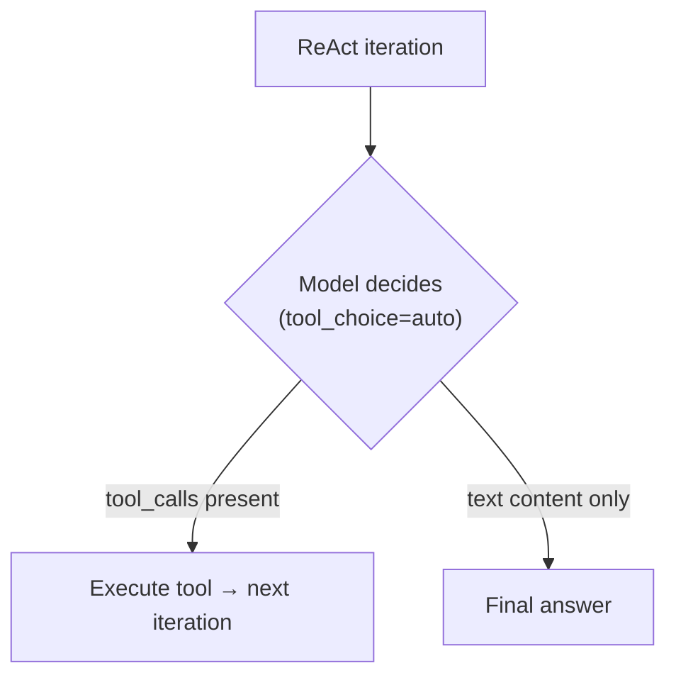
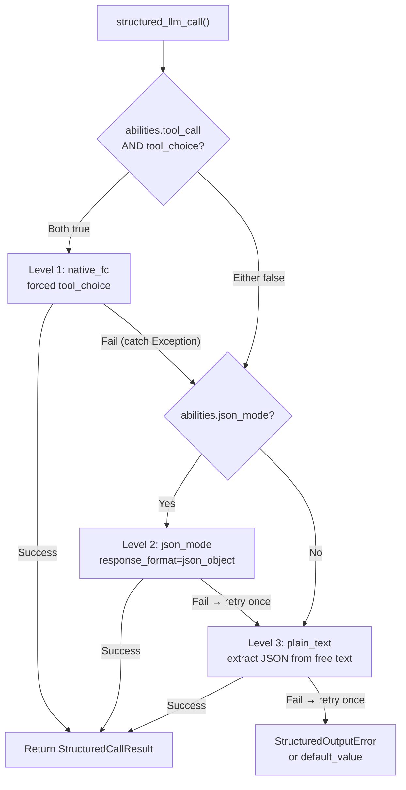

## Provider detection

FIM One uses LiteLLM as a universal adapter. The `_resolve_litellm_model()` function in `core/model/openai_compatible.py` maps the user's `LLM_BASE_URL` + `LLM_MODEL` to a LiteLLM model identifier with a provider prefix. The prefix determines how LiteLLM routes the request — native API protocol (Anthropic Messages API, Gemini, etc.) or generic OpenAI-compatible `/v1/chat/completions`.

Resolution order:

1. **Explicit provider** (from the `provider` field of a legacy `ModelConfig` row or an agent's inline model config; models added under Admin → Models have no provider field, so for them resolution starts at step 2) — highest priority. If the provider matches a known domain in the URL, no `api_base` is returned (LiteLLM routes natively). Otherwise, `api_base` is set to the relay URL.
2. **Domain match** against `KNOWN_DOMAINS` — official API endpoints are recognized by hostname.
3. **URL path hint** against `PATH_PROVIDER_HINTS` — common on relay platforms like UniAPI where `/claude` or `/anthropic` in the path indicates the upstream protocol.
4. **Fallback** — `openai/` prefix (generic OpenAI-compatible).

| Domain / Path | Provider prefix | Protocol |
|---|---|---|
| `api.openai.com` | `openai/` | OpenAI Chat Completions |
| `anthropic.com` | `anthropic/` | Anthropic Messages API |
| `generativelanguage.googleapis.com` | `gemini/` | Google Gemini |
| `api.deepseek.com` | `deepseek/` | DeepSeek (OpenAI-compatible) |
| `api.mistral.ai` | `mistral/` | Mistral |
| Path contains `/claude` or `/anthropic` | `anthropic/` | Anthropic Messages API (via relay) |
| Path contains `/gemini` | `gemini/` | Google Gemini (via relay) |
| Anything else | `openai/` | Generic OpenAI-compatible |

When the provider prefix is a native protocol (anthropic, gemini, etc.) and the URL is not the official endpoint, LiteLLM uses the native protocol but sends requests to the relay's `api_base`. This means provider-specific behaviors — including the Bedrock prefill issue described below — apply regardless of whether the request goes to the official API or through a relay.

<Warning>
If your relay URL contains `/claude` in the path, FIM One automatically routes via Anthropic's native protocol. This is usually correct (better streaming, thinking support), but means provider-specific behaviors apply — including the Bedrock prefill issue described below.
</Warning>

## tool_choice — 四种模式

`tool_choice` 参数通过 OpenAI 格式标准化。LiteLLM 在发送请求前将其转换为每个提供商的原生协议。

| 模式 | 含义 | 提供商支持 |
|---|---|---|
| `"auto"` | 模型决定是否调用工具或以文本响应 | 所有提供商 |
| `"required"` | 必须调用工具，但由模型选择哪个 | 大多数提供商 |
| `{"type":"function","function":{"name":"X"}}` | 必须特别调用函数 X | 大多数提供商 — **与 Anthropic thinking 不兼容** |
| `"none"` | 无法使用工具，仅文本 | 所有提供商 |

`"auto"` 和强制模式（`{"type":"function",...}`）之间的区别是 FIM One 中每个兼容性问题的关键。这两种模式由具有不同要求的完全不同的子系统使用。

## tool_choice 的使用位置

两个子系统使用 `tool_choice`，它们以根本不同的方式使用它。

### ReAct 引擎 — tool_choice="auto"

ReAct 循环需要模型在每次迭代中做出决定：调用工具或给出最终答案。只有 `"auto"` 才有意义——模型可以自由选择生成 `tool_calls` 或文本内容。这与所有提供商、所有模型和所有模式（包括扩展思考）兼容。



ReAct 引擎在 `abilities["tool_call"] = True` 时使用原生函数调用（`_run_native`），否则回退到 JSON-in-content 模式（`_run_json`）。两种模式都使用 `"auto"`——区别在于工具是通过 `tools` 参数传递还是在系统提示中描述。详见 [ReAct 引擎——双模式执行](/architecture/react-engine#dual-mode-execution)。

### structured_llm_call——tool_choice=forced

一次性结构化提取（架构注释、DAG规划、计划分析）。强制模型调用特定的虚拟函数，从而保证输出结构化JSON。这是触发提供商特定错误的调用位置。

`structured_llm_call`实现了三级降级链。这三个层级以代码命名，其编号与下文[结构化输出的四个保证层级](#structured-output-the-four-guarantee-tiers)并不相同：



关键的设计差异在于：`structured_llm_call`的回退是**运行时**行为——它会动态尝试每个层级，并捕获异常以继续执行后续层级。ReAct引擎的模式选择则发生在**构建时**——它会在开始时检查一次`_native_mode_active`，并在整个循环中固定使用一种模式。这意味着`structured_llm_call`可以透明地从提供商特定的400错误中恢复，而ReAct依赖于在开始时正确选择模式。

## 结构化输出：四个保证层级

“结构化输出”是一个涵盖四种不同机制的术语。它们都会生成JSON，但提供的保证并不相同。区别在于约束存在于何处：是在解码器内部——它无法生成Schema禁止的token；还是在提示词中——它只能提出要求。

| 层级 | 请求携带的内容 | 载荷到达的位置 | 保证内容 | 强制执行方 |
|---|---|---|---|---|
| **T1——原生函数调用，`strict: true`** | `tools=[…]`，并在函数定义中设置`strict` | `tool_calls[0].function.arguments`中的JSON字符串 | Schema级别：所有必填字段均存在，不含未声明的键，类型和枚举值均正确 | 解码器状态机 |
| **T2——`response_format: {"type": "json_schema"}`** | Schema本身位于`response_format`中，并设置`strict: true` | `message.content`中的JSON字符串 | Schema级别，与T1相同，但约束的是助手自身的回复，而不是工具调用 | 解码器状态机 |
| **T3——`response_format: {"type": "json_object"}`** | 仅指定类型，不提供Schema | `message.content`中的JSON字符串 | 仅保证语法：文本可解析为JSON。具体出现哪些键不受约束 | 解码器（语法） |
| **T4——自由文本加指令** | 无。Schema在提示词中描述 | `message.content`，可能包裹在说明文字或代码围栏中 | 不提供任何保证 | 提示词 |

T1和T2背后的机制是受约束解码。提供商会将Schema编译成语法，并在每个解码步骤中屏蔽所有会导致输出无法根据Schema解析的token。必填字段不能被跳过，因为在该字段生成之前，用于闭合对象的token不会位于允许集合中。这与“模型被客气地要求后遵守了”是完全不同类型的保证，也正因如此，T1/T2在温度为1以及较小的模型上仍然成立，而提示词遵循并不能做到这一点。

### T1和T2不可互换

它们通过不同的通道提供相同的保证，而通道在三个方面都很重要。

**两者的轮次形态不同。** T1返回工具调用轮次；模型已经决定要*采取行动*。T2返回普通的助手消息；模型以某种结构*给出了回答*。当调用方需要一次提取而不是智能体循环时，T2会直接表达这一点，而不是为模型虚构一个供其“调用”的虚拟函数。

**强制使用T1会与思考冲突。** 要从T1获取经过架构约束的载荷，通常意味着强制指定选项，可以是`required`或命名函数。多家提供商会拒绝在扩展思考处于启用状态时强制指定工具选项。下方的表B记录了具体情况。T2不存在此类冲突：它是响应约束，而不是工具约束，因此它是唯一一条在启用思考时仍然有效的架构约束路径。对于采用推理模型作为标准的部署而言，这才是选择T2而非T1的实际理由，而不是风格偏好。

**T1需要额外一轮T2不需要的架构连接工作。** 虚拟函数需要名称、描述，以及决定模型是否可以拒绝调用它。

### T2的成本

受约束解码并非免费，而且你已有的schema通常并不是它所接受的schema。

- **schema子集。** OpenAI的strict mode要求每个对象都设置`additionalProperties: false`，并将每个属性都列入`required`；可选性通过与`null`组成联合类型来表示，而不是从`required`中省略。根节点必须是对象。属性总数和嵌套深度也存在上限。大多数手写schema在符合要求前都需要进行编辑。
- **语法编译。** 携带新schema的首次请求需要承担提供商侧一次性的编译延迟。复用稳定的schema可以分摊这项开销；而每个请求都生成全新的schema则无法做到这一点。
- **新的失败面。** 不愿回答的模型会返回拒答，而不是符合schema结构的对象，因此调用方需要为此增加一个分支。

### 没有任何层级能够保证的内容

每个层级都会约束形式，但没有任何层级能够约束真实性。T2响应可以完全符合schema且在事实上错误；即使没有一个值是正确的，受枚举约束的字段也会返回允许值中的一个，因为解码器的职责是让输出保持在语法范围内，而不是知道答案。Schema门控可以消除解析失败和字段形状错误，但不能免除对值所表达内容进行检查的必要性。

<Warning>
**两套编号方案并不对应。** 本页使用**T1–T4**表示上述保证层级，使用**Level 1/2/3**表示`structured_llm_call`降级链的三个阶梯，这些名称取自代码（`native_fc`、`json_mode`、`plain_text`）。FIM One的Level 2是`json_object`，它属于**T3**，而不是T2。这条链只有三个阶梯，是因为它完全跳过了T2，而不是因为只有三个层级。
</Warning>

### FIM One 所处的位置

| `structured_llm_call` level | Tier | 代码实际执行的操作 |
|---|---|---|
| Level 1 — `native_fc` | **未启用 `strict` 的 T1** | `_build_tool_def` 只生成 `name`、`description`、`parameters`，不会生成其他内容。没有任何调用位置设置 `strict`，因此 `responses_adapter.py` 中的 `convert_tools` 会将其默认为 `False`。该 schema 会以应生成内容的描述形式传递给模型，而不是作为对模型生成内容的约束 |
| *(absent)* | **T2** | 未实现。代码库中没有任何地方出现 `json_schema`，`abilities` 也没有能够表达模型是否支持该功能的标志 |
| Level 2 — `json_mode` | **T3** | `{"type": "json_object"}`，在 `structured.py::_call_llm` 和 `react.py::_json_response_format` 中硬编码 |
| Level 3 — `plain_text` | **T4** | 对自由格式内容调用 `extract_json()`，并可选择在每个调用位置使用正则表达式回退 |

由此产生五个后果，这些是当前设计的实际限制。

1. **链中没有可回退到的 schema 约束层级。** 当 Level 1 失败时，下一层是 `json_object`，它只能保证文本可解析。不存在仍然强制要求字段的中间步骤。
2. **Level 1 的保证弱于其名称所暗示的程度。** 未启用 `strict` 时，原生函数调用属于 2024 年之前的非严格形式：模型通常会遵循 schema，但不会被阻止省略必填字段、编造键，或在声明为数字时返回字符串。
3. **在 `anthropic/` 路由上，Level 2 实际上并不是真正的 T3。** Anthropic Messages API 没有 `response_format`，因此 LiteLLM 会通过注入 assistant prefill 来模拟 JSON mode。这是一种提示词层面的机制，使实际保证介于 T4 和 T3 之间，而不是达到 T3。下文记录的 Bedrock prefill 陷阱，就是这种模拟机制明显失败的表现；更隐蔽的代价在于，这种保证从未达到参数名称所暗示的程度。
4. **结果不会在之后根据 schema 进行验证。** `jsonschema` 不是依赖项。实际执行的任何检查都位于可选的 `parse_fn` 中，并且由每个调用位置自行决定，其严格程度各不相同。
5. **失败会被吸收，而不是暴露出来。** 几乎所有调用方都会传入 `default_value`，因此链耗尽后会返回一个看似合理的对象，而不是抛出异常。`StructuredCallResult.level_used` 会记录生成该值的层级，但没有任何调用位置读取它；在 `default_value` 路径上，它还会为实际上什么都没生成的链报告 `plain_text`。

**如何查看当前实际处于哪个层级。** `structured_llm_call` 会在每次调用完成后于 `INFO` 级别记录一行日志；该日志仅在数据通过 `parse_fn` 后才会输出，因此其中标示的是确实成功的层级：

```
structured_llm_call: fn=classify_mode level=native_fc attempt=first calls=1
structured_llm_call: fn=annotate_tables level=json_mode attempt=reformat_retry calls=3
```

完全失败时，会以 `WARNING` 级别记录 `level=none outcome=default_value`。在一天的流量中检索这两行日志，是判断缺失的 T2 层级是否给特定部署带来影响的唯一方法，因为 `default_value` 设计会让症状表现为质量一般的答案，而不是错误。

### 每个层级的提供商支持情况

<Note>
**此表记录的是上游 API，而不是 FIM One 的代码路径。** 本页中的其他表格都会列出实现相应行为的函数，而此表无法这样做，因为 FIM One 不使用任何提供商的 T2 功能，也不会对任何提供商设置 `strict`。此表的作用是确保实现 T2 的决策以实际可用的能力为起点。提供商的能力变化很快，同一系列中的部分模型可能会先于其他模型获得支持；依赖某一行之前，请重新查阅提供商自己的文档。
</Note>

| 提供商 | T1 `strict` | T2 `json_schema` | T3 `json_object` | 备注 |
|---|---|---|---|---|
| **OpenAI** | ✅ | ✅ | ✅ | 两个严格层级的参考实现。严格函数调用和 `response_format: json_schema` 共享同一个语法引擎和同一套 Schema 子集。`json_object` 是较早的 JSON 模式，为兼容性而保留 |
| **Anthropic** | ⚠️ | ⚠️ | ❌ | Messages API 完全不提供 `response_format`；工具的 `input_schema` 会经过验证，但不会由解码器强制执行。最新的 Claude 模型通过 beta header 支持严格工具使用和 Schema 约束的输出格式。FIM One 通过 LiteLLM 接入 Anthropic，而 LiteLLM 通过预填充模拟 JSON 模式，不会使用该 beta 功能，因此这些能力在这里都未启用 |
| **Gemini** | ✅ | ✅ | ✅ | `responseSchema`（OpenAPI 3.0 子集）和后续推出的 `responseJsonSchema` 都由解码器强制执行，且 OpenAI 兼容端点接受 `response_format: json_schema`。强制调用使用 `ANY` 和 `allowed_function_names` |
| **xAI（Grok）** | ✅ | ✅ | ✅ | OpenAI 兼容接口，包含严格结构化输出 |
| **Mistral** | ✅ | ✅ | ✅ | 自定义结构化输出接受用户提供的 JSON Schema |
| **DeepSeek** | ❌ | ❌ | ✅ | 仅支持 `json_object` JSON 输出。文档要求提示词中包含单词 "json" 并展示示例，这是附加在 T3 参数上的 T4 手段。`deepseek-reasoner` 还会拒绝强制工具选择，因此其 Schema 闸门路径两端都被关闭 |
| **Qwen**（DashScope） | ⚠️ | ⚠️ | ✅ | 兼容端点提供 `json_object`。通过服务栈在自托管 Qwen 上可以可靠地进行 Schema 约束解码，而不是通过 API；DashScope 自身的 `json_schema` 支持因模型代际而异。请按模型逐一验证 |
| **GLM**（Zhipu / Z.AI） | ❌ | ⚠️ | ✅ | OpenAI 兼容端点提供 `json_object`。强制工具选择完全不受支持，这也是表 B 推荐设置 `tool_choice_enabled=false` 的原因。除非平台针对你的模型明确记录了支持情况，否则应将 `json_schema` 视为不可用 |
| **Kimi**（Moonshot） | ⚠️ | ⚠️ | ✅ | 文档明确支持 `json_object`。思考模型仅接受 `auto` 工具选择，因此无论是否支持 `strict`，这些模型都无法强制使用 T1 路径 |
| **MiniMax** | ⚠️ | ⚠️ | ✅ | 即使始终启用思考，函数调用仍支持强制选择，因此在始终思考的模型中，它是最可用的 T1 路径。文档未说明支持层级强制；假设 T1 为非严格模式 |
| **Doubao**（Volcengine Ark） | ⚠️ | ⚠️ | ✅ | Ark 记录了部分 Doubao 系列支持结构化输出。支持范围按模型划分，因此不要默认账号中的模型具备该能力，请先确认 |
| **Ollama / vLLM / llama.cpp** | ✅ | ✅ | ✅ | 此列表中层级支持最强、但宣传最少的一类。语法约束解码（GBNF、XGrammar、Outlines）在本地运行，因此可以为一个自托管的14B模型提供保证，而上面多个托管 API 无法做到这一点。根据服务器的不同，它会以 Ollama 的 `format`、vLLM 的引导解码参数，或 OpenAI 兼容的 `response_format` 形式公开 |

有三个模式值得单独说明，因为它们解释了表格的结构，而不只是重复表格内容。

**T3 是通用的，T2 则不是。** FIM One 支持的每个提供商都提供 `json_object`，而大约一半的提供商提供 Schema 层级。因此，可移植的结构化输出路径必须建立在 T3 或更低层级之上，这就是 FIM One 采用当前链路的原因。添加 T2 意味着添加按模型划分的能力标志，而不是启用一个全局开关。

**始终启用思考往往会关闭 T1 通道。** GLM、Kimi 的思考模型和 `deepseek-reasoner` 都会限制或拒绝强制工具选择，而 Anthropic 在思考处于启用状态时也会拒绝该选择。MiniMax 是一个反例。当通道关闭时，T2 是唯一剩下的 Schema 闸门选项，这也是缺失这一层级在中国模型部署中比在 OpenAI 部署中更重要的原因。

**自托管会颠倒通常的排序。** 约束解码是服务栈的属性，因此一个指令遵循能力远弱于前沿模型的本地 checkpoint 也可以使用它。最需要 Schema 闸门的模型，反而最有可能获得这一能力。

## Bedrock预填陷阱

当为使用`anthropic/`前缀解析的模型传递`response_format={"type":"json_object"}`时，LiteLLM会在内部注入一条助手预填消息来模拟JSON模式。Anthropic Messages API没有原生的`response_format`参数，所以LiteLLM通过在助手内容前加一个开括号来近似实现：

```json
{"role": "assistant", "content": "{"}
```

这在Anthropic的直接API上可以正常工作。但是，较新的AWS Bedrock模型版本会拒绝任何最后一条消息具有`role: "assistant"`的对话——他们称之为"助手消息预填"并抛出错误：

```
ValidationException: This model does not support assistant message prefill.
The conversation must end with a user message.
```

仅当**同时满足以下三个条件**时才会出现此错误：

1. 模型使用`anthropic/`前缀解析（通过域名匹配或URL路径提示）。
2. 传递了`response_format={"type":"json_object"}`（`structured_llm_call`中的json_mode代码路径）。
3. 实际后端是AWS Bedrock（拒绝预填）。

<Tip>
**通过OpenAI兼容端点的Bedrock？** 如果你的Bedrock中继暴露了OpenAI兼容的`/v1/chat/completions`端点（AWS自己的OpenAI兼容网关或第三方代理），且URL路径**不**包含`/claude`或`/anthropic`，FIM One会使用`openai/`前缀解析。LiteLLM随后将后端视为标准OpenAI兼容服务器，直接传递`response_format`而不注入任何预填，服务器原生处理JSON约束。**预填陷阱不适用**——你无需设置`json_mode_enabled=false`。
</Tip>

<Warning>
这**不**影响原生工具调用（`tool_choice="auto"`配合`tools=`参数）。预填注入仅在`response_format`时发生。ReAct智能体执行完全不受影响。
</Warning>

如果第1级（native_fc）和第2级（json_mode）在Bedrock上都失败，系统会在第3级（plain_text）恢复。下面描述的`json_mode_enabled`标志消除了浪费的第2级调用。

### 修复方案：`json_mode_enabled`

每个模型的`json_mode_enabled`标志控制是否会尝试 Level 2（`json_mode`）：

- **通过 DB 配置的模型**：在管理员 → 模型 → 高级设置中切换。该标志存储在`ModelProviderModel.json_mode_enabled`上（默认值为`TRUE`）。
- **通过 ENV 配置的模型**：在环境中设置`LLM_JSON_MODE_ENABLED=false`。
- **效果**：禁用后，`abilities["json_mode"]`返回`False`→不会传递`response_format`→不会进行预填充→Bedrock 可以正常工作。降级链变为`native_fc → plain_text`，完全跳过注定失败的`json_mode`调用。
- **跳过的代价**：实际上，模型仍会返回有效的 JSON，因为系统提示词要求模型这样做，并且在现代模型上，`extract_json()`能够可靠地解析自由格式的内容。失去的是保证，而不是输出：现在链路会在 T4 结束，此时除了提示词之外，没有任何机制约束结果。对于`anthropic/`路由来说，这种损失没有看起来那么大，因为模拟的 JSON 模式本来也不是解码器级别的保证。

## 思维模型 + 强制 tool_choice

多个提供商在启用扩展思维时拒绝强制 `tool_choice`，理由是固定特定函数调用与模型先进行推理的自由度相矛盾：

```
tool_choice 'specified' is incompatible with thinking enabled
```

**这是按提供商的规则，不是思维模型的通用法则。** Anthropic在协议级别强制执行，Moonshot（Kimi）的行为相同，但MiniMax在每次调用时都进行思维，仍然接受强制工具选择。下表B中的[提供商能力矩阵](#provider-capability-matrix)逐个提供商记录了判决结果；不要从一行推广到另一行。

对于Anthropic模型，`structured_llm_call`通过在原生FC级别传递`reasoning_effort=None`来自动解决冲突，这会关闭该次调用的思维功能（`structured.py::_call_llm`）。结构化输出需要**模式合规性**，而不是深度推理，因此在此处禁用思维既正确又更便宜。

当思维无法通过API关闭时，native_fc在每次结构化调用时都会以400失败，耗时约十秒后链条才会降级到json_mode。Kimi是常见情况：启用思维时仅支持`auto`，强制工具选择需要关闭思维，而Moonshot仅通过模型id暴露此选项（`kimi-k2`已关闭，`kimi-k2.5`和`kimi-k2-thinking`已启用）。FIM One没有翻转此选项的参数，因此补救措施是下面的`tool_choice_enabled`标志。

### 修复：tool_choice_enabled

一个针对每个模型的 `tool_choice_enabled` 标志控制是否尝试 Level 1（native_fc）：

- **数据库配置的模型**：在 Admin → Models → Advanced → "Native Function Calling" 中切换。该标志存储在 `ModelProviderModel.tool_choice_enabled` 上（默认为 `TRUE`）。
- **ENV 配置的模型**：在环境中设置 `LLM_TOOL_CHOICE_ENABLED=false`。
- **效果**：禁用时，`abilities["tool_choice"]` 返回 `False` → 降级链从 Level 2（json_mode）或 Level 3（plain_text）开始，完全跳过 native_fc。这消除了不兼容模型每次结构化调用约 10 秒的性能损失。
- **ReAct 智能体不受影响**：`tool_choice_enabled` 仅控制 `structured_llm_call` 中的强制工具选择。ReAct 引擎使用 `tool_choice="auto"`（模型自由决定），无论此设置如何都适用于所有模型。

<Note>
`tool_choice_enabled` 和 `tool_call` 是独立的能力标志。`tool_call`（对于 `OpenAICompatibleLLM` 始终为 `True`）控制工具是否被传递给模型 — 禁用它会破坏 ReAct 智能体。`tool_choice` 仅控制是否尝试**强制**工具选择以进行结构化输出提取。
</Note>

`tool_choice="auto"` 不受思考模式影响。ReAct 引擎专门使用 `"auto"`，因此启用思考时智能体执行工作正常。

<Warning>
不要设置 `abilities["tool_call"] = False` 来避免此约束。这会禁用 ReAct 的 `_run_native` 模式（使用 `tool_choice="auto"` 且与思考配合良好），强制其进入不太可靠的 `_run_json` 模式。
</Warning>

<Note>
**提供商迁移说明：** 某些第三方中继会静默丢弃不支持的参数，如 `reasoning_effort`（`drop_params=True`），因此即使配置了思考也永远不会激活。迁移到正确支持思考的提供商（Bedrock、直接 Anthropic API）时，native_fc 中的 `reasoning_effort=None` 确保一致的行为。无需用户操作 — 结构化输出在所有提供商中的工作方式相同。
</Note>

## 提供商能力矩阵

本部分是每个提供商支持的功能以及FIM One如何处理这些功能的权威记录。每一行都命名了实现该行为的函数，因此此处的任何声明都可以根据代码进行验证。其他页面链接到此处而不是重复数据；当代码更改时，本部分也会随之更改。

一行描述的是提供商的协议，而不是单个模型。当同一系列中的模型存在差异时（DeepSeek聊天与推理器、Kimi启用思考与关闭思考），单元格会说明这一点。

### Table A: Protocol routing

How a configured `base_url` plus `model` becomes a LiteLLM call, and what happens when the first choice of interface is unavailable.

| Provider | Detected by | LiteLLM prefix | Interface surface | Downgrade chain | Code anchor |
|---|---|---|---|---|---|
| **OpenAI** | Domain `api.openai.com`, or an explicit `provider` of `openai` on the model config | `openai/` | `completions`. GPT-5.x uses `responses-native` (`litellm.aresponses`), with `responses-bridge` (`openai/responses/<model>`) retained as a rollback | GPT-5.x talks Responses natively, falls back to `completions` on a 404 (cached per endpoint and model in `_RESPONSES_NATIVE_SUPPORT`) or on a 400 (not cached). `gpt-6.1-*` and `gpt-6-astra` keep a 400 on a request with tools instead of falling back, since their `completions` rejects tools. Every other model goes straight to `completions` | `_resolve_litellm_model`, `_should_use_native_responses`, `_dispatch_acompletion` |
| **Anthropic** (Bedrock note below) | Domain `anthropic.com`, path segment `/claude` or `/anthropic`, or an explicit `provider` of `anthropic` | `anthropic/` | `anthropic messages` | None. Native routes never enter the Responses bridge; their protocol is built in `_build_request_kwargs` | `_resolve_litellm_model`, `_dispatch_acompletion` |
| **Gemini** | Domain `generativelanguage.googleapis.com`, path segment `/gemini`, or an explicit `provider` of `gemini` | `gemini/` | `gemini` | None. A domain match also drops `api_base`, so an OpenAI-compat suffix such as `/v1beta/openai/` is ignored and the call goes to the native Gemini API | `_resolve_litellm_model` |
| **xAI (Grok)** | No domain or path entry. Resolves as generic OpenAI-compatible unless `provider` is set explicitly on the model config | `openai/` with `api_base`, or the explicit provider prefix | `completions` | None | `_resolve_litellm_model` |
| **DeepSeek** | Domain `api.deepseek.com` | `deepseek/` | `completions` | None | `_resolve_litellm_model` |
| **Qwen** (DashScope) | Generic fallback | `openai/` with `api_base` | `completions` | None | `_resolve_litellm_model` |
| **GLM** (Zhipu, Z.AI) | Generic fallback | `openai/` with `api_base` | `completions` | None | `_resolve_litellm_model` |
| **MiniMax** | Generic fallback | `openai/` with `api_base` | `completions` | None | `_resolve_litellm_model` |
| **Kimi** (Moonshot) | Generic fallback | `openai/` with `api_base` | `completions` | None | `_resolve_litellm_model` |
| **Doubao** (Volcengine) | Generic fallback | `openai/` with `api_base` | `completions` | None | `_resolve_litellm_model` |
| **Mistral** | Domain `api.mistral.ai` | `mistral/` | `completions` | None | `_resolve_litellm_model` |
| **Ollama / local** | Generic fallback, typically `http://localhost:11434/v1` | `openai/` with `api_base` | `completions` | None | `_resolve_litellm_model` |
| **Relay / proxy** | Path hint first, then the generic fallback. An explicit `provider` on the model config outranks both | The hinted provider prefix, else `openai/`, always with `api_base` pointing at the relay | Whatever the resolved prefix implies | None beyond the resolved prefix. See the relay gotchas below | `_resolve_litellm_model` |

**How GPT-5.x picks a protocol.** `FIM_GPT5_RESPONSES_MODE` selects it: `native` (the default) talks `/v1/responses` directly through `litellm.aresponses`, `bridge` uses LiteLLM's chat-completions translation, and `off` forces plain chat completions. The native path exists because the bridge is lossy in the one place that matters: it discards the reasoning items, so a GPT-5.x agent re-derives its chain of thought on every tool round. Talking the protocol directly lets those items be replayed. A call that explicitly passes `reasoning_effort=None`, which is what `structured_llm_call` and the finish-signal probes do, stays on chat completions, because a call that wants no thinking has no reasoning state to preserve. The exception is models that cannot switch reasoning off (`gpt-6.1-*`, `gpt-6-astra`): their chat completions reject function tools at any `reasoning_effort`, so those calls stay on `/v1/responses` and run at the lowest effort, `low`. For the same reason `off`, or an endpoint without `/v1/responses`, leaves these models without tool calls.

Two properties of that native request are load-bearing and easy to get wrong:

- `store=false` keeps the conversation stateless upstream, and `include=["reasoning.encrypted_content"]` asks for the encrypted payload to be returned. Without the include, the reasoning items arrive empty and replay silently becomes a no-op.
- A replayed reasoning item must have its server-side `id` stripped. With `store=false` nothing is persisted upstream, so echoing the id back earns `Item with id 'rs_...' not found. Items are not persisted when 'store' is set to false`. The `encrypted_content` blob carries the state on its own, so dropping the id costs nothing (`sanitize_reasoning_item`).

**User-supplied endpoints.** The table describes endpoints an operator configured (environment variables, Admin → Models). An endpoint that comes from a user, i.e. `base_url` in an agent's inline model settings, does not go through LiteLLM at all (`OpenAICompatibleLLM(untrusted_endpoint=True)`, `_call_pinned`). It must come with its own `api_key`: the platform's keys are never used for it, and an empty key is refused. It is called as OpenAI-compatible chat completions at the URL as typed, by the OpenAI SDK on a dedicated HTTP client that refuses private, loopback, link-local and metadata addresses when it connects and does not follow redirects. The model name is sent as a field of the request and selects no route, provider or protocol; there is no path hint, no `provider`, no Responses route. When such an endpoint fails, the error names the kind of failure and the HTTP status, not the response body. Models on internal networks, or that need a provider's native protocol, are added by an administrator under Admin → Models and selected by the agent.

**Bedrock.** Bedrock-hosted Claude follows the row it resolves to, not the fact that Bedrock is hosting it. Reached through an `anthropic/`-routed relay it inherits Anthropic protocol behaviour, including LiteLLM's json-mode assistant prefill, which newer Bedrock versions reject. Reached through an OpenAI-compatible gateway it resolves as `openai/`, no prefill is injected, and `json_mode_enabled` can stay on.

### 表 B：冲突与解决方案

FIM One 发出四个 `tool_choice` 状态中的三个：来自 ReAct 循环的 `auto`（`react.py::_run_native`）、来自结构化输出的命名函数（`structured.py::_call_llm`）以及当完成信号答案重放工具有效载荷时的 `none`。没有调用站点发出 `required`；该列记录提供商对非 `auto` 工具选择的约束，该约束同样适用于 `required` 和命名函数。

| 提供商 | `auto` | `required` | 命名函数 | `none` | 启用思考时 | FIM One 的解决方案 | 代码锚点 |
|---|---|---|---|---|---|---|---|
| **OpenAI** | ✅ | ✅ | ✅ | ✅ | GPT-5.x 在聊天完成上拒绝工具与推理的组合 | 在 Responses 上运行 GPT-5.x，两者都允许。在聊天完成回退上，只要存在工具就发送显式的 `reasoning_effort` 为 `none` | `_should_use_native_responses`、`_build_request_kwargs` |
| **Anthropic** | ✅ | ⚠️ | ⚠️ | ✅ | 在思考关闭时接受，在思考打开时以 400 拒绝。`auto` 不受影响 | `structured_llm_call` 在原生 FC 级别传递 `reasoning_effort=None`，因此该调用关闭思考。ReAct 保持 `auto` 并保持思考 | `structured.py::_call_llm` |
| **Gemini** | ✅ | ✅ | ✅ | ✅ | 无冲突 | 默认值：`tool_choice_enabled` 和 `json_mode_enabled` 都打开 | `OpenAICompatibleLLM.abilities` |
| **xAI (Grok)** | ✅ | ✅ | ✅ | ✅ | 推理变体接受工具 | 默认值，两者都打开 | `OpenAICompatibleLLM.abilities` |
| **DeepSeek** | ✅ | ⚠️ | ⚠️ | ✅ | `deepseek-chat`（V3.2，非思考）接受强制工具选择。`deepseek-reasoner`（V3.2 思考模式）拒绝它 | 仅在 `deepseek-reasoner` 上设置 `tool_choice_enabled=false`；对 `deepseek-chat` 保持打开 | `OpenAICompatibleLLM.abilities` |
| **Qwen** | ✅ | ✅ | ✅ | ✅ | `enable_thinking` 是 FIM One 从不发送的提供商端开关，因此思考遵循模型默认值 | 默认值，两者都打开 | `_build_request_kwargs` |
| **GLM** | ✅ | ❌ | ❌ | ✅ | 无论模型是否思考，都不支持强制工具选择 | 设置 `tool_choice_enabled=false` | `OpenAICompatibleLLM.abilities` |
| **MiniMax** | ✅ | ✅ | ✅ | ✅ | 思考始终打开，强制工具选择仍然有效。这是"始终打开思考拒绝强制工具"规则的反例 | 默认值，两者都打开。思考以 `<think>` 标签形式到达并被重新路由到推理流 | `_ThinkTagStreamParser` |
| **Kimi**（Moonshot） | ✅ | ⚠️ | ⚠️ | ✅ | 仅当思考打开时支持 `auto`；强制工具选择需要关闭思考。`kimi-k2` 关闭，`kimi-k2.5` 和 `kimi-k2-thinking` 打开 | 没有 API 参数翻转 Moonshot 思考，因此在思考模型上设置 `tool_choice_enabled=false` | `OpenAICompatibleLLM.abilities` |
| **Doubao** | ✅ | ✅ | ✅ | ✅ | 接受 `reasoning_effort` 与工具并行 | 默认值，两者都打开 | `_build_request_kwargs` |
| **Mistral** | ✅ | ✅ | ✅ | ✅ | 无思考模式 | 默认值，两者都打开 | `OpenAICompatibleLLM.abilities` |
| **Ollama / 本地** | ⚠️ 变化 | ⚠️ 变化 | ⚠️ 变化 | ⚠️ 变化 | 完全取决于检查点 | 14B 参数是可用工具调用的下限，32B 是实际目标。对较小的模型关闭两个标志，使结构化输出直接转为纯文本 | `OpenAICompatibleLLM.abilities` |
| **Relay / 代理** | 继承上游 | 继承上游 | 继承上游 | 继承上游 | 继承上游，不支持的参数被丢弃而不是拒绝（`litellm.drop_params=True`） | 按模型标志，加上下面的中继注意事项 | `_build_request_kwargs` |

### 表 C：思维协议

`LLM_REASONING_EFFORT` 接受 `low`、`medium` 和 `high`；任何其他值都被读作未设置（`deps.py::_reasoning_effort`）。FIM One 随后在线路上放置的内容是按提供商的，这就是本表记录的内容。replay 列是 `reasoning_replay_policy` 的返回值，它是一个小的闭合集合，包含四种状态，而不是按提供商的列表。

| 提供商 | 思维启用方式 | 接受的 `effort` 值 | Replay 策略 | 输出位置 | 代码锚点 |
|---|---|---|---|---|---|
| **OpenAI GPT-5.x** | Responses 上 `reasoning` 的 `{effort, summary: "auto"}`；聊天完成上的 `reasoning_effort` | 来自配置的 `low`、`medium`、`high`，加上聊天完成上存在工具时的强制 `none` | `openai_responses`：不透明的推理项在 Responses 上逐字重放，可读文本在聊天完成上恰好如 `informational_only` 那样被丢弃 | 加密项加可读摘要，在推理面板中呈现。聊天完成不返回推理文本 | `_build_responses_kwargs`、`reasoning_replay_policy` |
| **OpenAI o 系列** | 始终启用 | `reasoning_effort` 原样传递 | `informational_only`，在 `o1`、`o3` 和 `o4` 片段上匹配 | 内部；令牌被计费但不返回 | `reasoning_replay_policy` |
| **Anthropic，自适应**（Opus 4.6 / 4.7 / 4.8、Sonnet 4.6、Fable 5、Mythos 5） | `thinking` 类型为 `adaptive` 加 `output_config.effort` | `low`、`medium`、`high` | `anthropic_thinking`：块及其 `signature` 逐字重放或 API 拒绝该轮 | `reasoning_content` 加 `signature`，在推理面板中呈现 | `_uses_adaptive_thinking`、`_extract_thinking_signature` |
| **Anthropic，遗留**（4.5 及更早版本） | `thinking` 类型为 `enabled` 加 `budget_tokens`（当设置 `LLM_REASONING_BUDGET_TOKENS` 时），否则 `reasoning_effort` 交给 LiteLLM | `low`、`medium`、`high`，或显式令牌预算（最小值为 1024） | `anthropic_thinking` | 与自适应相同 | `_build_request_kwargs` |
| **Gemini** | 兼容性端点上的 `reasoning_effort` | `low`、`medium`、`high` | 对于携带 `flash-thinking` 片段的 id 为 `informational_only`。其他 Gemini id 解析为 `unsupported`，它同样丢弃该字段 | 内部 | `reasoning_replay_policy` |
| **xAI（Grok）** | 通过 LiteLLM 的 `reasoning_effort` | 提供商定义 | `informational_only`，因为通用 `reasoning` 片段匹配任何包含该词的 id | 内部 | `reasoning_replay_policy` |
| **DeepSeek** | 模型 id：V3.2 思维模式为 `deepseek-reasoner`，非思维模式为 `deepseek-chat` | 无。没有 effort 参数 | `informational_only` | `reasoning_content` 字段，在推理面板中呈现 | `_parse_choice_message` |
| **Qwen** | `enable_thinking`，提供商端。FIM One 不发送它 | 不适用 | 对于 `qwq` id 为 `informational_only`，否则为 `unsupported` | 内容内的 `<think>` 标签，重新路由到推理流 | `_ThinkTagStreamParser` |
| **GLM** | 内置于 `glm-5`；无 API 切换 | 不适用 | `unsupported` | 未外部化 | `reasoning_replay_policy` |
| **MiniMax** | 始终启用；无切换 | 不适用 | `unsupported` | 内容内的 `<think>` 标签，重新路由 | `_ThinkTagStreamParser`、`_THINK_RE` |
| **Kimi**（月之暗面） | 模型 id：`kimi-k2-thinking`，`kimi-k2.5` 默认思考 | 不适用 | `unsupported` | API 推理字段，读作 `reasoning_content` 或 `reasoning` | `_parse_choice_message` |
| **Doubao** | `reasoning_effort` | 提供商文档记录 `minimal`、`low`、`medium` 和 `high`；FIM One 仅发出中间三个 | `unsupported` | 内部 | `_build_request_kwargs` |
| **Mistral** | 无思维模式 | 不适用 | `unsupported` | 不适用 | `reasoning_replay_policy` |
| **Ollama / 本地** | 模型相关 | 不适用 | 对于 `deepseek-r1` 蒸馏版和 `qwq` 构建为 `informational_only`，否则为 `unsupported` | `<think>` 标签，其中检查点发出它们 | `_ThinkTagStreamParser` |
| **中继 / 代理** | 上游接受的任何内容 | 上游接受的任何内容 | 从模型 id 解析，完全如同直接路由 | 取决于上游。通用 `openai/` 中继后面的 Claude 自适应思维模型永远不会获得思维，构造函数记录一条警告说明这一点 | `OpenAICompatibleLLM.__init__` |

`unsupported` 和 `informational_only` 在线路上产生相同的字节：两者都从传出历史中剥离 `reasoning_content` 和 `signature`。它们的意图不同，因此明确进行推理但落在 `unsupported` 中的模型是片段表中的间隙，而不是实时错误。

### Relay/proxy gotchas

Third-party gateways fail in ways a direct provider does not, and most of those failures are silent. Each row below pairs the symptom with its mechanism and with what FIM One already does about it.

<Note>
**Support boundary.** FIM One guarantees the behaviour documented on this page for first-party endpoints: OpenAI's own API, Anthropic, Google, and any vendor serving its own models directly. Third-party relays are supported on a best-effort basis and are not covered by that guarantee, because what a relay does to a request is outside our control and frequently outside its own documentation. A relay can drop a parameter, rewrite history, strip a cache breakpoint, or answer a protocol it only partially implements, and in most of those cases it returns a `200` rather than an error.

This is a statement about what we promise, not a restriction on what runs. FIM One does not maintain an allowlist of approved hosts, and nothing here is gated on a domain. Capability is decided by what an endpoint actually does: a missing route answers `404` and is remembered, an ignored `include` yields empty reasoning items and the replay becomes a no-op, and a rejected request falls back for that call. Probing the endpoint is more accurate than inferring its capabilities from its hostname, and it is the only approach that keeps working for Azure OpenAI, enterprise gateways, and self-hosted proxies that implement the protocol correctly.

If a relay misbehaves in a way the fallbacks do not catch, pin the protocol yourself with `FIM_GPT5_RESPONSES_MODE` (`bridge` or `off`) or the per-model `tool_choice_enabled` and `json_mode_enabled` toggles, and reproduce against the first-party endpoint before filing it as a FIM One bug.
</Note>

| Symptom | Mechanism | What FIM One does |
|---|---|---|
| Thinking is configured but never appears | The relay path has no `/claude` hint, so the model resolves as `openai/`. The Chat Completions schema has no thinking concept, so the parameter is dropped before the request leaves the process | Logs a warning at construction naming the model and the resolved prefix, and telling you to use an Anthropic base URL (a `/claude` or `/anthropic` path) (`OpenAICompatibleLLM.__init__`) |
| A parameter appears to be accepted and has no effect | `litellm.drop_params=True` removes anything the resolved provider does not declare, silently and per-parameter | Deliberate. It keeps one request builder working across every provider. The cost is that "no error" is not evidence the parameter arrived |
| First token takes minutes on a non-OpenAI model, or the agent returns text and makes no tool calls | The relay advertises `/v1/responses` for a model that is not OpenAI's, accepts the request, then buffers the whole answer before replaying it. Observed on Uniapi with Claude at roughly four minutes to first token, and in a second reproduction the call returned normally but the agent then made zero tool calls. Nothing errors, so an error-triggered fallback never fires | The bridge is benefit-gated to GPT-5.x, the one family that gains capability from Responses. Everything else goes straight to chat completions and never probes (`_dispatch_acompletion`, commit `137ede4c`) |
| `ValidationException: This model does not support assistant message prefill` | json_mode on an `anthropic/`-routed Bedrock relay. LiteLLM simulates `response_format` by prefilling an opening brace as an assistant message, and newer Bedrock versions reject a conversation ending in an assistant turn | Set `json_mode_enabled=false` for that model, or route through an OpenAI-compatible gateway where no prefill is injected |
| `404` on every call to a Zhipu endpoint | The client appends an OpenAI-style `/v1` to a base URL that already ends in `/v4` | Configure the base URL exactly as the provider documents it. FIM One passes `api_base` through unchanged |
| `APIConnectionError: Connection error` after a quiet period | An intermediary reaped an idle pooled connection without sending FIN or RST, and httpx handed back the half-dead socket on the next write | Keep-alive expiry defaults to 5 seconds so cross-turn idle connections are discarded rather than reused. Set `LLM_HTTP_MAX_KEEPALIVE=0` to disable reuse entirely (`_get_shared_http_client`) |
| `Cannot send a request, as the client has been closed` | LiteLLM evicted a cached SDK client on its idle TTL, and the OpenAI SDK closed the shared httpx session that client was holding | The pool is re-validated before every attempt and rebuilt when closed, and LiteLLM's stale client cache is flushed alongside it (`_get_shared_http_client`, `_flush_litellm_client_cache`) |
| Billed input tokens do not match the reported cache reads | The relay strips `cache_control` before forwarding, so you pay full price while the response still reports cache counters | `TurnProfiler` logs `read_tokens` and `create_tokens` per turn, which doubles as a relay honesty probe. Compare it against the invoice |
| `Function tools with reasoning_effort are not supported ... Please use /v1/responses instead` | The relay guards chat completions on the presence of the `reasoning_effort` field, not on its value, so the explicit `none` FIM One sends to disable reasoning trips the guard too. Observed on Uniapi with `gpt-5.6-luna` | Nothing, and nothing is needed while the Responses path is working: that model only reaches chat completions after a Responses request has already failed. Read it as a sign the relay wants Responses, not as a reason to set `FIM_GPT5_RESPONSES_MODE=off` |
| GPT-5.x stays on chat completions on an endpoint that does support Responses | A `404` was cached as a negative verdict for that endpoint and model | Only a `404` is cached, because a missing route is structural. A `400` falls back for that one call and is deliberately not cached, so a single stale reasoning item cannot blacklist the endpoint permanently (`_remember_native_failure`). The cache is per process, so a restart re-probes either way |
| Thinking blocks are rejected or the prefix cache never hits | The relay rewrites or reorders history, so the replayed `signature` no longer matches | Replay is decided centrally by `reasoning_replay_policy`, and only Anthropic-family ids replay at all. If a Claude model behind a relay carries an unrecognisable id, add its fragment to the policy table |

## 推荐的按模型配置

`tool_choice_enabled`和`json_mode_enabled`都可以在管理员→模型→高级设置中按模型切换。默认值都是`TRUE`，对大多数提供商都是正确的；仅在看到错误或浪费延迟时进行调整。哪些提供商需要调整已在上表B中记录，操作员填写的按模型视图位于[模型管理](/configuration/model-management#per-provider-configuration-matrix)。

<Tip>
**何时更改：** 如果在日志中看到`structured_llm_call: native_fc call raised`警告，随后是成功的json_mode提取，则该模型不受益于native_fc。为该模型禁用"原生函数调用"以消除浪费的API调用（每个结构化输出请求约10秒）。
</Tip>

**环境变量级别覆盖**适用于通过环境变量配置的所有模型（不是管理员UI）：

```bash
# Disable native_fc globally (for thinking-model-only deployments)
LLM_TOOL_CHOICE_ENABLED=false

# Disable json_mode globally (for Bedrock relay deployments)
LLM_JSON_MODE_ENABLED=false
```

## Reasoning effort and thinking configuration

FIM One exposes two env vars for controlling extended thinking / reasoning (the reasoning tier has its own pair, `REASONING_LLM_EFFORT` and `REASONING_LLM_BUDGET`, falling back to these). They apply to the ENV-configured General model and to the Reasoning slot; the Fast model never gets reasoning, and General and Fast models from an active Model Group run without it:

| Variable | Values | Effect |
|---|---|---|
| `LLM_REASONING_EFFORT` | `low`, `medium`, `high` | Turns thinking on. Anything outside this set is read as unset (`deps.py::_reasoning_effort`). How the level is translated, and which values the provider itself accepts, is per-provider: see Table C in the [Provider Capability Matrix](#provider-capability-matrix). |
| `LLM_REASONING_BUDGET_TOKENS` | integer (e.g. `10000`) | Anthropic legacy path only: sets an explicit `thinking.budget_tokens` cap on models that still take the `enabled` form, bypassing LiteLLM's auto-mapping. Adaptive-thinking models ignore it in favour of `output_config.effort`. |

Two behaviours follow automatically once thinking is on, and neither needs user configuration:

1. **Temperature is handled for you.** On an `anthropic/` route with thinking active, `_build_request_kwargs` sends `temperature` 1.0 for Claude 4.5 and older, which is what Bedrock demands, and removes `temperature` for adaptive-thinking models (4.6 and newer). Models that reject sampling parameters outright (Opus 4.7 and 4.8, Fable 5, Mythos 5) have `temperature` removed from the request entirely, thinking or not. Do not set `LLM_TEMPERATURE=1` by hand for this.
2. **GPT-5.x keeps tools and reasoning together where it can.** FIM One talks `/v1/responses` directly for GPT-5.x, because that is the only surface where the two combine. An endpoint with no `/v1/responses` route (404) falls back to chat completions and the verdict is cached per endpoint and model; a 400 falls back for that call only. On that path a request carrying `tools` sends an explicit `reasoning_effort` of `none`. Omitting the field is not equivalent, since the server default is not `none`.

## 结构化输出的防御性解析

即使 native_fc 正常工作，结构化输出管道也包含一个防御性解析层，用于处理来自任何提供商或兼容性层的边界情况。

DAG 规划器的 `_dict_to_steps` 解析器处理三个常见的边界情况：

1. **单个对象而非数组。** 某些模型返回 `{"steps": {"id": "1", "task": "..."}}` （单个步骤对象）而不是 `{"steps": [{"id": "1", "task": "..."}]}` （数组）。解析器通过检查 `id` 或 `task` 键来检测这种情况，并将对象包装在列表中。

2. **双重编码的 JSON 字符串。** 当结构化输出降级到 json_mode（缺乏模式强制）时，某些提供商将 `steps` 值作为 JSON 字符串而非原生数组返回 — 例如 `{"steps": "[{\"id\": \"1\", ...}]"}`。这个字符串可能还包含字面换行符（来自模型的格式化），会破坏标准的 `json.loads`。解析器使用 `extract_json_value()` （包含 `_repair_json_strings`）来处理：
   - JSON 字符串值内的字面换行符
   - 无效的转义序列（常见于 LaTeX 或代码内容）
   - 来自兼容性层的其他序列化问题

3. **缺少 `steps` 包装器。** 模型可能返回单个步骤作为顶级对象，而没有 `steps` 包装键。解析器在根级别检测 `id` 和 `task`，并相应地进行包装。

<Note>
在正常操作下，native_fc 返回正确结构化的工具调用参数，这些边界情况不会出现。防御性解析器作为安全网存在，用于自定义 `BaseLLM` 子类、异常的提供商行为，或结构化输出降级到 json_mode 或 plain_text 的回退场景。
</Note>

## 提示词缓存（跨提供商）

FIM One 通过 `cache_control` 断点实现 Anthropic 的显式提示词缓存，同时通过**提示词部分注册表**从其他所有提供商的自动前缀缓存中受益。目标是实现一条单一的提示词组装路径，在所有提供商中工作，而无需按调用的提示词形状差异。

### 架构

`fim_one.core.prompt` 模块公开三个基础元素：

- **`PromptSection`** — 一个命名片段，包含静态 `content: str` 或动态 `content: Callable`
- **`PromptRegistry`** — 一个记忆化存储（静态片段渲染一次，动态片段每次调用重新渲染）
- **`DYNAMIC_BOUNDARY`** — 一个哨兵标记，注册表在最后一个静态片段和第一个动态片段之间插入，以便调用者可以在缓存断点处分割渲染的提示词

ReAct 的系统提示词（JSON 模式、原生函数调用模式、综合）分为：

- **静态前缀**（~95% 的提示词）— 身份、核心指南、工具描述
- **动态后缀** — 当前日期时间、每个请求的语言指令、交接上下文

### 能力检测

`fim_one.core.prompt.caching.is_cache_capable(model_id)` 当模型 id 包含以下任何内容时返回 `True`：`claude`、`anthropic`、`bedrock/anthropic`、`vertex_ai/claude`。这些提供商接收**两个** `role="system"` 消息，第一个（静态）消息带有 `cache_control: {"type": "ephemeral"}`。

所有其他提供商接收一个**单一的**连接系统消息，没有 `cache_control` 字段——这是必要的，因为非 Anthropic 端点要么拒绝该字段，要么静默丢弃它，通过某些中继发送它会导致 `400 unknown parameter` 错误。

### 跨提供商覆盖情况

| 提供商 | 机制 | 读取折扣 | 我们的处理方式 |
|---|---|---|---|
| **Anthropic Claude**（3、3.5、4） | 显式 `cache_control` | 0.10× | 两条带有临时断点的系统消息 |
| **AWS Bedrock Anthropic** | 使用 Anthropic 缓存 | 0.10× | 与 Anthropic 相同 |
| **GCP Vertex AI Claude** | 使用 Anthropic 缓存 | 0.10× | 与 Anthropic 相同 |
| **OpenAI GPT / o-series** | 自动前缀哈希（≥1024 个 token） | 0.50× | 通过 Section Registry 保持前缀的字节内容稳定 → 自动命中 |
| **DeepSeek（v3 / R1）** | 自动磁盘支持的前缀缓存 | 0.10× | 与 OpenAI 相同 |
| **Moonshot Kimi（K1/K2）** | 自动前缀缓存 | 0.10×/0.50× | 相同 |
| **ZhipuAI GLM-4.5+** | 自动长上下文缓存 | 0.20× | 相同 |
| **Grok（xAI）** | 自动前缀缓存 | 0.25× | 相同 |
| **Google Gemini** | 独立的 `createCachedContent` API | 0.25× | **尚未实现** —— `GeminiCacheAdapter` 暂时搁置，并未列入计划 |
| **Mistral / Cohere** | 不支持原生缓存 | 不适用 | 不适用 |

对于支持自动前缀缓存的所有提供商，`PromptRegistry` 都能「免费」带来收益——通过确保静态部分在每次调用之间保持字节内容一致（当前日期时间位于动态后缀中，而非前缀中），所有支持自动缓存的提供商都能匹配哈希并命中缓存。因此，即使不考虑 Anthropic 专属的 `cache_control`，Registry 也能带来基础性的无模型收益。

### Observability

Every `chat/*` response's `done_payload` now includes:

```json
"cache": {
  "read_tokens": 1067,
  "creation_tokens": 0
}
```

`TurnProfiler` emits a structured log line per turn: `turn_cache conv=<id> turn=<n> model=claude-sonnet-4-6 read_tokens=1067 create_tokens=0 saved_input_tokens=961 (~90%)`. This also functions as a **relay honesty probe** — if you route through an API relay, compare actual billed input vs `read_tokens` to detect whether the relay strips `cache_control` or keeps the 0.10× discount.

No dollar estimate is returned at the LLM layer — pricing and relay markup are applied above, so the LLM layer only returns objective token counts.

### 多轮缓存 ROI

在 Claude 4 ReAct 轮次上测量，使用默认智能体提示词：

| 模式 | 静态前缀 token | 动态后缀 token | 缓存比率 |
|---|---|---|---|
| JSON 模式，无工具 | ~753 | ~46 | 94.2% |
| JSON 模式，约 10 个工具 | ~1067 | ~46 | 95.9% |
| 原生函数调用 | ~523 | ~46 | 91.9% |

一个包含 10 个工具的 10 次迭代 ReAct 运行，在第一次之后的每一轮可节省约 8,640 个输入 token（9 次缓存命中 × 1067 token × 90%）。Anthropic 对第一次调用的缓存写入收费 1.25 倍，因此损益平衡点在**第二次**调用——单次查询不会受益。

## 推理重放策略（无模型正确性）

扩展思考/推理块在不同提供商之间的行为不同。统一的序列化策略会破坏协议契约和自动前缀缓存。`fim_one.core.prompt.reasoning.reasoning_replay_policy(model_id)` 返回四个值之一，并在 `OpenAICompatibleLLM._build_request_kwargs()` 中控制 `ChatMessage.to_openai_dict(replay_policy=...)` 的行为。

### Four policies

- **`anthropic_thinking`** — Claude family (including `anthropic/`, `bedrock/anthropic`, `vertex_ai/claude`). Thinking blocks MUST be replayed with `signature` attached; Anthropic rejects subsequent turns if the signature is missing or altered.
- **`informational_only`** — models that emit CoT but do NOT expect replay: DeepSeek reasoning mode (`deepseek-reasoner` on V3.2, and the older `deepseek-r1` and R1-Distill ids the fragment table still matches), Qwen QwQ, Gemini flash-thinking, OpenAI o1 / o3 / o4. Their documentation explicitly says "do not send `reasoning_content` back in message history". Sending it anyway:
  - Violates the provider contract (may start rejecting in future versions)
  - **Silently invalidates their automatic prefix cache** — message bytes mutate on every turn, breaking the hash
- **`openai_responses`** — GPT-5.x and later, matched on the `gpt-5` and `gpt-6` fragments. Its reasoning state is not text but a sequence of opaque items carrying encrypted payloads, and only `/v1/responses` has a slot for them. On that protocol the items are replayed verbatim, which is what keeps the model's chain of thought alive across tool rounds. The readable summary is still dropped from outgoing requests, so on the chat-completions fallback this behaves exactly like `informational_only`. Checked before the informational fragments, whose generic `reasoning` entry would otherwise swallow proxy-tagged GPT-5 ids.
- **`unsupported`** — the catch-all: models with no reasoning capability (GPT-4o, Gemini 1.5, Mistral, Llama), and reasoning models whose id matches no fragment (GLM, MiniMax, Kimi, Doubao). No field should be replayed either way, so this policy puts the same bytes on the wire as `informational_only`. It is also the safe default for unknown model ids.

The readable `reasoning_content` and the opaque `reasoning_items` are independent fields on `ChatMessage`. `to_openai_dict()` never serialises the items at all, so they are structurally incapable of leaking onto a chat-completions request, whatever the policy says.

### 执行

所有策略评估都在一个地方进行（`_build_request_kwargs`）。`ChatMessage.to_openai_dict(replay_policy=None)` 保留了 A3 宽松的默认设置，以便不协调的调用者不会回退。跨提供商测试矩阵位于 `tests/test_reasoning_replay_policy.py` 中，**反向断言**证明非 Anthropic 请求不会泄露 `reasoning_content`。

### 对于用户

特性和错误行为都是自动的 — 您无需配置任何内容。工作流影响：

- **如果您在同一对话中在 Claude 和 DeepSeek 智能体之间切换**，历史记录会完整保存思考块；在下一轮中，传出消息形状会根据当前模型进行调整。
- **如果您使用代理 / 自定义 `BaseLLM` 子类**，请确保其模型 id 是可识别的（包含其中一个片段），否则默认的 `unsupported` 策略将适用 — 这是安全的，但意味着异常代理后的 Claude 可能会丢失思考重放。将模型 id 片段添加到 `_CACHE_CAPABLE_MODEL_FRAGMENTS`（在 `core/prompt/caching.py` 中）和/或推理策略查找。

## Troubleshooting

**"This model does not support assistant message prefill"**
Bedrock + json_mode. Two fixes: (1) set `LLM_JSON_MODE_ENABLED=false` or disable JSON Mode in the admin model settings; or (2) if your Bedrock provider offers an OpenAI-compatible `/v1/chat/completions` endpoint, switch to that — FIM One resolves it as `openai/` and the prefill injection never occurs.

**"Thinking may not be enabled when tool_choice forces tool use"** / **"tool_choice 'specified' is incompatible with thinking enabled"**
For Anthropic models, `structured_llm_call` disables thinking for native_fc calls automatically. Where thinking cannot be turned off through the API, such as `kimi-k2.5` and `kimi-k2-thinking` or `deepseek-reasoner`, disable "Native Function Calling" in the model's Advanced settings, or set `LLM_TOOL_CHOICE_ENABLED=false` globally. The degradation chain will skip native_fc and extract structured output via json_mode or plain_text instead. Check Table B of the [Provider Capability Matrix](#provider-capability-matrix) before assuming a thinking model has this problem; MiniMax does not.

**"DAG pipeline failed: LLM 'steps' is not an array"**
The LLM returned the `steps` field as a string or single object instead of an array. This typically means structured output fell through to json_mode (which lacks schema enforcement). Check the log for `structured_llm_call: level=xxx` — if it shows `json_mode` instead of `native_fc`, native_fc is failing silently. If using a custom `BaseLLM` subclass, verify it accepts the `reasoning_effort` kwarg.

**ReAct falls back to JSON mode unexpectedly**
Check that the model's `abilities["tool_call"]` is `True`. This is always `True` for `OpenAICompatibleLLM`, but a custom `BaseLLM` subclass might override it.

**structured_llm_call exhausts all levels and raises StructuredOutputError**
The model failed to produce parseable JSON at any level. This is rare with modern models. Check: (1) the schema is valid JSON Schema, (2) the model has enough `max_tokens` to produce the full response, (3) the system prompt is not contradicting the schema instructions. The DAG planner and analyzer both provide `default_value` fallbacks, so this error only propagates from call sites that explicitly omit defaults.
